# Your account

Generated from the website help catalogue. Edit the content records, then run `npm run help:export`.

[Catalogue & capture provenance](README.md)

Screenshot source: `1df44d6bb31cf04352adae9c65819139b7b747d8`. New captures use latest-main development baseline 1df44d6b, selected 2026-11-21, with the Help candidate. Earlier captures list their own revision and capture date.

This GitHub training copy includes role-specific instructions. Signing in and current program permissions are still required to use the corresponding website features. All examples are synthetic.

- [Find your workspace and read notifications](#find-your-workspace-and-read-notifications)
- [Recover a failed load or save](#recover-a-failed-load-or-save)
- [Update your shared profile and access requests](#update-your-shared-profile-and-access-requests)
- [Confirm your academic details](#confirm-your-academic-details)
- [Report school departure or request a return](#report-school-departure-or-request-a-return)
- [Change your password or two-factor preference](#change-your-password-or-two-factor-preference)
- [Manage primary and secondary email addresses](#manage-primary-and-secondary-email-addresses)
- [Choose notification badges, email and language](#choose-notification-badges-email-and-language)
- [Read and accept a current participation policy](#read-and-accept-a-current-participation-policy)
- [Send a message or reply privately](#send-a-message-or-reply-privately)
- [Find and link your tutoring history](#find-and-link-your-tutoring-history)
- [Subscribe to confirmed sessions in your calendar](#subscribe-to-confirmed-sessions-in-your-calendar)

## Find your workspace and read notifications

Use role-aware shortcuts, the mobile menu, language controls and your notice bell.

Open: `/my-account`

### Before you start

- Sign in with your existing account.

### Walkthrough

1. **Open the account menu** Choose the workspace offered for your access: Enter Tutor Page, Enter Tutee Page, Patrol, Translations or management. Back to Management returns eligible staff and observers. A shortcut does not grant a missing membership.

   Look for: Account menu and available workspace links

   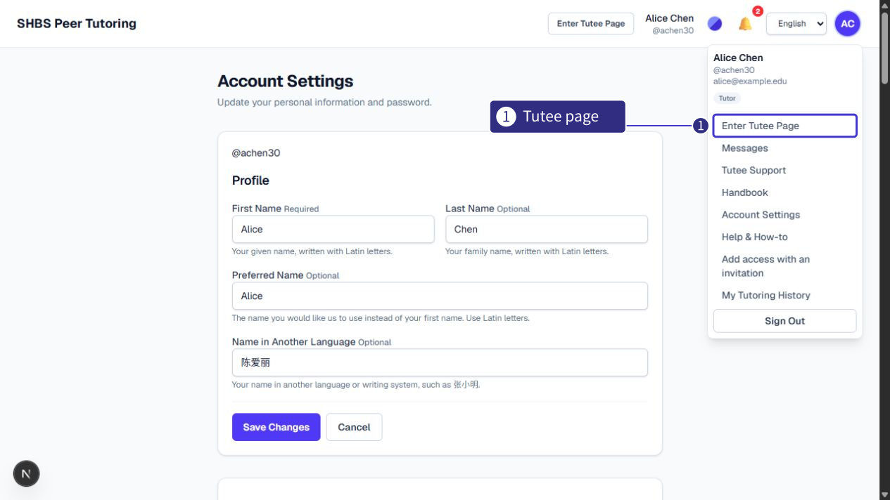

   /settings · EN · 2026-11-16

   Alice’s account menu offers Enter Tutee Page as her available workspace shortcut; this does not add another role.

   [Original full screenshot](assets/navigate-workspaces-step-1.en.jpg) · `dd970ea426016e85cb514beeeab537c3ab2e5098` · Latest-main development baseline dd970ea4, selected 2026-11-16, with the Help candidate; synthetic demonstration data.

   Annotations added for this step. The original full screenshot is unchanged.

   - **1.** Tutee page

2. **Use mobile and language controls** On narrow screens use Menu to open management navigation; choose a link, Close or Escape to dismiss it. Use the language selector and theme control in the header. Scroll wide tables inside their own region.

   **View 1**

   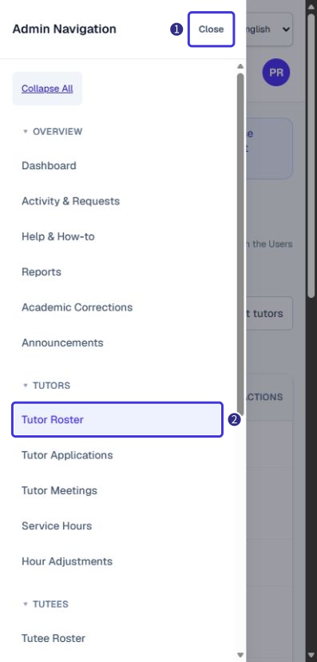

   /admin/tutors · EN · 2026-11-20

   At an actual 412-pixel narrow viewport, Menu opens Admin Navigation. Choose a visible workspace link, Close, or Escape to dismiss the drawer.

   [Original full screenshot](assets/navigate-workspaces-step-2.en.jpg) · `b5ece465681957c9fe579d26babdeb260c674fa0` · Latest-main development baseline b5ece465, selected 2026-11-20, with the Help candidate and synthetic demo records.

   Annotations added for this step. The original full screenshot is unchanged.

   - **1.** Close drawer

   - **2.** Workspace link

   **View 2**

   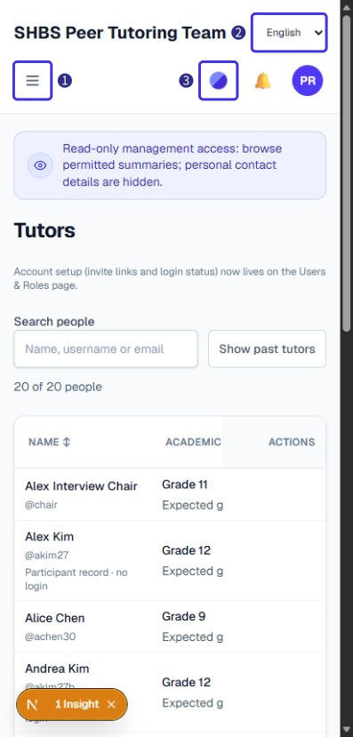

   /admin/tutors · EN · 2026-11-20

   With the mobile drawer closed, the same header keeps Menu, Language and Theme within reach. This example kept the existing selections.

   [Original full screenshot](assets/navigate-workspaces-step-2-view-2.en.jpg) · `b5ece465681957c9fe579d26babdeb260c674fa0` · Latest-main development baseline b5ece465, selected 2026-11-20, with the Help candidate and synthetic demo records.

   Annotations added for this step. The original full screenshot is unchanged.

   - **1.** Open navigation

   - **2.** Language

   - **3.** Theme

   **View 3**

   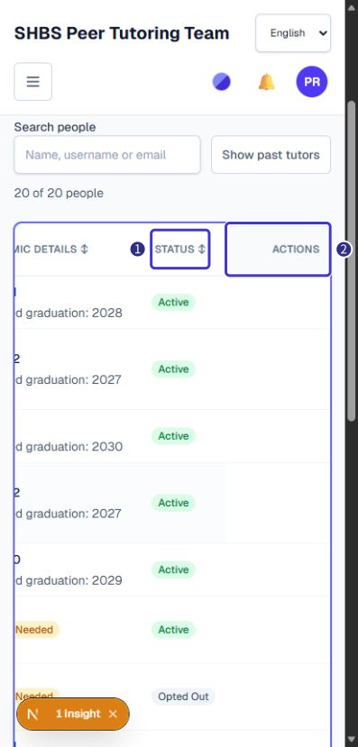

   /admin/tutors · EN · 2026-11-20

   The focused Tutors table moved horizontally to reveal the Status column. The table’s scroll reached its right edge, while the page itself stayed at horizontal offset zero.

   [Original full screenshot](assets/navigate-workspaces-step-2-view-3.en.jpg) · `b5ece465681957c9fe579d26babdeb260c674fa0` · Latest-main development baseline b5ece465, selected 2026-11-20, with the Help candidate and synthetic demo records.

   Annotations added for this step. The original full screenshot is unchanged.

   - **1.** Revealed column

   - **2.** Row actions

3. **Follow your notifications** Open the bell, select a notice to its related task, mark individual notices read or choose Mark all as read. Use Notification preferences to control badges and optional email separately.

   **View 1**

   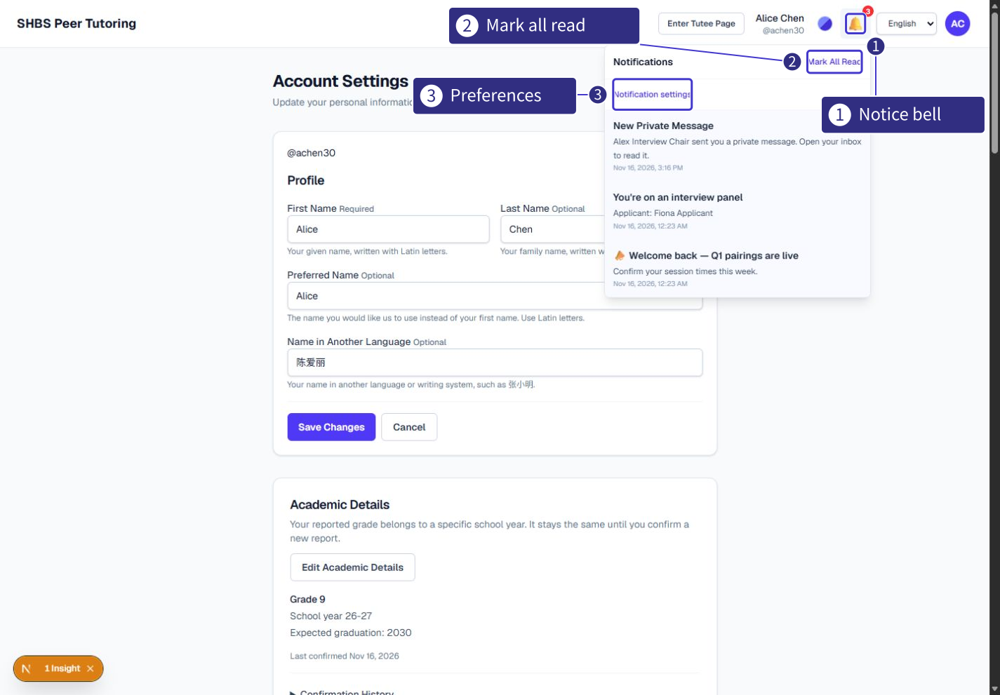

   /settings · EN · 2026-11-20

   The bell is open with three unread notices. Individual notices open related work, Mark All Read affects unread state, and Notification settings opens the separate preference controls. No notice was selected.

   [Original full screenshot](assets/navigate-workspaces-step-3.en.jpg) · `b5ece465681957c9fe579d26babdeb260c674fa0` · Latest-main development baseline b5ece465, selected 2026-11-20, with the Help candidate and synthetic demo records.

   Annotations added for this step. The original full screenshot is unchanged.

   - **1.** Notice bell

   - **2.** Mark all read

   - **3.** Preferences

   **View 2**

   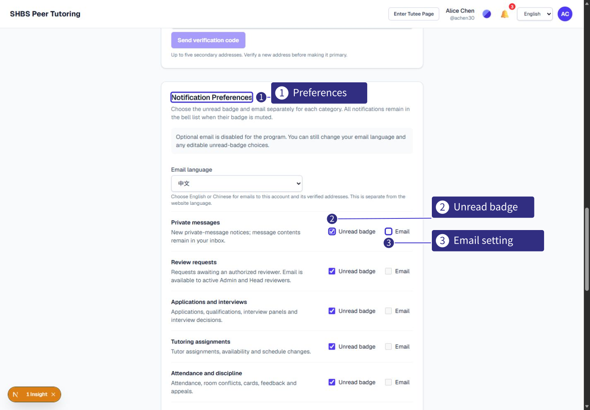

   /settings#notification-preferences · EN · 2026-11-20

   Notification Preferences separates unread-badge options from optional email. The current program has optional email disabled, so those checkboxes are unavailable. No preference was changed.

   [Original full screenshot](assets/navigate-workspaces-step-3-view-2.en.jpg) · `b5ece465681957c9fe579d26babdeb260c674fa0` · Latest-main development baseline b5ece465, selected 2026-11-20, with the Help candidate and synthetic demo records.

   Annotations added for this step. The original full screenshot is unchanged.

   - **1.** Preferences

   - **2.** Unread badge

   - **3.** Email setting

4. **Sort information safely** Select a sortable data heading for ascending, again for descending and a third time for original order. Keyboard users can focus it and press Enter or Space. Sorting preserves filters and changes no records.

   **View 1**

   

   /admin/tutors · EN · 2026-11-20

   On the read-only Tutor Roster, pressing Enter on Name sorts ascending. The up arrow and ascending column state describe the order. The roster records are unchanged.

   [Original full screenshot](assets/navigate-workspaces-step-4.en.jpg) · `b5ece465681957c9fe579d26babdeb260c674fa0` · Latest-main development baseline b5ece465, selected 2026-11-20, with the Help candidate and synthetic demo records.

   Annotations added for this step. The original full screenshot is unchanged.

   - **1.** Name ascending

   - **2.** Search filter

   **View 2**

   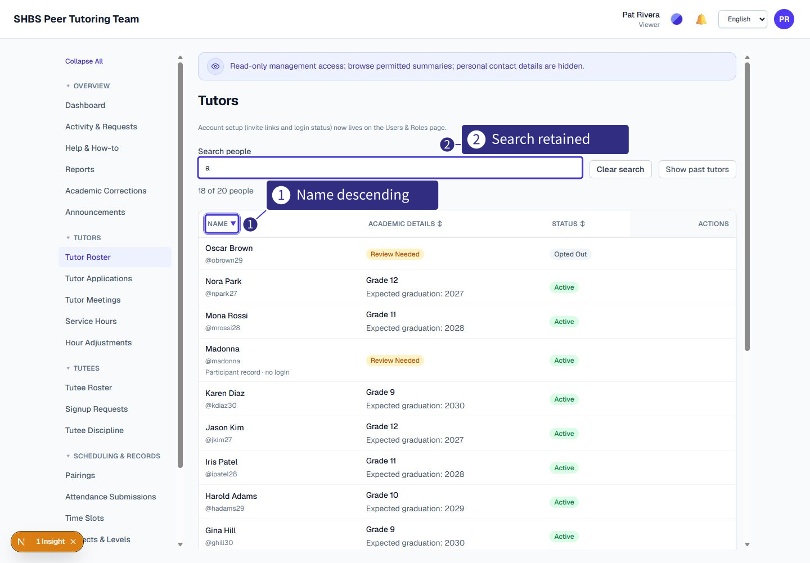

   /admin/tutors · EN · 2026-11-20

   The next Space press on Name changes the roster to descending. The search stays set to “a”. The third press returns the original order.

   [Original full screenshot](assets/navigate-workspaces-step-4-view-2.en.jpg) · `b5ece465681957c9fe579d26babdeb260c674fa0` · Latest-main development baseline b5ece465, selected 2026-11-20, with the Help candidate and synthetic demo records.

   Annotations added for this step. The original full screenshot is unchanged.

   - **1.** Name descending

   - **2.** Search retained

### What happens next

You are in the intended permitted workspace, with notices linked to their owning tasks.

### How it works

Management rank, Tutor/Tutee/Crew participation and Translator assignment are separate. Enabled program modules also affect visible navigation.

### Troubleshooting

- **A page or shortcut is missing** Ask management to check the linked profile, membership, school departure, suspension and enabled module. Typing a hidden page's address cannot bypass its server permission check.

## Recover a failed load or save

Recognize pending review, accepted writes, stale drafts and safe read-only retries.

Open: `/my-account`

### Before you start

- Keep the affected page open while reviewing the message.

### Walkthrough

1. **Read the specific status** Changes saved means the write was accepted. Submitted for Review means a proposal is pending and live records have not changed. An unavailable list is not an empty list.

   Look for: Section-specific save, error or recovery message

   **View 1**

   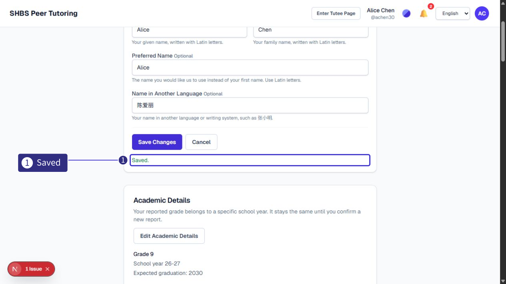

   /settings · EN · 2026-11-16

   The profile write completed and displays its real Saved status beside its own action controls.

   [Original full screenshot](assets/read-recover-save-step-1.en.jpg) · `589c055e4b1cf166b48b353bd619ac1982e5d9f6` · Latest-main development baseline 589c055e with the Help candidate; synthetic demonstration data.

   Annotations added for this step. The original full screenshot is unchanged.

   - **1.** Saved

   **View 2**

   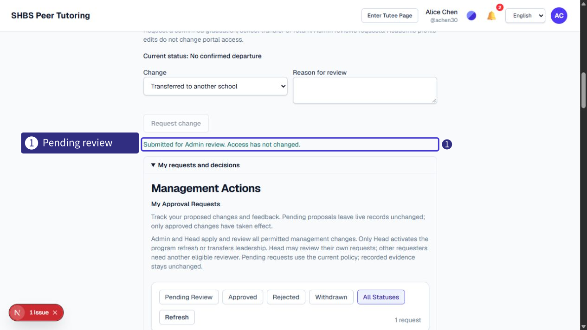

   /settings · EN · 2026-11-16

   Submitted for Admin review is a proposal receipt and explicitly confirms no access change.

   [Original full screenshot](assets/read-recover-save-step-1-view-2.en.jpg) · `589c055e4b1cf166b48b353bd619ac1982e5d9f6` · Latest-main development baseline 589c055e with the Help candidate; synthetic demonstration data.

   Annotations added for this step. The original full screenshot is unchanged.

   - **1.** Pending review

   **View 3**

   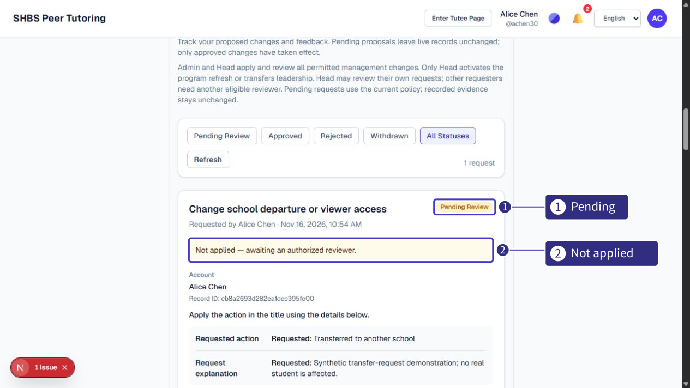

   /settings · EN · 2026-11-16

   Expanded personal request history shows Pending Review and Not applied; submitting has not confirmed departure.

   [Original full screenshot](assets/read-recover-save-step-1-view-3.en.jpg) · `589c055e4b1cf166b48b353bd619ac1982e5d9f6` · Latest-main development baseline 589c055e with the Help candidate; synthetic demonstration data.

   Annotations added for this step. The original full screenshot is unchanged.

   - **1.** Pending

   - **2.** Not applied

2. **Retry the correct operation** If saving failed, correct the error and deliberately retry. If saving succeeded but refresh failed, choose Retry refresh or Check request result: these read the accepted result instead of submitting it again.

   **View 1**

   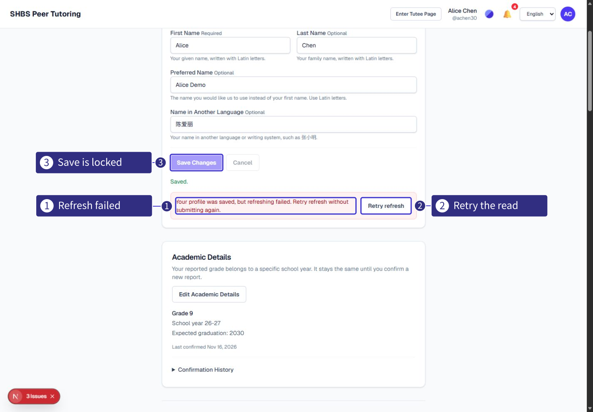

   /settings · EN · 2026-11-21

   The real profile edit was accepted. A controlled local transport fault blocked only the follow-up profile read, leaving Save disabled and showing Retry refresh.

   [Original full screenshot](assets/read-recover-save-step-2.en.jpg) · `b5ece465681957c9fe579d26babdeb260c674fa0` · Latest-main development baseline b5ece465, selected 2026-11-20, with the Help candidate and synthetic demo records.

   Annotations added for this step. The original full screenshot is unchanged.

   - **1.** Refresh failed

   - **2.** Retry the read

   - **3.** Save is locked

   **View 2**

   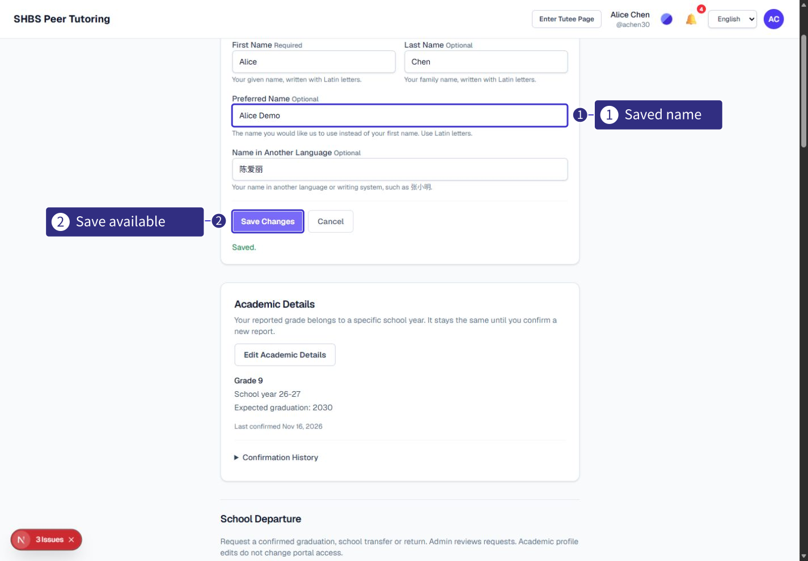

   /settings · EN · 2026-11-21

   Retry refresh adopted the saved preferred name. The refresh warning cleared and the ordinary profile controls returned.

   [Original full screenshot](assets/read-recover-save-step-2-view-2.en.jpg) · `b5ece465681957c9fe579d26babdeb260c674fa0` · Latest-main development baseline b5ece465, selected 2026-11-20, with the Help candidate and synthetic demo records.

   Annotations added for this step. The original full screenshot is unchanged.

   - **1.** Saved name

   - **2.** Save available

3. **Resolve a changed-record conflict** Review the conflict notice. Explicit Reload replaces the stale draft only after current evidence loads successfully; review that evidence before a new submission. Close or Cancel never confirms a review.

   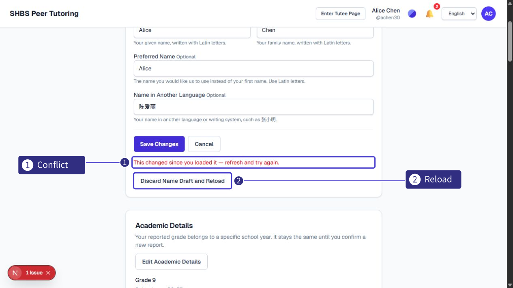

   /settings · EN · 2026-11-16

   A real stale profile draft is rejected after an academic confirmation changed the shared record; explicit reload is offered.

   [Original full screenshot](assets/read-recover-save-step-3.en.jpg) · `589c055e4b1cf166b48b353bd619ac1982e5d9f6` · Latest-main development baseline 589c055e with the Help candidate; synthetic demonstration data.

   Annotations added for this step. The original full screenshot is unchanged.

   - **1.** Conflict

   - **2.** Reload

4. **Keep drafts within their lifetime** Most editors retain drafts while this page remains mounted, including collapse or tab changes. They are not autosaved across leaving or refreshing. Pending writes may lock editing and dismissal until their result is known.

   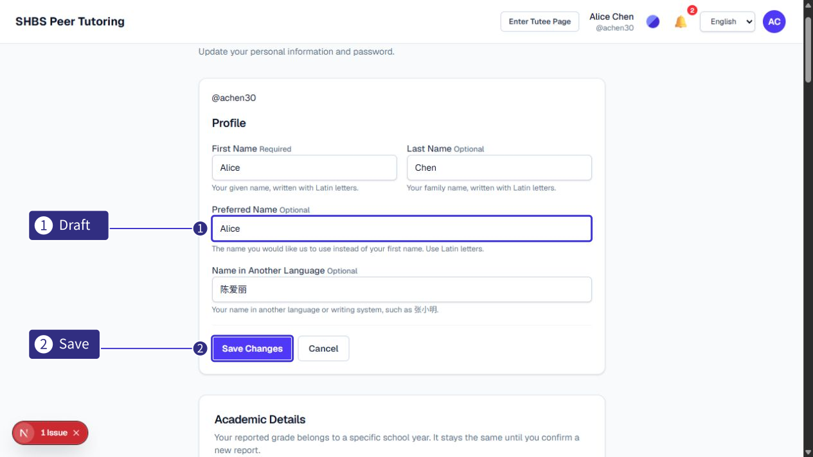

   /settings · EN · 2026-11-16

   Mounted profile editor retains an unsaved preferred-name draft until this section is saved, cancelled or the page is left.

   [Original full screenshot](assets/read-recover-save-step-4.en.jpg) · `589c055e4b1cf166b48b353bd619ac1982e5d9f6` · Latest-main development baseline 589c055e with the Help candidate; synthetic demonstration data.

   Annotations added for this step. The original full screenshot is unchanged.

   - **1.** Draft

   - **2.** Save

### What happens next

You recover the current record without accidentally repeating a completed action.

### How it works

Confirmation countdowns only enable the final button; they never submit automatically. Permission denial can remove protected content until a fresh authorized read succeeds.

### Troubleshooting

- **You cannot tell whether the action saved** Use the offered result check, inspect the affected record or ask management with the page and approximate time. Avoid changing and resubmitting an uncertain completed action.

## Update your shared profile and access requests

Save your name fields independently and request eligible participation without duplicating accounts.

Open: `/my-account`

### Before you start

- Sign in and open Account Settings; tutors can use Account Settings at /settings.

### Walkthrough

1. **Edit available name fields** In the profile section edit First Name, Last Name, Preferred Name or Name in Another Language when available. Latin fields accept accented letters, spaces, apostrophes and hyphens; use the other-language field for other scripts.

   Look for: Profile fields followed by this section's save and Cancel controls

   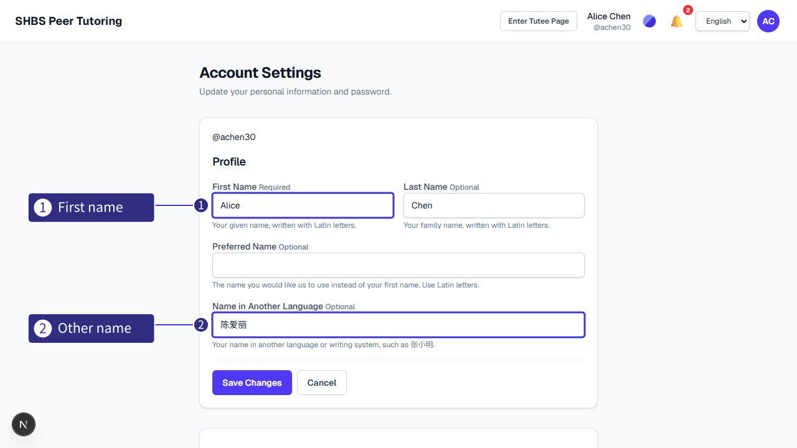

   /settings · EN · 2026-11-16

   Editable profile fields with required first name and optional multilingual names.

   [Original full screenshot](assets/account-profile-step-1.en.jpg) · `589c055e4b1cf166b48b353bd619ac1982e5d9f6` · Latest-main development baseline 589c055e with the Help candidate; synthetic demonstration data.

   Annotations added for this step. The original full screenshot is unchanged.

   - **1.** First name

   - **2.** Other name

2. **Save this section** Choose Save Changes in tutor Settings, or Save profile in shared Account Settings, to save the name fields together. Cancel restores the last loaded values. Password, emails, academics and membership each have their own actions and are not saved by this button.

   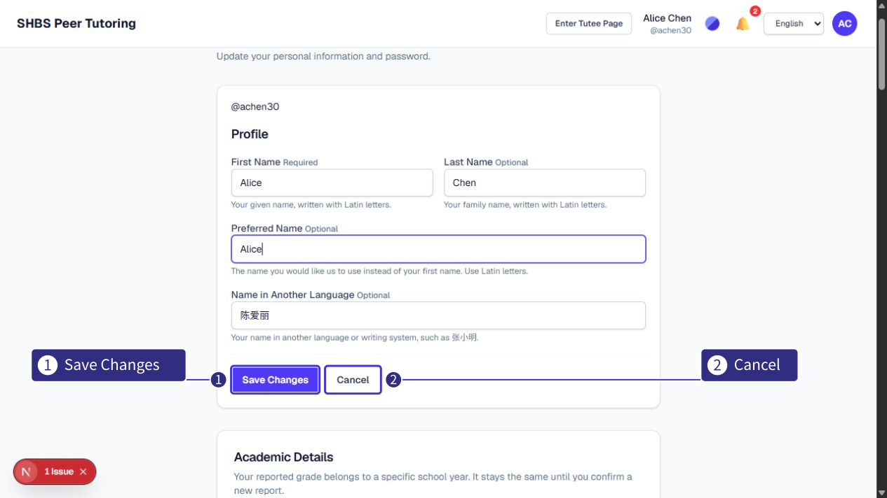

   /settings · EN · 2026-11-16

   Unsaved preferred-name draft with this profile section’s Save Changes and Cancel controls.

   [Original full screenshot](assets/account-profile-step-2.en.jpg) · `589c055e4b1cf166b48b353bd619ac1982e5d9f6` · Latest-main development baseline 589c055e with the Help candidate; synthetic demonstration data.

   Annotations added for this step. The original full screenshot is unchanged.

   - **1.** Save Changes

   - **2.** Cancel

3. **Review participation or an invitation** Use the membership controls to request eligible participation, or Add access to review a supplied invitation. A participant request cannot grant a management rank; check its pending decision before assuming access changed.

   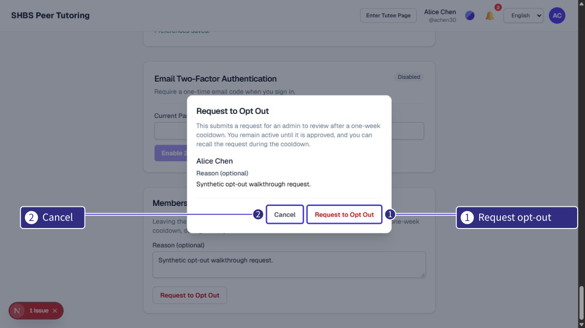

   /settings · EN · 2026-11-16

   Opt-out review names the tutor, optional reason, seven-day review cooldown and continued participation until approval.

   [Original full screenshot](assets/account-profile-step-3.en.jpg) · `589c055e4b1cf166b48b353bd619ac1982e5d9f6` · Latest-main development baseline 589c055e with the Help candidate; synthetic demonstration data.

   Annotations added for this step. The original full screenshot is unchanged.

   - **1.** Request opt-out

   - **2.** Cancel

### What happens next

The profile section confirms its save, or a separate access request shows its actual review state.

### How it works

Current explicitly linked tutor/tutee profiles share the account's name fields. Historical applications and signatures retain their original names. Name visibility and requiredness follow program configuration; the system does not guess how to split a legacy name.

### Troubleshooting

- **Your old full name has no split fields** Leave Latin name fields unchanged when correcting unrelated information. If changing a Latin name field, supply the actual valid First Name rather than guessing a split.

- **Profile saved but is still read only** Choose Retry refresh to read accepted values. If another editor changed the version, explicitly Reload and review before resubmitting.

## Confirm your academic details

Record the grade that actually applies in the current school year and inspect its history.

Open: `/my-account#academic-details`

### Before you start

- Open Academic Details in Account Settings.

### Walkthrough

1. **Review the current report** Choose Review Academic Details or Edit Academic Details. Read the saved grade, reference school year and any Needs Review & Confirmation notice.

   Look for: Opened academic editor, grade choice and reference school year

   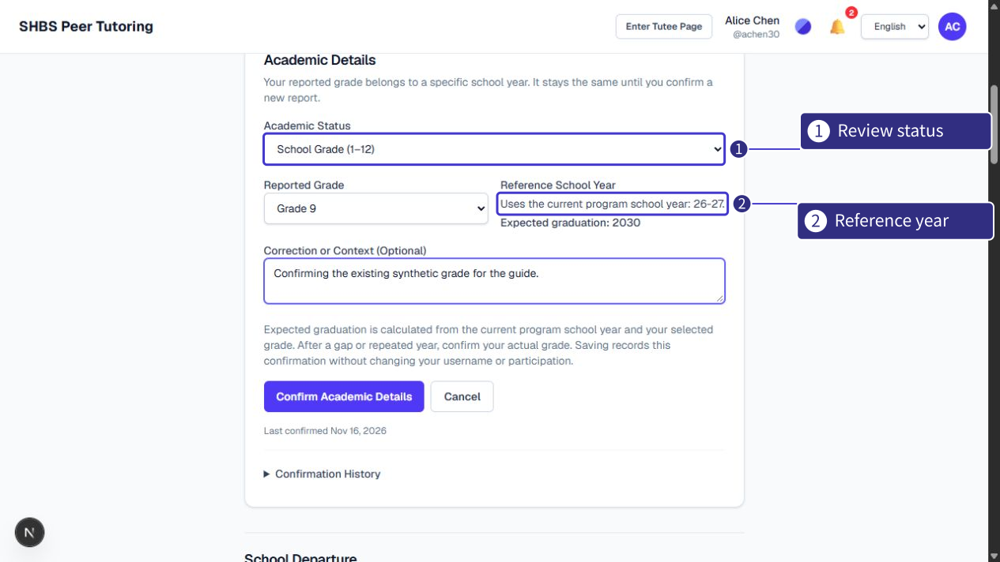

   /settings · EN · 2026-11-16

   Academic editor showing saved Grade 9, current reference year and the separate confirmation action.

   [Original full screenshot](assets/account-academics-step-1.en.jpg) · `589c055e4b1cf166b48b353bd619ac1982e5d9f6` · Latest-main development baseline 589c055e with the Help candidate; synthetic demonstration data.

   Annotations added for this step. The original full screenshot is unchanged.

   - **1.** Review status

   - **2.** Reference year

2. **Choose a truthful value** Select an offered grade, Unknown, Graduated or Not Applicable as appropriate. The current school year is filled automatically. Confirm the report; this saves academics separately from profile names.

   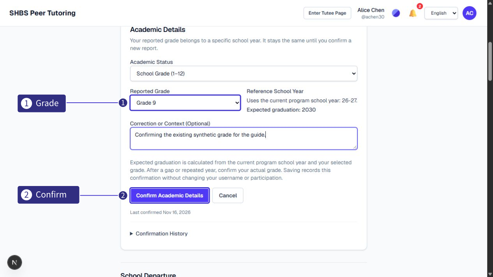

   /settings · EN · 2026-11-16

   Academic editor showing saved Grade 9, current reference year and the separate confirmation action.

   [Original full screenshot](assets/account-academics-step-2.en.jpg) · `589c055e4b1cf166b48b353bd619ac1982e5d9f6` · Latest-main development baseline 589c055e with the Help candidate; synthetic demonstration data.

   Annotations added for this step. The original full screenshot is unchanged.

   - **1.** Grade

   - **2.** Confirm

3. **Inspect confirmation history** Open Confirmation History to read recorded values, source and dates. If an invitation completion points here, finish confirmation and then follow the normal tutor activation or Crew reentry workflow.

   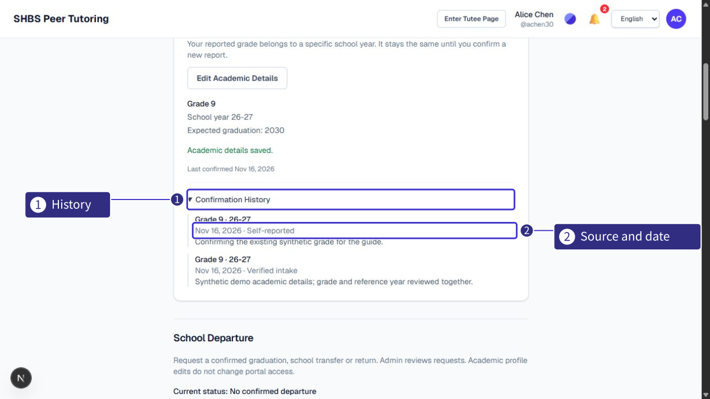

   /settings · EN · 2026-11-16

   Expanded confirmation history shows the new self-reported academic confirmation and earlier verified intake.

   [Original full screenshot](assets/account-academics-step-3.en.jpg) · `589c055e4b1cf166b48b353bd619ac1982e5d9f6` · Latest-main development baseline 589c055e with the Help candidate; synthetic demonstration data.

   Annotations added for this step. The original full screenshot is unchanged.

   - **1.** History

   - **2.** Source and date

### What happens next

Your current account academics are confirmed for the recorded school year.

### How it works

Expected graduation is derived from grade and reference year; it is not a separate editable field. Grades do not advance automatically. Academic Graduated does not itself change participation or grant observer access. Original enrollment academics and signed surveys remain historical evidence.

### Troubleshooting

- **School year changed while editing** Reload and review the newly applied year before confirming. If the current year is not configured, ask management; Unknown and Not Applicable remain available.

## Report school departure or request a return

Request graduation or transfer review and understand the effect on participation.

Open: `/my-account#academic-details`

### Before you start

- Open School Departure in tutor Settings, or use the separate departure control beside Academic Details in shared Account Settings.

### Walkthrough

1. **Open School Departure** In tutor Settings use School Departure directly; in shared Account Settings choose I have transferred away beside Academic Details. Select the applicable Change, enter Reason for review and choose Request change. Read Review departure change, then choose Confirm change to submit for Admin review; this does not approve departure.

   Look for: School Departure review, departure type and reason

   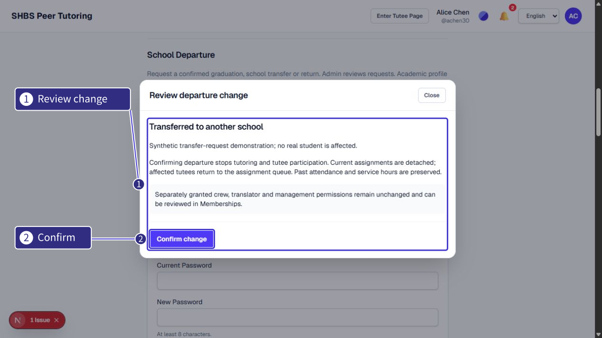

   /settings · EN · 2026-11-16

   Full review of a synthetic transfer request, including participation consequences and the explicit confirmation action.

   [Original full screenshot](assets/school-departure-step-1.en.jpg) · `589c055e4b1cf166b48b353bd619ac1982e5d9f6` · Latest-main development baseline 589c055e with the Help candidate; synthetic demonstration data.

   Annotations added for this step. The original full screenshot is unchanged.

   - **1.** Review change

   - **2.** Confirm

2. **Wait for the decision** Check the departure request and history. Admin/Head review it; submitting alone does not confirm departure. After confirmation, eligible Enter Viewers Portal opens masked read-only summaries.

   **View 1**

   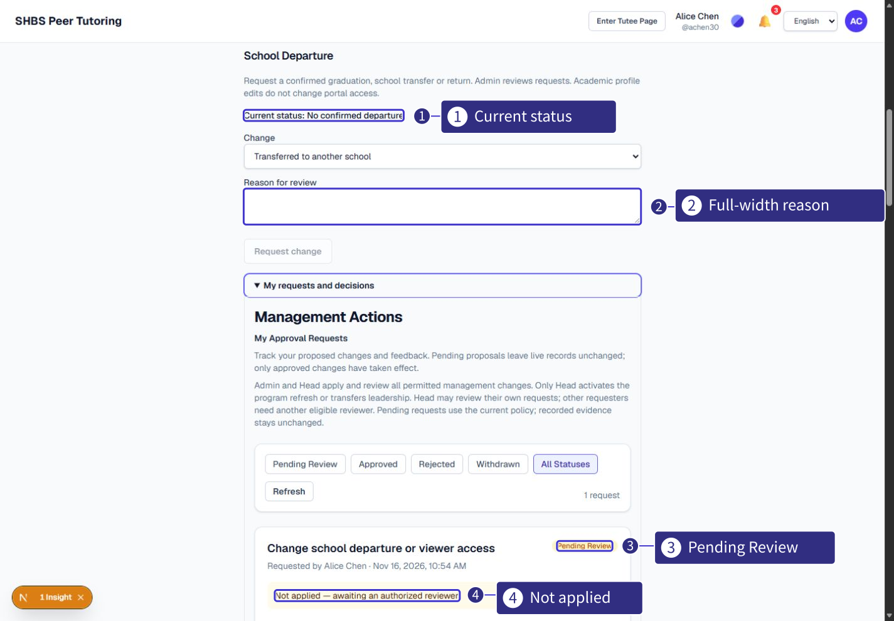

   /settings · EN · 2026-11-20

   School Departure shows the current stacked form and Alice’s original request. Pending Review and Not applied confirm that no departure has been recorded.

   [Original full screenshot](assets/school-departure-step-2.en.jpg) · `b5ece465681957c9fe579d26babdeb260c674fa0` · Latest-main development baseline b5ece465, selected 2026-11-20, with the Help candidate and synthetic demo records.

   Annotations added for this step. The original full screenshot is unchanged.

   - **1.** Current status

   - **2.** Full-width reason

   - **3.** Pending Review

   - **4.** Not applied

   **View 2**

   

   /settings · EN · 2026-11-16

   Expanded personal request history shows Pending Review and Not applied; submitting has not confirmed departure.

   [Original full screenshot](assets/school-departure-step-2-view-2.en.jpg) · `589c055e4b1cf166b48b353bd619ac1982e5d9f6` · Latest-main development baseline 589c055e with the Help candidate; synthetic demonstration data.

   Annotations added for this step. The original full screenshot is unchanged.

   - **1.** Pending

   - **2.** Not applied

3. **Request return when circumstances change** In School Departure choose Return to school under Change, enter Reason for review and choose Request change. Read Review departure change and Confirm change to submit the return request. After approval, restore tutor activation or learning enrollment through their normal workflows.

   **View 1**

   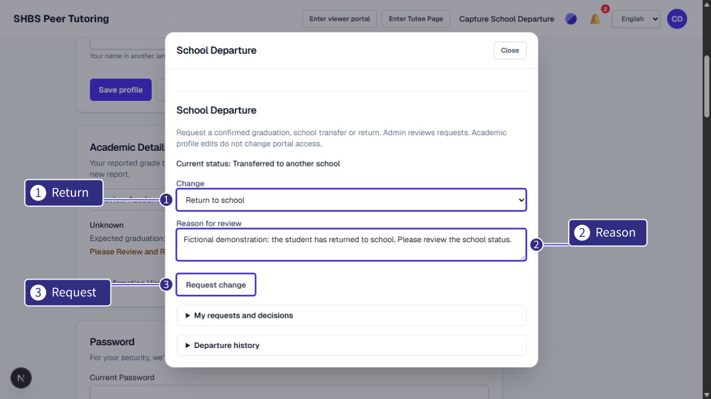

   /my-account · EN · 2026-11-16

   The separate fictional transferred student can request Return to school. The reason occupies its own full-width row; Request change opens a review and does not approve access.

   [Original full screenshot](assets/school-departure-step-3.en.jpg) · `dd970ea426016e85cb514beeeab537c3ab2e5098` · Latest-main development baseline dd970ea4, selected 2026-11-16, with the Help candidate; synthetic demonstration data.

   Annotations added for this step. The original full screenshot is unchanged.

   - **1.** Return

   - **2.** Reason

   - **3.** Request

   **View 2**

   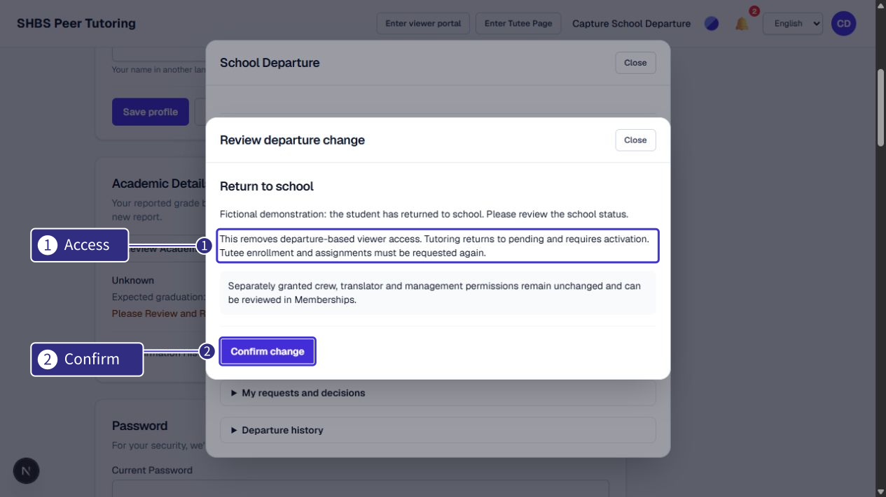

   /my-account · EN · 2026-11-16

   The return review explains the access consequences before Confirm change: tutoring returns to pending, and tutee enrollment and assignments must be requested again. This is a review, not an approved return.

   [Original full screenshot](assets/school-departure-step-3-view-2.en.jpg) · `dd970ea426016e85cb514beeeab537c3ab2e5098` · Latest-main development baseline dd970ea4, selected 2026-11-16, with the Help candidate; synthetic demonstration data.

   Annotations added for this step. The original full screenshot is unchanged.

   - **1.** Access

   - **2.** Confirm

   **View 3**

   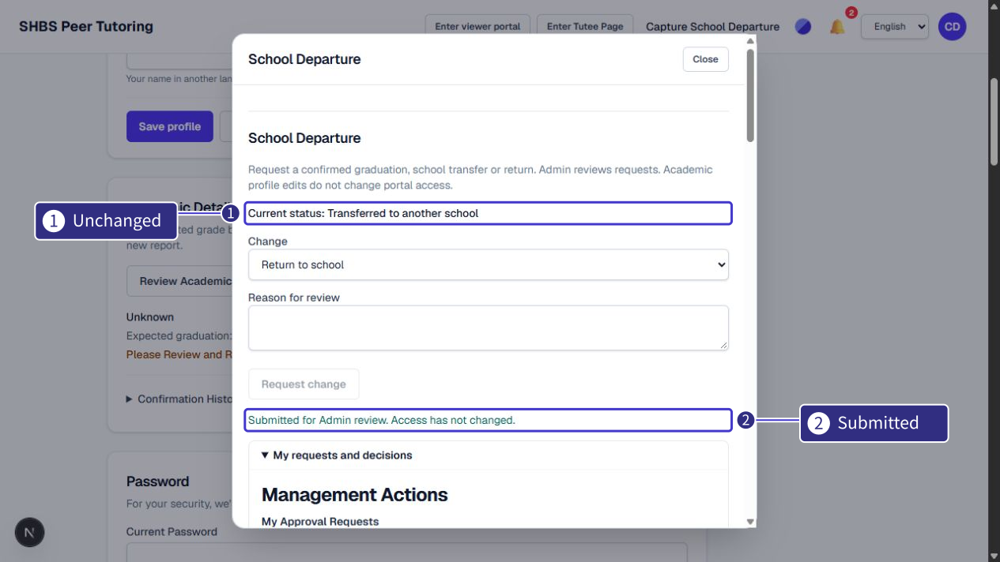

   /my-account · EN · 2026-11-16

   The actual return request was submitted for Admin review. The receipt says access has not changed, and Current status is still Transferred to another school; no return approval was applied.

   [Original full screenshot](assets/school-departure-step-3-view-3.en.jpg) · `dd970ea426016e85cb514beeeab537c3ab2e5098` · Latest-main development baseline dd970ea4, selected 2026-11-16, with the Help candidate; synthetic demonstration data.

   Annotations added for this step. The original full screenshot is unchanged.

   - **1.** Unchanged

   - **2.** Submitted

   **View 4**

   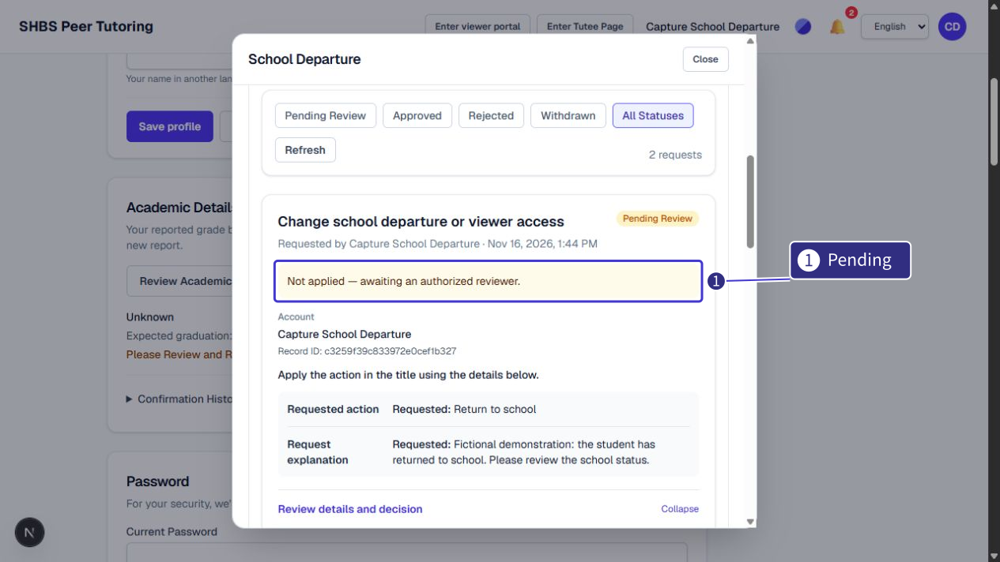

   /my-account · EN · 2026-11-16

   My requests and decisions lists the real return request as Pending Review and Not applied. The requested action is Return to school; an eligible reviewer still needs to decide it.

   [Original full screenshot](assets/school-departure-step-3-view-4.en.jpg) · `dd970ea426016e85cb514beeeab537c3ab2e5098` · Latest-main development baseline dd970ea4, selected 2026-11-16, with the Help candidate; synthetic demonstration data.

   Annotations added for this step. The original full screenshot is unchanged.

   - **1.** Pending

### What happens next

The request shows its actual decision and your participation reflects only the approved outcome.

### How it works

Confirmed departure closes current assignments and pending learning requests; a departing tutor's learners return to matching. It preserves account role and personal history. A reviewed return does not automatically restore assignments. Independent management, Crew and Translator permissions remain subject to their own rules.

### Troubleshooting

- **You set Graduated but cannot enter the Viewer portal** Academic graduation alone is not confirmed school departure. Check this separate reviewed request and ask management about observer restrictions.

## Change your password or two-factor preference

Confirm security changes and sign in again after a password change.

Open: `/my-account#account-password`

### Before you start

- Know your current password and have access to your primary email.

### Walkthrough

1. **Open the security section** In Account Settings find the password or two-factor controls. Enter your current password and complete the requested email security code when prompted.

   Look for: Current password, new password and the password confirmation action

   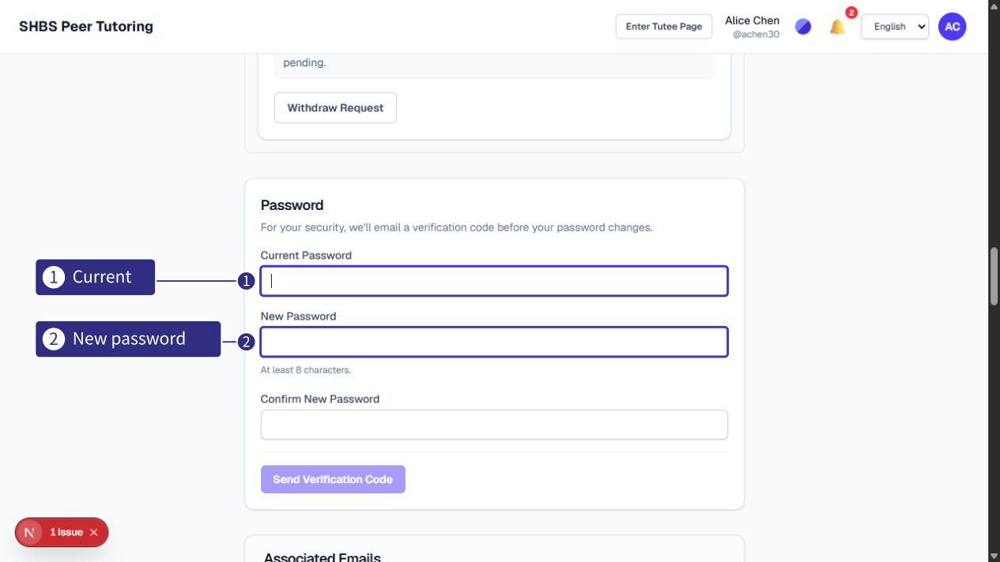

   /settings · EN · 2026-11-16

   Password section asks for current password, new password and confirmation; all credential fields are empty.

   [Original full screenshot](assets/account-security-step-1.en.jpg) · `589c055e4b1cf166b48b353bd619ac1982e5d9f6` · Latest-main development baseline 589c055e with the Help candidate; synthetic demonstration data.

   Annotations added for this step. The original full screenshot is unchanged.

   - **1.** Current

   - **2.** New password

2. **Confirm the intended change** For password change, enter a new password of 8–1,024 characters and use that section's confirmation. For two-factor, review whether you are enabling or disabling the personal preference and confirm separately.

   Look for: Two-factor preference and its independent security confirmation

   **View 1**

   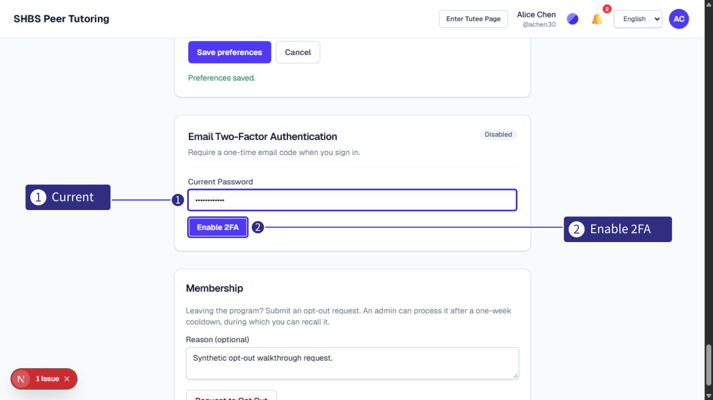

   /settings · EN · 2026-11-16

   Two-factor section with a native-masked current password and the explicit Enable 2FA action; no change has been submitted in this frame.

   [Original full screenshot](assets/account-security-step-2.en.jpg) · `589c055e4b1cf166b48b353bd619ac1982e5d9f6` · Latest-main development baseline 589c055e with the Help candidate; synthetic demonstration data.

   Annotations added for this step. The original full screenshot is unchanged.

   - **1.** Current

   - **2.** Enable 2FA

   **View 2**

   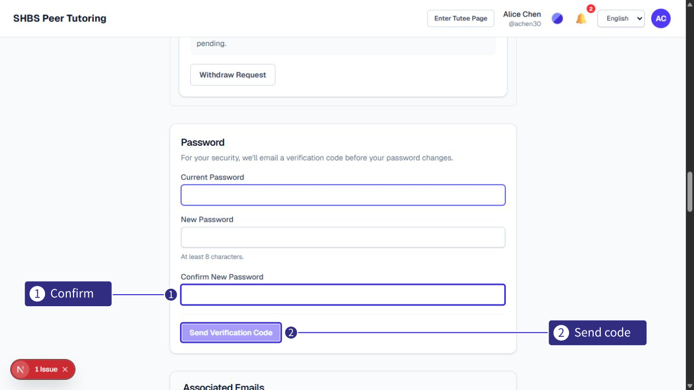

   /settings · EN · 2026-11-16

   Password-change fields and the section’s Send Verification Code control; fields are intentionally empty and no password is changed for the screenshot.

   [Original full screenshot](assets/account-security-step-2-view-2.en.jpg) · `589c055e4b1cf166b48b353bd619ac1982e5d9f6` · Latest-main development baseline 589c055e with the Help candidate; synthetic demonstration data.

   Annotations added for this step. The original full screenshot is unchanged.

   - **1.** Confirm

   - **2.** Send code

3. **Sign in again after password change** An accepted password change returns you to Sign In and revokes other existing sessions. Use the new password; retain access to the primary mailbox if two-factor is required.

   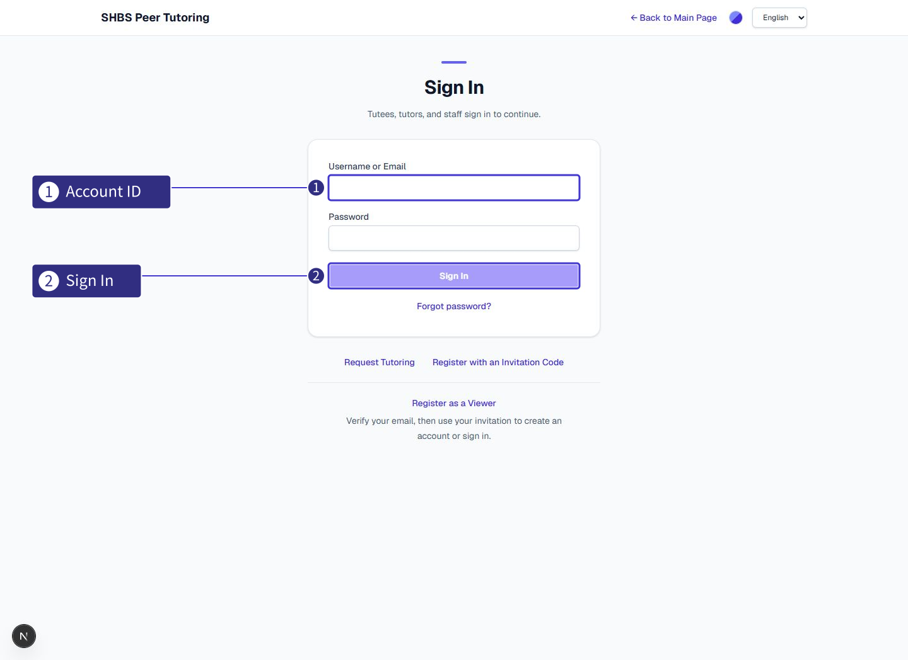

   /signin · EN · 2026-11-16

   Sign In entry with empty credential fields; this frame shows where to return after a password change and does not claim that a password was changed.

   [Original full screenshot](assets/account-security-step-3.en.jpg) · `589c055e4b1cf166b48b353bd619ac1982e5d9f6` · Latest-main development baseline 589c055e with the Help candidate; synthetic demonstration data.

   Annotations added for this step. The original full screenshot is unchanged.

   - **1.** Account ID

   - **2.** Sign In

### What happens next

The requested security preference is saved, or the new password is usable at fresh sign-in.

### How it works

Email two-factor requires both the program feature and your account preference. Verified secondary emails do not bypass it. Security alerts and verification mail remain independent of optional notification switches.

### Troubleshooting

- **Too many password confirmations** Wait fifteen minutes before retrying. The shared allowance covers ten checks per account, including successful checks across settings and privileged confirmations; signing in again does not reset it.

- **An older password exceeds the input limit** Use Forgot Password to replace it with an 8–1,024-character password before changing settings.

## Manage primary and secondary email addresses

Verify new addresses, select a primary and remove unused secondary addresses.

Open: `/my-account#associated-emails`

### Before you start

- Open Associated Emails and know your current password.

### Walkthrough

1. **Add and verify an address** When Secondary-Email Binding is enabled, enter the new address and current password, then enter its emailed code. Up to five secondary addresses, including pending ones, are allowed.

   Look for: Associated Emails and verification state

   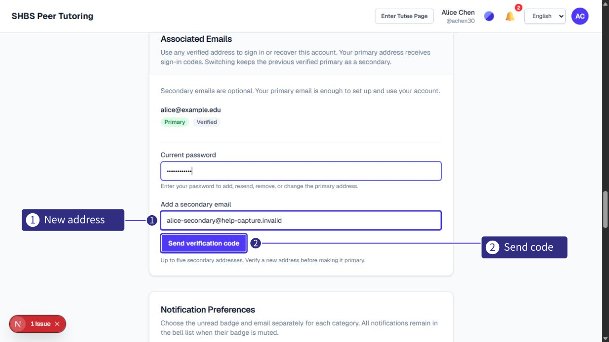

   /settings · EN · 2026-11-16

   Secondary-email entry with a fictional address and native-masked current password; verification has not been completed.

   [Original full screenshot](assets/account-emails-step-1.en.jpg) · `589c055e4b1cf166b48b353bd619ac1982e5d9f6` · Latest-main development baseline 589c055e with the Help candidate; synthetic demonstration data.

   Annotations added for this step. The original full screenshot is unchanged.

   - **1.** New address

   - **2.** Send code

2. **Handle a pending address** Re-enter Current password to unlock Resend code or Cancel pending. Use Resend code for an expired or missing code, or Cancel pending beside the address to remove its request. Codes last ten minutes, permit five attempts and have a one-minute resend interval.

   **View 1**

   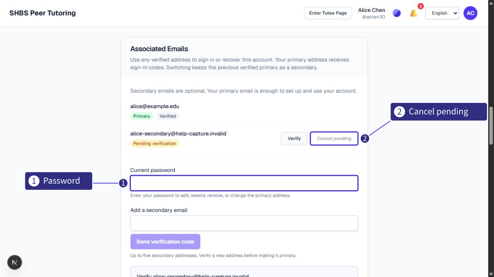

   /settings#associated-emails · EN · 2026-11-16

   The pending address is listed with Cancel pending disabled while Current password is empty. Re-enter the existing password to unlock pending-address actions; the verification form continues below.

   [Original full screenshot](assets/account-emails-step-2.en.jpg) · `dd970ea426016e85cb514beeeab537c3ab2e5098` · Latest-main development baseline dd970ea4, selected 2026-11-16, with the Help candidate; synthetic demonstration data.

   Annotations added for this step. The original full screenshot is unchanged.

   - **1.** Password

   - **2.** Cancel pending

   **View 2**

   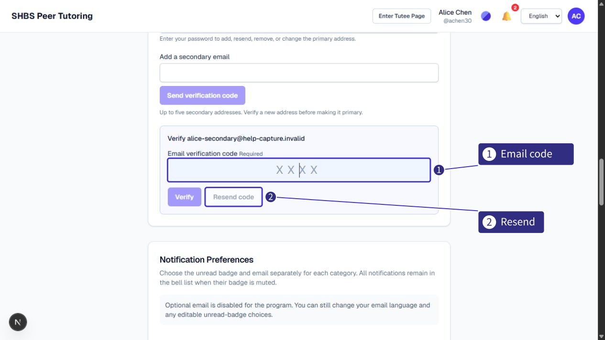

   /settings#associated-emails · EN · 2026-11-16

   The pending address has an empty verification-code field and a separate Resend code action. Resend remains disabled until Current password is re-entered in the preceding section; no code or password is shown.

   [Original full screenshot](assets/account-emails-step-2-view-2.en.jpg) · `dd970ea426016e85cb514beeeab537c3ab2e5098` · Latest-main development baseline dd970ea4, selected 2026-11-16, with the Help candidate; synthetic demonstration data.

   Annotations added for this step. The original full screenshot is unchanged.

   - **1.** Email code

   - **2.** Resend

3. **Choose the primary or remove a secondary** Enter Current password, then choose Make primary beside a verified secondary address. This submits immediately; the previous verified primary becomes secondary. To remove a secondary, ensure the intended primary is marked, re-enter Current password and choose Remove beside the secondary. There is no separate confirmation dialog.

   **View 1**

   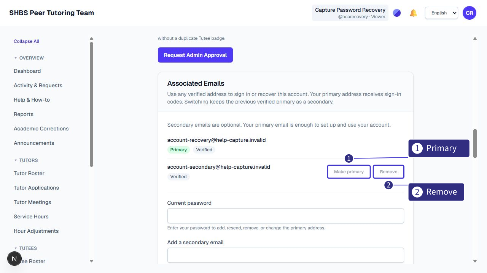

   /admin/account#associated-emails · EN · 2026-11-16

   The real local-mailbox verification produced a verified secondary address. Make primary and Remove are separate row actions; enter Current password before using them. The current primary has not been changed yet.

   [Original full screenshot](assets/account-emails-step-3.en.jpg) · `dd970ea426016e85cb514beeeab537c3ab2e5098` · Latest-main development baseline dd970ea4, selected 2026-11-16, with the Help candidate; synthetic demonstration data.

   Annotations added for this step. The original full screenshot is unchanged.

   - **1.** Primary

   - **2.** Remove

   **View 2**

   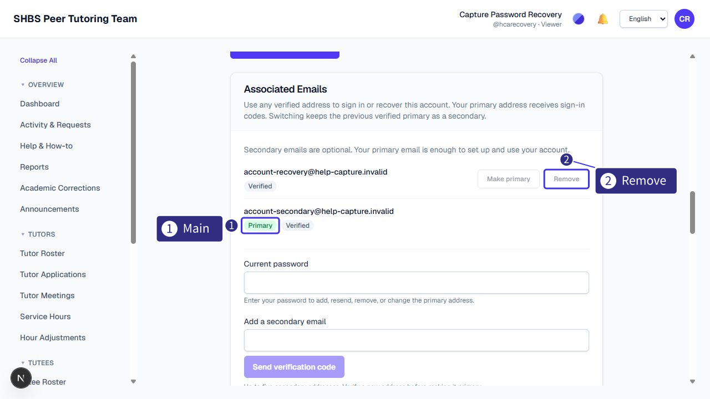

   /admin/account#associated-emails · EN · 2026-11-16

   The actual saved result marks account-secondary as Primary. The previous primary remains a verified secondary with its own Remove action; the password field is empty again.

   [Original full screenshot](assets/account-emails-step-3-view-2.en.jpg) · `dd970ea426016e85cb514beeeab537c3ab2e5098` · Latest-main development baseline dd970ea4, selected 2026-11-16, with the Help candidate; synthetic demonstration data.

   Annotations added for this step. The original full screenshot is unchanged.

   - **1.** Main

   - **2.** Remove

   **View 3**

   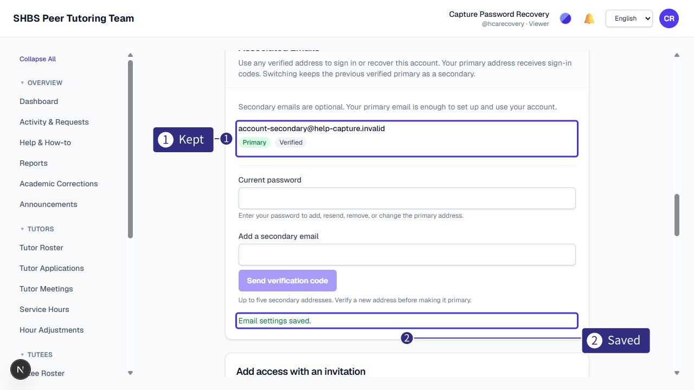

   /admin/account#associated-emails · EN · 2026-11-16

   The actual removal leaves only the intended verified primary address. The old secondary is absent and the page reports Email settings saved; the password field has cleared.

   [Original full screenshot](assets/account-emails-step-3-view-3.en.jpg) · `dd970ea426016e85cb514beeeab537c3ab2e5098` · Latest-main development baseline dd970ea4, selected 2026-11-16, with the Help candidate; synthetic demonstration data.

   Annotations added for this step. The original full screenshot is unchanged.

   - **1.** Kept

   - **2.** Saved

   **View 4**

   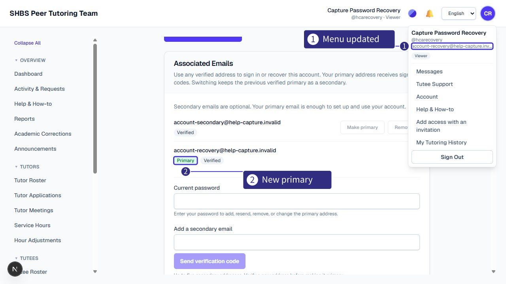

   /admin/account · EN · 2026-11-16

   The real verified alias is now primary. Without reloading, navigating or signing out, the open Account menu already displays the same current address. The previous primary remains verified secondary and the password field has cleared.

   [Original full screenshot](assets/account-emails-step-3-view-4.en.jpg) · `dd970ea426016e85cb514beeeab537c3ab2e5098` · Latest-main development baseline dd970ea4, selected 2026-11-16, with the Help candidate; synthetic demonstration data.

   Annotations added for this step. The original full screenshot is unchanged.

   - **1.** Menu updated

   - **2.** New primary

### What happens next

Each address has an explicit verified/pending state and the intended primary is marked.

### How it works

Any verified address can sign into or recover the same account. Login two-factor still goes to primary. Primary changes update explicitly linked current contact rows while preserving identity, roles and signed history. Removing an address revokes its outstanding grants.

### Troubleshooting

- **Adding or verifying is disabled** Re-enter Current password when Resend code or Cancel pending is disabled after sending. Wait for the resend cooldown. Check the program's Secondary-Email Binding notice: when off, existing verified addresses remain usable/removable, pending requests can be cancelled, and primary-email change remains available.

- **Address ownership conflicts** Do not create another account. Ownership is checked at verification, and a pending address reserves nothing; ask management to review an unexpected conflict.

## Choose notification badges, email and language

Set categories independently and understand required notices and unsubscribe links.

Open: `/my-account#notification-preferences`

### Before you start

- Open Account → Notification preferences, also linked from the bell.

### Walkthrough

1. **Choose badges and optional email** Set each category's unread badge and optional-email choices separately. Upcoming reminders are email-only. Required by your administrator choices stay checked and cannot be edited.

   Look for: Notification categories and Email language

   **View 1**

   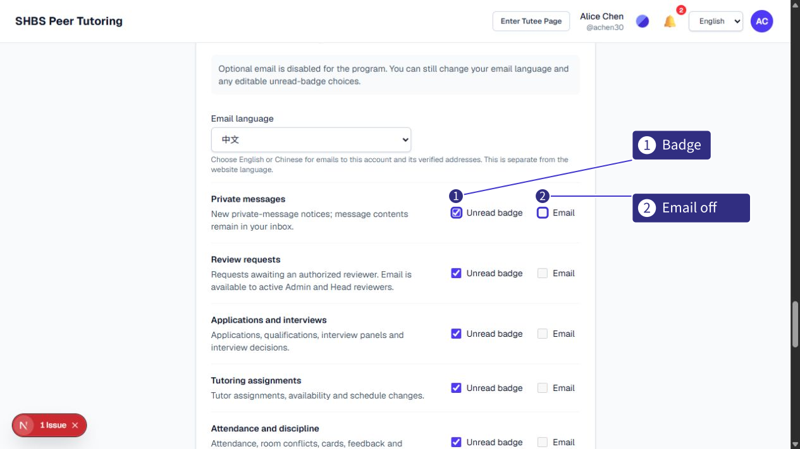

   /settings · EN · 2026-11-16

   Notification preferences distinguish unread badges from email; optional email is disabled by the program in this demonstration.

   [Original full screenshot](assets/notification-preferences-step-1.en.jpg) · `589c055e4b1cf166b48b353bd619ac1982e5d9f6` · Latest-main development baseline 589c055e with the Help candidate; synthetic demonstration data.

   Annotations added for this step. The original full screenshot is unchanged.

   - **1.** Badge

   - **2.** Email off

   **View 2**

   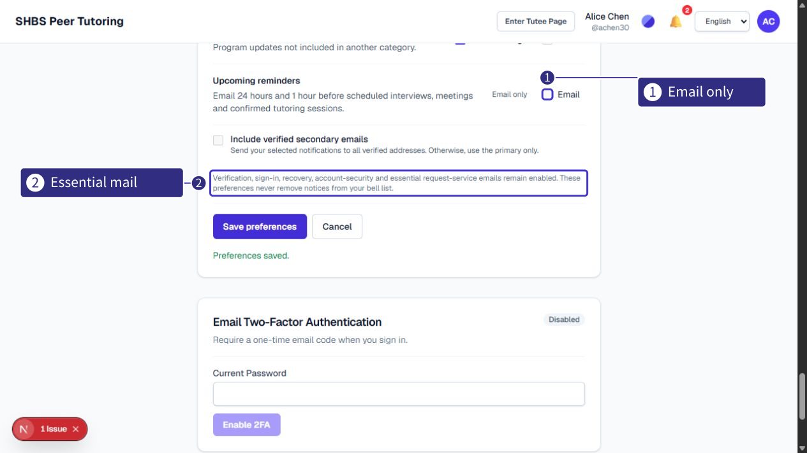

   /settings · EN · 2026-11-16

   Bottom of notification preferences shows verified-secondary delivery, essential-mail guidance and the real Preferences saved receipt.

   [Original full screenshot](assets/notification-preferences-step-1-view-2.en.jpg) · `589c055e4b1cf166b48b353bd619ac1982e5d9f6` · Latest-main development baseline 589c055e with the Help candidate; synthetic demonstration data.

   Annotations added for this step. The original full screenshot is unchanged.

   - **1.** Email only

   - **2.** Essential mail

2. **Choose delivery language and addresses** Choose English or 中文 for emails, and optionally include verified secondary addresses when offered. Save applies this section; Cancel discards its draft. Email language does not change the website language.

   **View 1**

   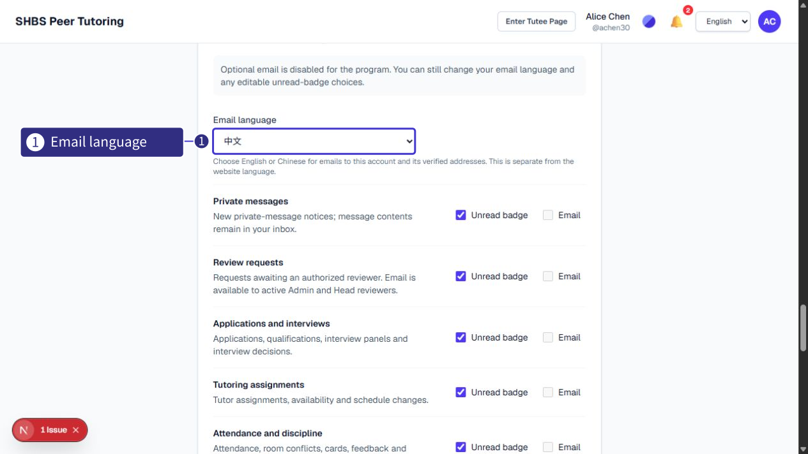

   /settings · EN · 2026-11-16

   Email language is set to Chinese in an English website; the choices are independent and still need this section’s Save.

   [Original full screenshot](assets/notification-preferences-step-2.en.jpg) · `589c055e4b1cf166b48b353bd619ac1982e5d9f6` · Latest-main development baseline 589c055e with the Help candidate; synthetic demonstration data.

   Annotations added for this step. The original full screenshot is unchanged.

   - **1.** Email language

   **View 2**

   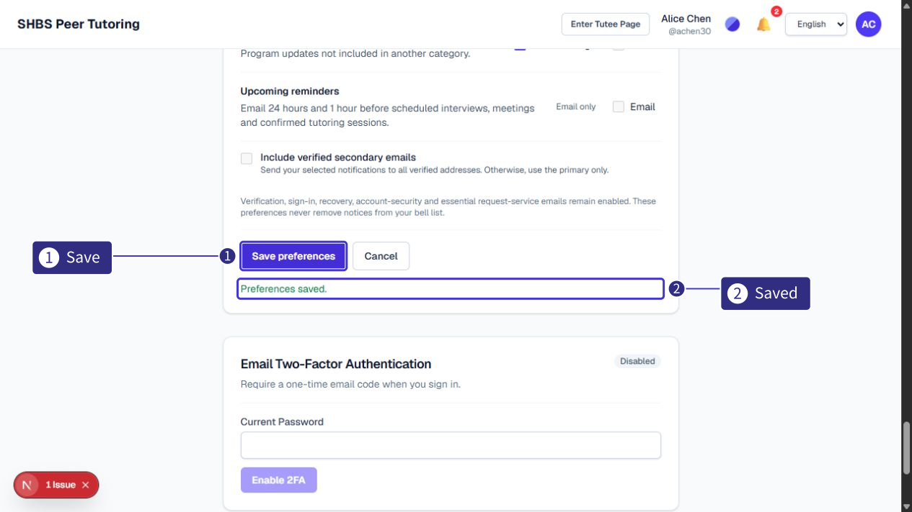

   /settings · EN · 2026-11-16

   Bottom of notification preferences shows verified-secondary delivery, essential-mail guidance and the real Preferences saved receipt.

   [Original full screenshot](assets/notification-preferences-step-2-view-2.en.jpg) · `589c055e4b1cf166b48b353bd619ac1982e5d9f6` · Latest-main development baseline 589c055e with the Help candidate; synthetic demonstration data.

   Annotations added for this step. The original full screenshot is unchanged.

   - **1.** Save

   - **2.** Saved

3. **Use an unsubscribe link deliberately** An optional notice's Unsubscribe opens a review page without changing anything. Choose the exact category or all unlocked optional emails and confirm. Restore choices later in Notification preferences.

   **View 1**

   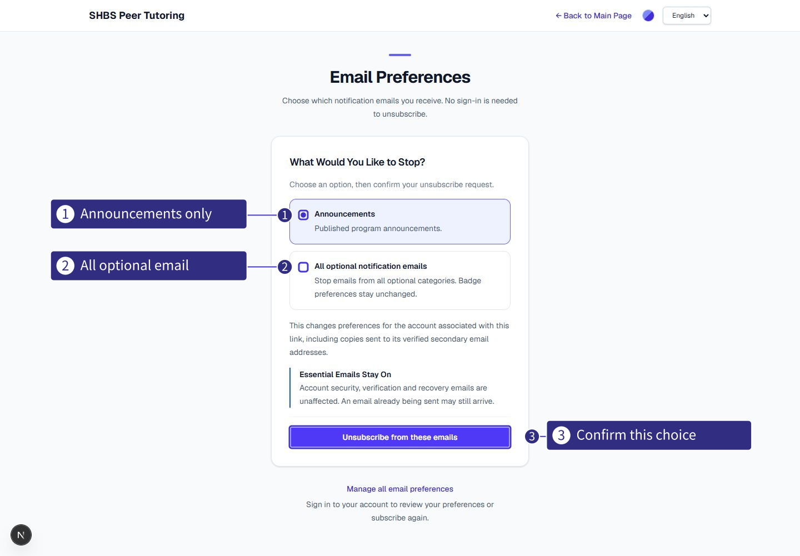

   /unsubscribe · EN · 2026-11-20

   A delivered announcement’s Unsubscribe link opens this signed-out review. Announcements is selected, with a separate choice for all optional email.

   [Original full screenshot](assets/notification-preferences-step-3.en.jpg) · `b5ece465681957c9fe579d26babdeb260c674fa0` · Latest-main development baseline b5ece465, selected 2026-11-20, with the Help candidate. Isolated synthetic first-report demonstration phase.

   Annotations added for this step. The original full screenshot is unchanged.

   - **1.** Announcements only

   - **2.** All optional email

   - **3.** Confirm this choice

   **View 2**

   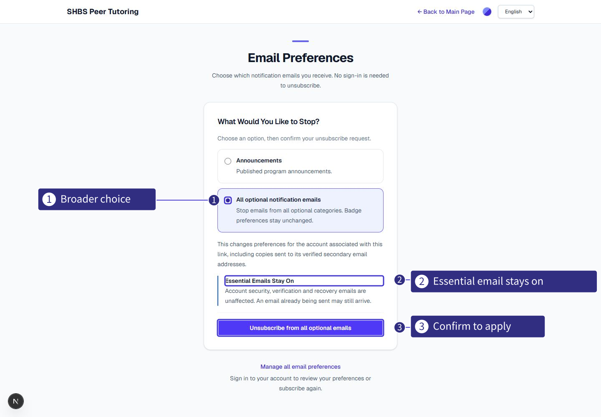

   /unsubscribe · EN · 2026-11-20

   Selecting all optional email only changes the current review choice. Essential email stays on, and nothing changes until you use the confirmation button.

   [Original full screenshot](assets/notification-preferences-step-3-view-2.en.jpg) · `b5ece465681957c9fe579d26babdeb260c674fa0` · Latest-main development baseline b5ece465, selected 2026-11-20, with the Help candidate. Isolated synthetic first-report demonstration phase.

   Annotations added for this step. The original full screenshot is unchanged.

   - **1.** Broader choice

   - **2.** Essential email stays on

   - **3.** Confirm to apply

### What happens next

Saved preferences control eligible badges and optional mail without disabling required security or request-status messages.

### How it works

Disabling a badge preserves notices and read state. Optional mail requires the program mail switch, verified delivery addresses and category eligibility. Reminders cover eligible interviews, meetings and confirmed tutoring; they are checked again before sending.

Unsubscribe affects the account's chosen category across primary and included secondary mailboxes. It cannot disable administrator-required choices. Links expire after 90 days and should remain private.

### Troubleshooting

- **Email choices are unavailable or mail never arrives** Check the program mail notice, your verification state and saved choices. Ask management about delivery warnings; successful queuing does not prove inbox delivery. Security and verification mail use separate rules.

## Read and accept a current participation policy

Review the exact revision before participation and reopen it without signing again.

Open: `/student?view=dashboard`

### Before you start

- A published policy applies to your tutor or tutee participation.

### Walkthrough

1. **Open the required document** For tutee participation open Dashboard in the tutee workspace; tutors open /dashboard for their tutor-policy reminder. Follow the applicable policy notice and read the selected translation, with English fallback. Accounts with both types review both applicable policies.

   Look for: Opened policy document, scroll area and agreement controls

   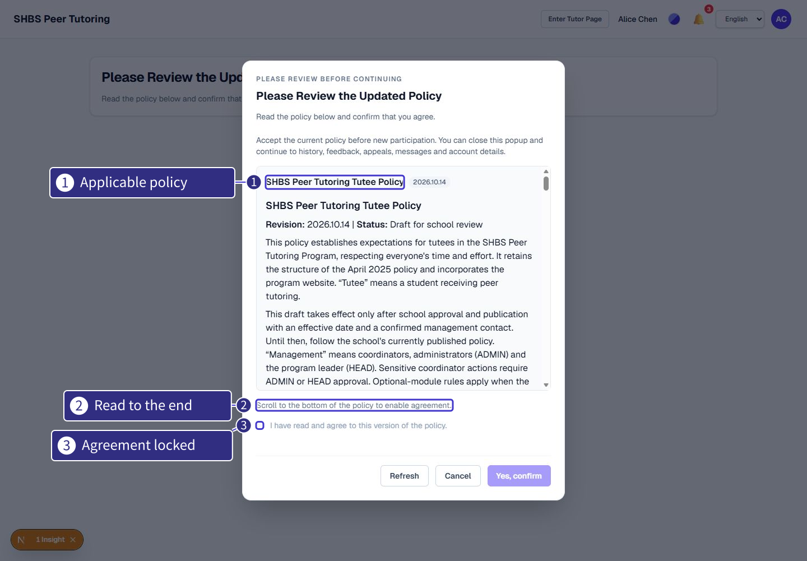

   /student · EN · 2026-11-20

   The tutee workspace opens the applicable Tutee Policy review. The English document shows revision 2026.10.14. Agreement stays unavailable until the document box reaches the end.

   [Original full screenshot](assets/read-accept-policy-step-1.en.jpg) · `b5ece465681957c9fe579d26babdeb260c674fa0` · Latest-main development baseline b5ece465, selected 2026-11-20, with the Help candidate and synthetic demo records.

   Annotations added for this step. The original full screenshot is unchanged.

   - **1.** Applicable policy

   - **2.** Read to the end

   - **3.** Agreement locked

2. **Read to the end and agree** Scroll to the bottom inside the policy text box using touch, mouse or keyboard. Then deliberately check the agreement, supply a signature when requested and complete the five-second confirmation. The timer never submits automatically.

   **View 1**

   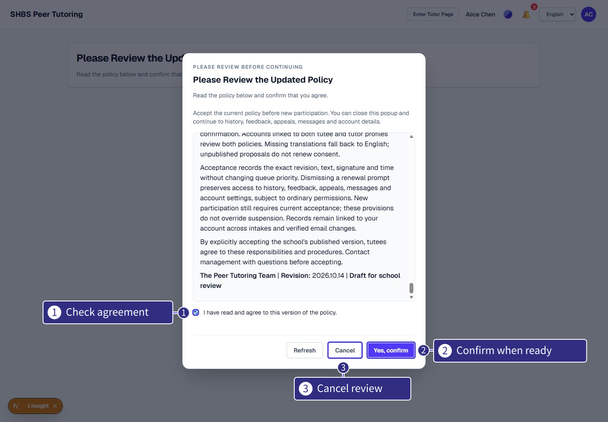

   /student · EN · 2026-11-20

   At the end of the document, agreement can be checked. After the five-second review, Yes, confirm becomes available. This walkthrough stopped at the review and chose Cancel.

   [Original full screenshot](assets/read-accept-policy-step-2.en.jpg) · `b5ece465681957c9fe579d26babdeb260c674fa0` · Latest-main development baseline b5ece465, selected 2026-11-20, with the Help candidate and synthetic demo records.

   Annotations added for this step. The original full screenshot is unchanged.

   - **1.** Check agreement

   - **2.** Confirm when ready

   - **3.** Cancel review

   **View 2**

   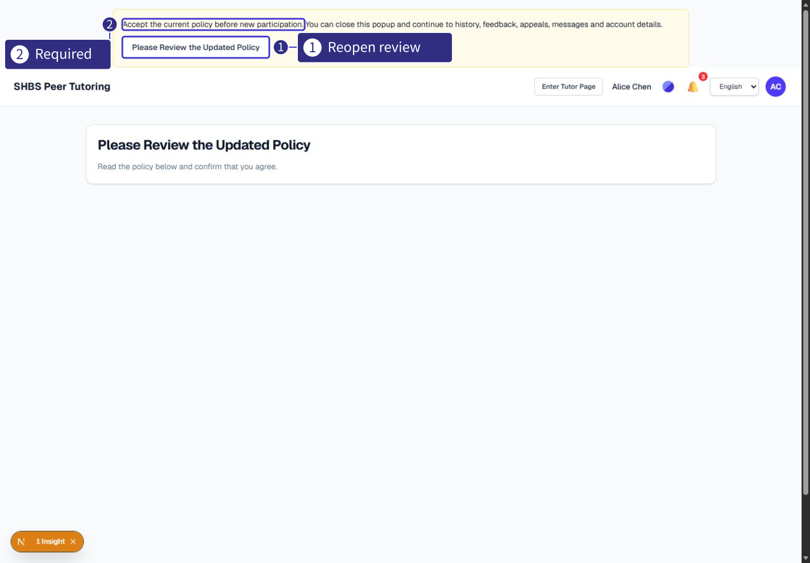

   /student · EN · 2026-11-20

   After Cancel, the review can be reopened and new tutee participation still requires acceptance. Existing account and history access remain available.

   [Original full screenshot](assets/read-accept-policy-step-2-view-2.en.jpg) · `b5ece465681957c9fe579d26babdeb260c674fa0` · Latest-main development baseline b5ece465, selected 2026-11-20, with the Help candidate and synthetic demo records.

   Annotations added for this step. The original full screenshot is unchanged.

   - **1.** Reopen review

   - **2.** Required

3. **Reopen without changing acceptance** Tutors can choose current policy in the accepted-policy message to read the latest document. Close, Escape or the backdrop dismisses its reader. Viewing alone records no acceptance.

   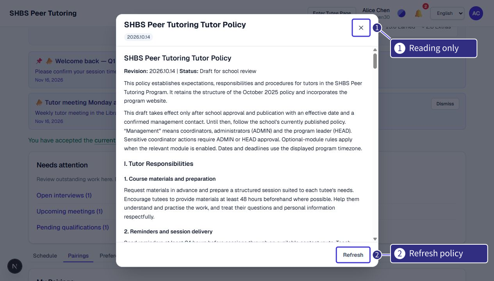

   /dashboard#tutor-pairings · EN · 2026-11-16

   Published tutor-policy reader reopened from the already-accepted policy notice

   [Original full screenshot](assets/read-accept-policy-step-3.en.jpg) · `589c055e4b1cf166b48b353bd619ac1982e5d9f6` · Latest-main development baseline 589c055e with the Help candidate; synthetic demonstration data.

   Annotations added for this step. The original full screenshot is unchanged.

   - **1.** Reading only

   - **2.** Refresh policy

### What happens next

An accepted revision satisfies its participation requirement; a read-only opening changes nothing.

### How it works

A newly published applicable revision requires renewed consent. Historical signatures retain their exact text. You can cancel renewal to use messages, account settings, owned history, feedback and appeals; new participation still needs current consent.

### Troubleshooting

- **The agreement checkbox stays disabled** Scroll inside the document box, not only the page. Reopening or changing revision/translation starts a fresh review. If loading or acceptance failed, use the offered Refresh before trying again.

## Send a message or reply privately

Choose permitted recipients, keep each delivery separate and check its saved result.

Open: `/messages`

### Before you start

- Your current account can message at least one permitted contact and is not messaging-restricted.

### Walkthrough

1. **Open your workspace inbox** Use Messages. Tutees can stay in their Messages tab; management uses /admin/messages. Search by name or username, select up to 20 contacts and review the selected list before sending.

   Look for: Recipient search, selected contacts and composer

   **View 1**

   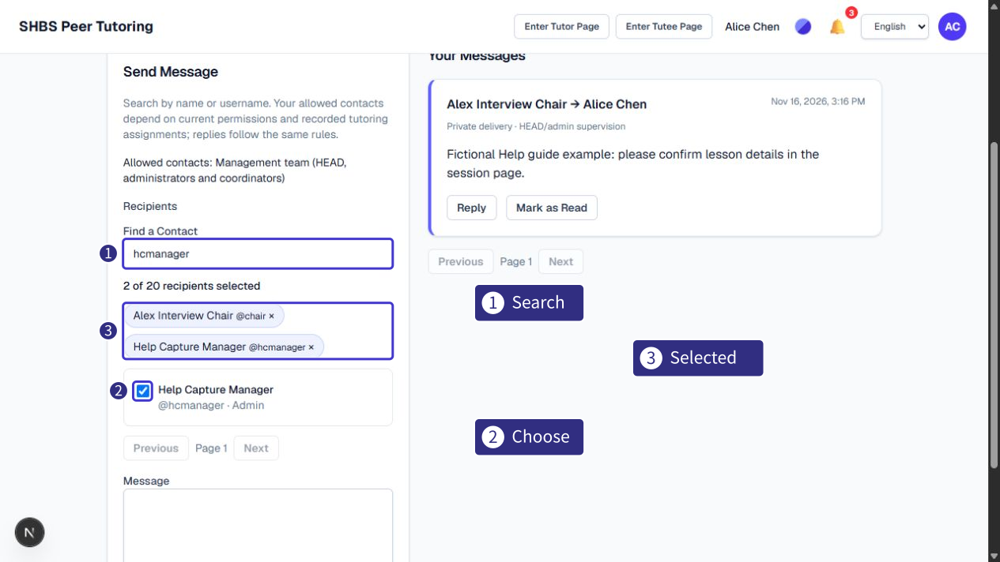

   /messages · EN · 2026-11-16

   Alice searches her actually permitted management contacts. The matching Help Capture Manager checkbox is selected, and the selected list retains both that manager and Alex Interview Chair from separate searches: two of twenty recipients. No message has been sent.

   [Original full screenshot](assets/send-private-messages-step-1.en.jpg) · `dd970ea426016e85cb514beeeab537c3ab2e5098` · Latest-main development baseline dd970ea4, selected 2026-11-16, with the Help candidate; synthetic demonstration data.

   Annotations added for this step. The original full screenshot is unchanged.

   - **1.** Search

   - **2.** Choose

   - **3.** Selected

   **View 2**

   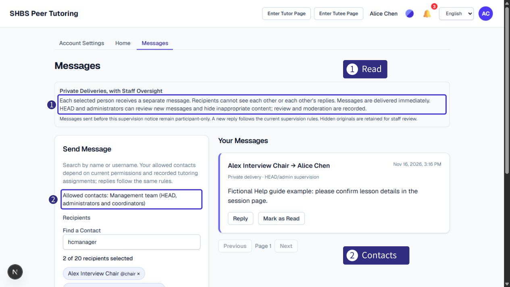

   /messages · EN · 2026-11-16

   The upper Messages page explains separate private deliveries, current HEAD/admin supervision and the older-message boundary. Alice’s composer also states her actually allowed contacts: the management team. Read these notices before choosing recipients and sending.

   [Original full screenshot](assets/send-private-messages-step-1-view-2.en.jpg) · `dd970ea426016e85cb514beeeab537c3ab2e5098` · Latest-main development baseline dd970ea4, selected 2026-11-16, with the Help candidate; synthetic demonstration data.

   Annotations added for this step. The original full screenshot is unchanged.

   - **1.** Read

   - **2.** Contacts

2. **Write and send once** Read the disclosure above the composer, enter your text and send. A message to several people creates separate private deliveries; recipients do not see the other recipients or their replies.

   **View 1**

   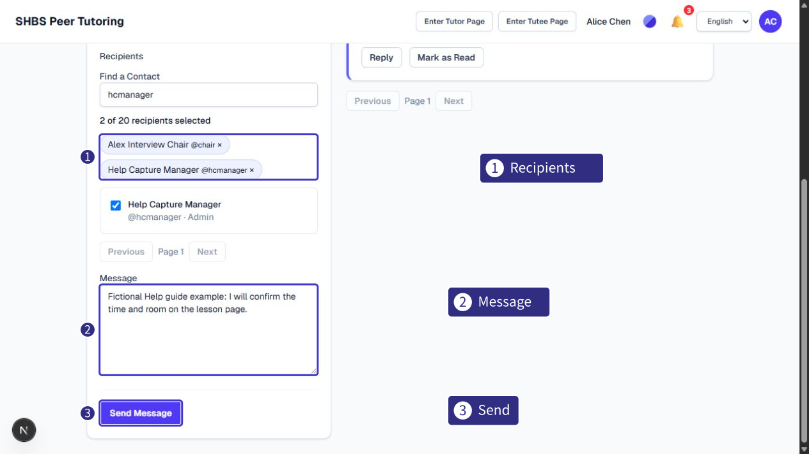

   /messages · EN · 2026-11-16

   After reading the disclosure, Alice drafts a fictional message for the two reviewed permitted recipients. The message and Send Message action are visible; sending once will create separate private deliveries. Nothing has been sent yet.

   [Original full screenshot](assets/send-private-messages-step-2.en.jpg) · `dd970ea426016e85cb514beeeab537c3ab2e5098` · Latest-main development baseline dd970ea4, selected 2026-11-16, with the Help candidate; synthetic demonstration data.

   Annotations added for this step. The original full screenshot is unchanged.

   - **1.** Recipients

   - **2.** Message

   - **3.** Send

   **View 2**

   

   /messages · EN · 2026-11-16

   The actual send receipt confirms two separate private deliveries. The composer has cleared its message and reset the selected count to zero after the one accepted send.

   [Original full screenshot](assets/send-private-messages-step-2-view-2.en.jpg) · `dd970ea426016e85cb514beeeab537c3ab2e5098` · Latest-main development baseline dd970ea4, selected 2026-11-16, with the Help candidate; synthetic demonstration data.

   Annotations added for this step. The original full screenshot is unchanged.

   - **1.** Sent

   **View 3**

   

   /messages · EN · 2026-11-16

   The saved history shows two delivery records from the single send: Alice to Alex Interview Chair and Alice to Help Capture Manager, each with the same fictional text and its own private-delivery disclosure.

   [Original full screenshot](assets/send-private-messages-step-2-view-3.en.jpg) · `dd970ea426016e85cb514beeeab537c3ab2e5098` · Latest-main development baseline dd970ea4, selected 2026-11-16, with the Help candidate; synthetic demonstration data.

   Annotations added for this step. The original full screenshot is unchanged.

   - **1.** Delivery

   - **2.** Delivery

3. **Reply or return to your draft** Choose Reply on a message. The composer names its sender and focuses the message field. Cancel reply returns to your separate general draft; a successful reply also returns there.

   **View 1**

   

   /messages · EN · 2026-11-16

   Reply has moved Alice into a composer addressed to Alex Interview Chair and kept the separate general draft. The fictional reply is drafted. Choose Send Message to send this reply, or Cancel Reply to return to the retained general draft.

   [Original full screenshot](assets/send-private-messages-step-3.en.jpg) · `dd970ea426016e85cb514beeeab537c3ab2e5098` · Latest-main development baseline dd970ea4, selected 2026-11-16, with the Help candidate; synthetic demonstration data.

   Annotations added for this step. The original full screenshot is unchanged.

   - **1.** Reply to

   - **2.** Message

   - **3.** Send

   - **4.** Cancel

   **View 2**

   

   /messages · EN · 2026-11-16

   Cancel Reply returned to the separate general composer and restored the original fictional unsent planning note exactly. No message was sent by cancelling; the selected-recipient count remains zero.

   [Original full screenshot](assets/send-private-messages-step-3-view-2.en.jpg) · `dd970ea426016e85cb514beeeab537c3ab2e5098` · Latest-main development baseline dd970ea4, selected 2026-11-16, with the Help candidate; synthetic demonstration data.

   Annotations added for this step. The original full screenshot is unchanged.

   - **1.** Draft

   **View 3**

   

   /messages · EN · 2026-11-16

   The reply was sent once and the actual receipt confirms one private delivery. The reply mode has closed and the original separate general draft has returned unchanged, with zero general recipients selected.

   [Original full screenshot](assets/send-private-messages-step-3-view-3.en.jpg) · `dd970ea426016e85cb514beeeab537c3ab2e5098` · Latest-main development baseline dd970ea4, selected 2026-11-16, with the Help candidate; synthetic demonstration data.

   Annotations added for this step. The original full screenshot is unchanged.

   - **1.** Draft

   - **2.** Sent

   **View 4**

   

   /messages · EN · 2026-11-16

   The newest saved record contains Alice’s actual fictional reply to Alex Interview Chair at 4:34 PM. The separate unsent general note is still visible in the ordinary composer.

   [Original full screenshot](assets/send-private-messages-step-3-view-4.en.jpg) · `dd970ea426016e85cb514beeeab537c3ab2e5098` · Latest-main development baseline dd970ea4, selected 2026-11-16, with the Help candidate; synthetic demonstration data.

   Annotations added for this step. The original full screenshot is unchanged.

   - **1.** Reply saved

4. **Mark incoming messages read and browse history** In Your Messages, choose Mark as Read on an unread incoming message. This saves immediately without a confirmation dialog. After the list refreshes, its Mark as Read button and unread left-border highlight disappear; opening the inbox or replying alone does not mark it read. Use this list's Next for older messages and Previous to return, checking the displayed page number and disabled buttons. Message read state and bell notices are independent; mark the notice read using the bell's own controls if needed.

   Look for: Incoming Mark as Read, its saved result and the Your Messages pager

   **View 1**

   

   /messages · EN · 2026-11-16

   The original incoming Alex message is still unread after opening the inbox and replying. Mark as Read is the explicit immediate action. The four-record history is on Page 1, with Previous and Next disabled because there is no other page.

   [Original full screenshot](assets/send-private-messages-step-4.en.jpg) · `dd970ea426016e85cb514beeeab537c3ab2e5098` · Latest-main development baseline dd970ea4, selected 2026-11-16, with the Help candidate; synthetic demonstration data.

   Annotations added for this step. The original full screenshot is unchanged.

   - **1.** Read

   - **2.** Previous

   - **3.** Next

   **View 2**

   

   /messages · EN · 2026-11-16

   After the real immediate Mark as Read action, the incoming message remains available with Reply, while its read button and colored unread left border are gone. The bell still shows its separate unread notices; no bell notice was marked read.

   [Original full screenshot](assets/send-private-messages-step-4-view-2.en.jpg) · `dd970ea426016e85cb514beeeab537c3ab2e5098` · Latest-main development baseline dd970ea4, selected 2026-11-16, with the Help candidate; synthetic demonstration data.

   Annotations added for this step. The original full screenshot is unchanged.

   - **1.** Read

   - **2.** Bell

### What happens next

Your sent history confirms the delivery or shows a clear failure while retaining the draft. After marking an incoming message read and refreshing the list, its Mark as Read button and unread left-border highlight disappear.

### How it works

New disclosed messages may be reviewed or reversibly hidden by Admin/Head with audit evidence. Older participant-only messages retain that boundary. Contact eligibility affects new sending; existing permitted history remains readable after eligibility changes.

### Troubleshooting

- **A selected recipient became unavailable** Nothing is delivered if any selected recipient becomes ineligible before sending. Refresh permitted contacts, review selections and retry with your retained text. An identical accepted retry does not duplicate delivery.

- **Your draft disappeared after leaving** Message drafts last only during the current page visit. Save needed text privately before navigation; do not place participant information in public bug reports.

## Find and link your tutoring history

Read tutoring received and provided, or accept an exact staff-reviewed history invitation.

Open: `/history`

### Before you start

- Sign in to the account that explicitly owns the records, or use a private history invitation supplied after identity review.

### Walkthrough

1. **Open My Tutoring History** Use My Tutoring History in the account menu. Separate sections show tutoring received and tutoring provided. Read the original period, record and session count, then choose the rightmost View History.

   Look for: Received/provided history and View History

   **View 1**

   

   /history · EN · 2026-11-20

   My Tutoring History separates records received and provided. Alice has no retained tutee enrollment here. The tutor row shows the recorded period range, 14 sessions and View History.

   [Original full screenshot](assets/find-own-history-step-1.en.jpg) · `b5ece465681957c9fe579d26babdeb260c674fa0` · Latest-main development baseline b5ece465, selected 2026-11-20, with the Help candidate and synthetic demo records.

   Annotations added for this step. The original full screenshot is unchanged.

   - **1.** Tutoring received

   - **2.** Tutoring provided

   - **3.** View history

   **View 2**

   

   /settings#notification-preferences · EN · 2026-11-20

   The signed-in account menu offers My Tutoring History. The link opens the history explicitly owned by this account.

   [Original full screenshot](assets/find-own-history-step-1-view-2.en.jpg) · `b5ece465681957c9fe579d26babdeb260c674fa0` · Latest-main development baseline b5ece465, selected 2026-11-20, with the Help candidate and synthetic demo records.

   Annotations added for this step. The original full screenshot is unchanged.

   - **1.** My Tutoring History

2. **Browse the retained evidence** Use each session, meeting and amendment list's own page controls. Tutor session-hour summaries exclude separate manual hour amendments; inspect those separately when comparing totals.

   **View 1**

   

   /history · EN · 2026-11-20

   The details show the original period and 14 sessions, 6 meeting records and 9 hour amendments. Each session shows stored credit. Meetings and amendments are separate lists.

   [Original full screenshot](assets/find-own-history-step-2.en.jpg) · `b5ece465681957c9fe579d26babdeb260c674fa0` · Latest-main development baseline b5ece465, selected 2026-11-20, with the Help candidate and synthetic demo records.

   Annotations added for this step. The original full screenshot is unchanged.

   - **1.** List counts

   - **2.** Sessions

   - **3.** Stored credit

   **View 2**

   

   /history · EN · 2026-11-20

   Scroll within the same history dialog to reach Meeting attendance and Hour amendments. The saved interview credit is listed separately from tutoring session hours. Each list fits on one page in this example.

   [Original full screenshot](assets/find-own-history-step-2-view-2.en.jpg) · `b5ece465681957c9fe579d26babdeb260c674fa0` · Latest-main development baseline b5ece465, selected 2026-11-20, with the Help candidate and synthetic demo records.

   Annotations added for this step. The original full screenshot is unchanged.

   - **1.** Meeting attendance

   - **2.** Hour amendments

   - **3.** Extra credit

3. **Accept exact historical access when invited** An alumnus without a login can verify the exact invited mailbox, continue from the invitation popup through account review, then review the listed source record and choose Link My History. Existing accounts use normal sign-in/recovery.

   **View 1**

   

   /history/claim · EN · 2026-11-21

   The verified existing recipient sees the original Tutor and Learner records in the frozen review. Linking them will not grant current participation.

   [Original full screenshot](assets/find-own-history-step-3.en.jpg) · `b5ece465681957c9fe579d26babdeb260c674fa0` · Latest-main development baseline b5ece465, selected 2026-11-20, with the Help candidate and synthetic demo records.

   Annotations added for this step. The original full screenshot is unchanged.

   - **1.** Record IDs

   - **2.** Confirm records

   - **3.** Link My History

   **View 2**

   

   /history/claim · EN · 2026-11-21

   The genuine invitation page offers existing-account sign-in and a separate history-only account form. The invited email field remains empty.

   [Original full screenshot](assets/find-own-history-step-3-view-2.en.jpg) · `b5ece465681957c9fe579d26babdeb260c674fa0` · Latest-main development baseline b5ece465, selected 2026-11-20, with the Help candidate and synthetic demo records.

   Annotations added for this step. The original full screenshot is unchanged.

   - **1.** Sign in

   - **2.** Invited email

   - **3.** Verify email

### What happens next

Only records explicitly owned or linked after the exact review appear; no new current enrollment is created.

### How it works

History can remain readable after participation revocation or archive. Name/email matches do not establish ownership, and several historical profiles may belong to one account. Linking history does not reactivate participation, grant a badge or fabricate policy consent.

### Troubleshooting

- **A record is missing or the old email is unavailable** Ask staff to review the exact original record and identity evidence. Use a replacement reviewed invitation if authorized; do not claim a similar-looking record or create duplicate accounts.

## Subscribe to confirmed sessions in your calendar

Use the private subscription link and rotate or revoke it when needed.

Open: `/student?view=schedule`

### Before you start

- Your tutor or tutee Sessions workspace offers calendar subscription.

### Walkthrough

1. **Open your session calendar controls** Open My Tutors & Schedule in the tutee workspace, or Schedule at /dashboard#sessions for tutors. Choose Calendar subscription and read the private-link guidance and current availability.

   Look for: Calendar subscription controls when available

   

   /student?view=schedule · EN · 2026-11-20

   Open My Tutors & Schedule and find Calendar subscription above the dated agenda. The accepted lesson is shown in the current week view.

   [Original full screenshot](assets/session-calendar-step-1.en.jpg) · `b5ece465681957c9fe579d26babdeb260c674fa0` · Latest-main development baseline b5ece465, selected 2026-11-20, with the Help candidate and synthetic demo records.

   Annotations added for this step. The original full screenshot is unchanged.

   - **1.** Schedule workspace

   - **2.** Calendar subscription

   - **3.** Weekly agenda

   - **4.** Confirmed date

2. **Create and copy the private link** Choose Create private link, review that creating a link revokes previous links, then confirm Create private link. Copy the displayed Private subscription link into your calendar app before closing this dialog. The URL is shown only for this opening; opening the dialog later does not reveal it again.

   

   /student?view=schedule · EN · 2026-11-20

   Choose Create private link, then read the previous-link warning before confirming. The new URL is visible only after confirmation, so this frame shows the review before the URL appears.

   [Original full screenshot](assets/session-calendar-step-2.en.jpg) · `b5ece465681957c9fe579d26babdeb260c674fa0` · Latest-main development baseline b5ece465, selected 2026-11-20, with the Help candidate and synthetic demo records.

   Annotations added for this step. The original full screenshot is unchanged.

   - **1.** Old links stop

   - **2.** Create private link

   - **3.** Cancel

3. **Check the confirmed appointments** Use the website as the authoritative view for agreed session time and room. Pending proposals and chat messages are not confirmed appointments.

   

   /dashboard#sessions · EN · 2026-11-20

   The dated Tutor agenda is authoritative for the agreed Mathematics appointment. The card shows November 25, 5:30–6:15 PM, Emma Sun, room A102 and Rescheduled.

   [Original full screenshot](assets/session-calendar-step-3.en.jpg) · `b5ece465681957c9fe579d26babdeb260c674fa0` · Latest-main development baseline b5ece465, selected 2026-11-20, with the Help candidate and synthetic demo records.

   Annotations added for this step. The original full screenshot is unchanged.

   - **1.** Agreed time

   - **2.** Current room

   - **3.** Rescheduled

4. **Rotate or revoke a shared link** If the link was lost or exposed, choose Replace private link, review and confirm, then copy the new URL and update your calendar. Every previous link stops updating. Choose Revoke private link and confirm to stop subscriptions without changing sessions. Keep all subscription URLs out of public reports.

   **View 1**

   

   /student?view=schedule · EN · 2026-11-20

   The saved subscription can be replaced or revoked from the reopened panel. The one-time private URL is hidden.

   [Original full screenshot](assets/session-calendar-step-4.en.jpg) · `b5ece465681957c9fe579d26babdeb260c674fa0` · Latest-main development baseline b5ece465, selected 2026-11-20, with the Help candidate and synthetic demo records.

   Annotations added for this step. The original full screenshot is unchanged.

   - **1.** Private link

   - **2.** Replace

   - **3.** Revoke

   **View 2**

   

   /student?view=schedule · EN · 2026-11-20

   Read what revocation changes before choosing a button. This review was canceled and the owned demo subscription remains active.

   [Original full screenshot](assets/session-calendar-step-4-view-2.en.jpg) · `b5ece465681957c9fe579d26babdeb260c674fa0` · Latest-main development baseline b5ece465, selected 2026-11-20, with the Help candidate and synthetic demo records.

   Annotations added for this step. The original full screenshot is unchanged.

   - **1.** Subscription stops

   - **2.** Confirm revocation

   - **3.** Cancel

### What happens next

Your calendar subscribes using a current private link, or an old link has been revoked.

### How it works

Calendar applications refresh on their own schedule and can lag behind the portal. The link is a private capability, so anyone holding it may retrieve the calendar it authorizes.

### Troubleshooting

- **The calendar still shows an old time** Confirm the portal's final agreed result, then refresh the subscription in your calendar application. Check that you replaced a rotated link rather than importing an old static copy.
