# 我的账户

由网站帮助目录生成。请修改内容源文件后运行 `npm run help:export`。

[目录与截图来源](README.md)

截图来源: `1df44d6bb31cf04352adae9c65819139b7b747d8`. New captures use latest-main development baseline 1df44d6b, selected 2026-11-21, with the Help candidate. Earlier captures list their own revision and capture date.

此 GitHub 培训副本包含各角色操作说明。实际使用网站功能仍需登录并具备当前项目权限。所有示例数据均为虚构。

- [切换工作区并查看通知](#切换工作区并查看通知)
- [恢复加载或保存失败](#恢复加载或保存失败)
- [更新共享资料及权限申请](#更新共享资料及权限申请)
- [确认学业信息](#确认学业信息)
- [报告离校或申请返校](#报告离校或申请返校)
- [更改密码或双重验证偏好](#更改密码或双重验证偏好)
- [管理主要与备用邮箱](#管理主要与备用邮箱)
- [选择通知角标、邮件及语言](#选择通知角标邮件及语言)
- [阅读并接受当前参与政策](#阅读并接受当前参与政策)
- [私下发送消息或回复](#私下发送消息或回复)
- [查找并关联自己的辅导历史](#查找并关联自己的辅导历史)
- [在个人日历订阅已确认课次](#在个人日历订阅已确认课次)

## 切换工作区并查看通知

使用按权限显示的快捷入口、手机菜单、语言设置和通知铃铛。

打开: `/my-account`

### 开始之前

- 使用现有账户登录。

### 操作步骤

1. **打开账户菜单** 按自身权限选择“进入辅导伙伴页面”、“进入学习伙伴页面”、巡查、翻译或管理区。符合条件的工作人员和观察员可用“返回管理区”。快捷入口不会授予缺失的参与资格。

   请注意: 账户菜单与可用工作区链接

   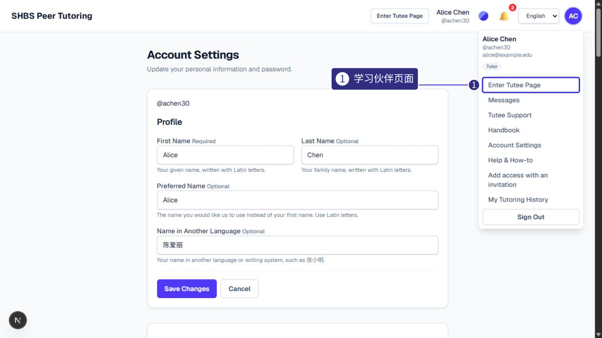

   /settings · EN · 2026-11-16

   Alice的账户菜单提供进入学习伙伴页面快捷方式；此入口不会增加其他角色。

   [原始完整截图](assets/navigate-workspaces-step-1.en.jpg) · `dd970ea426016e85cb514beeeab537c3ab2e5098` · Latest-main development baseline dd970ea4, selected 2026-11-16, with the Help candidate; synthetic demonstration data.

   已为本步骤添加标注，原始完整截图保持不变。

   - **1.** 学习伙伴页面

2. **使用手机与语言控件** 窄屏下使用“菜单”打开管理导航；选择链接、关闭或按Escape即可收起。页头可切换语言和主题。宽表格请在表格自身区域内横向滚动。

   **视图 1**

   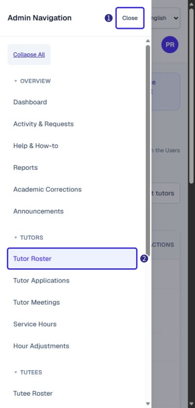

   /admin/tutors · EN · 2026-11-20

   在实际宽度412像素的窄视口中，菜单打开管理导航。选择可见工作区链接、关闭或按Escape可收起抽屉。

   [原始完整截图](assets/navigate-workspaces-step-2.en.jpg) · `b5ece465681957c9fe579d26babdeb260c674fa0` · Latest-main development baseline b5ece465, selected 2026-11-20, with the Help candidate and synthetic demo records.

   已为本步骤添加标注，原始完整截图保持不变。

   - **1.** 关闭菜单

   - **2.** 工作区入口

   **视图 2**

   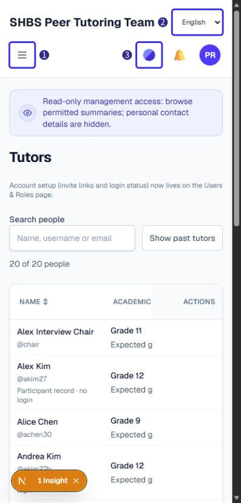

   /admin/tutors · EN · 2026-11-20

   收起手机菜单后，同一页头仍可使用菜单、语言和主题。本例保留现有设置。

   [原始完整截图](assets/navigate-workspaces-step-2-view-2.en.jpg) · `b5ece465681957c9fe579d26babdeb260c674fa0` · Latest-main development baseline b5ece465, selected 2026-11-20, with the Help candidate and synthetic demo records.

   已为本步骤添加标注，原始完整截图保持不变。

   - **1.** 打开导航

   - **2.** 语言

   - **3.** 主题

   **视图 3**

   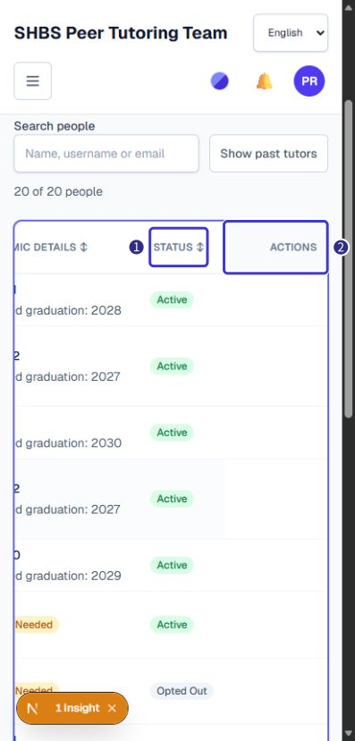

   /admin/tutors · EN · 2026-11-20

   聚焦的辅导伙伴表格横向滚动后显示状态列。表格已滚动到最右侧，页面本身仍没有横向移动。

   [原始完整截图](assets/navigate-workspaces-step-2-view-3.en.jpg) · `b5ece465681957c9fe579d26babdeb260c674fa0` · Latest-main development baseline b5ece465, selected 2026-11-20, with the Help candidate and synthetic demo records.

   已为本步骤添加标注，原始完整截图保持不变。

   - **1.** 显示其余列

   - **2.** 行操作

3. **查看自己的通知** 打开铃铛，选择通知进入关联任务，可逐条标为已读或选择“全部已读”。在通知偏好中分别设置角标与可选邮件。

   **视图 1**

   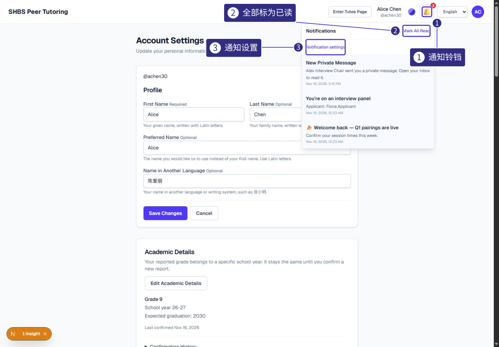

   /settings · EN · 2026-11-20

   通知铃铛已打开，显示三条未读通知。逐条通知可进入对应任务，全部标为已读会更新状态，通知设置通向单独偏好。本例未选择通知。

   [原始完整截图](assets/navigate-workspaces-step-3.en.jpg) · `b5ece465681957c9fe579d26babdeb260c674fa0` · Latest-main development baseline b5ece465, selected 2026-11-20, with the Help candidate and synthetic demo records.

   已为本步骤添加标注，原始完整截图保持不变。

   - **1.** 通知铃铛

   - **2.** 全部标为已读

   - **3.** 通知设置

   **视图 2**

   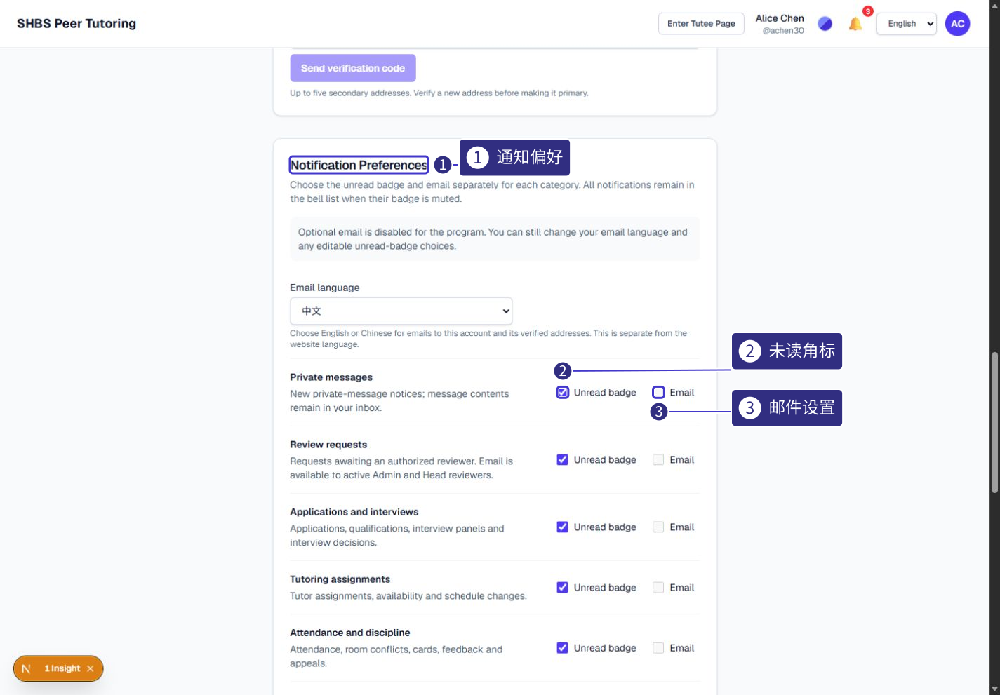

   /settings#notification-preferences · EN · 2026-11-20

   通知偏好分别设置未读角标和可选邮件。当前项目禁用了可选邮件，相关复选框不可用。本例未更改任何偏好。

   [原始完整截图](assets/navigate-workspaces-step-3-view-2.en.jpg) · `b5ece465681957c9fe579d26babdeb260c674fa0` · Latest-main development baseline b5ece465, selected 2026-11-20, with the Help candidate and synthetic demo records.

   已为本步骤添加标注，原始完整截图保持不变。

   - **1.** 通知偏好

   - **2.** 未读角标

   - **3.** 邮件设置

4. **安全排序信息** 点击可排序数据列标题，依次为升序、降序、原始顺序。键盘用户可聚焦后按Enter或空格。排序保留筛选条件，不修改记录。

   **视图 1**

   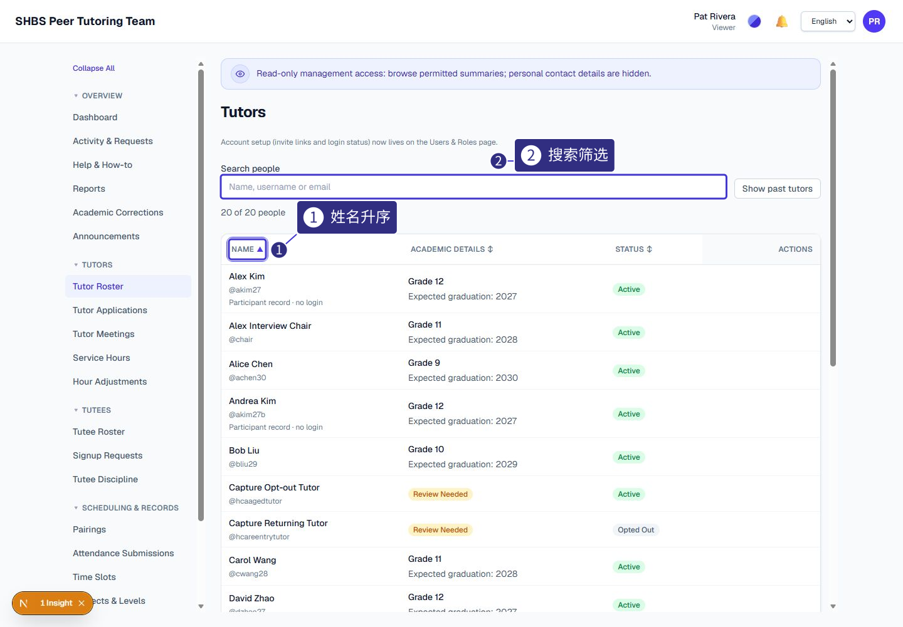

   /admin/tutors · EN · 2026-11-20

   在只读辅导伙伴名册中，聚焦姓名后按Enter会升序排列。上箭头及升序列状态表明当前顺序。名册记录未发生变化。

   [原始完整截图](assets/navigate-workspaces-step-4.en.jpg) · `b5ece465681957c9fe579d26babdeb260c674fa0` · Latest-main development baseline b5ece465, selected 2026-11-20, with the Help candidate and synthetic demo records.

   已为本步骤添加标注，原始完整截图保持不变。

   - **1.** 姓名升序

   - **2.** 搜索筛选

   **视图 2**

   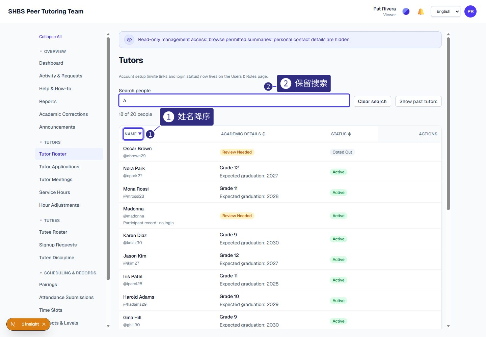

   /admin/tutors · EN · 2026-11-20

   再次在姓名列按空格会改为降序，搜索仍为“a”。第三次按键会恢复原始顺序。

   [原始完整截图](assets/navigate-workspaces-step-4-view-2.en.jpg) · `b5ece465681957c9fe579d26babdeb260c674fa0` · Latest-main development baseline b5ece465, selected 2026-11-20, with the Help candidate and synthetic demo records.

   已为本步骤添加标注，原始完整截图保持不变。

   - **1.** 姓名降序

   - **2.** 保留搜索

### 预期结果

进入所需且有权限的工作区，并可通过通知找到对应任务。

### 工作原理

管理职级、辅导伙伴／学习伙伴／巡查资格及翻译分配相互独立。项目模块开关也会影响导航。

### 问题排查

- **缺少页面或快捷入口** 请管理团队检查关联档案、参与资格、离校状态、停用和模块开关。直接输入隐藏页面地址不能绕过服务器权限检查。

## 恢复加载或保存失败

区分待审核、已接受保存、过时草稿与安全的只读重试。

打开: `/my-account`

### 开始之前

- 查看提示时保持相关页面打开。

### 操作步骤

1. **阅读具体状态** “更改已保存”表示写入已接受。“已提交审核”表示提案待审，实时记录尚未改变。列表不可用并不表示列表为空。

   请注意: 各区域的保存、错误或恢复提示

   **视图 1**

   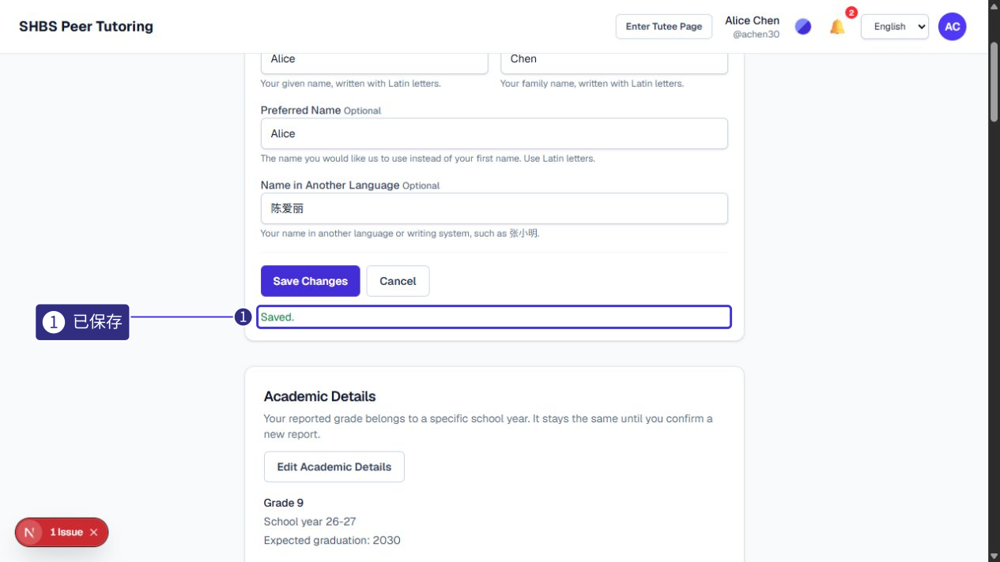

   /settings · EN · 2026-11-16

   个人资料写入已完成，在该区操作控件旁显示实际已保存状态。

   [原始完整截图](assets/read-recover-save-step-1.en.jpg) · `589c055e4b1cf166b48b353bd619ac1982e5d9f6` · Latest-main development baseline 589c055e with the Help candidate; synthetic demonstration data.

   已为本步骤添加标注，原始完整截图保持不变。

   - **1.** 已保存

   **视图 2**

   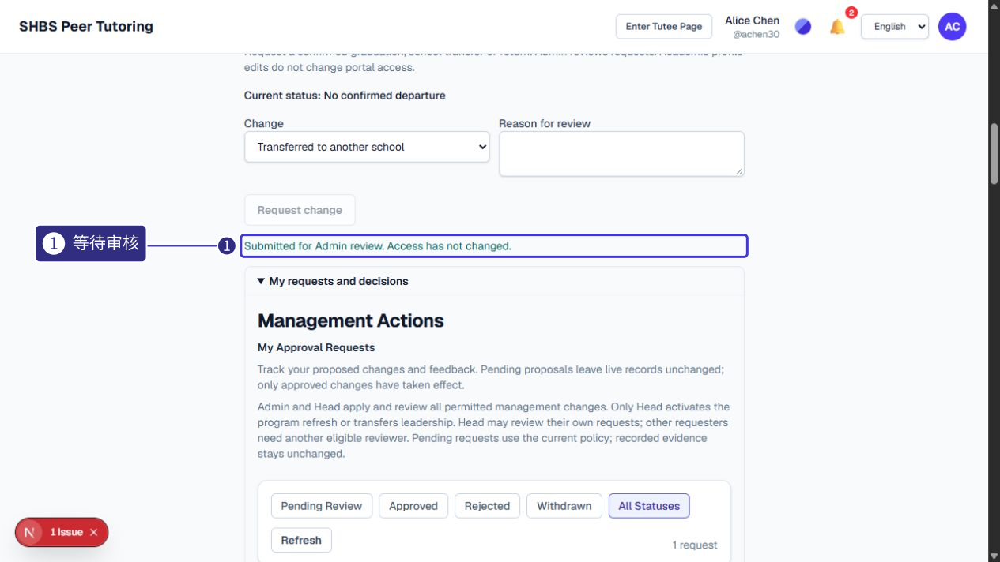

   /settings · EN · 2026-11-16

   已提交管理员审核是提案回执，并明确确认权限并未改变。

   [原始完整截图](assets/read-recover-save-step-1-view-2.en.jpg) · `589c055e4b1cf166b48b353bd619ac1982e5d9f6` · Latest-main development baseline 589c055e with the Help candidate; synthetic demonstration data.

   已为本步骤添加标注，原始完整截图保持不变。

   - **1.** 等待审核

   **视图 3**

   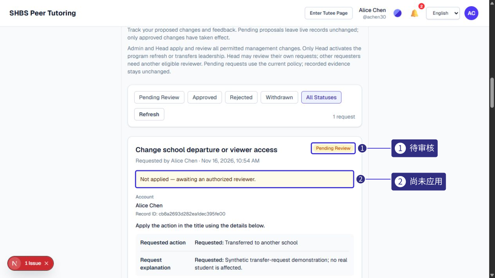

   /settings · EN · 2026-11-16

   已展开的本人申请历史显示等待审核及尚未应用；提交申请尚不代表离校已确认。

   [原始完整截图](assets/read-recover-save-step-1-view-3.en.jpg) · `589c055e4b1cf166b48b353bd619ac1982e5d9f6` · Latest-main development baseline 589c055e with the Help candidate; synthetic demonstration data.

   已为本步骤添加标注，原始完整截图保持不变。

   - **1.** 待审核

   - **2.** 尚未应用

2. **重试正确操作** 保存失败时，修正问题后主动重试。保存成功但刷新失败时，选择“重试刷新”或“检查申请结果”：这些操作读取已接受结果，不会重新提交。

   **视图 1**

   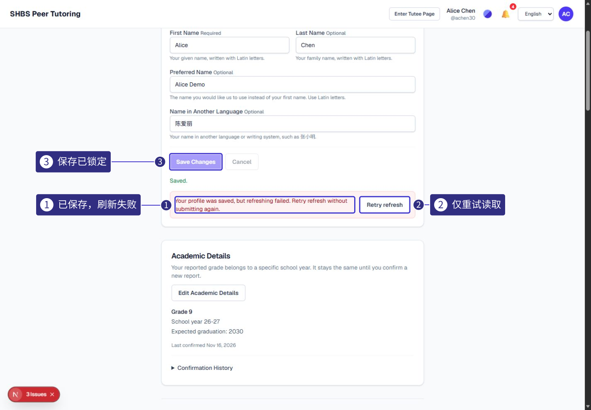

   /settings · EN · 2026-11-21

   真实资料修改已受理。受控的本地传输故障只阻止了保存后的资料读取，“保存”按钮禁用并显示重试刷新。

   [原始完整截图](assets/read-recover-save-step-2.en.jpg) · `b5ece465681957c9fe579d26babdeb260c674fa0` · Latest-main development baseline b5ece465, selected 2026-11-20, with the Help candidate and synthetic demo records.

   已为本步骤添加标注，原始完整截图保持不变。

   - **1.** 已保存，刷新失败

   - **2.** 仅重试读取

   - **3.** 保存已锁定

   **视图 2**

   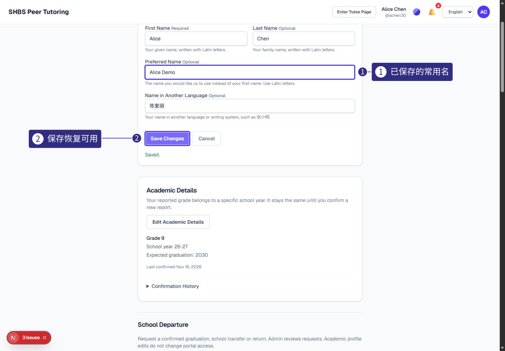

   /settings · EN · 2026-11-21

   重试刷新读取了已保存的常用名。刷新警告消失，常规资料控件恢复。

   [原始完整截图](assets/read-recover-save-step-2-view-2.en.jpg) · `b5ece465681957c9fe579d26babdeb260c674fa0` · Latest-main development baseline b5ece465, selected 2026-11-20, with the Help candidate and synthetic demo records.

   已为本步骤添加标注，原始完整截图保持不变。

   - **1.** 已保存的常用名

   - **2.** 保存恢复可用

3. **处理记录变化冲突** 阅读冲突提示。明确选择“重新加载”并成功获取当前证据后，才会替换过时草稿；再次提交前重新核对。关闭或取消不会确认审核。

   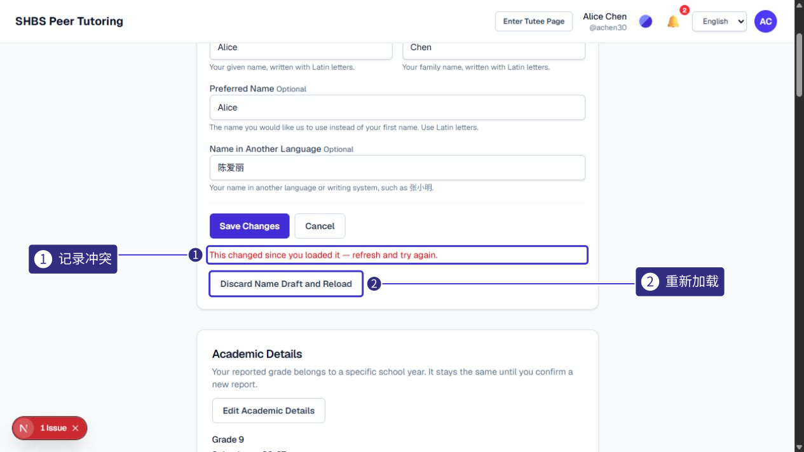

   /settings · EN · 2026-11-16

   学业确认更改共享记录后，过期的个人资料草稿被实际拒绝，并显示明确的重新加载按钮。

   [原始完整截图](assets/read-recover-save-step-3.en.jpg) · `589c055e4b1cf166b48b353bd619ac1982e5d9f6` · Latest-main development baseline 589c055e with the Help candidate; synthetic demonstration data.

   已为本步骤添加标注，原始完整截图保持不变。

   - **1.** 记录冲突

   - **2.** 重新加载

4. **注意草稿有效范围** 多数编辑器在当前页面仍挂载时保留草稿，包括折叠或切换页签。离开或刷新后不会自动保存。写入进行中可能锁定编辑及关闭，直到结果明确。

   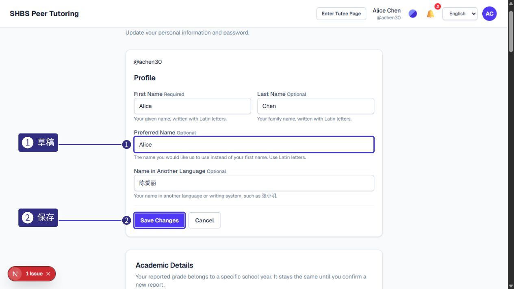

   /settings · EN · 2026-11-16

   已挂载的个人资料编辑器保留未保存常用姓名草稿，直至保存、取消或离开页面。

   [原始完整截图](assets/read-recover-save-step-4.en.jpg) · `589c055e4b1cf166b48b353bd619ac1982e5d9f6` · Latest-main development baseline 589c055e with the Help candidate; synthetic demonstration data.

   已为本步骤添加标注，原始完整截图保持不变。

   - **1.** 草稿

   - **2.** 保存

### 预期结果

恢复当前记录，并避免意外重复已完成的操作。

### 工作原理

确认倒计时只启用最终按钮，不会自动提交。权限被拒绝时，受保护内容可能隐藏，直到重新成功验证权限。

### 问题排查

- **无法确定操作是否保存** 使用页面提供的结果查询、查看相关记录，或告知管理团队页面及大致时间。不要修改后重新提交结果尚不明确的已执行操作。

## 更新共享资料及权限申请

单独保存姓名信息，并申请符合条件的参与资格，无需重复注册。

打开: `/my-account`

### 开始之前

- 登录并打开账户设置；辅导伙伴也可使用/settings的账户设置。

### 操作步骤

1. **编辑可用姓名字段** 在资料区域按需编辑名字、姓氏、惯用名或其他语言姓名。拉丁字段允许带重音字母、空格、撇号和连字符；其他文字请填入其他语言姓名。

   请注意: 资料字段及下方当前区域的保存与取消按钮

   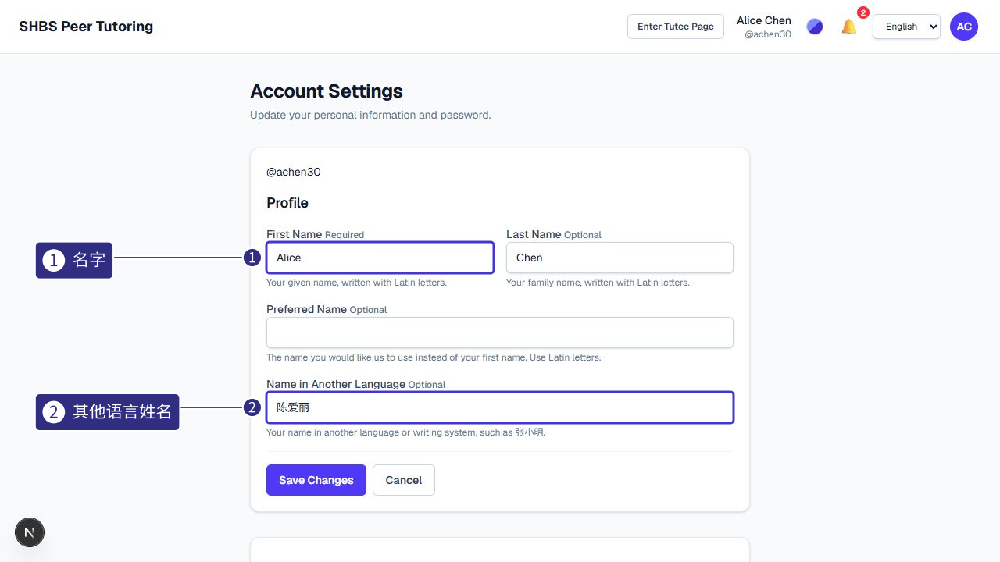

   /settings · EN · 2026-11-16

   个人资料编辑区，包含必填名字及可选的多语言姓名。

   [原始完整截图](assets/account-profile-step-1.en.jpg) · `589c055e4b1cf166b48b353bd619ac1982e5d9f6` · Latest-main development baseline 589c055e with the Help candidate; synthetic demonstration data.

   已为本步骤添加标注，原始完整截图保持不变。

   - **1.** 名字

   - **2.** 其他语言姓名

2. **保存当前区域** 在辅导伙伴设置中选择“保存更改”，或在通用账户设置中选择“保存个人资料”，一起保存姓名字段。“取消”恢复上次读取值。密码、邮箱、学业和参与资格各有独立操作，不会由此按钮保存。

   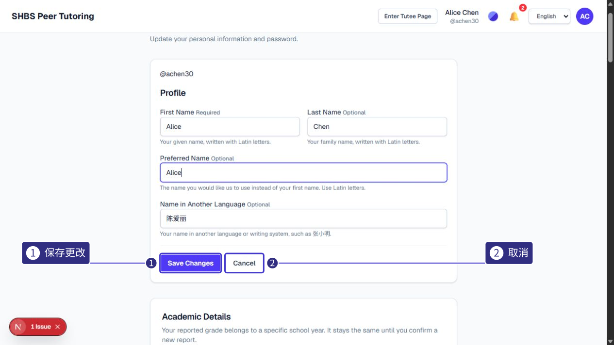

   /settings · EN · 2026-11-16

   未保存的常用姓名草稿，以及个人资料区自己的保存更改与取消按钮。

   [原始完整截图](assets/account-profile-step-2.en.jpg) · `589c055e4b1cf166b48b353bd619ac1982e5d9f6` · Latest-main development baseline 589c055e with the Help candidate; synthetic demonstration data.

   已为本步骤添加标注，原始完整截图保持不变。

   - **1.** 保存更改

   - **2.** 取消

3. **申请参与资格或接受邀请** 使用参与资格控件提交符合条件的申请，或用“添加权限”确认已收到的邀请。参与申请不能授予管理职级；应先查看决定，再判断权限是否改变。

   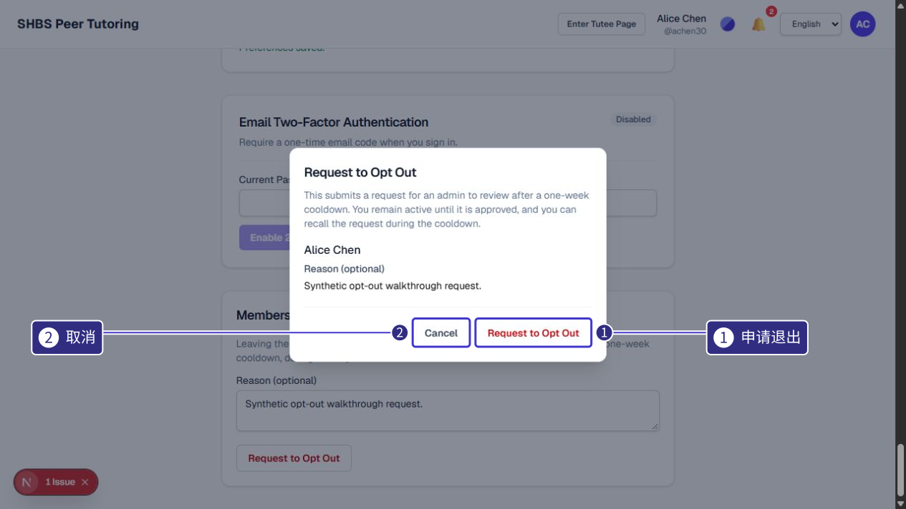

   /settings · EN · 2026-11-16

   退出审核确认区显示导师、可选理由、七天审核冷却期，以及获批前继续参与的规则。

   [原始完整截图](assets/account-profile-step-3.en.jpg) · `589c055e4b1cf166b48b353bd619ac1982e5d9f6` · Latest-main development baseline 589c055e with the Help candidate; synthetic demonstration data.

   已为本步骤添加标注，原始完整截图保持不变。

   - **1.** 申请退出

   - **2.** 取消

### 预期结果

资料区域显示保存结果，或独立权限申请显示实际审核状态。

### 工作原理

当前明确关联的辅导伙伴和学习伙伴档案共享账户姓名。历史申请和签名保留原姓名。姓名显示和必填规则由项目配置决定；系统不会猜测旧姓名的拆分方式。

### 问题排查

- **旧完整姓名没有拆分字段** 仅更正其他信息时，请保持拉丁姓名字段不变。确需修改时，填写真实有效的名字，不要猜测拆分。

- **资料已保存但仍只读** 选择“重试刷新”读取已接受值。如其他人更改了版本，请明确重新加载并核对后再提交。

## 确认学业信息

记录当前学年实际年级，并查看确认历史。

打开: `/my-account#academic-details`

### 开始之前

- 在账户设置中打开学业信息。

### 操作步骤

1. **检查当前记录** 选择“检查学业信息”或“编辑学业信息”，查看已存年级、参考学年及任何需要检查确认的提示。

   请注意: 已打开的学业编辑器、年级选择及参考学年

   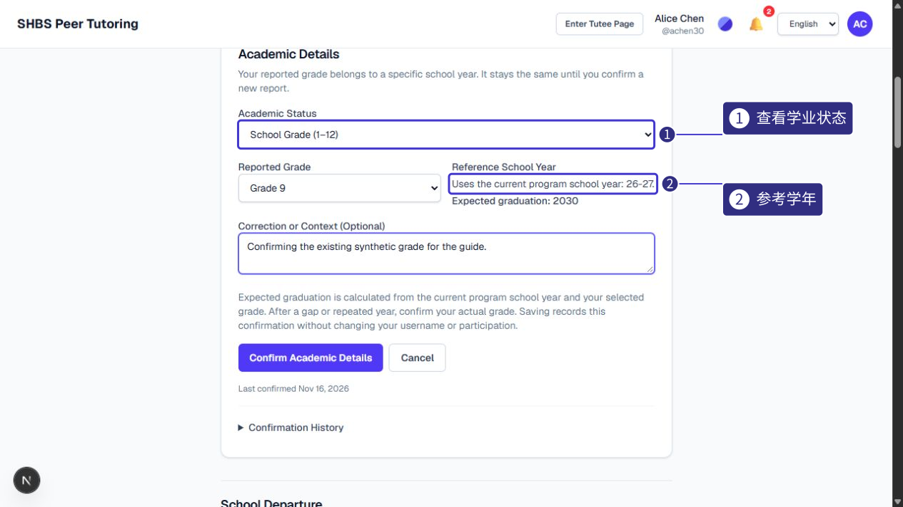

   /settings · EN · 2026-11-16

   学业编辑区显示九年级、当前参考学年及单独的确认按钮。

   [原始完整截图](assets/account-academics-step-1.en.jpg) · `589c055e4b1cf166b48b353bd619ac1982e5d9f6` · Latest-main development baseline 589c055e with the Help candidate; synthetic demonstration data.

   已为本步骤添加标注，原始完整截图保持不变。

   - **1.** 查看学业状态

   - **2.** 参考学年

2. **选择真实信息** 按实际情况选择开放年级、未知、已毕业或不适用。当前学年自动填写。确认此记录；学业信息与姓名资料分别保存。

   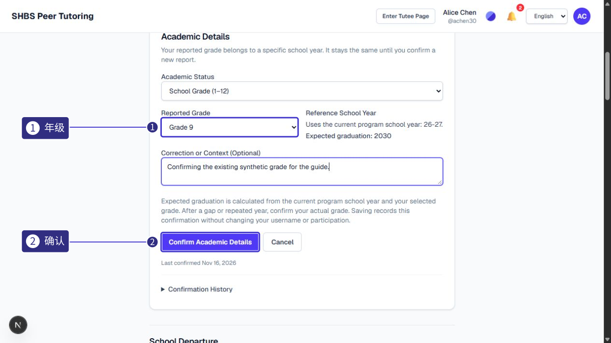

   /settings · EN · 2026-11-16

   学业编辑区显示九年级、当前参考学年及单独的确认按钮。

   [原始完整截图](assets/account-academics-step-2.en.jpg) · `589c055e4b1cf166b48b353bd619ac1982e5d9f6` · Latest-main development baseline 589c055e with the Help candidate; synthetic demonstration data.

   已为本步骤添加标注，原始完整截图保持不变。

   - **1.** 年级

   - **2.** 确认

3. **查看确认历史** 打开确认历史，查看记录值、来源和日期。邀请完成页若指向此处，请先确认，再按正常辅导激活或巡查重新加入流程继续。

   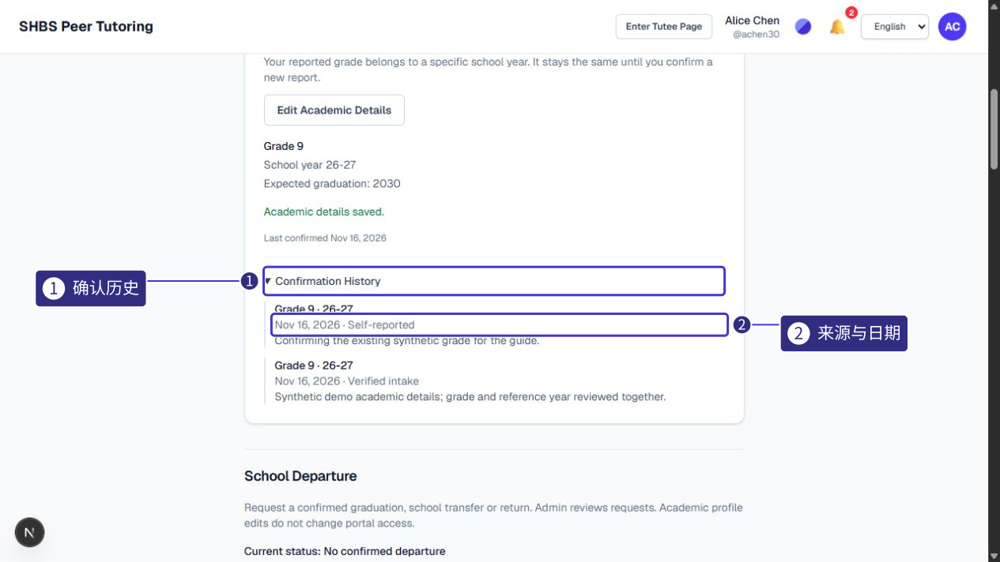

   /settings · EN · 2026-11-16

   已展开的确认历史显示新的本人报告学业确认及更早的已核验申请记录。

   [原始完整截图](assets/account-academics-step-3.en.jpg) · `589c055e4b1cf166b48b353bd619ac1982e5d9f6` · Latest-main development baseline 589c055e with the Help candidate; synthetic demonstration data.

   已为本步骤添加标注，原始完整截图保持不变。

   - **1.** 确认历史

   - **2.** 来源与日期

### 预期结果

当前账户学业信息已按记录学年确认。

### 工作原理

预计毕业年份由年级和参考学年推算，不能单独编辑。年级不会自动升级。学业中的已毕业状态本身不会改变参与资格或授予观察权限。原入组学业信息及签署申请仍作为历史证据保留。

### 问题排查

- **编辑时学年发生变化** 重新加载并检查新启用学年后再确认。如未配置当前学年，请联系管理团队；未知及不适用仍可使用。

## 报告离校或申请返校

申请毕业或转学审核，并了解对参与资格的影响。

打开: `/my-account#academic-details`

### 开始之前

- 在辅导伙伴设置中打开“离校状态”，或使用通用账户设置中学业信息旁的独立离校控件。

### 操作步骤

1. **打开离校功能** 在辅导伙伴设置中直接使用“离校状态”；通用账户设置则选择学业信息旁的“我已转学离校”。选择适用的“变更”，填写“审核理由”，再选择“申请变更”。阅读“核对离校变更”后选择“确认变更”，仅提交管理员审核，并不代表离校已获批准。

   请注意: 离校审核、离校类型及原因

   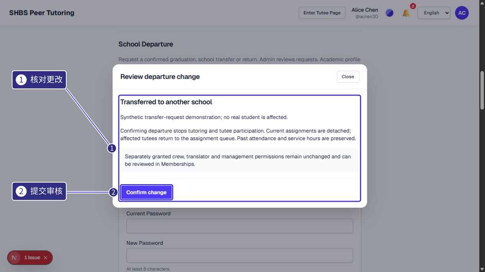

   /settings · EN · 2026-11-16

   虚构转学申请的完整审核确认区，列明参与资格后果及明确确认按钮。

   [原始完整截图](assets/school-departure-step-1.en.jpg) · `589c055e4b1cf166b48b353bd619ac1982e5d9f6` · Latest-main development baseline 589c055e with the Help candidate; synthetic demonstration data.

   已为本步骤添加标注，原始完整截图保持不变。

   - **1.** 核对更改

   - **2.** 提交审核

2. **等待决定** 查看离校申请和历史。由管理员／负责人审核；仅提交不代表离校已确认。确认后，符合条件的“进入观察员门户”可打开脱敏只读概览。

   **视图 1**

   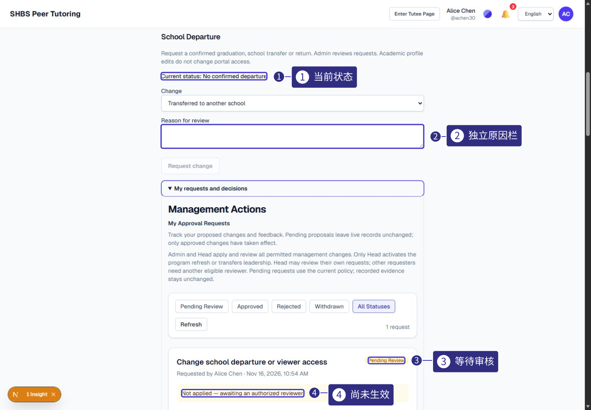

   /settings · EN · 2026-11-20

   离校页面显示当前纵向表单和 Alice 的原申请。等待审核和尚未生效表明离校尚未确认。

   [原始完整截图](assets/school-departure-step-2.en.jpg) · `b5ece465681957c9fe579d26babdeb260c674fa0` · Latest-main development baseline b5ece465, selected 2026-11-20, with the Help candidate and synthetic demo records.

   已为本步骤添加标注，原始完整截图保持不变。

   - **1.** 当前状态

   - **2.** 独立原因栏

   - **3.** 等待审核

   - **4.** 尚未生效

   **视图 2**

   

   /settings · EN · 2026-11-16

   已展开的本人申请历史显示等待审核及尚未应用；提交申请尚不代表离校已确认。

   [原始完整截图](assets/school-departure-step-2-view-2.en.jpg) · `589c055e4b1cf166b48b353bd619ac1982e5d9f6` · Latest-main development baseline 589c055e with the Help candidate; synthetic demonstration data.

   已为本步骤添加标注，原始完整截图保持不变。

   - **1.** 待审核

   - **2.** 尚未应用

3. **情况改变时申请返校** 在“离校状态”的“变更”中选择“返校”，填写“审核理由”并选择“申请变更”。阅读“核对离校变更”后选择“确认变更”，提交返校申请。获批后，通过正常流程恢复辅导激活或学习报名。

   **视图 1**

   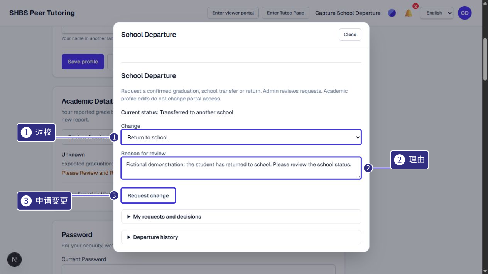

   /my-account · EN · 2026-11-16

   独立虚构转校学生可申请返校。审核理由占独立完整一行；申请变更会打开审核确认，不会直接批准权限。

   [原始完整截图](assets/school-departure-step-3.en.jpg) · `dd970ea426016e85cb514beeeab537c3ab2e5098` · Latest-main development baseline dd970ea4, selected 2026-11-16, with the Help candidate; synthetic demonstration data.

   已为本步骤添加标注，原始完整截图保持不变。

   - **1.** 返校

   - **2.** 理由

   - **3.** 申请变更

   **视图 2**

   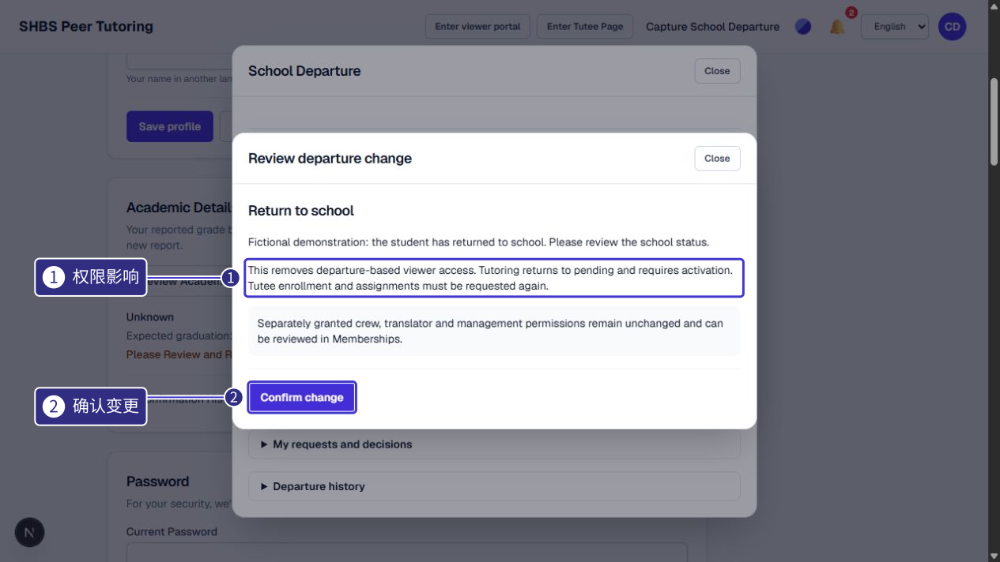

   /my-account · EN · 2026-11-16

   返校确认在确认变更前说明权限影响：辅导资格回到待激活，学习伙伴报名及分配须重新申请。此画面是确认审核，不是已批准返校。

   [原始完整截图](assets/school-departure-step-3-view-2.en.jpg) · `dd970ea426016e85cb514beeeab537c3ab2e5098` · Latest-main development baseline dd970ea4, selected 2026-11-16, with the Help candidate; synthetic demonstration data.

   已为本步骤添加标注，原始完整截图保持不变。

   - **1.** 权限影响

   - **2.** 确认变更

   **视图 3**

   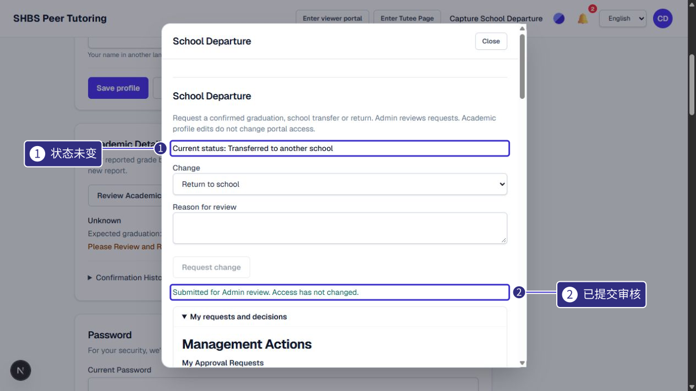

   /my-account · EN · 2026-11-16

   实际返校申请已提交管理员审核。回执明确权限未改变，当前状态仍为已转校；尚未应用返校批准。

   [原始完整截图](assets/school-departure-step-3-view-3.en.jpg) · `dd970ea426016e85cb514beeeab537c3ab2e5098` · Latest-main development baseline dd970ea4, selected 2026-11-16, with the Help candidate; synthetic demonstration data.

   已为本步骤添加标注，原始完整截图保持不变。

   - **1.** 状态未变

   - **2.** 已提交审核

   **视图 4**

   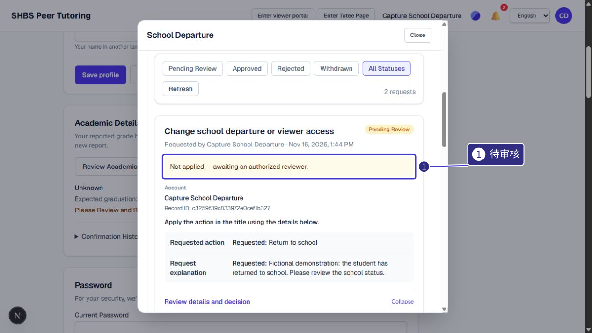

   /my-account · EN · 2026-11-16

   我的申请与决定将实际返校申请列为待审核及未应用。申请操作为返校，仍需符合条件的审核者决定。

   [原始完整截图](assets/school-departure-step-3-view-4.en.jpg) · `dd970ea426016e85cb514beeeab537c3ab2e5098` · Latest-main development baseline dd970ea4, selected 2026-11-16, with the Help candidate; synthetic demonstration data.

   已为本步骤添加标注，原始完整截图保持不变。

   - **1.** 待审核

### 预期结果

申请显示实际决定，参与资格仅按已批准结果变化。

### 工作原理

确认离校会结束当前分配及待处理学习申请；离校辅导伙伴的学习伙伴返回匹配。账户角色与个人历史保留。返校获批不会自动恢复分配。独立管理、巡查和翻译权限仍遵循各自规则。

### 问题排查

- **已选择毕业但无法进入观察员门户** 学业毕业状态不等于已确认离校。请检查此独立审核申请，并向管理团队了解观察权限限制。

## 更改密码或双重验证偏好

确认安全更改，并在修改密码后重新登录。

打开: `/my-account#account-password`

### 开始之前

- 知道当前密码，且能使用主要邮箱。

### 操作步骤

1. **打开安全区域** 在账户设置中找到密码或双重验证控件。输入当前密码，并按提示完成邮件安全验证码。

   请注意: 当前密码、新密码及密码确认操作

   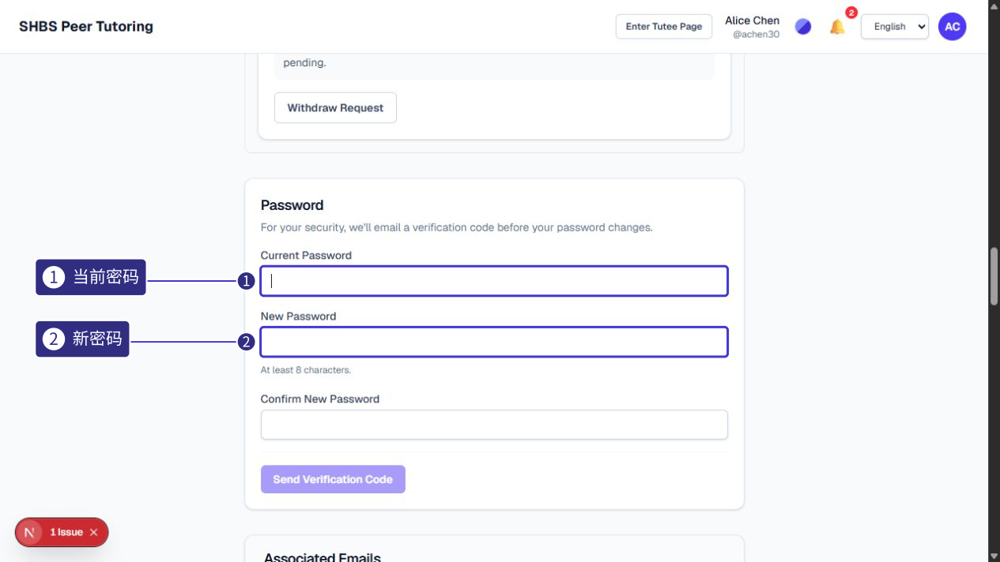

   /settings · EN · 2026-11-16

   密码区要求当前密码、新密码及再次确认；所有凭据字段均为空白。

   [原始完整截图](assets/account-security-step-1.en.jpg) · `589c055e4b1cf166b48b353bd619ac1982e5d9f6` · Latest-main development baseline 589c055e with the Help candidate; synthetic demonstration data.

   已为本步骤添加标注，原始完整截图保持不变。

   - **1.** 当前密码

   - **2.** 新密码

2. **确认所需更改** 修改密码时输入八至一千零二十四字符的新密码，再使用该区域的确认操作。更改双重验证时，核对正在启用还是关闭个人偏好，并单独确认。

   请注意: 双重验证偏好及其独立安全确认

   **视图 1**

   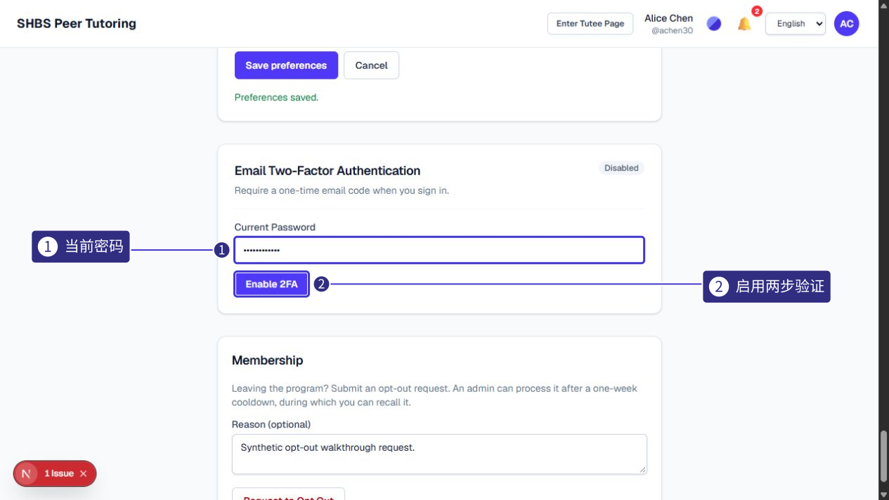

   /settings · EN · 2026-11-16

   双重验证区显示原生遮罩的当前密码及明确启用双重验证按钮；此截图尚未提交更改。

   [原始完整截图](assets/account-security-step-2.en.jpg) · `589c055e4b1cf166b48b353bd619ac1982e5d9f6` · Latest-main development baseline 589c055e with the Help candidate; synthetic demonstration data.

   已为本步骤添加标注，原始完整截图保持不变。

   - **1.** 当前密码

   - **2.** 启用两步验证

   **视图 2**

   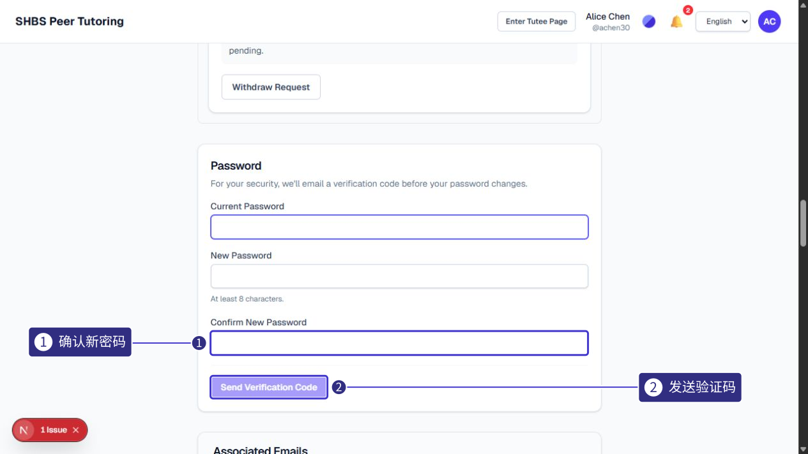

   /settings · EN · 2026-11-16

   密码更改字段及本区发送验证码按钮；为保护凭据，字段刻意留空，本截图未执行密码更改。

   [原始完整截图](assets/account-security-step-2-view-2.en.jpg) · `589c055e4b1cf166b48b353bd619ac1982e5d9f6` · Latest-main development baseline 589c055e with the Help candidate; synthetic demonstration data.

   已为本步骤添加标注，原始完整截图保持不变。

   - **1.** 确认新密码

   - **2.** 发送验证码

3. **修改密码后重新登录** 密码修改成功后会返回登录页，并撤销其他现有会话。使用新密码登录；如需双重验证，请确保主要邮箱可用。

   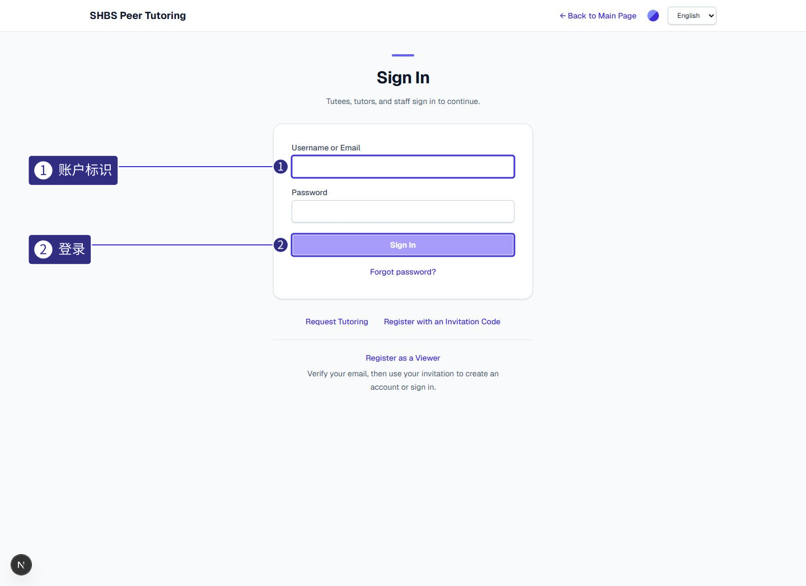

   /signin · EN · 2026-11-16

   登录入口及空白凭据字段；此图说明修改密码后返回的位置，不表示已实际修改密码。

   [原始完整截图](assets/account-security-step-3.en.jpg) · `589c055e4b1cf166b48b353bd619ac1982e5d9f6` · Latest-main development baseline 589c055e with the Help candidate; synthetic demonstration data.

   已为本步骤添加标注，原始完整截图保持不变。

   - **1.** 账户标识

   - **2.** 登录

### 预期结果

所需安全偏好已保存，或可使用新密码重新登录。

### 工作原理

邮箱双重验证同时依赖项目功能及个人偏好。已验证备用邮箱不能绕过此要求。安全警报和验证邮件不受可选通知开关控制。

### 问题排查

- **密码确认次数过多** 等待十五分钟再重试。每账户共享十次检查额度，包括跨设置和特权确认的成功检查；重新登录不会重置额度。

- **旧密码超过输入上限** 先通过忘记密码将其更换为八至一千零二十四字符，再更改设置。

## 管理主要与备用邮箱

验证新邮箱、选择主要邮箱，并移除不再使用的备用邮箱。

打开: `/my-account#associated-emails`

### 开始之前

- 打开关联邮箱，并知道当前密码。

### 操作步骤

1. **添加并验证邮箱** 启用备用邮箱绑定时，输入新地址和当前密码，然后填写该邮箱收到的验证码。最多允许五个备用地址，待验证地址也计入。

   请注意: 关联邮箱与验证状态

   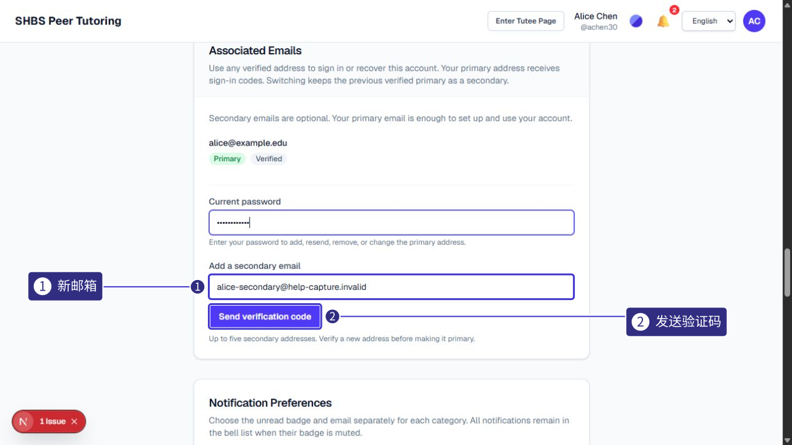

   /settings · EN · 2026-11-16

   次要邮箱输入区使用虚构地址及原生密码遮罩，邮箱核验尚未完成。

   [原始完整截图](assets/account-emails-step-1.en.jpg) · `589c055e4b1cf166b48b353bd619ac1982e5d9f6` · Latest-main development baseline 589c055e with the Help candidate; synthetic demonstration data.

   已为本步骤添加标注，原始完整截图保持不变。

   - **1.** 新邮箱

   - **2.** 发送验证码

2. **处理待验证地址** 重新输入当前密码，才能使用重发验证码或取消待验证。验证码过期或未收到时选择重发验证码；移除申请时，选择邮箱旁的取消待验证。验证码有效十分钟，允许五次尝试，重发间隔一分钟。

   **视图 1**

   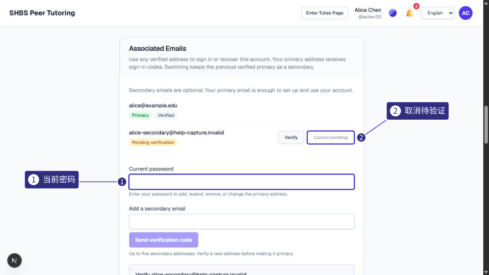

   /settings#associated-emails · EN · 2026-11-16

   待验证邮箱已列出；当前密码为空时，取消待验证不可用。重新输入现有密码才能启用待验证操作；验证码表单位于下方。

   [原始完整截图](assets/account-emails-step-2.en.jpg) · `dd970ea426016e85cb514beeeab537c3ab2e5098` · Latest-main development baseline dd970ea4, selected 2026-11-16, with the Help candidate; synthetic demonstration data.

   已为本步骤添加标注，原始完整截图保持不变。

   - **1.** 当前密码

   - **2.** 取消待验证

   **视图 2**

   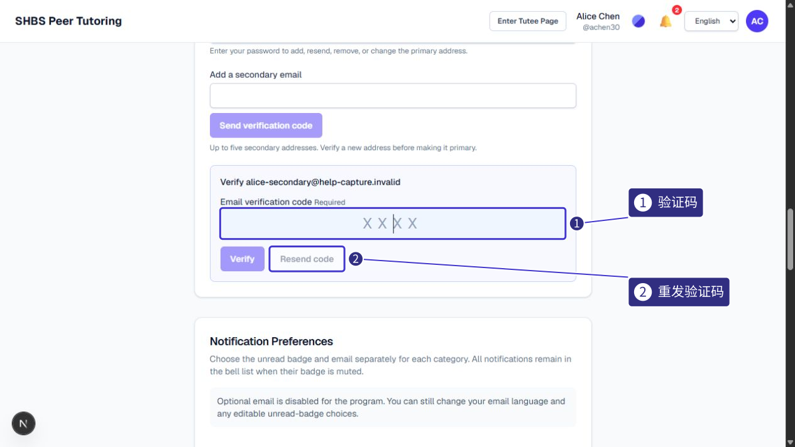

   /settings#associated-emails · EN · 2026-11-16

   待验证邮箱提供空白验证码输入框及独立的重发验证码操作。须在上一部分重新输入当前密码，重发才会启用；画面未显示验证码或密码。

   [原始完整截图](assets/account-emails-step-2-view-2.en.jpg) · `dd970ea426016e85cb514beeeab537c3ab2e5098` · Latest-main development baseline dd970ea4, selected 2026-11-16, with the Help candidate; synthetic demonstration data.

   已为本步骤添加标注，原始完整截图保持不变。

   - **1.** 验证码

   - **2.** 重发验证码

3. **选择主要邮箱或移除备用邮箱** 输入当前密码，再选择已验证备用邮箱旁的设为主要邮箱。操作立即提交，原已验证主要邮箱成为备用邮箱。移除备用邮箱前，确认预期主要邮箱已标记，重新输入当前密码，再选择该备用邮箱旁的移除。此操作没有另一个确认弹窗。

   **视图 1**

   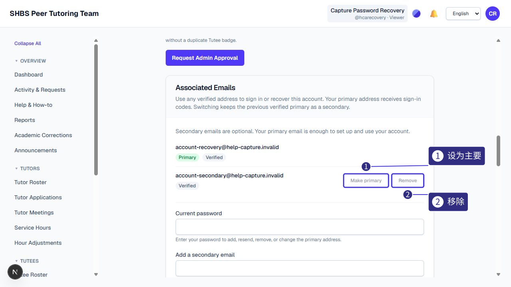

   /admin/account#associated-emails · EN · 2026-11-16

   实际本地邮箱验证已产生已验证备用邮箱。设为主要邮箱与移除是独立行操作，使用前须输入当前密码。当前主要邮箱尚未改变。

   [原始完整截图](assets/account-emails-step-3.en.jpg) · `dd970ea426016e85cb514beeeab537c3ab2e5098` · Latest-main development baseline dd970ea4, selected 2026-11-16, with the Help candidate; synthetic demonstration data.

   已为本步骤添加标注，原始完整截图保持不变。

   - **1.** 设为主要

   - **2.** 移除

   **视图 2**

   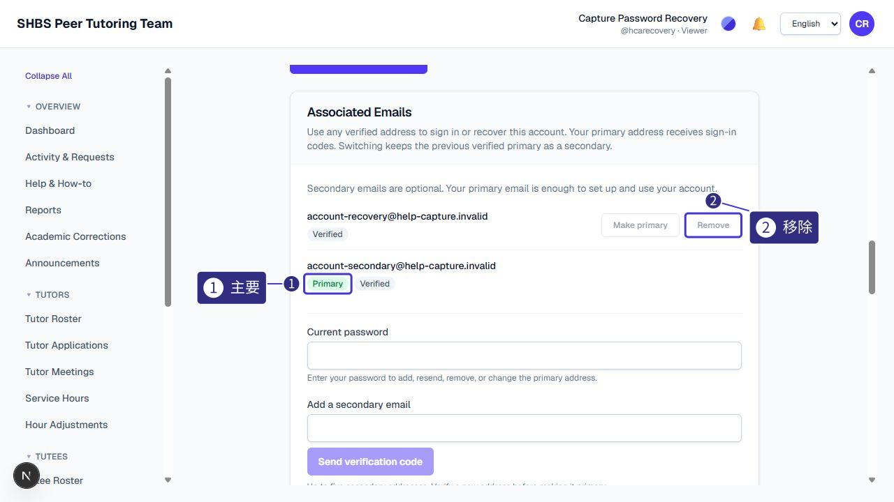

   /admin/account#associated-emails · EN · 2026-11-16

   实际保存结果将account-secondary标为主要邮箱。原主要邮箱仍作为已验证备用地址保留，并有独立移除操作；密码输入框再次为空。

   [原始完整截图](assets/account-emails-step-3-view-2.en.jpg) · `dd970ea426016e85cb514beeeab537c3ab2e5098` · Latest-main development baseline dd970ea4, selected 2026-11-16, with the Help candidate; synthetic demonstration data.

   已为本步骤添加标注，原始完整截图保持不变。

   - **1.** 主要

   - **2.** 移除

   **视图 3**

   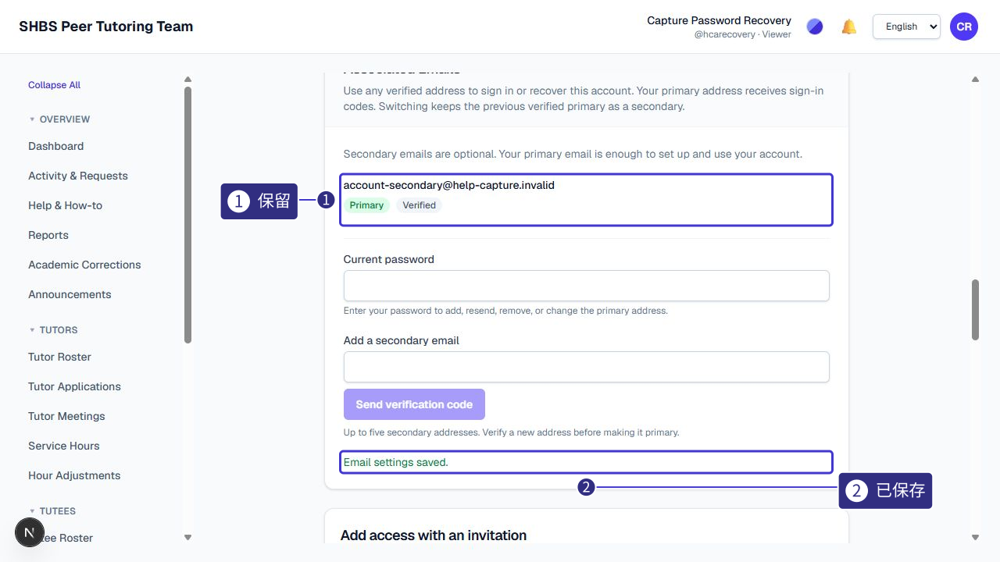

   /admin/account#associated-emails · EN · 2026-11-16

   实际移除后仅保留预期已验证主要邮箱。旧备用地址已不再列出，页面显示邮箱设置已保存；密码输入框已清空。

   [原始完整截图](assets/account-emails-step-3-view-3.en.jpg) · `dd970ea426016e85cb514beeeab537c3ab2e5098` · Latest-main development baseline dd970ea4, selected 2026-11-16, with the Help candidate; synthetic demonstration data.

   已为本步骤添加标注，原始完整截图保持不变。

   - **1.** 保留

   - **2.** 已保存

   **视图 4**

   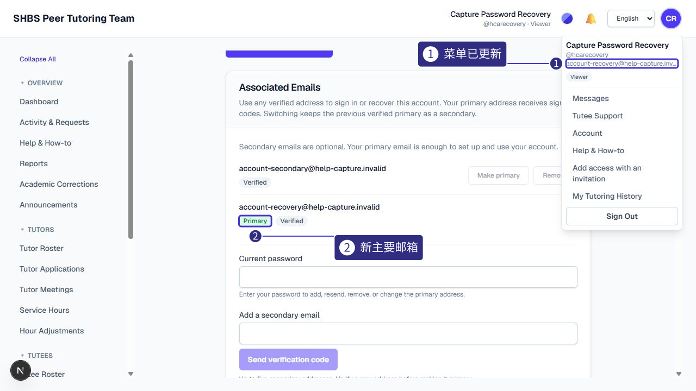

   /admin/account · EN · 2026-11-16

   实际验证的邮箱现已成为主要邮箱。没有重新加载、导航或退出，打开的账户菜单已显示相同当前地址。原主要邮箱保留为已验证备用邮箱，密码框已清空。

   [原始完整截图](assets/account-emails-step-3-view-4.en.jpg) · `dd970ea426016e85cb514beeeab537c3ab2e5098` · Latest-main development baseline dd970ea4, selected 2026-11-16, with the Help candidate; synthetic demonstration data.

   已为本步骤添加标注，原始完整截图保持不变。

   - **1.** 菜单已更新

   - **2.** 新主要邮箱

### 预期结果

每个地址显示明确的已验证或待验证状态，所需主要邮箱已标记。

### 工作原理

任一已验证地址均可登录或恢复同一账户。登录双重验证码仍发送到主要邮箱。主要邮箱变更更新明确关联的当前联系记录，但保留身份、角色及签署历史。移除地址会撤销其未完成授权。

### 问题排查

- **无法添加或验证** 发送后若重发验证码或取消待验证不可用，请重新输入当前密码，并等待重发冷却结束。查看项目备用邮箱绑定提示：关闭时，已有验证地址仍可使用或移除，待验证申请可取消，主要邮箱变更仍可用。

- **邮箱所有权冲突** 不要另建账户。所有权在验证时重新检查，待验证地址不会被保留；异常冲突请管理团队审核。

## 选择通知角标、邮件及语言

分别设置通知类别，并了解必需通知与退订链接。

打开: `/my-account#notification-preferences`

### 开始之前

- 打开账户→通知偏好，也可通过铃铛中的链接进入。

### 操作步骤

1. **选择角标与可选邮件** 分别设置各类别的未读角标与可选邮件。即将发生事件提醒仅通过邮件发送。标记为管理员要求的选项保持勾选，不能更改。

   请注意: 通知类别与邮件语言

   **视图 1**

   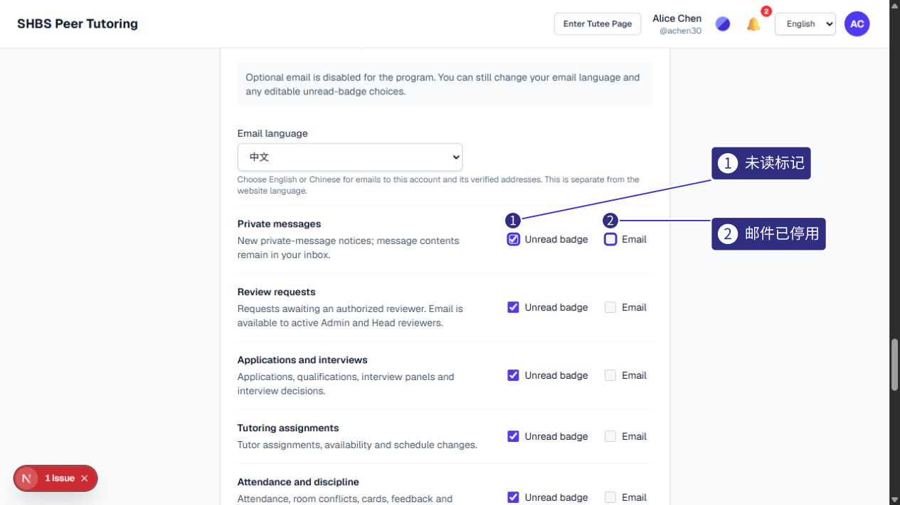

   /settings · EN · 2026-11-16

   通知偏好区分别显示未读标记与邮件选项；此演示中，项目已关闭可选邮件。

   [原始完整截图](assets/notification-preferences-step-1.en.jpg) · `589c055e4b1cf166b48b353bd619ac1982e5d9f6` · Latest-main development baseline 589c055e with the Help candidate; synthetic demonstration data.

   已为本步骤添加标注，原始完整截图保持不变。

   - **1.** 未读标记

   - **2.** 邮件已停用

   **视图 2**

   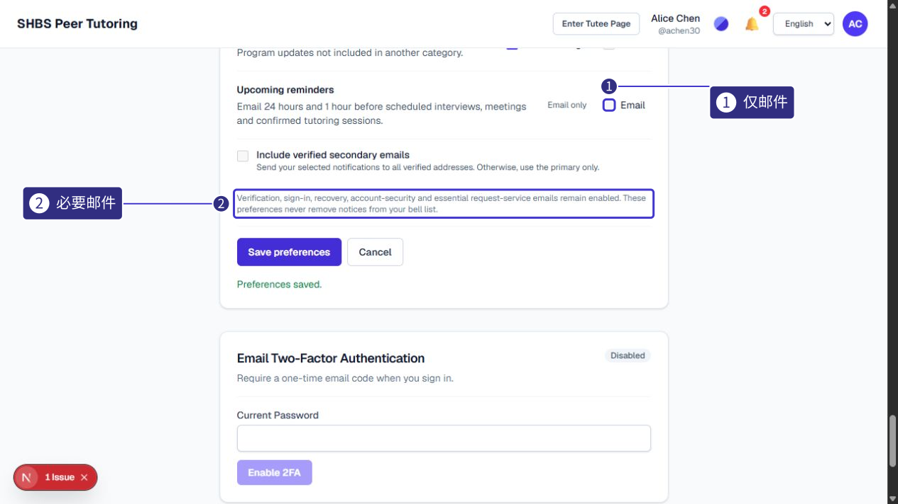

   /settings · EN · 2026-11-16

   通知偏好底部显示已核验次要邮箱投递、必要邮件说明及实际偏好已保存回执。

   [原始完整截图](assets/notification-preferences-step-1-view-2.en.jpg) · `589c055e4b1cf166b48b353bd619ac1982e5d9f6` · Latest-main development baseline 589c055e with the Help candidate; synthetic demonstration data.

   已为本步骤添加标注，原始完整截图保持不变。

   - **1.** 仅邮件

   - **2.** 必要邮件

2. **选择投递语言与邮箱** 选择英语或中文邮件；提供该选项时可包含已验证备用邮箱。保存应用本区域设置，取消放弃草稿。邮件语言不会改变网站语言。

   **视图 1**

   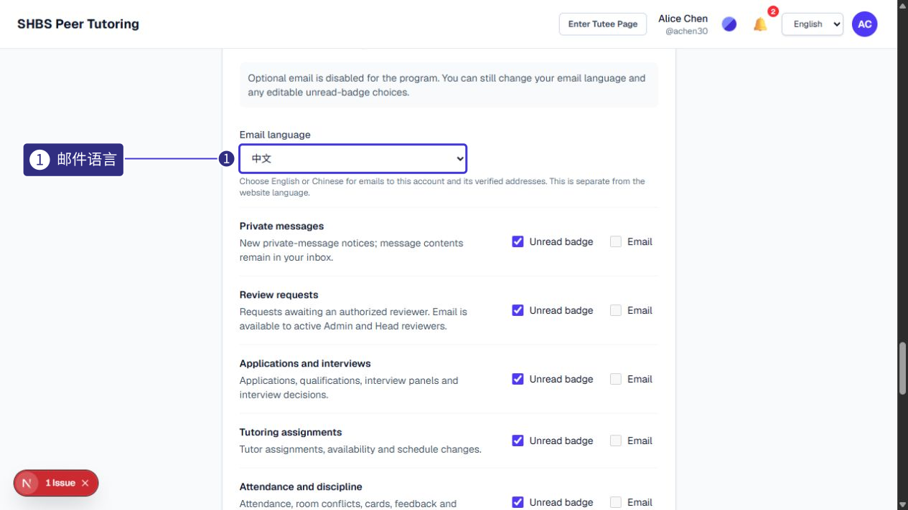

   /settings · EN · 2026-11-16

   英文网站中将邮件语言选择为中文；两种语言互相独立，仍需使用本区保存按钮。

   [原始完整截图](assets/notification-preferences-step-2.en.jpg) · `589c055e4b1cf166b48b353bd619ac1982e5d9f6` · Latest-main development baseline 589c055e with the Help candidate; synthetic demonstration data.

   已为本步骤添加标注，原始完整截图保持不变。

   - **1.** 邮件语言

   **视图 2**

   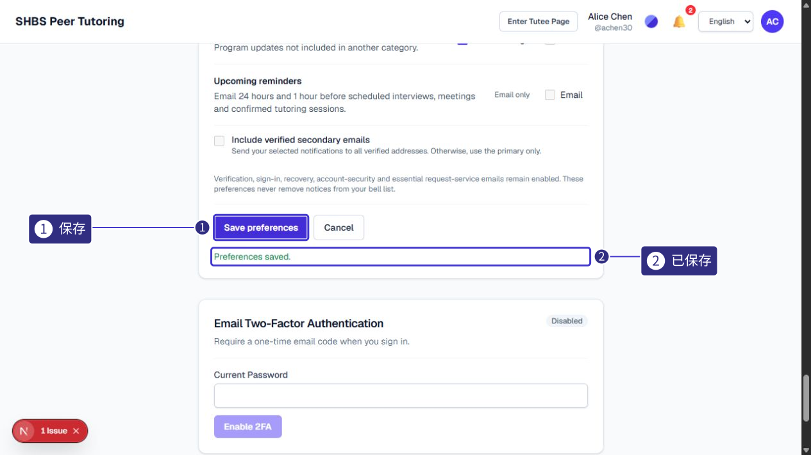

   /settings · EN · 2026-11-16

   通知偏好底部显示已核验次要邮箱投递、必要邮件说明及实际偏好已保存回执。

   [原始完整截图](assets/notification-preferences-step-2-view-2.en.jpg) · `589c055e4b1cf166b48b353bd619ac1982e5d9f6` · Latest-main development baseline 589c055e with the Help candidate; synthetic demonstration data.

   已为本步骤添加标注，原始完整截图保持不变。

   - **1.** 保存

   - **2.** 已保存

3. **明确使用退订链接** 可选通知中的退订链接仅打开审核页，不会立即更改设置。选择具体类别或所有未锁定可选邮件并确认。之后可在通知偏好中恢复。

   **视图 1**

   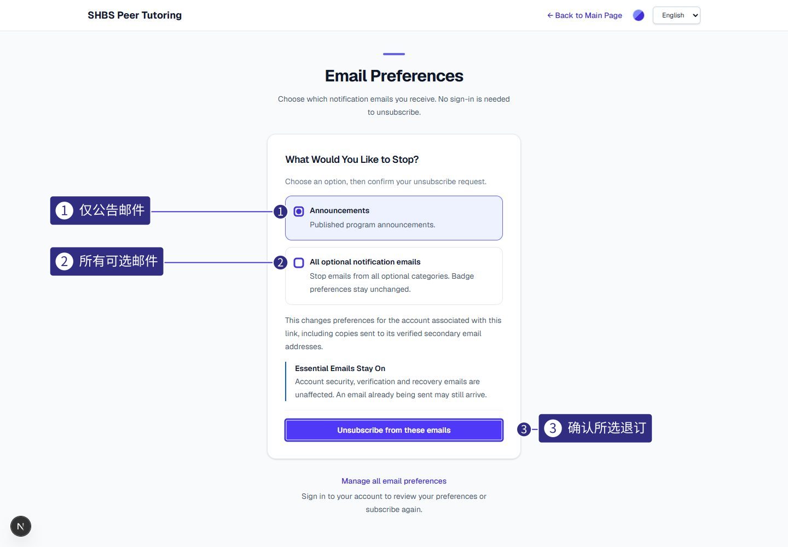

   /unsubscribe · EN · 2026-11-20

   已收到的公告邮件中，“退订”链接会打开无需登录的确认页面。当前选中“公告”，也可以单独选择所有可选通知邮件。

   [原始完整截图](assets/notification-preferences-step-3.en.jpg) · `b5ece465681957c9fe579d26babdeb260c674fa0` · Latest-main development baseline b5ece465, selected 2026-11-20, with the Help candidate. Isolated synthetic first-report demonstration phase.

   已为本步骤添加标注，原始完整截图保持不变。

   - **1.** 仅公告邮件

   - **2.** 所有可选邮件

   - **3.** 确认所选退订

   **视图 2**

   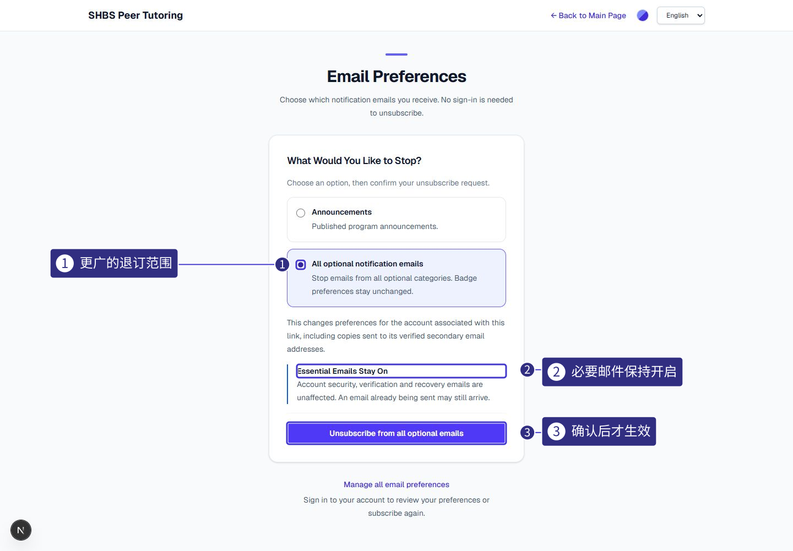

   /unsubscribe · EN · 2026-11-20

   选择所有可选邮件只改变当前的待确认选项。必要邮件仍会发送，点击确认按钮后退订才生效。

   [原始完整截图](assets/notification-preferences-step-3-view-2.en.jpg) · `b5ece465681957c9fe579d26babdeb260c674fa0` · Latest-main development baseline b5ece465, selected 2026-11-20, with the Help candidate. Isolated synthetic first-report demonstration phase.

   已为本步骤添加标注，原始完整截图保持不变。

   - **1.** 更广的退订范围

   - **2.** 必要邮件保持开启

   - **3.** 确认后才生效

### 预期结果

保存偏好后控制符合条件的角标和可选邮件，必需安全及申请状态邮件仍保留。

### 工作原理

关闭角标会保留通知及已读状态。可选邮件依赖项目邮件开关、已验证地址及类别资格。提醒涵盖符合条件的面试、会议及已确认辅导，并在发送前再次检查。

退订作用于账户该类别，包括主要邮箱和已包含的备用邮箱。不能关闭管理员要求的选项。链接九十天后过期，应保持私密。

### 问题排查

- **邮件选项不可用或未收到邮件** 检查项目邮件提示、邮箱验证状态及已保存选项。向管理团队询问投递警告；排队成功不代表到达收件箱。安全与验证邮件遵循独立规则。

## 阅读并接受当前参与政策

参与前核对具体修订版，也可重新打开阅读而不再次签署。

打开: `/student?view=dashboard`

### 开始之前

- 已发布政策适用于你的辅导伙伴或学习伙伴资格。

### 操作步骤

1. **打开所需文档** 学习伙伴在本人页面打开概览；辅导伙伴通过/dashboard打开辅导政策提醒。跟随适用政策提示阅读所选译文，无译文时使用英语。兼有两种资格的账户需分别检查两项适用政策。

   请注意: 已打开的政策文档、滚动区域及同意控件

   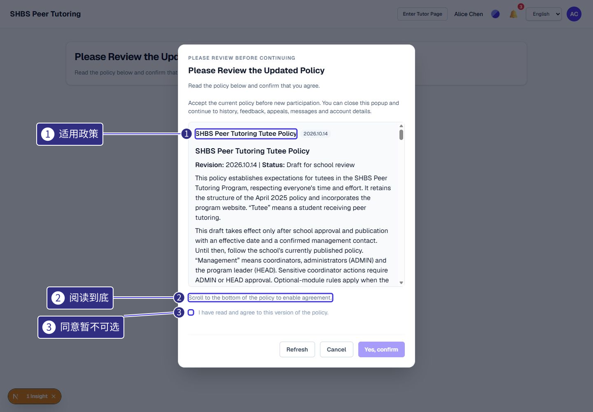

   /student · EN · 2026-11-20

   学习伙伴工作区打开适用的学习伙伴政策审核。英文文档显示版本2026.10.14。只有将文档框滚动到底部后才可勾选同意。

   [原始完整截图](assets/read-accept-policy-step-1.en.jpg) · `b5ece465681957c9fe579d26babdeb260c674fa0` · Latest-main development baseline b5ece465, selected 2026-11-20, with the Help candidate and synthetic demo records.

   已为本步骤添加标注，原始完整截图保持不变。

   - **1.** 适用政策

   - **2.** 阅读到底

   - **3.** 同意暂不可选

2. **阅读到底并同意** 使用触摸、鼠标或键盘在政策文本框内滚动到底部。随后主动勾选同意，按要求签名并完成五秒确认。倒计时不会自动提交。

   **视图 1**

   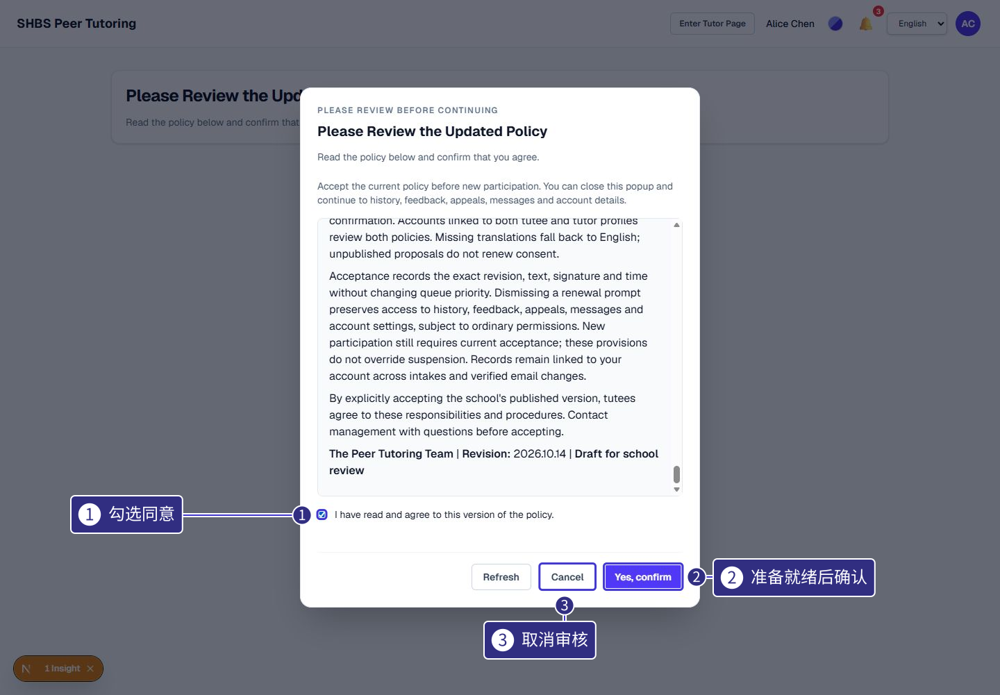

   /student · EN · 2026-11-20

   滚动到文档底部后可勾选同意。五秒审核结束后可选择确认。本次演示停留在审核并选择取消。

   [原始完整截图](assets/read-accept-policy-step-2.en.jpg) · `b5ece465681957c9fe579d26babdeb260c674fa0` · Latest-main development baseline b5ece465, selected 2026-11-20, with the Help candidate and synthetic demo records.

   已为本步骤添加标注，原始完整截图保持不变。

   - **1.** 勾选同意

   - **2.** 准备就绪后确认

   - **3.** 取消审核

   **视图 2**

   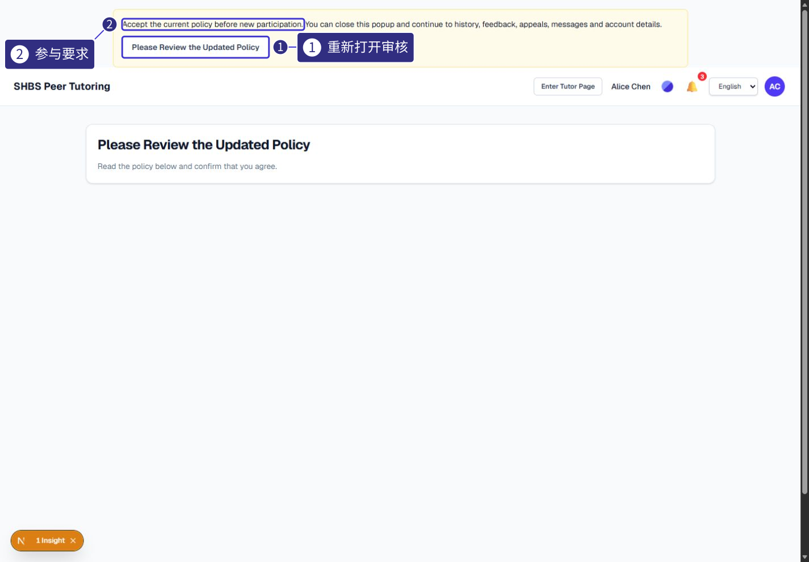

   /student · EN · 2026-11-20

   取消后仍可重新打开审核，新的学习伙伴参与仍需接受政策。现有账户及历史记录仍可访问。

   [原始完整截图](assets/read-accept-policy-step-2-view-2.en.jpg) · `b5ece465681957c9fe579d26babdeb260c674fa0` · Latest-main development baseline b5ece465, selected 2026-11-20, with the Help candidate and synthetic demo records.

   已为本步骤添加标注，原始完整截图保持不变。

   - **1.** 重新打开审核

   - **2.** 参与要求

3. **重新阅读且不改变接受记录** 辅导伙伴可点击已接受提示中的当前政策，阅读最新文档。可关闭、按Escape或点击背景退出。仅查看不会记录接受。

   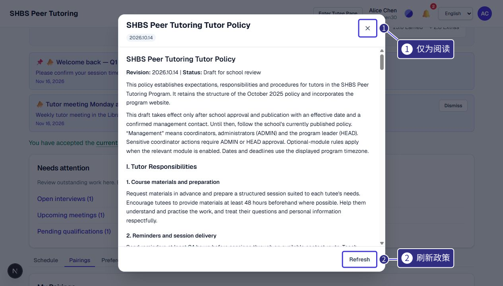

   /dashboard#tutor-pairings · EN · 2026-11-16

   从已接受政策提示重新打开的已发布辅导伙伴政策阅读器

   [原始完整截图](assets/read-accept-policy-step-3.en.jpg) · `589c055e4b1cf166b48b353bd619ac1982e5d9f6` · Latest-main development baseline 589c055e with the Help candidate; synthetic demonstration data.

   已为本步骤添加标注，原始完整截图保持不变。

   - **1.** 仅为阅读

   - **2.** 刷新政策

### 预期结果

已接受修订版满足其参与要求；只读打开不会改变任何记录。

### 工作原理

新发布且适用的修订版需要重新同意。历史签名保留其准确文本。可以取消续签并访问消息、账户设置、已有历史、反馈及申诉，但新的参与操作仍需当前同意。

### 问题排查

- **同意复选框仍不可用** 请在文档框内部滚动，而非仅滚动页面。重新打开或切换修订版、译文会重新开始阅读检查。加载或接受失败时，先使用页面提供的刷新。

## 私下发送消息或回复

选择获准收件人、分别投递，并检查保存结果。

打开: `/messages`

### 开始之前

- 当前账户至少有一个可联系对象，且未受消息限制。

### 操作步骤

1. **打开工作区收件箱** 打开消息。学习伙伴可留在消息页签；管理团队使用/admin/messages。按姓名或用户名搜索，选择最多二十位联系人，并在发送前核对已选列表。

   请注意: 收件人搜索、已选联系人和编辑框

   **视图 1**

   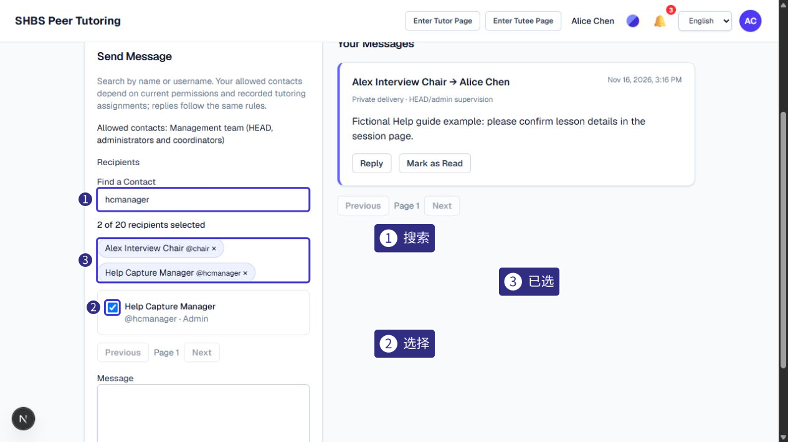

   /messages · EN · 2026-11-16

   Alice 搜索实际获准联系的管理成员，勾选匹配的 Help Capture Manager；已选列表保留分别搜索选中的该管理员与 Alex Interview Chair，共二十人上限中的两人。尚未发送消息。

   [原始完整截图](assets/send-private-messages-step-1.en.jpg) · `dd970ea426016e85cb514beeeab537c3ab2e5098` · Latest-main development baseline dd970ea4, selected 2026-11-16, with the Help candidate; synthetic demonstration data.

   已为本步骤添加标注，原始完整截图保持不变。

   - **1.** 搜索

   - **2.** 选择

   - **3.** 已选

   **视图 2**

   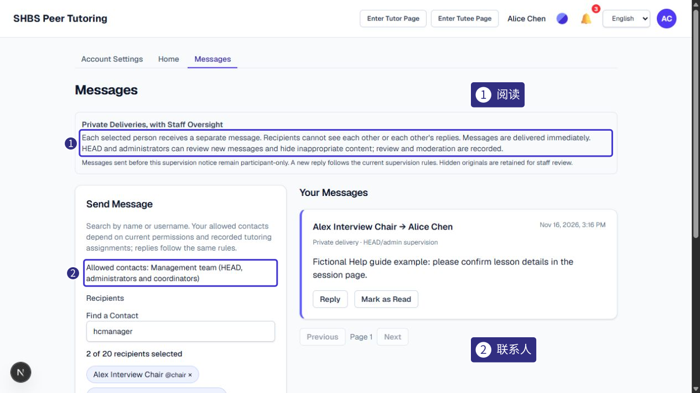

   /messages · EN · 2026-11-16

   消息页上方说明分别私密投递、当前负责人／管理员监督与旧消息边界；Alice 的编辑器还列明实际可联系对象为管理团队。选择收件人及发送前先阅读这些说明。

   [原始完整截图](assets/send-private-messages-step-1-view-2.en.jpg) · `dd970ea426016e85cb514beeeab537c3ab2e5098` · Latest-main development baseline dd970ea4, selected 2026-11-16, with the Help candidate; synthetic demonstration data.

   已为本步骤添加标注，原始完整截图保持不变。

   - **1.** 阅读

   - **2.** 联系人

2. **编辑并发送一次** 阅读编辑框上方的披露说明，输入文字并发送。群选收件人会分别私密投递；收件人看不到其他收件人及其回复。

   **视图 1**

   

   /messages · EN · 2026-11-16

   阅读披露说明后，Alice 为两位已核对且获准的收件人草拟虚构消息。消息内容与发送消息操作均可见；发送一次会分别私密投递，尚未发送。

   [原始完整截图](assets/send-private-messages-step-2.en.jpg) · `dd970ea426016e85cb514beeeab537c3ab2e5098` · Latest-main development baseline dd970ea4, selected 2026-11-16, with the Help candidate; synthetic demonstration data.

   已为本步骤添加标注，原始完整截图保持不变。

   - **1.** 收件人

   - **2.** 消息

   - **3.** 发送

   **视图 2**

   

   /messages · EN · 2026-11-16

   实际发送回执确认分别私密投递给两人；一次发送获接受后，编辑器消息清空，已选收件人数归零。

   [原始完整截图](assets/send-private-messages-step-2-view-2.en.jpg) · `dd970ea426016e85cb514beeeab537c3ab2e5098` · Latest-main development baseline dd970ea4, selected 2026-11-16, with the Help candidate; synthetic demonstration data.

   已为本步骤添加标注，原始完整截图保持不变。

   - **1.** 已发送

   **视图 3**

   

   /messages · EN · 2026-11-16

   已存历史显示一次发送产生的两条投递记录：Alice 分别发给 Alex Interview Chair 与 Help Capture Manager；每条包含相同虚构文字及各自的私密投递说明。

   [原始完整截图](assets/send-private-messages-step-2-view-3.en.jpg) · `dd970ea426016e85cb514beeeab537c3ab2e5098` · Latest-main development baseline dd970ea4, selected 2026-11-16, with the Help candidate; synthetic demonstration data.

   已为本步骤添加标注，原始完整截图保持不变。

   - **1.** 单独投递

   - **2.** 单独投递

3. **回复或返回原草稿** 在消息上选择回复。编辑框显示发送者并聚焦文字框。取消回复会返回独立的普通消息草稿；回复成功后也会返回。

   **视图 1**

   

   /messages · EN · 2026-11-16

   点击回复后，Alice 的编辑器指向 Alex Interview Chair，并保留独立普通草稿。虚构回复已草拟；选择发送消息会发送此回复，选择取消回复则返回保留的普通草稿。

   [原始完整截图](assets/send-private-messages-step-3.en.jpg) · `dd970ea426016e85cb514beeeab537c3ab2e5098` · Latest-main development baseline dd970ea4, selected 2026-11-16, with the Help candidate; synthetic demonstration data.

   已为本步骤添加标注，原始完整截图保持不变。

   - **1.** 回复

   - **2.** 消息

   - **3.** 发送

   - **4.** 取消

   **视图 2**

   

   /messages · EN · 2026-11-16

   取消回复后返回独立普通编辑器，原先虚构的未发送计划草稿完全恢复。取消未发送消息，已选收件人数仍为零。

   [原始完整截图](assets/send-private-messages-step-3-view-2.en.jpg) · `dd970ea426016e85cb514beeeab537c3ab2e5098` · Latest-main development baseline dd970ea4, selected 2026-11-16, with the Help candidate; synthetic demonstration data.

   已为本步骤添加标注，原始完整截图保持不变。

   - **1.** 草稿

   **视图 3**

   

   /messages · EN · 2026-11-16

   回复已发送一次，实际回执确认向一人私密投递。回复模式关闭，原先独立普通草稿未变并已恢复，普通收件人数为零。

   [原始完整截图](assets/send-private-messages-step-3-view-3.en.jpg) · `dd970ea426016e85cb514beeeab537c3ab2e5098` · Latest-main development baseline dd970ea4, selected 2026-11-16, with the Help candidate; synthetic demonstration data.

   已为本步骤添加标注，原始完整截图保持不变。

   - **1.** 草稿

   - **2.** 已发送

   **视图 4**

   

   /messages · EN · 2026-11-16

   最新已存记录显示 Alice 在下午4:34实际回复 Alex Interview Chair 的虚构文字；独立未发送普通草稿仍显示在普通编辑器中。

   [原始完整截图](assets/send-private-messages-step-3-view-4.en.jpg) · `dd970ea426016e85cb514beeeab537c3ab2e5098` · Latest-main development baseline dd970ea4, selected 2026-11-16, with the Help candidate; synthetic demonstration data.

   已为本步骤添加标注，原始完整截图保持不变。

   - **1.** 已回复

4. **将收到的消息标为已读并翻阅历史** 在“我的消息”中，对尚未阅读的收到消息选择“标为已读”。此操作立即保存，没有确认对话框。列表刷新后，该消息的“标为已读”按钮和彩色未读左边框消失；仅打开收件箱或回复不会将其标为已读。使用此列表的“下一页”翻阅较早消息、“上一页”返回，并留意显示的页码和禁用按钮。消息已读状态与铃铛通知相互独立；如需把通知标为已读，请使用铃铛自身的已读控件。

   请注意: 收到消息的标为已读按钮、保存结果与我的消息分页控件

   **视图 1**

   

   /messages · EN · 2026-11-16

   打开收件箱并回复后，Alex 原先收到的消息仍未读；标为已读是明确且立即保存的操作。四条记录均在第1页，因无其他页，上一页与下一页均禁用。

   [原始完整截图](assets/send-private-messages-step-4.en.jpg) · `dd970ea426016e85cb514beeeab537c3ab2e5098` · Latest-main development baseline dd970ea4, selected 2026-11-16, with the Help candidate; synthetic demonstration data.

   已为本步骤添加标注，原始完整截图保持不变。

   - **1.** 已读

   - **2.** 上一页

   - **3.** 下一页

   **视图 2**

   

   /messages · EN · 2026-11-16

   实际立即标为已读后，收到的消息与回复操作仍保留，已读按钮和彩色未读左边框已消失。铃铛仍显示独立未读通知，本次未对铃铛通知进行已读操作。

   [原始完整截图](assets/send-private-messages-step-4-view-2.en.jpg) · `dd970ea426016e85cb514beeeab537c3ab2e5098` · Latest-main development baseline dd970ea4, selected 2026-11-16, with the Help candidate; synthetic demonstration data.

   已为本步骤添加标注，原始完整截图保持不变。

   - **1.** 已读

   - **2.** 通知

### 预期结果

已发历史确认投递，或明确显示失败并保留草稿。收到消息被标为已读并刷新列表后，不再显示该消息的“标为已读”按钮和彩色未读左边框。

### 工作原理

新披露消息可能被管理员／负责人审核或可逆隐藏，操作留有审计证据。旧版仅参与者可见消息保留原边界。联系人资格影响新发送；资格改变后仍可阅读原有获准历史。

### 问题排查

- **已选收件人变为不可用** 发送前任一已选收件人失去资格时，不会投递任何消息。刷新获准联系人、检查选择，再用保留文字重试。已接受的相同重试不会重复投递。

- **离开后草稿消失** 消息草稿仅在当前页面访问期间保留。离开前请私下保留所需文字，不要把参与者信息放入公开问题报告。

## 查找并关联自己的辅导历史

查看接受及提供辅导的历史，或接受工作人员审核的指定历史邀请。

打开: `/history`

### 开始之前

- 登录明确拥有记录的账户，或使用身份审核后提供的私密历史邀请。

### 操作步骤

1. **打开我的辅导历史** 从账户菜单选择“我的辅导历史”。接受辅导和提供辅导分别列出。查看原时期、记录及课次数，再选择最右侧的查看历史。

   请注意: 接受／提供辅导历史与查看历史入口

   **视图 1**

   

   /history · EN · 2026-11-20

   我的辅导历史分别列出接受及提供辅导记录。Alice 这里没有历史学习伙伴报名，其辅导伙伴行显示记录时段、14节课和查看历史。

   [原始完整截图](assets/find-own-history-step-1.en.jpg) · `b5ece465681957c9fe579d26babdeb260c674fa0` · Latest-main development baseline b5ece465, selected 2026-11-20, with the Help candidate and synthetic demo records.

   已为本步骤添加标注，原始完整截图保持不变。

   - **1.** 接受辅导

   - **2.** 提供辅导

   - **3.** 查看历史

   **视图 2**

   

   /settings#notification-preferences · EN · 2026-11-20

   登录后的账户菜单提供我的辅导历史。该链接打开明确属于此账户的历史。

   [原始完整截图](assets/find-own-history-step-1-view-2.en.jpg) · `b5ece465681957c9fe579d26babdeb260c674fa0` · Latest-main development baseline b5ece465, selected 2026-11-20, with the Help candidate and synthetic demo records.

   已为本步骤添加标注，原始完整截图保持不变。

   - **1.** 我的辅导历史

2. **浏览保留证据** 分别使用课次、会议及调整列表的分页控件。辅导课次时数概览不包含单独的手动调整；比较总数时请另外检查。

   **视图 1**

   

   /history · EN · 2026-11-20

   详情显示原始时段、14节课、6条会议记录和9项学时调整。每节课显示保存的学时。会议及调整位于独立列表。

   [原始完整截图](assets/find-own-history-step-2.en.jpg) · `b5ece465681957c9fe579d26babdeb260c674fa0` · Latest-main development baseline b5ece465, selected 2026-11-20, with the Help candidate and synthetic demo records.

   已为本步骤添加标注，原始完整截图保持不变。

   - **1.** 证据数量

   - **2.** 课程

   - **3.** 已存学时

   **视图 2**

   

   /history · EN · 2026-11-20

   在同一历史弹窗内滚动可找到会议出勤和学时调整。已保存的面试学时与辅导课时分开列出。本例各列表均只需一页。

   [原始完整截图](assets/find-own-history-step-2-view-2.en.jpg) · `b5ece465681957c9fe579d26babdeb260c674fa0` · Latest-main development baseline b5ece465, selected 2026-11-20, with the Help candidate and synthetic demo records.

   已为本步骤添加标注，原始完整截图保持不变。

   - **1.** 会议出勤

   - **2.** 学时调整

   - **3.** 独立额外学时

3. **受邀时接受指定历史权限** 没有登录账户的校友可验证邀请指定邮箱，经邀请弹窗完成账户确认，再核对列出的源记录并选择关联我的历史。已有账户使用正常登录或恢复。

   **视图 1**

   

   /history/claim · EN · 2026-11-21

   已验证的现有收件人在固定审阅中看到原辅导伙伴及学习伙伴记录。关联不会授予当前参与资格。

   [原始完整截图](assets/find-own-history-step-3.en.jpg) · `b5ece465681957c9fe579d26babdeb260c674fa0` · Latest-main development baseline b5ece465, selected 2026-11-20, with the Help candidate and synthetic demo records.

   已为本步骤添加标注，原始完整截图保持不变。

   - **1.** 原记录编号

   - **2.** 确认自己的记录

   - **3.** 关联我的历史

   **视图 2**

   

   /history/claim · EN · 2026-11-21

   真实邀请页面提供现有账户登录，也提供独立的仅历史账户表单。受邀邮箱栏仍为空。

   [原始完整截图](assets/find-own-history-step-3-view-2.en.jpg) · `b5ece465681957c9fe579d26babdeb260c674fa0` · Latest-main development baseline b5ece465, selected 2026-11-20, with the Help candidate and synthetic demo records.

   已为本步骤添加标注，原始完整截图保持不变。

   - **1.** 登录已有账户

   - **2.** 受邀邮箱

   - **3.** 验证邮箱

### 预期结果

仅显示明确拥有或经指定审核关联的记录；不会创建当前参与报名。

### 工作原理

参与权限被撤销或档案归档后，历史仍可能可读。姓名或邮箱匹配不代表所有权；同一账户可有多个历史档案。关联历史不会重新激活参与、授予徽章或补造政策同意。

### 问题排查

- **缺少记录或旧邮箱不可用** 请工作人员检查准确原记录及身份证据。经授权可用替代审核邀请；不要认领看似相近的记录或另建重复账户。

## 在个人日历订阅已确认课次

使用私密订阅链接，并按需更换或撤销。

打开: `/student?view=schedule`

### 开始之前

- 辅导伙伴或学习伙伴课次页面提供日历订阅。

### 操作步骤

1. **打开课次日历控件** 学习伙伴打开我的辅导伙伴与课表，辅导伙伴打开/dashboard#sessions的课表。选择日历订阅，并阅读私密链接说明及当前可用状态。

   请注意: 可用时的日历订阅控件

   

   /student?view=schedule · EN · 2026-11-20

   打开我的辅导伙伴与安排，在按日期的日程上方找到日历订阅。当前每周日程显示已确认的课程。

   [原始完整截图](assets/session-calendar-step-1.en.jpg) · `b5ece465681957c9fe579d26babdeb260c674fa0` · Latest-main development baseline b5ece465, selected 2026-11-20, with the Help candidate and synthetic demo records.

   已为本步骤添加标注，原始完整截图保持不变。

   - **1.** 排课工作区

   - **2.** 日历订阅

   - **3.** 每周日程

   - **4.** 已确认日期

2. **创建并复制私密链接** 选择创建私密链接，阅读创建会撤销旧链接的提示，再确认创建私密链接。关闭弹窗前，将显示的私密订阅链接复制到日历应用。网址仅在本次打开期间显示，之后重新打开不会再次显示。

   

   /student?view=schedule · EN · 2026-11-20

   选择创建私密链接，在确认前阅读旧链接提示。新链接仅在确认后显示，因此本图展示链接出现前的审核。

   [原始完整截图](assets/session-calendar-step-2.en.jpg) · `b5ece465681957c9fe579d26babdeb260c674fa0` · Latest-main development baseline b5ece465, selected 2026-11-20, with the Help candidate and synthetic demo records.

   已为本步骤添加标注，原始完整截图保持不变。

   - **1.** 旧链接停止

   - **2.** 创建私密链接

   - **3.** 取消

3. **核对已确认约会** 以网站中已约定课次时间和教室为最终依据。待处理提议与聊天消息不属于已确认约会。

   

   /dashboard#sessions · EN · 2026-11-20

   辅导伙伴的日期议程显示已同意的数学课程。卡片显示11月25日17:30至18:15、Emma Sun、A102教室及已改期状态。

   [原始完整截图](assets/session-calendar-step-3.en.jpg) · `b5ece465681957c9fe579d26babdeb260c674fa0` · Latest-main development baseline b5ece465, selected 2026-11-20, with the Help candidate and synthetic demo records.

   已为本步骤添加标注，原始完整截图保持不变。

   - **1.** 已同意时间

   - **2.** 当前教室

   - **3.** 已改期

4. **更换或撤销已分享链接** 链接丢失或泄露时，选择替换私密链接，检查并确认，再复制新网址并更新个人日历。全部旧链接停止更新。选择撤销私密链接并确认，可停止订阅而不改变课次。请勿在公开报告中包含订阅网址。

   **视图 1**

   

   /student?view=schedule · EN · 2026-11-20

   重新打开面板可替换或撤销已保存的订阅。一次性显示的私密链接已隐藏。

   [原始完整截图](assets/session-calendar-step-4.en.jpg) · `b5ece465681957c9fe579d26babdeb260c674fa0` · Latest-main development baseline b5ece465, selected 2026-11-20, with the Help candidate and synthetic demo records.

   已为本步骤添加标注，原始完整截图保持不变。

   - **1.** 私密链接

   - **2.** 替换

   - **3.** 撤销

   **视图 2**

   

   /student?view=schedule · EN · 2026-11-20

   操作前阅读撤销影响。本次审核已取消，模拟订阅仍处于启用状态。

   [原始完整截图](assets/session-calendar-step-4-view-2.en.jpg) · `b5ece465681957c9fe579d26babdeb260c674fa0` · Latest-main development baseline b5ece465, selected 2026-11-20, with the Help candidate and synthetic demo records.

   已为本步骤添加标注，原始完整截图保持不变。

   - **1.** 停止订阅

   - **2.** 确认撤销

   - **3.** 取消

### 预期结果

个人日历使用当前私密链接订阅，或旧链接已撤销。

### 工作原理

日历应用按自身周期刷新，可能滞后于网站。该链接是一种私密访问凭证，持有人可能读取其授权日历。

### 问题排查

- **日历仍显示旧时间** 先确认网站最终约定结果，再在日历应用刷新订阅。检查已替换更换后的链接，而非导入旧静态副本。
