# 我的账户

由网站帮助目录生成。请修改内容源文件后运行 `npm run help:export`。

[目录与截图来源](README.md)

截图来源: `dbb3c4eb213d58e134744fd417b1a06299b0e984`. Local dev server based on latest main at task start (dbb3c4eb), with the Help candidate. User-selected source baseline; no live deployment attestation.

此 GitHub 培训副本包含各角色操作说明。实际使用网站功能仍需登录并具备当前项目权限。所有示例数据均为虚构。

- [切换工作区并查看通知](#切换工作区并查看通知)
- [恢复加载或保存失败](#恢复加载或保存失败)
- [更新共享资料及权限申请](#更新共享资料及权限申请)
- [确认学业信息](#确认学业信息)
- [报告离校或申请返校](#报告离校或申请返校)
- [更改密码或双重验证偏好](#更改密码或双重验证偏好)
- [管理主要与备用邮箱](#管理主要与备用邮箱)
- [选择通知角标、邮件及语言](#选择通知角标邮件及语言)
- [阅读并接受当前参与政策](#阅读并接受当前参与政策)
- [私下发送消息或回复](#私下发送消息或回复)
- [查找并关联自己的辅导历史](#查找并关联自己的辅导历史)
- [在个人日历订阅已确认课次](#在个人日历订阅已确认课次)

## 切换工作区并查看通知

使用按权限显示的快捷入口、手机菜单、语言设置和通知铃铛。

打开: `/my-account`

### 开始之前

- 使用现有账户登录。

### 操作步骤

1. **打开账户菜单** 按自身权限选择“进入辅导伙伴页面”、“进入学习伙伴页面”、巡查、翻译或管理区。符合条件的工作人员和观察员可用“返回管理区”。快捷入口不会授予缺失的参与资格。

   请注意: 账户菜单与可用工作区链接

   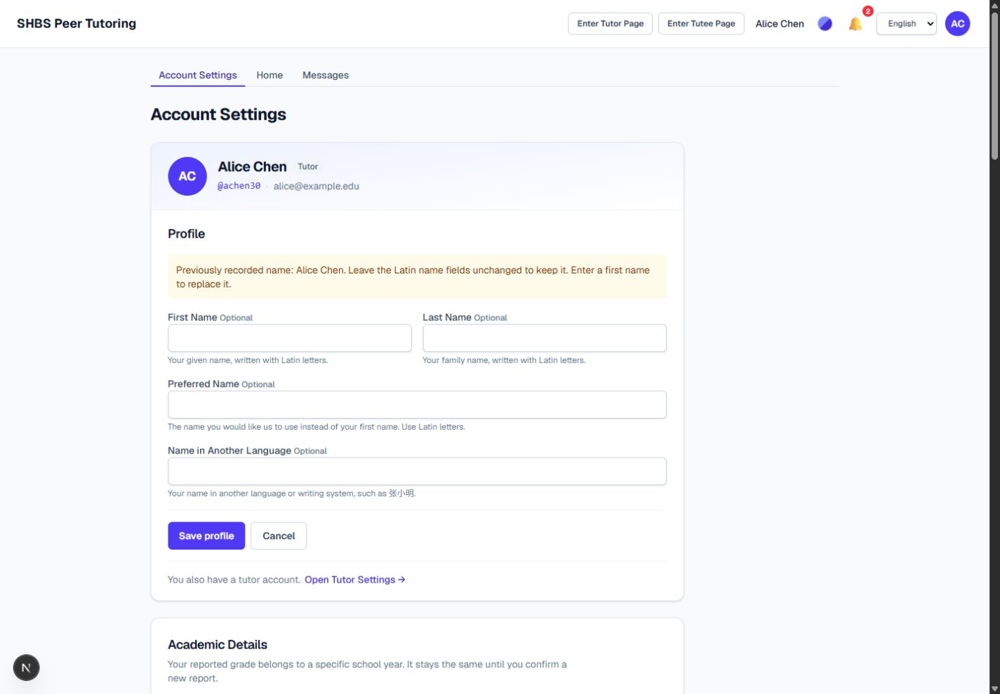

   /my-account · EN · 2026-11-15

2. **使用手机与语言控件** 窄屏下使用“菜单”打开管理导航；选择链接、关闭或按Escape即可收起。页头可切换语言和主题。宽表格请在表格自身区域内横向滚动。

3. **查看自己的通知** 打开铃铛，选择通知进入关联任务，可逐条标为已读或选择“全部已读”。在通知偏好中分别设置角标与可选邮件。

4. **安全排序信息** 点击可排序数据列标题，依次为升序、降序、原始顺序。键盘用户可聚焦后按Enter或空格。排序保留筛选条件，不修改记录。

### 预期结果

进入所需且有权限的工作区，并可通过通知找到对应任务。

### 工作原理

管理职级、辅导伙伴／学习伙伴／巡查资格及翻译分配相互独立。项目模块开关也会影响导航。

### 问题排查

- **缺少页面或快捷入口** 请管理团队检查关联档案、参与资格、离校状态、停用和模块开关。直接输入隐藏页面地址不能绕过服务器权限检查。

## 恢复加载或保存失败

区分待审核、已接受保存、过时草稿与安全的只读重试。

打开: `/my-account`

### 开始之前

- 查看提示时保持相关页面打开。

### 操作步骤

1. **阅读具体状态** “更改已保存”表示写入已接受。“已提交审核”表示提案待审，实时记录尚未改变。列表不可用并不表示列表为空。

   请注意: 各区域的保存、错误或恢复提示

   

   /my-account · EN · 2026-11-15

2. **重试正确操作** 保存失败时，修正问题后主动重试。保存成功但刷新失败时，选择“重试刷新”或“检查申请结果”：这些操作读取已接受结果，不会重新提交。

3. **处理记录变化冲突** 阅读冲突提示。明确选择“重新加载”并成功获取当前证据后，才会替换过时草稿；再次提交前重新核对。关闭或取消不会确认审核。

4. **注意草稿有效范围** 多数编辑器在当前页面仍挂载时保留草稿，包括折叠或切换页签。离开或刷新后不会自动保存。写入进行中可能锁定编辑及关闭，直到结果明确。

### 预期结果

恢复当前记录，并避免意外重复已完成的操作。

### 工作原理

确认倒计时只启用最终按钮，不会自动提交。权限被拒绝时，受保护内容可能隐藏，直到重新成功验证权限。

### 问题排查

- **无法确定操作是否保存** 使用页面提供的结果查询、查看相关记录，或告知管理团队页面及大致时间。不要修改后重新提交结果尚不明确的已执行操作。

## 更新共享资料及权限申请

单独保存姓名信息，并申请符合条件的参与资格，无需重复注册。

打开: `/my-account`

### 开始之前

- 登录并打开账户设置；辅导伙伴也可使用/settings的账户设置。

### 操作步骤

1. **编辑可用姓名字段** 在资料区域按需编辑名字、姓氏、惯用名或其他语言姓名。拉丁字段允许带重音字母、空格、撇号和连字符；其他文字请填入其他语言姓名。

   请注意: 资料字段及下方的保存资料、取消按钮

   

   /my-account · EN · 2026-11-15

2. **保存当前区域** 选择“保存资料”一起保存姓名字段。“取消”恢复上次读取值。密码、邮箱、学业和参与资格各有独立操作，不会由此按钮保存。

3. **申请参与资格或接受邀请** 使用参与资格控件提交符合条件的申请，或用“添加权限”确认已收到的邀请。参与申请不能授予管理职级；应先查看决定，再判断权限是否改变。

### 预期结果

资料区域显示保存结果，或独立权限申请显示实际审核状态。

### 工作原理

当前明确关联的辅导伙伴和学习伙伴档案共享账户姓名。历史申请和签名保留原姓名。姓名显示和必填规则由项目配置决定；系统不会猜测旧姓名的拆分方式。

### 问题排查

- **旧完整姓名没有拆分字段** 仅更正其他信息时，请保持拉丁姓名字段不变。确需修改时，填写真实有效的名字，不要猜测拆分。

- **资料已保存但仍只读** 选择“重试刷新”读取已接受值。如其他人更改了版本，请明确重新加载并核对后再提交。

## 确认学业信息

记录当前学年实际年级，并查看确认历史。

打开: `/my-account#academic-details`

### 开始之前

- 在账户设置中打开学业信息。

### 操作步骤

1. **检查当前记录** 选择“检查学业信息”或“编辑学业信息”，查看已存年级、参考学年及任何需要检查确认的提示。

   请注意: 已打开的学业编辑器、年级选择及参考学年

   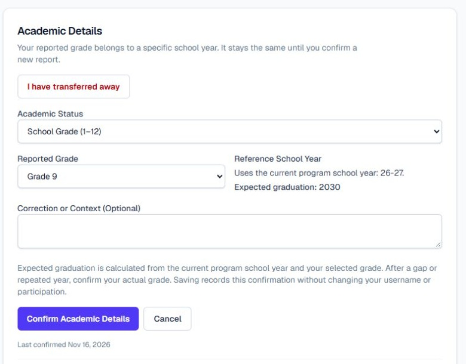

   /my-account · EN · 2026-11-15

2. **选择真实信息** 按实际情况选择开放年级、未知、已毕业或不适用。当前学年自动填写。确认此记录；学业信息与姓名资料分别保存。

3. **查看确认历史** 打开确认历史，查看记录值、来源和日期。邀请完成页若指向此处，请先确认，再按正常辅导激活或巡查重新加入流程继续。

### 预期结果

当前账户学业信息已按记录学年确认。

### 工作原理

预计毕业年份由年级和参考学年推算，不能单独编辑。年级不会自动升级。学业中的已毕业状态本身不会改变参与资格或授予观察权限。原入组学业信息及签署申请仍作为历史证据保留。

### 问题排查

- **编辑时学年发生变化** 重新加载并检查新启用学年后再确认。如未配置当前学年，请联系管理团队；未知及不适用仍可使用。

## 报告离校或申请返校

申请毕业或转学审核，并了解对参与资格的影响。

打开: `/my-account#academic-details`

### 开始之前

- 打开账户设置→学业信息，并使用独立离校控件。

### 操作步骤

1. **打开离校功能** 选择学业信息旁的“我已转学离校”。根据实际情况选择毕业或转学、填写说明，并核对具体影响后确认申请。

   请注意: 离校审核、离校类型及原因

   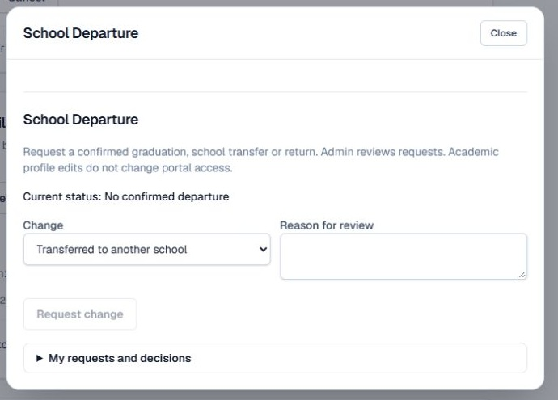

   /my-account#academic-details · EN · 2026-11-15

2. **等待决定** 查看离校申请和历史。由管理员／负责人审核；仅提交不代表离校已确认。确认后，符合条件的“进入观察员门户”可打开脱敏只读概览。

3. **情况改变时申请返校** 再次打开同一离校入口，选择“返回学校”并提供所需原因。获批后，通过正常流程恢复辅导激活或学习报名。

### 预期结果

申请显示实际决定，参与资格仅按已批准结果变化。

### 工作原理

确认离校会结束当前分配及待处理学习申请；离校辅导伙伴的学习伙伴返回匹配。账户角色与个人历史保留。返校获批不会自动恢复分配。独立管理、巡查和翻译权限仍遵循各自规则。

### 问题排查

- **已选择毕业但无法进入观察员门户** 学业毕业状态不等于已确认离校。请检查此独立审核申请，并向管理团队了解观察权限限制。

## 更改密码或双重验证偏好

确认安全更改，并在修改密码后重新登录。

打开: `/my-account#account-password`

### 开始之前

- 知道当前密码，且能使用主要邮箱。

### 操作步骤

1. **打开安全区域** 在账户设置中找到密码或双重验证控件。输入当前密码，并按提示完成邮件安全验证码。

   请注意: 当前密码、新密码及密码确认操作

   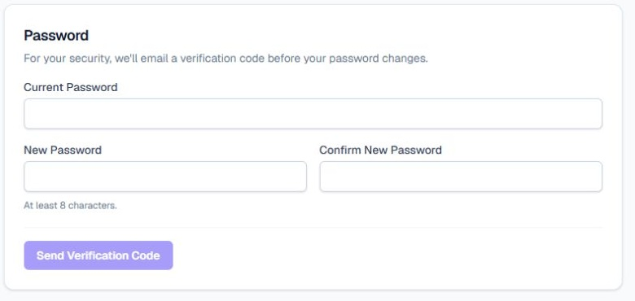

   /my-account#account-password · EN · 2026-11-15

2. **确认所需更改** 修改密码时输入八至一千零二十四字符的新密码，再使用该区域的确认操作。更改双重验证时，核对正在启用还是关闭个人偏好，并单独确认。

   请注意: 双重验证偏好及其独立安全确认

   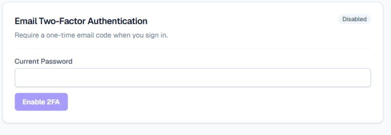

   /my-account#account-twofactor · EN · 2026-11-15

3. **修改密码后重新登录** 密码修改成功后会返回登录页，并撤销其他现有会话。使用新密码登录；如需双重验证，请确保主要邮箱可用。

### 预期结果

所需安全偏好已保存，或可使用新密码重新登录。

### 工作原理

邮箱双重验证同时依赖项目功能及个人偏好。已验证备用邮箱不能绕过此要求。安全警报和验证邮件不受可选通知开关控制。

### 问题排查

- **密码确认次数过多** 等待十五分钟再重试。每账户共享十次检查额度，包括跨设置和特权确认的成功检查；重新登录不会重置额度。

- **旧密码超过输入上限** 先通过忘记密码将其更换为八至一千零二十四字符，再更改设置。

## 管理主要与备用邮箱

验证新邮箱、选择主要邮箱，并移除不再使用的备用邮箱。

打开: `/my-account#associated-emails`

### 开始之前

- 打开关联邮箱，并知道当前密码。

### 操作步骤

1. **添加并验证邮箱** 启用备用邮箱绑定时，输入新地址和当前密码，然后填写该邮箱收到的验证码。最多允许五个备用地址，待验证地址也计入。

   请注意: 关联邮箱与验证状态

   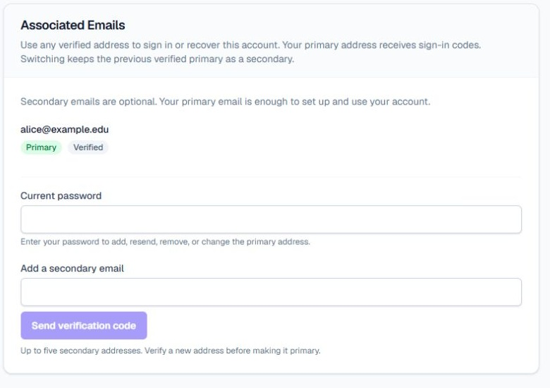

   /my-account#associated-emails · EN · 2026-11-15

2. **处理待验证地址** 验证码过期或未收到时使用重发，或选择取消移除待验证申请。验证码有效十分钟，允许五次尝试，重发间隔一分钟。

3. **选择主要邮箱或移除备用邮箱** 通过密码确认将已验证地址设为主要邮箱。原已验证主要邮箱会成为备用邮箱。移除地址前，先确保另一已验证地址为主要邮箱，再确认移除备用邮箱。

### 预期结果

每个地址显示明确的已验证或待验证状态，所需主要邮箱已标记。

### 工作原理

任一已验证地址均可登录或恢复同一账户。登录双重验证码仍发送到主要邮箱。主要邮箱变更更新明确关联的当前联系记录，但保留身份、角色及签署历史。移除地址会撤销其未完成授权。

### 问题排查

- **无法添加或验证** 查看项目备用邮箱绑定提示。关闭时，已有验证地址仍可使用或移除，待验证申请可取消；主要邮箱变更仍可用。

- **邮箱所有权冲突** 不要另建账户。所有权在验证时重新检查，待验证地址不会被保留；异常冲突请管理团队审核。

## 选择通知角标、邮件及语言

分别设置通知类别，并了解必需通知与退订链接。

打开: `/my-account#notification-preferences`

### 开始之前

- 打开账户→通知偏好，也可通过铃铛中的链接进入。

### 操作步骤

1. **选择角标与可选邮件** 分别设置各类别的未读角标与可选邮件。即将发生事件提醒仅通过邮件发送。标记为管理员要求的选项保持勾选，不能更改。

   请注意: 通知类别与邮件语言

   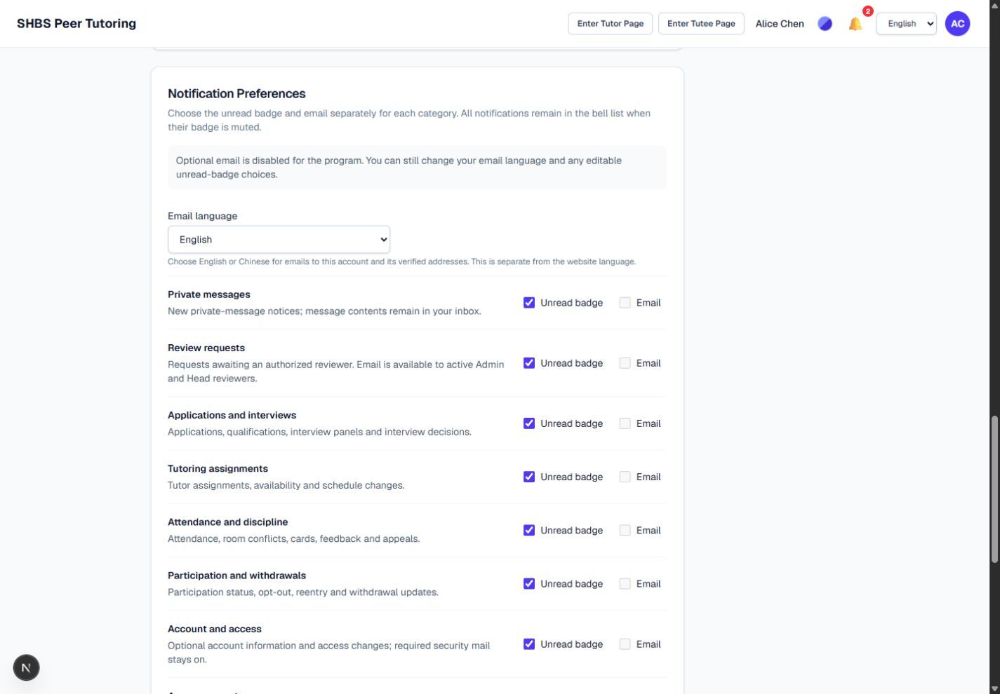

   /my-account#notification-preferences · EN · 2026-11-15

2. **选择投递语言与邮箱** 选择英语或中文邮件；提供该选项时可包含已验证备用邮箱。保存应用本区域设置，取消放弃草稿。邮件语言不会改变网站语言。

3. **明确使用退订链接** 可选通知中的退订链接仅打开审核页，不会立即更改设置。选择具体类别或所有未锁定可选邮件并确认。之后可在通知偏好中恢复。

### 预期结果

保存偏好后控制符合条件的角标和可选邮件，必需安全及申请状态邮件仍保留。

### 工作原理

关闭角标会保留通知及已读状态。可选邮件依赖项目邮件开关、已验证地址及类别资格。提醒涵盖符合条件的面试、会议及已确认辅导，并在发送前再次检查。

退订作用于账户该类别，包括主要邮箱和已包含的备用邮箱。不能关闭管理员要求的选项。链接九十天后过期，应保持私密。

### 问题排查

- **邮件选项不可用或未收到邮件** 检查项目邮件提示、邮箱验证状态及已保存选项。向管理团队询问投递警告；排队成功不代表到达收件箱。安全与验证邮件遵循独立规则。

## 阅读并接受当前参与政策

参与前核对具体修订版，也可重新打开阅读而不再次签署。

打开: `/student?view=dashboard`

### 开始之前

- 已发布政策适用于你的辅导伙伴或学习伙伴资格。

### 操作步骤

1. **打开所需文档** 学习伙伴在本人页面打开概览；辅导伙伴通过/dashboard打开辅导政策提醒。跟随适用政策提示阅读所选译文，无译文时使用英语。兼有两种资格的账户需分别检查两项适用政策。

   请注意: 已打开的政策文档、滚动区域及同意控件

   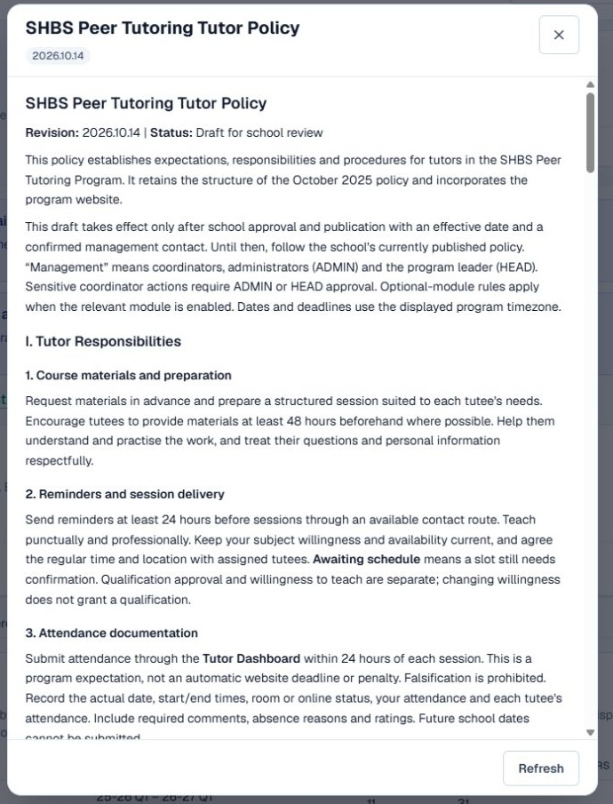

   /dashboard · EN · 2026-11-15

2. **阅读到底并同意** 使用触摸、鼠标或键盘在政策文本框内滚动到底部。随后主动勾选同意，按要求签名并完成五秒确认。倒计时不会自动提交。

3. **重新阅读且不改变接受记录** 辅导伙伴可点击已接受提示中的当前政策，阅读最新文档。可关闭、按Escape或点击背景退出。仅查看不会记录接受。

### 预期结果

已接受修订版满足其参与要求；只读打开不会改变任何记录。

### 工作原理

新发布且适用的修订版需要重新同意。历史签名保留其准确文本。可以取消续签并访问消息、账户设置、已有历史、反馈及申诉，但新的参与操作仍需当前同意。

### 问题排查

- **同意复选框仍不可用** 请在文档框内部滚动，而非仅滚动页面。重新打开或切换修订版、译文会重新开始阅读检查。加载或接受失败时，先使用页面提供的刷新。

## 私下发送消息或回复

选择获准收件人、分别投递，并检查保存结果。

打开: `/messages`

### 开始之前

- 当前账户至少有一个可联系对象，且未受消息限制。

### 操作步骤

1. **打开工作区收件箱** 打开消息。学习伙伴可留在消息页签；管理团队使用/admin/messages。按姓名或用户名搜索，选择最多二十位联系人，并在发送前核对已选列表。

   请注意: 收件人搜索、已选联系人和编辑框

   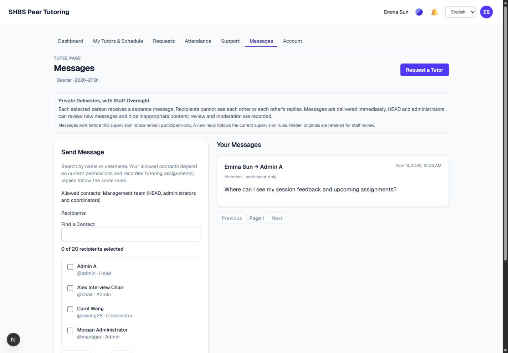

   /student?view=messages · EN · 2026-11-15

2. **编辑并发送一次** 阅读编辑框上方的披露说明，输入文字并发送。群选收件人会分别私密投递；收件人看不到其他收件人及其回复。

3. **回复或返回原草稿** 在消息上选择回复。编辑框显示发送者并聚焦文字框。取消回复会返回独立的普通消息草稿；回复成功后也会返回。

### 预期结果

已发历史确认投递，或明确显示失败并保留草稿。

### 工作原理

新披露消息可能被管理员／负责人审核或可逆隐藏，操作留有审计证据。旧版仅参与者可见消息保留原边界。联系人资格影响新发送；资格改变后仍可阅读原有获准历史。

### 问题排查

- **已选收件人变为不可用** 发送前任一已选收件人失去资格时，不会投递任何消息。刷新获准联系人、检查选择，再用保留文字重试。已接受的相同重试不会重复投递。

- **离开后草稿消失** 消息草稿仅在当前页面访问期间保留。离开前请私下保留所需文字，不要把参与者信息放入公开问题报告。

## 查找并关联自己的辅导历史

查看接受及提供辅导的历史，或接受工作人员审核的指定历史邀请。

打开: `/history`

### 开始之前

- 登录明确拥有记录的账户，或使用身份审核后提供的私密历史邀请。

### 操作步骤

1. **打开我的辅导历史** 从账户菜单选择“我的辅导历史”。接受辅导和提供辅导分别列出。查看原时期、记录及课次数，再选择最右侧的查看历史。

   请注意: 接受／提供辅导历史与查看历史入口

   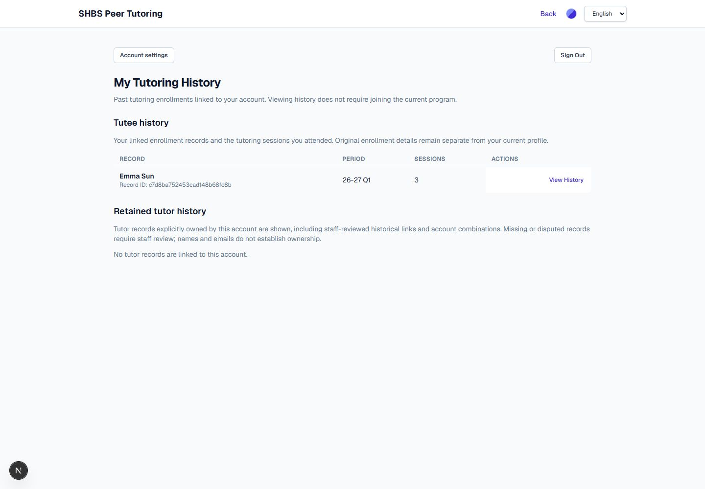

   /history · EN · 2026-11-15

2. **浏览保留证据** 分别使用课次、会议及调整列表的分页控件。辅导课次时数概览不包含单独的手动调整；比较总数时请另外检查。

3. **受邀时接受指定历史权限** 没有登录账户的校友可验证邀请指定邮箱，经邀请弹窗完成账户确认，再核对列出的源记录并选择关联我的历史。已有账户使用正常登录或恢复。

### 预期结果

仅显示明确拥有或经指定审核关联的记录；不会创建当前参与报名。

### 工作原理

参与权限被撤销或档案归档后，历史仍可能可读。姓名或邮箱匹配不代表所有权；同一账户可有多个历史档案。关联历史不会重新激活参与、授予徽章或补造政策同意。

### 问题排查

- **缺少记录或旧邮箱不可用** 请工作人员检查准确原记录及身份证据。经授权可用替代审核邀请；不要认领看似相近的记录或另建重复账户。

## 在个人日历订阅已确认课次

使用私密订阅链接，并按需更换或撤销。

打开: `/student?view=schedule`

### 开始之前

- 辅导伙伴或学习伙伴课次页面提供日历订阅。

### 操作步骤

1. **打开课次日历控件** 学习伙伴打开我的辅导伙伴与课表，辅导伙伴打开/dashboard#sessions的课表。选择日历订阅，并阅读私密链接说明及当前可用状态。

   请注意: 可用时的日历订阅控件

   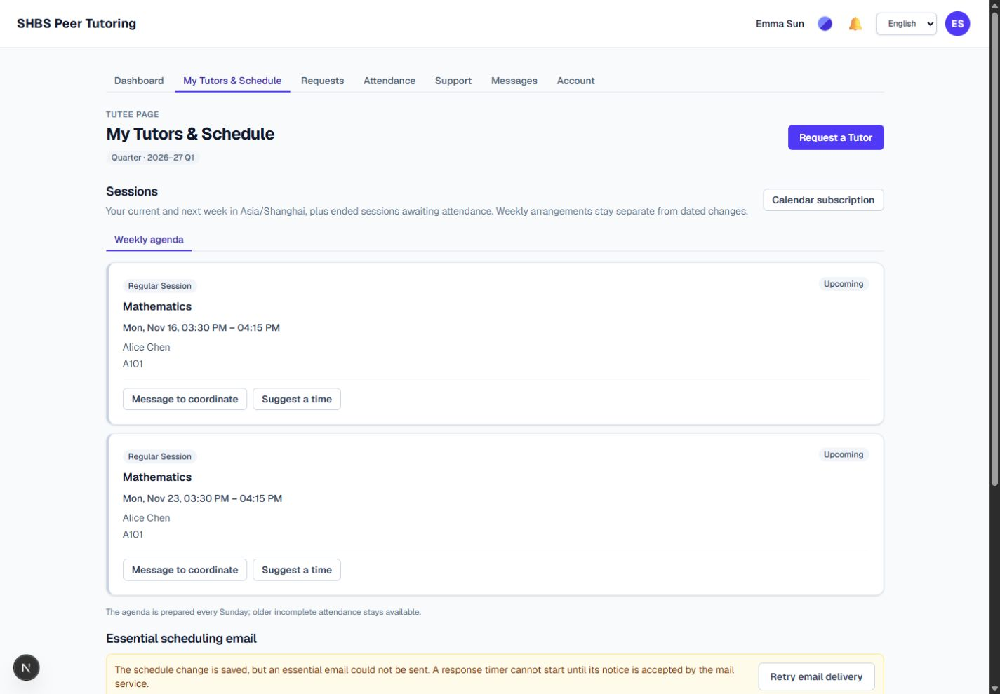

   /student?view=schedule · EN · 2026-11-15

2. **创建并复制私密链接** 选择创建私密链接，阅读创建会撤销旧链接的提示，再确认创建私密链接。关闭弹窗前，将显示的私密订阅链接复制到日历应用。网址仅在本次打开期间显示，之后重新打开不会再次显示。

3. **核对已确认约会** 以网站中已约定课次时间和教室为最终依据。待处理提议与聊天消息不属于已确认约会。

4. **更换或撤销已分享链接** 链接丢失或泄露时，选择替换私密链接，检查并确认，再复制新网址并更新个人日历。全部旧链接停止更新。选择撤销私密链接并确认，可停止订阅而不改变课次。请勿在公开报告中包含订阅网址。

### 预期结果

个人日历使用当前私密链接订阅，或旧链接已撤销。

### 工作原理

日历应用按自身周期刷新，可能滞后于网站。该链接是一种私密访问凭证，持有人可能读取其授权日历。

### 问题排查

- **日历仍显示旧时间** 先确认网站最终约定结果，再在日历应用刷新订阅。检查已替换更换后的链接，而非导入旧静态副本。
