# Review & administer

Generated from the website help catalogue. Edit the content records, then run `npm run help:export`.

[Catalogue & capture provenance](README.md)

Screenshot source: `1df44d6bb31cf04352adae9c65819139b7b747d8`. New captures use latest-main development baseline 1df44d6b, selected 2026-11-21, with the Help candidate. Earlier captures list their own revision and capture date.

This GitHub training copy includes role-specific instructions. Signing in and current program permissions are still required to use the corresponding website features. All examples are synthetic.

- [Revise signup answers and release assignments](#revise-signup-answers-and-release-assignments)
- [Prepare the first school-hours report](#prepare-the-first-school-hours-report)
- [Issue and correct a school-hours report](#issue-and-correct-a-school-hours-report)
- [Manage account access and setup](#manage-account-access-and-setup)
- [Assign or change a permanent username](#assign-or-change-a-permanent-username)
- [Combine records after identity review](#combine-records-after-identity-review)
- [Link history or invite a former participant](#link-history-or-invite-a-former-participant)
- [Correct a mistaken grouping or history reader](#correct-a-mistaken-grouping-or-history-reader)
- [Review a management change request](#review-a-management-change-request)
- [Inspect persisted records safely](#inspect-persisted-records-safely)
- [Export or import program-record archives](#export-or-import-program-record-archives)
- [Review disclosed messages and contact restrictions](#review-disclosed-messages-and-contact-restrictions)
- [Decide an additional qualification request](#decide-an-additional-qualification-request)
- [Review translations and language visibility](#review-translations-and-language-visibility)

## Revise signup answers and release assignments

Review changed subject choices and their explicit assignment consequences.

Open: `/admin/requests`

### Before you start

- Admin or Head access and the exact current student request. Review the original submission before editing.

### Walkthrough

1. **Read original and current answers** Open the student's request and choose Edit signup answers. Compare the current answers with the retained original signature and policy revision. Confirm the subject and period you intend to change.

   Look for: Open the request's answer editor and review affected assigned choices.

   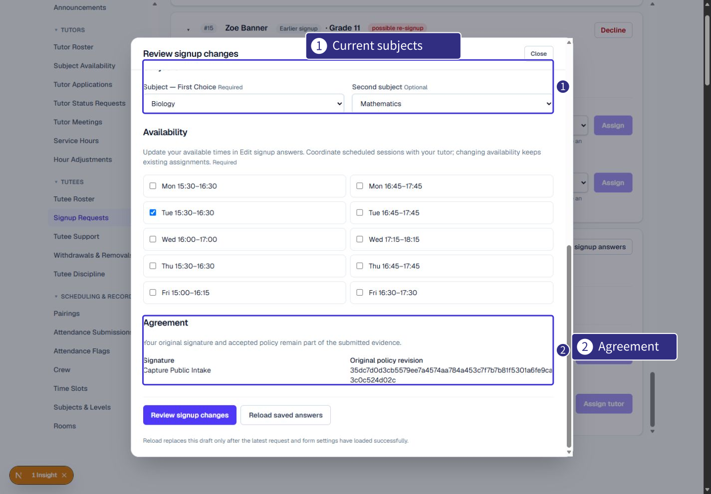

   /admin/requests · EN · 2026-11-20

   Read the current Biology and Mathematics answers alongside the retained original signature and policy revision.

   [Original full screenshot](assets/revise-student-signup-step-1.en.jpg) · `b5ece465681957c9fe579d26babdeb260c674fa0` · Latest-main development baseline b5ece465, selected 2026-11-20, with the Help candidate and synthetic demo records.

   Annotations added for this step. The original full screenshot is unchanged.

   - **1.** Current subjects

   - **2.** Agreement

2. **Edit the intended answers** Update the needed fields in Edit signup answers. Check which subjects are assigned on the request. Owners can edit unassigned choices. A staff change to an assigned choice can release that assignment.

   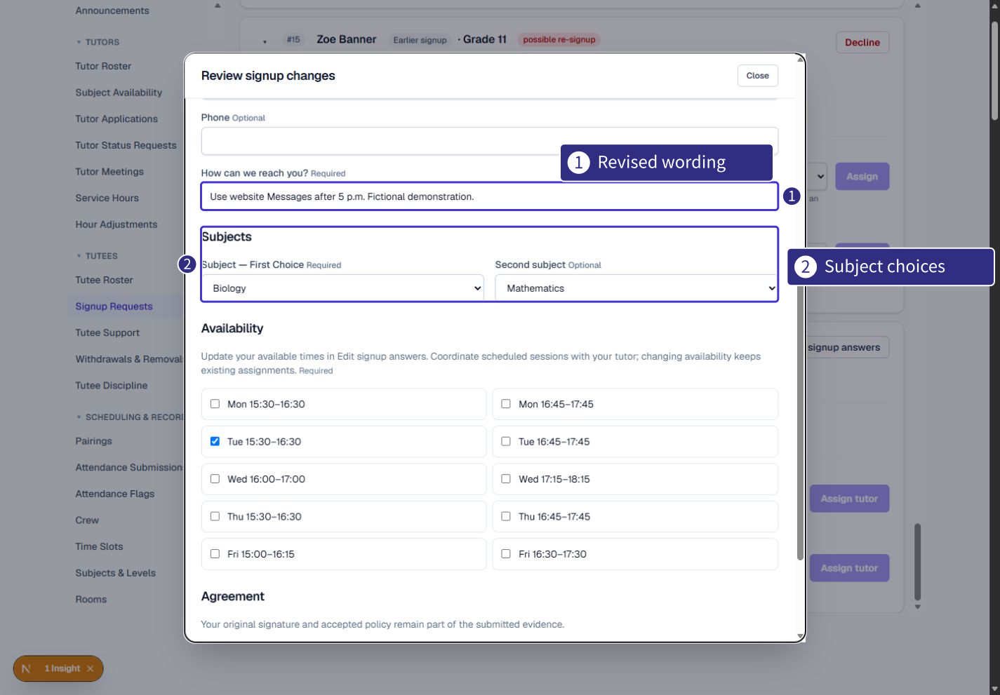

   /admin/requests · EN · 2026-11-20

   Refine the contact wording in the draft. Both subject selections stay in place.

   [Original full screenshot](assets/revise-student-signup-step-2.en.jpg) · `b5ece465681957c9fe579d26babdeb260c674fa0` · Latest-main development baseline b5ece465, selected 2026-11-20, with the Help candidate and synthetic demo records.

   Annotations added for this step. The original full screenshot is unchanged.

   - **1.** Revised wording

   - **2.** Subject choices

3. **Review releases explicitly** Choose Review signup changes. Check the identified student and the release consequences. Match the affected subjects and assignments to the original request. Cancel returns to the draft.

   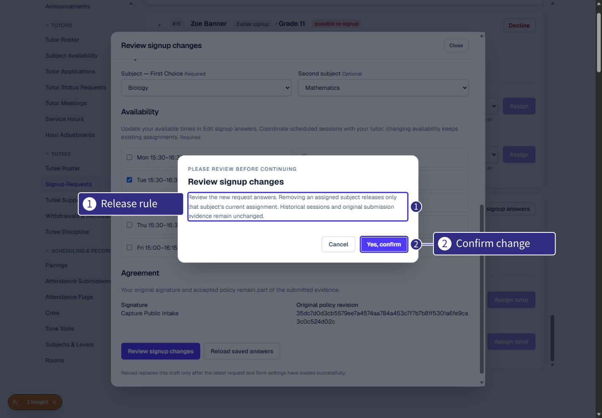

   /admin/requests · EN · 2026-11-20

   Read the release rule before confirming. Both choices were unmatched in this example, so this edit changes only the contact wording.

   [Original full screenshot](assets/revise-student-signup-step-3.en.jpg) · `b5ece465681957c9fe579d26babdeb260c674fa0` · Latest-main development baseline b5ece465, selected 2026-11-20, with the Help candidate and synthetic demo records.

   Annotations added for this step. The original full screenshot is unchanged.

   - **1.** Release rule

   - **2.** Confirm change

4. **Verify the revised request** After saving, check the current choices and assignment status. Reopen the editor to verify the retained signature and policy version. If the list failed to refresh, retry the read.

   **View 1**

   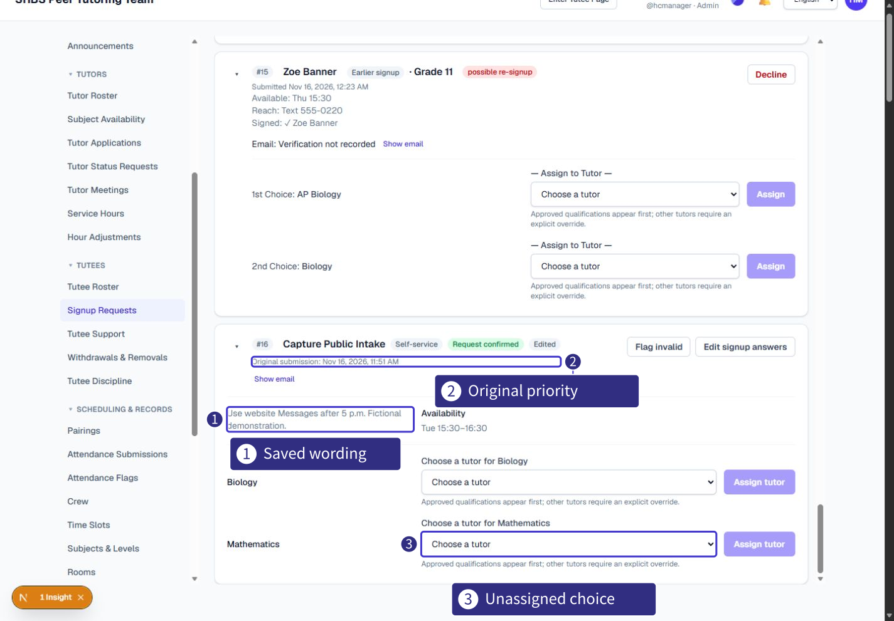

   /admin/requests · EN · 2026-11-20

   The revised wording saved. Both choices await tutors and the original submission time remains. Reopen the editor to verify the agreement.

   [Original full screenshot](assets/revise-student-signup-step-4.en.jpg) · `b5ece465681957c9fe579d26babdeb260c674fa0` · Latest-main development baseline b5ece465, selected 2026-11-20, with the Help candidate and synthetic demo records.

   Annotations added for this step. The original full screenshot is unchanged.

   - **1.** Saved wording

   - **2.** Original priority

   - **3.** Unassigned choice

   **View 2**

   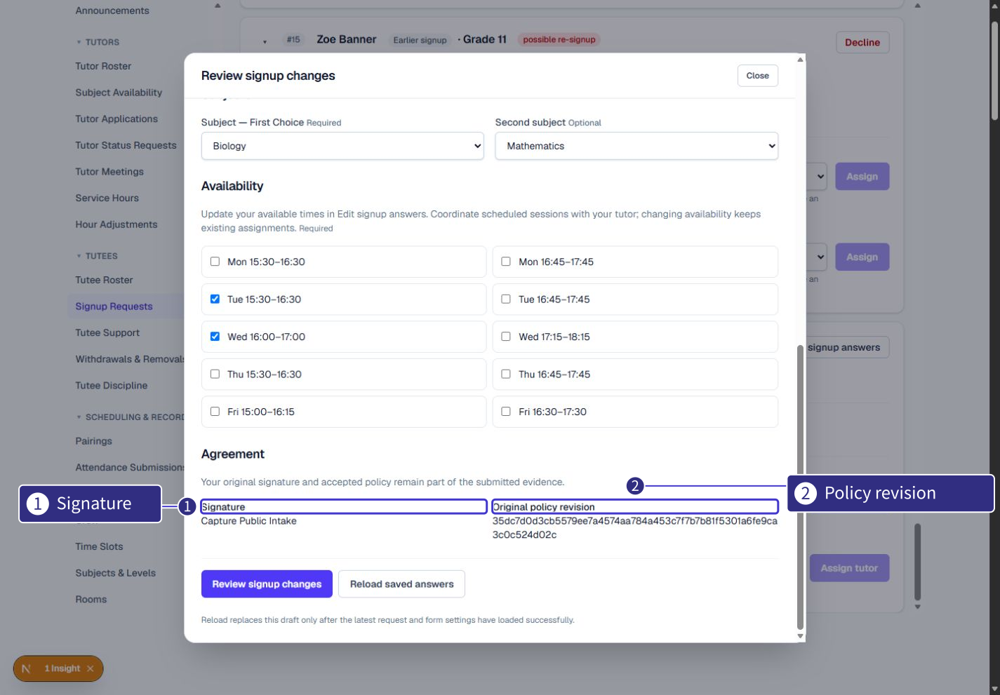

   /admin/requests · EN · 2026-11-20

   Reopen the saved request to verify its original signature and policy revision are still present.

   [Original full screenshot](assets/revise-student-signup-step-4-view-2.en.jpg) · `b5ece465681957c9fe579d26babdeb260c674fa0` · Latest-main development baseline b5ece465, selected 2026-11-20, with the Help candidate and synthetic demo records.

   Annotations added for this step. The original full screenshot is unchanged.

   - **1.** Signature

   - **2.** Policy revision

### What happens next

Only the reviewed answers and assignment releases change; the request's evidence remains readable.

### How it works

Signup-answer changes do not rewrite shared account identity, original policy signatures, completed lessons or attendance. A release must be reviewed as an assignment consequence, not treated as an ordinary profile edit.

### Troubleshooting

- **The review is stale** Use the explicit reload action and reread the new affected-assignment list. Do not reuse an earlier confirmation after another staff member changes the request.

## Prepare the first school-hours report

Resolve identities and explicitly reconcile already-posted opening balances before issuing school credit.

Open: `/admin/service-hours`

### Before you start

- Admin or Head authority, Service Hours enabled, and school confirmation of already-reported hours and account references.

### Walkthrough

1. **Open School reports** In Service Hours, open School reports and the opening-balance review. Inspect all people requiring reconciliation, including identity warnings and excluded archive-source counts.

   Look for: Open School reports and review opening balances and identity warnings.

   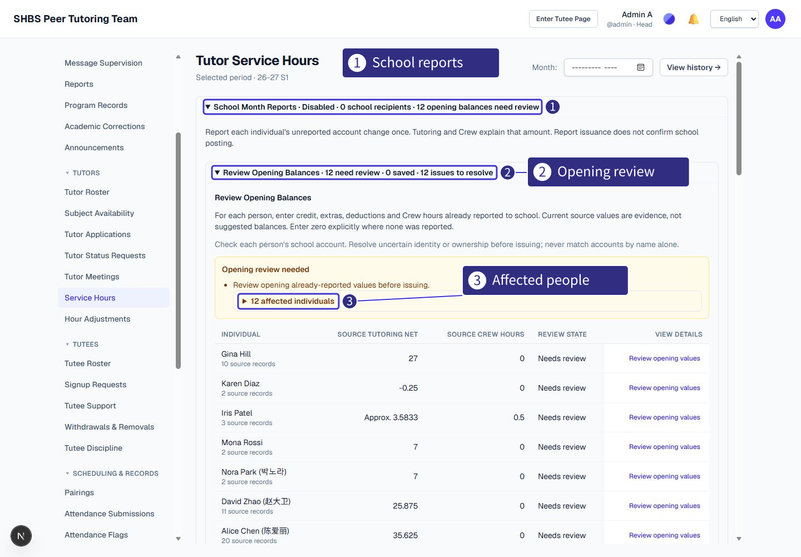

   /admin/service-hours · EN · 2026-11-20

   School Month Reports shows twelve people waiting for opening review. The opening panel exposes the blocker and source rows.

   [Original full screenshot](assets/review-first-school-report-step-1.en.jpg) · `b5ece465681957c9fe579d26babdeb260c674fa0` · Latest-main development baseline b5ece465, selected 2026-11-20, with the Help candidate. Isolated synthetic first-report demonstration phase.

   Annotations added for this step. The original full screenshot is unchanged.

   - **1.** School reports

   - **2.** Opening review

   - **3.** Affected people

2. **Confirm the person and account** Review each person's original evidence and school-account reference. Resolve missing or conflicting identities through the existing account/record workflows before reporting.

   **View 1**

   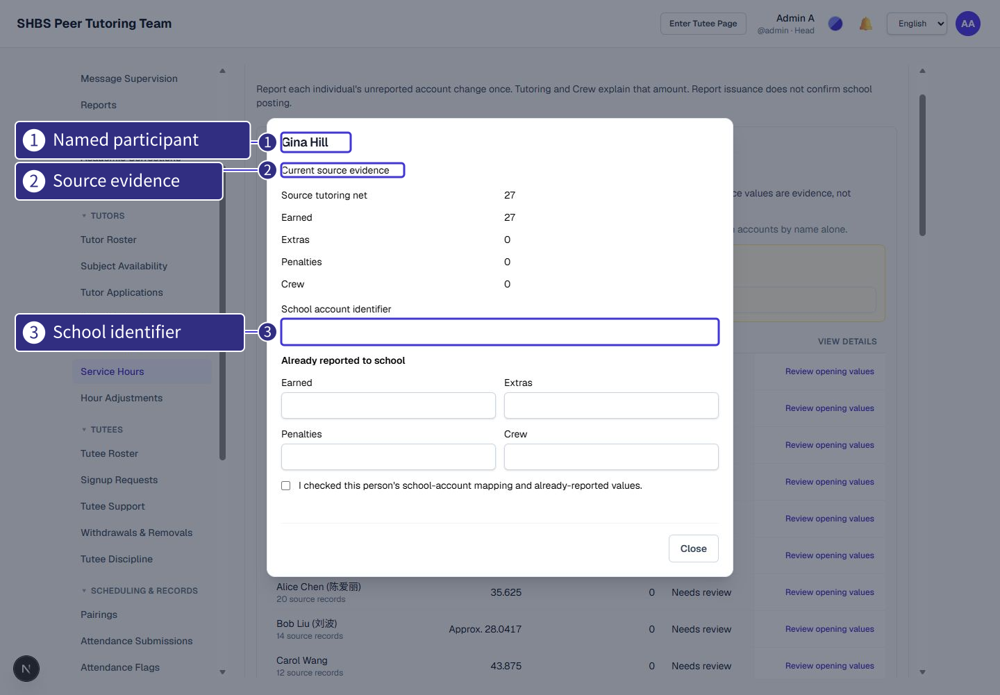

   /admin/service-hours · EN · 2026-11-20

   Gina’s current source totals and the blank school-account field are separate. Use the confirmed external school identifier and keep the opening amounts blank until reviewed.

   [Original full screenshot](assets/review-first-school-report-step-2.en.jpg) · `b5ece465681957c9fe579d26babdeb260c674fa0` · Latest-main development baseline b5ece465, selected 2026-11-20, with the Help candidate. Isolated synthetic first-report demonstration phase.

   Annotations added for this step. The original full screenshot is unchanged.

   - **1.** Named participant

   - **2.** Source evidence

   - **3.** School identifier

   **View 2**

   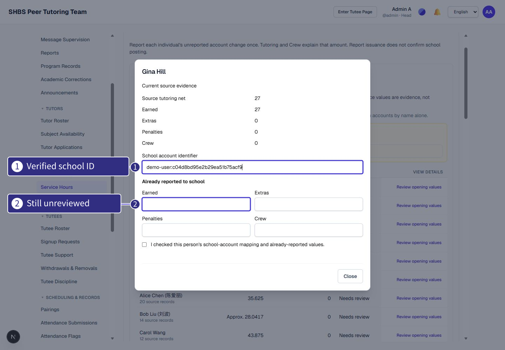

   /admin/service-hours · EN · 2026-11-20

   The verified synthetic school identifier is now staged for Gina. The four already-reported fields remain blank until the amount review.

   [Original full screenshot](assets/review-first-school-report-step-2-view-2.en.jpg) · `b5ece465681957c9fe579d26babdeb260c674fa0` · Latest-main development baseline b5ece465, selected 2026-11-20, with the Help candidate. Isolated synthetic first-report demonstration phase.

   Annotations added for this step. The original full screenshot is unchanged.

   - **1.** Verified school ID

   - **2.** Still unreviewed

3. **Record already-posted amounts** Enter the reviewed already-reported opening amount for each person. Confirm zero explicitly where none was previously posted. Save completed people in batches; missing values are never treated as zero.

   **View 1**

   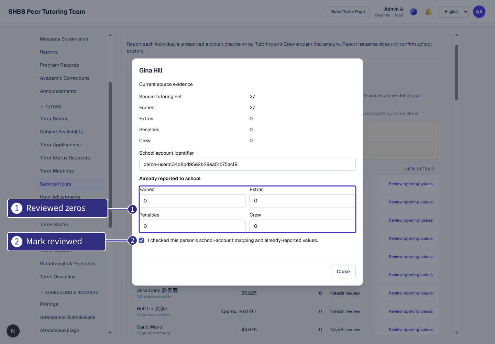

   /admin/service-hours · EN · 2026-11-20

   The reviewer explicitly enters zero in all four categories for this fictional prerequisite and marks the named person reviewed.

   [Original full screenshot](assets/review-first-school-report-step-3.en.jpg) · `b5ece465681957c9fe579d26babdeb260c674fa0` · Latest-main development baseline b5ece465, selected 2026-11-20, with the Help candidate. Isolated synthetic first-report demonstration phase.

   Annotations added for this step. The original full screenshot is unchanged.

   - **1.** Reviewed zeros

   - **2.** Mark reviewed

   **View 2**

   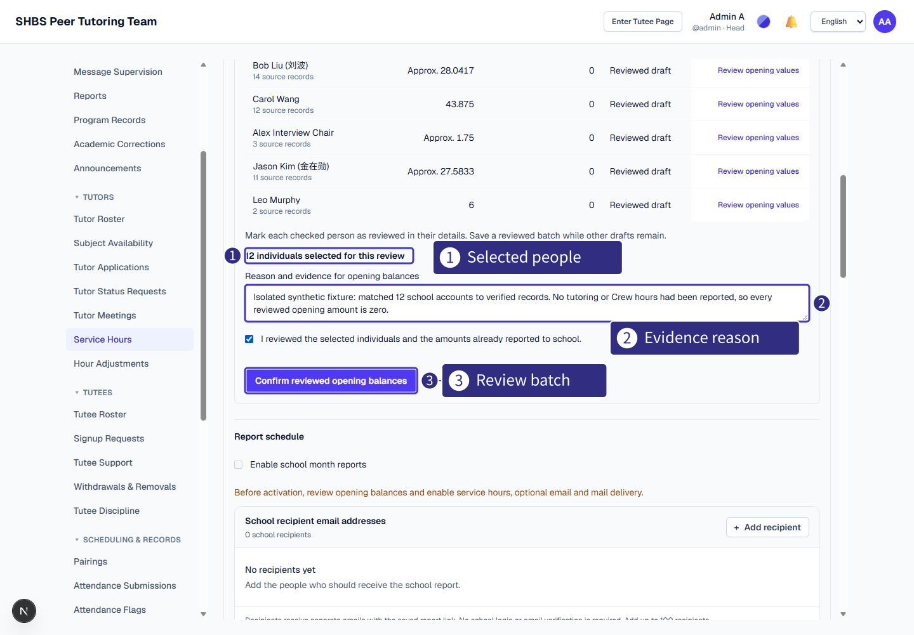

   /admin/service-hours · EN · 2026-11-20

   The reviewer records why the twelve isolated participants have zero previously reported amounts, then acknowledges the selected batch before confirmation.

   [Original full screenshot](assets/review-first-school-report-step-3-view-2.en.jpg) · `b5ece465681957c9fe579d26babdeb260c674fa0` · Latest-main development baseline b5ece465, selected 2026-11-20, with the Help candidate. Isolated synthetic first-report demonstration phase.

   Annotations added for this step. The original full screenshot is unchanged.

   - **1.** Selected people

   - **2.** Evidence reason

   - **3.** Review batch

   **View 3**

   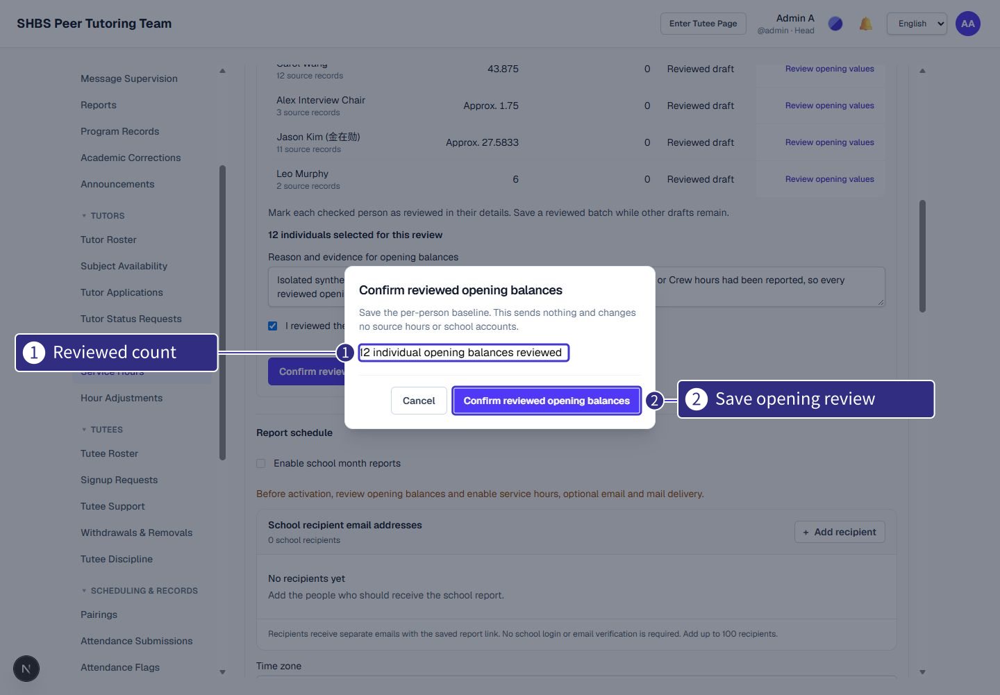

   /admin/service-hours · EN · 2026-11-20

   The confirmation dialog scopes the opening-balance save to twelve individually reviewed entries.

   [Original full screenshot](assets/review-first-school-report-step-3-view-3.en.jpg) · `b5ece465681957c9fe579d26babdeb260c674fa0` · Latest-main development baseline b5ece465, selected 2026-11-20, with the Help candidate. Isolated synthetic first-report demonstration phase.

   Annotations added for this step. The original full screenshot is unchanged.

   - **1.** Reviewed count

   - **2.** Save opening review

   **View 4**

   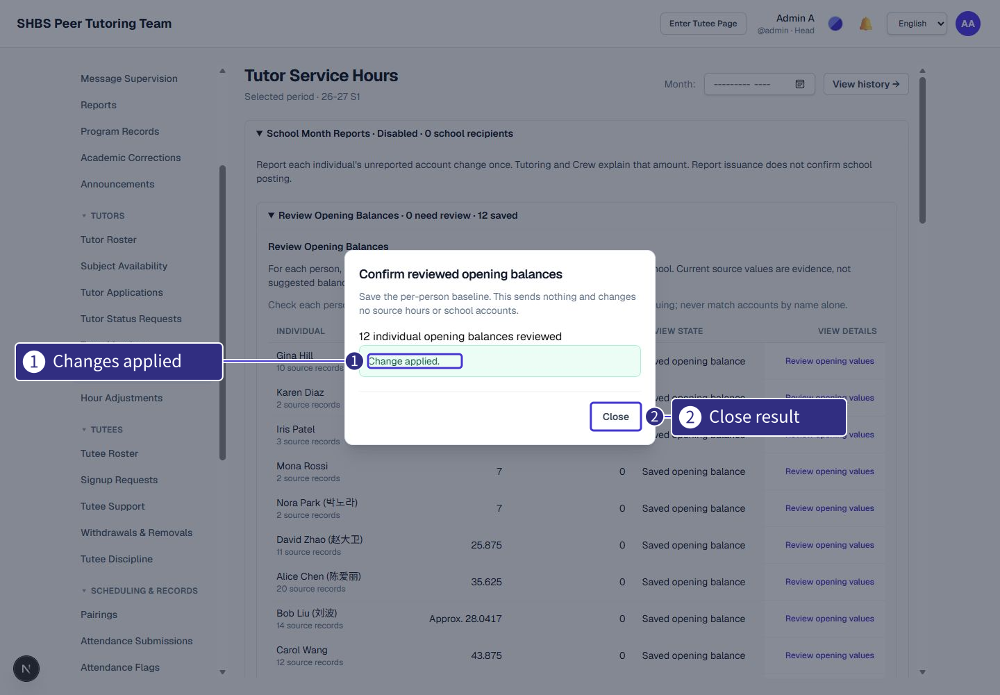

   /admin/service-hours · EN · 2026-11-20

   The confirmation reports that the twelve reviewed balances were applied. This action saved opening evidence only.

   [Original full screenshot](assets/review-first-school-report-step-3-view-4.en.jpg) · `b5ece465681957c9fe579d26babdeb260c674fa0` · Latest-main development baseline b5ece465, selected 2026-11-20, with the Help candidate. Isolated synthetic first-report demonstration phase.

   Annotations added for this step. The original full screenshot is unchanged.

   - **1.** Changes applied

   - **2.** Close result

   **View 5**

   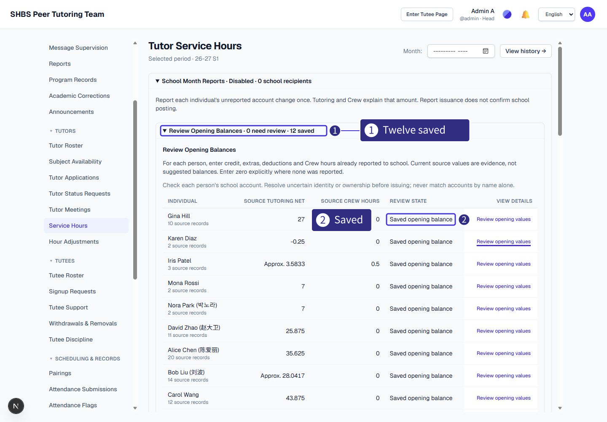

   /admin/service-hours · EN · 2026-11-20

   The refreshed opening panel confirms twelve saved balances and zero remaining reviews while school reporting stays disabled.

   [Original full screenshot](assets/review-first-school-report-step-3-view-5.en.jpg) · `b5ece465681957c9fe579d26babdeb260c674fa0` · Latest-main development baseline b5ece465, selected 2026-11-20, with the Help candidate. Isolated synthetic first-report demonstration phase.

   Annotations added for this step. The original full screenshot is unchanged.

   - **1.** Twelve saved

   - **2.** Saved

4. **Inspect the individual preview** Review Carry In → Raw Change → Hours → Carry Out and the person's Details. Issue only when required reviews and identity conflicts have been resolved.

   **View 1**

   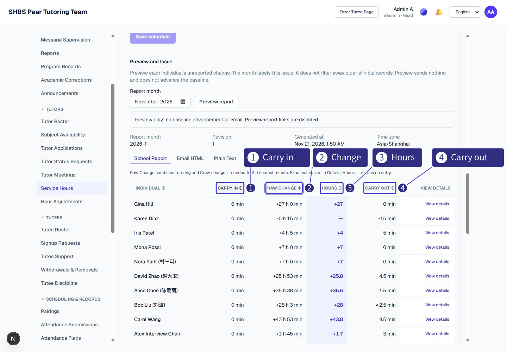

   /admin/service-hours · EN · 2026-11-20

   The refreshed individual preview puts Carry in, Raw Change, Hours and Carry out in report order after the opening review clears.

   [Original full screenshot](assets/review-first-school-report-step-4.en.jpg) · `b5ece465681957c9fe579d26babdeb260c674fa0` · Latest-main development baseline b5ece465, selected 2026-11-20, with the Help candidate. Isolated synthetic first-report demonstration phase.

   Annotations added for this step. The original full screenshot is unchanged.

   - **1.** Carry in

   - **2.** Change

   - **3.** Hours

   - **4.** Carry out

   **View 2**

   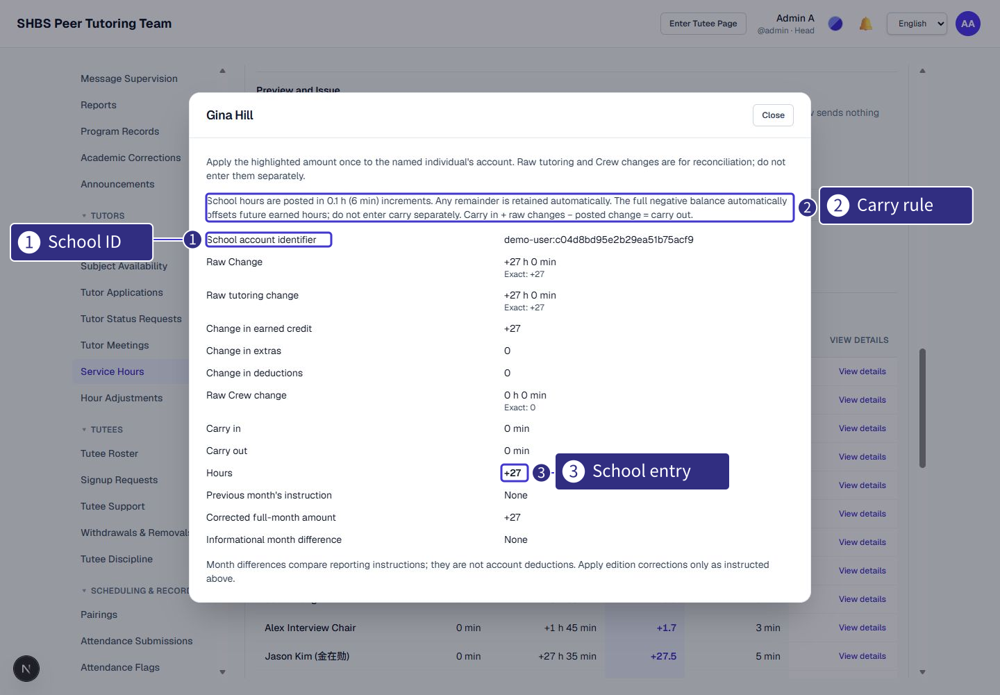

   /admin/service-hours · EN · 2026-11-20

   Gina’s refreshed Details connects the verified synthetic account to the exact source changes, credited Hours and carry rule.

   [Original full screenshot](assets/review-first-school-report-step-4-view-2.en.jpg) · `b5ece465681957c9fe579d26babdeb260c674fa0` · Latest-main development baseline b5ece465, selected 2026-11-20, with the Help candidate. Isolated synthetic first-report demonstration phase.

   Annotations added for this step. The original full screenshot is unchanged.

   - **1.** School ID

   - **2.** Carry rule

   - **3.** School entry

   **View 3**

   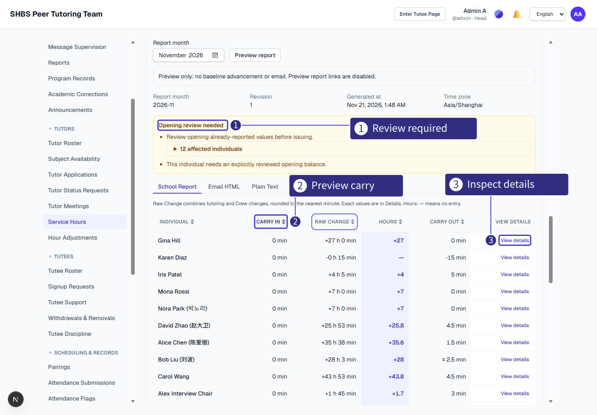

   /admin/service-hours · EN · 2026-11-20

   The first preview already calculates source changes, but the opening-review warning blocks issue until the required balances are saved.

   [Original full screenshot](assets/review-first-school-report-step-4-view-3.en.jpg) · `b5ece465681957c9fe579d26babdeb260c674fa0` · Latest-main development baseline b5ece465, selected 2026-11-20, with the Help candidate. Isolated synthetic first-report demonstration phase.

   Annotations added for this step. The original full screenshot is unchanged.

   - **1.** Review required

   - **2.** Preview carry

   - **3.** Inspect details

   **View 4**

   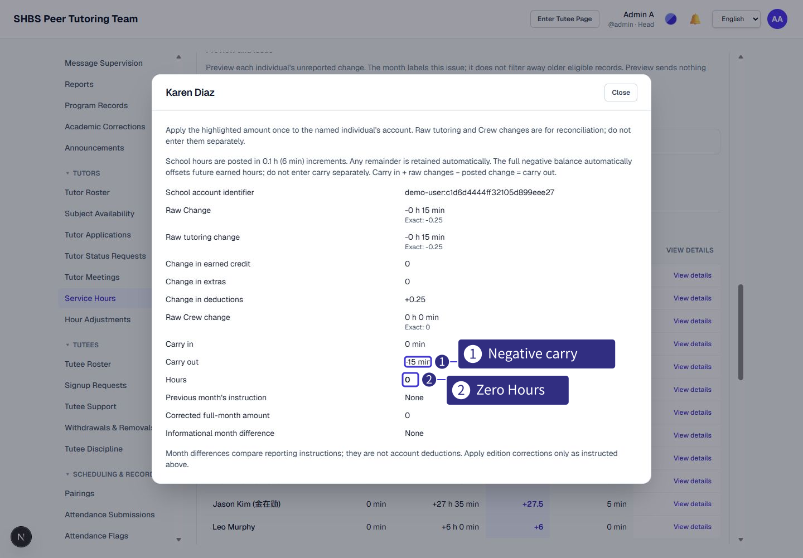

   /admin/service-hours · EN · 2026-11-20

   Karen’s Details show zero Hours and a negative fifteen-minute Carry out. It is retained for later credit instead of becoming a school entry.

   [Original full screenshot](assets/review-first-school-report-step-4-view-4.en.jpg) · `b5ece465681957c9fe579d26babdeb260c674fa0` · Latest-main development baseline b5ece465, selected 2026-11-20, with the Help candidate. Isolated synthetic first-report demonstration phase.

   Annotations added for this step. The original full screenshot is unchanged.

   - **1.** Negative carry

   - **2.** Zero Hours

### What happens next

All required opening reviews are explicitly saved and the first report has a reviewed accounting boundary.

### How it works

Historical archive imports remain program evidence but do not create new school credits or opening-review work. Overlap with already reviewed school evidence blocks issuance until reconciled. Old monthly totals cannot replace per-person opening review.

### Troubleshooting

- **Issuance remains blocked** Read every outstanding identity/opening-review warning. Save confirmed people, resolve the remaining sources and refresh the preview. Do not fill unknown balances with zero merely to enable issuance.

## Issue and correct a school-hours report

Preview an edition, issue exact posting amounts and avoid double-counting revised reports.

Open: `/admin/service-hours`

### Before you start

- Admin/Head access, resolved opening/identity reviews and enabled program mail/Service Hours prerequisites.

### Walkthrough

1. **Choose month and preview** Open School reports, choose the month and inspect each person's posting instructions plus the HTML/plain-text school email preview. A preview sends nothing and has no live report link.

   Look for: Use the report preview and saved-edition controls under School reports.

   **View 1**

   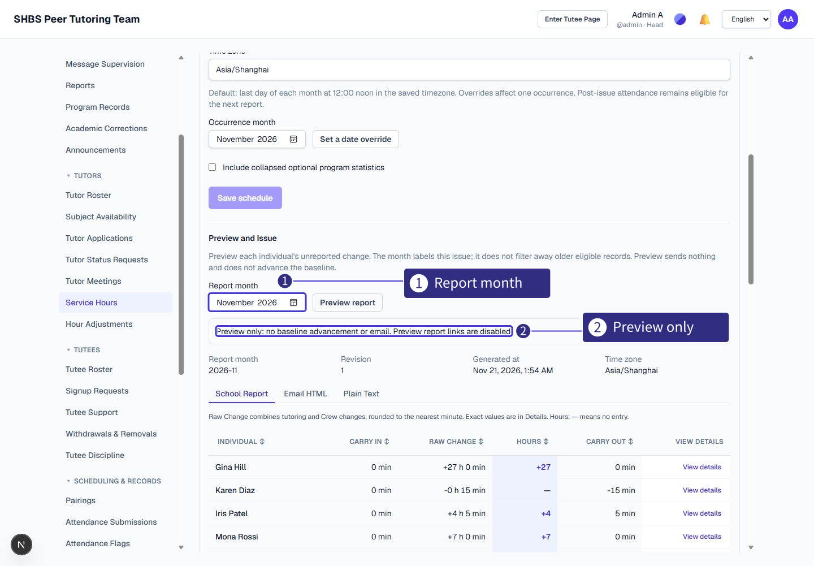

   /admin/service-hours · EN · 2026-11-20

   November report revision 1 is a preview with individual posting instructions. The selected month and the preview-only notice are visible before issuance.

   [Original full screenshot](assets/issue-school-report-step-1.en.jpg) · `b5ece465681957c9fe579d26babdeb260c674fa0` · Latest-main development baseline b5ece465, selected 2026-11-20, with the Help candidate. Isolated synthetic first-report demonstration phase.

   Annotations added for this step. The original full screenshot is unchanged.

   - **1.** Report month

   - **2.** Preview only

   **View 2**

   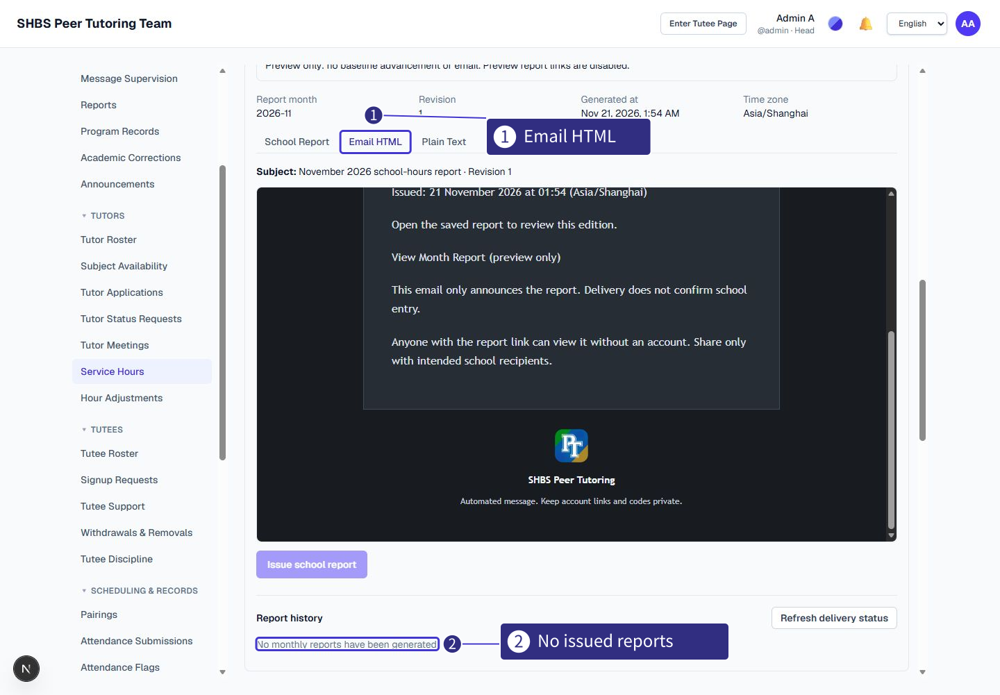

   /admin/service-hours · EN · 2026-11-20

   The HTML email preview shows View Month Report as preview-only text. The report history is still empty.

   [Original full screenshot](assets/issue-school-report-step-1-view-2.en.jpg) · `b5ece465681957c9fe579d26babdeb260c674fa0` · Latest-main development baseline b5ece465, selected 2026-11-20, with the Help candidate. Isolated synthetic first-report demonstration phase.

   Annotations added for this step. The original full screenshot is unchanged.

   - **1.** Email HTML

   - **2.** No issued reports

   **View 3**

   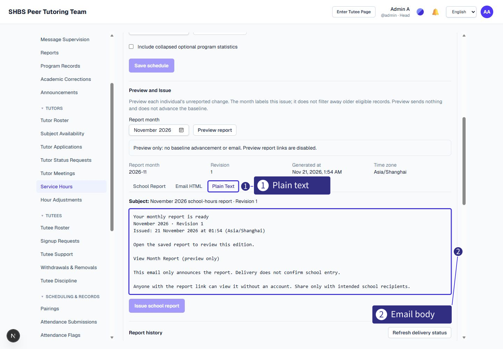

   /admin/service-hours · EN · 2026-11-20

   The Plain Text tab shows the same report preview and disabled action wording, with no live report URL.

   [Original full screenshot](assets/issue-school-report-step-1-view-3.en.jpg) · `b5ece465681957c9fe579d26babdeb260c674fa0` · Latest-main development baseline b5ece465, selected 2026-11-20, with the Help candidate. Isolated synthetic first-report demonstration phase.

   Annotations added for this step. The original full screenshot is unchanged.

   - **1.** Plain text

   - **2.** Email body

2. **Review and issue once** Read the issuance review, then issue the report. Save and inspect the returned edition rather than repeating generation when a refresh fails.

   **View 1**

   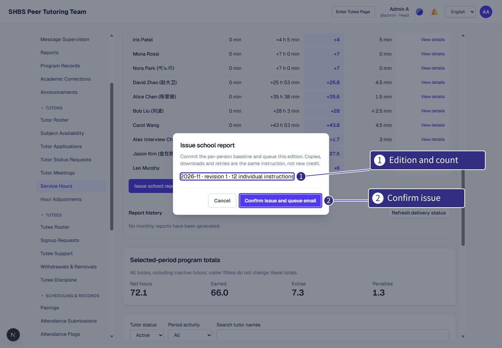

   /admin/service-hours · EN · 2026-11-20

   The first issue review identifies November 2026, revision 1, and 12 actual individual instructions before confirmation.

   [Original full screenshot](assets/issue-school-report-step-2.en.jpg) · `b5ece465681957c9fe579d26babdeb260c674fa0` · Latest-main development baseline b5ece465, selected 2026-11-20, with the Help candidate. Isolated synthetic first-report demonstration phase.

   Annotations added for this step. The original full screenshot is unchanged.

   - **1.** Edition and count

   - **2.** Confirm issue

   **View 2**

   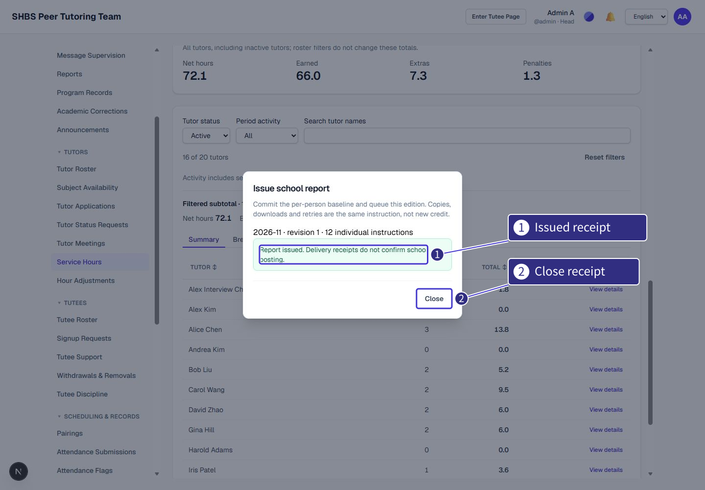

   /admin/service-hours · EN · 2026-11-20

   The real first issue was saved. The success receipt separates report issuance from school-account posting.

   [Original full screenshot](assets/issue-school-report-step-2-view-2.en.jpg) · `b5ece465681957c9fe579d26babdeb260c674fa0` · Latest-main development baseline b5ece465, selected 2026-11-20, with the Help candidate. Isolated synthetic first-report demonstration phase.

   Annotations added for this step. The original full screenshot is unchanged.

   - **1.** Issued receipt

   - **2.** Close receipt

3. **Inspect exact posting amounts** The highlighted Hours amount is what to enter once. Open Details for school-account references, separate tutoring/Crew values and carry explanations. Do not separately post Carry In, Raw Change or Carry Out.

   **View 1**

   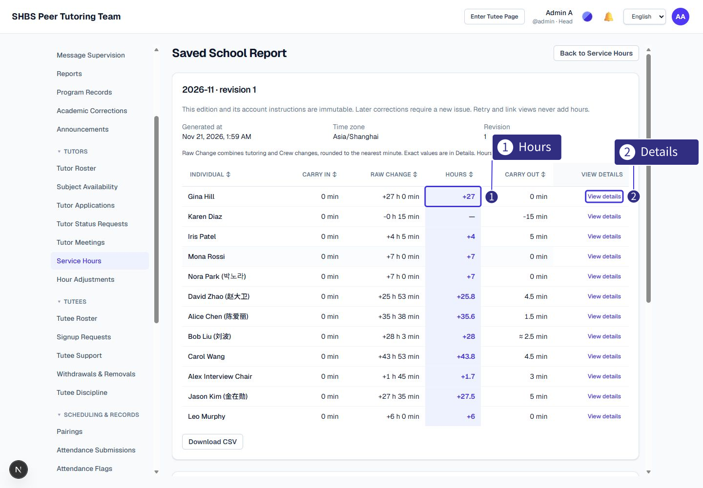

   /admin/service-hours/school-reports/77a833d6-d3a3-42ce-a219-a97d82b15125 · EN · 2026-11-20

   Saved November revision 1 highlights the exact +27 Hours for Gina Hill. View details opens the components and reference for that same row.

   [Original full screenshot](assets/issue-school-report-step-3.en.jpg) · `b5ece465681957c9fe579d26babdeb260c674fa0` · Latest-main development baseline b5ece465, selected 2026-11-20, with the Help candidate. Isolated synthetic first-report demonstration phase.

   Annotations added for this step. The original full screenshot is unchanged.

   - **1.** Hours

   - **2.** Details

   **View 2**

   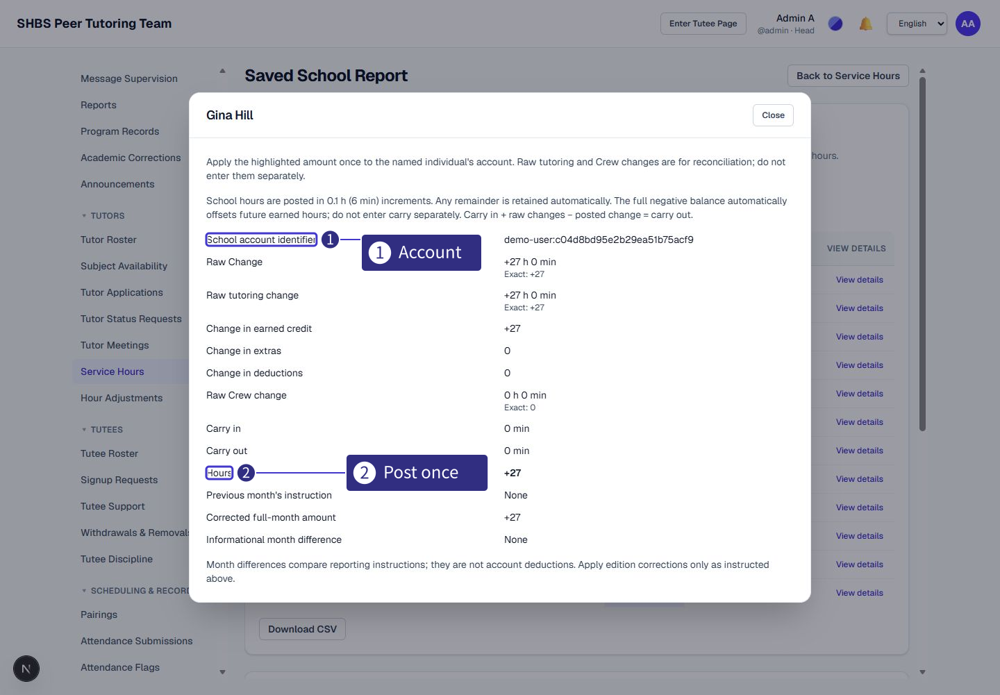

   /admin/service-hours/school-reports/77a833d6-d3a3-42ce-a219-a97d82b15125 · EN · 2026-11-20

   The saved Details show the synthetic school-account reference, the components, and exact Hours for Gina Hill. Carry and raw changes explain the one posting instruction.

   [Original full screenshot](assets/issue-school-report-step-3-view-2.en.jpg) · `b5ece465681957c9fe579d26babdeb260c674fa0` · Latest-main development baseline b5ece465, selected 2026-11-20, with the Help candidate. Isolated synthetic first-report demonstration phase.

   Annotations added for this step. The original full screenshot is unchanged.

   - **1.** Account

   - **2.** Post once

4. **Correct the latest eligible edition** Review the corrected edition. In Details, find the comparison row for the last edition the school entered and use its incremental amount. Once a later month has been issued, any new changes reconcile in the next report.

   **View 1**

   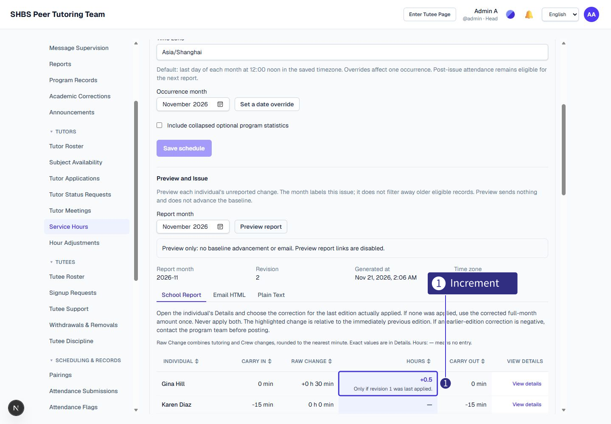

   /admin/service-hours · EN · 2026-11-20

   The correction preview highlights +0.5 only if revision 1 was the last edition applied. It reconciles the real extra half-hour to the same report month.

   [Original full screenshot](assets/issue-school-report-step-4.en.jpg) · `b5ece465681957c9fe579d26babdeb260c674fa0` · Latest-main development baseline b5ece465, selected 2026-11-20, with the Help candidate. Isolated synthetic first-report demonstration phase.

   Annotations added for this step. The original full screenshot is unchanged.

   - **1.** Increment

   **View 2**

   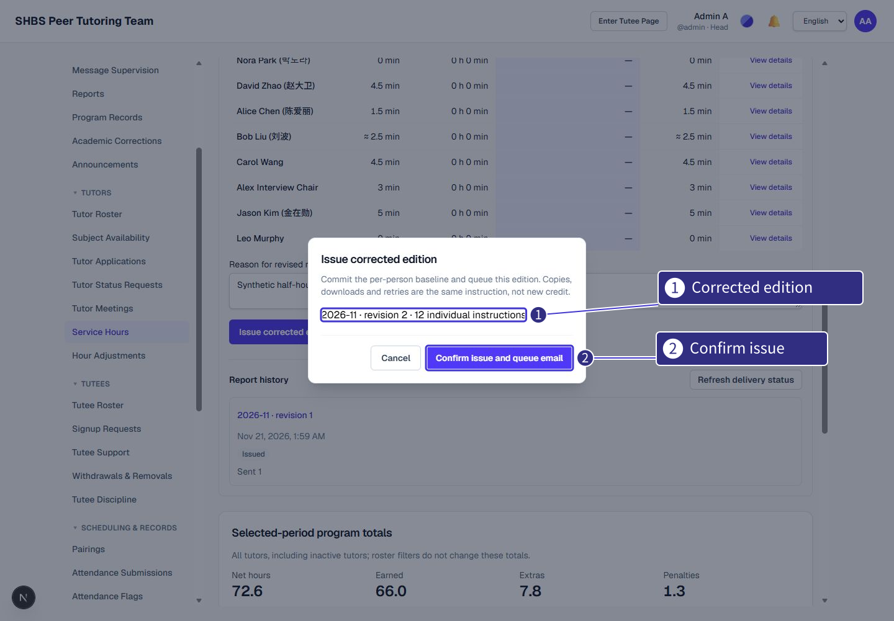

   /admin/service-hours · EN · 2026-11-20

   The correction review is for November revision 2 and its 12 individual instructions. This is the next edition of the same month.

   [Original full screenshot](assets/issue-school-report-step-4-view-2.en.jpg) · `b5ece465681957c9fe579d26babdeb260c674fa0` · Latest-main development baseline b5ece465, selected 2026-11-20, with the Help candidate. Isolated synthetic first-report demonstration phase.

   Annotations added for this step. The original full screenshot is unchanged.

   - **1.** Corrected edition

   - **2.** Confirm issue

   **View 3**

   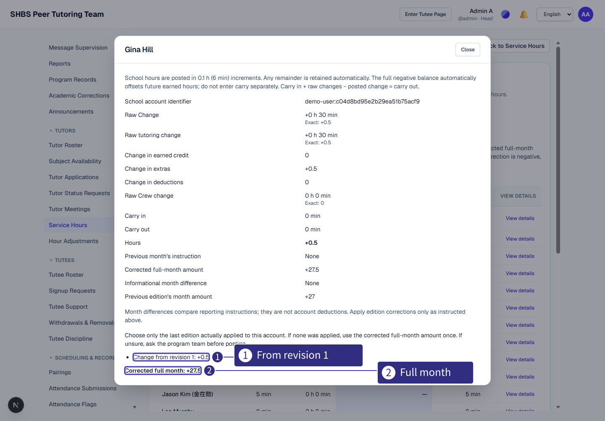

   /admin/service-hours/school-reports/f48fd63b-e622-4f17-811e-80ecf53de9fe · EN · 2026-11-20

   The saved revision 2 Details compare +0.5 after revision 1 with the corrected full-month amount +27.5. The table is read according to the actual last posted edition.

   [Original full screenshot](assets/issue-school-report-step-4-view-3.en.jpg) · `b5ece465681957c9fe579d26babdeb260c674fa0` · Latest-main development baseline b5ece465, selected 2026-11-20, with the Help candidate. Isolated synthetic first-report demonstration phase.

   Annotations added for this step. The original full screenshot is unchanged.

   - **1.** From revision 1

   - **2.** Full month

### What happens next

A saved edition contains exact one-time posting instructions and a clear correction basis.

### How it works

New reports post complete 0.1-hour steps and carry the remainder across months without semester reset. For example, 80 minutes posts 1.3 hours and carries two minutes. Negative balances post zero and carry forward; future earnings cover deficits first.

### Troubleshooting

- **School already entered an older edition** Use Details to choose the actual last-entered edition and its incremental correction. Issuing or emailing a report does not prove school entered it. Coordinate the entry record before applying another amount.

## Manage account access and setup

Review rank and participant access, send setup/recovery, decide suspension appeals and delete only eligible accounts.

Open: `/admin/users`

### Before you start

- Current Admin or Head access. Follow each dedicated review/password requirement; current Head leadership uses a separate workflow.

### Walkthrough

1. **Verify current identity and access** Open User details and inspect live login status, management rank, Tutor/Tutee/Crew memberships, Translator assignment, suspension and school departure. Read each action's eligibility before changing it.

   Look for: Use the exact account's Actions and read current permissions in User details.

   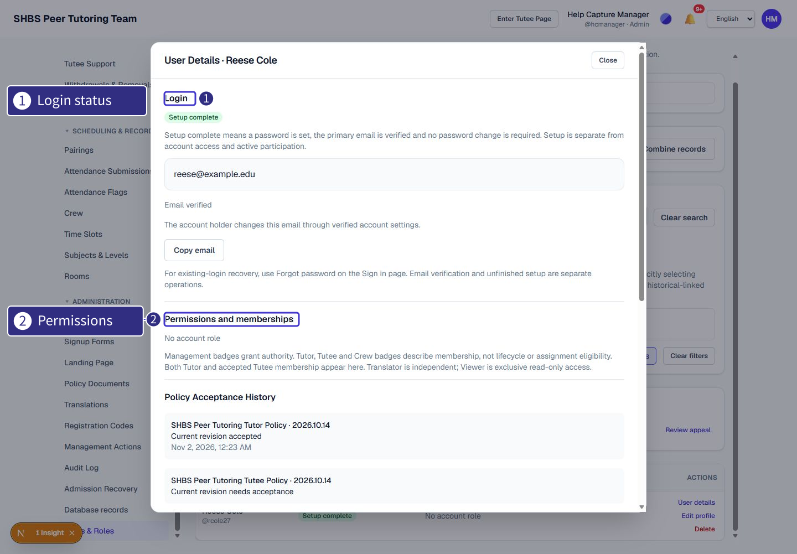

   /admin/users · EN · 2026-11-20

   User Details separates completed login setup from the account’s current permissions.

   [Original full screenshot](assets/manage-account-access-step-1.en.jpg) · `b5ece465681957c9fe579d26babdeb260c674fa0` · Latest-main development baseline b5ece465, selected 2026-11-20, with the Help candidate and synthetic demo records.

   Annotations added for this step. The original full screenshot is unchanged.

   - **1.** Login status

   - **2.** Permissions

2. **Use setup or recovery appropriately** Use Send Setup Link in Users & Roles for eligible unfinished setup. For a ready account, direct the owner to Forgot password on Sign In. The application delivers the setup or recovery link to the eligible recipient through that workflow.

   **View 1**

   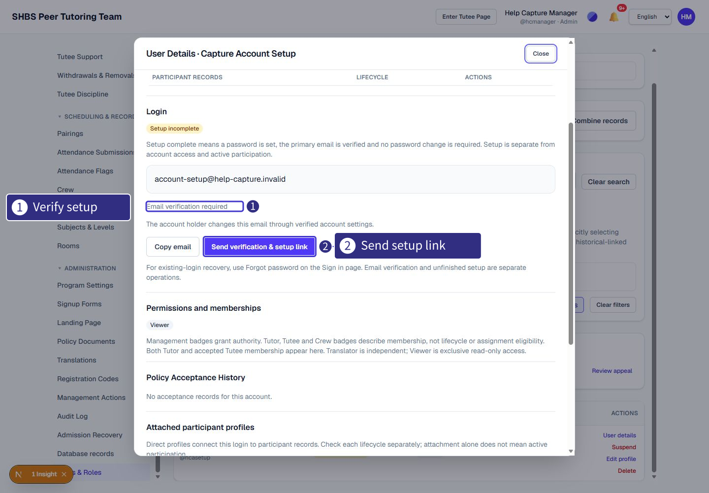

   /admin/users · EN · 2026-11-20

   The unfinished login shows where the verification and setup link would be sent. The button has not been used.

   [Original full screenshot](assets/manage-account-access-step-2.en.jpg) · `b5ece465681957c9fe579d26babdeb260c674fa0` · Latest-main development baseline b5ece465, selected 2026-11-20, with the Help candidate and synthetic demo records.

   Annotations added for this step. The original full screenshot is unchanged.

   - **1.** Verify setup

   - **2.** Send setup link

   **View 2**

   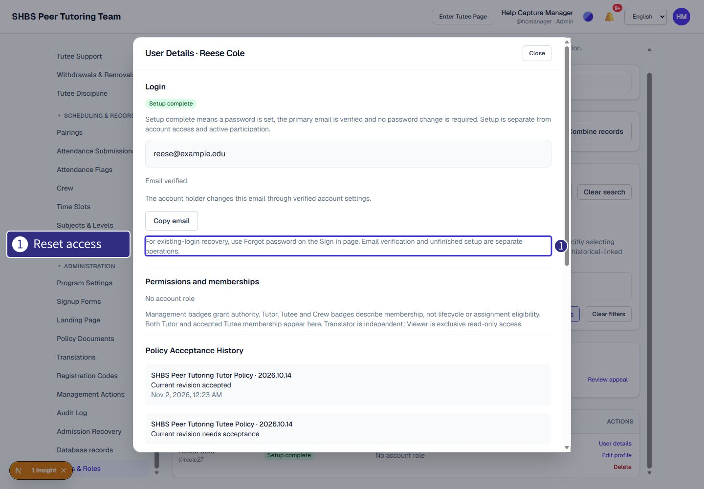

   /admin/users · EN · 2026-11-20

   The ready login points the owner to Forgot password on the Sign In page.

   [Original full screenshot](assets/manage-account-access-step-2-view-2.en.jpg) · `b5ece465681957c9fe579d26babdeb260c674fa0` · Latest-main development baseline b5ece465, selected 2026-11-20, with the Help candidate and synthetic demo records.

   Annotations added for this step. The original full screenshot is unchanged.

   - **1.** Reset access

3. **Review authority and suspension changes** For permitted non-Head rank grants/revocations or participant access changes, review the named account and consequences and complete required password/review. For Review appeal, read the complete account appeal before approving or denying.

   **View 1**

   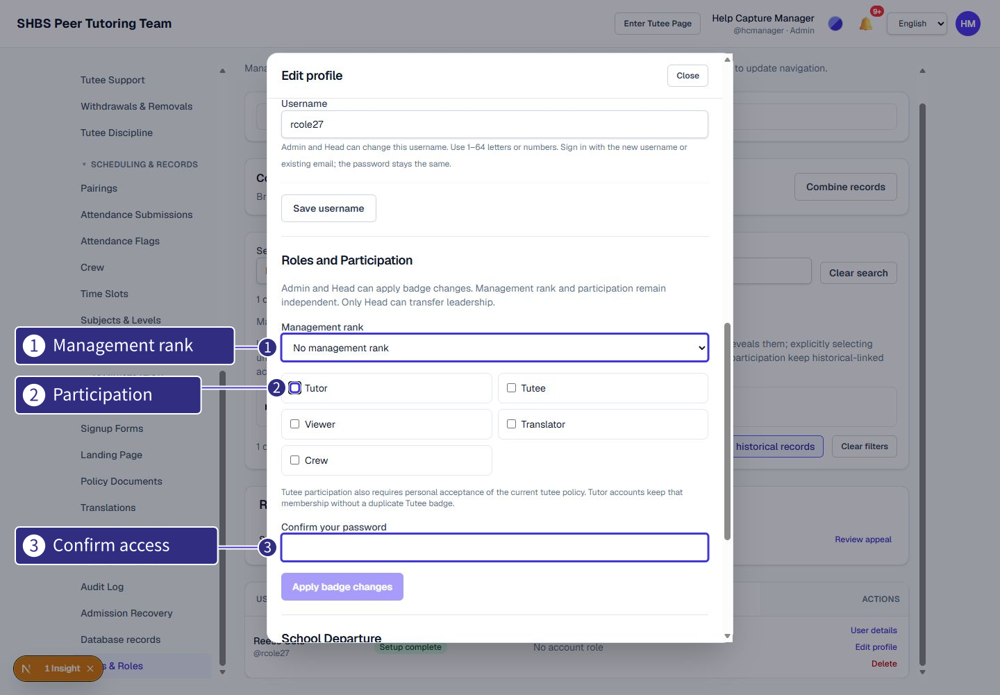

   /admin/users · EN · 2026-11-20

   The named editor separates management rank from participation and requires the admin’s password before applying badge changes.

   [Original full screenshot](assets/manage-account-access-step-3.en.jpg) · `b5ece465681957c9fe579d26babdeb260c674fa0` · Latest-main development baseline b5ece465, selected 2026-11-20, with the Help candidate and synthetic demo records.

   Annotations added for this step. The original full screenshot is unchanged.

   - **1.** Management rank

   - **2.** Participation

   - **3.** Confirm access

   **View 2**

   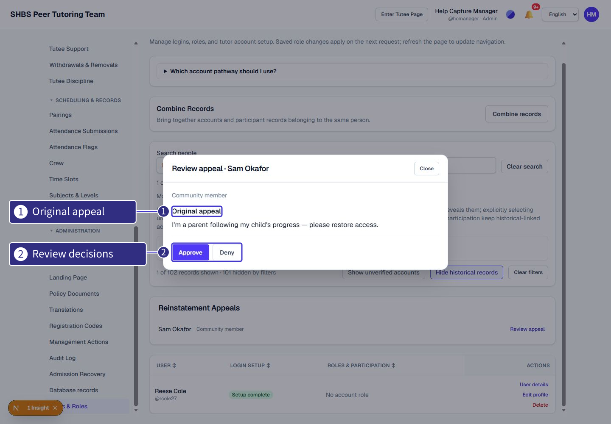

   /admin/users · EN · 2026-11-20

   The pending appeal names the account and displays the complete original text before any decision.

   [Original full screenshot](assets/manage-account-access-step-3-view-2.en.jpg) · `b5ece465681957c9fe579d26babdeb260c674fa0` · Latest-main development baseline b5ece465, selected 2026-11-20, with the Help candidate and synthetic demo records.

   Annotations added for this step. The original full screenshot is unchanged.

   - **1.** Original appeal

   - **2.** Review decisions

4. **Delete only through eligibility review** If account deletion is offered, inspect the exact login and retained-record consequences and confirm through its dedicated workflow. The current Head and reviewed combined groups cannot be deleted as ordinary accounts.

   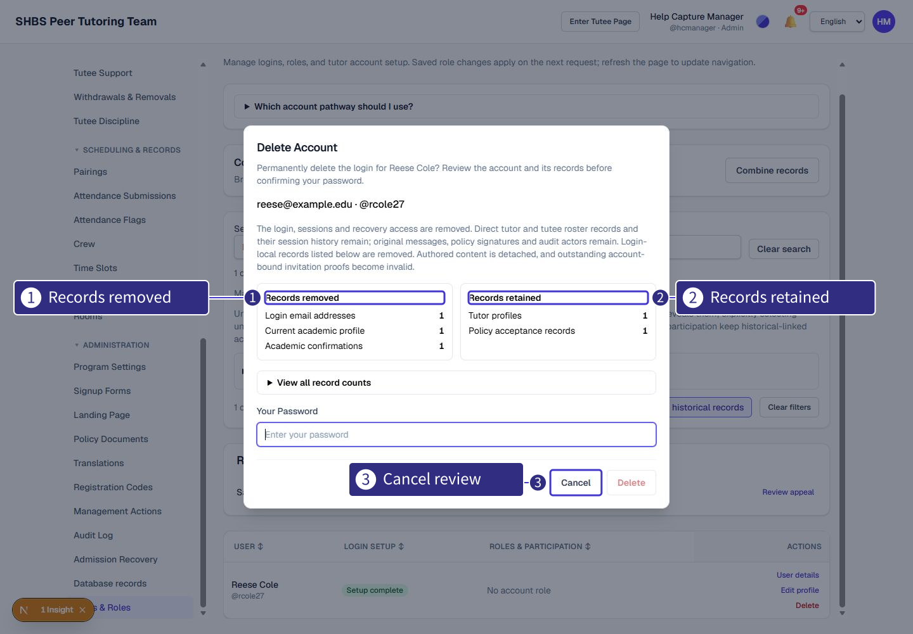

   /admin/users · EN · 2026-11-20

   The named deletion review lists what is removed and retained. Confirmation is still blank.

   [Original full screenshot](assets/manage-account-access-step-4.en.jpg) · `b5ece465681957c9fe579d26babdeb260c674fa0` · Latest-main development baseline b5ece465, selected 2026-11-20, with the Help candidate and synthetic demo records.

   Annotations added for this step. The original full screenshot is unchanged.

   - **1.** Records removed

   - **2.** Records retained

   - **3.** Cancel review

### What happens next

Only the explicitly reviewed access or setup action is recorded; historical evidence and separate memberships remain authoritative.

### How it works

Management role and participation badges are separate. Granting management rank does not automatically grant Tutor/Crew/Translator participation. Setup complete is a credential predicate, not a guarantee of unsuspended access.

### Troubleshooting

- **An action is unavailable or its saved list did not refresh** Read the server's current authority/ownership restriction. Do not use invitations to bypass a denied direct action. After an accepted decision, use Retry refresh rather than repeating suspension, deletion or appeal review.

## Assign or change a permanent username

Backfill an eligible missing handle or save a reviewed account/roster username without changing identity evidence.

Open: `/admin/users`

### Before you start

- Admin/Head access. Both apply ordinary account username edits directly under current management policy; Coordinators cannot submit account username edits.

### Walkthrough

1. **Inspect the current handle** Open Users & Roles and verify the exact login and linked tutor. For a verified eligible account without a handle, use Assign Username; reading the directory alone does not allocate one.

   Look for: Find Assign Username or the Username section inside Edit profile.

   **View 1**

   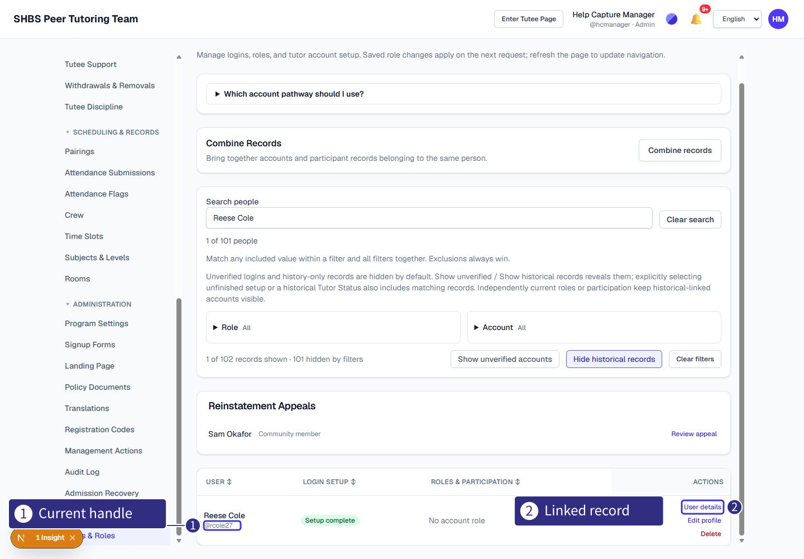

   /admin/users · EN · 2026-11-20

   The directory identifies the exact ready login and its original username before editing.

   [Original full screenshot](assets/manage-usernames-step-1.en.jpg) · `b5ece465681957c9fe579d26babdeb260c674fa0` · Latest-main development baseline b5ece465, selected 2026-11-20, with the Help candidate and synthetic demo records.

   Annotations added for this step. The original full screenshot is unchanged.

   - **1.** Current handle

   - **2.** Linked record

   **View 2**

   

   /admin/tutors · EN · 2026-11-20

   The independently filtered Tutor Roster confirms the same original handle and archived status.

   [Original full screenshot](assets/manage-usernames-step-1-view-2.en.jpg) · `b5ece465681957c9fe579d26babdeb260c674fa0` · Latest-main development baseline b5ece465, selected 2026-11-20, with the Help candidate and synthetic demo records.

   Annotations added for this step. The original full screenshot is unchanged.

   - **1.** Linked handle

   - **2.** Tutor status

2. **Edit explicitly** In Edit profile → Username, enter 1–64 ASCII letters or digits. Surrounding whitespace is trimmed and letters become lowercase. Review the old/new handles and the stated authority path.

   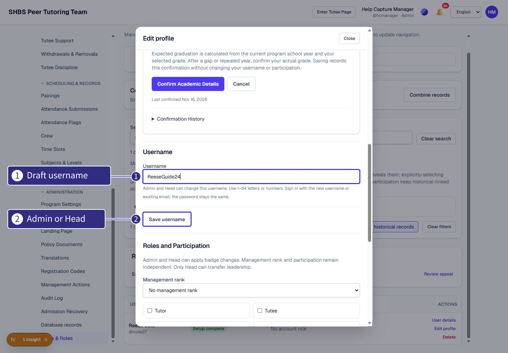

   /admin/users · EN · 2026-11-20

   The draft shows a valid mixed-case username and the Admin or Head save path.

   [Original full screenshot](assets/manage-usernames-step-2.en.jpg) · `b5ece465681957c9fe579d26babdeb260c674fa0` · Latest-main development baseline b5ece465, selected 2026-11-20, with the Help candidate and synthetic demo records.

   Annotations added for this step. The original full screenshot is unchanged.

   - **1.** Draft username

   - **2.** Admin or Head

3. **Review and save** Review the old/new handles and save through Admin/Head authority. Confirm the applied result; an unchanged save is a no-op. Current policy rechecks older pending proposals before any reviewed application.

   **View 1**

   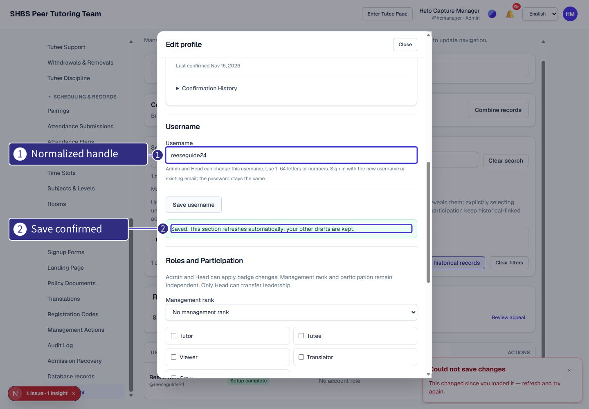

   /admin/users · EN · 2026-11-20

   The green Username receipt confirms the normalized handle. The corner notice records the earlier rejected draft.

   [Original full screenshot](assets/manage-usernames-step-3.en.jpg) · `b5ece465681957c9fe579d26babdeb260c674fa0` · Latest-main development baseline b5ece465, selected 2026-11-20, with the Help candidate and synthetic demo records.

   Annotations added for this step. The original full screenshot is unchanged.

   - **1.** Normalized handle

   - **2.** Save confirmed

   **View 2**

   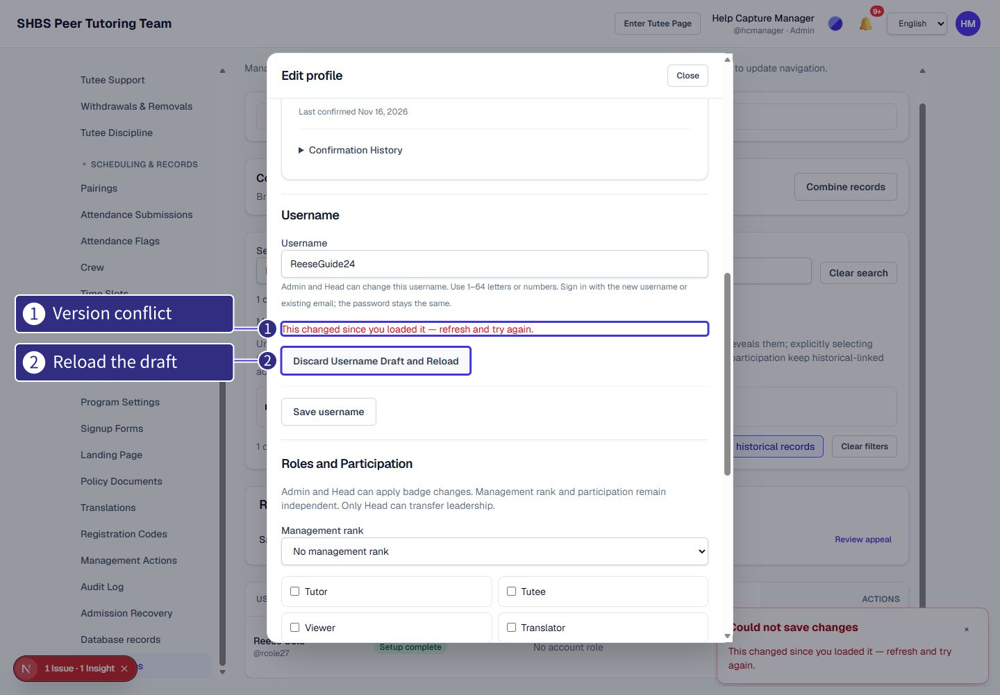

   /admin/users · EN · 2026-11-20

   The stale username draft was rejected after a separate profile save. Reload the section before drafting the change again.

   [Original full screenshot](assets/manage-usernames-step-3-view-2.en.jpg) · `b5ece465681957c9fe579d26babdeb260c674fa0` · Latest-main development baseline b5ece465, selected 2026-11-20, with the Help candidate and synthetic demo records.

   Annotations added for this step. The original full screenshot is unchanged.

   - **1.** Version conflict

   - **2.** Reload the draft

4. **Verify current values** After the section refreshes, confirm the account and linked tutor handle changed together. Tell the owner to use the new handle or their existing email for sign-in after application.

   **View 1**

   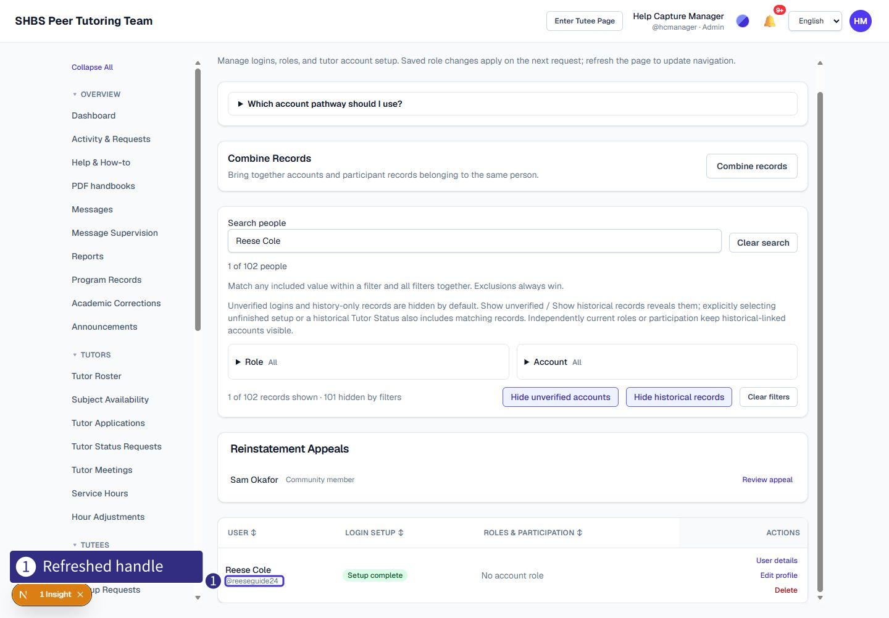

   /admin/users · EN · 2026-11-20

   The freshly loaded Users & Roles directory identifies Reese using the new normalized handle.

   [Original full screenshot](assets/manage-usernames-step-4.en.jpg) · `b5ece465681957c9fe579d26babdeb260c674fa0` · Latest-main development baseline b5ece465, selected 2026-11-20, with the Help candidate and synthetic demo records.

   Annotations added for this step. The original full screenshot is unchanged.

   - **1.** Refreshed handle

   **View 2**

   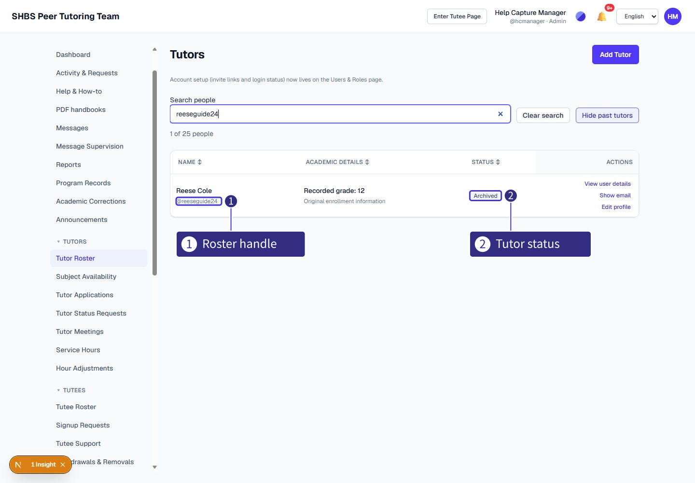

   /admin/tutors · EN · 2026-11-20

   The independently loaded Tutor Roster shows the same normalized handle and the unchanged archived record.

   [Original full screenshot](assets/manage-usernames-step-4-view-2.en.jpg) · `b5ece465681957c9fe579d26babdeb260c674fa0` · Latest-main development baseline b5ece465, selected 2026-11-20, with the Help candidate and synthetic demo records.

   Annotations added for this step. The original full screenshot is unchanged.

   - **1.** Roster handle

   - **2.** Tutor status

### What happens next

The intended handle is unique and synchronized with the linked tutor, or its reviewed request remains pending.

### How it works

A name or academic correction does not regenerate an established username. Changing the handle preserves email sign-in, password, IDs, memberships and history; the old handle stops signing in after application.

### Troubleshooting

- **The name is taken or the edit is stale** Check login and tutor-roster uniqueness, then choose a valid handle. If the account changed while you were editing, choose Discard Username Draft and Reload, review the current handle and re-enter the change. If reloading fails, retry the read before editing again.

## Combine records after identity review

Group exact sources, select a retained login only when reviewed, and resolve current participation separately.

Open: `/admin/users`

### Before you start

- Admin/Head access, verified identity evidence and your current password when the dedicated review requires it. Names/emails alone are not identity proof.

### Walkthrough

1. **Select exact records** Open Combine records in Users & Roles or a historical profile. Search and select the exact login, tutor and tutee sources that belong to one person; read original IDs and evidence.

   Look for: Open Combine records; its source search is independent of directory filters.

   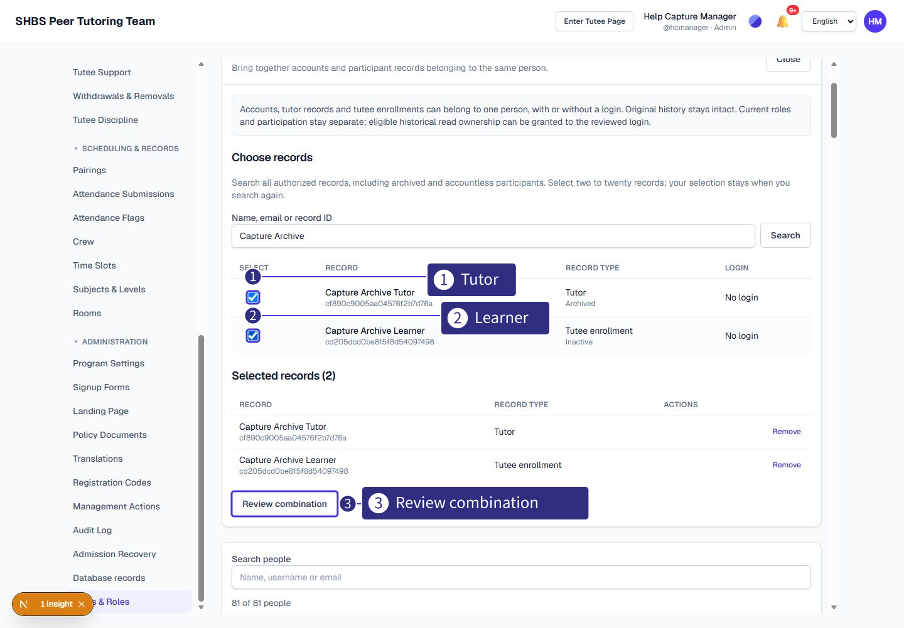

   /admin/users · EN · 2026-11-20

   The exact archived Tutor and inactive Learner are selected as two separate original records. Neither has a login.

   [Original full screenshot](assets/combine-person-records-step-1.en.jpg) · `b5ece465681957c9fe579d26babdeb260c674fa0` · Latest-main development baseline b5ece465, selected 2026-11-20, with the Help candidate and synthetic demo records.

   Annotations added for this step. The original full screenshot is unchanged.

   - **1.** Tutor

   - **2.** Learner

   - **3.** Review combination

2. **Review the full group** Preview every source. With no login the result remains accountless; one ready login may retain unowned history without reenrollment. For multiple logins, explicitly choose the retained login and review retirement only after conflicts are resolved.

   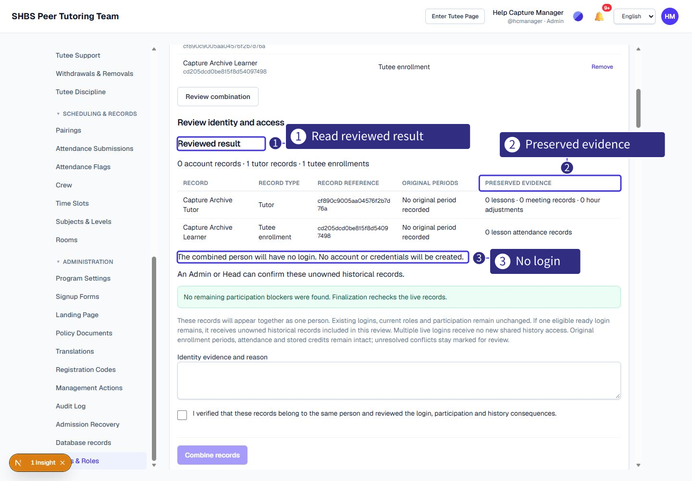

   /admin/users · EN · 2026-11-20

   The reviewed originals remain distinct and their periods and evidence are shown. The combined historical person does not create a login.

   [Original full screenshot](assets/combine-person-records-step-2.en.jpg) · `b5ece465681957c9fe579d26babdeb260c674fa0` · Latest-main development baseline b5ece465, selected 2026-11-20, with the Help candidate and synthetic demo records.

   Annotations added for this step. The original full screenshot is unchanged.

   - **1.** Read reviewed result

   - **2.** Preserved evidence

   - **3.** No login

3. **Record evidence and confirm** Enter identity evidence, acknowledge the complete review and provide your current password where required for multiple logins, ownership conflicts, active unowned work or restricted accounts. Read and retain the operation receipt.

   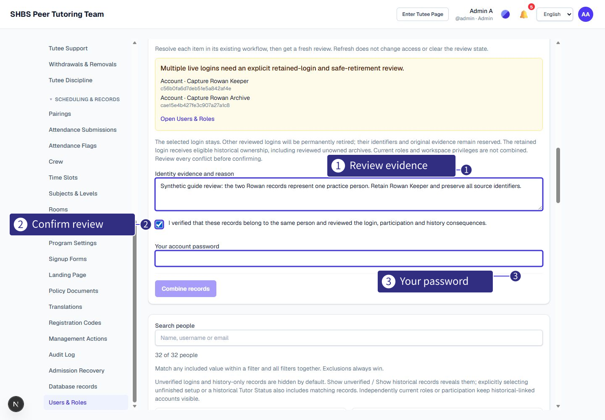

   /admin/users · EN · 2026-11-21

   The reviewed Rowan example keeps one login and reserves the original records. Add the evidence, acknowledge the consequences and enter your own password before confirming; the field is empty in this example.

   [Original full screenshot](assets/combine-person-records-step-3.en.jpg) · `b5ece465681957c9fe579d26babdeb260c674fa0` · Latest-main development baseline b5ece465, selected 2026-11-20, with the Help candidate. Isolated synthetic first-report demonstration phase.

   Annotations added for this step. The original full screenshot is unchanged.

   - **1.** Review evidence

   - **2.** Confirm review

   - **3.** Your password

4. **Resolve operational work** If Current participation or login review required appears, open User details → Combined records → Review current participation. Follow each exact blocker, cancel an obsolete pending history invitation if reviewed, then Get fresh participation review and Finalize reviewed group with evidence.

   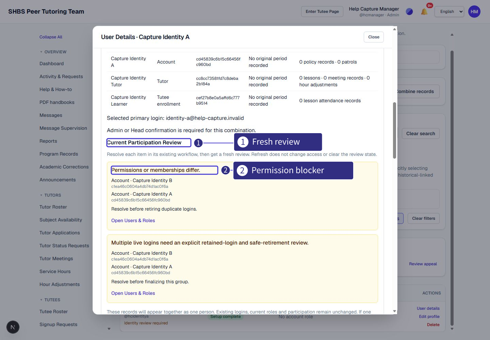

   /admin/users · EN · 2026-11-21

   The corrected two-login group has a fresh review. Different membership or permission decisions prevent finalization, while both original login families remain separate from the archive group.

   [Original full screenshot](assets/combine-person-records-step-4.en.jpg) · `b5ece465681957c9fe579d26babdeb260c674fa0` · Latest-main development baseline b5ece465, selected 2026-11-20, with the Help candidate and synthetic demo records.

   Annotations added for this step. The original full screenshot is unchanged.

   - **1.** Fresh review

   - **2.** Permission blocker

### What happens next

The directory identity is grouped with original sources retained, and any remaining operational review is explicit.

### How it works

Grouping does not silently union roles, transfer assignments, restore restrictions, deduplicate events or fabricate consent. Explicitly retired credentials stay disabled; source IDs preserve authorship. A receipt, not a checkbox or refresh, establishes finalization.

### Troubleshooting

- **A new review still lists records from an earlier combination** In Selected records, remove each unrelated source before opening Review combination. Compare the names and original record IDs in Reviewed source records before confirming.

- **The review changed or the response was interrupted** Get a fresh preview after changed evidence. If submission may have succeeded, inspect its receipt first and use read-only refresh. Do not submit a different grouping intent to recover an uncertain prior result.

## Link history or invite a former participant

Assign exact retained history to its verified owner or send an invitation with frozen history-only scope.

Open: `/admin/users`

### Before you start

- Admin/Head access and reviewed ownership evidence for every source. A private recipient mailbox must be verified through the recipient workflow.

### Walkthrough

1. **Find the original archive** Use Show past tutors/Show historical records and open Edit profile on the exact archive, or open Combined records for a reviewed historical group. Inspect original enrollment and existing retained owner.

   Look for: Use historical Edit profile or User details → Combined records.

   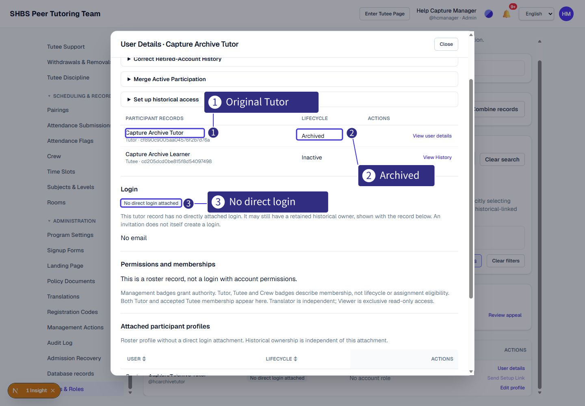

   /admin/users · EN · 2026-11-20

   The original Tutor record remains Archived and has no direct login. The same directory group lists the separate inactive Learner.

   [Original full screenshot](assets/link-historical-participant-records-step-1.en.jpg) · `b5ece465681957c9fe579d26babdeb260c674fa0` · Latest-main development baseline b5ece465, selected 2026-11-20, with the Help candidate and synthetic demo records.

   Annotations added for this step. The original full screenshot is unchanged.

   - **1.** Original Tutor

   - **2.** Archived

   - **3.** No direct login

2. **Choose link or invitation** For an existing verified owner use the reviewed Combine records/history linking pathway. To invite an alumnus without a login, choose Set up historical access and review the recipient and every included source.

   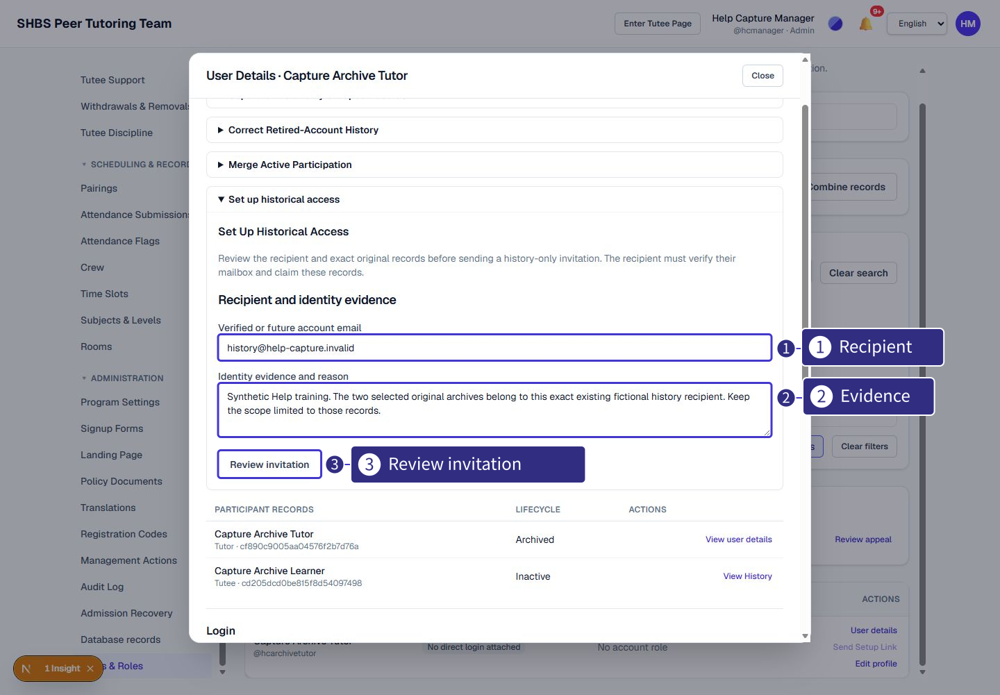

   /admin/users · EN · 2026-11-20

   The grouped archive’s history-only invitation draft names the exact existing synthetic recipient, with identity evidence ready for the scope review.

   [Original full screenshot](assets/link-historical-participant-records-step-2.en.jpg) · `b5ece465681957c9fe579d26babdeb260c674fa0` · Latest-main development baseline b5ece465, selected 2026-11-20, with the Help candidate and synthetic demo records.

   Annotations added for this step. The original full screenshot is unchanged.

   - **1.** Recipient

   - **2.** Evidence

   - **3.** Review invitation

3. **Review ownership or delivery** Record identity evidence and provide current-password confirmation for a retained-owner correction when required. Send only the reviewed invitation scope; later additions to a group do not expand a pending invitation.

   **View 1**

   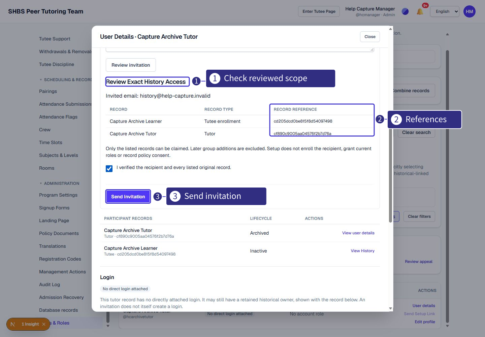

   /admin/users · EN · 2026-11-20

   The review freezes the exact two archived sources and the intended mailbox. The acknowledgement applies to this listed scope.

   [Original full screenshot](assets/link-historical-participant-records-step-3.en.jpg) · `b5ece465681957c9fe579d26babdeb260c674fa0` · Latest-main development baseline b5ece465, selected 2026-11-20, with the Help candidate and synthetic demo records.

   Annotations added for this step. The original full screenshot is unchanged.

   - **1.** Check reviewed scope

   - **2.** References

   - **3.** Send invitation

   **View 2**

   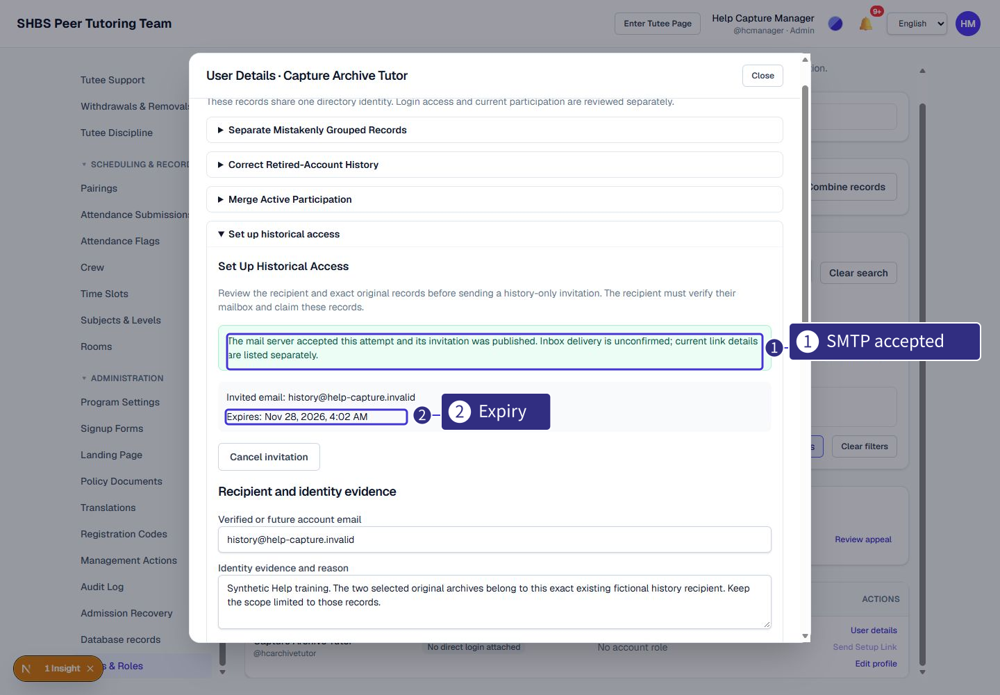

   /admin/users · EN · 2026-11-20

   The application records actual local mail acceptance and the invitation expiry. The separate loopback inbox independently received this exact invitation.

   [Original full screenshot](assets/link-historical-participant-records-step-3-view-2.en.jpg) · `b5ece465681957c9fe579d26babdeb260c674fa0` · Latest-main development baseline b5ece465, selected 2026-11-20, with the Help candidate and synthetic demo records.

   Annotations added for this step. The original full screenshot is unchanged.

   - **1.** SMTP accepted

   - **2.** Expiry

4. **Verify history access separately** The recipient verifies the mailbox, reviews the invitation and separately claims the exact frozen sources after sign-in. Check the resulting ownership/claim receipt; current tutoring participation is not granted by history setup.

   **View 1**

   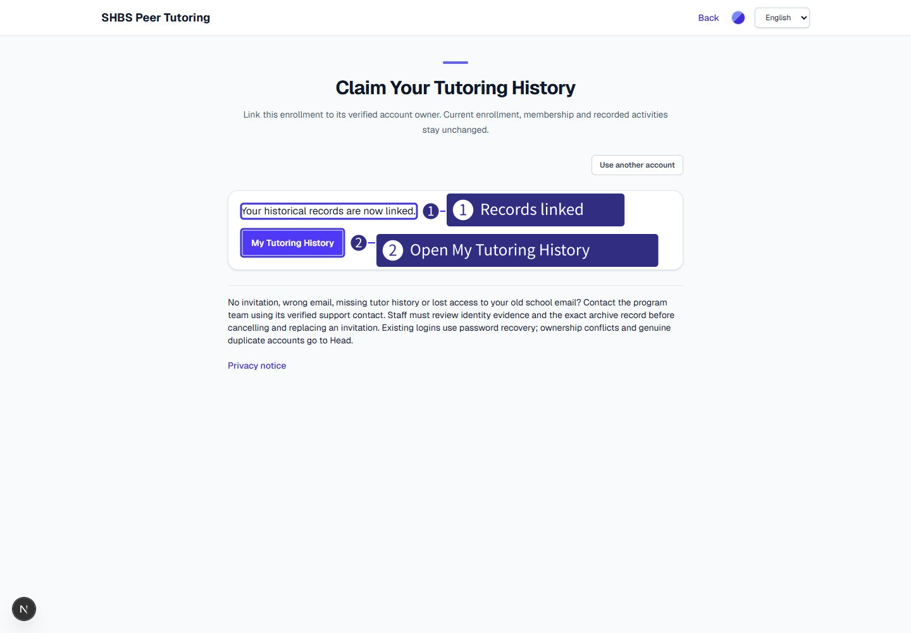

   /history/claim · EN · 2026-11-21

   The existing synthetic account saved the exact claim. The receipt links to the recipient’s retained history.

   [Original full screenshot](assets/link-historical-participant-records-step-4.en.jpg) · `b5ece465681957c9fe579d26babdeb260c674fa0` · Latest-main development baseline b5ece465, selected 2026-11-20, with the Help candidate and synthetic demo records.

   Annotations added for this step. The original full screenshot is unchanged.

   - **1.** Records linked

   - **2.** Open My Tutoring History

   **View 2**

   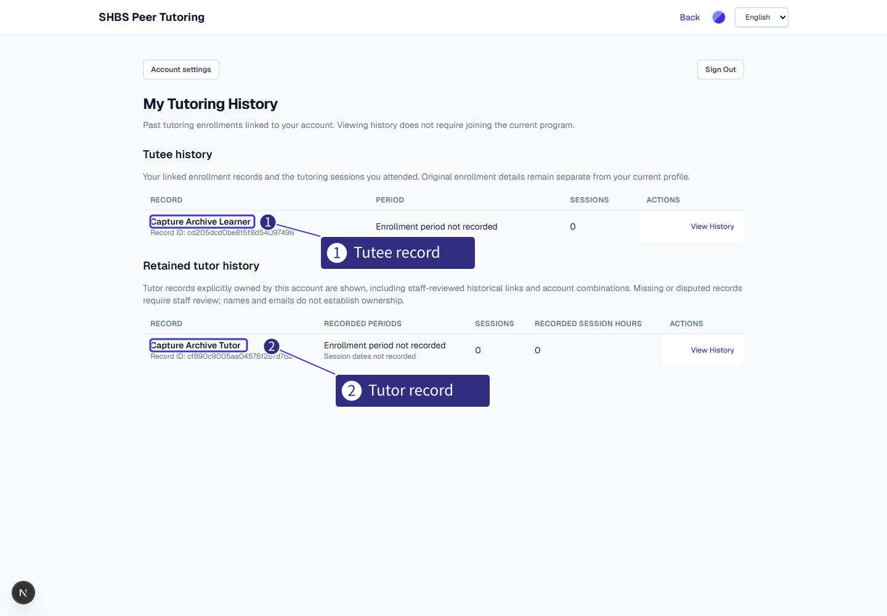

   /history · EN · 2026-11-21

   The recipient’s ordinary My Tutoring History page now lists both exact original sources in separate Tutee and Tutor sections.

   [Original full screenshot](assets/link-historical-participant-records-step-4-view-2.en.jpg) · `b5ece465681957c9fe579d26babdeb260c674fa0` · Latest-main development baseline b5ece465, selected 2026-11-20, with the Help candidate and synthetic demo records.

   Annotations added for this step. The original full screenshot is unchanged.

   - **1.** Tutee record

   - **2.** Tutor record

### What happens next

Only the reviewed original history becomes linked or invited, with ownership evidence preserved.

### How it works

Several archived profiles may belong to one login without replacing its current profile or reactivating archives. Existing historical Tutee invitations keep their original claim workflow; matching contact data alone never authorizes private history.

### Troubleshooting

- **A conflicting owner or current work blocks setup** Open the exact ownership/current-participation review and resolve its stated sources. Do not send a broader replacement invitation or link by email alone. Cancel only a reviewed obsolete invitation, then load fresh evidence.

## Correct a mistaken grouping or history reader

Separate directory identities, correct retired-account history, or merge active participation through distinct reviews.

Open: `/admin/users`

### Before you start

- Admin/Head access, exact source evidence and current-password confirmation. These dedicated corrections are not ordinary Coordinator proposals.

### Walkthrough

1. **Choose the correction boundary** Open Combined records and identify whether the error concerns directory grouping, who reads retired-account history, or future active work. Use the corresponding named workflow; one cannot substitute for another.

   Look for: Open User details → Combined records and choose the exact correction workflow.

   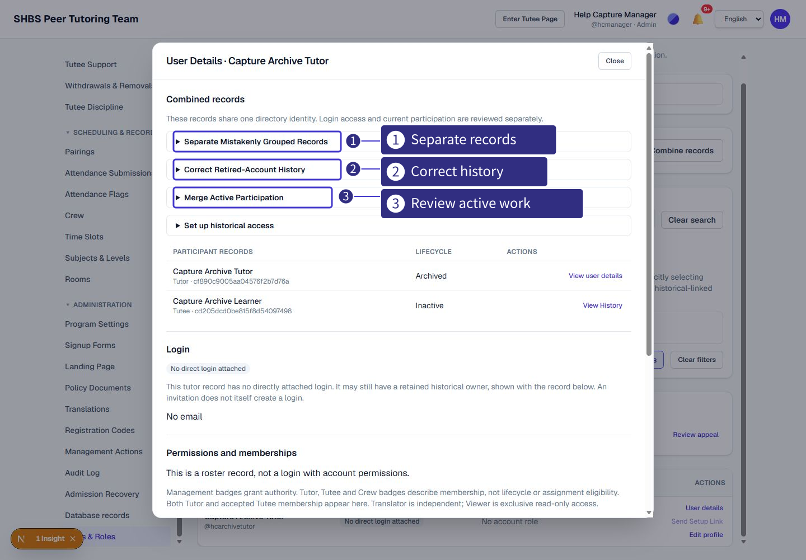

   /admin/users · EN · 2026-11-20

   The grouped synthetic archive exposes three independent corrections for directory identity, retired history and active work.

   [Original full screenshot](assets/correct-combined-records-step-1.en.jpg) · `b5ece465681957c9fe579d26babdeb260c674fa0` · Latest-main development baseline b5ece465, selected 2026-11-20, with the Help candidate and synthetic demo records.

   Annotations added for this step. The original full screenshot is unchanged.

   - **1.** Separate records

   - **2.** Correct history

   - **3.** Review active work

2. **Separate a mistaken grouping** In Separate Mistakenly Grouped Records, select sources to move and Review separation. Keep each login with its current records and retained history. Review both resulting identities, evidence and password before confirming; both require fresh participation review afterward.

   **View 1**

   

   /admin/users · EN · 2026-11-20

   The review shows the original Tutor staying in this identity and only the selected Learner moving. The separation is unsaved.

   [Original full screenshot](assets/correct-combined-records-step-2.en.jpg) · `b5ece465681957c9fe579d26babdeb260c674fa0` · Latest-main development baseline b5ece465, selected 2026-11-20, with the Help candidate and synthetic demo records.

   Annotations added for this step. The original full screenshot is unchanged.

   - **1.** Review both identities

   - **2.** Stays

   - **3.** Moves

   **View 2**

   

   /admin/users · EN · 2026-11-20

   The second real preview keeps both identity logins with their attached original records. It moves only the two accountless archive sources.

   [Original full screenshot](assets/correct-combined-records-step-2-view-2.en.jpg) · `b5ece465681957c9fe579d26babdeb260c674fa0` · Latest-main development baseline b5ece465, selected 2026-11-20, with the Help candidate and synthetic demo records.

   Annotations added for this step. The original full screenshot is unchanged.

   - **1.** Retain logins

   - **2.** Move archives

3. **Correct exact history access** In Correct Retired-Account History, select original retired logins and a live history reader or quarantine. Decide every affected row as Retain, Assign or Quarantine, inspect before/after readers and remaining restrictions, then confirm the frozen review.

   

   /admin/users · EN · 2026-11-21

   The retired Rowan login and its original tutor record are visible with the current and proposed reader. Choose Retain, Assign, or Quarantine for the exact record. This is a review before any correction.

   [Original full screenshot](assets/correct-combined-records-step-3.en.jpg) · `b5ece465681957c9fe579d26babdeb260c674fa0` · Latest-main development baseline b5ece465, selected 2026-11-20, with the Help candidate. Isolated synthetic first-report demonstration phase.

   Annotations added for this step. The original full screenshot is unchanged.

   - **1.** Compare readers

   - **2.** Decision

4. **Transfer active execution only when intended** In Merge Active Participation, choose one active tutor/tutee record and retained login, exact qualification sources and whose willingness/availability to keep. Review assignments, published responses/deadlines, history-access and discipline consequences, record evidence/password and confirm only when all blockers resolve.

   

   /admin/users · EN · 2026-11-21

   This actual transfer review previews the recurring Mathematics assignment, approved qualification and chosen preference sources. Resolve the history-access review before any transfer. No assignment was moved.

   [Original full screenshot](assets/correct-combined-records-step-4.en.jpg) · `b5ece465681957c9fe579d26babdeb260c674fa0` · Latest-main development baseline b5ece465, selected 2026-11-20, with the Help candidate. Isolated synthetic first-report demonstration phase.

   Annotations added for this step. The original full screenshot is unchanged.

   - **1.** History access

   - **2.** Recurring Math

   - **3.** Qualification

   - **4.** Preference sources

### What happens next

A dedicated receipt records the reviewed separation, history correction or future-work transfer without restoring retired credentials.

### How it works

Directory grouping, private ownership and active execution are separate. Original actors, completed lessons, signatures, credit and intake priority remain evidence. New history access does not remove original suspension/departure restrictions, and pending email copies are never forwarded to a new reader.

### Troubleshooting

- **The response is uncertain or a blocker remains** Check the operation receipt first. If none is visible, use the same frozen-operation retry with current password as offered; do not alter sources mid-retry. Resolve exact source restrictions/workflow blockers and obtain a fresh review before a new intent.

## Review a management change request

Read captured and current evidence, confirm consequences and approve or reject with a note.

Open: `/admin/approvals`

### Before you start

- Current Admin/Head review authority for the operation. Head alone reviews official refresh requests; only Head can review their own eligible management proposal.

### Walkthrough

1. **Read the complete request** Open Management Actions and filter pending requests. Read requester, exact target, operation and captured before/after evidence. Follow the owning-record link when additional context is needed.

   Look for: Open a pending request and compare its recorded evidence before approving.

   

   /admin/approvals · EN · 2026-11-16

   Alex, a separate Admin reviewer, selects Carol Wang in Requested By and sees only the intended pending slot proposal.

   [Original full screenshot](assets/decide-management-proposals-step-1.en.jpg) · `589c055e4b1cf166b48b353bd619ac1982e5d9f6` · Latest-main development baseline 589c055e with the Help candidate; synthetic demonstration data.

   Annotations added for this step. The original full screenshot is unchanged.

   - **1.** Requester

2. **Compare current authority and evidence** Check that the request still matches current target data and authority. A compatible old proposal can be reviewed under current policy; stale or incompatible evidence requires rejection/return and a fresh request.

   

   /admin/approvals · EN · 2026-11-16

   The Admin checks the immutable requested label, weekday and clock values and the not-applied state for this new-record request.

   [Original full screenshot](assets/decide-management-proposals-step-2.en.jpg) · `589c055e4b1cf166b48b353bd619ac1982e5d9f6` · Latest-main development baseline 589c055e with the Help candidate; synthetic demonstration data.

   Annotations added for this step. The original full screenshot is unchanged.

   - **1.** Evidence

3. **Decide with a note** Enter the required review note, check the exact request, then choose Approve and Apply or Reject with Feedback. Complete the consequence review and fresh-password confirmation when the operation offers or requires them. Requests without an extra consequence review submit directly from the decision button.

   

   /admin/approvals · EN · 2026-11-16

   The Admin has checked Capture Guide Slot A and entered an independent decision note. Approve and Apply will apply this slot request directly.

   [Original full screenshot](assets/decide-management-proposals-step-3.en.jpg) · `589c055e4b1cf166b48b353bd619ac1982e5d9f6` · Latest-main development baseline 589c055e with the Help candidate; synthetic demonstration data.

   Annotations added for this step. The original full screenshot is unchanged.

   - **1.** Approve

4. **Verify outcome and notices** Inspect the applied record and separate request/action audit entries. Refresh reviewer notifications can append missing eligible notices without deciding requests or resending already-delivered notices.

   **View 1**

   

   /admin/time-slots · EN · 2026-11-16

   The applied proposal has created Capture Guide Slot A in the live catalogue, with Saturday 15:30–16:00 and Active shown.

   [Original full screenshot](assets/decide-management-proposals-step-4.en.jpg) · `589c055e4b1cf166b48b353bd619ac1982e5d9f6` · Latest-main development baseline 589c055e with the Help candidate; synthetic demonstration data.

   Annotations added for this step. The original full screenshot is unchanged.

   - **1.** Live

   **View 2**

   

   /admin/approvals · EN · 2026-11-16

   The genuine Approved receipt states that the request was applied and preserves its requested values; later live edits are a separate action.

   [Original full screenshot](assets/decide-management-proposals-step-4-view-2.en.jpg) · `589c055e4b1cf166b48b353bd619ac1982e5d9f6` · Latest-main development baseline 589c055e with the Help candidate; synthetic demonstration data.

   Annotations added for this step. The original full screenshot is unchanged.

   - **1.** Outcome

### What happens next

The request has one recorded decision and any applied action matches the reviewed current evidence.

### How it works

Admin/Head review non-refresh proposals; official refresh belongs to Head. The Head self-review exception never permits an applicant to decide their own qualification interview. Review notes and policy versions remain audit evidence.

### Troubleshooting

- **Approval is blocked or reviewer notices are missing** Check self-review, current role/suspension and stale-evidence restrictions. Use Refresh reviewer notifications for missing routing only; it is not approval. For changed targets, request a new proposal rather than force the old one.

## Inspect persisted records safely

Browse approved table projections, exact keys and recorded relationships without writing to the database.

Open: `/admin/database`

### Before you start

- Admin or Head access. The inspector is read-only and follows a field/table policy; it is not unrestricted database administration.

### Walkthrough

1. **Select an approved table** Open Database records and choose Database table. Read its primary-key fields and Field access policy. Metadata only means rows are not queried under the current policy.

   Look for: Choose Database table and optionally apply an exact JSON primary key.

   

   /admin/database · EN · 2026-11-20

   Choose Tutor in Database table. Read the required key field, id, then expand Field access policy to see which fields are permitted, restricted or omitted.

   [Original full screenshot](assets/inspect-database-records-step-1.en.jpg) · `dd970ea426016e85cb514beeeab537c3ab2e5098` · Latest-main development baseline dd970ea4, selected 2026-11-16, with the Help candidate; synthetic demonstration data.

   Annotations added for this step. The original full screenshot is unchanged.

   - **1.** Table

   - **2.** Primary key

   - **3.** Field policy

2. **Browse or enter an exact key** Leave Exact primary key blank to browse, or enter a JSON object containing every primary-key field with scalar values and choose Apply key filter. Use Previous/Next for the resulting pages.

   

   /admin/database · EN · 2026-11-20

   Enter every key field as a JSON object. Apply the key filter and confirm that the single returned Tutor record has the same id.

   [Original full screenshot](assets/inspect-database-records-step-2.en.jpg) · `dd970ea426016e85cb514beeeab537c3ab2e5098` · Latest-main development baseline dd970ea4, selected 2026-11-16, with the Help candidate; synthetic demonstration data.

   Annotations added for this step. The original full screenshot is unchanged.

   - **1.** JSON key

   - **2.** Apply

   - **3.** Matching key

3. **Inspect persisted evidence** Choose Inspect record and read permitted fields and omitted-field reasons. Follow a recorded relationship only when needed; every linked read rechecks current policy and masking.

   **View 1**

   

   /admin/database · EN · 2026-11-20

   Choose Inspect record for the matching Tutor. Read the permitted persisted values and the separate omitted-field reasons. Recorded recovery relationships opens a separate reader.

   [Original full screenshot](assets/inspect-database-records-step-3.en.jpg) · `dd970ea426016e85cb514beeeab537c3ab2e5098` · Latest-main development baseline dd970ea4, selected 2026-11-16, with the Help candidate; synthetic demonstration data.

   Annotations added for this step. The original full screenshot is unchanged.

   - **1.** Relationships

   - **2.** Persisted fields

   - **3.** Omitted fields

   **View 2**

   

   /admin/database · EN · 2026-11-20

   Open Recorded recovery relationships to check saved references for this exact record. This Tutor has no recorded relationships in the reader.

   [Original full screenshot](assets/inspect-database-records-step-3-view-2.en.jpg) · `dd970ea426016e85cb514beeeab537c3ab2e5098` · Latest-main development baseline dd970ea4, selected 2026-11-16, with the Help candidate; synthetic demonstration data.

   Annotations added for this step. The original full screenshot is unchanged.

   - **1.** Relationships

   - **2.** No recorded links

4. **Copy an operator reference** Use Copy record reference to preserve the exact table/key for the technical operator. Read CLI placeholders carefully; the reference is an identifier, not permission to execute a shell mutation.

   

   /admin/database · EN · 2026-11-20

   Use Copy record reference to copy the exact Tutor table and primary key. Confirm that Record reference copied appears. The CLI example below uses placeholders.

   [Original full screenshot](assets/inspect-database-records-step-4.en.jpg) · `dd970ea426016e85cb514beeeab537c3ab2e5098` · Latest-main development baseline dd970ea4, selected 2026-11-16, with the Help candidate; synthetic demonstration data.

   Annotations added for this step. The original full screenshot is unchanged.

   - **1.** JSON reference

   - **2.** Copy

   - **3.** Copied

### What happens next

You have a precise permitted record reference and understand which values/relationships were not retrieved.

### How it works

No recorded relationships does not prove there are no other effects. Sensitive, oversized or unsupported fields remain omitted; the inspector does not reconstruct them or prove a complete recovery chain.

### Troubleshooting

- **The key is invalid or results are metadata only** Match exactly the displayed primary-key field names and JSON scalar types. For metadata-only tables use the operator recovery guide; do not try alternate keys to infer protected row existence.

## Export or import program-record archives

Use stable-ID UTF-8 CSV templates, preview dependencies and import without overwriting existing records.

Open: `/admin/records`

### Before you start

- Admin/Head access for templates, previews, imports and exports. Review archival purpose and storage before moving participant records.

### Walkthrough

1. **Download an archive or templates** Open Program Records and choose Export CSV archive or Download CSV templates. Read the listed export scope. Preserve the ZIP/CSV headers and stable source IDs. A full backup is a separate operator workflow.

   Look for: Use Export, Templates and the selected-file import preview.

   

   /admin/records · EN · 2026-11-20

   Program Records offers separate archive and template downloads. The archive scope and limits appear on the same page.

   [Original full screenshot](assets/transfer-program-records-step-1.en.jpg) · `b5ece465681957c9fe579d26babdeb260c674fa0` · Latest-main development baseline b5ece465, selected 2026-11-20, with the Help candidate. Isolated synthetic first-report demonstration phase.

   Annotations added for this step. The original full screenshot is unchanged.

   - **1.** Export ZIP

   - **2.** CSV templates

2. **Prepare related files together** Use the offered UTF-8 CSV formats and include related files together. Under Import Past Records, select the CSV files or ZIP archive. Check the selected file, parsed CSV count and displayed limits before previewing.

   

   /admin/records · EN · 2026-11-20

   The importer read three related CSVs from the named synthetic catalogue ZIP. Nothing has been imported yet.

   [Original full screenshot](assets/transfer-program-records-step-2.en.jpg) · `b5ece465681957c9fe579d26babdeb260c674fa0` · Latest-main development baseline b5ece465, selected 2026-11-20, with the Help candidate. Isolated synthetic first-report demonstration phase.

   Annotations added for this step. The original full screenshot is unchanged.

   - **1.** Selected ZIP

   - **2.** Parsed file count

3. **Preview before import** Choose Preview import and check New records and Already present for each record type. If a conflict or missing dependency is reported, correct the named file or row and preview again.

   

   /admin/records · EN · 2026-11-20

   The no-change preview found zero new rows and 39 already present rows across the three selected record types.

   [Original full screenshot](assets/transfer-program-records-step-3.en.jpg) · `b5ece465681957c9fe579d26babdeb260c674fa0` · Latest-main development baseline b5ece465, selected 2026-11-20, with the Help candidate. Isolated synthetic first-report demonstration phase.

   Annotations added for this step. The original full screenshot is unchanged.

   - **1.** New records

   - **2.** Already present

4. **Confirm and verify** Acknowledge the reviewed preview and choose Import records. Check the completion counts and audit receipt. Duplicate entries preserve the existing records and their stable source IDs.

   **View 1**

   

   /admin/records · EN · 2026-11-20

   The completed import recorded zero new rows and preserved all 39 existing rows. The success message confirms that this operation is in the audit log.

   [Original full screenshot](assets/transfer-program-records-step-4.en.jpg) · `b5ece465681957c9fe579d26babdeb260c674fa0` · Latest-main development baseline b5ece465, selected 2026-11-20, with the Help candidate. Isolated synthetic first-report demonstration phase.

   Annotations added for this step. The original full screenshot is unchanged.

   - **1.** Import complete

   - **2.** Audit receipt

   **View 2**

   

   /admin/records · EN · 2026-11-20

   The three selected files all preview as existing records. The acknowledgement is checked and the import has yet to be confirmed.

   [Original full screenshot](assets/transfer-program-records-step-4-view-2.en.jpg) · `b5ece465681957c9fe579d26babdeb260c674fa0` · Latest-main development baseline b5ece465, selected 2026-11-20, with the Help candidate. Isolated synthetic first-report demonstration phase.

   Annotations added for this step. The original full screenshot is unchanged.

   - **1.** Review IDs

   - **2.** Confirm import

   **View 3**

   

   /admin/audit · EN · 2026-11-20

   Audit Log retains the applied import and its recorded per-type summary. The stored evidence is read-only.

   [Original full screenshot](assets/transfer-program-records-step-4-view-3.en.jpg) · `b5ece465681957c9fe579d26babdeb260c674fa0` · Latest-main development baseline b5ece465, selected 2026-11-20, with the Help candidate. Isolated synthetic first-report demonstration phase.

   Annotations added for this step. The original full screenshot is unchanged.

   - **1.** Stored evidence

   - **2.** Saved counts

### What happens next

The reviewed archive is downloaded or only its validated new historical records are imported.

### How it works

The archive excludes credentials, configuration and private messages and grants no current participation. Imported historical source credits remain archive evidence and are excluded from new school posting; database backup/recovery is a separate operator process.

### Troubleshooting

- **A preview has missing dependencies or conflicting IDs** Use the exact templates and include the referenced source files in the same review. Resolve conflicts against existing evidence; do not expect import to update old rows. Preview again after every file change.

## Review disclosed messages and contact restrictions

Use reasoned Admin/Head supervision and separate permission controls without entering unrelated private threads.

Open: `/admin/messages/supervision`

### Before you start

- Current Admin or Head message-supervision authority. Coordinators and participant inbox access do not grant supervision.

### Walkthrough

1. **Find the disclosed conversation** Open Message Supervision. Search by name, username or message text, then check participants and visibility. Use View conversation to narrow the disclosed messages to that pair.

   Look for: Use Supervision for reviewed conversations; Own inbox returns to your messages.

   

   /admin/messages/supervision · EN · 2026-11-20

   The visible-only conversation filter selects Alice Chen and Help Capture Manager. Message Supervision lists eligible disclosed deliveries before opening their content.

   [Original full screenshot](assets/supervise-disclosed-messages-step-1.en.jpg) · `b5ece465681957c9fe579d26babdeb260c674fa0` · Latest-main development baseline b5ece465, selected 2026-11-20, with the Help candidate and synthetic demo records.

   Annotations added for this step. The original full screenshot is unchanged.

   - **1.** Disclosed messages

   - **2.** Filter visibility

   - **3.** Selected people

2. **Record the review reason** Enter a review reason of at least five characters and choose Open audited review on the exact message. Read the content and audit history. Supervision applies to messages covered by the disclosed rule.

   **View 1**

   

   /admin/messages/supervision · EN · 2026-11-20

   The audited review reveals this exact synthetic message. Review and moderation history records who opened it and the supplied reason.

   [Original full screenshot](assets/supervise-disclosed-messages-step-2.en.jpg) · `b5ece465681957c9fe579d26babdeb260c674fa0` · Latest-main development baseline b5ece465, selected 2026-11-20, with the Help candidate and synthetic demo records.

   Annotations added for this step. The original full screenshot is unchanged.

   - **1.** Reviewed message

   - **2.** Review history

   - **3.** Recorded reason

   **View 2**

   

   /admin/messages/supervision · EN · 2026-11-20

   Enter the reason before opening the one audited message review. This draft is ready to submit.

   [Original full screenshot](assets/supervise-disclosed-messages-step-2-view-2.en.jpg) · `b5ece465681957c9fe579d26babdeb260c674fa0` · Latest-main development baseline b5ece465, selected 2026-11-20, with the Help candidate and synthetic demo records.

   Annotations added for this step. The original full screenshot is unchanged.

   - **1.** State the reason

   - **2.** Open review

3. **Moderate explicitly** Check the exact message and enter the reason for changing it. Hide from participants and Restore for participants submit immediately. Check the resulting visibility and audit history. Use the separate account permission controls to restrict or restore contact access.

   **View 1**

   

   /admin/messages/supervision · EN · 2026-11-20

   Review the exact message and enter the moderation reason before Hide from participants. This control immediately changes participant visibility.

   [Original full screenshot](assets/supervise-disclosed-messages-step-3.en.jpg) · `b5ece465681957c9fe579d26babdeb260c674fa0` · Latest-main development baseline b5ece465, selected 2026-11-20, with the Help candidate and synthetic demo records.

   Annotations added for this step. The original full screenshot is unchanged.

   - **1.** Moderation reason

   - **2.** Verify exact message

   - **3.** Hide from participants

   **View 2**

   

   /admin/messages/supervision · EN · 2026-11-20

   After Hide, the same delivery appears under Hidden by staff, with its participants and timestamp retained.

   [Original full screenshot](assets/supervise-disclosed-messages-step-3-view-2.en.jpg) · `b5ece465681957c9fe579d26babdeb260c674fa0` · Latest-main development baseline b5ece465, selected 2026-11-20, with the Help candidate and synthetic demo records.

   Annotations added for this step. The original full screenshot is unchanged.

   - **1.** Find hidden deliveries

   - **2.** Same participants

   - **3.** Hidden state

   **View 3**

   

   /admin/messages/supervision · EN · 2026-11-20

   The same reviewed message is hidden. Its Hide reason appears in the audit history, and Restore for participants will reverse this exact visibility change.

   [Original full screenshot](assets/supervise-disclosed-messages-step-3-view-3.en.jpg) · `b5ece465681957c9fe579d26babdeb260c674fa0` · Latest-main development baseline b5ece465, selected 2026-11-20, with the Help candidate and synthetic demo records.

   Annotations added for this step. The original full screenshot is unchanged.

   - **1.** Restore this delivery

   - **2.** Moderation history

   - **3.** Recorded Hide reason

   **View 4**

   

   /admin/messages/supervision · EN · 2026-11-20

   The same disclosed delivery is back under Visible after one Restore. The original participants and timestamp match the pre-state.

   [Original full screenshot](assets/supervise-disclosed-messages-step-3-view-4.en.jpg) · `b5ece465681957c9fe579d26babdeb260c674fa0` · Latest-main development baseline b5ece465, selected 2026-11-20, with the Help candidate and synthetic demo records.

   Annotations added for this step. The original full screenshot is unchanged.

   - **1.** Visible filter

   - **2.** Same delivery

   - **3.** Visibility restored

   **View 5**

   

   /admin/audit · EN · 2026-11-20

   A read-only Audit Log detail confirms the exact RESTORE action and its separate recorded reason.

   [Original full screenshot](assets/supervise-disclosed-messages-step-3-view-5.en.jpg) · `b5ece465681957c9fe579d26babdeb260c674fa0` · Latest-main development baseline b5ece465, selected 2026-11-20, with the Help candidate and synthetic demo records.

   Annotations added for this step. The original full screenshot is unchanged.

   - **1.** Restore event

   - **2.** Restore reason

4. **Maintain permission rules separately** Choose Messaging permissions in Program Settings to inspect permitted contact groups by role or account. Choose Your inbox to send your own messages.

   **View 1**

   

   /admin/program · EN · 2026-11-20

   The named account’s effective permission source and allowed groups appear in Account Settings. Changes require their own reason and Save groups.

   [Original full screenshot](assets/supervise-disclosed-messages-step-4.en.jpg) · `b5ece465681957c9fe579d26babdeb260c674fa0` · Latest-main development baseline b5ece465, selected 2026-11-20, with the Help candidate and synthetic demo records.

   Annotations added for this step. The original full screenshot is unchanged.

   - **1.** Selected account

   - **2.** Effective source

   - **3.** Allowed groups

   **View 2**

   

   /admin/program · EN · 2026-11-20

   Permissions by Role shows the current allowed contact groups. The Tutee card is a role policy rather than a message review.

   [Original full screenshot](assets/supervise-disclosed-messages-step-4-view-2.en.jpg) · `b5ece465681957c9fe579d26babdeb260c674fa0` · Latest-main development baseline b5ece465, selected 2026-11-20, with the Help candidate and synthetic demo records.

   Annotations added for this step. The original full screenshot is unchanged.

   - **1.** Role contact policies

   - **2.** Tutee role

   - **3.** Allowed group

### What happens next

An eligible reviewed conversation or restriction action has its own reason and audit evidence.

### How it works

Private messages are separate deliveries with participant ownership. Supervision is disclosed, permission-scoped and audited; it does not authorize silent forwarding or access to every historical message.

### Troubleshooting

- **The thread is not available to supervision** Read the eligibility/disclosure reason and verify current Admin/Head authority. Do not ask a participant to republish private history to bypass the boundary; use the authorized support process for the actual issue.

## Decide an additional qualification request

Review an added-subject/higher-level request, approve without interview when justified or route it through an interview.

Open: `/admin/applications`

### Before you start

- Admin/Head authority for qualificationApplication.decide. Coordinator manual-grant proposals in Subject Availability are a separate workflow.

### Walkthrough

1. **Inspect the exact added request** Open Tutor Applications and locate the additional-subject or higher-level request. Read requested subject/level, the tutor's reason, captured qualification evidence and current status.

   Look for: Expand an additional request and find Approve without Interview and Decision note.

   

   /admin/applications · EN · 2026-11-20

   Alice Chen’s pending additional-subject application requests Standard Algebra II. The expanded record displays the submitted example-course evidence and a separately available interview path.

   [Original full screenshot](assets/decide-additional-qualification-applications-step-1.en.jpg) · `b5ece465681957c9fe579d26babdeb260c674fa0` · Latest-main development baseline b5ece465, selected 2026-11-20, with the Help candidate and synthetic demo records.

   Annotations added for this step. The original full screenshot is unchanged.

   - **1.** Additional subject

   - **2.** Reason

2. **Choose the evidence-based path** If an interview is needed, assign a valid panel and chair using the interview workflow. If the available evidence supports direct acceptance, choose Approve without Interview and read the exact requested grants.

   

   /admin/applications · EN · 2026-11-20

   The direct review lists Alice Chen’s requested Algebra II qualification. It explains the required decision note and the separate interview path for rejection. No decision has been submitted.

   [Original full screenshot](assets/decide-additional-qualification-applications-step-2.en.jpg) · `b5ece465681957c9fe579d26babdeb260c674fa0` · Latest-main development baseline b5ece465, selected 2026-11-20, with the Help candidate and synthetic demo records.

   Annotations added for this step. The original full screenshot is unchanged.

   - **1.** Direct review

   - **2.** Requested qualification

3. **Record the permitted decision** For direct acceptance, enter the required Decision note, review the named applicant, subjects and qualification consequences, then confirm Approve qualification. Rejection follows the interview path: an assigned Admin/Head chair reviews completed panel votes and the required decision note before confirming the panel decision.

   

   /admin/applications · EN · 2026-11-20

   The named review now has a sample decision note and shows Approve qualification. The example closes the draft without recording a decision or granting a qualification.

   [Original full screenshot](assets/decide-additional-qualification-applications-step-3.en.jpg) · `b5ece465681957c9fe579d26babdeb260c674fa0` · Latest-main development baseline b5ece465, selected 2026-11-20, with the Help candidate and synthetic demo records.

   Annotations added for this step. The original full screenshot is unchanged.

   - **1.** Draft decision note

   - **2.** Approve qualification

4. **Verify independent state** Inspect the completed request and Subject Availability grant sources. Confirm willingness and account participation separately; the qualification result does not silently set either.

   **View 1**

   

   /admin/applications · EN · 2026-11-21

   The Additional subject application is accepted. Its saved decision and grant identify Standard Algebra II.

   [Original full screenshot](assets/decide-additional-qualification-applications-step-4.en.jpg) · `b5ece465681957c9fe579d26babdeb260c674fa0` · Latest-main development baseline b5ece465, selected 2026-11-20, with the Help candidate and synthetic demo records.

   Annotations added for this step. The original full screenshot is unchanged.

   - **1.** Accepted application

   - **2.** Saved decision

   - **3.** Granted subject

   **View 2**

   

   /admin/subject-availability · EN · 2026-11-21

   Alice’s Standard Algebra II now has its own direct approval. Willingness still reads Not recorded.

   [Original full screenshot](assets/decide-additional-qualification-applications-step-4-view-2.en.jpg) · `b5ece465681957c9fe579d26babdeb260c674fa0` · Latest-main development baseline b5ece465, selected 2026-11-20, with the Help candidate and synthetic demo records.

   Annotations added for this step. The original full screenshot is unchanged.

   - **1.** Direct approval

   - **2.** Willingness

### What happens next

The exact additional request has a recorded decision note and resulting qualification evidence.

### How it works

A direct additional-application decision is Admin/Head-only. It is distinct from the manual qualification grant/source-removal controls available through the normal management authority path.

### Troubleshooting

- **The decision is blocked by changed or restricted participation** Read the exact source/status restriction and refresh the application evidence. Resolve suspension, departure or revoked access through its owning workflow before retrying; do not use another grant path to bypass the restriction.

## Review translations and language visibility

Publish or reject pending translations and maintain enabled language order without requiring an editing assignment.

Open: `/localization?view=review`

### Before you start

- Admin/Head review/publish authority. Editing translations remains a separate explicit Translator assignment; review authority alone does not grant the editor.

### Walkthrough

1. **Inspect the draft card** Open Localization → Draft review and use its status filter to find pending or historical drafts. Inspect the language, key and destination shown on the intended draft card, then compare the original and proposed wording.

   Look for: Open translation review and select the language and destination being reviewed.

   

   /localization?view=review · EN · 2026-11-20

   Filter Draft review to Pending review. On the intended card, verify the exact destination key, proposed wording and language before making a decision.

   [Original full screenshot](assets/review-translations-and-languages-step-1.en.jpg) · `dd970ea426016e85cb514beeeab537c3ab2e5098` · Latest-main development baseline dd970ea4, selected 2026-11-16, with the Help candidate; synthetic demonstration data.

   Annotations added for this step. The original full screenshot is unchanged.

   - **1.** Draft status

   - **2.** Destination key

   - **3.** Proposed text

   - **4.** Language code

2. **Publish or reject the exact draft** Read the complete change and its destination before approving/publishing or rejecting with the offered review controls. A pending draft remains unpublished until the authorized review completes.

   **View 1**

   

   /localization?view=review · EN · 2026-11-20

   After checking the intended pending draft, choose Approve and Publish or Reject Draft on that card. Both decisions apply immediately.

   [Original full screenshot](assets/review-translations-and-languages-step-2.en.jpg) · `dd970ea426016e85cb514beeeab537c3ab2e5098` · Latest-main development baseline dd970ea4, selected 2026-11-16, with the Help candidate; synthetic demonstration data.

   Annotations added for this step. The original full screenshot is unchanged.

   - **1.** Publish

   - **2.** Reject draft

   **View 2**

   

   /localization?view=review · EN · 2026-11-20

   After the decision, choose Published in Draft status and verify the same key, language and wording on the published card.

   [Original full screenshot](assets/review-translations-and-languages-step-2-view-2.en.jpg) · `dd970ea426016e85cb514beeeab537c3ab2e5098` · Latest-main development baseline dd970ea4, selected 2026-11-16, with the Help candidate; synthetic demonstration data.

   Annotations added for this step. The original full screenshot is unchanged.

   - **1.** Published filter

   - **2.** Published

3. **Maintain languages deliberately** In language settings, inspect enabled/hidden status and order. Review showing, hiding or reordering a language, and read the specific constraints before deleting an eligible custom language.

   **View 1**

   

   /localization?view=review · EN · 2026-11-20

   In Languages, verify the exact language and its current visibility. Enable changes public visibility, arrows change order, and Remove opens a separate confirmation for custom entries.

   [Original full screenshot](assets/review-translations-and-languages-step-3.en.jpg) · `dd970ea426016e85cb514beeeab537c3ab2e5098` · Latest-main development baseline dd970ea4, selected 2026-11-16, with the Help candidate; synthetic demonstration data.

   Annotations added for this step. The original full screenshot is unchanged.

   - **1.** Hidden

   - **2.** Enable

   - **3.** Move up

   - **4.** Remove

   **View 2**

   

   /localization?view=review · EN · 2026-11-20

   Read the exact language name and deletion warning. Choose Cancel if the custom language and its translations should be kept.

   [Original full screenshot](assets/review-translations-and-languages-step-3-view-2.en.jpg) · `dd970ea426016e85cb514beeeab537c3ab2e5098` · Latest-main development baseline dd970ea4, selected 2026-11-16, with the Help candidate; synthetic demonstration data.

   Annotations added for this step. The original full screenshot is unchanged.

   - **1.** Deletion warning

   - **2.** Cancel

   **View 3**

   

   /localization?view=review · EN · 2026-11-20

   The demo language is enabled. Its status confirms it can appear on the locale picker, and Hide restores hidden visibility.

   [Original full screenshot](assets/review-translations-and-languages-step-3-view-3.en.jpg) · `dd970ea426016e85cb514beeeab537c3ab2e5098` · Latest-main development baseline dd970ea4, selected 2026-11-16, with the Help candidate; synthetic demonstration data.

   Annotations added for this step. The original full screenshot is unchanged.

   - **1.** Enabled

   - **2.** Hide

4. **Verify live text** Choose the language on the actual destination page and inspect the applied strings. Missing strings may fall back to a supported source; check the exact destination/key rather than assuming the whole language published.

   

   /help · EN · 2026-11-20

   On the real Help page, choose the enabled demo language. The navigation link displays the approved wording while the Help catalogue shows its English fallback notice.

   [Original full screenshot](assets/review-translations-and-languages-step-4.en.jpg) · `dd970ea426016e85cb514beeeab537c3ab2e5098` · Latest-main development baseline dd970ea4, selected 2026-11-16, with the Help candidate; synthetic demonstration data.

   Annotations added for this step. The original full screenshot is unchanged.

   - **1.** Demo language

   - **2.** Published text

   - **3.** English fallback

### What happens next

Only reviewed translation drafts and language settings are live, with edit and review authority kept separate.

### How it works

Admin/Head may review without Translator assignment; explicit editing requires canTranslate and excludes Viewer. Interface keys, website text and policy text retain their own destination/version rules.

### Troubleshooting

- **Review succeeded but text remains unchanged** Check language, destination, key and applied/pending state, then refresh the actual page. Do not republish an unrelated draft; a policy translation must follow its policy document workflow.
