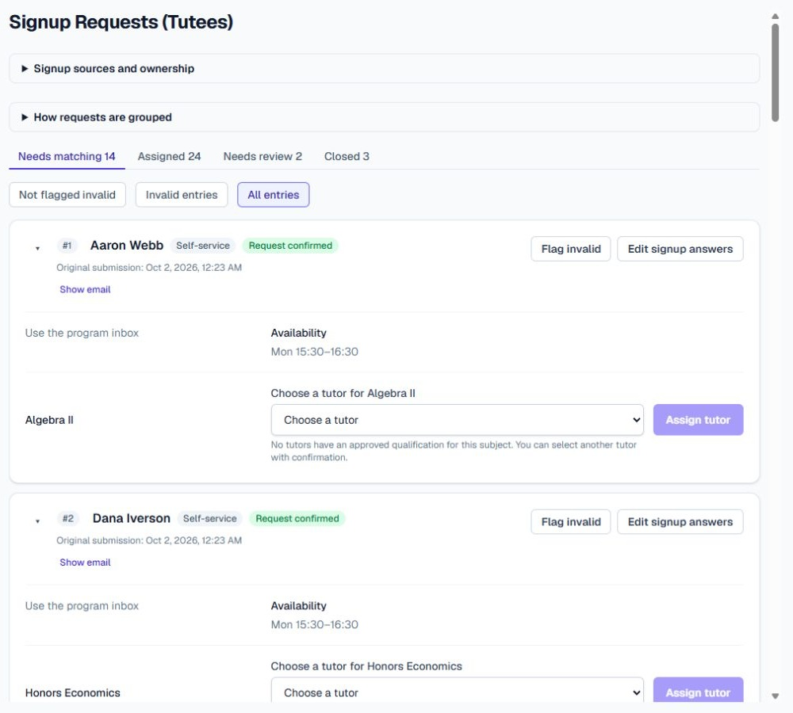
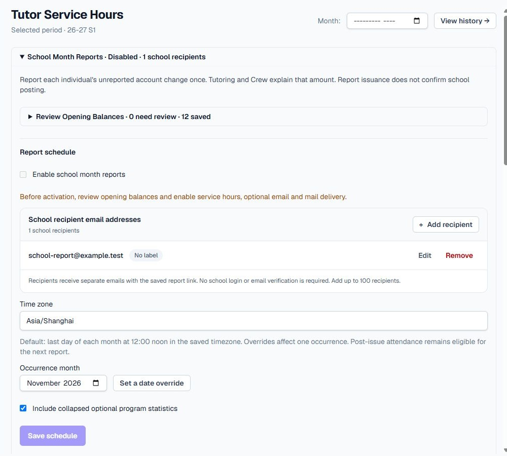
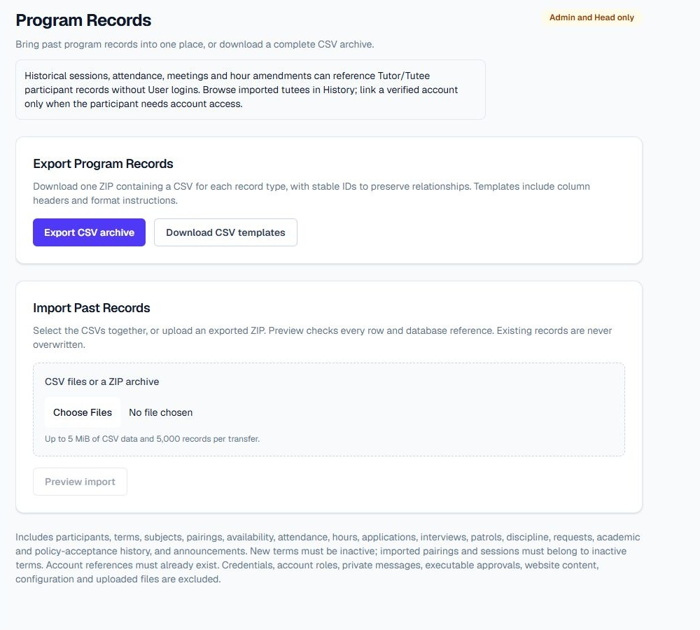
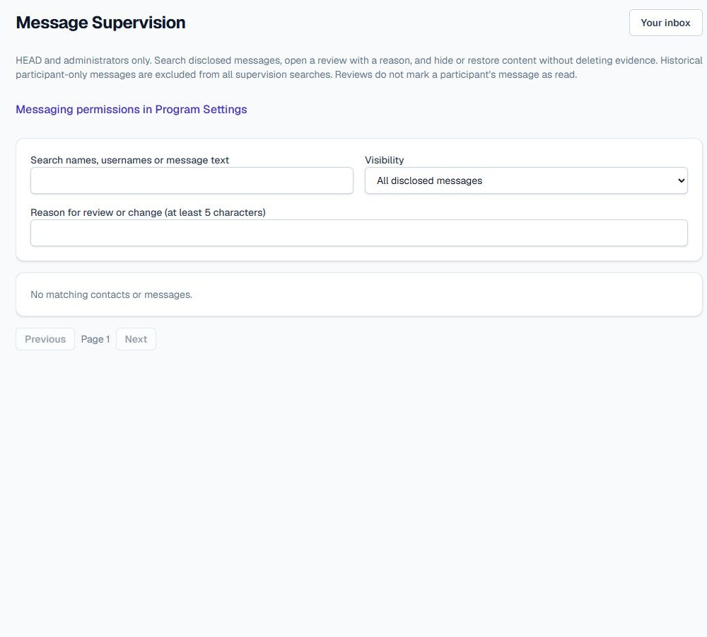
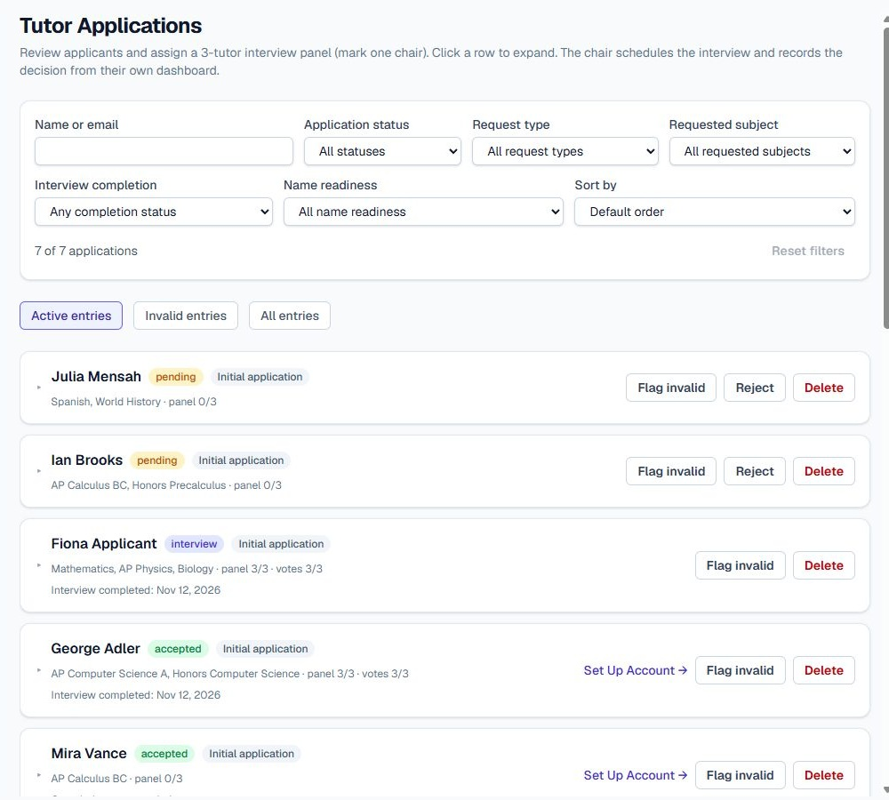
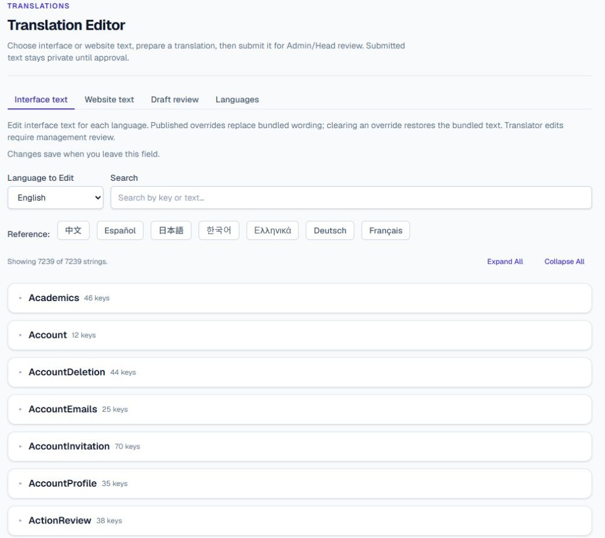

# Review & administer

Generated from the website help catalogue. Edit the content records, then run `npm run help:export`.

[Catalogue & capture provenance](README.md)

Screenshot source: `dbb3c4eb213d58e134744fd417b1a06299b0e984`. Local dev server based on latest main at task start (dbb3c4eb), with the Help candidate. User-selected source baseline; no live deployment attestation.

This GitHub training copy includes role-specific instructions. Signing in and current program permissions are still required to use the corresponding website features. All examples are synthetic.

- [Revise signup answers and release assignments](#revise-signup-answers-and-release-assignments)
- [Prepare the first school-hours report](#prepare-the-first-school-hours-report)
- [Issue and correct a school-hours report](#issue-and-correct-a-school-hours-report)
- [Manage account access and setup](#manage-account-access-and-setup)
- [Assign or change a permanent username](#assign-or-change-a-permanent-username)
- [Combine records after identity review](#combine-records-after-identity-review)
- [Link history or invite a former participant](#link-history-or-invite-a-former-participant)
- [Correct a mistaken grouping or history reader](#correct-a-mistaken-grouping-or-history-reader)
- [Review a management change request](#review-a-management-change-request)
- [Inspect persisted records safely](#inspect-persisted-records-safely)
- [Export or import program-record archives](#export-or-import-program-record-archives)
- [Review disclosed messages and contact restrictions](#review-disclosed-messages-and-contact-restrictions)
- [Decide an additional qualification request](#decide-an-additional-qualification-request)
- [Review translations and language visibility](#review-translations-and-language-visibility)

## Revise signup answers and release assignments

Review changed subject choices and their explicit assignment consequences.

Open: `/admin/requests`

### Before you start

- Admin or Head access and the exact current student request. Review the original submission before editing.

### Walkthrough

1. **Read original and current answers** Open the student's request and inspect the original submission separately from accepted revisions. Confirm the subject and period you mean to change.

   Look for: Open the request's answer editor and review affected assigned choices.

   

   /admin/requests · EN · 2026-11-15

2. **Edit the intended answers** Open the signup-answer editor, update only the needed fields, and inspect any assigned choices that the change will release. Owners may edit unassigned choices; staff changes can have wider consequences.

3. **Review releases explicitly** Read the affected student, subject and assignment list before confirming an edit or unassignment. Cancel to return to the unchanged draft when the consequences are not intended.

4. **Verify the revised request** After saving, reload through the offered read recovery if needed. Check the current choices, assigned status and retained revision history.

### What happens next

Only the reviewed answers and assignment releases change; the request's evidence remains readable.

### How it works

Signup-answer changes do not rewrite shared account identity, original policy signatures, completed lessons or attendance. A release must be reviewed as an assignment consequence, not treated as an ordinary profile edit.

### Troubleshooting

- **The review is stale** Use the explicit reload action and reread the new affected-assignment list. Do not reuse an earlier confirmation after another staff member changes the request.

## Prepare the first school-hours report

Resolve identities and explicitly reconcile already-posted opening balances before issuing school credit.

Open: `/admin/service-hours`

### Before you start

- Admin or Head authority, Service Hours enabled, and school confirmation of already-reported hours and account references.

### Walkthrough

1. **Open School reports** In Service Hours, open School reports and the opening-balance review. Inspect all people requiring reconciliation, including identity warnings and excluded archive-source counts.

   Look for: Open School reports and review opening balances and identity warnings.

   

   /admin/service-hours · EN · 2026-11-15

2. **Confirm the person and account** Review each person's original evidence and school-account reference. Resolve missing or conflicting identities through the existing account/record workflows before reporting.

3. **Record already-posted amounts** Enter the reviewed already-reported opening amount for each person. Confirm zero explicitly where none was previously posted. Save completed people in batches; missing values are never treated as zero.

4. **Inspect the individual preview** Review Carry In → Raw Change → Hours → Carry Out and the person's Details. Issue only when required reviews and identity conflicts have been resolved.

### What happens next

All required opening reviews are explicitly saved and the first report has a reviewed accounting boundary.

### How it works

Historical archive imports remain program evidence but do not create new school credits or opening-review work. Overlap with already reviewed school evidence blocks issuance until reconciled. Old monthly totals cannot replace per-person opening review.

### Troubleshooting

- **Issuance remains blocked** Read every outstanding identity/opening-review warning. Save confirmed people, resolve the remaining sources and refresh the preview. Do not fill unknown balances with zero merely to enable issuance.

## Issue and correct a school-hours report

Preview an edition, issue exact posting amounts and avoid double-counting revised reports.

Open: `/admin/service-hours`

### Before you start

- Admin/Head access, resolved opening/identity reviews and enabled program mail/Service Hours prerequisites.

### Walkthrough

1. **Choose month and preview** Open School reports, choose the month and inspect each person's posting instructions plus the HTML/plain-text school email preview. A preview sends nothing and has no live report link.

   Look for: Use the report preview and saved-edition controls under School reports.

   

   /admin/service-hours · EN · 2026-11-15

2. **Review and issue once** Read the issuance review, then issue the report. Save and inspect the returned edition rather than repeating generation when a refresh fails.

3. **Inspect exact posting amounts** The highlighted Hours amount is what to enter once. Open Details for school-account references, separate tutoring/Crew values and carry explanations. Do not separately post Carry In, Raw Change or Carry Out.

4. **Correct the latest eligible edition** Review the correction and select the last edition actually entered by school. Apply only the displayed incremental correction, not the full replacement amount again. After a later month issues, later changes reconcile in the next report.

### What happens next

A saved edition contains exact one-time posting instructions and a clear correction basis.

### How it works

New reports post complete 0.1-hour steps and carry the remainder across months without semester reset. For example, 80 minutes posts 1.3 hours and carries two minutes. Negative balances post zero and carry forward; future earnings cover deficits first.

### Troubleshooting

- **School already entered an older edition** Use Details to choose the actual last-entered edition and its incremental correction. Issuing or emailing a report does not prove school entered it. Coordinate the entry record before applying another amount.

## Manage account access and setup

Review rank and participant access, send setup/recovery, decide suspension appeals and delete only eligible accounts.

Open: `/admin/users`

### Before you start

- Current Admin or Head access. Follow each dedicated review/password requirement; current Head leadership uses a separate workflow.

### Walkthrough

1. **Verify current identity and access** Open User details and inspect live login status, management rank, Tutor/Tutee/Crew memberships, Translator assignment, suspension and school departure. Read each action's eligibility before changing it.

   Look for: Use the exact account's Actions and read current permissions in User details.

   

   /admin/users · EN · 2026-11-15

2. **Use setup or recovery appropriately** Use Send setup link for an eligible unlinked/unfinished source, or the existing-login recovery action for a ready account. Delivery goes to the canonical recipient; staff do not receive the recipient's recovery secret.

3. **Review authority and suspension changes** For permitted non-Head rank grants/revocations or participant access changes, review the named account and consequences and complete required password/review. For Review appeal, read the complete account appeal before approving or denying.

4. **Delete only through eligibility review** If account deletion is offered, inspect the exact login and retained-record consequences and confirm through its dedicated workflow. The current Head and reviewed combined groups cannot be deleted as ordinary accounts.

### What happens next

Only the explicitly reviewed access or setup action is recorded; historical evidence and separate memberships remain authoritative.

### How it works

Management role and participation badges are separate. Granting management rank does not automatically grant Tutor/Crew/Translator participation. Setup complete is a credential predicate, not a guarantee of unsuspended access.

### Troubleshooting

- **An action is unavailable or its saved list did not refresh** Read the server's current authority/ownership restriction. Do not use invitations to bypass a denied direct action. After an accepted decision, use Retry refresh rather than repeating suspension, deletion or appeal review.

## Assign or change a permanent username

Backfill an eligible missing handle or save a reviewed account/roster username without changing identity evidence.

Open: `/admin/users`

### Before you start

- Admin/Head access. Both apply ordinary account username edits directly under current management policy; Coordinators cannot submit account username edits.

### Walkthrough

1. **Inspect the current handle** Open Users & Roles and verify the exact login and linked tutor. For a verified eligible account without a handle, use Assign Username; reading the directory alone does not allocate one.

   Look for: Find Assign Username or the Username section inside Edit profile.

   

   /admin/users · EN · 2026-11-15

2. **Edit explicitly** In Edit profile → Username, enter 1–64 ASCII letters or digits. Surrounding whitespace is trimmed and letters become lowercase. Review the old/new handles and the stated authority path.

3. **Review and save** Review the old/new handles and save through Admin/Head authority. Confirm the applied result; an unchanged save is a no-op. Current policy rechecks older pending proposals before any reviewed application.

4. **Verify current values** After the section refreshes, confirm the account and linked tutor handle changed together. Tell the owner to use the new handle or their existing email for sign-in after application.

### What happens next

The intended handle is unique and synchronized with the linked tutor, or its reviewed request remains pending.

### How it works

A name or academic correction does not regenerate an established username. Changing the handle preserves email sign-in, password, IDs, memberships and history; the old handle stops signing in after application.

### Troubleshooting

- **The name is taken or the edit is stale** Choose another valid handle after checking login and tutor-roster uniqueness. For a version conflict use explicit Reload; a failed read keeps the draft, so retry the read before editing again.

## Combine records after identity review

Group exact sources, select a retained login only when reviewed, and resolve current participation separately.

Open: `/admin/users`

### Before you start

- Admin/Head access, verified identity evidence and your current password when the dedicated review requires it. Names/emails alone are not identity proof.

### Walkthrough

1. **Select exact records** Open Combine records in Users & Roles or a historical profile. Search and select the exact login, tutor and tutee sources that belong to one person; read original IDs and evidence.

   Look for: Open Combine records; its source search is independent of directory filters.

   

   /admin/users · EN · 2026-11-15

2. **Review the full group** Preview every source. With no login the result remains accountless; one ready login may retain unowned history without reenrollment. For multiple logins, explicitly choose the retained login and review retirement only after conflicts are resolved.

3. **Record evidence and confirm** Enter identity evidence, acknowledge the complete review and provide your current password where required for multiple logins, ownership conflicts, active unowned work or restricted accounts. Read and retain the operation receipt.

4. **Resolve operational work** If Current participation or login review required appears, open User details → Combined records → Review current participation. Follow each exact blocker, cancel an obsolete pending history invitation if reviewed, then Get fresh participation review and Finalize reviewed group with evidence.

### What happens next

The directory identity is grouped with original sources retained, and any remaining operational review is explicit.

### How it works

Grouping does not silently union roles, transfer assignments, restore restrictions, deduplicate events or fabricate consent. Explicitly retired credentials stay disabled; source IDs preserve authorship. A receipt, not a checkbox or refresh, establishes finalization.

### Troubleshooting

- **The review changed or the response was interrupted** Get a fresh preview after changed evidence. If submission may have succeeded, inspect its receipt first and use read-only refresh. Do not submit a different grouping intent to recover an uncertain prior result.

## Link history or invite a former participant

Assign exact retained history to its verified owner or send an invitation with frozen history-only scope.

Open: `/admin/users`

### Before you start

- Admin/Head access and reviewed ownership evidence for every source. A private recipient mailbox must be verified through the recipient workflow.

### Walkthrough

1. **Find the original archive** Use Show past tutors/Show historical records and open Edit profile on the exact archive, or open Combined records for a reviewed historical group. Inspect original enrollment and existing retained owner.

   Look for: Use historical Edit profile or User details → Combined records.

   

   /admin/users · EN · 2026-11-15

2. **Choose link or invitation** For an existing verified owner use the reviewed Combine records/history linking pathway. To invite an alumnus without a login, choose Set up historical access and review the recipient and every included source.

3. **Review ownership or delivery** Record identity evidence and provide current-password confirmation for a retained-owner correction when required. Send only the reviewed invitation scope; later additions to a group do not expand a pending invitation.

4. **Verify history access separately** The recipient verifies the mailbox, reviews the invitation and separately claims the exact frozen sources after sign-in. Check the resulting ownership/claim receipt; current tutoring participation is not granted by history setup.

### What happens next

Only the reviewed original history becomes linked or invited, with ownership evidence preserved.

### How it works

Several archived profiles may belong to one login without replacing its current profile or reactivating archives. Existing historical Tutee invitations keep their original claim workflow; matching contact data alone never authorizes private history.

### Troubleshooting

- **A conflicting owner or current work blocks setup** Open the exact ownership/current-participation review and resolve its stated sources. Do not send a broader replacement invitation or link by email alone. Cancel only a reviewed obsolete invitation, then load fresh evidence.

## Correct a mistaken grouping or history reader

Separate directory identities, correct retired-account history, or merge active participation through distinct reviews.

Open: `/admin/users`

### Before you start

- Admin/Head access, exact source evidence and current-password confirmation. These dedicated corrections are not ordinary Coordinator proposals.

### Walkthrough

1. **Choose the correction boundary** Open Combined records and identify whether the error concerns directory grouping, who reads retired-account history, or future active work. Use the corresponding named workflow; one cannot substitute for another.

   Look for: Open User details → Combined records and choose the exact correction workflow.

   

   /admin/users · EN · 2026-11-15

2. **Separate a mistaken grouping** In Separate Mistakenly Grouped Records, select sources to move and Review separation. Keep each login with its current records and retained history. Review both resulting identities, evidence and password before confirming; both require fresh participation review afterward.

3. **Correct exact history access** In Correct Retired-Account History, select original retired logins and a live history reader or quarantine. Decide every affected row as Retain, Assign or Quarantine, inspect before/after readers and remaining restrictions, then confirm the frozen review.

4. **Transfer active execution only when intended** In Merge Active Participation, choose one active tutor/tutee record and retained login, exact qualification sources and whose willingness/availability to keep. Review assignments, published responses/deadlines, history-access and discipline consequences, record evidence/password and confirm only when all blockers resolve.

### What happens next

A dedicated receipt records the reviewed separation, history correction or future-work transfer without restoring retired credentials.

### How it works

Directory grouping, private ownership and active execution are separate. Original actors, completed lessons, signatures, credit and intake priority remain evidence. New history access does not remove original suspension/departure restrictions, and pending email copies are never forwarded to a new reader.

### Troubleshooting

- **The response is uncertain or a blocker remains** Check the operation receipt first. If none is visible, use the same frozen-operation retry with current password as offered; do not alter sources mid-retry. Resolve exact source restrictions/workflow blockers and obtain a fresh review before a new intent.

## Review a management change request

Read captured and current evidence, confirm consequences and approve or reject with a note.

Open: `/admin/approvals`

### Before you start

- Current Admin/Head review authority for the operation. Head alone reviews official refresh requests; only Head can review their own eligible management proposal.

### Walkthrough

1. **Read the complete request** Open Management Actions and filter pending requests. Read requester, exact target, operation and captured before/after evidence. Follow the owning-record link when additional context is needed.

   Look for: Open a pending request and compare its recorded evidence before approving.

   

   /admin/approvals · EN · 2026-11-15

2. **Compare current authority and evidence** Check that the request still matches current target data and authority. A compatible old proposal can be reviewed under current policy; stale or incompatible evidence requires rejection/return and a fresh request.

3. **Decide with a note** Read the complete consequence confirmation, add the required review note and approve or reject the exact request. Complete fresh-password confirmation if the operation requires it.

4. **Verify outcome and notices** Inspect the applied record and separate request/action audit entries. Refresh reviewer notifications can append missing eligible notices without deciding requests or resending already-delivered notices.

### What happens next

The request has one recorded decision and any applied action matches the reviewed current evidence.

### How it works

Admin/Head review non-refresh proposals; official refresh belongs to Head. The Head self-review exception never permits an applicant to decide their own qualification interview. Review notes and policy versions remain audit evidence.

### Troubleshooting

- **Approval is blocked or reviewer notices are missing** Check self-review, current role/suspension and stale-evidence restrictions. Use Refresh reviewer notifications for missing routing only; it is not approval. For changed targets, request a new proposal rather than force the old one.

## Inspect persisted records safely

Browse approved table projections, exact keys and recorded relationships without writing to the database.

Open: `/admin/database`

### Before you start

- Admin or Head access. The inspector is read-only and follows a field/table policy; it is not unrestricted database administration.

### Walkthrough

1. **Select an approved table** Open Database records and choose Database table. Read its primary-key fields and Field access policy. Metadata only means rows are not queried under the current policy.

   Look for: Choose Database table and optionally apply an exact JSON primary key.

   

   /admin/database · EN · 2026-11-15

2. **Browse or enter an exact key** Leave Exact primary key blank to browse, or enter a JSON object containing every primary-key field with scalar values and choose Apply key filter. Use Previous/Next for the resulting pages.

3. **Inspect persisted evidence** Choose Inspect record and read permitted fields and omitted-field reasons. Follow a recorded relationship only when needed; every linked read rechecks current policy and masking.

4. **Copy an operator reference** Use Copy record reference to preserve the exact table/key for the technical operator. Read CLI placeholders carefully; the reference is an identifier, not permission to execute a shell mutation.

### What happens next

You have a precise permitted record reference and understand which values/relationships were not retrieved.

### How it works

No recorded relationships does not prove there are no other effects. Sensitive, oversized or unsupported fields remain omitted; the inspector does not reconstruct them or prove a complete recovery chain.

### Troubleshooting

- **The key is invalid or results are metadata only** Match exactly the displayed primary-key field names and JSON scalar types. For metadata-only tables use the operator recovery guide; do not try alternate keys to infer protected row existence.

## Export or import program-record archives

Use stable-ID UTF-8 CSV templates, preview dependencies and import without overwriting existing records.

Open: `/admin/records`

### Before you start

- Admin/Head access for templates, previews, imports and exports. Review archival purpose and storage before moving participant records.

### Walkthrough

1. **Download an archive or templates** Open Program records and choose the export or template download. Keep the ZIP/CSV headers and stable source IDs intact. Read the listed archive scope before treating it as a complete backup.

   Look for: Use Export, Templates and the selected-file import preview.

   

   /admin/records · EN · 2026-11-15

2. **Prepare related files together** Fill the offered UTF-8 CSV formats and include dependent files together. Select the intended ZIP/CSV files and check the displayed limits and selected filenames.

3. **Preview before import** Choose Preview and inspect each record type's new/skipped/conflicting counts and dependency errors. Correct the source files and preview again until the intended import is clear.

4. **Confirm and verify** Acknowledge the reviewed preview and confirm import. Inspect the completion counts and original records. Existing records are never overwritten; a skipped duplicate is not an instruction to invent a new ID.

### What happens next

The reviewed archive is downloaded or only its validated new historical records are imported.

### How it works

The archive excludes credentials, configuration and private messages and grants no current participation. Imported historical source credits remain archive evidence and are excluded from new school posting; database backup/recovery is a separate operator process.

### Troubleshooting

- **A preview has missing dependencies or conflicting IDs** Use the exact templates and include the referenced source files in the same review. Resolve conflicts against existing evidence; do not expect import to update old rows. Preview again after every file change.

## Review disclosed messages and contact restrictions

Use reasoned Admin/Head supervision and separate permission controls without entering unrelated private threads.

Open: `/admin/messages/supervision`

### Before you start

- Current Admin or Head message-supervision authority. Coordinators and participant inbox access do not grant supervision.

### Walkthrough

1. **Find the disclosed conversation** Open Messages → Supervision and use the available search/filter controls. Inspect the intended participants and the disclosure boundary before opening a conversation.

   Look for: Use Supervision for reviewed conversations; Own inbox returns to your messages.

   

   /admin/messages/supervision · EN · 2026-11-15

2. **Record the review reason** Provide the required reason to review an eligible conversation and read its exact messages. Original legacy participant-only messages remain outside the disclosed supervision boundary.

3. **Moderate explicitly** Use the named hide/restore or contact-restriction action only after reviewing the exact message/person and consequences. Record the required reason; restoration and unrestriction remain reviewed reversals.

4. **Maintain permission rules separately** Use Program Settings contact-permission controls to inspect role/user allowed contacts. Return to Own inbox to send personal messages; supervision does not turn a private conversation into your own thread.

### What happens next

An eligible reviewed conversation or restriction action has its own reason and audit evidence.

### How it works

Private messages are separate deliveries with participant ownership. Supervision is disclosed, permission-scoped and audited; it does not authorize silent forwarding or access to every historical message.

### Troubleshooting

- **The thread is not available to supervision** Read the eligibility/disclosure reason and verify current Admin/Head authority. Do not ask a participant to republish private history to bypass the boundary; use the authorized support process for the actual issue.

## Decide an additional qualification request

Review an added-subject/higher-level request, approve without interview when justified or route it through an interview.

Open: `/admin/applications`

### Before you start

- Admin/Head authority for qualificationApplication.decide. Coordinator manual-grant proposals in Subject Availability are a separate workflow.

### Walkthrough

1. **Inspect the exact added request** Open Tutor Applications and locate the additional-subject or higher-level request. Read requested subject/level, the tutor's reason, captured qualification evidence and current status.

   Look for: Expand an additional request and find Approve without Interview and Decision note.

   

   /admin/applications · EN · 2026-11-15

2. **Choose the evidence-based path** If an interview is needed, assign a valid panel and chair using the interview workflow. If the available evidence supports direct acceptance, choose Approve without Interview and read the exact requested grants.

3. **Record the permitted decision** For direct acceptance, enter the required Decision note, review the named applicant, subjects and qualification consequences, then confirm Approve qualification. Rejection follows the interview path: an assigned Admin/Head chair reviews completed panel votes and the required decision note before confirming the panel decision.

4. **Verify independent state** Inspect the completed request and Subject Availability grant sources. Confirm willingness and account participation separately; the qualification result does not silently set either.

### What happens next

The exact additional request has a recorded decision note and resulting qualification evidence.

### How it works

A direct additional-application decision is Admin/Head-only. It is distinct from the manual qualification grant/source-removal controls available through the normal management authority path.

### Troubleshooting

- **The decision is blocked by changed or restricted participation** Read the exact source/status restriction and refresh the application evidence. Resolve suspension, departure or revoked access through its owning workflow before retrying; do not use another grant path to bypass the restriction.

## Review translations and language visibility

Publish or reject pending translations and maintain enabled language order without requiring an editing assignment.

Open: `/localization?view=review`

### Before you start

- Admin/Head review/publish authority. Editing translations remains a separate explicit Translator assignment; review authority alone does not grant the editor.

### Walkthrough

1. **Inspect the draft card** Open Localization → Draft review and use its status filter to find pending or historical drafts. Inspect the language, key and destination shown on the intended draft card, then compare the original and proposed wording.

   Look for: Open translation review and select the language and destination being reviewed.

   

   /localization · EN · 2026-11-15

2. **Publish or reject the exact draft** Read the complete change and its destination before approving/publishing or rejecting with the offered review controls. A pending draft remains unpublished until the authorized review completes.

3. **Maintain languages deliberately** In language settings, inspect enabled/hidden status and order. Review showing, hiding or reordering a language, and read the specific constraints before deleting an eligible custom language.

4. **Verify live text** Choose the language on the actual destination page and inspect the applied strings. Missing strings may fall back to a supported source; check the exact destination/key rather than assuming the whole language published.

### What happens next

Only reviewed translation drafts and language settings are live, with edit and review authority kept separate.

### How it works

Admin/Head may review without Translator assignment; explicit editing requires canTranslate and excludes Viewer. Interface keys, website text and policy text retain their own destination/version rules.

### Troubleshooting

- **Review succeeded but text remains unchanged** Check language, destination, key and applied/pending state, then refresh the actual page. Do not republish an unrelated draft; a policy translation must follow its policy document workflow.
