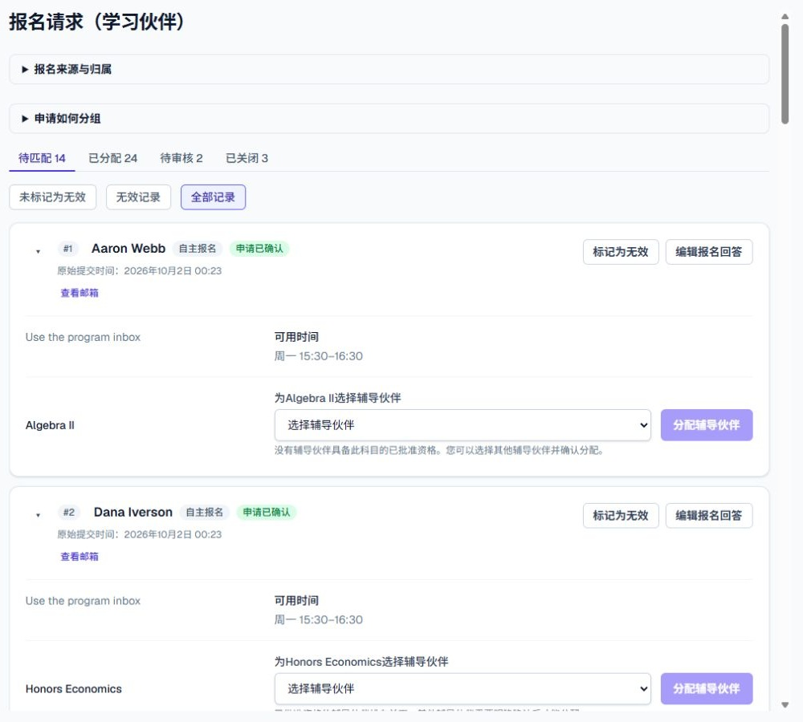
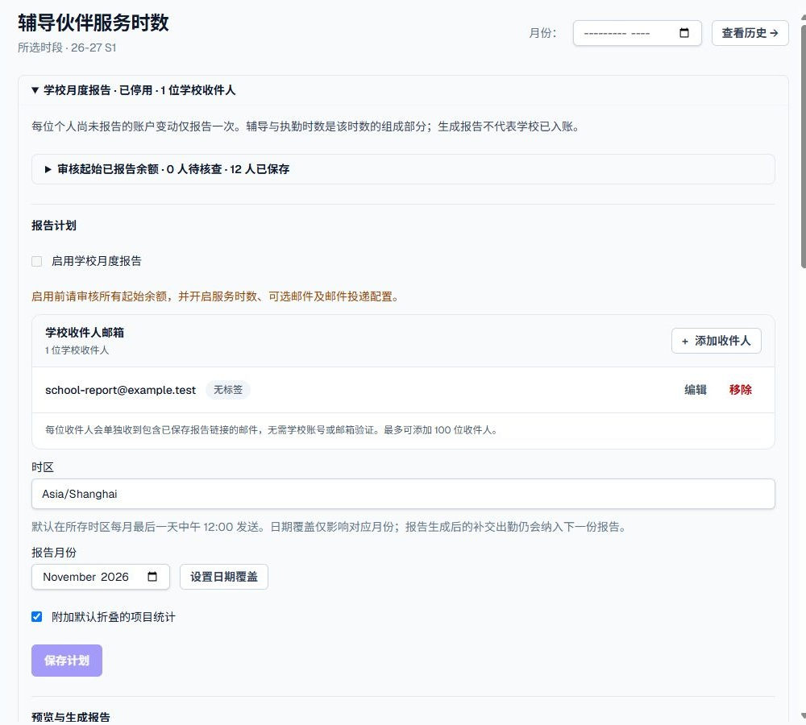
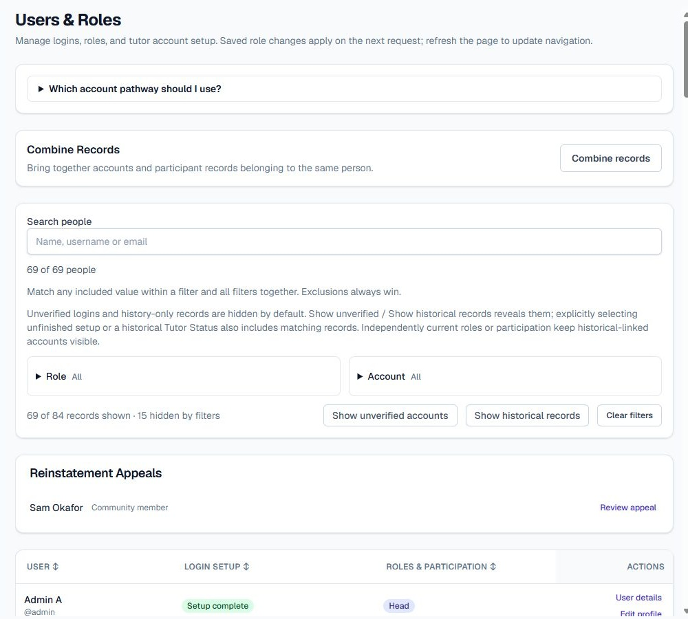
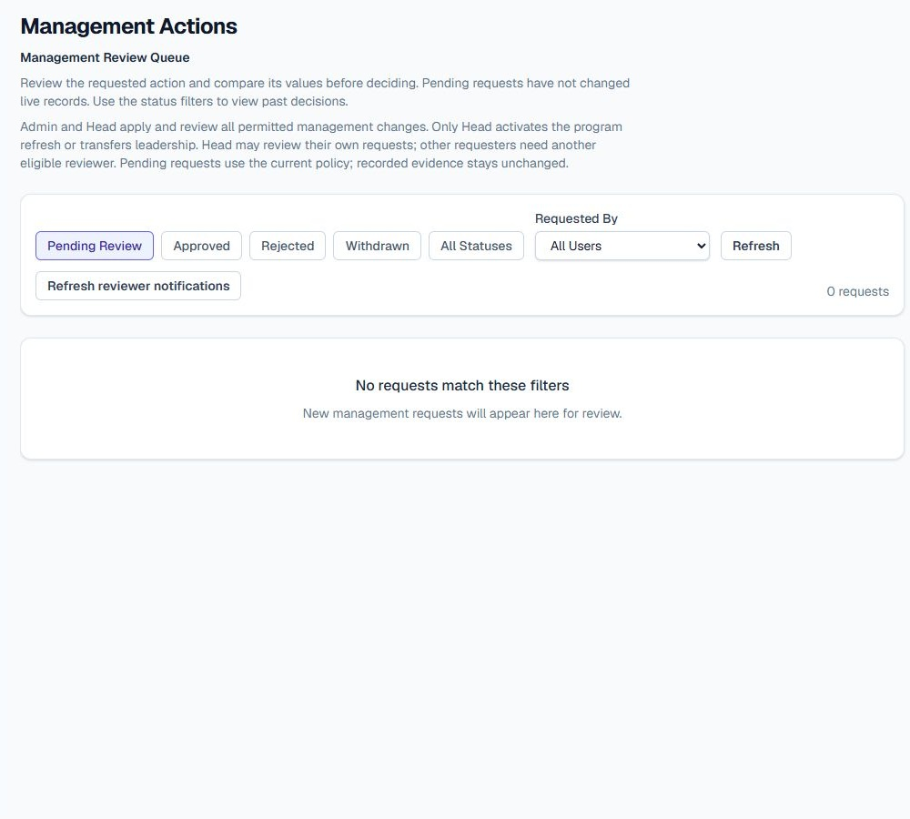
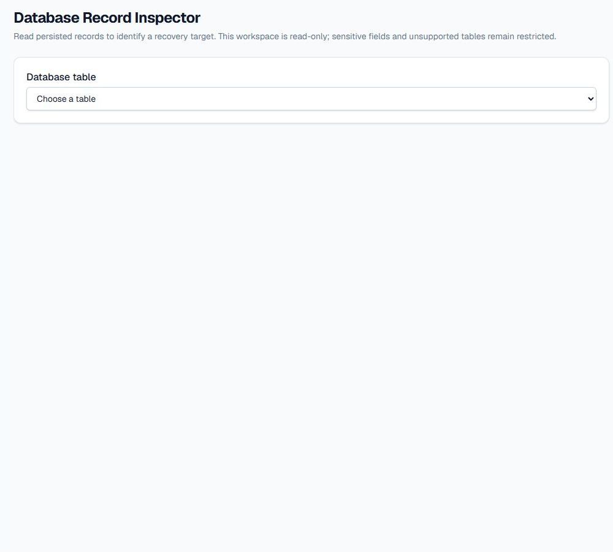
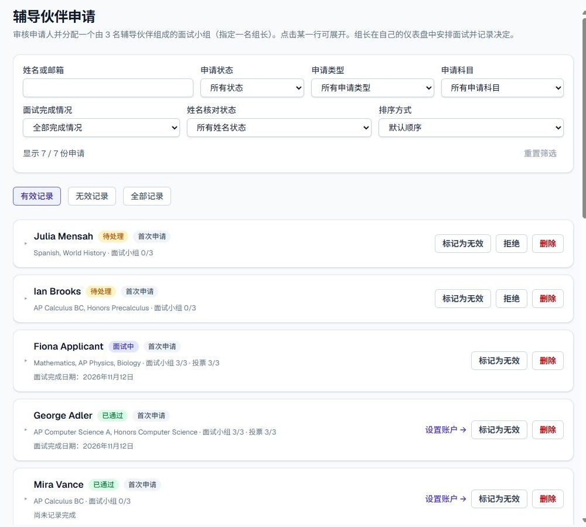

# 审核与管理

由网站帮助目录生成。请修改内容源文件后运行 `npm run help:export`。

[目录与截图来源](README.md)

截图来源: `dbb3c4eb213d58e134744fd417b1a06299b0e984`. Local dev server based on latest main at task start (dbb3c4eb), with the Help candidate. User-selected source baseline; no live deployment attestation.

此 GitHub 培训副本包含各角色操作说明。实际使用网站功能仍需登录并具备当前项目权限。所有示例数据均为虚构。

- [修订报名答案并解除分配](#修订报名答案并解除分配)
- [准备首份学校学时报表](#准备首份学校学时报表)
- [发放及修订学校学时报表](#发放及修订学校学时报表)
- [管理账户权限及设置](#管理账户权限及设置)
- [分配或更改永久用户名](#分配或更改永久用户名)
- [审核身份后合并记录](#审核身份后合并记录)
- [关联历史或邀请往届参与者](#关联历史或邀请往届参与者)
- [修正错误分组或历史读取人](#修正错误分组或历史读取人)
- [审核管理变更申请](#审核管理变更申请)
- [安全查看持久化记录](#安全查看持久化记录)
- [导出或导入项目记录归档](#导出或导入项目记录归档)
- [审核已告知监管消息及联系限制](#审核已告知监管消息及联系限制)
- [决定额外资格申请](#决定额外资格申请)
- [审核翻译及语言可见性](#审核翻译及语言可见性)

## 修订报名答案并解除分配

审阅变更的科目志愿及其明确的分配后果。

打开: `/admin/requests`

### 开始之前

- 需要管理员或负责人权限及准确的当前学习伙伴申请。编辑前阅读原始提交。

### 操作步骤

1. **阅读原始及当前答案** 打开学习伙伴申请，分别查看原始提交与已接受修订，确认要变更的科目和学期。

   请注意: 打开申请答案编辑器并审阅受影响的已分配志愿。

   

   /admin/requests · ZH · 2026-11-15

2. **编辑预期答案** 打开报名答案编辑器，仅更新必要字段，并检查变更会解除的已分配志愿。申请人只能改未分配志愿；工作人员变更可能影响更多内容。

3. **明确审阅解除分配** 确认编辑或解除分配前阅读受影响学习伙伴、科目及分配清单。若后果并非预期，取消可返回未提交草稿。

4. **验证修订申请** 保存后如有需要，使用提供的读取恢复功能。检查当前志愿、分配状态及保留的修订历史。

### 预期结果

只有已审阅的答案及解除分配发生变化，申请证据仍可读取。

### 工作原理

报名答案变更不会重写共享账户身份、原始政策签名、已完成课程或出勤。解除分配必须作为分配后果审阅，不能当作普通资料编辑。

### 问题排查

- **审阅内容已过时** 使用明确的重新加载操作，再次阅读新的受影响分配清单。其他工作人员变更申请后，不要沿用之前的确认。

## 准备首份学校学时报表

发放学校学时前先解决身份问题，并明确核对已入账期初余额。

打开: `/admin/service-hours`

### 开始之前

- 需要管理员或负责人权限、启用服务时数，以及学校确认的已报告学时和账户参考。

### 操作步骤

1. **打开学校报表** 在服务时数中打开学校报表及期初余额审核。检查所有需核对人员，包括身份警告及排除归档来源数量。

   请注意: 打开学校报表并审核期初余额及身份警告。

   

   /admin/service-hours · ZH · 2026-11-15

2. **确认人员及账户** 审核每个人的原始证据及学校账户参考。报告前通过现有账户或记录流程解决缺失或冲突身份。

3. **记录已入账数量** 为每人填写已核对的已报告期初数量。此前未入账者须明确确认零。可分批保存已完成人员；缺失值绝不会当作零。

4. **检查个人预览** 检查转入余额→原始变化→入账时数→转出余额及个人详情。只有必要审核和身份冲突解决后才发放。

### 预期结果

全部必要期初审核已明确保存，首份报表拥有经审核的核算边界。

### 工作原理

历史归档导入保留为项目证据，但不产生新学校学时或期初审核任务。与已审核学校证据重叠会阻止发放，直至完成核对。旧月度总计不能代替逐人期初审核。

### 问题排查

- **仍无法发放** 阅读每条未解决身份或期初审核警告。保存已确认人员，解决剩余来源并刷新预览。不要为了启用发放而将未知余额填零。

## 发放及修订学校学时报表

预览版本、发放精确入账数量，并避免重复计算修订报表。

打开: `/admin/service-hours`

### 开始之前

- 需要管理员或负责人权限、已解决期初和身份审核，并满足项目邮件及服务时数启用条件。

### 操作步骤

1. **选择月份并预览** 打开学校报表，选择月份并检查每人入账说明及HTML、纯文本学校邮件预览。预览不会发送，也无有效报表链接。

   请注意: 使用学校报表中的预览及已保存版本控件。

   

   /admin/service-hours · ZH · 2026-11-15

2. **审核后发放一次** 阅读发放审阅后发放报表。保存并检查返回版本；刷新失败时不要重复生成。

3. **检查精确入账数量** 突出显示的入账时数是应入账一次的数量。打开详情查看学校账户参考、辅导和巡视分项及结转解释。不要另行入账转入、原始变化或转出余额。

4. **修订最新符合条件版本** 审核修订并选择学校实际入账的上个版本。只应用显示的增量修正，不要再次录入完整替换数量。后续月份发放后，更晚变化会在下一报表核对。

### 预期结果

保存版本包含精确一次入账说明及清晰修正依据。

### 工作原理

新报表以完整0.1小时单位入账，余数跨月结转，学期不清零。例如80分钟入账1.3小时并结转2分钟。负余额入账零并继续结转，未来收入先抵欠额。

### 问题排查

- **学校已录入旧版本** 在详情选择实际已入账版本及其增量修正。发放或发送报表不证明学校已录入。应用另一数量前先核对学校入账记录。

## 管理账户权限及设置

审核管理职级与参与权限、发送设置或恢复、决定暂停申诉，并仅删除符合条件账户。

打开: `/admin/users`

### 开始之前

- 需要当前管理员或负责人权限。遵循各专用审阅及密码要求；当前负责人职权转移使用独立流程。

### 操作步骤

1. **确认当前身份及权限** 打开用户详情，检查实际登录状态、管理职级、辅导伙伴或学习伙伴或巡视成员资格、翻译指派、暂停及离校。变更前阅读各操作资格。

   请注意: 使用具体账户操作，并在用户详情阅读当前权限。

   

   /admin/users · EN · 2026-11-15

2. **适当使用设置或恢复** 对符合条件未关联或未完成来源使用发送设置链接；已就绪账户使用现有登录恢复操作。投递发往规范收件人，工作人员不会收到收件人恢复密钥。

3. **审核权限及暂停变更** 允许的非负责人职级授予、撤销或参与权限变更，应审阅具体账户及后果并完成必要密码或审核。审核申诉时须先阅读完整账户申诉再批准或拒绝。

4. **仅通过资格审阅删除** 若提供账户删除，应检查准确登录及保留记录后果，并通过专用流程确认。当前负责人及已审核合并组不能作为普通账户删除。

### 预期结果

仅明确审核的权限或设置操作被记录，历史证据及独立成员资格仍具权威。

### 工作原理

管理角色与参与标记彼此独立。授予管理职级不会自动授予辅导伙伴、巡视或翻译资格。设置完成是凭据条件，不保证未暂停访问。

### 问题排查

- **操作不可用或保存后列表未刷新** 阅读服务器当前权限或归属限制。不要使用邀请绕过被拒直接操作。决定被接受后应重试刷新，不要重复暂停、删除或申诉审核。

## 分配或更改永久用户名

为符合条件缺失用户名者补充，或保存审核后的账户、名册用户名，同时保留身份依据。

打开: `/admin/users`

### 开始之前

- 需要管理员或负责人权限。当前管理政策下两者均可直接应用普通账户用户名编辑；协调员不能提交账户用户名编辑。

### 操作步骤

1. **检查当前用户名** 打开用户与角色并核对具体登录及关联辅导伙伴。对已验证且符合条件的无用户名账户使用分配用户名；仅查看目录不会分配。

   请注意: 找到分配用户名，或编辑资料中的用户名区块。

   

   /admin/users · EN · 2026-11-15

2. **明确编辑** 在编辑资料→用户名填写1至64个ASCII字母或数字。首尾空白会去除，字母转小写。审阅新旧用户名及显示权限路径。

3. **审核并保存** 审核新旧用户名并通过管理员、负责人权限保存。确认应用结果；保存相同值不会产生变化。当前政策会在审核应用旧待审提案前重新检查。

4. **验证当前值** 区块刷新后，确认账户及关联辅导伙伴用户名一并改变。应用后应告知用户使用新用户名或现有邮箱登录。

### 预期结果

预期用户名唯一且与关联辅导伙伴同步，或审核申请仍待处理。

### 工作原理

姓名或学业修正不会重新生成已有用户名。更改用户名会保留邮箱登录、密码、ID、成员资格及历史；应用后旧用户名不能再登录。

### 问题排查

- **用户名已被占用或编辑已过时** 检查登录及辅导伙伴名册唯一性后选择其他有效用户名。版本冲突请明确重新加载；读取失败会保留草稿，应先重试读取再编辑。

## 审核身份后合并记录

分组合适准确来源，仅经审核选择保留登录，并单独解决当前参与。

打开: `/admin/users`

### 开始之前

- 需要管理员或负责人权限、已验证身份证据，以及专用审阅要求时的当前密码。姓名或邮箱本身不是身份证明。

### 操作步骤

1. **选择准确记录** 在用户与角色或历史资料打开合并记录。搜索并选择属于同一人的准确登录、辅导伙伴及学习伙伴来源，阅读原始ID及证据。

   请注意: 打开合并记录，其来源搜索与目录筛选独立。

   

   /admin/users · EN · 2026-11-15

2. **审核完整分组** 预览所有来源。无登录的结果仍为无账户；一个就绪登录可保留无归属历史而无需重新入组。多个登录时须明确选择保留登录，解决冲突后才审阅退休。

3. **记录证据并确认** 填写身份证据、确认完整审阅，并在多个登录、归属冲突、无归属活跃工作或受限账户等要求下填写当前密码。阅读并保留操作回执。

4. **解决实际工作** 若出现需要当前参与或登录审核，打开用户详情→合并记录→审核当前参与。逐项处理具体阻碍；经审核可取消过时历史邀请，再获取最新参与审核并凭证据完成已审阅分组。

### 预期结果

目录身份已分组且原始来源保留，剩余实际操作审核明确可见。

### 工作原理

分组不会暗中合并角色、转移配对、解除限制、去重事件或制造同意。明确退休凭据仍禁用；来源ID保留作者归属。完成由回执证明，不是勾选或刷新。

### 问题排查

- **审阅已改变或响应中断** 证据改变后获取新预览。若提交可能已成功，先检查回执并使用只读刷新。不要提交不同分组意图来恢复不确定的先前结果。

## 关联历史或邀请往届参与者

将准确保留历史关联至已验证归属人，或发送范围固定的仅历史邀请。

打开: `/admin/users`

### 开始之前

- 需要管理员或负责人权限，且每个来源都有已审核归属证据。私人收件邮箱须通过收件人流程验证。

### 操作步骤

1. **查找原始档案** 使用显示过往辅导伙伴或显示历史记录，打开准确档案的编辑资料，或打开已审核历史分组的合并记录。检查原始入组及现有保留归属人。

   请注意: 使用历史资料编辑或用户详情→合并记录。

   

   /admin/users · EN · 2026-11-15

2. **选择关联或邀请** 已有已验证归属人使用审阅后的合并记录或历史关联路径。邀请无登录往届成员时选择设置历史访问，并审阅收件人及全部包含来源。

3. **审核归属或投递** 记录身份证据，修正保留归属人时按要求提供当前密码确认。仅发送已审核邀请范围；后续添加组员不会扩大待处理邀请。

4. **单独验证历史访问** 收件人验证邮箱、审阅邀请，并在登录后单独认领准确固定来源。检查归属或认领回执；历史设置不会授予当前辅导参与资格。

### 预期结果

只有经审核原始历史被关联或邀请，且归属证据保留。

### 工作原理

多个归档资料可属于同一登录，不替换当前资料或重新激活档案。现有历史学习伙伴邀请保留原认领流程；联系方式相同本身绝不授权私人历史。

### 问题排查

- **归属冲突或当前工作阻止设置** 打开准确归属或当前参与审核，解决所述来源。不要发送范围更广替代邀请或仅按邮箱关联。只取消已审核过时邀请，再读取最新证据。

## 修正错误分组或历史读取人

通过不同审阅分开目录身份、修正退休账户历史或合并活跃参与。

打开: `/admin/users`

### 开始之前

- 需要管理员或负责人权限、准确来源证据及当前密码确认。这些专用修正不是普通协调员提案。

### 操作步骤

1. **选择修正边界** 打开合并记录，确定错误涉及目录分组、退休账户历史读取人，还是未来活跃工作。使用相应明确流程；三者不能互相替代。

   请注意: 打开用户详情→合并记录，选择准确修正流程。

   

   /admin/users · EN · 2026-11-15

2. **分离错误分组** 在分离错误分组记录选择要移动来源，再审核分离。每个登录须与其当前记录及保留历史一起。确认前审阅两个结果身份、证据及密码；此后两者均需最新参与审核。

3. **修正准确历史访问** 在修正退休账户历史选择原退休登录及活跃历史读取人，或隔离。逐行决定保留、分配或隔离，检查前后读取人及剩余限制，再确认固定审阅。

4. **仅按意图转移活跃执行** 在合并活跃参与选择一份活跃辅导伙伴、学习伙伴记录及保留登录、准确资格来源和要保留的意愿、可用时间来源。审阅配对、已发布响应及截止时间、历史权限与纪律后果，记录证据及密码，并在全部阻碍解决后确认。

### 预期结果

专用回执记录经审核分离、历史修正或未来工作转移，不会恢复退休凭据。

### 工作原理

目录分组、私人归属与活跃执行彼此独立。原作者、已完成课程、签名、学时及报名优先级仍保留为证据。新历史权限不会解除原暂停、离校限制，待发邮件副本也不会转发给新读取人。

### 问题排查

- **响应不确定或仍有阻碍** 先检查操作回执。若仍无回执，按界面使用当前密码重试同一固定操作，不要在重试中更改来源。解决具体来源限制及流程阻碍，再为新意图获取新审阅。

## 审核管理变更申请

阅读已捕获及当前证据、确认后果，并附说明批准或拒绝。

打开: `/admin/approvals`

### 开始之前

- 需要操作所需当前管理员或负责人审核权限。只有负责人审核正式换期申请；只有负责人可审核本人符合条件管理提案。

### 操作步骤

1. **阅读完整申请** 打开管理操作并筛选待处理申请。阅读申请人、准确目标、操作及捕获前后证据。需要更多背景时跟随所属记录链接。

   请注意: 打开待处理申请，批准前比较记录证据。

   

   /admin/approvals · EN · 2026-11-15

2. **比较当前权限及证据** 检查申请仍符合当前目标数据及权限。兼容旧提案可按当前政策审核；过时或不兼容证据须拒绝或退回并重新申请。

3. **附说明决定** 阅读完整后果确认、填写必要审核说明，并批准或拒绝具体申请。操作需要时完成最新密码确认。

4. **验证结果及通知** 检查已应用记录及独立申请、操作审计条目。刷新审核人通知可补充缺失合资格通知，不会决定申请或重发已投递通知。

### 预期结果

申请有一项已记录决定，且应用操作符合已审核当前证据。

### 工作原理

管理员或负责人审核非换期提案；正式换期归负责人。负责人自审例外绝不允许申请人决定自己的资格面试。审核说明及政策版本保留为审计证据。

### 问题排查

- **批准受阻或缺少审核通知** 检查自审、当前角色或暂停及过时证据限制。缺少分派仅使用刷新审核人通知，它不是批准。目标改变后应要求新提案，不要强推旧提案。

## 安全查看持久化记录

浏览获准表投影、准确键及记录关系，不写入数据库。

打开: `/admin/database`

### 开始之前

- 需要管理员或负责人权限。检查器只读，并遵循字段、表政策；它不是无限制数据库管理。

### 操作步骤

1. **选择获准表** 打开数据库记录并选择数据库表。阅读其主键字段及字段访问政策。仅元数据表示当前政策下不会查询行。

   请注意: 选择数据库表，并可选应用准确JSON主键。

   

   /admin/database · EN · 2026-11-15

2. **浏览或输入准确键** 准确主键留空可浏览，或输入包含全部主键字段及标量值的JSON对象，再选择应用键筛选。使用上一页、下一页浏览结果。

3. **查看持久化证据** 选择检查记录，阅读允许字段及省略原因。必要时跟随记录关系；每次关联读取均重新检查当前政策及遮蔽。

4. **复制操作员参考** 使用复制记录参考，将准确表和键交给技术操作员。仔细阅读命令行占位符；参考是标识，不是执行命令行写入的授权。

### 预期结果

获得准确且获准的记录参考，并理解哪些值或关系未读取。

### 工作原理

未记录关系不证明不存在其他后果。敏感、超长或不支持字段仍会省略；检查器不会重建它们或证明完整恢复链。

### 问题排查

- **键无效或结果仅元数据** 准确匹配显示主键字段名及JSON标量类型。仅元数据表应使用操作员恢复指南，不要尝试替代键推测受保护行是否存在。

## 导出或导入项目记录归档

使用稳定ID的UTF-8 CSV模板、预览依赖并导入，保留现有记录不覆盖。

打开: `/admin/records`

### 开始之前

- 模板、预览、导入及导出均需要管理员或负责人权限。移动参与者记录前审核归档用途及存储位置。

### 操作步骤

1. **下载归档或模板** 打开项目记录并选择导出或模板下载。保留ZIP、CSV表头及稳定来源ID。将其视为完整备份前先阅读列出的归档范围。

   请注意: 使用导出、模板及已选文件导入预览。

   

   /admin/records · EN · 2026-11-15

2. **一起准备关联文件** 填写提供的UTF-8 CSV格式，并将依赖文件一并包含。选择预期ZIP或CSV文件，检查显示限制及文件名。

3. **导入前预览** 选择预览，检查各记录类型新增、跳过、冲突数量及依赖错误。修正来源文件并重新预览，直至预期导入明确。

4. **确认并验证** 确认已审核预览并执行导入。检查完成数量及原始记录。现有记录不会覆盖；跳过重复项不代表应编造新ID。

### 预期结果

经审核归档已下载，或仅其已验证新历史记录被导入。

### 工作原理

归档不包括凭据、配置和私人消息，也不授予当前参与资格。导入历史来源学时保留为归档证据，不进入新学校入账；数据库备份和恢复属于独立操作员流程。

### 问题排查

- **预览缺少依赖或ID冲突** 使用准确模板，并在同一次审核包含被引用来源文件。对照现有证据解决冲突，不要预期导入更新旧行。每次文件变化后重新预览。

## 审核已告知监管消息及联系限制

使用带理由的管理员或负责人监管及独立权限控件，避免进入无关私人会话。

打开: `/admin/messages/supervision`

### 开始之前

- 需要当前管理员或负责人消息监管权限。协调员或参与者收件箱权限不授予监管。

### 操作步骤

1. **查找已告知监管会话** 打开消息→监管，并使用搜索、筛选控件。打开会话前检查预期参与者及告知监管边界。

   请注意: 监管用于审阅会话；个人收件箱返回自己的消息。

   

   /admin/messages/supervision · EN · 2026-11-15

2. **记录审阅原因** 填写必要原因以审核符合条件会话，再阅读准确消息。旧的仅参与者消息仍在已告知监管边界之外。

3. **明确执行监管操作** 只有审核准确消息、人员及后果后，才使用明确隐藏、恢复或联系限制操作。记录必要原因；恢复和解除限制仍属于审核逆转。

4. **单独维护权限规则** 使用项目设置联系权限控件检查角色、用户允许联系人。发送个人消息应返回个人收件箱；监管不会将私人会话变成自己的会话。

### 预期结果

符合条件审阅会话或限制操作拥有独立原因及审计证据。

### 工作原理

私人消息是参与者拥有的独立投递。监管经过告知、受权限约束并有审计，不授权暗中转发或访问所有历史消息。

### 问题排查

- **会话不允许监管** 阅读资格或告知原因并确认当前管理员或负责人权限。不要要求参与者重新发布私人历史以绕过边界；实际问题应使用授权支持流程。

## 决定额外资格申请

审核加科、升级申请；有依据时可无需面试批准，或按面试流程处理。

打开: `/admin/applications`

### 开始之前

- qualificationApplication.decide需要管理员或负责人权限。科目可用性中的协调员手动资格提案属于独立流程。

### 操作步骤

1. **检查准确额外申请** 打开辅导伙伴申请并定位加科或升级申请。阅读申请科目、级别、辅导伙伴原因、捕获资格证据及当前状态。

   请注意: 展开额外申请，找到无需面试批准及决定说明。

   

   /admin/applications · ZH · 2026-11-15

2. **选择有依据路径** 若需面试，应使用面试流程分配有效评委和主席。若现有证据支持直接接受，选择无需面试批准并阅读准确申请资格授予。

3. **记录允许的决定** 直接接受时，填写必要决定说明，审核具体申请人、科目及资格后果，再确认批准资格。拒绝须使用面试路径：指定管理员或负责人主席审核全部评委投票及必要决定说明后，再确认评委组决定。

4. **验证独立状态** 检查已完成申请及科目可用性资格来源。另行确认意愿和账户参与；资格结果不会暗中设置两者。

### 预期结果

准确额外申请有已记录决定说明及最终资格证据。

### 工作原理

额外申请直接决定仅限管理员或负责人。它与通过正常管理权限路径提供的手动资格授予、来源移除控件不同。

### 问题排查

- **决定因参与改变或受限而阻止** 阅读准确来源、状态限制并刷新申请证据。通过对应流程解决暂停、离校或撤销权限后再重试；不要使用其他授予路径绕过限制。

## 审核翻译及语言可见性

发布或拒绝待审翻译，并维护启用语言顺序，无需额外编辑指派即可审核。

打开: `/localization?view=review`

### 开始之前

- 需要管理员或负责人审核、发布权限。编辑翻译仍需要明确翻译员指派；仅审核权限不授予编辑器。

### 操作步骤

1. **检查草稿卡** 打开本地化→草稿审核，使用状态筛选查找待审或历史草稿。检查预期草稿卡上显示的语言、键及目标，再比较原始与拟修改文字。

   请注意: 打开翻译审核并选择要审阅语言和目标。

   

   /localization · EN · 2026-11-15

2. **发布或拒绝准确草稿** 使用提供审核控件批准、发布或拒绝前，阅读完整变更及目标。待审草稿在授权审核完成前仍未发布。

3. **审慎维护语言** 在语言设置检查启用、隐藏状态及顺序。审阅显示、隐藏或重排语言；删除符合条件自定义语言前阅读具体约束。

4. **验证实际文字** 在实际目标页面选择该语言并检查已应用文字。缺失条目可能回退至支持来源；应检查准确目标和键，不要假设整种语言已发布。

### 预期结果

只有经审核翻译草稿及语言设置生效，编辑与审核权限仍分离。

### 工作原理

管理员或负责人无翻译员指派也可审核；明确编辑需要canTranslate且排除观察者。界面键、网站文字及政策文字保留各自目标和版本规则。

### 问题排查

- **审核成功但文字未改变** 检查语言、目标、键及已应用、待审状态，再刷新实际页面。不要重新发布无关草稿；政策翻译须遵循政策文档流程。
