# 审核与管理

由网站帮助目录生成。请修改内容源文件后运行 `npm run help:export`。

[目录与截图来源](README.md)

截图来源: `1df44d6bb31cf04352adae9c65819139b7b747d8`. New captures use latest-main development baseline 1df44d6b, selected 2026-11-21, with the Help candidate. Earlier captures list their own revision and capture date.

此 GitHub 培训副本包含各角色操作说明。实际使用网站功能仍需登录并具备当前项目权限。所有示例数据均为虚构。

- [修订报名答案并解除分配](#修订报名答案并解除分配)
- [准备首份学校学时报表](#准备首份学校学时报表)
- [发放及修订学校学时报表](#发放及修订学校学时报表)
- [管理账户权限及设置](#管理账户权限及设置)
- [分配或更改永久用户名](#分配或更改永久用户名)
- [审核身份后合并记录](#审核身份后合并记录)
- [关联历史或邀请往届参与者](#关联历史或邀请往届参与者)
- [修正错误分组或历史读取人](#修正错误分组或历史读取人)
- [审核管理变更申请](#审核管理变更申请)
- [安全查看持久化记录](#安全查看持久化记录)
- [导出或导入项目记录归档](#导出或导入项目记录归档)
- [审核已告知监管消息及联系限制](#审核已告知监管消息及联系限制)
- [决定额外资格申请](#决定额外资格申请)
- [审核翻译及语言可见性](#审核翻译及语言可见性)

## 修订报名答案并解除分配

审阅变更的科目志愿及其明确的分配后果。

打开: `/admin/requests`

### 开始之前

- 需要管理员或负责人权限及准确的当前学习伙伴申请。编辑前阅读原始提交。

### 操作步骤

1. **阅读原始及当前答案** 打开学习伙伴申请并选择“编辑报名答案”。将当前答案与保留的原签名及政策版本对照。确认要更改的科目和学期。

   请注意: 打开申请答案编辑器并审阅受影响的已分配志愿。

   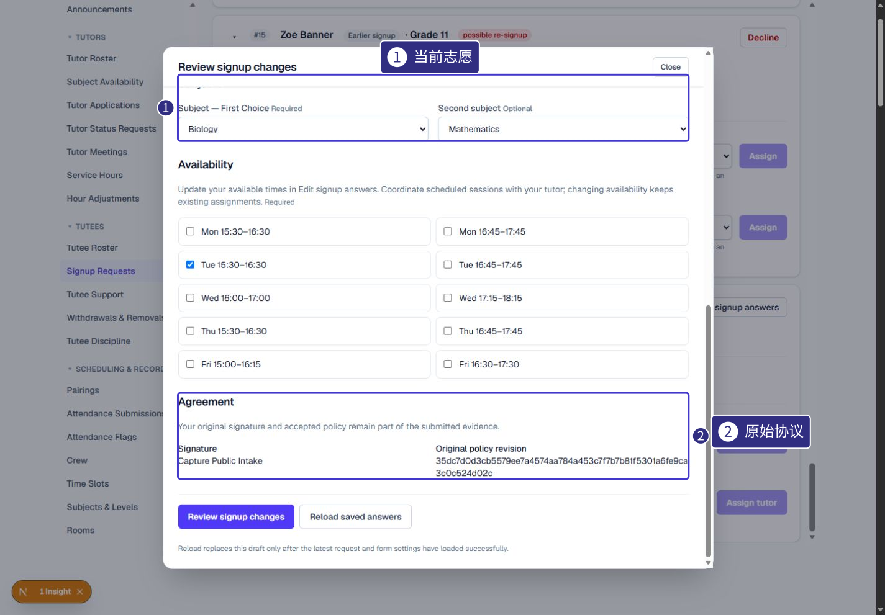

   /admin/requests · EN · 2026-11-20

   核对当前生物和数学志愿，以及保留的原签名及政策版本。

   [原始完整截图](assets/revise-student-signup-step-1.en.jpg) · `b5ece465681957c9fe579d26babdeb260c674fa0` · Latest-main development baseline b5ece465, selected 2026-11-20, with the Help candidate and synthetic demo records.

   已为本步骤添加标注，原始完整截图保持不变。

   - **1.** 当前志愿

   - **2.** 原始协议

2. **编辑预期答案** 在“编辑报名答案”中更新所需字段。先查看申请中哪些科目已分配。申请人可以编辑未分配的志愿。工作人员更改已分配的志愿可能会解除对应分配。

   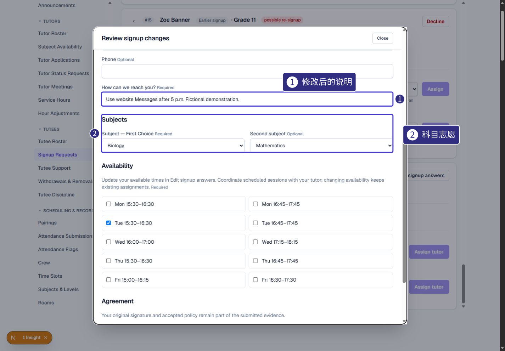

   /admin/requests · EN · 2026-11-20

   在草稿中调整联系说明。两项科目志愿保持原样。

   [原始完整截图](assets/revise-student-signup-step-2.en.jpg) · `b5ece465681957c9fe579d26babdeb260c674fa0` · Latest-main development baseline b5ece465, selected 2026-11-20, with the Help candidate and synthetic demo records.

   已为本步骤添加标注，原始完整截图保持不变。

   - **1.** 修改后的说明

   - **2.** 科目志愿

3. **明确审阅解除分配** 选择“审核报名更改”。核对学习伙伴及解除分配的后果，并与原申请中的科目和分配对照。“取消”会返回草稿。

   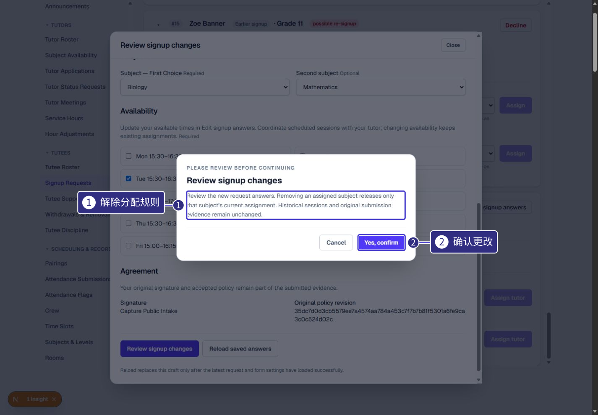

   /admin/requests · EN · 2026-11-20

   确认前阅读解除分配规则。本例两项志愿均待匹配，因此此次仅修改联系说明。

   [原始完整截图](assets/revise-student-signup-step-3.en.jpg) · `b5ece465681957c9fe579d26babdeb260c674fa0` · Latest-main development baseline b5ece465, selected 2026-11-20, with the Help candidate and synthetic demo records.

   已为本步骤添加标注，原始完整截图保持不变。

   - **1.** 解除分配规则

   - **2.** 确认更改

4. **验证修订申请** 保存后检查当前志愿和分配状态。重新打开编辑器，核对保留的签名和政策版本。如果列表未刷新，请重试读取。

   **视图 1**

   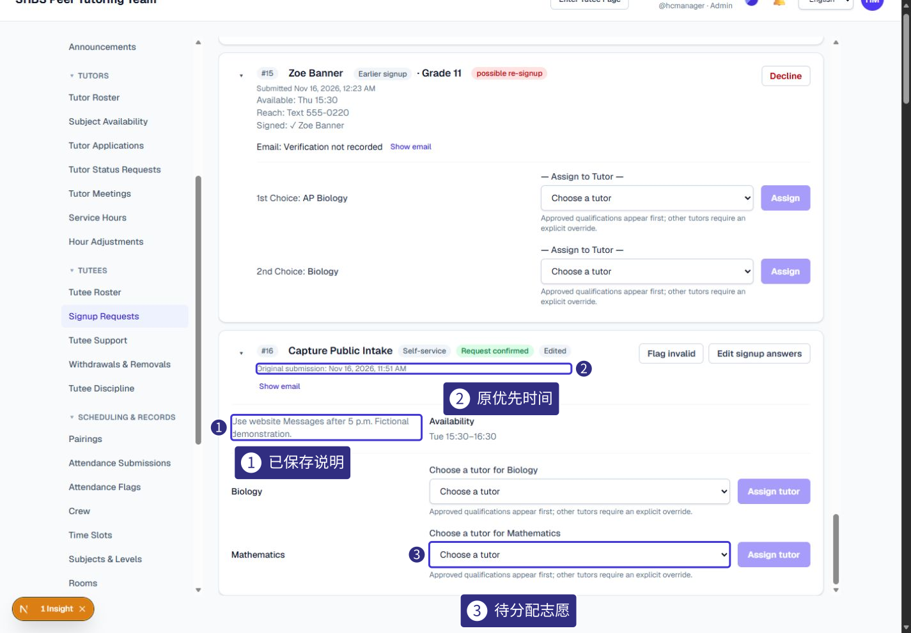

   /admin/requests · EN · 2026-11-20

   修订后的说明已保存。两项志愿仍待匹配，原提交时间保持不变。可重新打开编辑器核对原始协议。

   [原始完整截图](assets/revise-student-signup-step-4.en.jpg) · `b5ece465681957c9fe579d26babdeb260c674fa0` · Latest-main development baseline b5ece465, selected 2026-11-20, with the Help candidate and synthetic demo records.

   已为本步骤添加标注，原始完整截图保持不变。

   - **1.** 已保存说明

   - **2.** 原优先时间

   - **3.** 待分配志愿

   **视图 2**

   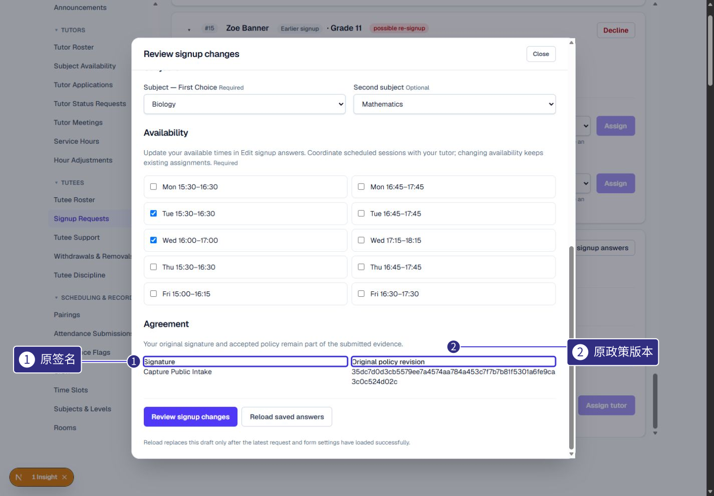

   /admin/requests · EN · 2026-11-20

   重新打开已保存的申请，核对原签名及政策版本仍然保留。

   [原始完整截图](assets/revise-student-signup-step-4-view-2.en.jpg) · `b5ece465681957c9fe579d26babdeb260c674fa0` · Latest-main development baseline b5ece465, selected 2026-11-20, with the Help candidate and synthetic demo records.

   已为本步骤添加标注，原始完整截图保持不变。

   - **1.** 原签名

   - **2.** 原政策版本

### 预期结果

只有已审阅的答案及解除分配发生变化，申请证据仍可读取。

### 工作原理

报名答案变更不会重写共享账户身份、原始政策签名、已完成课程或出勤。解除分配必须作为分配后果审阅，不能当作普通资料编辑。

### 问题排查

- **审阅内容已过时** 使用明确的重新加载操作，再次阅读新的受影响分配清单。其他工作人员变更申请后，不要沿用之前的确认。

## 准备首份学校学时报表

发放学校学时前先解决身份问题，并明确核对已入账期初余额。

打开: `/admin/service-hours`

### 开始之前

- 需要管理员或负责人权限、启用服务时数，以及学校确认的已报告学时和账户参考。

### 操作步骤

1. **打开学校报表** 在服务时数中打开学校报表及期初余额审核。检查所有需核对人员，包括身份警告及排除归档来源数量。

   请注意: 打开学校报表并审核期初余额及身份警告。

   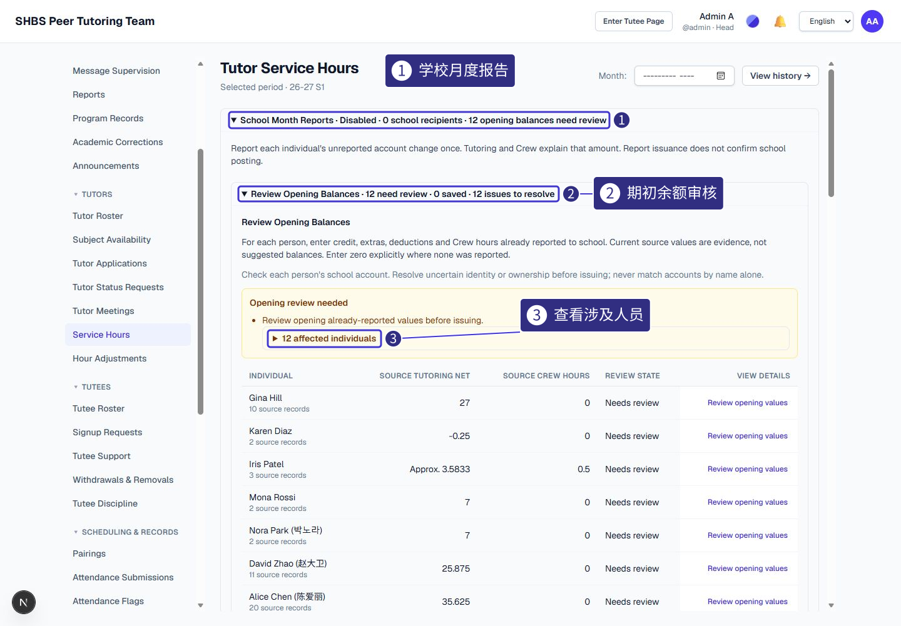

   /admin/service-hours · EN · 2026-11-20

   “学校月度报告”显示十二人等待期初审核。展开的审核区列出阻碍及来源记录。

   [原始完整截图](assets/review-first-school-report-step-1.en.jpg) · `b5ece465681957c9fe579d26babdeb260c674fa0` · Latest-main development baseline b5ece465, selected 2026-11-20, with the Help candidate. Isolated synthetic first-report demonstration phase.

   已为本步骤添加标注，原始完整截图保持不变。

   - **1.** 学校月度报告

   - **2.** 期初余额审核

   - **3.** 查看涉及人员

2. **确认人员及账户** 审核每个人的原始证据及学校账户参考。报告前通过现有账户或记录流程解决缺失或冲突身份。

   **视图 1**

   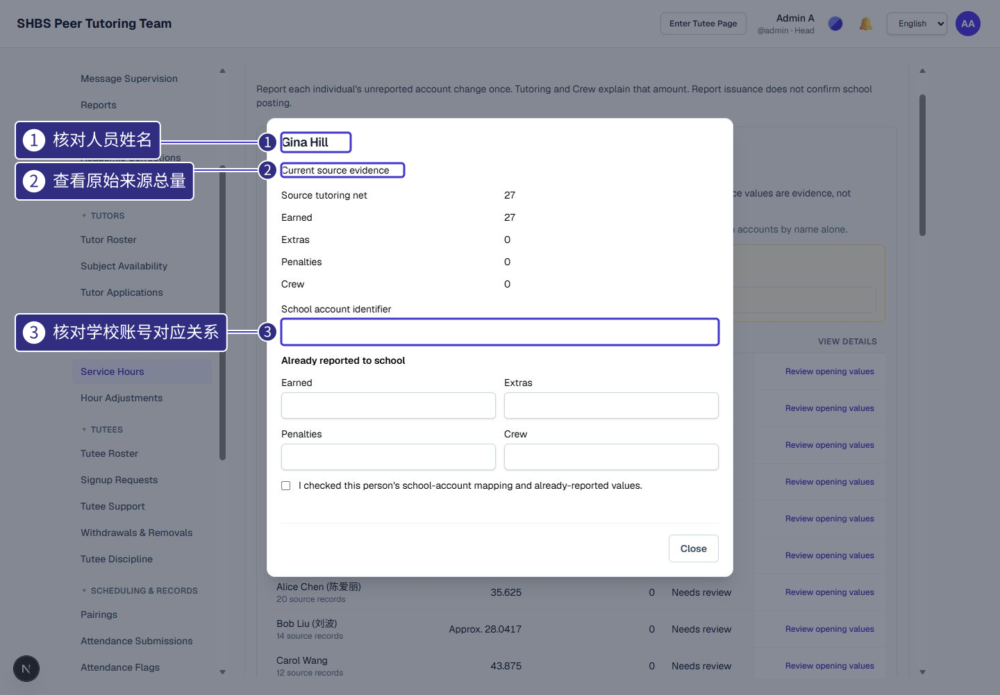

   /admin/service-hours · EN · 2026-11-20

   Gina 的当前来源总量与空白的学校账号字段分开显示。确认学校账号标识后填写，已上报金额仍待核对。

   [原始完整截图](assets/review-first-school-report-step-2.en.jpg) · `b5ece465681957c9fe579d26babdeb260c674fa0` · Latest-main development baseline b5ece465, selected 2026-11-20, with the Help candidate. Isolated synthetic first-report demonstration phase.

   已为本步骤添加标注，原始完整截图保持不变。

   - **1.** 核对人员姓名

   - **2.** 查看原始来源总量

   - **3.** 核对学校账号对应关系

   **视图 2**

   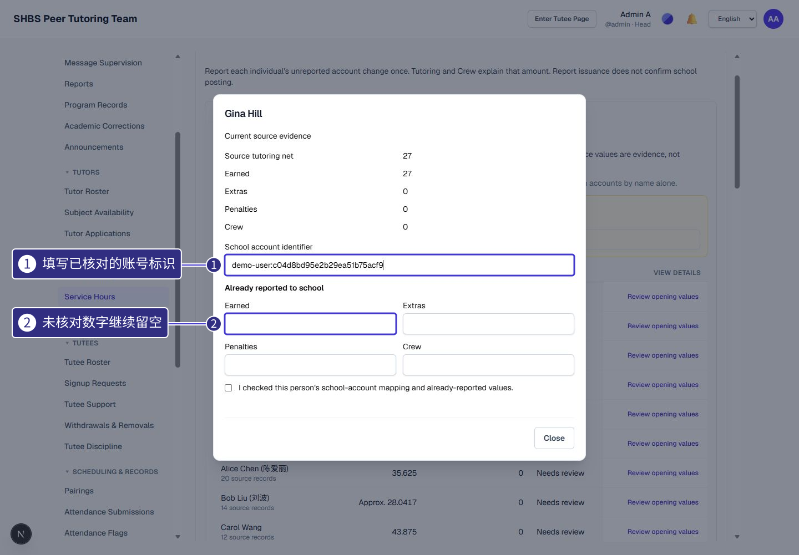

   /admin/service-hours · EN · 2026-11-20

   Gina 已暂填经过核对的合成学校账号标识。四个已上报数字仍为空白，等待金额审核。

   [原始完整截图](assets/review-first-school-report-step-2-view-2.en.jpg) · `b5ece465681957c9fe579d26babdeb260c674fa0` · Latest-main development baseline b5ece465, selected 2026-11-20, with the Help candidate. Isolated synthetic first-report demonstration phase.

   已为本步骤添加标注，原始完整截图保持不变。

   - **1.** 填写已核对的账号标识

   - **2.** 未核对数字继续留空

3. **记录已入账数量** 为每人填写已核对的已报告期初数量。此前未入账者须明确确认零。可分批保存已完成人员；缺失值绝不会当作零。

   **视图 1**

   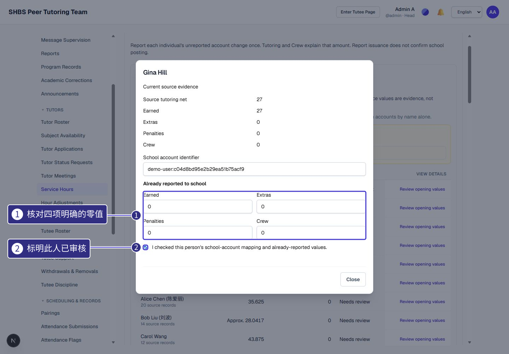

   /admin/service-hours · EN · 2026-11-20

   本合成案例的审核员在四项金额中分别明确输入零，并将指定人员标为已审核。

   [原始完整截图](assets/review-first-school-report-step-3.en.jpg) · `b5ece465681957c9fe579d26babdeb260c674fa0` · Latest-main development baseline b5ece465, selected 2026-11-20, with the Help candidate. Isolated synthetic first-report demonstration phase.

   已为本步骤添加标注，原始完整截图保持不变。

   - **1.** 核对四项明确的零值

   - **2.** 标明此人已审核

   **视图 2**

   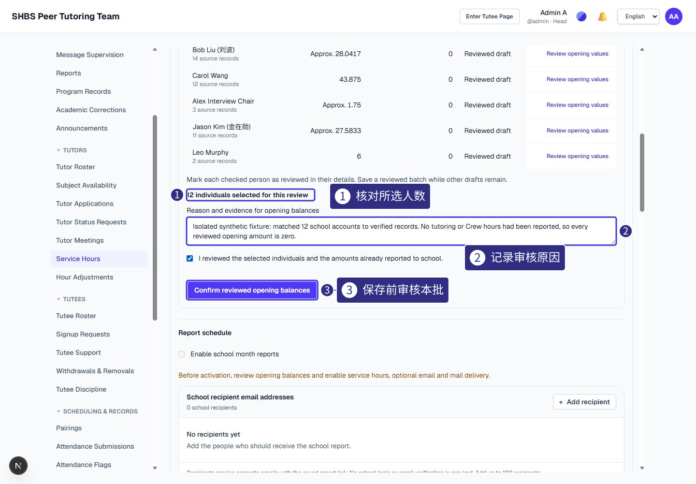

   /admin/service-hours · EN · 2026-11-20

   审核员记录十二名合成人员此前上报金额为零的原因，并在确认前勾选所选审核批次。

   [原始完整截图](assets/review-first-school-report-step-3-view-2.en.jpg) · `b5ece465681957c9fe579d26babdeb260c674fa0` · Latest-main development baseline b5ece465, selected 2026-11-20, with the Help candidate. Isolated synthetic first-report demonstration phase.

   已为本步骤添加标注，原始完整截图保持不变。

   - **1.** 核对所选人数

   - **2.** 记录审核原因

   - **3.** 保存前审核本批

   **视图 3**

   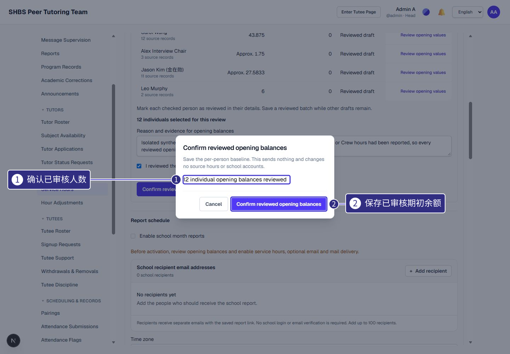

   /admin/service-hours · EN · 2026-11-20

   确认对话框将期初余额保存范围限定在十二条逐一审核的记录。

   [原始完整截图](assets/review-first-school-report-step-3-view-3.en.jpg) · `b5ece465681957c9fe579d26babdeb260c674fa0` · Latest-main development baseline b5ece465, selected 2026-11-20, with the Help candidate. Isolated synthetic first-report demonstration phase.

   已为本步骤添加标注，原始完整截图保持不变。

   - **1.** 确认已审核人数

   - **2.** 保存已审核期初余额

   **视图 4**

   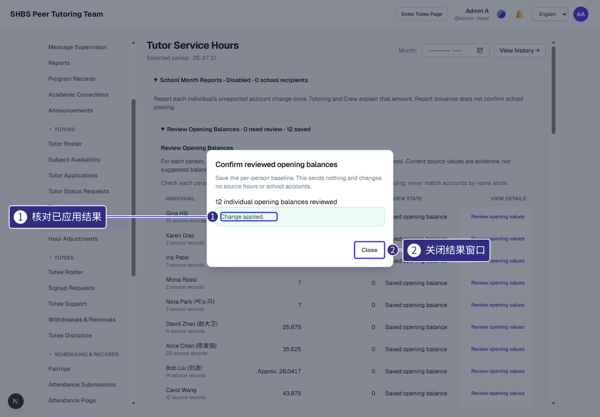

   /admin/service-hours · EN · 2026-11-20

   确认对话框显示十二项审核余额已应用，此操作仅保存期初凭据。

   [原始完整截图](assets/review-first-school-report-step-3-view-4.en.jpg) · `b5ece465681957c9fe579d26babdeb260c674fa0` · Latest-main development baseline b5ece465, selected 2026-11-20, with the Help candidate. Isolated synthetic first-report demonstration phase.

   已为本步骤添加标注，原始完整截图保持不变。

   - **1.** 核对已应用结果

   - **2.** 关闭结果窗口

   **视图 5**

   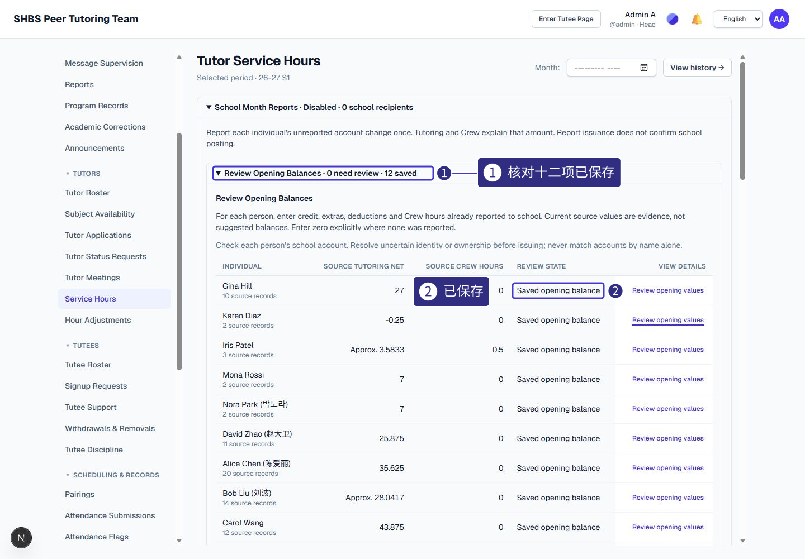

   /admin/service-hours · EN · 2026-11-20

   刷新后的期初审核区显示十二项已保存、待审核为零，学校报告仍为停用状态。

   [原始完整截图](assets/review-first-school-report-step-3-view-5.en.jpg) · `b5ece465681957c9fe579d26babdeb260c674fa0` · Latest-main development baseline b5ece465, selected 2026-11-20, with the Help candidate. Isolated synthetic first-report demonstration phase.

   已为本步骤添加标注，原始完整截图保持不变。

   - **1.** 核对十二项已保存

   - **2.** 已保存

4. **检查个人预览** 检查转入余额→原始变化→入账时数→转出余额及个人详情。只有必要审核和身份冲突解决后才发放。

   **视图 1**

   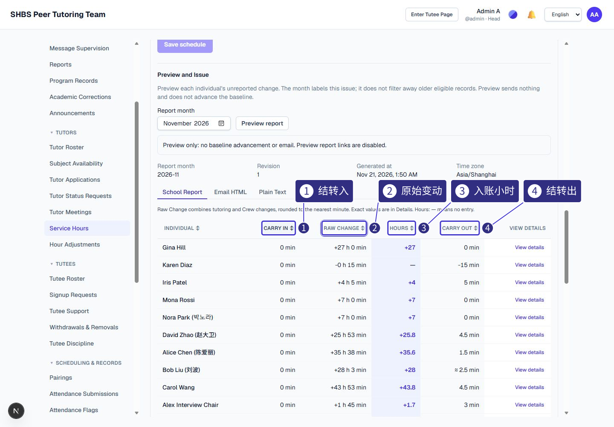

   /admin/service-hours · EN · 2026-11-20

   期初审核通过后，刷新后的个人预览按报告顺序列出结转入、原始变动、入账小时和结转出。

   [原始完整截图](assets/review-first-school-report-step-4.en.jpg) · `b5ece465681957c9fe579d26babdeb260c674fa0` · Latest-main development baseline b5ece465, selected 2026-11-20, with the Help candidate. Isolated synthetic first-report demonstration phase.

   已为本步骤添加标注，原始完整截图保持不变。

   - **1.** 结转入

   - **2.** 原始变动

   - **3.** 入账小时

   - **4.** 结转出

   **视图 2**

   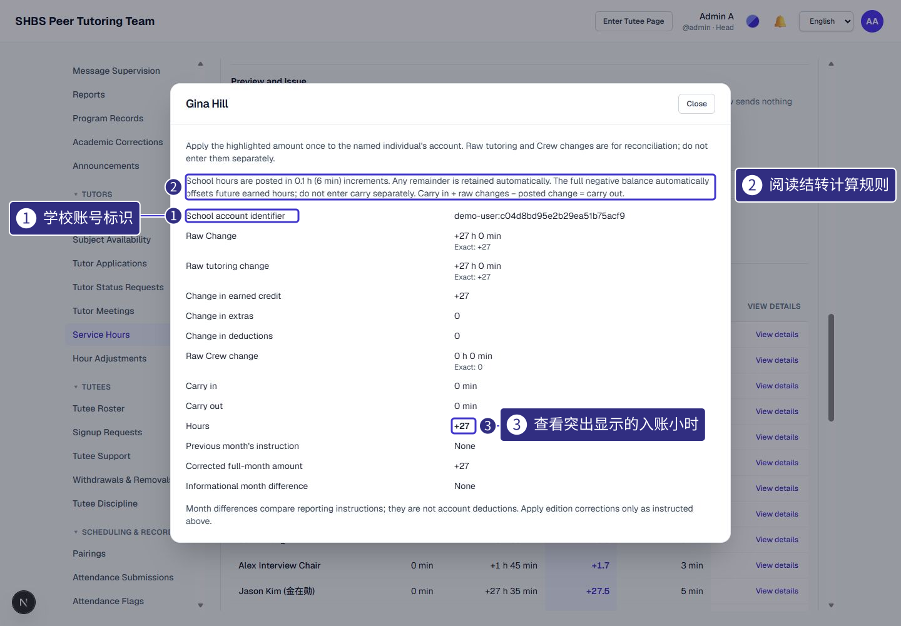

   /admin/service-hours · EN · 2026-11-20

   Gina 刷新后的明细将已核对的合成账号与准确的来源变动、入账小时及结转规则对应起来。

   [原始完整截图](assets/review-first-school-report-step-4-view-2.en.jpg) · `b5ece465681957c9fe579d26babdeb260c674fa0` · Latest-main development baseline b5ece465, selected 2026-11-20, with the Help candidate. Isolated synthetic first-report demonstration phase.

   已为本步骤添加标注，原始完整截图保持不变。

   - **1.** 学校账号标识

   - **2.** 阅读结转计算规则

   - **3.** 查看突出显示的入账小时

   **视图 3**

   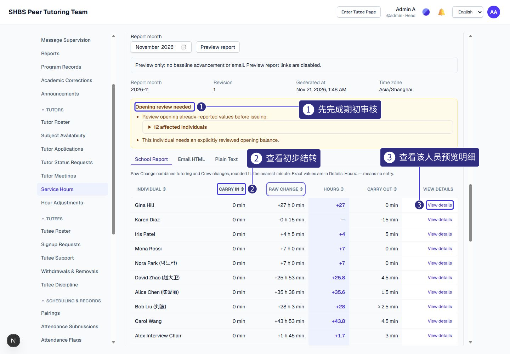

   /admin/service-hours · EN · 2026-11-20

   首次预览已计算来源变动。仍须保存必需的期初余额，才能发布报告。

   [原始完整截图](assets/review-first-school-report-step-4-view-3.en.jpg) · `b5ece465681957c9fe579d26babdeb260c674fa0` · Latest-main development baseline b5ece465, selected 2026-11-20, with the Help candidate. Isolated synthetic first-report demonstration phase.

   已为本步骤添加标注，原始完整截图保持不变。

   - **1.** 先完成期初审核

   - **2.** 查看初步结转

   - **3.** 查看该人员预览明细

   **视图 4**

   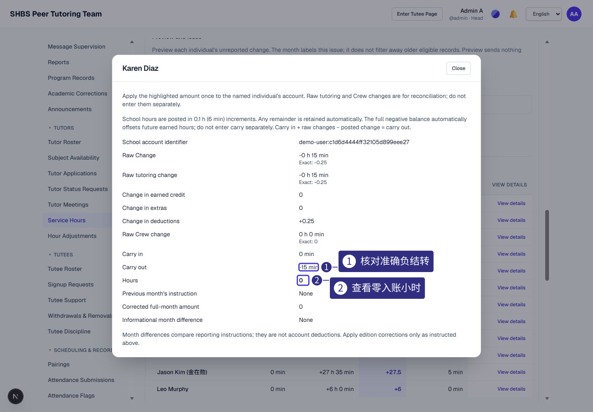

   /admin/service-hours · EN · 2026-11-20

   Karen 的明细显示入账小时为零、结转出为负十五分钟。该余额保留用于抵扣将来取得的小时，不生成学校入账。

   [原始完整截图](assets/review-first-school-report-step-4-view-4.en.jpg) · `b5ece465681957c9fe579d26babdeb260c674fa0` · Latest-main development baseline b5ece465, selected 2026-11-20, with the Help candidate. Isolated synthetic first-report demonstration phase.

   已为本步骤添加标注，原始完整截图保持不变。

   - **1.** 核对准确负结转

   - **2.** 查看零入账小时

### 预期结果

全部必要期初审核已明确保存，首份报表拥有经审核的核算边界。

### 工作原理

历史归档导入保留为项目证据，但不产生新学校学时或期初审核任务。与已审核学校证据重叠会阻止发放，直至完成核对。旧月度总计不能代替逐人期初审核。

### 问题排查

- **仍无法发放** 阅读每条未解决身份或期初审核警告。保存已确认人员，解决剩余来源并刷新预览。不要为了启用发放而将未知余额填零。

## 发放及修订学校学时报表

预览版本、发放精确入账数量，并避免重复计算修订报表。

打开: `/admin/service-hours`

### 开始之前

- 需要管理员或负责人权限、已解决期初和身份审核，并满足项目邮件及服务时数启用条件。

### 操作步骤

1. **选择月份并预览** 打开学校报表，选择月份并检查每人入账说明及HTML、纯文本学校邮件预览。预览不会发送，也无有效报表链接。

   请注意: 使用学校报表中的预览及已保存版本控件。

   **视图 1**

   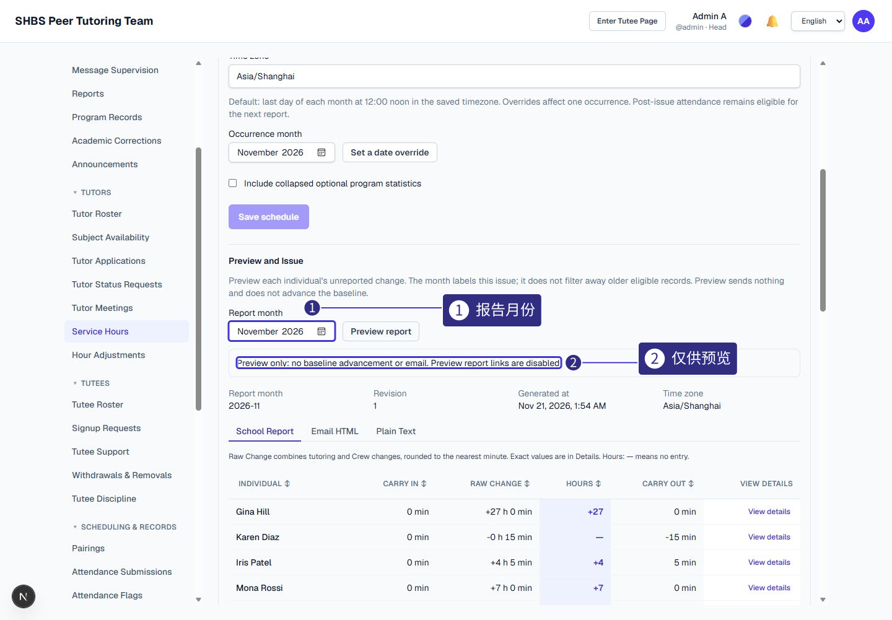

   /admin/service-hours · EN · 2026-11-20

   11 月第 1 版报告在生成前显示逐人入账指示、所选月份和仅供预览的提示。

   [原始完整截图](assets/issue-school-report-step-1.en.jpg) · `b5ece465681957c9fe579d26babdeb260c674fa0` · Latest-main development baseline b5ece465, selected 2026-11-20, with the Help candidate. Isolated synthetic first-report demonstration phase.

   已为本步骤添加标注，原始完整截图保持不变。

   - **1.** 报告月份

   - **2.** 仅供预览

   **视图 2**

   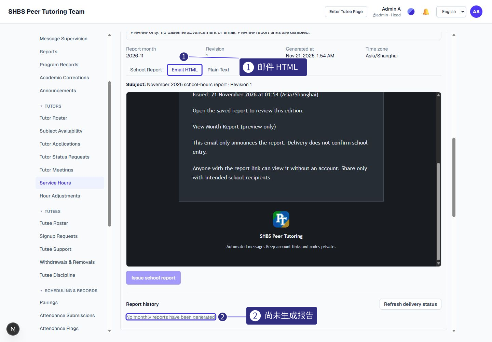

   /admin/service-hours · EN · 2026-11-20

   邮件 HTML 预览将“查看月度报告”显示为仅供预览的文字。报告历史仍为空。

   [原始完整截图](assets/issue-school-report-step-1-view-2.en.jpg) · `b5ece465681957c9fe579d26babdeb260c674fa0` · Latest-main development baseline b5ece465, selected 2026-11-20, with the Help candidate. Isolated synthetic first-report demonstration phase.

   已为本步骤添加标注，原始完整截图保持不变。

   - **1.** 邮件 HTML

   - **2.** 尚未生成报告

   **视图 3**

   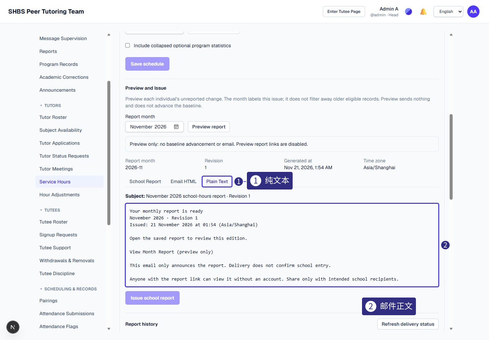

   /admin/service-hours · EN · 2026-11-20

   纯文本标签显示同一报告的预览以及未启用操作的文字，不含可用的报告网址。

   [原始完整截图](assets/issue-school-report-step-1-view-3.en.jpg) · `b5ece465681957c9fe579d26babdeb260c674fa0` · Latest-main development baseline b5ece465, selected 2026-11-20, with the Help candidate. Isolated synthetic first-report demonstration phase.

   已为本步骤添加标注，原始完整截图保持不变。

   - **1.** 纯文本

   - **2.** 邮件正文

2. **审核后发放一次** 阅读发放审阅后发放报表。保存并检查返回版本；刷新失败时不要重复生成。

   **视图 1**

   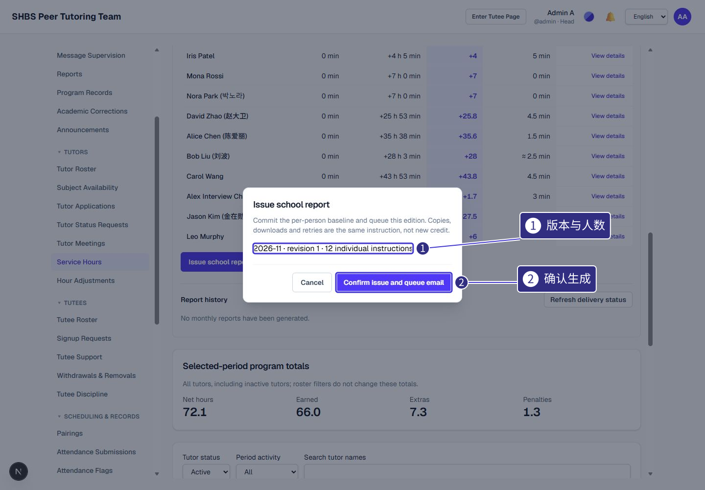

   /admin/service-hours · EN · 2026-11-20

   确认前的首次生成复核显示 2026 年 11 月、第 1 版及 12 条实际个人入账指示。

   [原始完整截图](assets/issue-school-report-step-2.en.jpg) · `b5ece465681957c9fe579d26babdeb260c674fa0` · Latest-main development baseline b5ece465, selected 2026-11-20, with the Help candidate. Isolated synthetic first-report demonstration phase.

   已为本步骤添加标注，原始完整截图保持不变。

   - **1.** 版本与人数

   - **2.** 确认生成

   **视图 2**

   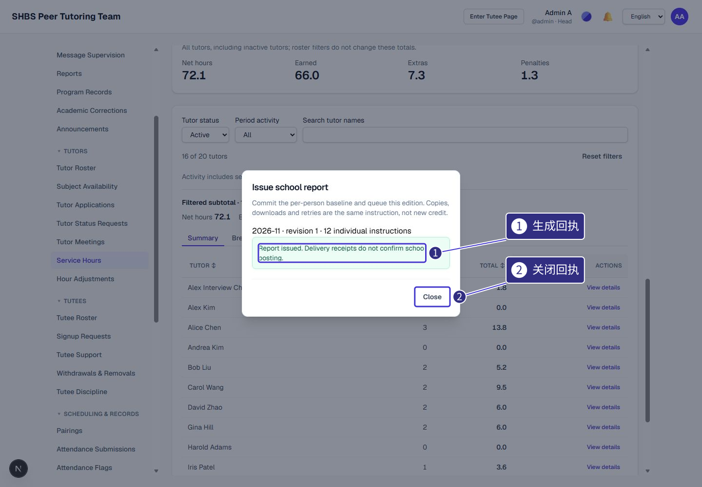

   /admin/service-hours · EN · 2026-11-20

   实际首版报告已保存。成功回执区分报告生成与学校账户入账。

   [原始完整截图](assets/issue-school-report-step-2-view-2.en.jpg) · `b5ece465681957c9fe579d26babdeb260c674fa0` · Latest-main development baseline b5ece465, selected 2026-11-20, with the Help candidate. Isolated synthetic first-report demonstration phase.

   已为本步骤添加标注，原始完整截图保持不变。

   - **1.** 生成回执

   - **2.** 关闭回执

3. **检查精确入账数量** 突出显示的入账时数是应入账一次的数量。打开详情查看学校账户参考、辅导和巡视分项及结转解释。不要另行入账转入、原始变化或转出余额。

   **视图 1**

   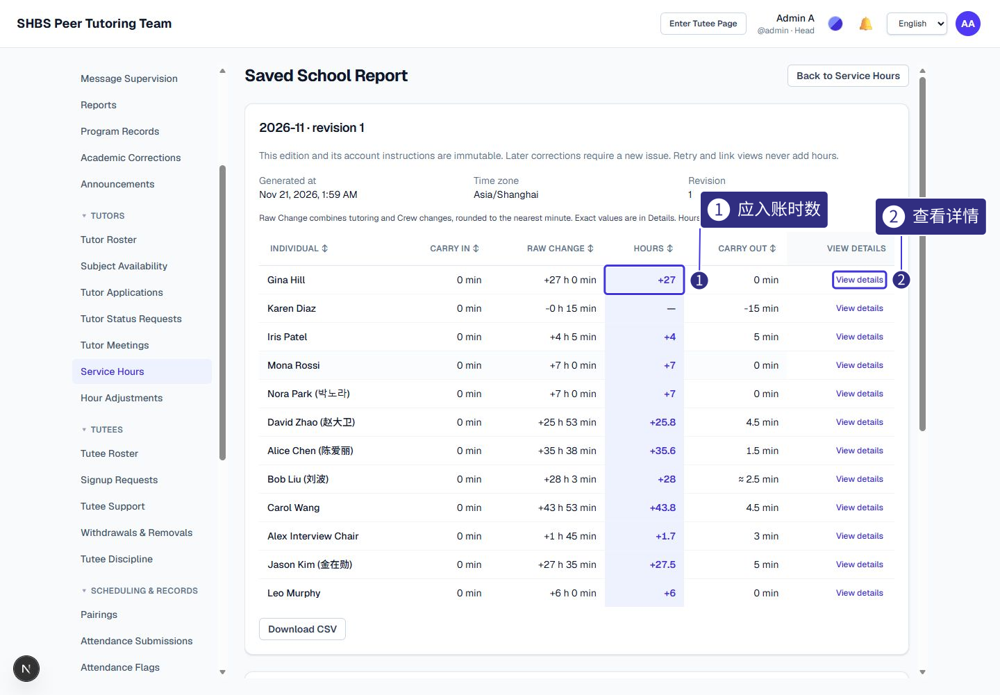

   /admin/service-hours/school-reports/77a833d6-d3a3-42ce-a219-a97d82b15125 · EN · 2026-11-20

   已保存的 11 月第 1 版突出显示 Gina Hill 的精确时数 +27。“查看详情”打开同一行的组成及账户标识。

   [原始完整截图](assets/issue-school-report-step-3.en.jpg) · `b5ece465681957c9fe579d26babdeb260c674fa0` · Latest-main development baseline b5ece465, selected 2026-11-20, with the Help candidate. Isolated synthetic first-report demonstration phase.

   已为本步骤添加标注，原始完整截图保持不变。

   - **1.** 应入账时数

   - **2.** 查看详情

   **视图 2**

   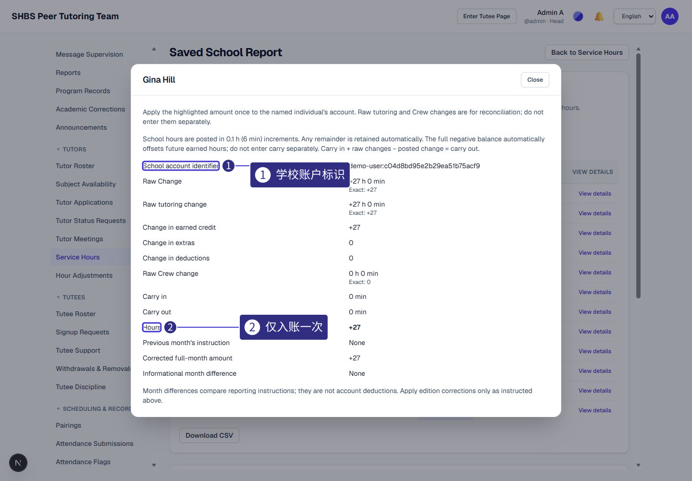

   /admin/service-hours/school-reports/77a833d6-d3a3-42ce-a219-a97d82b15125 · EN · 2026-11-20

   已保存详情显示 Gina Hill 的合成学校账户标识、各组成与精确时数。余量和原始变化用于解释同一条入账指示。

   [原始完整截图](assets/issue-school-report-step-3-view-2.en.jpg) · `b5ece465681957c9fe579d26babdeb260c674fa0` · Latest-main development baseline b5ece465, selected 2026-11-20, with the Help candidate. Isolated synthetic first-report demonstration phase.

   已为本步骤添加标注，原始完整截图保持不变。

   - **1.** 学校账户标识

   - **2.** 仅入账一次

4. **修订最新符合条件版本** 核对修订版。在“详情”中找到学校上次实际入账版本的对照行，并使用该行的增量时数。后续月份的报表发放后，新变化会在下一份报表中核对。

   **视图 1**

   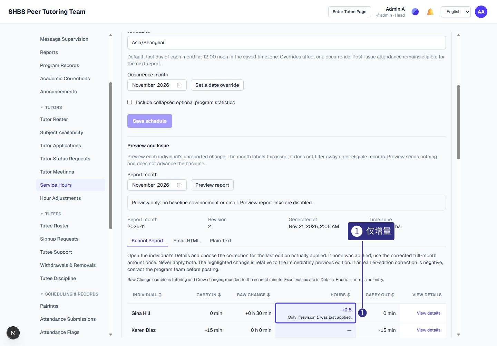

   /admin/service-hours · EN · 2026-11-20

   更正预览突出显示仅在上一笔按第 1 版入账时追加 +0.5，同一月份根据实际的半小时追加计算。

   [原始完整截图](assets/issue-school-report-step-4.en.jpg) · `b5ece465681957c9fe579d26babdeb260c674fa0` · Latest-main development baseline b5ece465, selected 2026-11-20, with the Help candidate. Isolated synthetic first-report demonstration phase.

   已为本步骤添加标注，原始完整截图保持不变。

   - **1.** 仅增量

   **视图 2**

   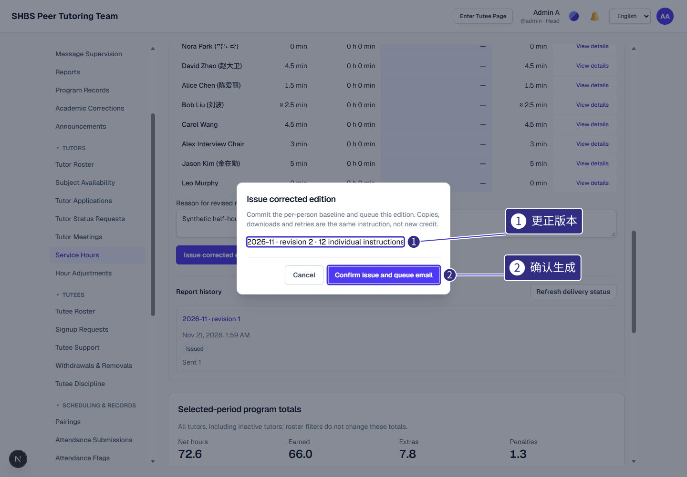

   /admin/service-hours · EN · 2026-11-20

   更正复核显示 11 月第 2 版及 12 条个人入账指示。这是同一月份的下一版。

   [原始完整截图](assets/issue-school-report-step-4-view-2.en.jpg) · `b5ece465681957c9fe579d26babdeb260c674fa0` · Latest-main development baseline b5ece465, selected 2026-11-20, with the Help candidate. Isolated synthetic first-report demonstration phase.

   已为本步骤添加标注，原始完整截图保持不变。

   - **1.** 更正版本

   - **2.** 确认生成

   **视图 3**

   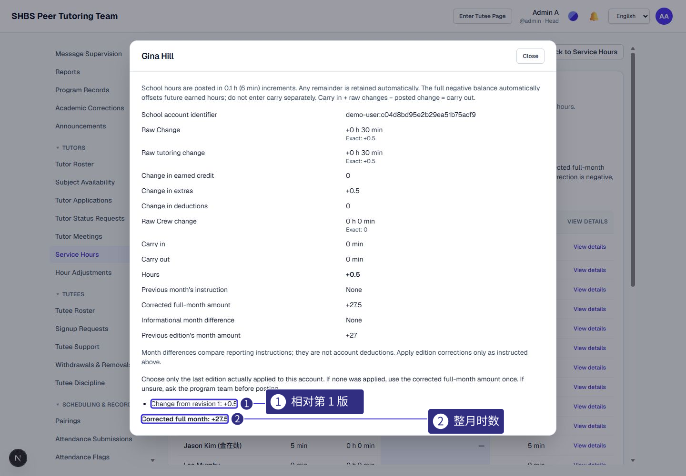

   /admin/service-hours/school-reports/f48fd63b-e622-4f17-811e-80ecf53de9fe · EN · 2026-11-20

   已保存的第 2 版详情列出第 1 版后的增量 +0.5 和更正后的整月时数 +27.5，应按实际上一次已入账版本读取。

   [原始完整截图](assets/issue-school-report-step-4-view-3.en.jpg) · `b5ece465681957c9fe579d26babdeb260c674fa0` · Latest-main development baseline b5ece465, selected 2026-11-20, with the Help candidate. Isolated synthetic first-report demonstration phase.

   已为本步骤添加标注，原始完整截图保持不变。

   - **1.** 相对第 1 版

   - **2.** 整月时数

### 预期结果

保存版本包含精确一次入账说明及清晰修正依据。

### 工作原理

新报表以完整0.1小时单位入账，余数跨月结转，学期不清零。例如80分钟入账1.3小时并结转2分钟。负余额入账零并继续结转，未来收入先抵欠额。

### 问题排查

- **学校已录入旧版本** 在详情选择实际已入账版本及其增量修正。发放或发送报表不证明学校已录入。应用另一数量前先核对学校入账记录。

## 管理账户权限及设置

审核管理职级与参与权限、发送设置或恢复、决定暂停申诉，并仅删除符合条件账户。

打开: `/admin/users`

### 开始之前

- 需要当前管理员或负责人权限。遵循各专用审阅及密码要求；当前负责人职权转移使用独立流程。

### 操作步骤

1. **确认当前身份及权限** 打开用户详情，检查实际登录状态、管理职级、辅导伙伴或学习伙伴或巡视成员资格、翻译指派、暂停及离校。变更前阅读各操作资格。

   请注意: 使用具体账户操作，并在用户详情阅读当前权限。

   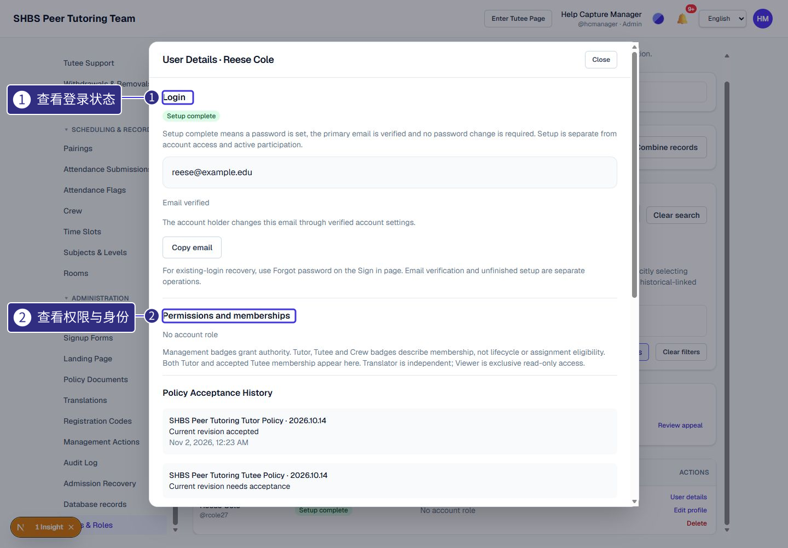

   /admin/users · EN · 2026-11-20

   “用户详情”分别显示登录设置状态和账号当前权限。

   [原始完整截图](assets/manage-account-access-step-1.en.jpg) · `b5ece465681957c9fe579d26babdeb260c674fa0` · Latest-main development baseline b5ece465, selected 2026-11-20, with the Help candidate and synthetic demo records.

   已为本步骤添加标注，原始完整截图保持不变。

   - **1.** 查看登录状态

   - **2.** 查看权限与身份

2. **适当使用设置或恢复** 对符合条件但尚未完成设置的账户，请在“用户与角色”中选择“发送设置链接”。已就绪账户的使用者可在登录页选择“忘记密码”。应用会按相应流程向符合条件的收件人发送设置或恢复链接。

   **视图 1**

   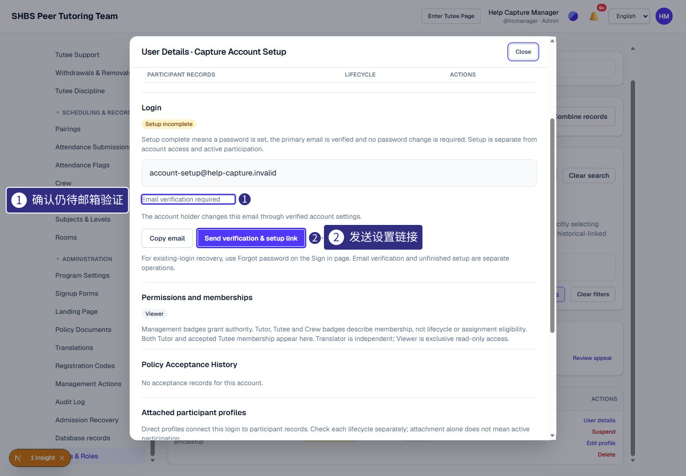

   /admin/users · EN · 2026-11-20

   未完成设置的账号显示验证与设置链接的发送位置，尚未点击发送。

   [原始完整截图](assets/manage-account-access-step-2.en.jpg) · `b5ece465681957c9fe579d26babdeb260c674fa0` · Latest-main development baseline b5ece465, selected 2026-11-20, with the Help candidate and synthetic demo records.

   已为本步骤添加标注，原始完整截图保持不变。

   - **1.** 确认仍待邮箱验证

   - **2.** 发送设置链接

   **视图 2**

   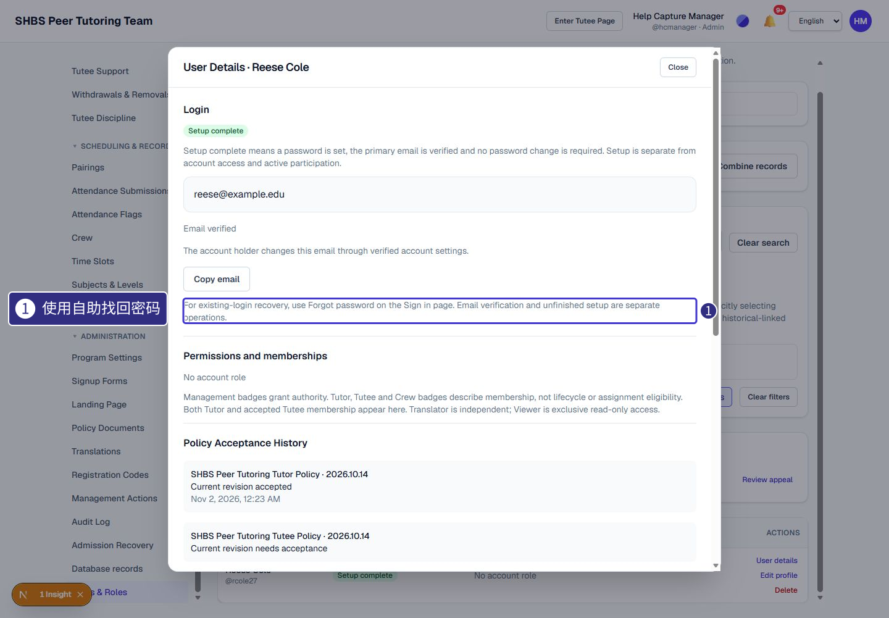

   /admin/users · EN · 2026-11-20

   已就绪的登录账号提示持有人在登录页使用“忘记密码”。

   [原始完整截图](assets/manage-account-access-step-2-view-2.en.jpg) · `b5ece465681957c9fe579d26babdeb260c674fa0` · Latest-main development baseline b5ece465, selected 2026-11-20, with the Help candidate and synthetic demo records.

   已为本步骤添加标注，原始完整截图保持不变。

   - **1.** 使用自助找回密码

3. **审核权限及暂停变更** 允许的非负责人职级授予、撤销或参与权限变更，应审阅具体账户及后果并完成必要密码或审核。审核申诉时须先阅读完整账户申诉再批准或拒绝。

   **视图 1**

   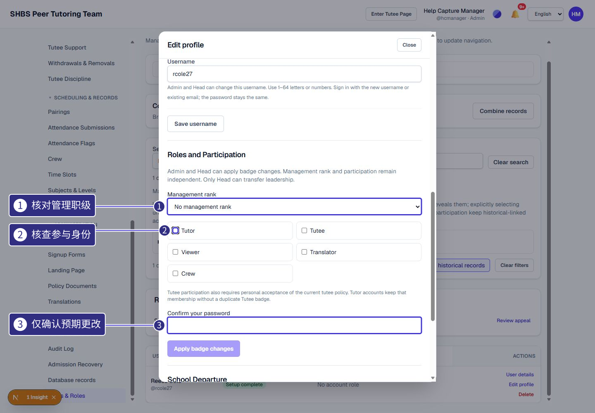

   /admin/users · EN · 2026-11-20

   此指定账号的编辑器将管理职级与参与身份分开，并要求管理员输入密码后才能应用徽章更改。

   [原始完整截图](assets/manage-account-access-step-3.en.jpg) · `b5ece465681957c9fe579d26babdeb260c674fa0` · Latest-main development baseline b5ece465, selected 2026-11-20, with the Help candidate and synthetic demo records.

   已为本步骤添加标注，原始完整截图保持不变。

   - **1.** 核对管理职级

   - **2.** 核查参与身份

   - **3.** 仅确认预期更改

   **视图 2**

   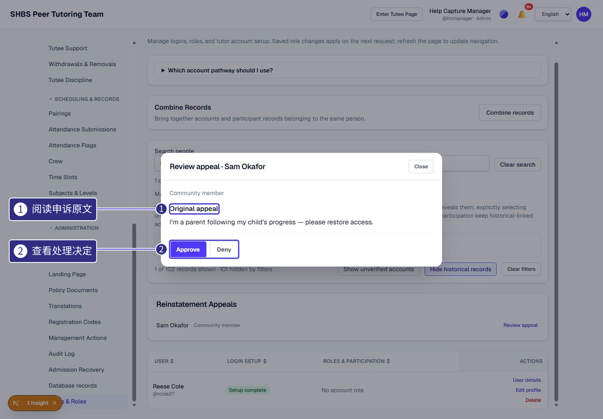

   /admin/users · EN · 2026-11-20

   待审核的申诉列出账号，并在作出决定前显示完整原文。

   [原始完整截图](assets/manage-account-access-step-3-view-2.en.jpg) · `b5ece465681957c9fe579d26babdeb260c674fa0` · Latest-main development baseline b5ece465, selected 2026-11-20, with the Help candidate and synthetic demo records.

   已为本步骤添加标注，原始完整截图保持不变。

   - **1.** 阅读申诉原文

   - **2.** 查看处理决定

4. **仅通过资格审阅删除** 若提供账户删除，应检查准确登录及保留记录后果，并通过专用流程确认。当前负责人及已审核合并组不能作为普通账户删除。

   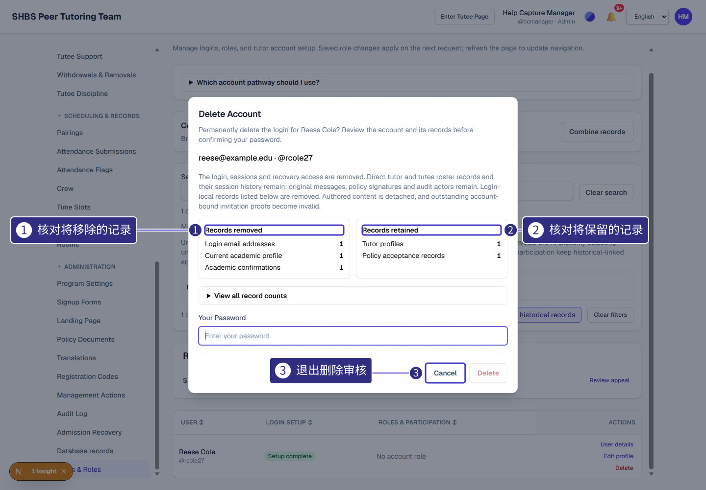

   /admin/users · EN · 2026-11-20

   指定账号的删除审核列出了将移除和保留的内容，确认密码仍为空。

   [原始完整截图](assets/manage-account-access-step-4.en.jpg) · `b5ece465681957c9fe579d26babdeb260c674fa0` · Latest-main development baseline b5ece465, selected 2026-11-20, with the Help candidate and synthetic demo records.

   已为本步骤添加标注，原始完整截图保持不变。

   - **1.** 核对将移除的记录

   - **2.** 核对将保留的记录

   - **3.** 退出删除审核

### 预期结果

仅明确审核的权限或设置操作被记录，历史证据及独立成员资格仍具权威。

### 工作原理

管理角色与参与标记彼此独立。授予管理职级不会自动授予辅导伙伴、巡视或翻译资格。设置完成是凭据条件，不保证未暂停访问。

### 问题排查

- **操作不可用或保存后列表未刷新** 阅读服务器当前权限或归属限制。不要使用邀请绕过被拒直接操作。决定被接受后应重试刷新，不要重复暂停、删除或申诉审核。

## 分配或更改永久用户名

为符合条件缺失用户名者补充，或保存审核后的账户、名册用户名，同时保留身份依据。

打开: `/admin/users`

### 开始之前

- 需要管理员或负责人权限。当前管理政策下两者均可直接应用普通账户用户名编辑；协调员不能提交账户用户名编辑。

### 操作步骤

1. **检查当前用户名** 打开用户与角色并核对具体登录及关联辅导伙伴。对已验证且符合条件的无用户名账户使用分配用户名；仅查看目录不会分配。

   请注意: 找到分配用户名，或编辑资料中的用户名区块。

   **视图 1**

   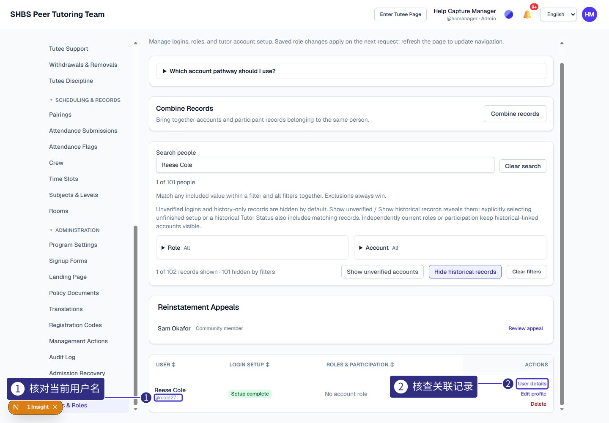

   /admin/users · EN · 2026-11-20

   编辑前，目录显示准确的已就绪登录账号及其原用户名。

   [原始完整截图](assets/manage-usernames-step-1.en.jpg) · `b5ece465681957c9fe579d26babdeb260c674fa0` · Latest-main development baseline b5ece465, selected 2026-11-20, with the Help candidate and synthetic demo records.

   已为本步骤添加标注，原始完整截图保持不变。

   - **1.** 核对当前用户名

   - **2.** 核查关联记录

   **视图 2**

   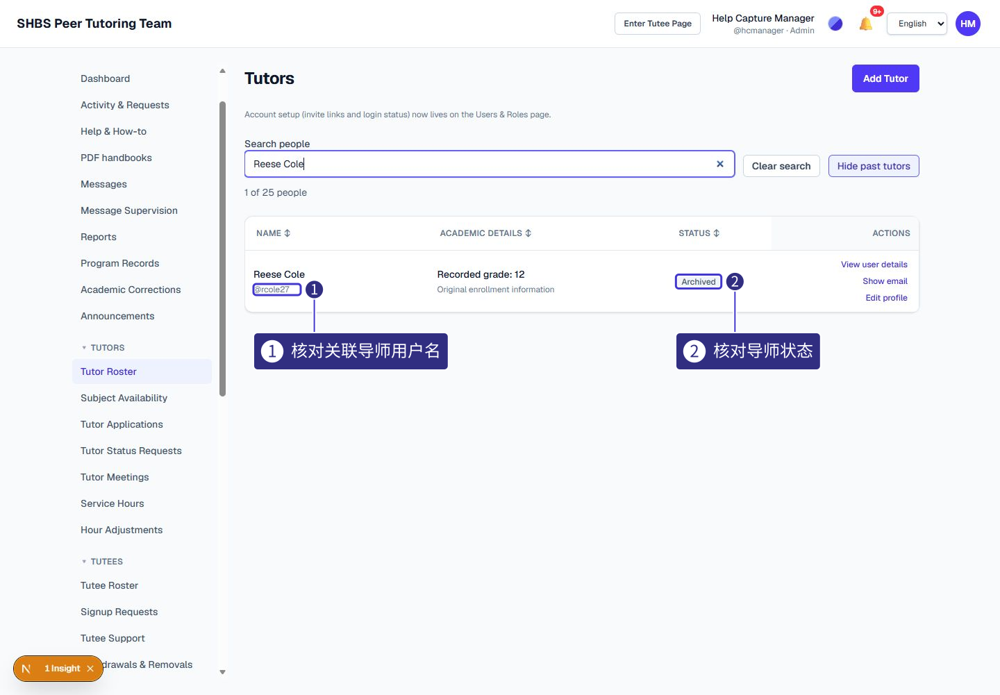

   /admin/tutors · EN · 2026-11-20

   独立筛选的导师名册显示相同的原用户名，以及已归档状态。

   [原始完整截图](assets/manage-usernames-step-1-view-2.en.jpg) · `b5ece465681957c9fe579d26babdeb260c674fa0` · Latest-main development baseline b5ece465, selected 2026-11-20, with the Help candidate and synthetic demo records.

   已为本步骤添加标注，原始完整截图保持不变。

   - **1.** 核对关联导师用户名

   - **2.** 核对导师状态

2. **明确编辑** 在编辑资料→用户名填写1至64个ASCII字母或数字。首尾空白会去除，字母转小写。审阅新旧用户名及显示权限路径。

   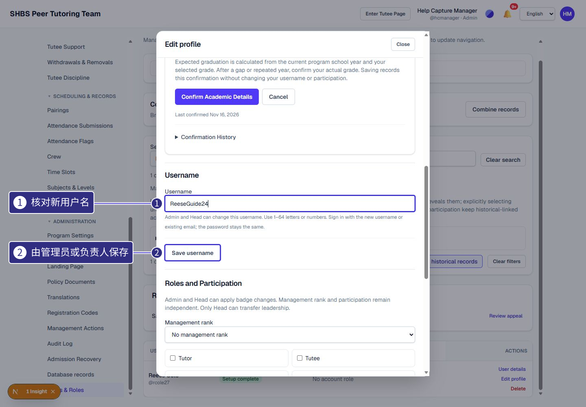

   /admin/users · EN · 2026-11-20

   草稿显示有效的大小写混合用户名，以及管理员或负责人的保存入口。

   [原始完整截图](assets/manage-usernames-step-2.en.jpg) · `b5ece465681957c9fe579d26babdeb260c674fa0` · Latest-main development baseline b5ece465, selected 2026-11-20, with the Help candidate and synthetic demo records.

   已为本步骤添加标注，原始完整截图保持不变。

   - **1.** 核对新用户名

   - **2.** 由管理员或负责人保存

3. **审核并保存** 审核新旧用户名并通过管理员、负责人权限保存。确认应用结果；保存相同值不会产生变化。当前政策会在审核应用旧待审提案前重新检查。

   **视图 1**

   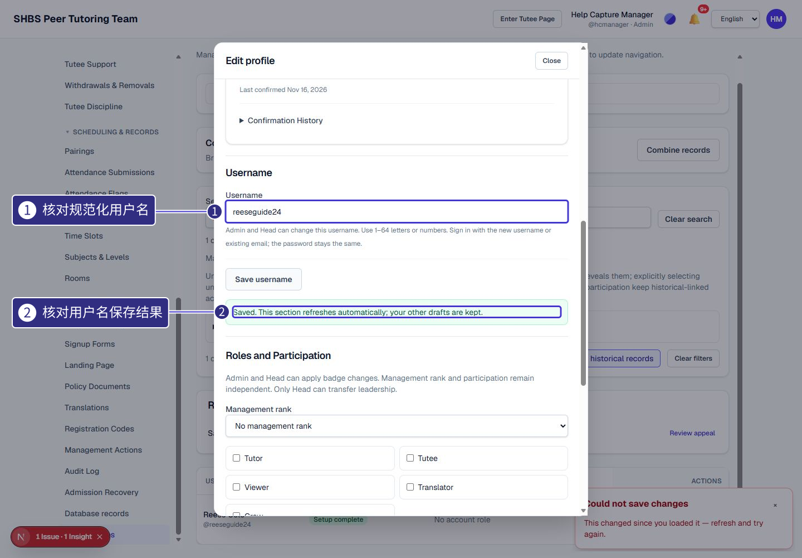

   /admin/users · EN · 2026-11-20

   “用户名”区绿色提示确认用户名已完成规范化。角落提示来自先前被拒绝的草稿。

   [原始完整截图](assets/manage-usernames-step-3.en.jpg) · `b5ece465681957c9fe579d26babdeb260c674fa0` · Latest-main development baseline b5ece465, selected 2026-11-20, with the Help candidate and synthetic demo records.

   已为本步骤添加标注，原始完整截图保持不变。

   - **1.** 核对规范化用户名

   - **2.** 核对用户名保存结果

   **视图 2**

   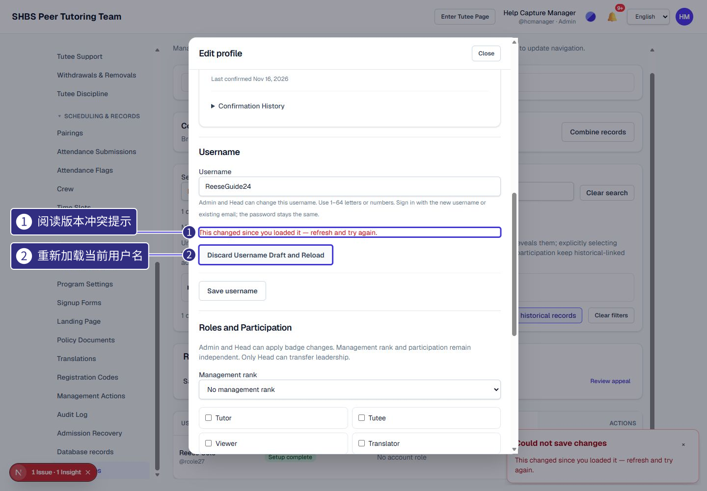

   /admin/users · EN · 2026-11-20

   独立的资料保存后，旧版用户名草稿被拒绝。重新加载此区后再编辑用户名。

   [原始完整截图](assets/manage-usernames-step-3-view-2.en.jpg) · `b5ece465681957c9fe579d26babdeb260c674fa0` · Latest-main development baseline b5ece465, selected 2026-11-20, with the Help candidate and synthetic demo records.

   已为本步骤添加标注，原始完整截图保持不变。

   - **1.** 阅读版本冲突提示

   - **2.** 重新加载当前用户名

4. **验证当前值** 区块刷新后，确认账户及关联辅导伙伴用户名一并改变。应用后应告知用户使用新用户名或现有邮箱登录。

   **视图 1**

   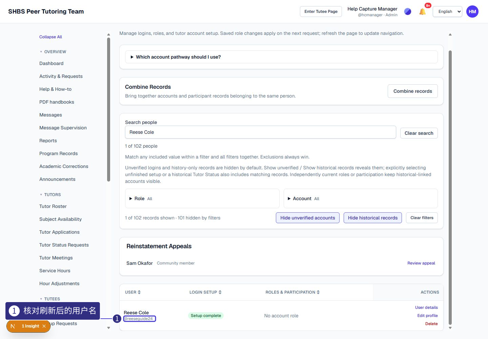

   /admin/users · EN · 2026-11-20

   重新加载的“用户与角色”目录使用新的规范化用户名标识 Reese。

   [原始完整截图](assets/manage-usernames-step-4.en.jpg) · `b5ece465681957c9fe579d26babdeb260c674fa0` · Latest-main development baseline b5ece465, selected 2026-11-20, with the Help candidate and synthetic demo records.

   已为本步骤添加标注，原始完整截图保持不变。

   - **1.** 核对刷新后的用户名

   **视图 2**

   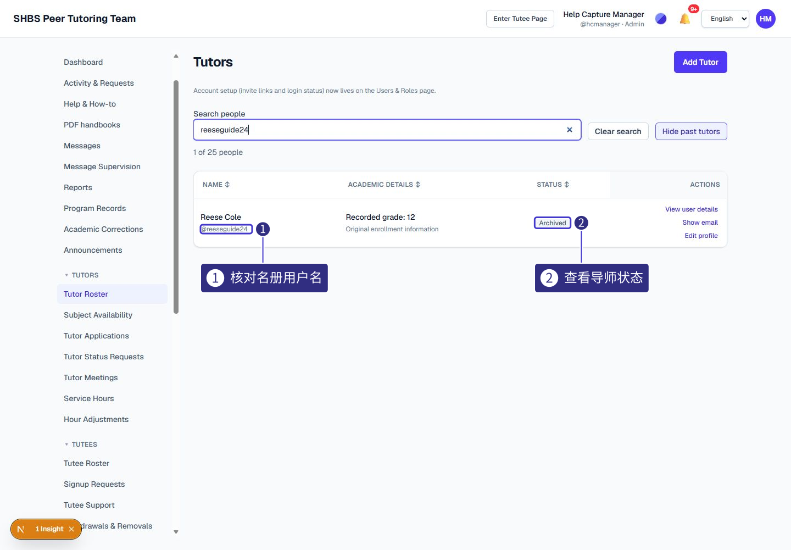

   /admin/tutors · EN · 2026-11-20

   独立加载的导师名册显示相同的规范化用户名，导师记录仍为已归档。

   [原始完整截图](assets/manage-usernames-step-4-view-2.en.jpg) · `b5ece465681957c9fe579d26babdeb260c674fa0` · Latest-main development baseline b5ece465, selected 2026-11-20, with the Help candidate and synthetic demo records.

   已为本步骤添加标注，原始完整截图保持不变。

   - **1.** 核对名册用户名

   - **2.** 查看导师状态

### 预期结果

预期用户名唯一且与关联辅导伙伴同步，或审核申请仍待处理。

### 工作原理

姓名或学业修正不会重新生成已有用户名。更改用户名会保留邮箱登录、密码、ID、成员资格及历史；应用后旧用户名不能再登录。

### 问题排查

- **用户名已被占用或编辑已过时** 检查登录账户及辅导伙伴名册中的用户名是否唯一，再选择有效用户名。如果编辑期间账户发生变化，选择“放弃用户名草稿并重新加载”，核对当前用户名后重新输入变更。若重新加载失败，请先重试读取再编辑。

## 审核身份后合并记录

分组合适准确来源，仅经审核选择保留登录，并单独解决当前参与。

打开: `/admin/users`

### 开始之前

- 需要管理员或负责人权限、已验证身份证据，以及专用审阅要求时的当前密码。姓名或邮箱本身不是身份证明。

### 操作步骤

1. **选择准确记录** 在用户与角色或历史资料打开合并记录。搜索并选择属于同一人的准确登录、辅导伙伴及学习伙伴来源，阅读原始ID及证据。

   请注意: 打开合并记录，其来源搜索与目录筛选独立。

   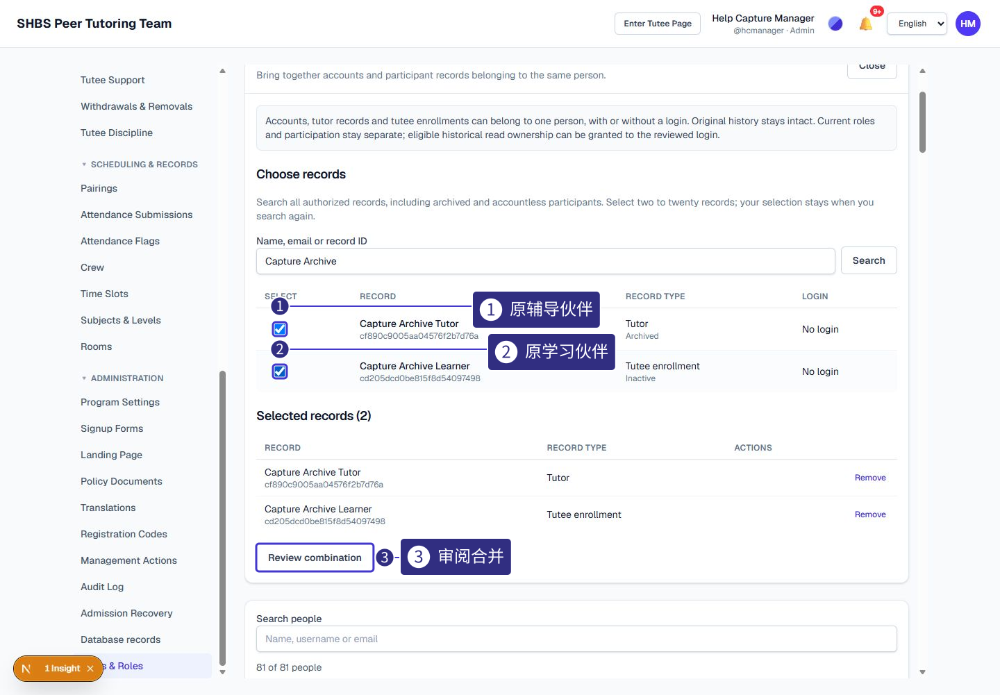

   /admin/users · EN · 2026-11-20

   已将准确的归档辅导伙伴与不活跃学习伙伴选为两条独立原记录。两条记录均无登录。

   [原始完整截图](assets/combine-person-records-step-1.en.jpg) · `b5ece465681957c9fe579d26babdeb260c674fa0` · Latest-main development baseline b5ece465, selected 2026-11-20, with the Help candidate and synthetic demo records.

   已为本步骤添加标注，原始完整截图保持不变。

   - **1.** 原辅导伙伴

   - **2.** 原学习伙伴

   - **3.** 审阅合并

2. **审核完整分组** 预览所有来源。无登录的结果仍为无账户；一个就绪登录可保留无归属历史而无需重新入组。多个登录时须明确选择保留登录，解决冲突后才审阅退休。

   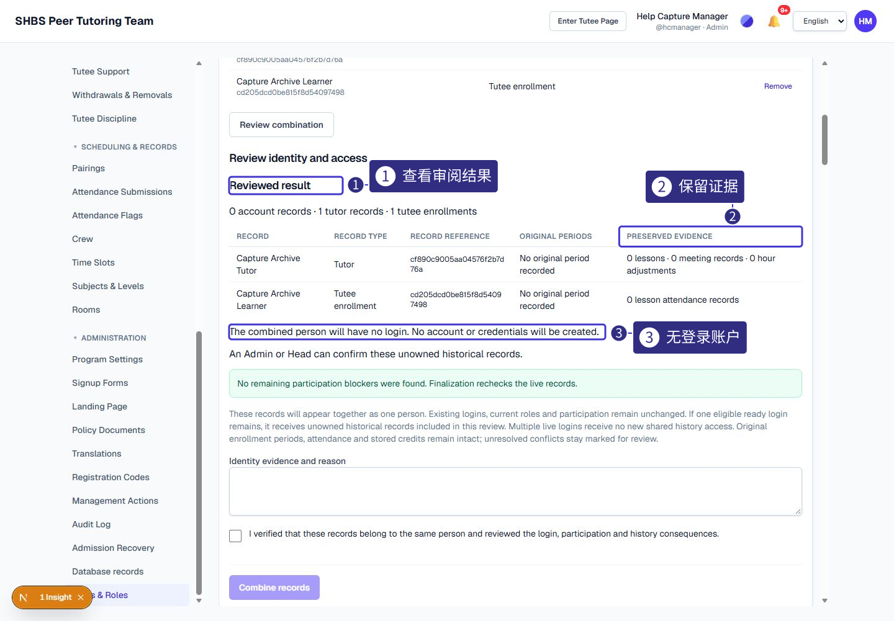

   /admin/users · EN · 2026-11-20

   审阅中保留两条独立原记录，并显示各自时期和证据。合并后的历史人员不会创建登录。

   [原始完整截图](assets/combine-person-records-step-2.en.jpg) · `b5ece465681957c9fe579d26babdeb260c674fa0` · Latest-main development baseline b5ece465, selected 2026-11-20, with the Help candidate and synthetic demo records.

   已为本步骤添加标注，原始完整截图保持不变。

   - **1.** 查看审阅结果

   - **2.** 保留证据

   - **3.** 无登录账户

3. **记录证据并确认** 填写身份证据、确认完整审阅，并在多个登录、归属冲突、无归属活跃工作或受限账户等要求下填写当前密码。阅读并保留操作回执。

   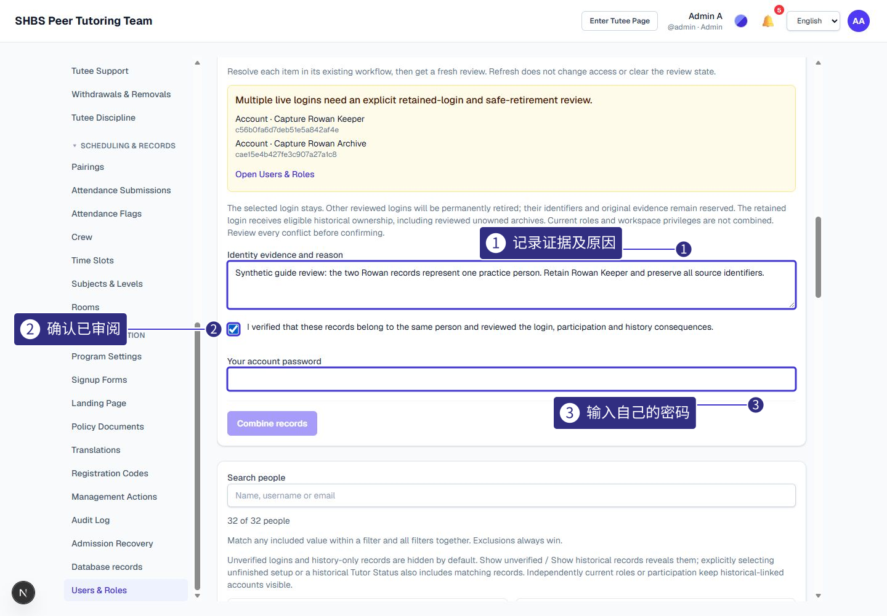

   /admin/users · EN · 2026-11-21

   此 Rowan 示例经复核后保留一个登录账号，并保留原始记录。确认前填写证据、确认影响并输入自己的密码；示例中密码框为空。

   [原始完整截图](assets/combine-person-records-step-3.en.jpg) · `b5ece465681957c9fe579d26babdeb260c674fa0` · Latest-main development baseline b5ece465, selected 2026-11-20, with the Help candidate. Isolated synthetic first-report demonstration phase.

   已为本步骤添加标注，原始完整截图保持不变。

   - **1.** 记录证据及原因

   - **2.** 确认已审阅

   - **3.** 输入自己的密码

4. **解决实际工作** 若出现需要当前参与或登录审核，打开用户详情→合并记录→审核当前参与。逐项处理具体阻碍；经审核可取消过时历史邀请，再获取最新参与审核并凭证据完成已审阅分组。

   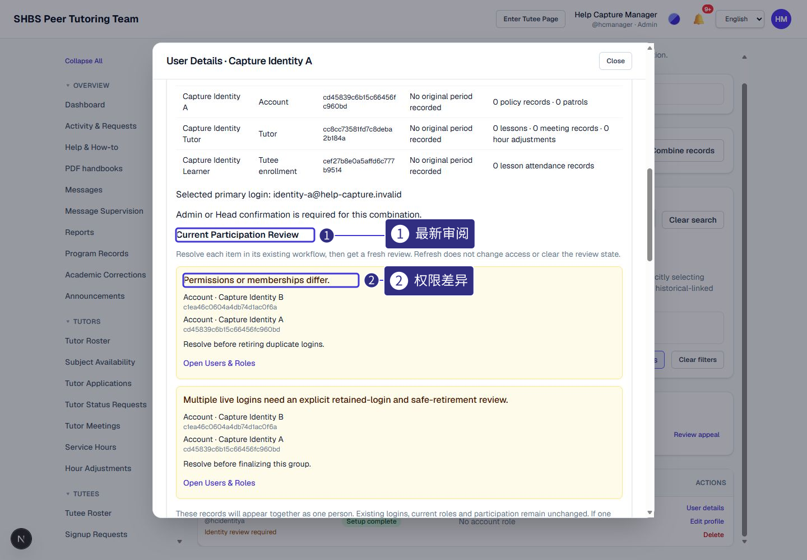

   /admin/users · EN · 2026-11-21

   已为修正后的双登录组加载最新审阅。权限或成员资格差异阻止完成审阅，两套原始登录记录仍与档案组分开。

   [原始完整截图](assets/combine-person-records-step-4.en.jpg) · `b5ece465681957c9fe579d26babdeb260c674fa0` · Latest-main development baseline b5ece465, selected 2026-11-20, with the Help candidate and synthetic demo records.

   已为本步骤添加标注，原始完整截图保持不变。

   - **1.** 最新审阅

   - **2.** 权限差异

### 预期结果

目录身份已分组且原始来源保留，剩余实际操作审核明确可见。

### 工作原理

分组不会暗中合并角色、转移配对、解除限制、去重事件或制造同意。明确退休凭据仍禁用；来源ID保留作者归属。完成由回执证明，不是勾选或刷新。

### 问题排查

- **新审阅仍列出上一次合并的记录** 打开审阅合并前，在已选记录中移除每条无关来源。确认前对照审阅来源记录中的姓名和原记录编号。

- **审阅已改变或响应中断** 证据改变后获取新预览。若提交可能已成功，先检查回执并使用只读刷新。不要提交不同分组意图来恢复不确定的先前结果。

## 关联历史或邀请往届参与者

将准确保留历史关联至已验证归属人，或发送范围固定的仅历史邀请。

打开: `/admin/users`

### 开始之前

- 需要管理员或负责人权限，且每个来源都有已审核归属证据。私人收件邮箱须通过收件人流程验证。

### 操作步骤

1. **查找原始档案** 使用显示过往辅导伙伴或显示历史记录，打开准确档案的编辑资料，或打开已审核历史分组的合并记录。检查原始入组及现有保留归属人。

   请注意: 使用历史资料编辑或用户详情→合并记录。

   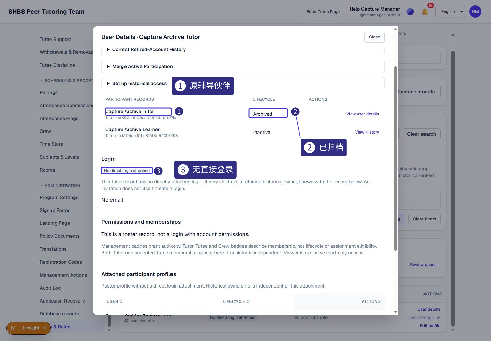

   /admin/users · EN · 2026-11-20

   原辅导伙伴记录仍为归档且没有直接登录。同一目录分组列出另一条独立不活跃学习伙伴记录。

   [原始完整截图](assets/link-historical-participant-records-step-1.en.jpg) · `b5ece465681957c9fe579d26babdeb260c674fa0` · Latest-main development baseline b5ece465, selected 2026-11-20, with the Help candidate and synthetic demo records.

   已为本步骤添加标注，原始完整截图保持不变。

   - **1.** 原辅导伙伴

   - **2.** 已归档

   - **3.** 无直接登录

2. **选择关联或邀请** 已有已验证归属人使用审阅后的合并记录或历史关联路径。邀请无登录往届成员时选择设置历史访问，并审阅收件人及全部包含来源。

   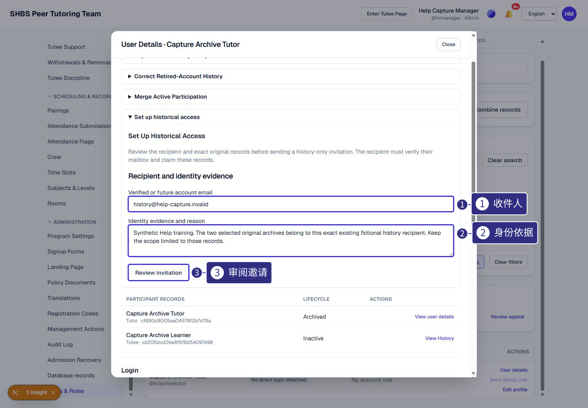

   /admin/users · EN · 2026-11-20

   分组档案的仅历史邀请草稿已填写准确的演示收件人，身份依据已准备好供范围审阅。

   [原始完整截图](assets/link-historical-participant-records-step-2.en.jpg) · `b5ece465681957c9fe579d26babdeb260c674fa0` · Latest-main development baseline b5ece465, selected 2026-11-20, with the Help candidate and synthetic demo records.

   已为本步骤添加标注，原始完整截图保持不变。

   - **1.** 收件人

   - **2.** 身份依据

   - **3.** 审阅邀请

3. **审核归属或投递** 记录身份证据，修正保留归属人时按要求提供当前密码确认。仅发送已审核邀请范围；后续添加组员不会扩大待处理邀请。

   **视图 1**

   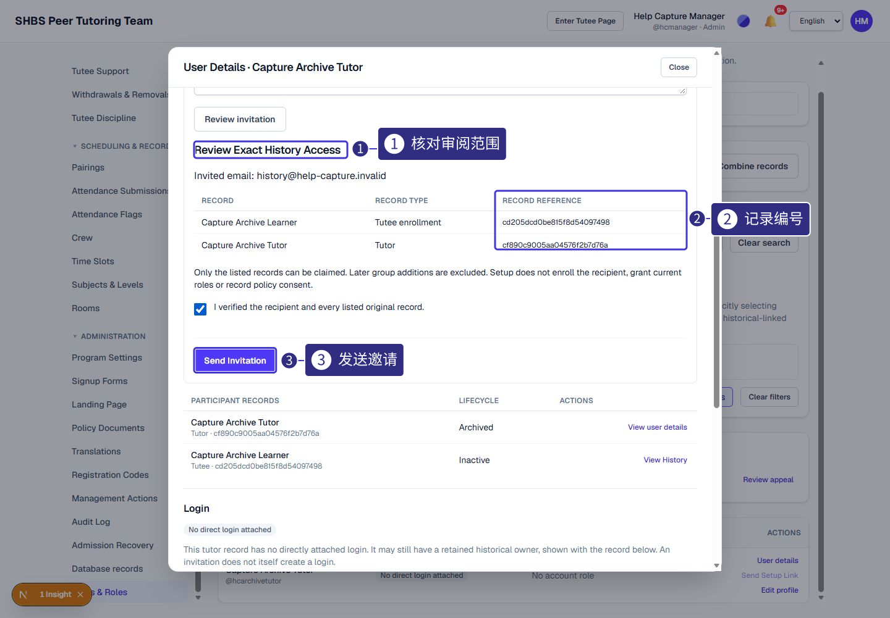

   /admin/users · EN · 2026-11-20

   审阅固定两条准确档案来源及指定邮箱。复选确认仅适用于当前列出的范围。

   [原始完整截图](assets/link-historical-participant-records-step-3.en.jpg) · `b5ece465681957c9fe579d26babdeb260c674fa0` · Latest-main development baseline b5ece465, selected 2026-11-20, with the Help candidate and synthetic demo records.

   已为本步骤添加标注，原始完整截图保持不变。

   - **1.** 核对审阅范围

   - **2.** 记录编号

   - **3.** 发送邀请

   **视图 2**

   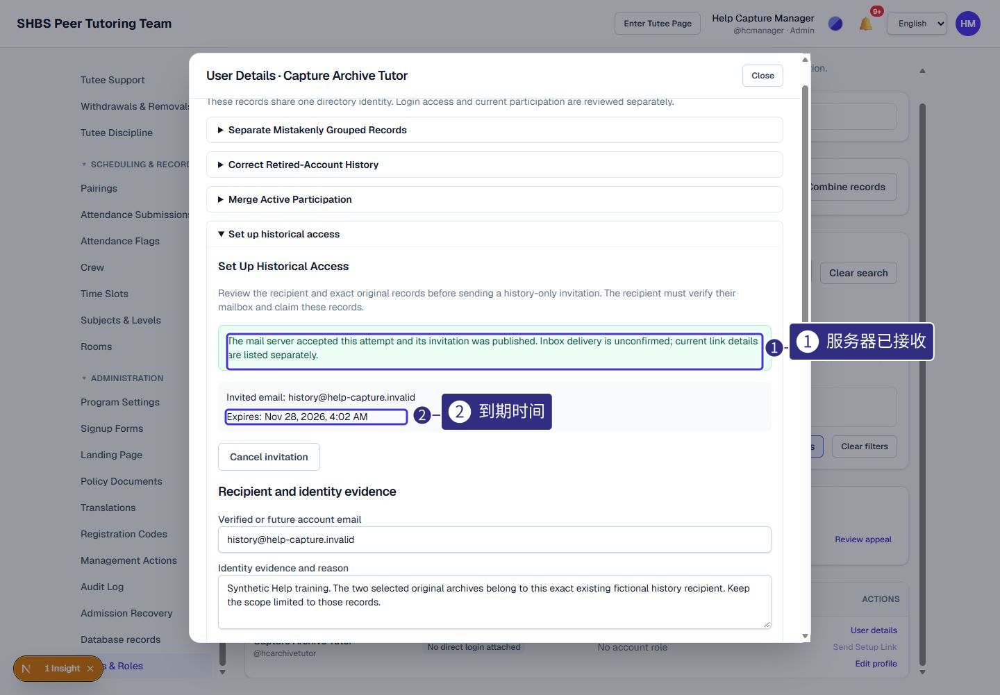

   /admin/users · EN · 2026-11-20

   应用记录实际本地邮件受理及邀请到期时间。独立的回环收件箱确实收到这封准确邀请。

   [原始完整截图](assets/link-historical-participant-records-step-3-view-2.en.jpg) · `b5ece465681957c9fe579d26babdeb260c674fa0` · Latest-main development baseline b5ece465, selected 2026-11-20, with the Help candidate and synthetic demo records.

   已为本步骤添加标注，原始完整截图保持不变。

   - **1.** 服务器已接收

   - **2.** 到期时间

4. **单独验证历史访问** 收件人验证邮箱、审阅邀请，并在登录后单独认领准确固定来源。检查归属或认领回执；历史设置不会授予当前辅导参与资格。

   **视图 1**

   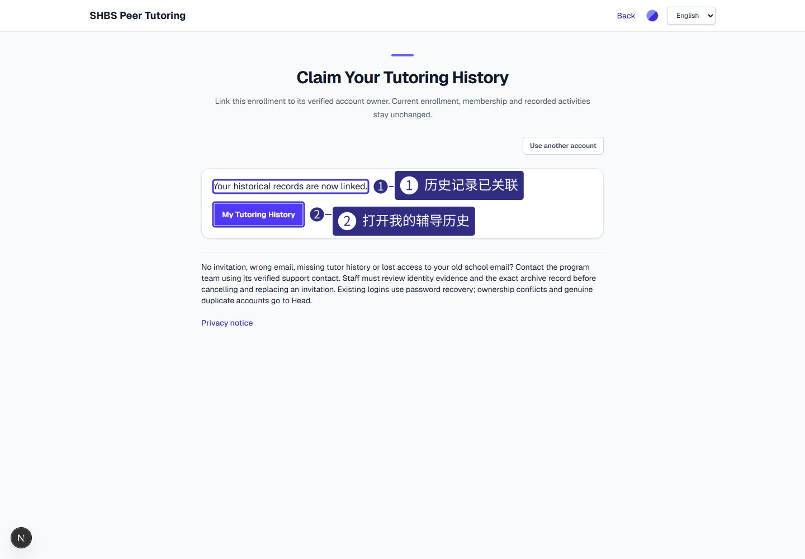

   /history/claim · EN · 2026-11-21

   现有演示账户已保存准确认领。回执链接到收件人的保留历史。

   [原始完整截图](assets/link-historical-participant-records-step-4.en.jpg) · `b5ece465681957c9fe579d26babdeb260c674fa0` · Latest-main development baseline b5ece465, selected 2026-11-20, with the Help candidate and synthetic demo records.

   已为本步骤添加标注，原始完整截图保持不变。

   - **1.** 历史记录已关联

   - **2.** 打开我的辅导历史

   **视图 2**

   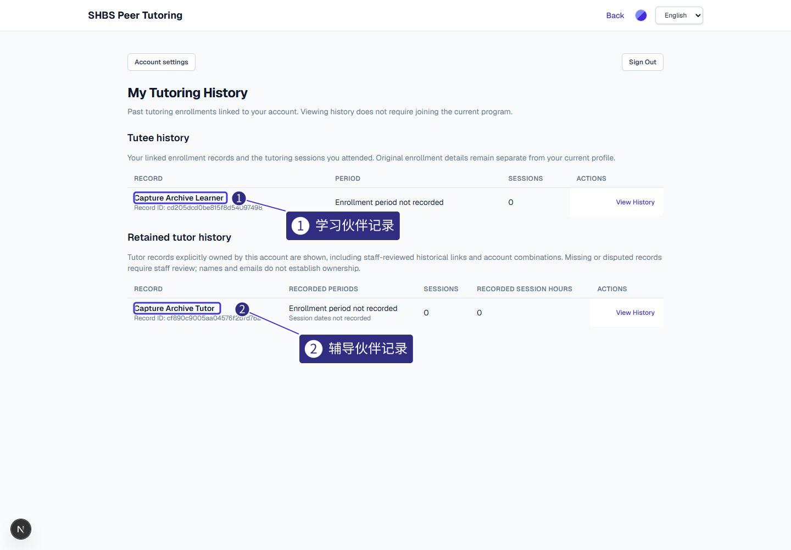

   /history · EN · 2026-11-21

   收件人的常规“我的辅导历史”页面已在学习伙伴与辅导伙伴两个区域分别列出两条确切原记录。

   [原始完整截图](assets/link-historical-participant-records-step-4-view-2.en.jpg) · `b5ece465681957c9fe579d26babdeb260c674fa0` · Latest-main development baseline b5ece465, selected 2026-11-20, with the Help candidate and synthetic demo records.

   已为本步骤添加标注，原始完整截图保持不变。

   - **1.** 学习伙伴记录

   - **2.** 辅导伙伴记录

### 预期结果

只有经审核原始历史被关联或邀请，且归属证据保留。

### 工作原理

多个归档资料可属于同一登录，不替换当前资料或重新激活档案。现有历史学习伙伴邀请保留原认领流程；联系方式相同本身绝不授权私人历史。

### 问题排查

- **归属冲突或当前工作阻止设置** 打开准确归属或当前参与审核，解决所述来源。不要发送范围更广替代邀请或仅按邮箱关联。只取消已审核过时邀请，再读取最新证据。

## 修正错误分组或历史读取人

通过不同审阅分开目录身份、修正退休账户历史或合并活跃参与。

打开: `/admin/users`

### 开始之前

- 需要管理员或负责人权限、准确来源证据及当前密码确认。这些专用修正不是普通协调员提案。

### 操作步骤

1. **选择修正边界** 打开合并记录，确定错误涉及目录分组、退休账户历史读取人，还是未来活跃工作。使用相应明确流程；三者不能互相替代。

   请注意: 打开用户详情→合并记录，选择准确修正流程。

   

   /admin/users · EN · 2026-11-20

   已分组的演示档案提供三种独立修正，分别处理目录身份、退休账户历史及活跃工作。

   [原始完整截图](assets/correct-combined-records-step-1.en.jpg) · `b5ece465681957c9fe579d26babdeb260c674fa0` · Latest-main development baseline b5ece465, selected 2026-11-20, with the Help candidate and synthetic demo records.

   已为本步骤添加标注，原始完整截图保持不变。

   - **1.** 分离记录

   - **2.** 修正历史访问

   - **3.** 审阅当前工作

2. **分离错误分组** 在分离错误分组记录选择要移动来源，再审核分离。每个登录须与其当前记录及保留历史一起。确认前审阅两个结果身份、证据及密码；此后两者均需最新参与审核。

   **视图 1**

   

   /admin/users · EN · 2026-11-20

   审阅显示原辅导伙伴保留在当前身份，仅选中的学习伙伴移到新身份。分离未提交。

   [原始完整截图](assets/correct-combined-records-step-2.en.jpg) · `b5ece465681957c9fe579d26babdeb260c674fa0` · Latest-main development baseline b5ece465, selected 2026-11-20, with the Help candidate and synthetic demo records.

   已为本步骤添加标注，原始完整截图保持不变。

   - **1.** 审阅两个身份

   - **2.** 保留

   - **3.** 移动

   **视图 2**

   

   /admin/users · EN · 2026-11-20

   第二个真实审阅将两套身份登录与各自附加原记录一起保留，只移动两条无登录档案来源。

   [原始完整截图](assets/correct-combined-records-step-2-view-2.en.jpg) · `b5ece465681957c9fe579d26babdeb260c674fa0` · Latest-main development baseline b5ece465, selected 2026-11-20, with the Help candidate and synthetic demo records.

   已为本步骤添加标注，原始完整截图保持不变。

   - **1.** 保留登录账户

   - **2.** 移动档案

3. **修正准确历史访问** 在修正退休账户历史选择原退休登录及活跃历史读取人，或隔离。逐行决定保留、分配或隔离，检查前后读取人及剩余限制，再确认固定审阅。

   

   /admin/users · EN · 2026-11-21

   复核显示 Rowan 已停用的登录账号、原始导师记录，以及当前和拟定的读取者。对该条记录选择保留、分配或隔离。此处尚未应用更正。

   [原始完整截图](assets/correct-combined-records-step-3.en.jpg) · `b5ece465681957c9fe579d26babdeb260c674fa0` · Latest-main development baseline b5ece465, selected 2026-11-20, with the Help candidate. Isolated synthetic first-report demonstration phase.

   已为本步骤添加标注，原始完整截图保持不变。

   - **1.** 比较历史读取者

   - **2.** 选择记录处理方式

4. **仅按意图转移活跃执行** 在合并活跃参与选择一份活跃辅导伙伴、学习伙伴记录及保留登录、准确资格来源和要保留的意愿、可用时间来源。审阅配对、已发布响应及截止时间、历史权限与纪律后果，记录证据及密码，并在全部阻碍解决后确认。

   

   /admin/users · EN · 2026-11-21

   此转移复核显示固定的数学安排、已批准的资格和选定的偏好来源。转移前处理历史访问复核。此处未转移任何安排。

   [原始完整截图](assets/correct-combined-records-step-4.en.jpg) · `b5ece465681957c9fe579d26babdeb260c674fa0` · Latest-main development baseline b5ece465, selected 2026-11-20, with the Help candidate. Isolated synthetic first-report demonstration phase.

   已为本步骤添加标注，原始完整截图保持不变。

   - **1.** 历史访问要求

   - **2.** 固定数学辅导

   - **3.** 已批准资格

   - **4.** 偏好来源

### 预期结果

专用回执记录经审核分离、历史修正或未来工作转移，不会恢复退休凭据。

### 工作原理

目录分组、私人归属与活跃执行彼此独立。原作者、已完成课程、签名、学时及报名优先级仍保留为证据。新历史权限不会解除原暂停、离校限制，待发邮件副本也不会转发给新读取人。

### 问题排查

- **响应不确定或仍有阻碍** 先检查操作回执。若仍无回执，按界面使用当前密码重试同一固定操作，不要在重试中更改来源。解决具体来源限制及流程阻碍，再为新意图获取新审阅。

## 审核管理变更申请

阅读已捕获及当前证据、确认后果，并附说明批准或拒绝。

打开: `/admin/approvals`

### 开始之前

- 需要操作所需当前管理员或负责人审核权限。只有负责人审核正式换期申请；只有负责人可审核本人符合条件管理提案。

### 操作步骤

1. **阅读完整申请** 打开管理操作并筛选待处理申请。阅读申请人、准确目标、操作及捕获前后证据。需要更多背景时跟随所属记录链接。

   请注意: 打开待处理申请，批准前比较记录证据。

   

   /admin/approvals · EN · 2026-11-16

   独立管理员审核人Alex在申请人中选择Carol Wang，仅查看预期的待审时段提案。

   [原始完整截图](assets/decide-management-proposals-step-1.en.jpg) · `589c055e4b1cf166b48b353bd619ac1982e5d9f6` · Latest-main development baseline 589c055e with the Help candidate; synthetic demonstration data.

   已为本步骤添加标注，原始完整截图保持不变。

   - **1.** 申请人

2. **比较当前权限及证据** 检查申请仍符合当前目标数据及权限。兼容旧提案可按当前政策审核；过时或不兼容证据须拒绝或退回并重新申请。

   

   /admin/approvals · EN · 2026-11-16

   管理员核对新建记录提案的不可变标签、星期及时间值，并确认其尚未应用。

   [原始完整截图](assets/decide-management-proposals-step-2.en.jpg) · `589c055e4b1cf166b48b353bd619ac1982e5d9f6` · Latest-main development baseline 589c055e with the Help candidate; synthetic demonstration data.

   已为本步骤添加标注，原始完整截图保持不变。

   - **1.** 变更证据

3. **附说明决定** 填写必填审核说明、核对具体申请，再选择批准并应用或拒绝并反馈。操作提供或要求后果审阅、密码确认时，完成对应步骤。没有额外后果审阅的申请会由决定按钮直接提交。

   

   /admin/approvals · EN · 2026-11-16

   管理员已核对示例A时段并填写独立决定说明；批准并应用会直接应用此时段申请。

   [原始完整截图](assets/decide-management-proposals-step-3.en.jpg) · `589c055e4b1cf166b48b353bd619ac1982e5d9f6` · Latest-main development baseline 589c055e with the Help candidate; synthetic demonstration data.

   已为本步骤添加标注，原始完整截图保持不变。

   - **1.** 批准应用

4. **验证结果及通知** 检查已应用记录及独立申请、操作审计条目。刷新审核人通知可补充缺失合资格通知，不会决定申请或重发已投递通知。

   **视图 1**

   

   /admin/time-slots · EN · 2026-11-16

   已应用的提案已在实际目录创建示例A时段，显示周六15:30至16:00及启用状态。

   [原始完整截图](assets/decide-management-proposals-step-4.en.jpg) · `589c055e4b1cf166b48b353bd619ac1982e5d9f6` · Latest-main development baseline 589c055e with the Help candidate; synthetic demonstration data.

   已为本步骤添加标注，原始完整截图保持不变。

   - **1.** 已生效

   **视图 2**

   

   /admin/approvals · EN · 2026-11-16

   实际已批准回执确认申请已应用并保留拟变更值；后续实际编辑属于独立操作。

   [原始完整截图](assets/decide-management-proposals-step-4-view-2.en.jpg) · `589c055e4b1cf166b48b353bd619ac1982e5d9f6` · Latest-main development baseline 589c055e with the Help candidate; synthetic demonstration data.

   已为本步骤添加标注，原始完整截图保持不变。

   - **1.** 已应用结果

### 预期结果

申请有一项已记录决定，且应用操作符合已审核当前证据。

### 工作原理

管理员或负责人审核非换期提案；正式换期归负责人。负责人自审例外绝不允许申请人决定自己的资格面试。审核说明及政策版本保留为审计证据。

### 问题排查

- **批准受阻或缺少审核通知** 检查自审、当前角色或暂停及过时证据限制。缺少分派仅使用刷新审核人通知，它不是批准。目标改变后应要求新提案，不要强推旧提案。

## 安全查看持久化记录

浏览获准表投影、准确键及记录关系，不写入数据库。

打开: `/admin/database`

### 开始之前

- 需要管理员或负责人权限。检查器只读，并遵循字段、表政策；它不是无限制数据库管理。

### 操作步骤

1. **选择获准表** 打开数据库记录并选择数据库表。阅读其主键字段及字段访问政策。仅元数据表示当前政策下不会查询行。

   请注意: 选择数据库表，并可选应用准确JSON主键。

   

   /admin/database · EN · 2026-11-20

   在数据库表中选择 Tutor。阅读必需的主键字段 id，再展开字段访问政策以查看允许、受限或省略的字段。

   [原始完整截图](assets/inspect-database-records-step-1.en.jpg) · `dd970ea426016e85cb514beeeab537c3ab2e5098` · Latest-main development baseline dd970ea4, selected 2026-11-16, with the Help candidate; synthetic demonstration data.

   已为本步骤添加标注，原始完整截图保持不变。

   - **1.** 数据库表

   - **2.** 主键

   - **3.** 字段访问政策

2. **浏览或输入准确键** 准确主键留空可浏览，或输入包含全部主键字段及标量值的JSON对象，再选择应用键筛选。使用上一页、下一页浏览结果。

   

   /admin/database · EN · 2026-11-20

   将所有主键字段填写为 JSON 对象。应用键筛选，确认返回的一条 Tutor 记录具有同一 id。

   [原始完整截图](assets/inspect-database-records-step-2.en.jpg) · `dd970ea426016e85cb514beeeab537c3ab2e5098` · Latest-main development baseline dd970ea4, selected 2026-11-16, with the Help candidate; synthetic demonstration data.

   已为本步骤添加标注，原始完整截图保持不变。

   - **1.** JSON 主键

   - **2.** 应用筛选

   - **3.** 匹配的主键

3. **查看持久化证据** 选择检查记录，阅读允许字段及省略原因。必要时跟随记录关系；每次关联读取均重新检查当前政策及遮蔽。

   **视图 1**

   

   /admin/database · EN · 2026-11-20

   对匹配的 Tutor 选择检查记录。阅读允许的持久化值和单独列出的省略原因。记录的恢复关系会打开单独的读取界面。

   [原始完整截图](assets/inspect-database-records-step-3.en.jpg) · `dd970ea426016e85cb514beeeab537c3ab2e5098` · Latest-main development baseline dd970ea4, selected 2026-11-16, with the Help candidate; synthetic demonstration data.

   已为本步骤添加标注，原始完整截图保持不变。

   - **1.** 记录关系

   - **2.** 持久化字段

   - **3.** 省略字段

   **视图 2**

   

   /admin/database · EN · 2026-11-20

   打开记录的恢复关系，检查此确切记录的已保存参考。此 Tutor 在读取界面中没有记录关系。

   [原始完整截图](assets/inspect-database-records-step-3-view-2.en.jpg) · `dd970ea426016e85cb514beeeab537c3ab2e5098` · Latest-main development baseline dd970ea4, selected 2026-11-16, with the Help candidate; synthetic demonstration data.

   已为本步骤添加标注，原始完整截图保持不变。

   - **1.** 记录关系

   - **2.** 没有记录关系

4. **复制操作员参考** 使用复制记录参考，将准确表和键交给技术操作员。仔细阅读命令行占位符；参考是标识，不是执行命令行写入的授权。

   

   /admin/database · EN · 2026-11-20

   选择复制记录参考以复制确切的 Tutor 表和主键。确认显示已复制记录参考。下方的命令行示例使用占位符。

   [原始完整截图](assets/inspect-database-records-step-4.en.jpg) · `dd970ea426016e85cb514beeeab537c3ab2e5098` · Latest-main development baseline dd970ea4, selected 2026-11-16, with the Help candidate; synthetic demonstration data.

   已为本步骤添加标注，原始完整截图保持不变。

   - **1.** JSON 参考

   - **2.** 复制

   - **3.** 已复制

### 预期结果

获得准确且获准的记录参考，并理解哪些值或关系未读取。

### 工作原理

未记录关系不证明不存在其他后果。敏感、超长或不支持字段仍会省略；检查器不会重建它们或证明完整恢复链。

### 问题排查

- **键无效或结果仅元数据** 准确匹配显示主键字段名及JSON标量类型。仅元数据表应使用操作员恢复指南，不要尝试替代键推测受保护行是否存在。

## 导出或导入项目记录归档

使用稳定ID的UTF-8 CSV模板、预览依赖并导入，保留现有记录不覆盖。

打开: `/admin/records`

### 开始之前

- 模板、预览、导入及导出均需要管理员或负责人权限。移动参与者记录前审核归档用途及存储位置。

### 操作步骤

1. **下载归档或模板** 打开“项目记录”，选择“导出 CSV 归档”或“下载 CSV 模板”。阅读列出的导出范围，保留 ZIP、CSV 表头及稳定来源 ID。完整备份由操作员通过独立流程执行。

   请注意: 使用导出、模板及已选文件导入预览。

   

   /admin/records · EN · 2026-11-20

   “项目记录”分别提供归档与模板下载，页面也列出归档范围和大小限制。

   [原始完整截图](assets/transfer-program-records-step-1.en.jpg) · `b5ece465681957c9fe579d26babdeb260c674fa0` · Latest-main development baseline b5ece465, selected 2026-11-20, with the Help candidate. Isolated synthetic first-report demonstration phase.

   已为本步骤添加标注，原始完整截图保持不变。

   - **1.** 导出 ZIP

   - **2.** CSV 模板

2. **一起准备关联文件** 使用提供的 UTF-8 CSV 格式，并一起选择相关文件。在“导入历史记录”中选择 CSV 文件或 ZIP 归档。预览前核对所选文件、解析出的 CSV 数量及显示的限制。

   

   /admin/records · EN · 2026-11-20

   导入区已读取此演示目录 ZIP 中的三个相关 CSV 文件，尚未导入任何记录。

   [原始完整截图](assets/transfer-program-records-step-2.en.jpg) · `b5ece465681957c9fe579d26babdeb260c674fa0` · Latest-main development baseline b5ece465, selected 2026-11-20, with the Help candidate. Isolated synthetic first-report demonstration phase.

   已为本步骤添加标注，原始完整截图保持不变。

   - **1.** 已选 ZIP

   - **2.** 核对已读取文件数

3. **导入前预览** 选择“预览导入”，检查各类型的新增记录及已存在记录数量。若提示冲突或缺少依赖，请修正提示中的文件或行，再次预览。

   

   /admin/records · EN · 2026-11-20

   未保存更改的预览显示，所选三类记录中没有新增行，已有 39 行。

   [原始完整截图](assets/transfer-program-records-step-3.en.jpg) · `b5ece465681957c9fe579d26babdeb260c674fa0` · Latest-main development baseline b5ece465, selected 2026-11-20, with the Help candidate. Isolated synthetic first-report demonstration phase.

   已为本步骤添加标注，原始完整截图保持不变。

   - **1.** 核对新增记录

   - **2.** 核对已有记录

4. **确认并验证** 确认已审核预览后选择“导入记录”。核对完成数量和审计记录。重复条目会保留现有记录及其稳定来源 ID。

   **视图 1**

   

   /admin/records · EN · 2026-11-20

   导入完成，新增记录为 0，39 条已有记录均保留。成功提示确认此操作已记入审计日志。

   [原始完整截图](assets/transfer-program-records-step-4.en.jpg) · `b5ece465681957c9fe579d26babdeb260c674fa0` · Latest-main development baseline b5ece465, selected 2026-11-20, with the Help candidate. Isolated synthetic first-report demonstration phase.

   已为本步骤添加标注，原始完整截图保持不变。

   - **1.** 导入已完成

   - **2.** 审计回执

   **视图 2**

   

   /admin/records · EN · 2026-11-20

   三个所选文件的预览结果均为已有记录。确认框已勾选，还未确认导入。

   [原始完整截图](assets/transfer-program-records-step-4-view-2.en.jpg) · `b5ece465681957c9fe579d26babdeb260c674fa0` · Latest-main development baseline b5ece465, selected 2026-11-20, with the Help candidate. Isolated synthetic first-report demonstration phase.

   已为本步骤添加标注，原始完整截图保持不变。

   - **1.** 核对记录编号

   - **2.** 确认导入

   **视图 3**

   

   /admin/audit · EN · 2026-11-20

   审计日志保留已执行的导入事件及按类型记录的汇总。保存的证据为只读。

   [原始完整截图](assets/transfer-program-records-step-4-view-3.en.jpg) · `b5ece465681957c9fe579d26babdeb260c674fa0` · Latest-main development baseline b5ece465, selected 2026-11-20, with the Help candidate. Isolated synthetic first-report demonstration phase.

   已为本步骤添加标注，原始完整截图保持不变。

   - **1.** 已保存的证据

   - **2.** 已记录的导入数量

### 预期结果

经审核归档已下载，或仅其已验证新历史记录被导入。

### 工作原理

归档不包括凭据、配置和私人消息，也不授予当前参与资格。导入历史来源学时保留为归档证据，不进入新学校入账；数据库备份和恢复属于独立操作员流程。

### 问题排查

- **预览缺少依赖或ID冲突** 使用准确模板，并在同一次审核包含被引用来源文件。对照现有证据解决冲突，不要预期导入更新旧行。每次文件变化后重新预览。

## 审核已告知监管消息及联系限制

使用带理由的管理员或负责人监管及独立权限控件，避免进入无关私人会话。

打开: `/admin/messages/supervision`

### 开始之前

- 需要当前管理员或负责人消息监管权限。协调员或参与者收件箱权限不授予监管。

### 操作步骤

1. **查找已告知监管会话** 打开消息监管，按姓名、用户名或消息正文搜索，核对参与者及可见状态。选择“查看双方对话”，筛选到该双方已告知监督规则的消息。

   请注意: 监管用于审阅会话；个人收件箱返回自己的消息。

   

   /admin/messages/supervision · EN · 2026-11-20

   可见消息的会话筛选已选定Alice Chen和Help Capture Manager。消息监管先列出符合条件的已告知监管投递，再打开正文。

   [原始完整截图](assets/supervise-disclosed-messages-step-1.en.jpg) · `b5ece465681957c9fe579d26babdeb260c674fa0` · Latest-main development baseline b5ece465, selected 2026-11-20, with the Help candidate and synthetic demo records.

   已为本步骤添加标注，原始完整截图保持不变。

   - **1.** 已告知监管的消息

   - **2.** 筛选可见状态

   - **3.** 已选参与者

2. **记录审阅原因** 输入至少五个字符的审阅理由，再对对应消息选择“审阅并记录操作”。查看正文及审计记录。监督适用于已告知监督规则的消息。

   **视图 1**

   

   /admin/messages/supervision · EN · 2026-11-20

   带审计审阅显示这条准确的模拟消息。审阅和监管历史记录打开人及所填原因。

   [原始完整截图](assets/supervise-disclosed-messages-step-2.en.jpg) · `b5ece465681957c9fe579d26babdeb260c674fa0` · Latest-main development baseline b5ece465, selected 2026-11-20, with the Help candidate and synthetic demo records.

   已为本步骤添加标注，原始完整截图保持不变。

   - **1.** 已审阅消息

   - **2.** 审阅历史

   - **3.** 已记录原因

   **视图 2**

   

   /admin/messages/supervision · EN · 2026-11-20

   打开这条消息的带审计审阅前先填写原因。此草稿已准备好提交。

   [原始完整截图](assets/supervise-disclosed-messages-step-2-view-2.en.jpg) · `b5ece465681957c9fe579d26babdeb260c674fa0` · Latest-main development baseline b5ece465, selected 2026-11-20, with the Help candidate and synthetic demo records.

   已为本步骤添加标注，原始完整截图保持不变。

   - **1.** 填写审阅原因

   - **2.** 打开带审计审阅

3. **明确执行监管操作** 核对对应消息并填写变更理由。“对双方隐藏”和“恢复双方可见”会立即提交。核对变更后的可见状态和审计记录。限制或恢复联系权限请使用独立的账户权限控件。

   **视图 1**

   

   /admin/messages/supervision · EN · 2026-11-20

   选择对参与者隐藏前，核对准确消息并填写监管原因。该按钮会立即更改参与者可见性。

   [原始完整截图](assets/supervise-disclosed-messages-step-3.en.jpg) · `b5ece465681957c9fe579d26babdeb260c674fa0` · Latest-main development baseline b5ece465, selected 2026-11-20, with the Help candidate and synthetic demo records.

   已为本步骤添加标注，原始完整截图保持不变。

   - **1.** 填写监管原因

   - **2.** 核对准确消息

   - **3.** 对参与者隐藏

   **视图 2**

   

   /admin/messages/supervision · EN · 2026-11-20

   隐藏后，同一条投递显示在工作人员已隐藏筛选中，并保留参与者及时间。

   [原始完整截图](assets/supervise-disclosed-messages-step-3-view-2.en.jpg) · `b5ece465681957c9fe579d26babdeb260c674fa0` · Latest-main development baseline b5ece465, selected 2026-11-20, with the Help candidate and synthetic demo records.

   已为本步骤添加标注，原始完整截图保持不变。

   - **1.** 筛选已隐藏消息

   - **2.** 同一对参与者

   - **3.** 确认已隐藏状态

   **视图 3**

   

   /admin/messages/supervision · EN · 2026-11-20

   同一条已审阅消息处于隐藏状态。审计历史显示隐藏原因，选择对参与者恢复可撤回这项确切的可见性变更。

   [原始完整截图](assets/supervise-disclosed-messages-step-3-view-3.en.jpg) · `b5ece465681957c9fe579d26babdeb260c674fa0` · Latest-main development baseline b5ece465, selected 2026-11-20, with the Help candidate and synthetic demo records.

   已为本步骤添加标注，原始完整截图保持不变。

   - **1.** 恢复这条投递

   - **2.** 监管历史

   - **3.** 已记录隐藏原因

   **视图 4**

   

   /admin/messages/supervision · EN · 2026-11-20

   一次恢复后，同一条已告知监管投递回到可见筛选。原参与者和时间与操作前一致。

   [原始完整截图](assets/supervise-disclosed-messages-step-3-view-4.en.jpg) · `b5ece465681957c9fe579d26babdeb260c674fa0` · Latest-main development baseline b5ece465, selected 2026-11-20, with the Help candidate and synthetic demo records.

   已为本步骤添加标注，原始完整截图保持不变。

   - **1.** 可见消息筛选

   - **2.** 同一条投递

   - **3.** 已恢复可见

   **视图 5**

   

   /admin/audit · EN · 2026-11-20

   只读审计日志详情确认准确的恢复操作及独立记录的恢复原因。

   [原始完整截图](assets/supervise-disclosed-messages-step-3-view-5.en.jpg) · `b5ece465681957c9fe579d26babdeb260c674fa0` · Latest-main development baseline b5ece465, selected 2026-11-20, with the Help candidate and synthetic demo records.

   已为本步骤添加标注，原始完整截图保持不变。

   - **1.** 已记录恢复操作

   - **2.** 恢复原因

4. **单独维护权限规则** 选择“在项目设置中管理消息权限”，按角色或账户查看允许联系的组。发送自己的消息时选择“我的收件箱”。

   **视图 1**

   

   /admin/program · EN · 2026-11-20

   账户设置显示指定账户的生效权限来源和允许联系的群组。更改需要单独原因并保存群组。

   [原始完整截图](assets/supervise-disclosed-messages-step-4.en.jpg) · `b5ece465681957c9fe579d26babdeb260c674fa0` · Latest-main development baseline b5ece465, selected 2026-11-20, with the Help candidate and synthetic demo records.

   已为本步骤添加标注，原始完整截图保持不变。

   - **1.** 已选账户

   - **2.** 生效权限来源

   - **3.** 允许联系的群组

   **视图 2**

   

   /admin/program · EN · 2026-11-20

   按角色设置权限显示当前允许的联系组。学习伙伴卡片用于角色权限规则。

   [原始完整截图](assets/supervise-disclosed-messages-step-4-view-2.en.jpg) · `b5ece465681957c9fe579d26babdeb260c674fa0` · Latest-main development baseline b5ece465, selected 2026-11-20, with the Help candidate and synthetic demo records.

   已为本步骤添加标注，原始完整截图保持不变。

   - **1.** 角色联系权限

   - **2.** 学习伙伴角色

   - **3.** 允许联系的群组

### 预期结果

符合条件审阅会话或限制操作拥有独立原因及审计证据。

### 工作原理

私人消息是参与者拥有的独立投递。监管经过告知、受权限约束并有审计，不授权暗中转发或访问所有历史消息。

### 问题排查

- **会话不允许监管** 阅读资格或告知原因并确认当前管理员或负责人权限。不要要求参与者重新发布私人历史以绕过边界；实际问题应使用授权支持流程。

## 决定额外资格申请

审核加科、升级申请；有依据时可无需面试批准，或按面试流程处理。

打开: `/admin/applications`

### 开始之前

- qualificationApplication.decide需要管理员或负责人权限。科目可用性中的协调员手动资格提案属于独立流程。

### 操作步骤

1. **检查准确额外申请** 打开辅导伙伴申请并定位加科或升级申请。阅读申请科目、级别、辅导伙伴原因、捕获资格证据及当前状态。

   请注意: 展开额外申请，找到无需面试批准及决定说明。

   

   /admin/applications · EN · 2026-11-20

   陈辅导伙伴待审核的增科申请请求标准级代数II。展开记录显示已提交的课程示例说明，并提供独立面试路径。

   [原始完整截图](assets/decide-additional-qualification-applications-step-1.en.jpg) · `b5ece465681957c9fe579d26babdeb260c674fa0` · Latest-main development baseline b5ece465, selected 2026-11-20, with the Help candidate and synthetic demo records.

   已为本步骤添加标注，原始完整截图保持不变。

   - **1.** 增科申请

   - **2.** 提交原因

2. **选择有依据路径** 若需面试，应使用面试流程分配有效评委和主席。若现有证据支持直接接受，选择无需面试批准并阅读准确申请资格授予。

   

   /admin/applications · EN · 2026-11-20

   直接审核列出陈辅导伙伴申请的代数II资格，说明须填写决定说明，拒绝则需走面试流程。尚未提交决定。

   [原始完整截图](assets/decide-additional-qualification-applications-step-2.en.jpg) · `b5ece465681957c9fe579d26babdeb260c674fa0` · Latest-main development baseline b5ece465, selected 2026-11-20, with the Help candidate and synthetic demo records.

   已为本步骤添加标注，原始完整截图保持不变。

   - **1.** 直接审核

   - **2.** 申请资格

3. **记录允许的决定** 直接接受时，填写必要决定说明，审核具体申请人、科目及资格后果，再确认批准资格。拒绝须使用面试路径：指定管理员或负责人主席审核全部评委投票及必要决定说明后，再确认评委组决定。

   

   /admin/applications · EN · 2026-11-20

   指定审核已填写示例决定说明，并显示批准资格按钮。本例关闭草稿，未记录决定或授予资格。

   [原始完整截图](assets/decide-additional-qualification-applications-step-3.en.jpg) · `b5ece465681957c9fe579d26babdeb260c674fa0` · Latest-main development baseline b5ece465, selected 2026-11-20, with the Help candidate and synthetic demo records.

   已为本步骤添加标注，原始完整截图保持不变。

   - **1.** 决定说明草稿

   - **2.** 批准资格

4. **验证独立状态** 检查已完成申请及科目可用性资格来源。另行确认意愿和账户参与；资格结果不会暗中设置两者。

   **视图 1**

   

   /admin/applications · EN · 2026-11-21

   额外科目申请已通过。已保存的决定及授予记录标明标准级别的 Algebra II。

   [原始完整截图](assets/decide-additional-qualification-applications-step-4.en.jpg) · `b5ece465681957c9fe579d26babdeb260c674fa0` · Latest-main development baseline b5ece465, selected 2026-11-20, with the Help candidate and synthetic demo records.

   已为本步骤添加标注，原始完整截图保持不变。

   - **1.** 已通过申请

   - **2.** 已保存决定

   - **3.** 获批科目

   **视图 2**

   

   /admin/subject-availability · EN · 2026-11-21

   Alice 的标准级别 Algebra II 现在有独立的直接批准，辅导意愿仍显示未记录。

   [原始完整截图](assets/decide-additional-qualification-applications-step-4-view-2.en.jpg) · `b5ece465681957c9fe579d26babdeb260c674fa0` · Latest-main development baseline b5ece465, selected 2026-11-20, with the Help candidate and synthetic demo records.

   已为本步骤添加标注，原始完整截图保持不变。

   - **1.** 直接批准

   - **2.** 辅导意愿

### 预期结果

准确额外申请有已记录决定说明及最终资格证据。

### 工作原理

额外申请直接决定仅限管理员或负责人。它与通过正常管理权限路径提供的手动资格授予、来源移除控件不同。

### 问题排查

- **决定因参与改变或受限而阻止** 阅读准确来源、状态限制并刷新申请证据。通过对应流程解决暂停、离校或撤销权限后再重试；不要使用其他授予路径绕过限制。

## 审核翻译及语言可见性

发布或拒绝待审翻译，并维护启用语言顺序，无需额外编辑指派即可审核。

打开: `/localization?view=review`

### 开始之前

- 需要管理员或负责人审核、发布权限。编辑翻译仍需要明确翻译员指派；仅审核权限不授予编辑器。

### 操作步骤

1. **检查草稿卡** 打开本地化→草稿审核，使用状态筛选查找待审或历史草稿。检查预期草稿卡上显示的语言、键及目标，再比较原始与拟修改文字。

   请注意: 打开翻译审核并选择要审阅语言和目标。

   

   /localization?view=review · EN · 2026-11-20

   将草稿审核筛选为待审核。在目标草稿卡上核对准确目标键、拟修改文字和语言，再作决定。

   [原始完整截图](assets/review-translations-and-languages-step-1.en.jpg) · `dd970ea426016e85cb514beeeab537c3ab2e5098` · Latest-main development baseline dd970ea4, selected 2026-11-16, with the Help candidate; synthetic demonstration data.

   已为本步骤添加标注，原始完整截图保持不变。

   - **1.** 草稿状态

   - **2.** 目标键

   - **3.** 拟修改文字

   - **4.** 语言代码

2. **发布或拒绝准确草稿** 使用提供审核控件批准、发布或拒绝前，阅读完整变更及目标。待审草稿在授权审核完成前仍未发布。

   **视图 1**

   

   /localization?view=review · EN · 2026-11-20

   核对目标待审核草稿后，在该卡片上选择批准并发布或拒绝草稿。两种决定均立即生效。

   [原始完整截图](assets/review-translations-and-languages-step-2.en.jpg) · `dd970ea426016e85cb514beeeab537c3ab2e5098` · Latest-main development baseline dd970ea4, selected 2026-11-16, with the Help candidate; synthetic demonstration data.

   已为本步骤添加标注，原始完整截图保持不变。

   - **1.** 批准并发布

   - **2.** 拒绝草稿

   **视图 2**

   

   /localization?view=review · EN · 2026-11-20

   作出决定后，在草稿状态中选择已发布，核对已发布卡上的同一键、语言和文字。

   [原始完整截图](assets/review-translations-and-languages-step-2-view-2.en.jpg) · `dd970ea426016e85cb514beeeab537c3ab2e5098` · Latest-main development baseline dd970ea4, selected 2026-11-16, with the Help candidate; synthetic demonstration data.

   已为本步骤添加标注，原始完整截图保持不变。

   - **1.** 已发布筛选

   - **2.** 已发布

3. **审慎维护语言** 在语言设置检查启用、隐藏状态及顺序。审阅显示、隐藏或重排语言；删除符合条件自定义语言前阅读具体约束。

   **视图 1**

   

   /localization?view=review · EN · 2026-11-20

   在语言页面核对准确语言及当前可见性。启用会更改公开可见性，箭头会更改顺序，移除自定义项会打开单独确认。

   [原始完整截图](assets/review-translations-and-languages-step-3.en.jpg) · `dd970ea426016e85cb514beeeab537c3ab2e5098` · Latest-main development baseline dd970ea4, selected 2026-11-16, with the Help candidate; synthetic demonstration data.

   已为本步骤添加标注，原始完整截图保持不变。

   - **1.** 已隐藏

   - **2.** 启用

   - **3.** 上移

   - **4.** 移除

   **视图 2**

   

   /localization?view=review · EN · 2026-11-20

   阅读准确的语言名称与删除警告。要保留自定义语言及其翻译，请选择取消。

   [原始完整截图](assets/review-translations-and-languages-step-3-view-2.en.jpg) · `dd970ea426016e85cb514beeeab537c3ab2e5098` · Latest-main development baseline dd970ea4, selected 2026-11-16, with the Help candidate; synthetic demonstration data.

   已为本步骤添加标注，原始完整截图保持不变。

   - **1.** 删除警告

   - **2.** 取消

   **视图 3**

   

   /localization?view=review · EN · 2026-11-20

   演示语言现已启用。此状态表示它可出现在语言选择器中，选择隐藏可恢复隐藏状态。

   [原始完整截图](assets/review-translations-and-languages-step-3-view-3.en.jpg) · `dd970ea426016e85cb514beeeab537c3ab2e5098` · Latest-main development baseline dd970ea4, selected 2026-11-16, with the Help candidate; synthetic demonstration data.

   已为本步骤添加标注，原始完整截图保持不变。

   - **1.** 已启用

   - **2.** 隐藏

4. **验证实际文字** 在实际目标页面选择该语言并检查已应用文字。缺失条目可能回退至支持来源；应检查准确目标和键，不要假设整种语言已发布。

   

   /help · EN · 2026-11-20

   在实际帮助页面选择已启用的演示语言。导航链接显示获批文字，帮助目录显示英语回退提示。

   [原始完整截图](assets/review-translations-and-languages-step-4.en.jpg) · `dd970ea426016e85cb514beeeab537c3ab2e5098` · Latest-main development baseline dd970ea4, selected 2026-11-16, with the Help candidate; synthetic demonstration data.

   已为本步骤添加标注，原始完整截图保持不变。

   - **1.** 演示语言

   - **2.** 已发布文字

   - **3.** 英语回退

### 预期结果

只有经审核翻译草稿及语言设置生效，编辑与审核权限仍分离。

### 工作原理

管理员或负责人无翻译员指派也可审核；明确编辑需要canTranslate且排除观察者。界面键、网站文字及政策文字保留各自目标和版本规则。

### 问题排查

- **审核成功但文字未改变** 检查语言、目标、键及已应用、待审状态，再刷新实际页面。不要重新发布无关草稿；政策翻译须遵循政策文档流程。
