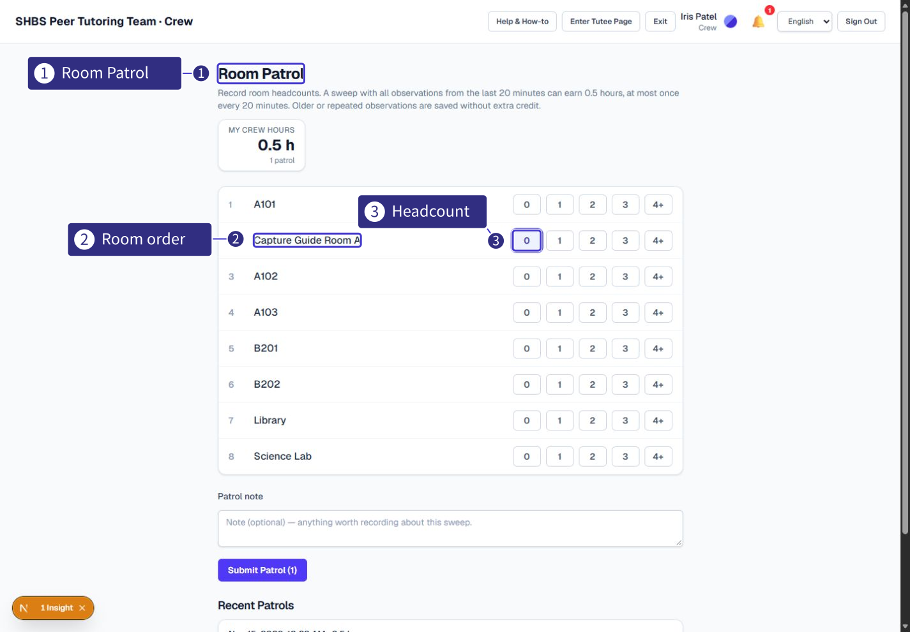
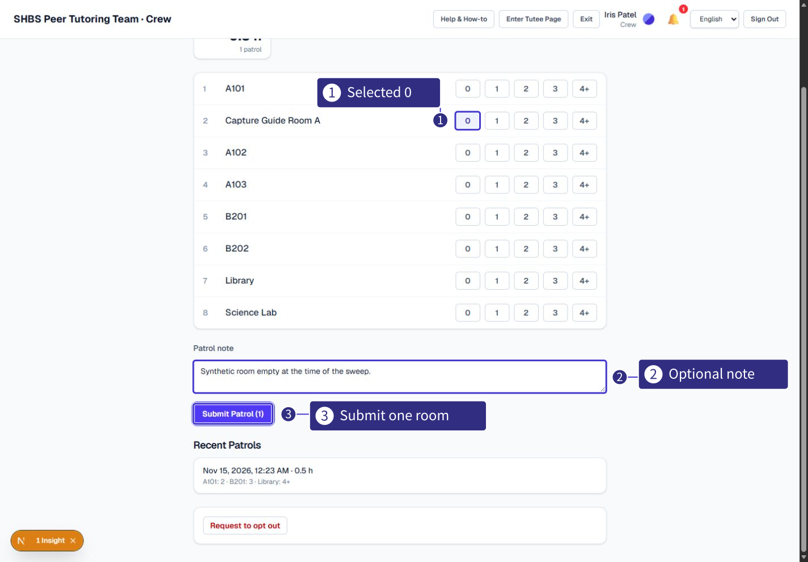
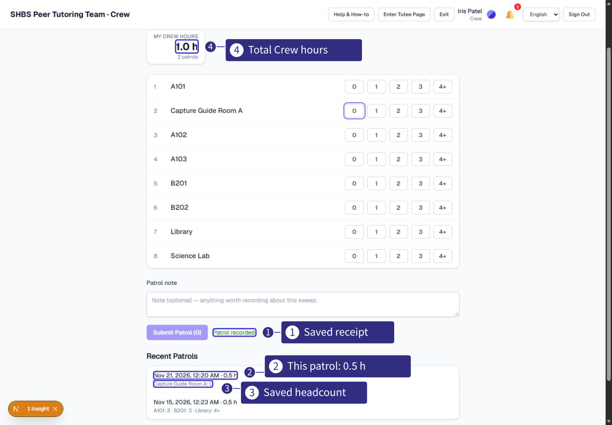
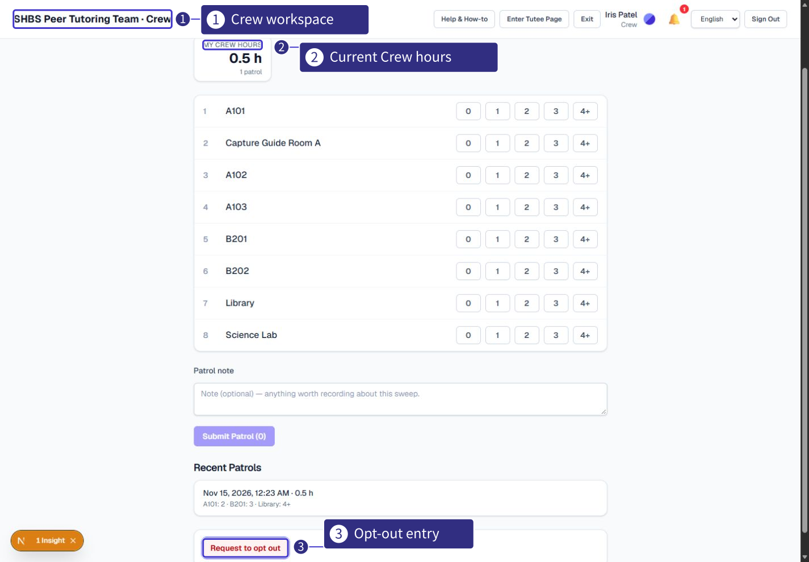
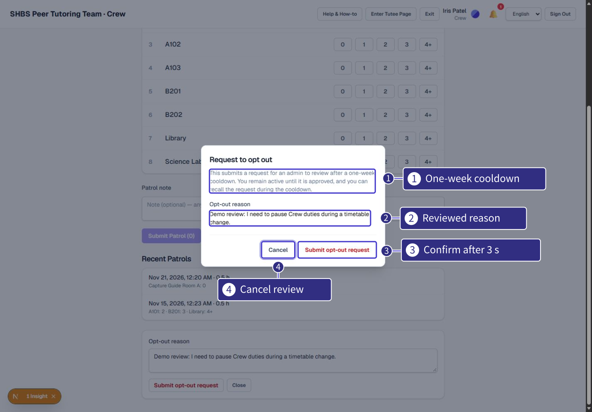
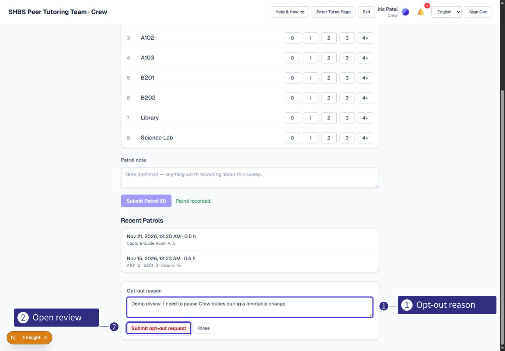
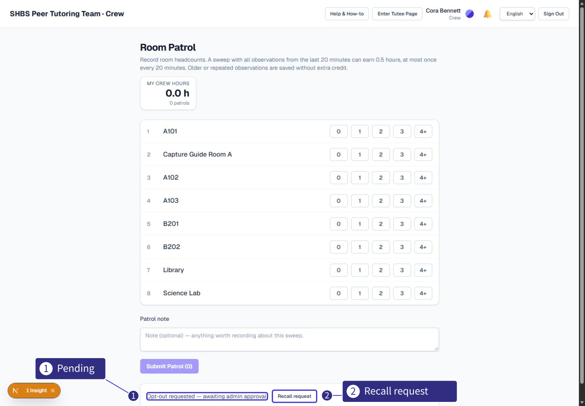
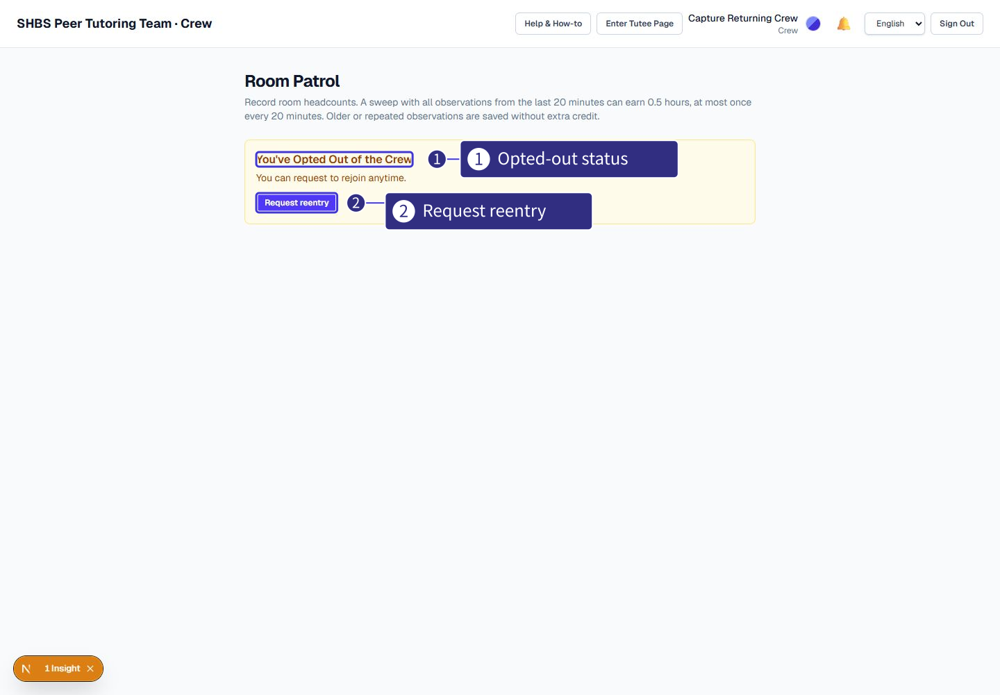
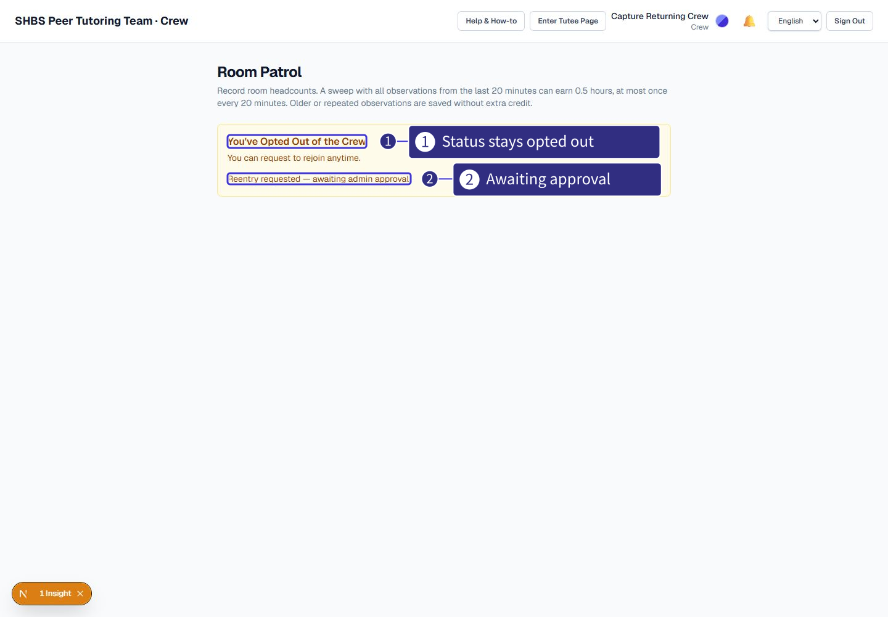

# Crew & patrols

Generated from the website help catalogue. Edit the content records, then run `npm run help:export`.

[Catalogue & capture provenance](README.md)

Screenshot source: `1df44d6bb31cf04352adae9c65819139b7b747d8`. New captures use latest-main development baseline 1df44d6b, selected 2026-11-21, with the Help candidate. Earlier captures list their own revision and capture date.

This GitHub training copy includes role-specific instructions. Signing in and current program permissions are still required to use the corresponding website features. All examples are synthetic.

- [Record a room patrol sweep](#record-a-room-patrol-sweep)
- [Request Crew opt-out, recall or reentry](#request-crew-opt-out-recall-or-reentry)

## Record a room patrol sweep

Save honest room observations and understand when a sweep earns Crew hours.

Open: `/patrol`

### Before you start

- Your Crew access is active and the Crew module is enabled.

### Walkthrough

1. **Open Patrol and walk the room order** Open Patrol from your workspace/account menu and follow the listed room order. At each visited room, select the actual student headcount: 0, 1, 2, 3 or 4+. The page automatically timestamps each selection; choosing again replaces that room's count and time. Include at least one room.

   Look for: Ordered rooms and selected headcount buttons

   

   /patrol · EN · 2026-11-20

   Follow the listed rooms and select the actual count. This synthetic room is empty, so 0 is selected and the app timestamps the choice.

   [Original full screenshot](assets/record-patrol-step-1.en.jpg) · `b5ece465681957c9fe579d26babdeb260c674fa0` · Latest-main development baseline b5ece465, selected 2026-11-20, with the Help candidate and synthetic demo records.

   Annotations added for this step. The original full screenshot is unchanged.

   - **1.** Room Patrol

   - **2.** Room order

   - **3.** Headcount

2. **Check selections and submit** Check the highlighted counts, optionally enter Patrol note, then choose Submit Patrol (n), where n is the number of recorded rooms. This saves the sweep immediately. Do not reselect an older count just to refresh its timestamp. If a future-time error appears, check your device clock; the server allows only one minute of clock difference.

   

   /patrol · EN · 2026-11-20

   Verify the highlighted count and optional note, then choose Submit Patrol (1). It immediately saves the single observed room.

   [Original full screenshot](assets/record-patrol-step-2.en.jpg) · `b5ece465681957c9fe579d26babdeb260c674fa0` · Latest-main development baseline b5ece465, selected 2026-11-20, with the Help candidate and synthetic demo records.

   Annotations added for this step. The original full screenshot is unchanged.

   - **1.** Selected 0

   - **2.** Optional note

   - **3.** Submit one room

3. **Read the saved credit result** Check whether the saved sweep earned 0.5 Crew hours or 0 hours and review its history. A no-credit result still preserves observations. For mistakes, identify the exact patrol and ask management for a reasoned correction.

   

   /patrol · EN · 2026-11-20

   The confirmation and newest history row are visible together. This patrol saved the zero headcount and earned 0.5 hours.

   [Original full screenshot](assets/record-patrol-step-3.en.jpg) · `b5ece465681957c9fe579d26babdeb260c674fa0` · Latest-main development baseline b5ece465, selected 2026-11-20, with the Help candidate and synthetic demo records.

   Annotations added for this step. The original full screenshot is unchanged.

   - **1.** Saved receipt

   - **2.** This patrol: 0.5 h

   - **3.** Saved headcount

   - **4.** Total Crew hours

### What happens next

The saved sweep appears in Recent Patrols with its Crew hours; a zero-credit success message explains when no hours were added.

### How it works

An eligible sweep awards 0.5 hours at most once every 20 minutes per Crew member, measured by the server. All observations must be within the last 20 minutes. Older observations or cooldown submissions save with zero hours. Reserved observation intervals cannot be reused by changing rooms, counts, notes or request keys.

Crew credit is separate from tutoring credit. A patrol discrepancy can flag attendance for management review; it does not itself impose a penalty.

### Troubleshooting

- **The sweep saved zero hours** Check every observation's actual age and the server cooldown. Keep truthful evidence; do not submit altered times or repeated sweeps to claim credit. An identical retry returns the existing result.

- **Patrol controls are unavailable** Check active Crew membership and module status with management. Use Retry for failed authorized reads; an unavailable history is not an empty history.

## Request Crew opt-out, recall or reentry

Keep patrol participation and pending membership review separate.

Open: `/patrol`

### Before you start

- Your account has Crew membership and no conflicting pending request.

### Walkthrough

1. **Read your Crew state** Open Patrol and inspect current status and pending membership request. Crew-only membership does not grant Tutor assignments or management authority.

   Look for: Crew status and membership request controls

   

   /patrol · EN · 2026-11-20

   An active Crew member can record patrols, see their current Crew hours, and find Request to opt out below history.

   [Original full screenshot](assets/crew-membership-step-1.en.jpg) · `b5ece465681957c9fe579d26babdeb260c674fa0` · Latest-main development baseline b5ece465, selected 2026-11-20, with the Help candidate and synthetic demo records.

   Annotations added for this step. The original full screenshot is unchanged.

   - **1.** Crew workspace

   - **2.** Current Crew hours

   - **3.** Opt-out entry

2. **Request or recall opt-out** Use the opt-out control, give the requested reason and confirm its named review after the three-second pause. Staff can approve only after seven days. Use Recall for a pending opt-out if you choose to continue.

   **View 1**

   

   /patrol · EN · 2026-11-20

   The named review shows the reason and one-week cooldown. The button opens after the three-second pause. Choose Cancel to leave the request unsent.

   [Original full screenshot](assets/crew-membership-step-2.en.jpg) · `b5ece465681957c9fe579d26babdeb260c674fa0` · Latest-main development baseline b5ece465, selected 2026-11-20, with the Help candidate and synthetic demo records.

   Annotations added for this step. The original full screenshot is unchanged.

   - **1.** One-week cooldown

   - **2.** Reviewed reason

   - **3.** Confirm after 3 s

   - **4.** Cancel review

   **View 2**

   

   /patrol · EN · 2026-11-20

   Enter the reason and open the named opt-out review from the form. The request is still unsent.

   [Original full screenshot](assets/crew-membership-step-2-view-2.en.jpg) · `b5ece465681957c9fe579d26babdeb260c674fa0` · Latest-main development baseline b5ece465, selected 2026-11-20, with the Help candidate and synthetic demo records.

   Annotations added for this step. The original full screenshot is unchanged.

   - **1.** Opt-out reason

   - **2.** Open review

   **View 3**

   

   /patrol · EN · 2026-11-20

   A pending opt-out keeps the member active. Recall request is visible on the existing pending example.

   [Original full screenshot](assets/crew-membership-step-2-view-3.en.jpg) · `b5ece465681957c9fe579d26babdeb260c674fa0` · Latest-main development baseline b5ece465, selected 2026-11-20, with the Help candidate and synthetic demo records.

   Annotations added for this step. The original full screenshot is unchanged.

   - **1.** Pending

   - **2.** Recall request

3. **Request reentry** An opted-out member can request reentry without the seven-day wait, but staff approval is still required. An inactive account may need explicit staff restoration. Check the decision before attempting new patrols.

   **View 1**

   

   /patrol · EN · 2026-11-20

   An opted-out Crew member can request reentry from this notice. Staff still need to approve the request.

   [Original full screenshot](assets/crew-membership-step-3.en.jpg) · `b5ece465681957c9fe579d26babdeb260c674fa0` · Latest-main development baseline b5ece465, selected 2026-11-20, with the Help candidate and synthetic demo records.

   Annotations added for this step. The original full screenshot is unchanged.

   - **1.** Opted-out status

   - **2.** Request reentry

   **View 2**

   

   /patrol · EN · 2026-11-20

   The saved reentry request awaits administrator approval. The member remains opted out while the request is pending.

   [Original full screenshot](assets/crew-membership-step-3-view-2.en.jpg) · `b5ece465681957c9fe579d26babdeb260c674fa0` · Latest-main development baseline b5ece465, selected 2026-11-20, with the Help candidate and synthetic demo records.

   Annotations added for this step. The original full screenshot is unchanged.

   - **1.** Status stays opted out

   - **2.** Awaiting approval

### What happens next

The membership request shows pending, recalled or decided state; patrol availability follows actual approved access.

### How it works

Academic confirmation after an invitation does not itself reactivate opted-out Crew. Participation remains subject to Crew membership and the enabled program module, independently of other account badges.

### Troubleshooting

- **Request accepted but status did not refresh** Use Retry refresh to read the saved request, not another submission. If the saved status changed since the request, ask management to review the current state.
