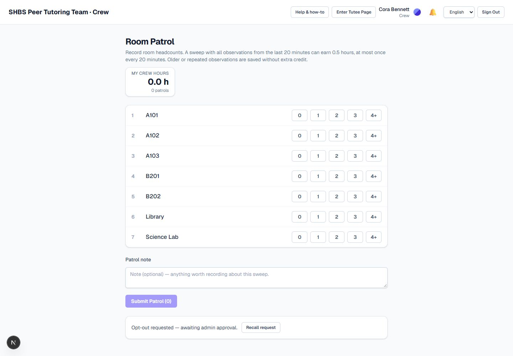

# Crew & patrols

Generated from the website help catalogue. Edit the content records, then run `npm run help:export`.

[Catalogue & capture provenance](README.md)

Screenshot source: `dbb3c4eb213d58e134744fd417b1a06299b0e984`. Local dev server based on latest main at task start (dbb3c4eb), with the Help candidate. User-selected source baseline; no live deployment attestation.

This GitHub training copy includes role-specific instructions. Signing in and current program permissions are still required to use the corresponding website features. All examples are synthetic.

- [Record a room patrol sweep](#record-a-room-patrol-sweep)
- [Request Crew opt-out, recall or reentry](#request-crew-opt-out-recall-or-reentry)

## Record a room patrol sweep

Save honest room observations and understand when a sweep earns Crew hours.

Open: `/patrol`

### Before you start

- Your Crew access is active and the Crew module is enabled.

### Walkthrough

1. **Open Patrol and walk the room order** Open Patrol from your workspace/account menu. For each visited room, enter its actual observation time and select student headcount 0, 1, 2, 3 or 4+. Record each room once and include at least one observation.

   Look for: Room observations, actual time and headcount buttons

   

   /patrol · EN · 2026-11-15

2. **Review and submit the sweep** Check rooms, actual times and counts, then submit once. Never change an older observation time to claim freshness. The server permits only a one-minute future allowance for device-clock differences.

3. **Read the saved credit result** Check whether the saved sweep earned 0.5 Crew hours or 0 hours and review its history. A no-credit result still preserves observations. For mistakes, identify the exact patrol and ask management for a reasoned correction.

### What happens next

One patrol receipt retains observations and explicitly states its earned Crew credit.

### How it works

An eligible sweep awards 0.5 hours at most once every 20 minutes per Crew member, measured by the server. All observations must be within the last 20 minutes. Older observations or cooldown submissions save with zero hours. Reserved observation intervals cannot be reused by changing rooms, counts, notes or request keys.

Crew credit is separate from tutoring credit. A patrol discrepancy can flag attendance for management review; it does not itself impose a penalty.

### Troubleshooting

- **The sweep saved zero hours** Check every observation's actual age and the server cooldown. Keep truthful evidence; do not submit altered times or repeated sweeps to claim credit. An identical retry returns the existing result.

- **Patrol controls are unavailable** Check active Crew membership and module status with management. Use Retry for failed authorized reads; an unavailable history is not an empty history.

## Request Crew opt-out, recall or reentry

Keep patrol participation and pending membership review separate.

Open: `/patrol`

### Before you start

- Your account has Crew membership and no conflicting pending request.

### Walkthrough

1. **Read your Crew state** Open Patrol and inspect current status and pending membership request. Crew-only membership does not grant Tutor assignments or management authority.

   Look for: Crew status and membership request controls

   

   /patrol · EN · 2026-11-15

2. **Request or recall opt-out** Use the opt-out control, give the requested reason and confirm its named review after the three-second pause. Staff can approve only after seven days. Use Recall for a pending opt-out if you choose to continue.

3. **Request reentry** An opted-out member can request reentry without the seven-day wait, but staff approval is still required. An inactive account may need explicit staff restoration. Check the decision before attempting new patrols.

### What happens next

The membership request shows pending, recalled or decided state; patrol availability follows actual approved access.

### How it works

Academic confirmation after an invitation does not itself reactivate opted-out Crew. Participation remains subject to Crew membership and the enabled program module, independently of other account badges.

### Troubleshooting

- **Request accepted but status did not refresh** Use Retry refresh to read the saved request, not another submission. If the saved status changed since the request, ask management to review the current state.
