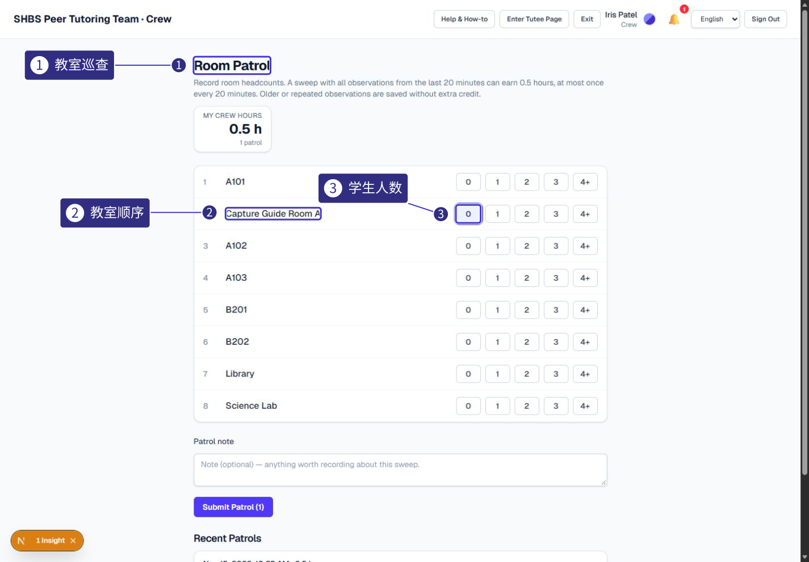
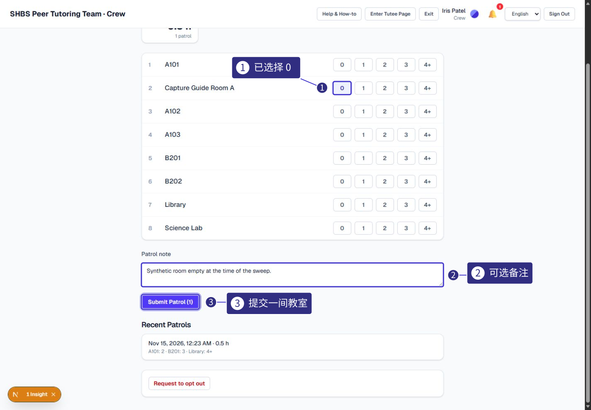
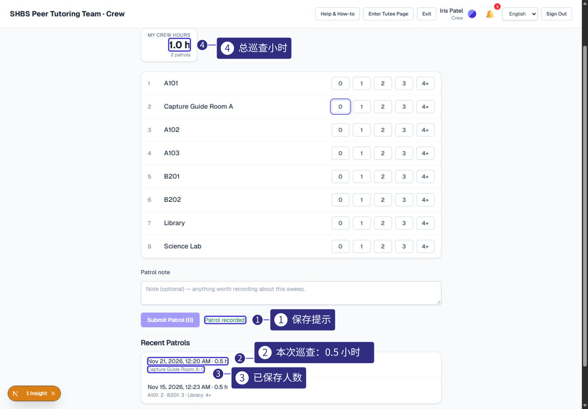
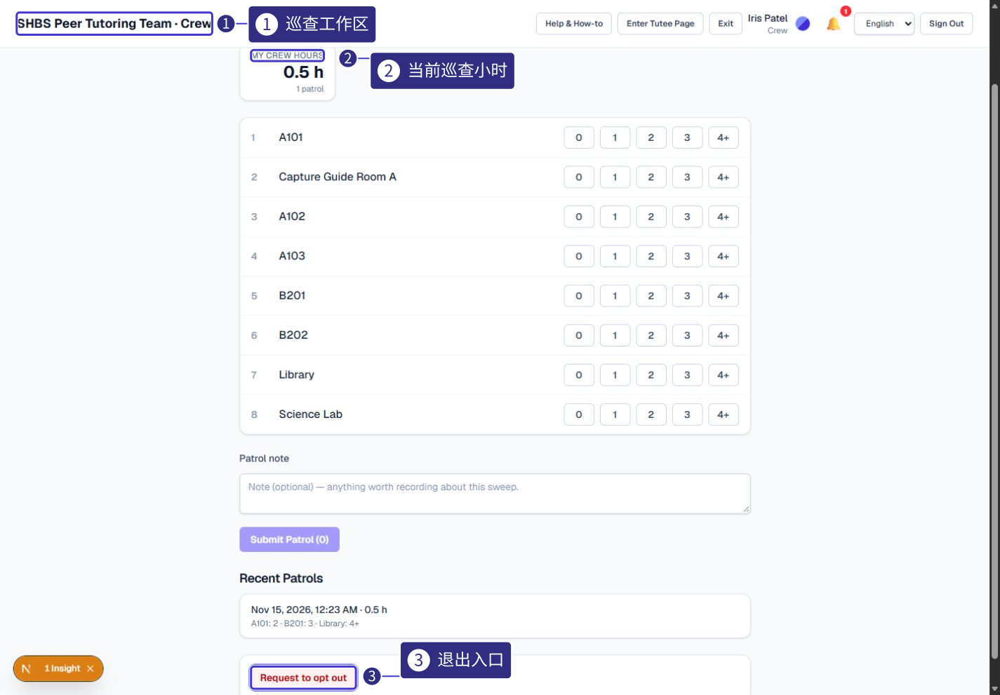
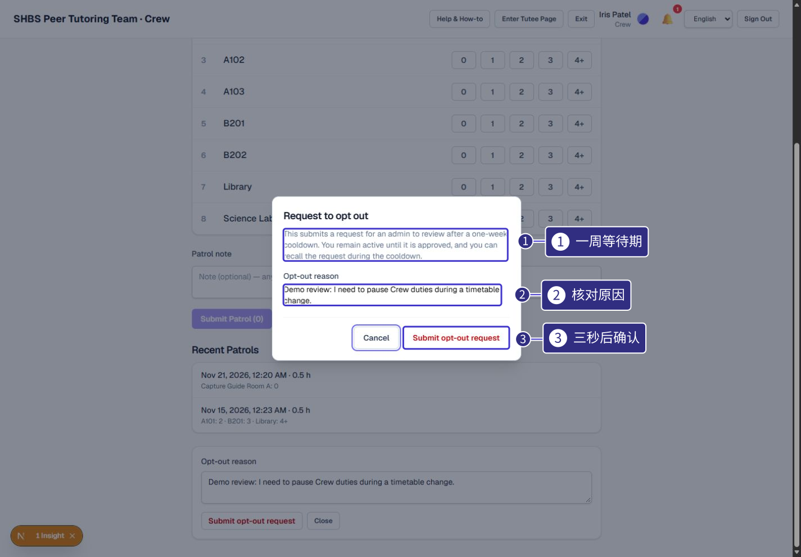
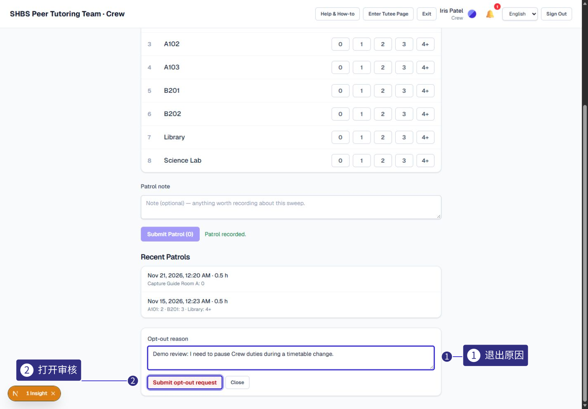
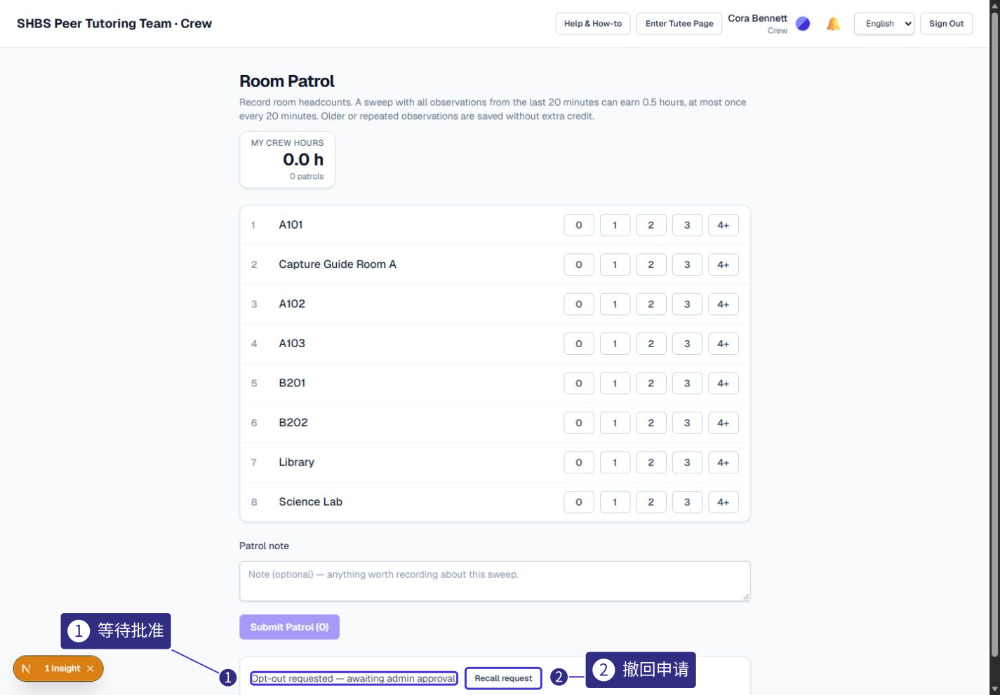
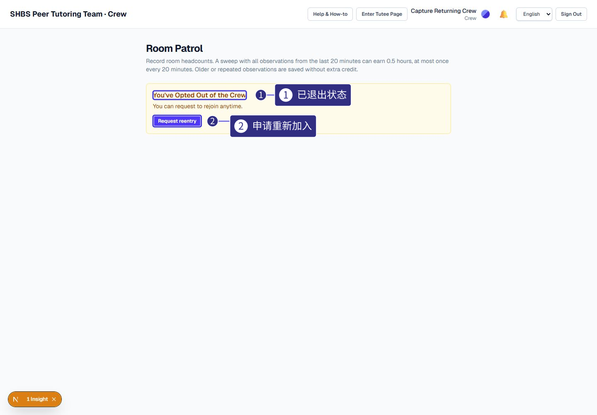
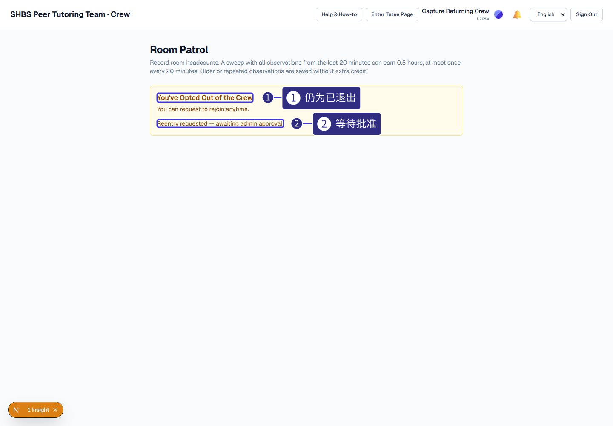

# 巡查队与巡查

由网站帮助目录生成。请修改内容源文件后运行 `npm run help:export`。

[目录与截图来源](README.md)

截图来源: `1df44d6bb31cf04352adae9c65819139b7b747d8`. New captures use latest-main development baseline 1df44d6b, selected 2026-11-21, with the Help candidate. Earlier captures list their own revision and capture date.

此 GitHub 培训副本包含各角色操作说明。实际使用网站功能仍需登录并具备当前项目权限。所有示例数据均为虚构。

- [记录教室巡查](#记录教室巡查)
- [申请退出巡查、撤回或重新加入](#申请退出巡查撤回或重新加入)

## 记录教室巡查

如实保存教室观察，并了解何时获得巡查时数。

打开: `/patrol`

### 开始之前

- 本人巡查资格有效，且项目已启用巡查模块。

### 操作步骤

1. **打开巡查并按教室顺序检查** 从工作区或账户菜单打开巡查，按列表中的教室顺序检查。每到一间教室，选择实际学生人数：0、1、2、3 或 4+。页面会自动记录每次选择的时间；再次选择会替换该教室的人数和时间。至少记录一间教室。

   请注意: 按顺序排列的教室及已选人数按钮

   

   英文界面

   

   
截图详情

   按列表中的教室顺序检查并选择实际人数。此模拟教室无人，选择 0 后应用会自动记录选中时间。

   /patrol · EN · 2026-11-20

   [原始完整截图](assets/record-patrol-step-1.en.jpg) · `b5ece465681957c9fe579d26babdeb260c674fa0` · Latest-main development baseline b5ece465, selected 2026-11-20, with the Help candidate and synthetic demo records.

   

2. **核对选项并提交巡查** 核对高亮的人数选项，可在「巡查备注」中填写说明，再点击「提交巡查（n）」，其中 n 为已记录的教室数量。此按钮会立即保存巡查。不要为了刷新时间而重新选择较早记录的人数。若出现观察时间在未来的错误，请检查设备时钟；服务器仅允许一分钟时钟误差。

   

   英文界面

   

   
截图详情

   核对高亮人数与可选备注后，选择提交巡查（1）。系统立即保存已观察的一间教室。

   /patrol · EN · 2026-11-20

   [原始完整截图](assets/record-patrol-step-2.en.jpg) · `b5ece465681957c9fe579d26babdeb260c674fa0` · Latest-main development baseline b5ece465, selected 2026-11-20, with the Help candidate and synthetic demo records.

   

3. **查看保存的计时结果** 检查保存巡查获得零点五巡查小时还是零小时，并查看历史。无计时结果仍保留观察记录。出现错误时，指出准确巡查记录并请管理团队按原因更正。

   

   英文界面

   

   
截图详情

   确认提示与最新历史记录同时显示。本次巡查保存零人的观察结果并获得 0.5 小时。

   /patrol · EN · 2026-11-20

   [原始完整截图](assets/record-patrol-step-3.en.jpg) · `b5ece465681957c9fe579d26babdeb260c674fa0` · Latest-main development baseline b5ece465, selected 2026-11-20, with the Help candidate and synthetic demo records.

   

### 预期结果

保存的巡查会出现在「近期巡查」并显示巡查时数；未增加时数时，成功提示会说明原因。

### 工作原理

服务器按每位巡查成员计算，每二十分钟最多一次符合条件巡查获得零点五小时。全部观察需在最近二十分钟内。较旧观察或冷却期提交会以零小时保存。改变教室、人数、备注或请求标识不能重复使用已占观察区间。

巡查计时与辅导计时分开。巡查差异可能生成出勤审核提示，但本身不会处罚。

### 问题排查

- **巡查保存为零小时** 检查每项观察实际距今时间和服务器冷却期。保留真实证据，不要修改时间或重复巡查以获得时数。相同重试返回原结果。

- **巡查控件不可用** 与管理团队检查有效巡查资格及模块状态。获准读取失败时使用重试；历史不可用不代表没有记录。

## 申请退出巡查、撤回或重新加入

区分巡查参与与待审资格申请。

打开: `/patrol`

### 开始之前

- 账户已有巡查资格，且无冲突的待处理申请。

### 操作步骤

1. **查看巡查状态** 打开巡查，查看当前状态及待处理资格申请。仅有巡查资格不会授予辅导分配或管理权限。

   请注意: 巡查状态与资格申请控件

   

   英文界面

   

   
截图详情

   活跃巡查成员可以记录巡查、查看当前巡查小时，并在历史记录下方找到申请退出。

   /patrol · EN · 2026-11-20

   [原始完整截图](assets/crew-membership-step-1.en.jpg) · `b5ece465681957c9fe579d26babdeb260c674fa0` · Latest-main development baseline b5ece465, selected 2026-11-20, with the Help candidate and synthetic demo records.

   

2. **申请或撤回退出** 使用退出控件，填写所需原因，并在三秒暂停后确认具体审核。工作人员只能在七天后批准。决定继续时，可撤回待审退出申请。

   **视图 1**

   

   英文界面

   

   
截图详情

   具名审核会展示原因和一周等待期。三秒后确认按钮可用。选择取消可保持申请未发送。

   /patrol · EN · 2026-11-20

   [原始完整截图](assets/crew-membership-step-2.en.jpg) · `b5ece465681957c9fe579d26babdeb260c674fa0` · Latest-main development baseline b5ece465, selected 2026-11-20, with the Help candidate and synthetic demo records.

   

   **视图 2**

   

   英文界面

   

   
截图详情

   填写退出原因，从表单打开具名退出审核。申请尚未发送。

   /patrol · EN · 2026-11-20

   [原始完整截图](assets/crew-membership-step-2-view-2.en.jpg) · `b5ece465681957c9fe579d26babdeb260c674fa0` · Latest-main development baseline b5ece465, selected 2026-11-20, with the Help candidate and synthetic demo records.

   

   **视图 3**

   

   英文界面

   

   
截图详情

   退出申请待审期间成员仍保持活跃。现有待审示例显示撤回申请按钮。

   /patrol · EN · 2026-11-20

   [原始完整截图](assets/crew-membership-step-2-view-3.en.jpg) · `b5ece465681957c9fe579d26babdeb260c674fa0` · Latest-main development baseline b5ece465, selected 2026-11-20, with the Help candidate and synthetic demo records.

   

3. **申请重新加入** 已退出成员可申请重新加入，无七天等待，但仍需工作人员批准。停用账户可能需明确工作人员恢复。开始新巡查前请检查决定。

   **视图 1**

   

   英文界面

   

   
截图详情

   已退出的巡查成员可从此提示申请重新加入；申请仍需工作人员批准。

   /patrol · EN · 2026-11-20

   [原始完整截图](assets/crew-membership-step-3.en.jpg) · `b5ece465681957c9fe579d26babdeb260c674fa0` · Latest-main development baseline b5ece465, selected 2026-11-20, with the Help candidate and synthetic demo records.

   

   **视图 2**

   

   英文界面

   

   
截图详情

   已保存的重新加入申请等待管理员批准。待审期间成员仍为已退出状态。

   /patrol · EN · 2026-11-20

   [原始完整截图](assets/crew-membership-step-3-view-2.en.jpg) · `b5ece465681957c9fe579d26babdeb260c674fa0` · Latest-main development baseline b5ece465, selected 2026-11-20, with the Help candidate and synthetic demo records.

   

### 预期结果

资格申请显示待审、已撤回或决定状态；巡查可用性按实际获批权限执行。

### 工作原理

邀请后的学业确认本身不会重新激活已退出巡查资格。参与仍取决于巡查资格和启用模块，与账户其他徽章独立。

### 问题排查

- **申请已接受但状态未刷新** 使用重试刷新读取已保存申请，不要重复提交。若保存状态在申请后改变，请管理团队检查当前状态。
