# Head responsibilities

Generated from the website help catalogue. Edit the content records, then run `npm run help:export`.

[Catalogue & capture provenance](README.md)

Screenshot source: `1df44d6bb31cf04352adae9c65819139b7b747d8`. New captures use latest-main development baseline 1df44d6b, selected 2026-11-21, with the Help candidate. Earlier captures list their own revision and capture date.

This GitHub training copy includes role-specific instructions. Signing in and current program permissions are still required to use the corresponding website features. All examples are synthetic.

- [Review, schedule or apply official program refresh](#review-schedule-or-apply-official-program-refresh)
- [Transfer program leadership](#transfer-program-leadership)

## Review, schedule or apply official program refresh

Verify destination openings, staged modules and participation consequences before advancing the period.

Open: `/admin/program`

### Before you start

- Current Head authority and complete current-period/destination evidence. Admin can request refresh; only Head applies or schedules the official action.

### Walkthrough

1. **Review preparation** Open Program Settings → Recruitment and Refresh. Read the current period, named destination, both prepared recruitment openings, their timezone and all staged feature switches.

   Look for: Read the destination and full refresh effects before typing REFRESH.

   **View 1**

   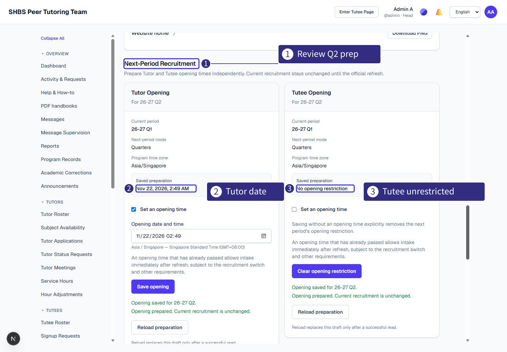

   

   
Capture details

   Q1 stays active while Q2 has a future Tutor opening and an explicit unrestricted Tutee opening. Both use the program’s Singapore timezone.

   /admin/program · EN · 2026-11-20

   [Original full screenshot](assets/perform-official-refresh-step-1.en.jpg) · `b5ece465681957c9fe579d26babdeb260c674fa0` · Latest-main development baseline b5ece465, selected 2026-11-20, with the Help candidate. Isolated synthetic first-report demonstration phase.

   

   **View 2**

   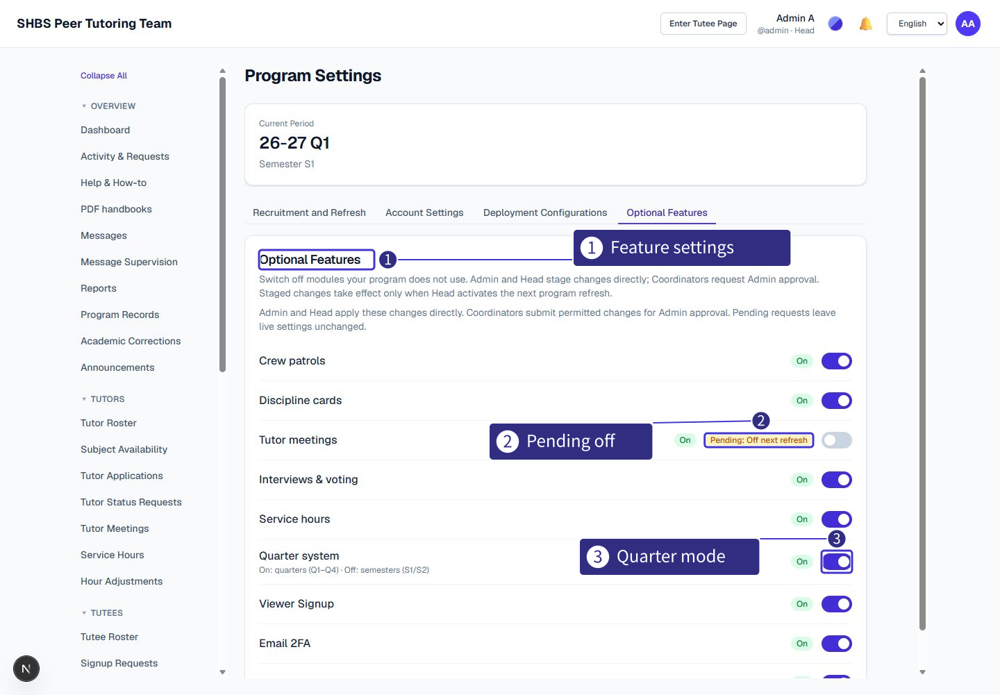

   

   
Capture details

   Quarter mode is active. Tutor Meetings has an explicit Off change staged for the next refresh.

   /admin/program · EN · 2026-11-20

   [Original full screenshot](assets/perform-official-refresh-step-1-view-2.en.jpg) · `b5ece465681957c9fe579d26babdeb260c674fa0` · Latest-main development baseline b5ece465, selected 2026-11-20, with the Help candidate. Isolated synthetic first-report demonstration phase.

   

2. **Read all refresh effects** Inspect the displayed participation, scheduling and destination consequences. Resolve stale preparations and review current mail, policies, subjects, rooms and operator readiness before admitting the refresh.

   **View 1**

   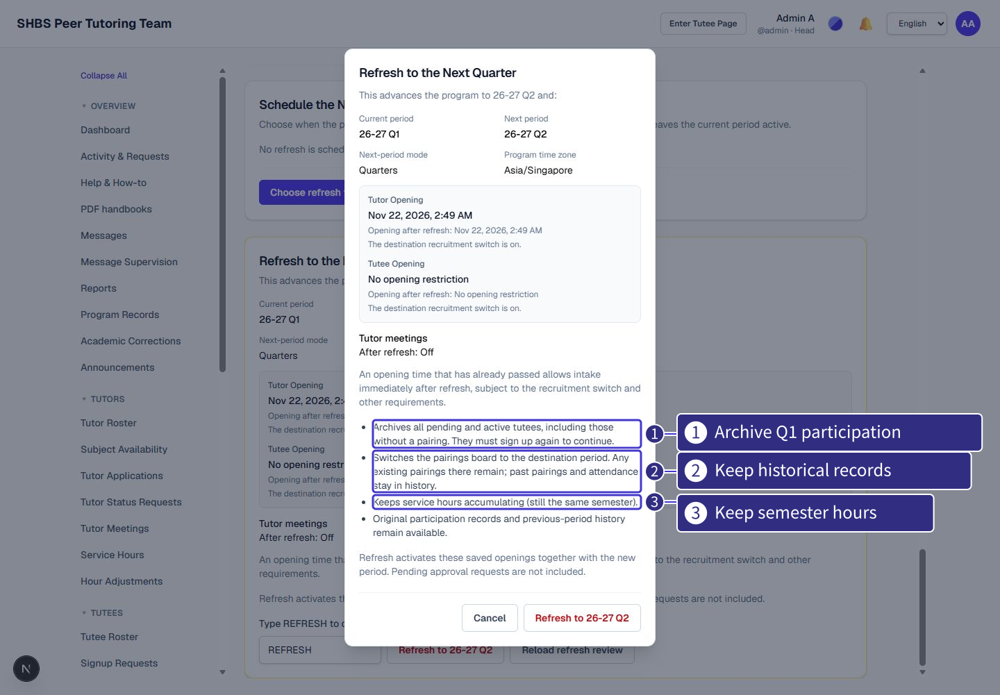

   

   
Capture details

   The Head reviews archival of Q1 tutee participation, the Q2 pairings board, retained past attendance and continued S1 service hours before any write.

   /admin/program · EN · 2026-11-20

   [Original full screenshot](assets/perform-official-refresh-step-2.en.jpg) · `b5ece465681957c9fe579d26babdeb260c674fa0` · Latest-main development baseline b5ece465, selected 2026-11-20, with the Help candidate. Isolated synthetic first-report demonstration phase.

   

   **View 2**

   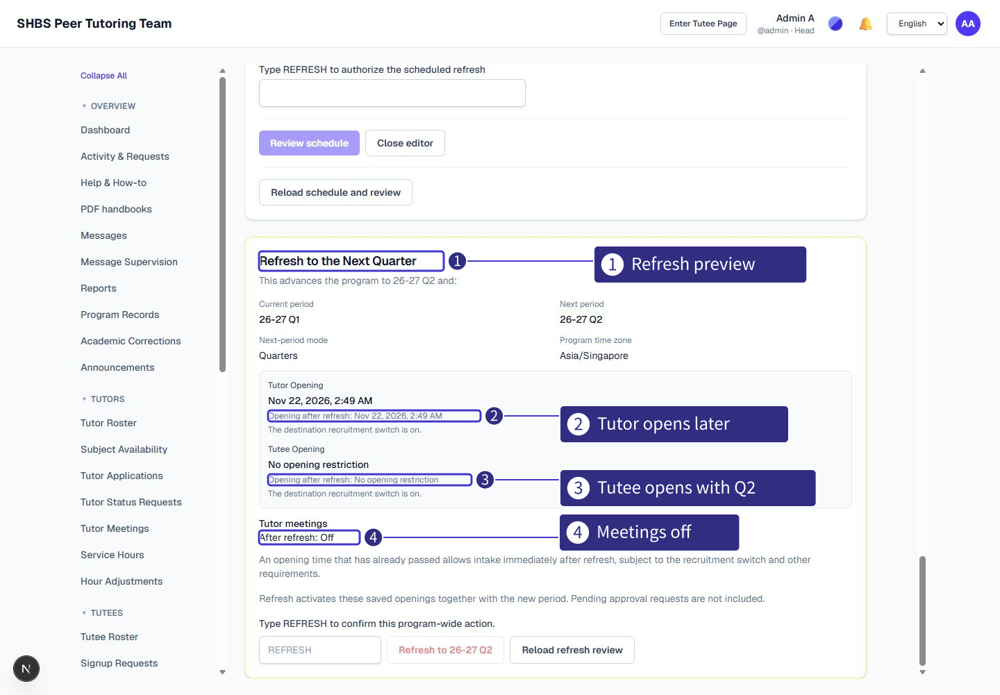

   

   
Capture details

   The inline Q2 preview shows the effective opening for each audience, intact destination recruitment switches and staged Tutor Meetings Off.

   /admin/program · EN · 2026-11-20

   [Original full screenshot](assets/perform-official-refresh-step-2-view-2.en.jpg) · `b5ece465681957c9fe579d26babdeb260c674fa0` · Latest-main development baseline b5ece465, selected 2026-11-20, with the Help candidate. Isolated synthetic first-report demonstration phase.

   

3. **Apply or schedule deliberately** For an immediate refresh, enter REFRESH and read the final named consequence review before confirming. For a scheduled refresh, review its exact execution time/timezone and target; cancel an unneeded pending schedule through its separate action.

   **View 1**

   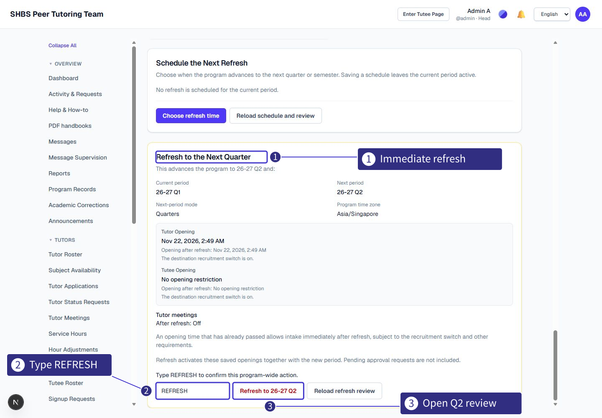

   

   
Capture details

   Typing REFRESH enables the named Q2 action. This first button opens the final review, where the Head can confirm or cancel.

   /admin/program · EN · 2026-11-20

   [Original full screenshot](assets/perform-official-refresh-step-3.en.jpg) · `b5ece465681957c9fe579d26babdeb260c674fa0` · Latest-main development baseline b5ece465, selected 2026-11-20, with the Help candidate. Isolated synthetic first-report demonstration phase.

   

   **View 2**

   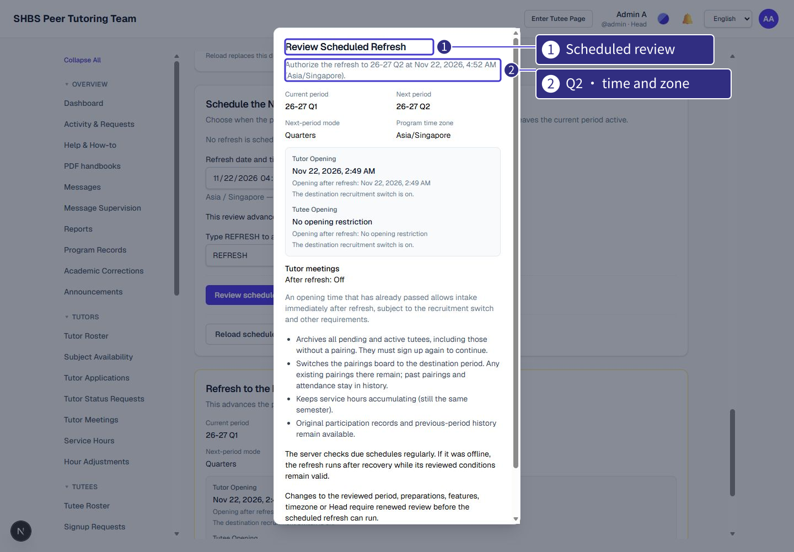

   

   
Capture details

   The schedule review names the destination, exact future time and Asia/Singapore. This example only opens the review and cancels the draft.

   /admin/program · EN · 2026-11-20

   [Original full screenshot](assets/perform-official-refresh-step-3-view-2.en.jpg) · `b5ece465681957c9fe579d26babdeb260c674fa0` · Latest-main development baseline b5ece465, selected 2026-11-20, with the Help candidate. Isolated synthetic first-report demonstration phase.

   

4. **Verify the new period** After the accepted receipt, inspect the current period, activated openings/modules and participant workspaces. Use read-only refresh recovery if the accepted result cannot reload; never repeat a possibly completed period advance.

   **View 1**

   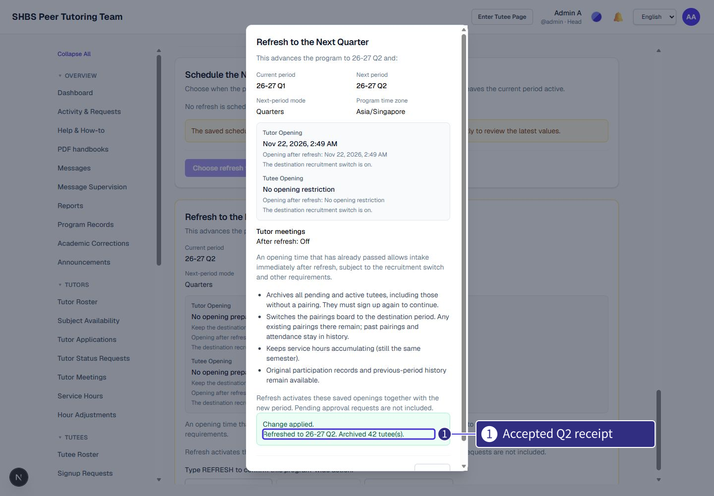

   

   
Capture details

   The accepted Head action advanced the program to 26-27 Q2 and archived 42 Q1 tutee participation records.

   /admin/program · EN · 2026-11-20

   [Original full screenshot](assets/perform-official-refresh-step-4.en.jpg) · `b5ece465681957c9fe579d26babdeb260c674fa0` · Latest-main development baseline b5ece465, selected 2026-11-20, with the Help candidate. Isolated synthetic first-report demonstration phase.

   

   **View 2**

   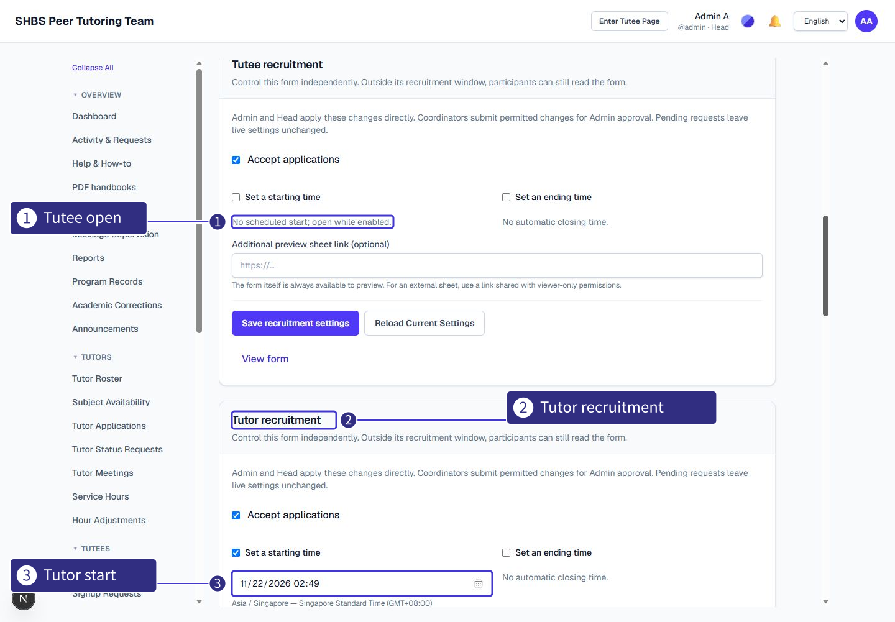

   

   
Capture details

   The current Q2 recruitment windows confirm Tutee signup open while enabled and Tutor signup waiting for its saved Singapore start.

   /admin/program · EN · 2026-11-20

   [Original full screenshot](assets/perform-official-refresh-step-4-view-2.en.jpg) · `b5ece465681957c9fe579d26babdeb260c674fa0` · Latest-main development baseline b5ece465, selected 2026-11-20, with the Help candidate. Isolated synthetic first-report demonstration phase.

   

### What happens next

One reviewed refresh advances to the intended period or one exact pending schedule is retained.

### How it works

Official refresh activates staged settings and changes current participation while preserving historical attendance, policy acceptance and audits. Editing recruitment windows or staging modules alone does not advance the period.

### Troubleshooting

- **Refresh is blocked by changed preparation** Reload the named destination and saved preparation, then repeat the full review. Do not reuse a prior confirmation. For an uncertain submission inspect its current period/receipt before any exact supported retry.

## Transfer program leadership

Review the eligible successor and confirm the dedicated password-protected Head transfer.

Open: `/admin/users`

### Before you start

- You are the current Head, know your current password and have reviewed the intended eligible Admin/Coordinator successor.

### Walkthrough

1. **Identify the successor** In Users & Roles, open the intended eligible administrator/coordinator and inspect the exact account ID, current status and authority. Do not select by display name alone.

   Look for: Use the dedicated leadership-transfer action, separate from ordinary role edits.

   **View 1**

   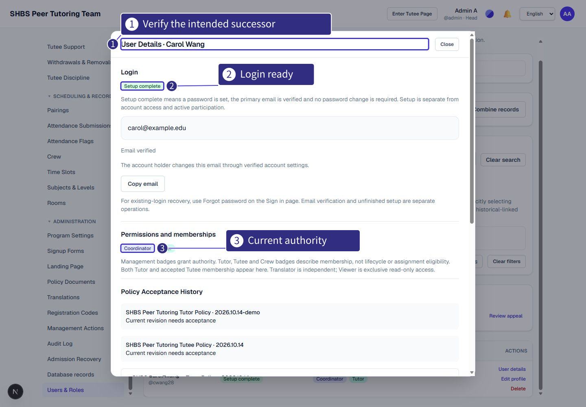

   

   
Capture details

   Carol Wang’s User Details show a complete login and Coordinator authority. Both are checked before the dedicated leadership review.

   /admin/users · EN · 2026-11-20

   [Original full screenshot](assets/transfer-head-leadership-step-1.en.jpg) · `b5ece465681957c9fe579d26babdeb260c674fa0` · Latest-main development baseline b5ece465, selected 2026-11-20, with the Help candidate. Isolated synthetic first-report demonstration phase.

   

   **View 2**

   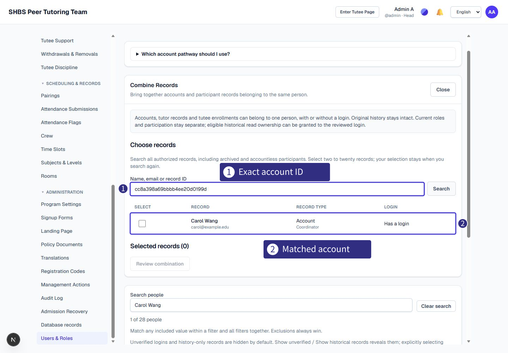

   

   
Capture details

   A read-only exact account-ID search confirms the Carol Wang account matches the intended synthetic successor. No records are selected.

   /admin/users · EN · 2026-11-20

   [Original full screenshot](assets/transfer-head-leadership-step-1-view-2.en.jpg) · `b5ece465681957c9fe579d26babdeb260c674fa0` · Latest-main development baseline b5ece465, selected 2026-11-20, with the Help candidate. Isolated synthetic first-report demonstration phase.

   

2. **Open the dedicated transfer** In Edit profile, open Roles and Participation and choose Make Head. Review the named successor and confirm that the outgoing Head will become an Admin.

   **View 1**

   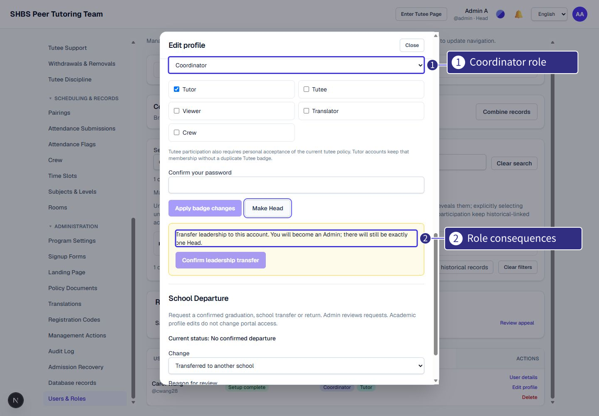

   

   
Capture details

   The dedicated review shows the chosen Coordinator and says the outgoing Head will become Admin. The program retains exactly one Head after confirmation.

   /admin/users · EN · 2026-11-20

   [Original full screenshot](assets/transfer-head-leadership-step-2.en.jpg) · `b5ece465681957c9fe579d26babdeb260c674fa0` · Latest-main development baseline b5ece465, selected 2026-11-20, with the Help candidate. Isolated synthetic first-report demonstration phase.

   

   **View 2**

   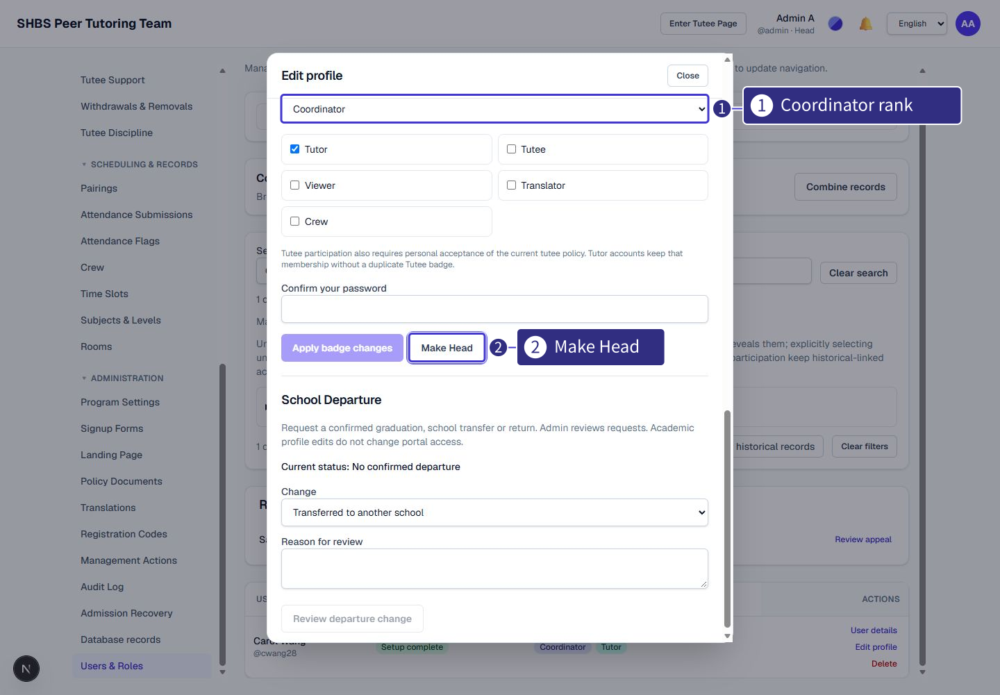

   

   
Capture details

   The profile editor shows the current Coordinator rank and the separate Make Head action. No rank edit has been applied.

   /admin/users · EN · 2026-11-20

   [Original full screenshot](assets/transfer-head-leadership-step-2-view-2.en.jpg) · `b5ece465681957c9fe579d26babdeb260c674fa0` · Latest-main development baseline b5ece465, selected 2026-11-20, with the Help candidate. Isolated synthetic first-report demonstration phase.

   

3. **Confirm identity and password** Check the successor and resulting roles in the confirmation. Enter your current password and choose Confirm leadership transfer when those details are correct.

   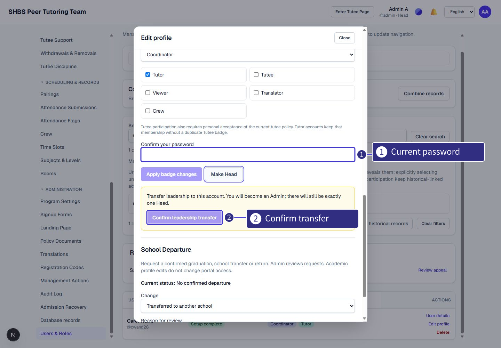

   

   
Capture details

   Confirm your password and the final transfer action are shown with the password empty. No leadership transfer has been applied yet.

   /admin/users · EN · 2026-11-20

   [Original full screenshot](assets/transfer-head-leadership-step-3.en.jpg) · `b5ece465681957c9fe579d26babdeb260c674fa0` · Latest-main development baseline b5ece465, selected 2026-11-20, with the Help candidate. Isolated synthetic first-report demonstration phase.

   

4. **Verify current leadership** Inspect the accepted result and current roles. Pending management-review ownership is reconciled; review remaining work with the new Head through existing workflows.

   **View 1**

   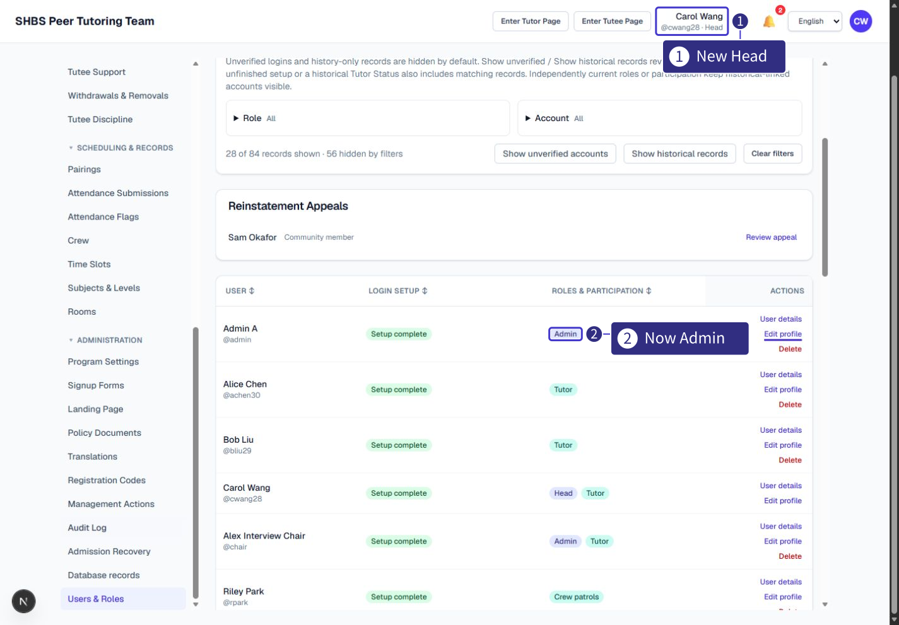

   

   
Capture details

   The freshly signed-in successor Carol Wang is Head, and the directory records outgoing Admin A as Admin.

   /admin/users · EN · 2026-11-20

   [Original full screenshot](assets/transfer-head-leadership-step-4.en.jpg) · `b5ece465681957c9fe579d26babdeb260c674fa0` · Latest-main development baseline b5ece465, selected 2026-11-20, with the Help candidate. Isolated synthetic first-report demonstration phase.

   

   **View 2**

   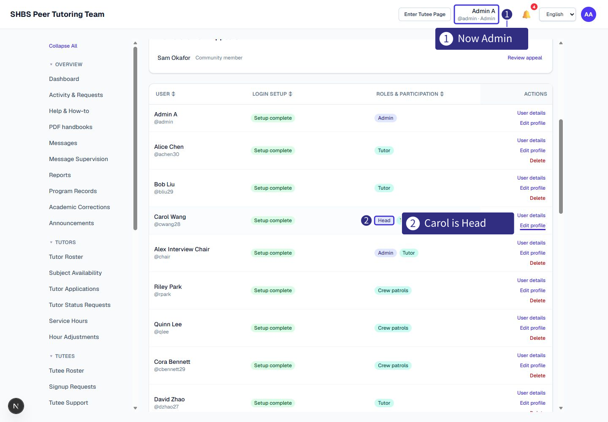

   

   
Capture details

   After transfer, the current account header shows Admin A as Admin and the verified Carol Wang row now shows Head.

   /admin/users · EN · 2026-11-20

   [Original full screenshot](assets/transfer-head-leadership-step-4-view-2.en.jpg) · `b5ece465681957c9fe579d26babdeb260c674fa0` · Latest-main development baseline b5ece465, selected 2026-11-20, with the Help candidate. Isolated synthetic first-report demonstration phase.

   

   **View 3**

   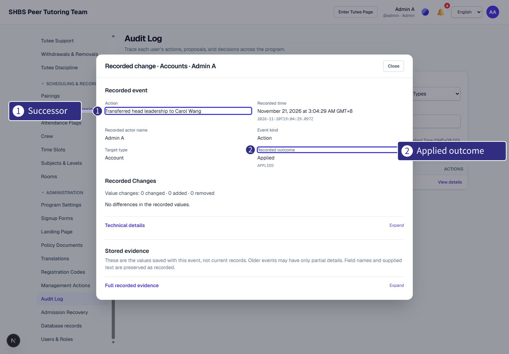

   

   
Capture details

   The persisted account audit names the transfer to Carol Wang, records Admin A as the actor and shows an applied outcome.

   /admin/audit · EN · 2026-11-20

   [Original full screenshot](assets/transfer-head-leadership-step-4-view-3.en.jpg) · `b5ece465681957c9fe579d26babdeb260c674fa0` · Latest-main development baseline b5ece465, selected 2026-11-20, with the Help candidate. Isolated synthetic first-report demonstration phase.

   

### What happens next

The reviewed successor becomes the single Head and the outgoing Head becomes Admin.

### How it works

No invitation grants Head and the current Head cannot be deleted as an ordinary account. Leadership transfer is a dedicated operation with fresh authority/password checks, not a Coordinator proposal.

### Troubleshooting

- **The successor or leadership changed** Stop the old review and load current accounts/authority. Read the server's eligibility restriction and start a fresh dedicated review; do not attempt to grant Head through an invitation or ordinary role switch.
