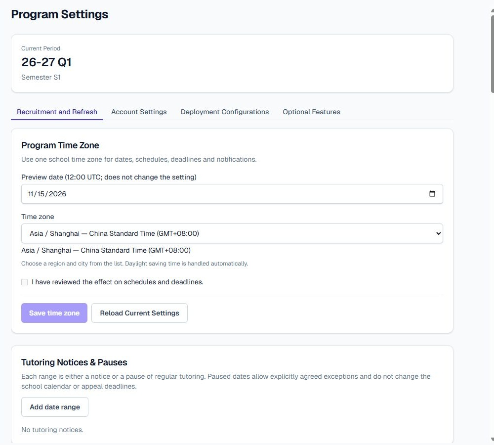
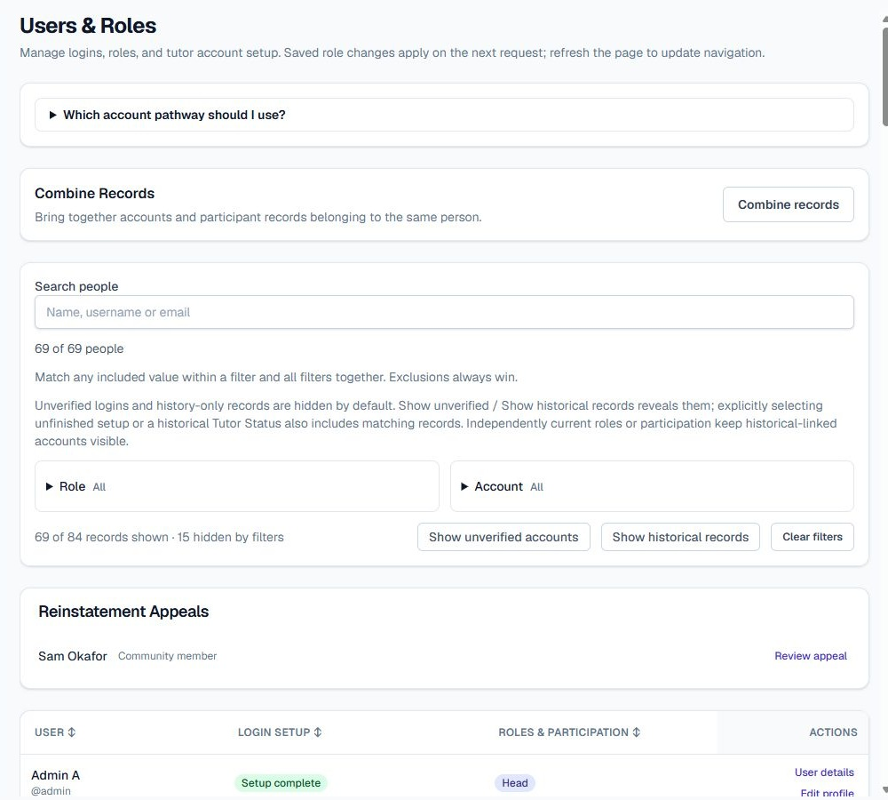

# 负责人职责

由网站帮助目录生成。请修改内容源文件后运行 `npm run help:export`。

[目录与截图来源](README.md)

截图来源: `dbb3c4eb213d58e134744fd417b1a06299b0e984`. Local dev server based on latest main at task start (dbb3c4eb), with the Help candidate. User-selected source baseline; no live deployment attestation.

此 GitHub 培训副本包含各角色操作说明。实际使用网站功能仍需登录并具备当前项目权限。所有示例数据均为虚构。

- [审核、安排或应用正式项目换期](#审核安排或应用正式项目换期)
- [转移项目负责人职权](#转移项目负责人职权)

## 审核、安排或应用正式项目换期

推进学期前核对目标开启时间、暂存模块及参与后果。

打开: `/admin/program`

### 开始之前

- 需要当前负责人权限及完整当前学期、目标证据。管理员可申请换期；只有负责人应用或安排正式操作。

### 操作步骤

1. **审核准备** 打开项目设置→招募及换期。阅读当前学期、具体目标、两类已准备招募开启时间及其时区，还有全部暂存功能开关。

   请注意: 输入REFRESH前阅读目标及完整换期影响。

   

   /admin/program · EN · 2026-11-15

2. **阅读全部换期影响** 检查显示的参与、排课及目标后果。接受换期前解决过时准备，并审核当前邮件、政策、科目、教室及操作员就绪。

3. **审慎应用或安排** 即时换期需输入REFRESH并在确认前阅读最后明确后果审阅。安排定时换期时审核准确执行时间、时区及目标；不再需要的待执行计划应通过独立操作取消。

4. **验证新学期** 回执被接受后检查当前学期、已启用开启时间、模块及参与者工作区。结果接受后无法重载时使用只读恢复，绝不重复可能已完成的学期推进。

### 预期结果

一次已审核换期推进至预期学期，或保留一个准确待执行计划。

### 工作原理

正式换期启用暂存设置并改变当前参与，同时保留历史出勤、政策接受及审计。只编辑招募窗口或暂存模块不会推进学期。

### 问题排查

- **换期因准备变化受阻** 重载具体目标及保存准备，再完整重新审阅。不要复用旧确认。提交不确定时先检查当前学期及回执，再进行受支持的相同重试。

## 转移项目负责人职权

审核符合条件继任者，并确认专用密码保护的负责人转移。

打开: `/admin/users`

### 开始之前

- 您是当前负责人，知道当前密码，并已审核预期符合条件管理员或协调员继任者。

### 操作步骤

1. **识别继任者** 在用户与角色打开预期符合条件管理员或协调员，检查准确账户ID、当前状态及权限。不要仅凭显示姓名选择。

   请注意: 使用专用负责人转移操作，与普通角色编辑分开。

   

   /admin/users · EN · 2026-11-15

2. **打开专用转移** 使用负责人转移，而非普通管理职级编辑或邀请。阅读前后负责人及原负责人将成为管理员的结果。

3. **确认身份及密码** 审核明确后果确认，输入当前密码，仅在继任者及最终角色正确时完成转移。

4. **验证当前负责人** 检查已接受结果及当前角色。待处理管理审核归属会重新协调；剩余工作应与新负责人通过现有流程审核。

### 预期结果

经审核继任者成为唯一负责人，原负责人变为管理员。

### 工作原理

没有邀请可授予负责人，当前负责人也不能作为普通账户删除。负责人转移是具有最新权限、密码检查的专用操作，不是协调员提案。

### 问题排查

- **继任者或负责人已改变** 停止旧审阅并读取当前账户及权限。阅读服务器资格限制并开始新的专用审阅，不要尝试通过邀请或普通角色开关授予负责人。
