# 负责人职责

由网站帮助目录生成。请修改内容源文件后运行 `npm run help:export`。

[目录与截图来源](README.md)

截图来源: `b5ece465681957c9fe579d26babdeb260c674fa0`. New captures use latest-main development baseline b5ece465, selected 2026-11-20, with the Help candidate. Earlier captures list their own revision and capture date.

此 GitHub 培训副本包含各角色操作说明。实际使用网站功能仍需登录并具备当前项目权限。所有示例数据均为虚构。

- [审核、安排或应用正式项目换期](#审核安排或应用正式项目换期)
- [转移项目负责人职权](#转移项目负责人职权)

## 审核、安排或应用正式项目换期

推进学期前核对目标开启时间、暂存模块及参与后果。

打开: `/admin/program`

### 开始之前

- 需要当前负责人权限及完整当前学期、目标证据。管理员可申请换期；只有负责人应用或安排正式操作。

### 操作步骤

1. **审核准备** 打开项目设置→招募及换期。阅读当前学期、具体目标、两类已准备招募开启时间及其时区，还有全部暂存功能开关。

   请注意: 输入REFRESH前阅读目标及完整换期影响。

   **视图 1**

   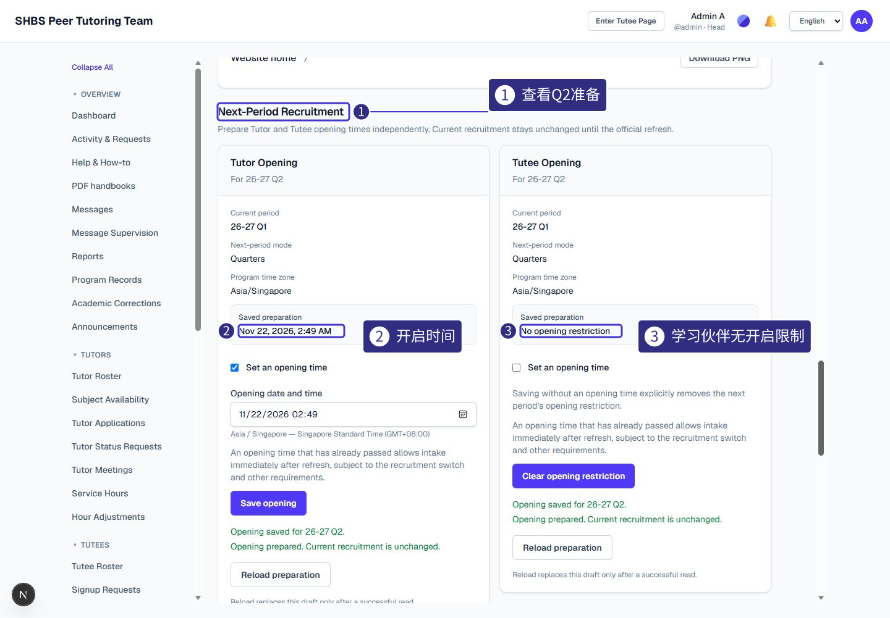

   /admin/program · EN · 2026-11-20

   Q1仍为当前学季。Q2的辅导伙伴报名已有未来开启时间，学习伙伴报名已明确取消开启限制，两项均使用新加坡项目时区。

   [原始完整截图](assets/perform-official-refresh-step-1.en.jpg) · `b5ece465681957c9fe579d26babdeb260c674fa0` · Latest-main development baseline b5ece465, selected 2026-11-20, with the Help candidate. Isolated synthetic first-report demonstration phase.

   已为本步骤添加标注，原始完整截图保持不变。

   - **1.** 查看Q2准备

   - **2.** 开启时间

   - **3.** 学习伙伴无开启限制

   **视图 2**

   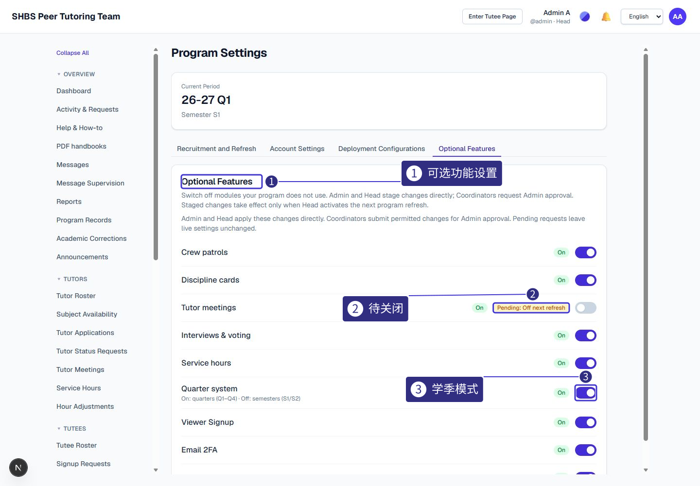

   /admin/program · EN · 2026-11-20

   学季模式已启用。辅导伙伴会议的关闭变更已暂存，将在下次换期时生效。

   [原始完整截图](assets/perform-official-refresh-step-1-view-2.en.jpg) · `b5ece465681957c9fe579d26babdeb260c674fa0` · Latest-main development baseline b5ece465, selected 2026-11-20, with the Help candidate. Isolated synthetic first-report demonstration phase.

   已为本步骤添加标注，原始完整截图保持不变。

   - **1.** 可选功能设置

   - **2.** 待关闭

   - **3.** 学季模式

2. **阅读全部换期影响** 检查显示的参与、排课及目标后果。接受换期前解决过时准备，并审核当前邮件、政策、科目、教室及操作员就绪。

   **视图 1**

   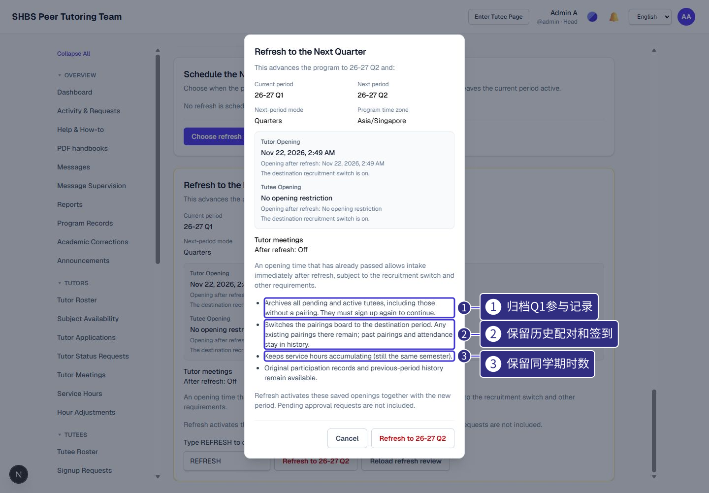

   /admin/program · EN · 2026-11-20

   负责人在提交前检查Q1学习伙伴参与记录的归档、Q2配对面板、历史签到保留及同学期服务时数继续累计。

   [原始完整截图](assets/perform-official-refresh-step-2.en.jpg) · `b5ece465681957c9fe579d26babdeb260c674fa0` · Latest-main development baseline b5ece465, selected 2026-11-20, with the Help candidate. Isolated synthetic first-report demonstration phase.

   已为本步骤添加标注，原始完整截图保持不变。

   - **1.** 归档Q1参与记录

   - **2.** 保留历史配对和签到

   - **3.** 保留同学期时数

   **视图 2**

   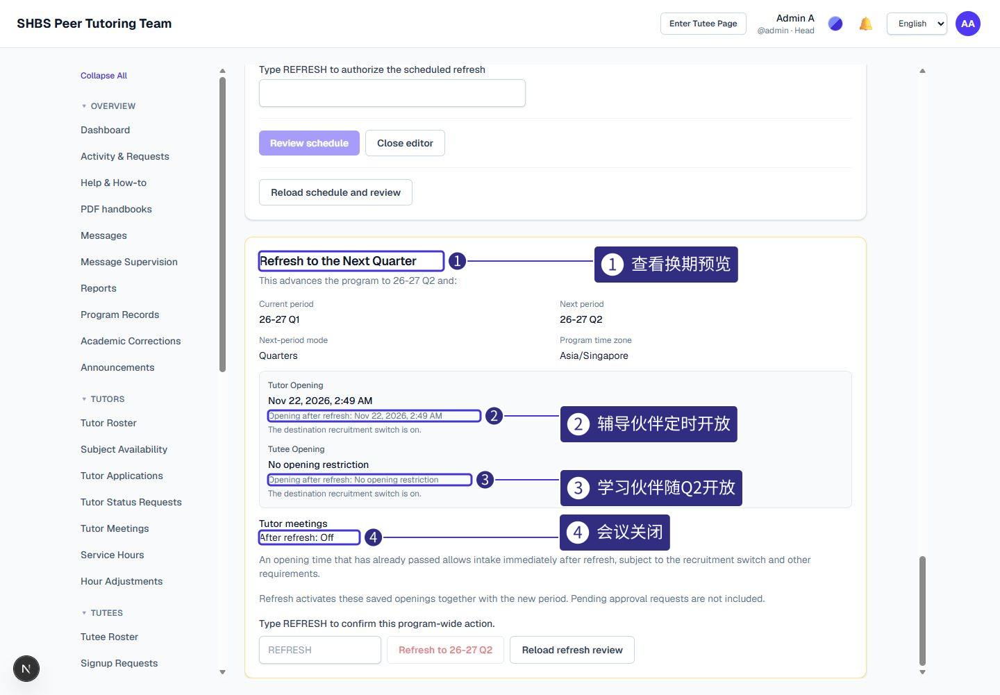

   /admin/program · EN · 2026-11-20

   Q2换期页面预览分别显示两类报名的生效安排，目标招募开关保持开启，辅导伙伴会议已暂存为关闭。

   [原始完整截图](assets/perform-official-refresh-step-2-view-2.en.jpg) · `b5ece465681957c9fe579d26babdeb260c674fa0` · Latest-main development baseline b5ece465, selected 2026-11-20, with the Help candidate. Isolated synthetic first-report demonstration phase.

   已为本步骤添加标注，原始完整截图保持不变。

   - **1.** 查看换期预览

   - **2.** 辅导伙伴定时开放

   - **3.** 学习伙伴随Q2开放

   - **4.** 会议关闭

3. **审慎应用或安排** 即时换期需输入REFRESH并在确认前阅读最后明确后果审阅。安排定时换期时审核准确执行时间、时区及目标；不再需要的待执行计划应通过独立操作取消。

   **视图 1**

   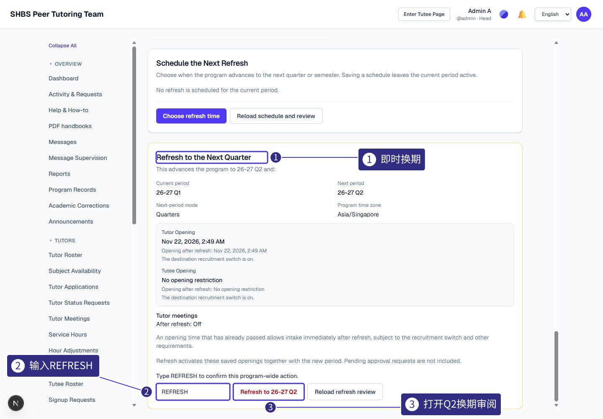

   /admin/program · EN · 2026-11-20

   输入REFRESH后，指明Q2的操作按钮才可用。此按钮打开最终审阅，负责人随后可确认或取消。

   [原始完整截图](assets/perform-official-refresh-step-3.en.jpg) · `b5ece465681957c9fe579d26babdeb260c674fa0` · Latest-main development baseline b5ece465, selected 2026-11-20, with the Help candidate. Isolated synthetic first-report demonstration phase.

   已为本步骤添加标注，原始完整截图保持不变。

   - **1.** 即时换期

   - **2.** 输入REFRESH

   - **3.** 打开Q2换期审阅

   **视图 2**

   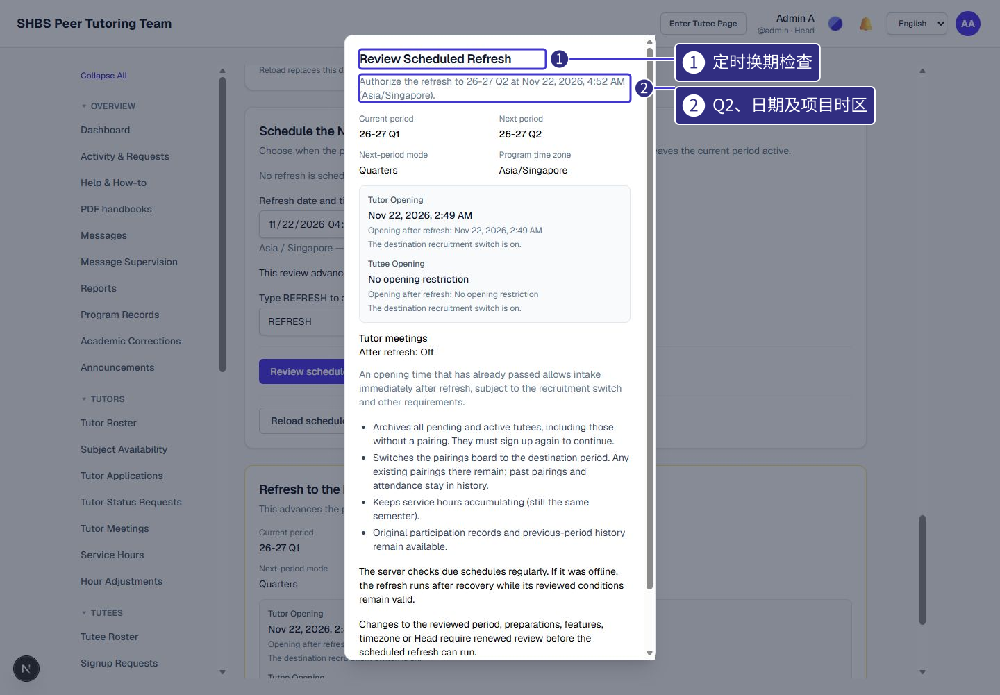

   /admin/program · EN · 2026-11-20

   定时换期审阅显示具体目标、未来执行时间及Asia/Singapore。本例仅打开审阅并取消草稿。

   [原始完整截图](assets/perform-official-refresh-step-3-view-2.en.jpg) · `b5ece465681957c9fe579d26babdeb260c674fa0` · Latest-main development baseline b5ece465, selected 2026-11-20, with the Help candidate. Isolated synthetic first-report demonstration phase.

   已为本步骤添加标注，原始完整截图保持不变。

   - **1.** 定时换期检查

   - **2.** Q2、日期及项目时区

4. **验证新学期** 回执被接受后检查当前学期、已启用开启时间、模块及参与者工作区。结果接受后无法重载时使用只读恢复，绝不重复可能已完成的学期推进。

   **视图 1**

   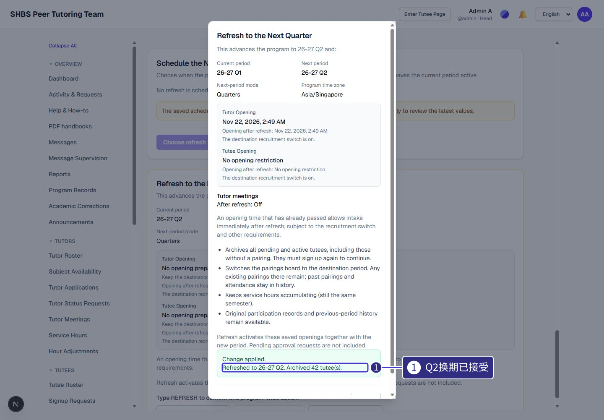

   /admin/program · EN · 2026-11-20

   负责人提交已被接受，项目推进至26-27 Q2，并归档42条Q1学习伙伴参与记录。

   [原始完整截图](assets/perform-official-refresh-step-4.en.jpg) · `b5ece465681957c9fe579d26babdeb260c674fa0` · Latest-main development baseline b5ece465, selected 2026-11-20, with the Help candidate. Isolated synthetic first-report demonstration phase.

   已为本步骤添加标注，原始完整截图保持不变。

   - **1.** Q2换期已接受

   **视图 2**

   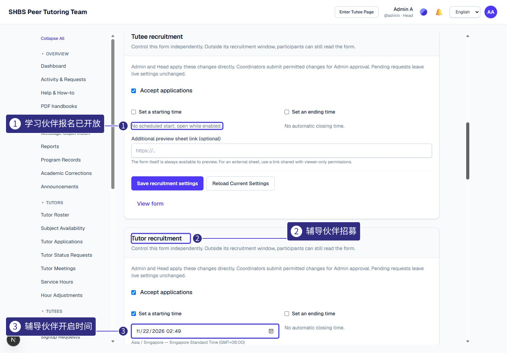

   /admin/program · EN · 2026-11-20

   当前Q2招募表单确认学习伙伴报名随开关开启，辅导伙伴报名按已保存的新加坡时间稍后开启。

   [原始完整截图](assets/perform-official-refresh-step-4-view-2.en.jpg) · `b5ece465681957c9fe579d26babdeb260c674fa0` · Latest-main development baseline b5ece465, selected 2026-11-20, with the Help candidate. Isolated synthetic first-report demonstration phase.

   已为本步骤添加标注，原始完整截图保持不变。

   - **1.** 学习伙伴报名已开放

   - **2.** 辅导伙伴招募

   - **3.** 辅导伙伴开启时间

### 预期结果

一次已审核换期推进至预期学期，或保留一个准确待执行计划。

### 工作原理

正式换期启用暂存设置并改变当前参与，同时保留历史出勤、政策接受及审计。只编辑招募窗口或暂存模块不会推进学期。

### 问题排查

- **换期因准备变化受阻** 重载具体目标及保存准备，再完整重新审阅。不要复用旧确认。提交不确定时先检查当前学期及回执，再进行受支持的相同重试。

## 转移项目负责人职权

审核符合条件继任者，并确认专用密码保护的负责人转移。

打开: `/admin/users`

### 开始之前

- 您是当前负责人，知道当前密码，并已审核预期符合条件管理员或协调员继任者。

### 操作步骤

1. **识别继任者** 在用户与角色打开预期符合条件管理员或协调员，检查准确账户ID、当前状态及权限。不要仅凭显示姓名选择。

   请注意: 使用专用负责人转移操作，与普通角色编辑分开。

   **视图 1**

   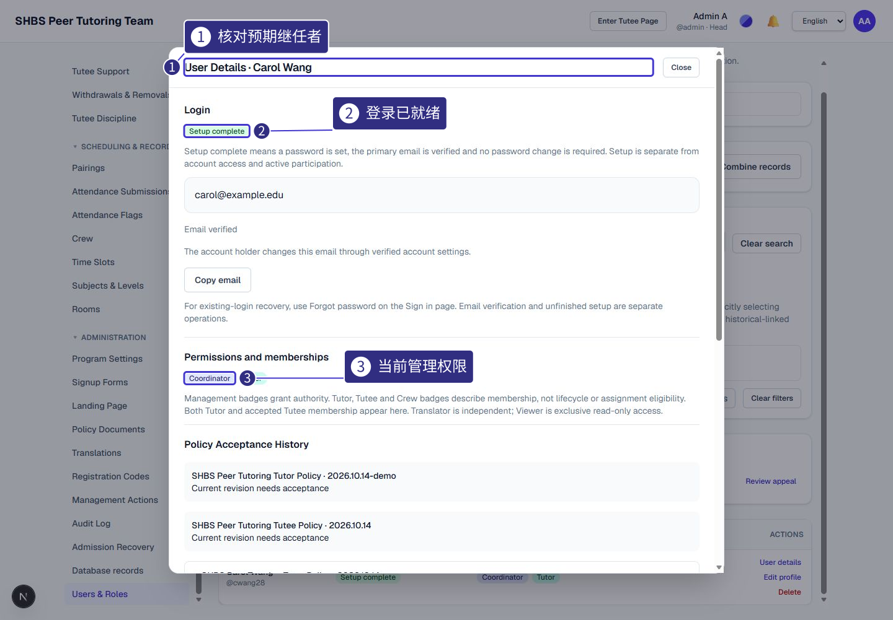

   /admin/users · EN · 2026-11-20

   Carol Wang 的用户详情显示登录设置已完成，现有权限为协调员。这些状态在专用领导权交接审核前核对。

   [原始完整截图](assets/transfer-head-leadership-step-1.en.jpg) · `b5ece465681957c9fe579d26babdeb260c674fa0` · Latest-main development baseline b5ece465, selected 2026-11-20, with the Help candidate. Isolated synthetic first-report demonstration phase.

   已为本步骤添加标注，原始完整截图保持不变。

   - **1.** 核对预期继任者

   - **2.** 登录已就绪

   - **3.** 当前管理权限

   **视图 2**

   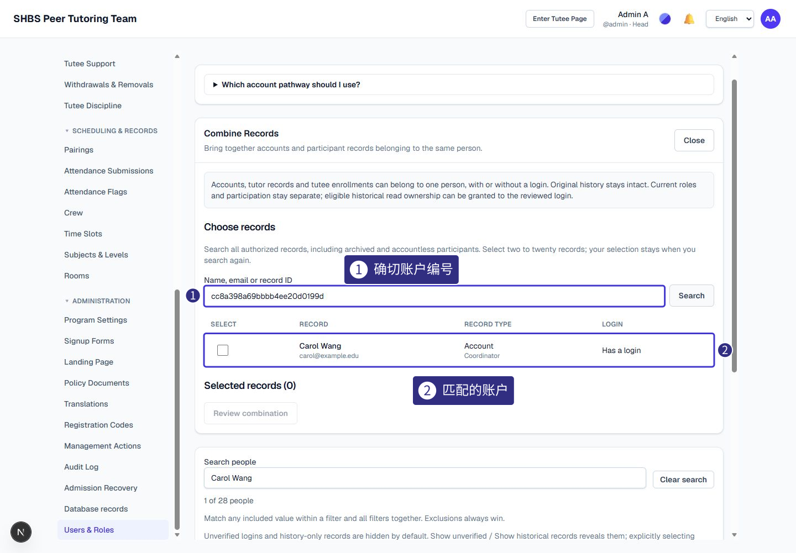

   /admin/users · EN · 2026-11-20

   按确切账户编号进行只读搜索，确认 Carol Wang 为预期演示继任者。未选择任何记录。

   [原始完整截图](assets/transfer-head-leadership-step-1-view-2.en.jpg) · `b5ece465681957c9fe579d26babdeb260c674fa0` · Latest-main development baseline b5ece465, selected 2026-11-20, with the Help candidate. Isolated synthetic first-report demonstration phase.

   已为本步骤添加标注，原始完整截图保持不变。

   - **1.** 确切账户编号

   - **2.** 匹配的账户

2. **打开专用转移** 在“编辑资料”中打开角色与参与资格，选择“设为负责人”。核对所列继任者，并确认原负责人将成为管理员。

   **视图 1**

   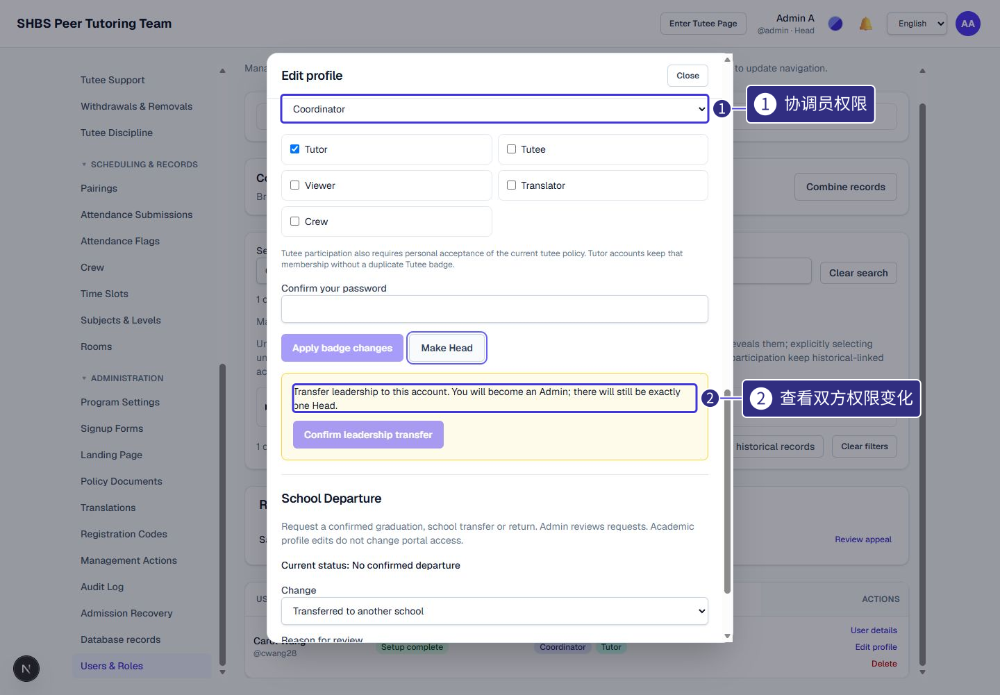

   /admin/users · EN · 2026-11-20

   专用审核显示所选协调员，并说明原负责人将成为管理员。确认后项目仍只有一位负责人。

   [原始完整截图](assets/transfer-head-leadership-step-2.en.jpg) · `b5ece465681957c9fe579d26babdeb260c674fa0` · Latest-main development baseline b5ece465, selected 2026-11-20, with the Help candidate. Isolated synthetic first-report demonstration phase.

   已为本步骤添加标注，原始完整截图保持不变。

   - **1.** 协调员权限

   - **2.** 查看双方权限变化

   **视图 2**

   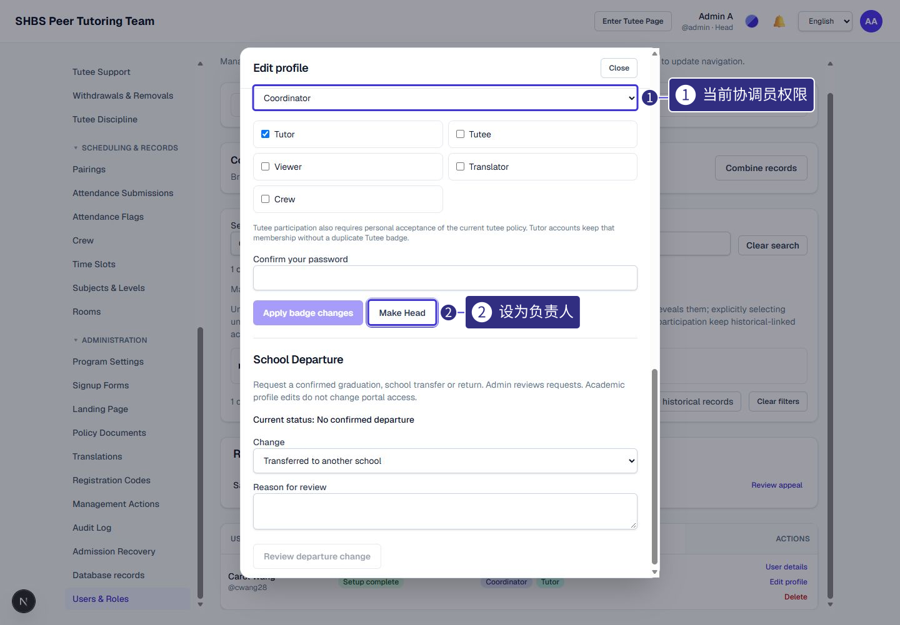

   /admin/users · EN · 2026-11-20

   资料编辑器显示当前协调员权限，以及独立的“设为负责人”操作。未应用权限编辑。

   [原始完整截图](assets/transfer-head-leadership-step-2-view-2.en.jpg) · `b5ece465681957c9fe579d26babdeb260c674fa0` · Latest-main development baseline b5ece465, selected 2026-11-20, with the Help candidate. Isolated synthetic first-report demonstration phase.

   已为本步骤添加标注，原始完整截图保持不变。

   - **1.** 当前协调员权限

   - **2.** 设为负责人

3. **确认身份及密码** 在确认区核对继任者和变更后的角色。信息正确时输入当前密码，再选择“确认转交负责人”。

   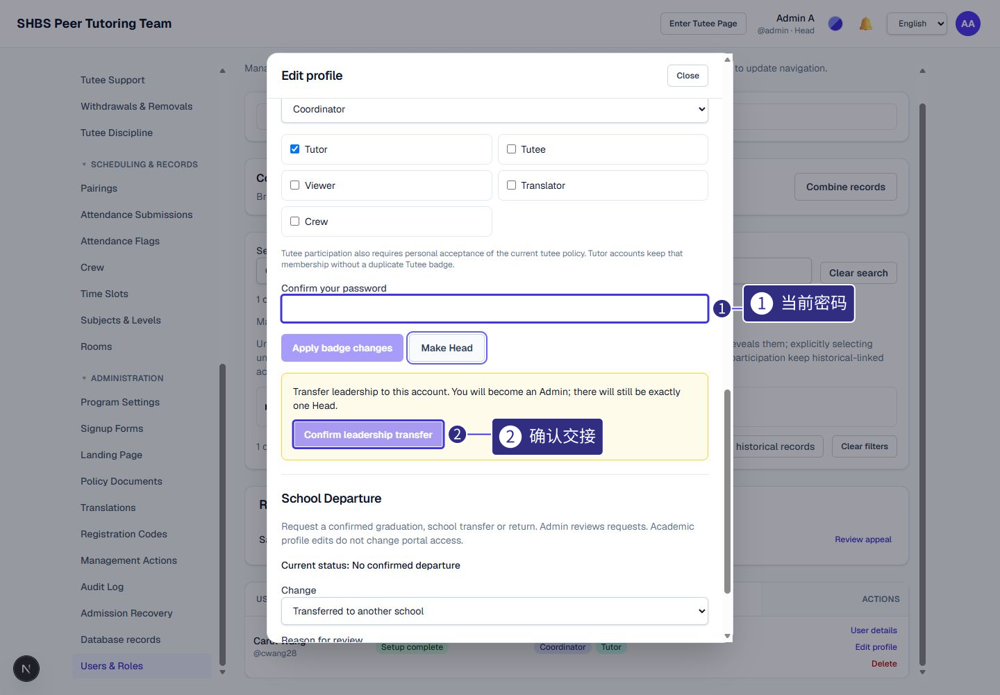

   /admin/users · EN · 2026-11-20

   “确认密码”和最终交接操作已显示，密码栏仍为空。尚未应用领导权交接。

   [原始完整截图](assets/transfer-head-leadership-step-3.en.jpg) · `b5ece465681957c9fe579d26babdeb260c674fa0` · Latest-main development baseline b5ece465, selected 2026-11-20, with the Help candidate. Isolated synthetic first-report demonstration phase.

   已为本步骤添加标注，原始完整截图保持不变。

   - **1.** 当前密码

   - **2.** 确认交接

4. **验证当前负责人** 检查已接受结果及当前角色。待处理管理审核归属会重新协调；剩余工作应与新负责人通过现有流程审核。

   **视图 1**

   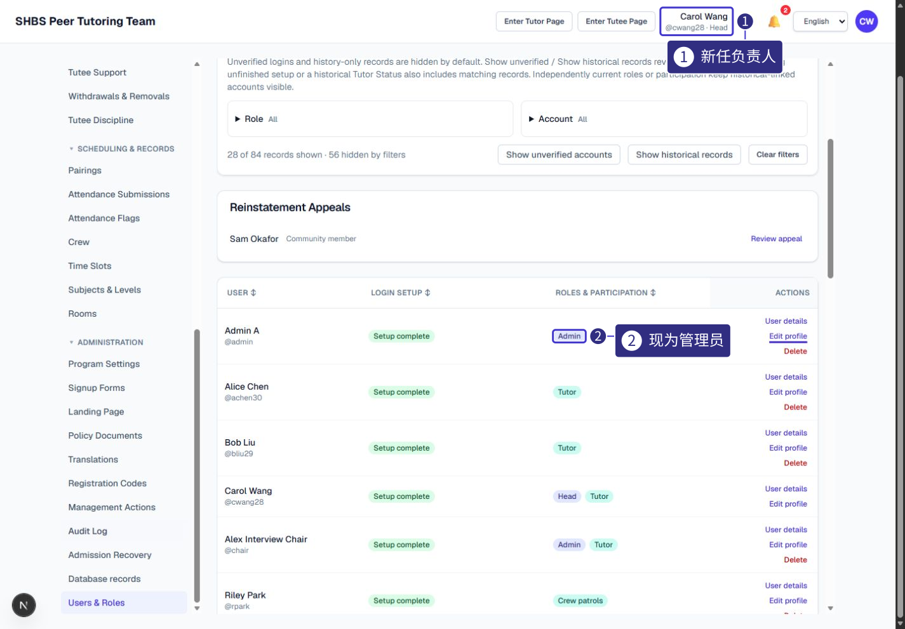

   /admin/users · EN · 2026-11-20

   重新登录后，继任者 Carol Wang 现为负责人；用户目录显示原负责人 Admin A 现为管理员。

   [原始完整截图](assets/transfer-head-leadership-step-4.en.jpg) · `b5ece465681957c9fe579d26babdeb260c674fa0` · Latest-main development baseline b5ece465, selected 2026-11-20, with the Help candidate. Isolated synthetic first-report demonstration phase.

   已为本步骤添加标注，原始完整截图保持不变。

   - **1.** 新任负责人

   - **2.** 现为管理员

   **视图 2**

   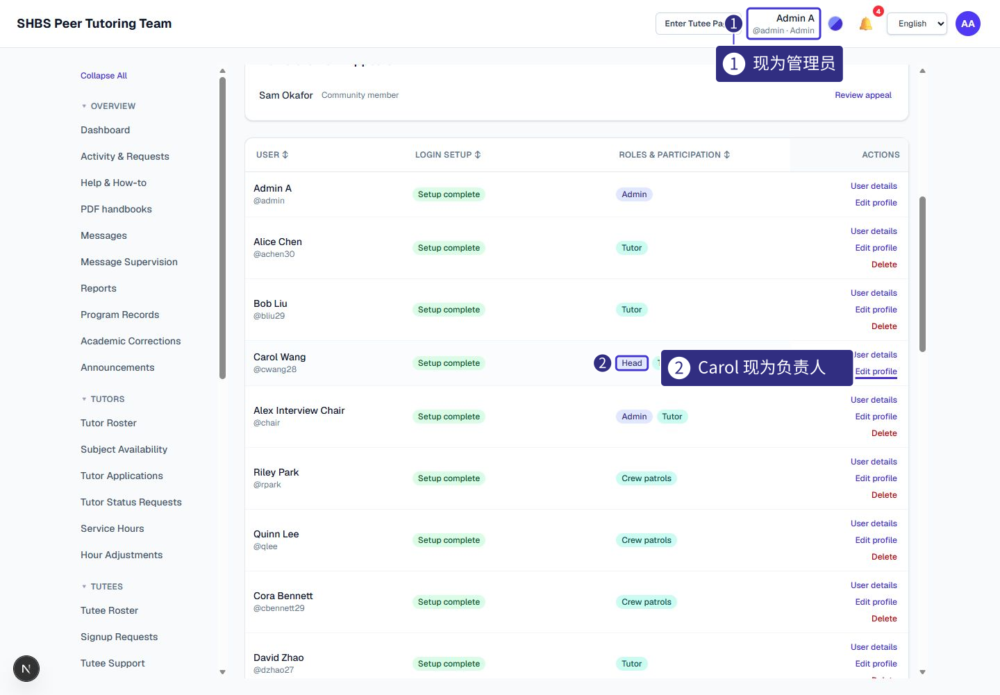

   /admin/users · EN · 2026-11-20

   交接完成后，当前账户标题显示 Admin A 为管理员；已核对的 Carol Wang 用户行现显示负责人。

   [原始完整截图](assets/transfer-head-leadership-step-4-view-2.en.jpg) · `b5ece465681957c9fe579d26babdeb260c674fa0` · Latest-main development baseline b5ece465, selected 2026-11-20, with the Help candidate. Isolated synthetic first-report demonstration phase.

   已为本步骤添加标注，原始完整截图保持不变。

   - **1.** 现为管理员

   - **2.** Carol 现为负责人

   **视图 3**

   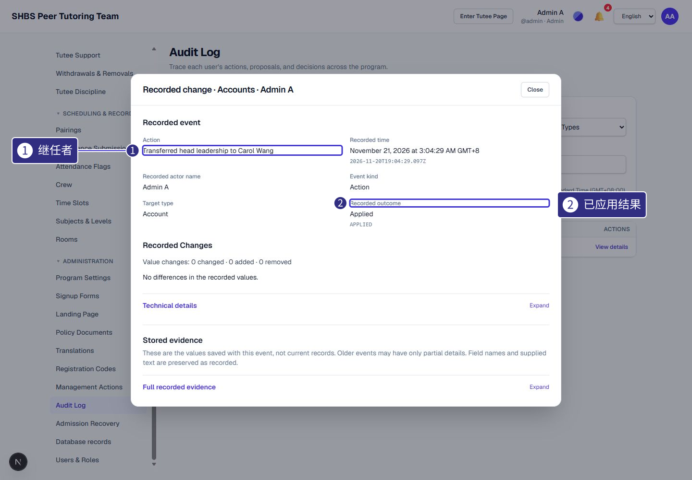

   /admin/audit · EN · 2026-11-20

   账户审计记录已保存，明确交接给 Carol Wang，记录 Admin A 为操作人，并显示已应用。

   [原始完整截图](assets/transfer-head-leadership-step-4-view-3.en.jpg) · `b5ece465681957c9fe579d26babdeb260c674fa0` · Latest-main development baseline b5ece465, selected 2026-11-20, with the Help candidate. Isolated synthetic first-report demonstration phase.

   已为本步骤添加标注，原始完整截图保持不变。

   - **1.** 继任者

   - **2.** 已应用结果

### 预期结果

经审核继任者成为唯一负责人，原负责人变为管理员。

### 工作原理

没有邀请可授予负责人，当前负责人也不能作为普通账户删除。负责人转移是具有最新权限、密码检查的专用操作，不是协调员提案。

### 问题排查

- **继任者或负责人已改变** 停止旧审阅并读取当前账户及权限。阅读服务器资格限制并开始新的专用审阅，不要尝试通过邀请或普通角色开关授予负责人。
