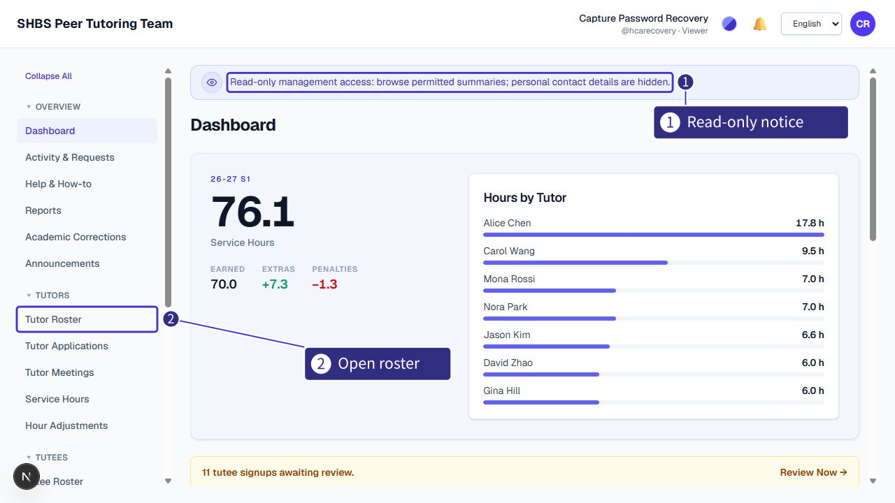
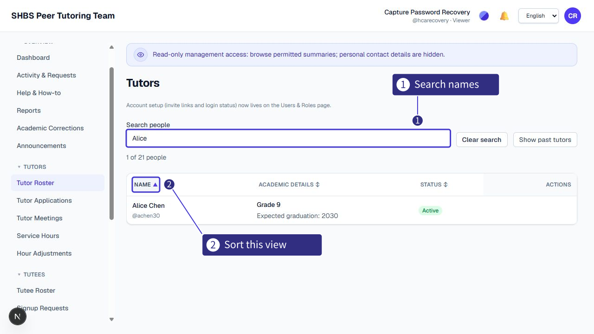
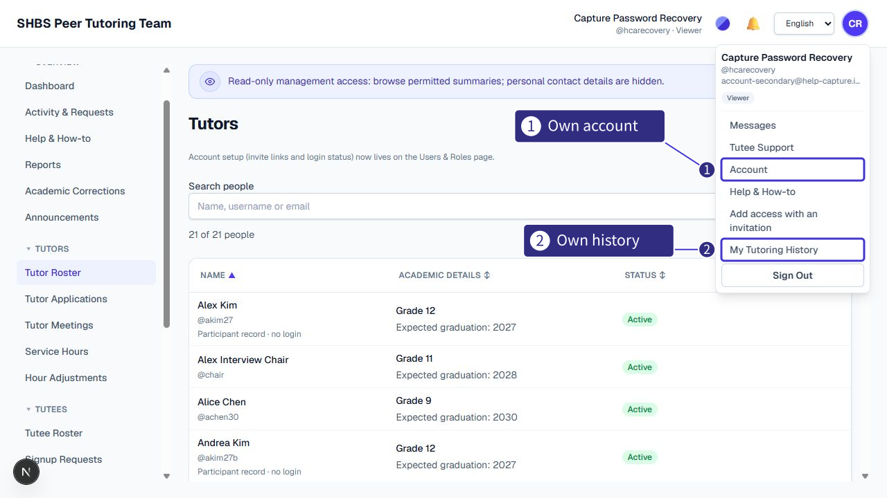

# Observe the program

Generated from the website help catalogue. Edit the content records, then run `npm run help:export`.

[Catalogue & capture provenance](README.md)

Screenshot source: `1df44d6bb31cf04352adae9c65819139b7b747d8`. New captures use latest-main development baseline 1df44d6b, selected 2026-11-21, with the Help candidate. Earlier captures list their own revision and capture date.

This GitHub training copy includes role-specific instructions. Signing in and current program permissions are still required to use the corresponding website features. All examples are synthetic.

- [Browse the program as a read-only observer](#browse-the-program-as-a-read-only-observer)

## Browse the program as a read-only observer

Read permitted summaries while keeping private evidence and management actions restricted.

Open: `/admin`

### Before you start

- You are an eligible Viewer or have approved departure-based observer access, and are not suspended.

### Walkthrough

1. **Enter the read-only portal** Use the management area or Enter Viewers Portal offered for your account. On mobile open Menu; available pages reflect enabled modules and your permission.

   Look for: Read-only navigation and permitted summaries

   

   

   
Capture details

   The signed-in Viewer is in the actual read-only management portal. The permission notice explains that contact details are hidden. Tutor Roster is one of the permitted summary pages in the left navigation; no management action is being submitted.

   /admin · EN · 2026-11-16

   [Original full screenshot](assets/observe-program-step-1.en.jpg) · `dd970ea426016e85cb514beeeab537c3ab2e5098` · Latest-main development baseline dd970ea4, selected 2026-11-16, with the Help candidate; synthetic demonstration data.

   

2. **Read and filter summaries** Browse allowed names, schedules, statuses, ratings and totals. Use available search, period filters and sortable headings; these only change the view. Read published policies and announcements through their permitted pages.

   

   

   
Capture details

   Search people is filtering the real Viewer roster to Alice; clicking Name changes the sort only. The permitted summary shows academic details and Active status. Contact columns and management action controls are absent for this Viewer.

   /admin/tutors · EN · 2026-11-16

   [Original full screenshot](assets/observe-program-step-2.en.jpg) · `dd970ea426016e85cb514beeeab537c3ab2e5098` · Latest-main development baseline dd970ea4, selected 2026-11-16, with the Help candidate; synthetic demonstration data.

   

3. **Use your own account separately** Open Account Settings or My Tutoring History for your own eligible records. If you need participant access, request it or review an authorized Add access invitation; do not create a duplicate account.

   

   

   
Capture details

   Open Account for your own settings or My Tutoring History for your own eligible records. The invitation link adds authorized access to this same account; it is not a reason to register a duplicate. These links do not grant management editing powers.

   /admin/tutors · EN · 2026-11-16

   [Original full screenshot](assets/observe-program-step-3.en.jpg) · `dd970ea426016e85cb514beeeab537c3ab2e5098` · Latest-main development baseline dd970ea4, selected 2026-11-16, with the Help candidate; synthetic demonstration data.

   

### What happens next

You can inspect permitted program summaries without gaining management write powers or another person's private history.

### How it works

Contact details, signatures, private comments, absence reasons, application evidence and decision notes are masked. These summaries are not anonymous. Viewer is an exclusive role; departure-based observation is a separate access condition and does not replace your account role.

### Troubleshooting

- **Details or an action are missing** That content may be private or require management authority. Ask staff about the exact task rather than opening hidden addresses. Observer access may also be revoked independently after departure.
