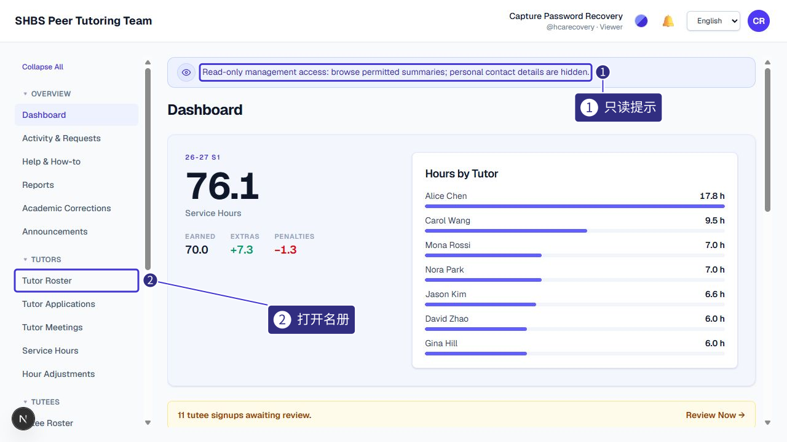
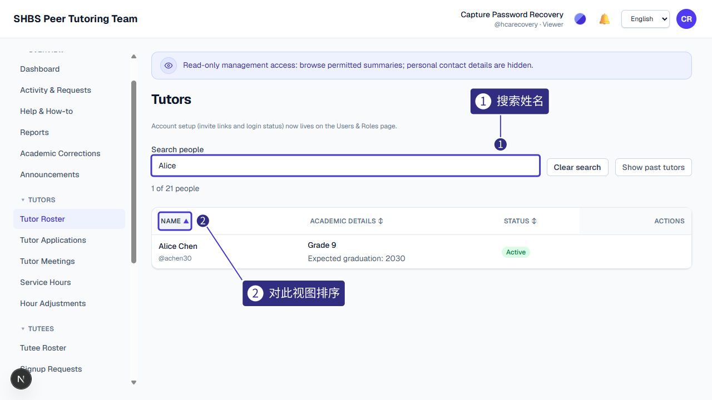
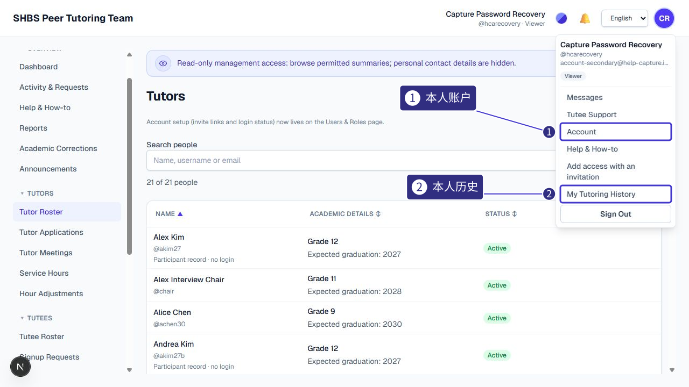

# 查看项目

由网站帮助目录生成。请修改内容源文件后运行 `npm run help:export`。

[目录与截图来源](README.md)

截图来源: `b5ece465681957c9fe579d26babdeb260c674fa0`. New captures use latest-main development baseline b5ece465, selected 2026-11-20, with the Help candidate. Earlier captures list their own revision and capture date.

此 GitHub 培训副本包含各角色操作说明。实际使用网站功能仍需登录并具备当前项目权限。所有示例数据均为虚构。

- [以只读观察员浏览项目](#以只读观察员浏览项目)

## 以只读观察员浏览项目

阅读允许的概览，私人证据和管理操作仍受限制。

打开: `/admin`

### 开始之前

- 本人为符合条件的观察员，或有离校获批观察权限，且未被停用。

### 操作步骤

1. **进入只读门户** 使用账户提供的管理区或进入观察员门户。手机端打开菜单；可用页面随模块及权限变化。

   请注意: 只读导航与允许查看的概览

   

   /admin · EN · 2026-11-16

   已登录观察员进入实际只读管理门户。权限提示说明联系方式已隐藏。左侧导航的辅导伙伴名册是允许查看的概览页面之一，此处不提交管理操作。

   [原始完整截图](assets/observe-program-step-1.en.jpg) · `dd970ea426016e85cb514beeeab537c3ab2e5098` · Latest-main development baseline dd970ea4, selected 2026-11-16, with the Help candidate; synthetic demonstration data.

   已为本步骤添加标注，原始完整截图保持不变。

   - **1.** 只读提示

   - **2.** 打开名册

2. **阅读并筛选概览** 浏览允许的姓名、时间安排、状态、评分和总数。使用可用搜索、时期筛选和排序标题，这些操作仅改变视图。通过允许页面阅读已发布政策及公告。

   

   /admin/tutors · EN · 2026-11-16

   人员搜索已将实际观察员名册筛选为 Alice，点击姓名仅改变排序。允许的概览显示学业信息与有效状态，此观察员没有联系方式栏或管理操作控件。

   [原始完整截图](assets/observe-program-step-2.en.jpg) · `dd970ea426016e85cb514beeeab537c3ab2e5098` · Latest-main development baseline dd970ea4, selected 2026-11-16, with the Help candidate; synthetic demonstration data.

   已为本步骤添加标注，原始完整截图保持不变。

   - **1.** 搜索姓名

   - **2.** 对此视图排序

3. **单独管理本人账户** 打开账户设置或我的辅导历史，查看本人符合条件的记录。需要参与资格时，提交申请或确认授权添加权限邀请，不要重复注册。

   

   /admin/tutors · EN · 2026-11-16

   打开账户管理本人设置，或我的辅导历史查看本人符合条件的记录。邀请码入口用于给同一账户添加授权权限，不需重复注册。这些链接不会授予管理编辑权限。

   [原始完整截图](assets/observe-program-step-3.en.jpg) · `dd970ea426016e85cb514beeeab537c3ab2e5098` · Latest-main development baseline dd970ea4, selected 2026-11-16, with the Help candidate; synthetic demonstration data.

   已为本步骤添加标注，原始完整截图保持不变。

   - **1.** 本人账户

   - **2.** 本人历史

### 预期结果

可查看允许项目概览，但不获得管理写入权限或他人私人历史。

### 工作原理

联系方式、签名、私人评论、缺席原因、申请证据和决定说明会隐藏。概览并非匿名数据。观察员是独占角色；离校观察是另一种访问条件，不会替换账户角色。

### 问题排查

- **缺少详情或操作** 内容可能私密或需管理权限。请向工作人员说明具体任务，而非尝试隐藏地址。离校观察权限也可能被单独撤销。
