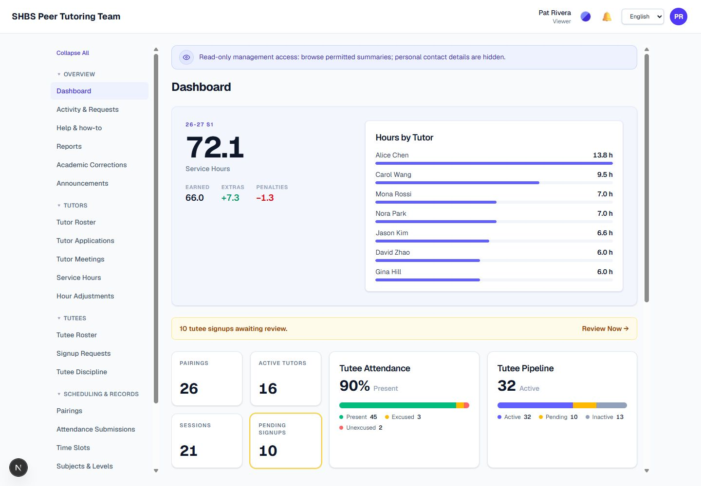

# 查看项目

由网站帮助目录生成。请修改内容源文件后运行 `npm run help:export`。

[目录与截图来源](README.md)

截图来源: `dbb3c4eb213d58e134744fd417b1a06299b0e984`. Local dev server based on latest main at task start (dbb3c4eb), with the Help candidate. User-selected source baseline; no live deployment attestation.

此 GitHub 培训副本包含各角色操作说明。实际使用网站功能仍需登录并具备当前项目权限。所有示例数据均为虚构。

- [以只读观察员浏览项目](#以只读观察员浏览项目)

## 以只读观察员浏览项目

阅读允许的概览，私人证据和管理操作仍受限制。

打开: `/admin`

### 开始之前

- 本人为符合条件的观察员，或有离校获批观察权限，且未被停用。

### 操作步骤

1. **进入只读门户** 使用账户提供的管理区或进入观察员门户。手机端打开菜单；可用页面随模块及权限变化。

   请注意: 只读导航与允许查看的概览

   

   /admin · EN · 2026-11-15

2. **阅读并筛选概览** 浏览允许的姓名、时间安排、状态、评分和总数。使用可用搜索、时期筛选和排序标题，这些操作仅改变视图。通过允许页面阅读已发布政策及公告。

3. **单独管理本人账户** 打开账户设置或我的辅导历史，查看本人符合条件的记录。需要参与资格时，提交申请或确认授权添加权限邀请，不要重复注册。

### 预期结果

可查看允许项目概览，但不获得管理写入权限或他人私人历史。

### 工作原理

联系方式、签名、私人评论、缺席原因、申请证据和决定说明会隐藏。概览并非匿名数据。观察员是独占角色；离校观察是另一种访问条件，不会替换账户角色。

### 问题排查

- **缺少详情或操作** 内容可能私密或需管理权限。请向工作人员说明具体任务，而非尝试隐藏地址。离校观察权限也可能被单独撤销。
