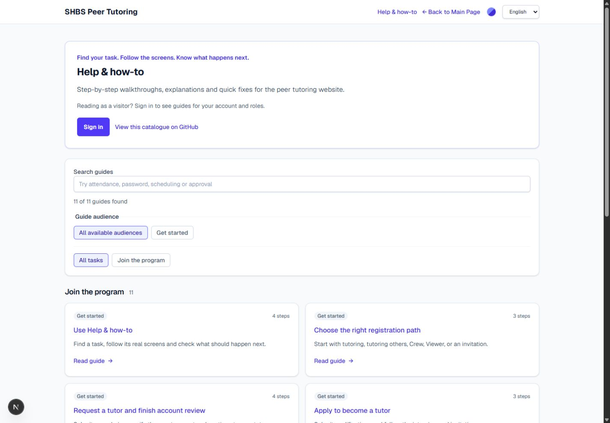
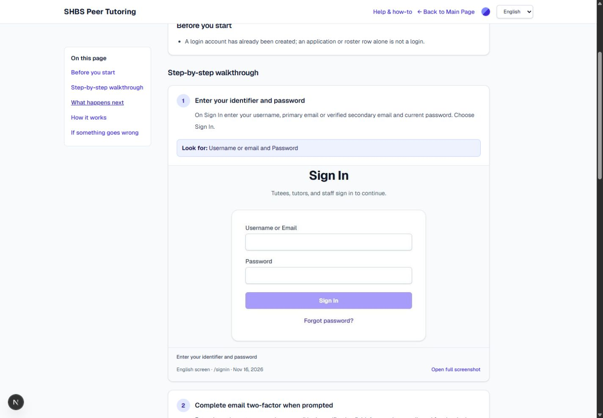
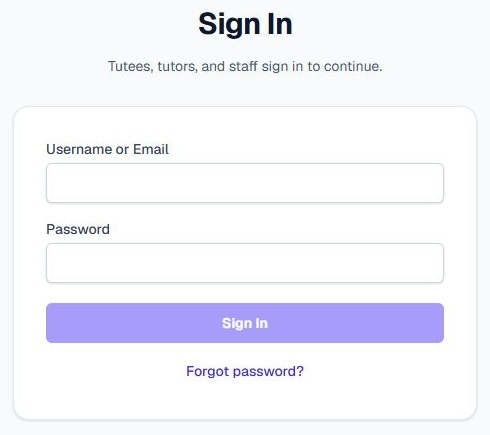
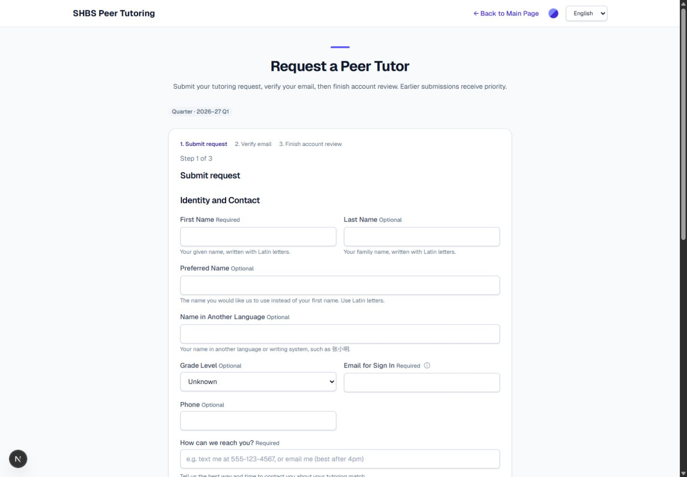
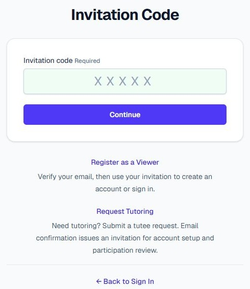
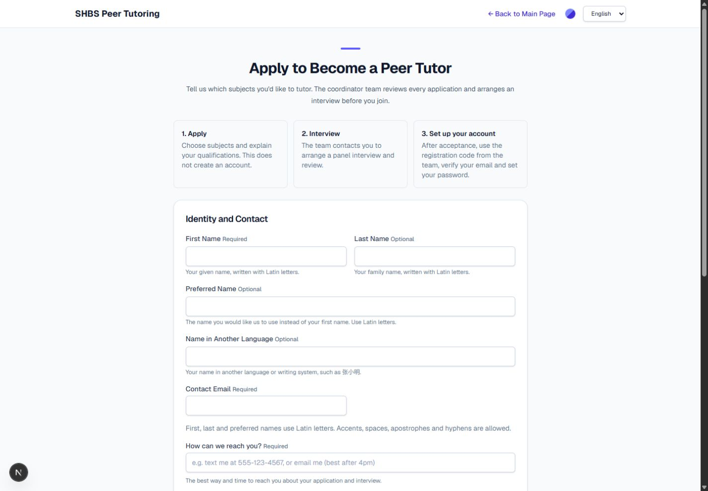
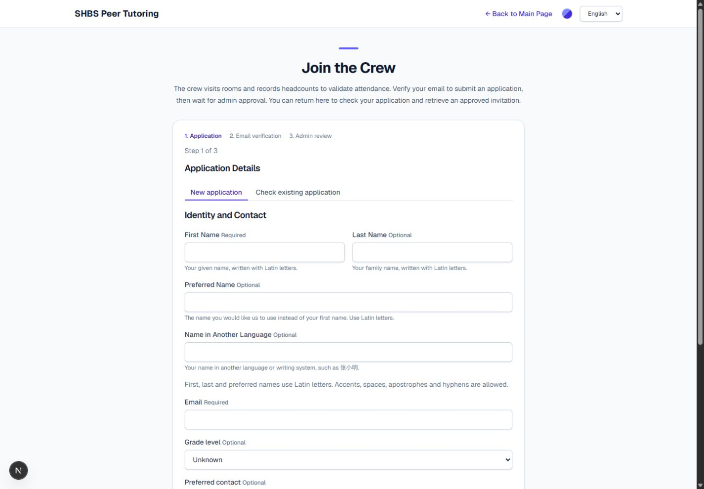
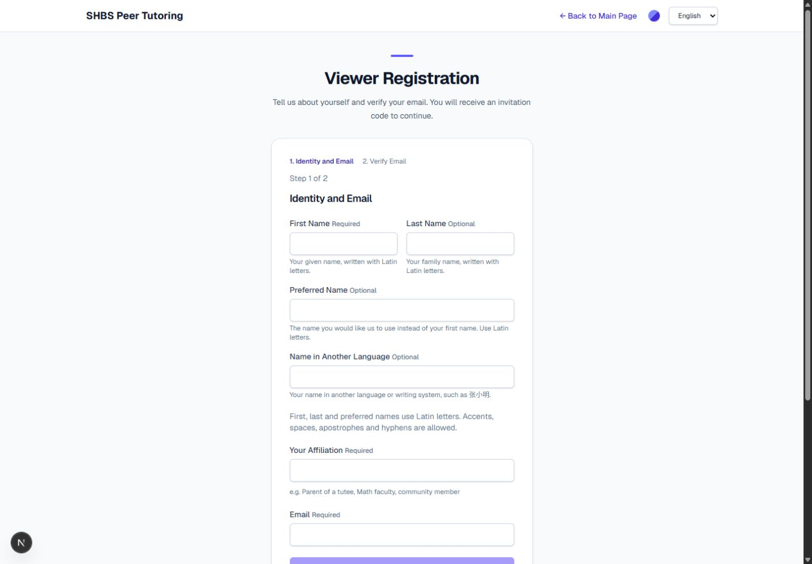
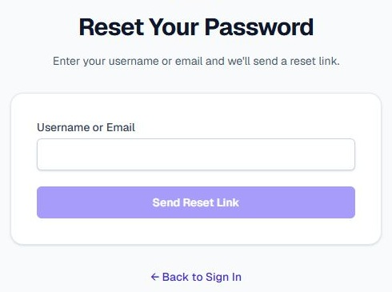
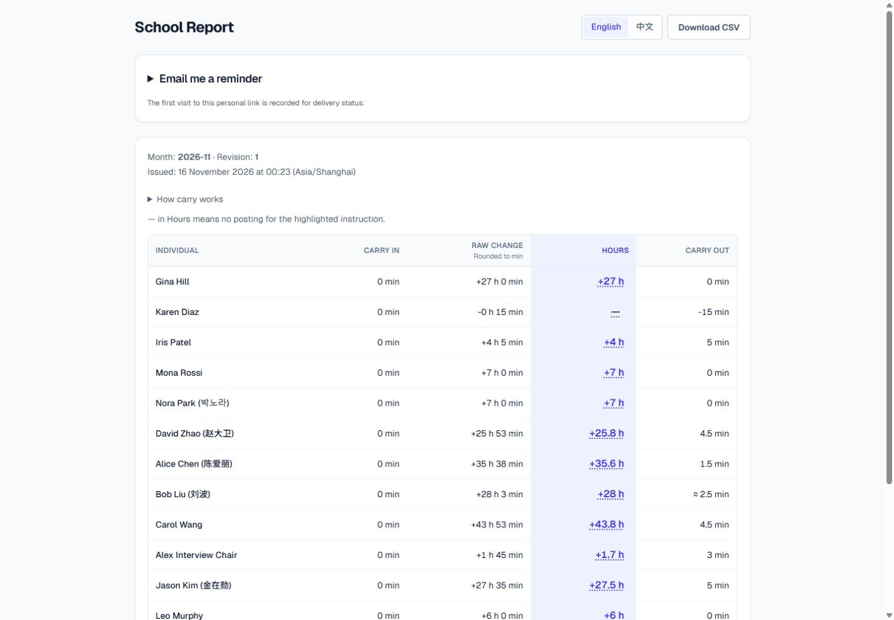

# Get started

Generated from the website help catalogue. Edit the content records, then run `npm run help:export`.

[Catalogue & capture provenance](README.md)

Screenshot source: `dbb3c4eb213d58e134744fd417b1a06299b0e984`. Local dev server based on latest main at task start (dbb3c4eb), with the Help candidate. User-selected source baseline; no live deployment attestation.

This GitHub training copy includes role-specific instructions. Signing in and current program permissions are still required to use the corresponding website features. All examples are synthetic.

- [Use Help & how-to](#use-help--how-to)
- [Choose the right registration path](#choose-the-right-registration-path)
- [Request a tutor and finish account review](#request-a-tutor-and-finish-account-review)
- [Apply to become a tutor](#apply-to-become-a-tutor)
- [Apply to Crew and check your application](#apply-to-crew-and-check-your-application)
- [Register for read-only Viewer access](#register-for-read-only-viewer-access)
- [Use an invitation or add approved access](#use-an-invitation-or-add-approved-access)
- [Sign in or recover your password](#sign-in-or-recover-your-password)
- [Get private support or report a website problem](#get-private-support-or-report-a-website-problem)
- [Appeal an invalid signup from its email notice](#appeal-an-invalid-signup-from-its-email-notice)
- [Use a school-hours report link](#use-a-school-hours-report-link)

## Use Help & how-to

Find a task, follow its real screens and check what should happen next.

Open: `/help`

### Before you start

- Public getting-started guides are available without signing in; sign in to see collections for your current access.

### Walkthrough

1. **Search or filter the catalogue** Open Help & how-to. Search a task or symptom such as password, attendance or approval; search includes instructions and troubleshooting. Use Guide audience and Browse by task to narrow results, and Clear filters to reset search and both filters.

   Look for: Search guides, Guide audience, Browse by task and Clear filters

   

   /help · EN · 2026-11-15

2. **Follow the task guide** Choose Read guide, check Before you start, then follow numbered steps and Look for directions beside the screens. Use On this page to jump to What happens next, How it works or If something goes wrong. Open this page opens the actual feature; reading instructions grants no access.

   Look for: Numbered walkthrough, Look for and On this page

   

   /help/sign-in-recover · EN · 2026-11-15

3. **Enlarge and identify a screenshot** Choose Open full screenshot or select the image for a full-size view. Read the image's English/Chinese screen label, route and capture date. About these screenshots identifies source revision, release baseline and capture server; screenshots use synthetic demonstration accounts, and settings may change your visible controls.

4. **Find your role collection or an offline handbook** Sign in to reveal current account, participation and assigned-role guides. Staff can use administration → PDF handbooks to download the editions available to their account. Old FAQ links continue to this catalogue. Use the catalogue's GitHub link for its maintained repository copy.

### What happens next

You find an available task guide, understand its expected result and can inspect the screenshot's origin.

### How it works

Audience and task filters only narrow guides already authorized by the server. Tutor, Tutee, Crew and Translator access are independent of management rank. Screenshot provenance records an illustrative release state; it does not prove every school configuration looks identical.

### Troubleshooting

- **No guide matches or your role collection is missing** Try a shorter phrase and Clear filters. Sign in with the intended account. If the collection still does not appear, ask management to check current membership/assignment and permissions; a filter or old bookmark cannot grant access.

- **The image language or controls differ** Read the caption and release baseline, use the named controls in your interface and enlarge the image. English is used when no Chinese capture is available. Report a persistent release mismatch with its guide title and capture date, without sharing private records.

## Choose the right registration path

Start with tutoring, tutoring others, Crew, Viewer, or an invitation.

Open: `/signin`

### Before you start

- Use the website address supplied by your program. Read Privacy policy from the homepage information menu/footer or /privacy before providing personal information; English and Chinese are available.

### Walkthrough

1. **Choose what you need** From Home, choose Request a Tutor to receive tutoring, Become a Tutor to apply to teach, or Join the crew for room patrol. Use Register as a Viewer for read-only observation when available.

   Look for: Registration links below Sign In

   

   /signin · EN · 2026-11-15

2. **Use an invitation when you have one** Choose Register with an Invitation Code. Existing accounts can use Add access from their account menu instead of creating another account.

3. **Check the opening notice** A tutor or tutee form outside recruitment is a read-only preview. Check its opening time in the displayed program timezone and return when intake opens.

### What happens next

You are on the application or invitation page for your intended access.

### How it works

An application, an approved roster entry, email verification and a ready login are different stages. Participation and management authority are separate.

### Troubleshooting

- **Viewer signup or another entry is missing** The program may have disabled that path. Ask management which application or authorized invitation to use; do not register a second account to bypass access rules.

## Request a tutor and finish account review

Submit your choices, verify the exact request and continue to your tutee workspace.

Open: `/tutee-signup`

### Before you start

- Tutee recruitment is open and a current participation policy is published.
- Use an email you can access, preferably an address already verified on your existing account.

### Walkthrough

1. **Complete the request** Choose Request a Tutor. Enter the required names, contact preference, subject choices and available catalogue times. Read the policy, scroll to its end, agree and sign before Save and verify email.

   Look for: Required fields, subject choices and policy agreement

   

   /tutee-signup · EN · 2026-11-15

2. **Verify this submission** Enter the four-digit emailed verification code, keeping leading zeros. An existing emailed confirmation link can also be opened and explicitly confirmed. Use the code step's resend if mail is missing.

3. **Finish the shared account review** In the invitation popup choose Finish account review. Review this submission's answers and signed policy; create only missing credentials. Existing accounts complete normal sign-in and any two-factor check, then explicitly accept the request.

   Look for: Continue to account review

   

   /register-account · EN · 2026-11-15

4. **Check the confirmed request** Open Enter Tutee Page → Requests. Check request confirmation separately from tutor assignment and schedule status. You may close and reopen the invitation receipt without repeating mailbox verification while it remains valid.

### What happens next

Requests shows your confirmed request, with assignment and scheduling states shown separately.

### How it works

The first eligible saved submission establishes queue priority; mailbox verification alone does not complete signup. A proven replacement of an existing open request preserves its original priority, assignments, attendance and original agreement while recording the new submission's consent.

A first assignment starts a fixed seven-day verification deadline. Resends, reassignment and replacement submissions do not extend it.

### Troubleshooting

- **Mail or saving failed** Keep the form open. Retry the unchanged submission or use its resend/recovery action; do not submit another application just because mail is delayed. After a saved result with failed refresh, retry the read.

- **The invitation or staged submission expired** Return to the originating request's recovery instructions or contact management, especially if the email was wrong. A resend cannot extend an expired fixed assignment deadline.

## Apply to become a tutor

Submit qualifications and follow the interview and invitation process.

Open: `/tutor-signup`

### Before you start

- Tutor recruitment is open and the tutor policy is available.

### Walkthrough

1. **Enter your application** Choose Become a Tutor. Fill required identity and contact fields, select up to three offered subjects and explain the requested qualifications, grades, AP scores or self-study experience when applicable.

   Look for: Subject qualification questions

   

   /tutor-signup · EN · 2026-11-15

2. **Read and submit** Read the displayed tutor policy and complete its agreement. Check the saved application receipt; wait for the team to arrange screening or an interview.

3. **Follow your accepted invitation** After acceptance, use the supplied Tutor code or setup invitation, verify your email and finish shared account review. Then open the tutor workspace and check activation and current policy requirements.

### What happens next

A submission is recorded for review; only the later approved invitation/account workflow grants tutor access.

### How it works

Submitting again while the same email's application is under review preserves the original answers and does not notify the team again. Interview completion, admission and awarded interview hours are distinct evidence.

### Troubleshooting

- **Questions or policy do not load** Use Retry. The program needs configured subjects and a published policy; contact management if the form remains unavailable.

- **You need to correct a submitted answer** Contact the team rather than repeatedly applying. Staff can review eligible initial name corrections without rewriting your signed policy or other application evidence.

## Apply to Crew and check your application

Verify your mailbox, wait for staff approval and retrieve an approved invitation.

Open: `/crew-signup`

### Before you start

- Crew applications are available and you can access the submitted email.

### Walkthrough

1. **Apply and verify** Complete Join the crew and enter the emailed verification code. This sends the application to staff; it does not create a login or Crew membership.

   Look for: Application and check-status entry

   

   /crew-signup · EN · 2026-11-15

2. **Check an existing application** On the same page, enter its email in the status-check flow and verify a fresh mailbox code. Pending and rejected applications show their status without an invitation.

3. **Accept approved access** An approved, usable invitation opens a popup. Copy the code, optionally Email code, or continue through the prefilled account review link. Existing accounts add approved Crew access while retaining credentials and other eligible access.

### What happens next

Your status is visible, or approved Crew access is explicitly accepted through account review.

### How it works

Repeating an under-review Crew application keeps its original answers. Checking status or verifying email never substitutes for staff approval.

### Troubleshooting

- **Approval has no usable invitation** Follow the displayed expiry, revocation or already-used guidance and contact the team. Resending or changing the email requires a new verification code.

## Register for read-only Viewer access

Verify your email and review the access offered to your account.

Open: `/viewer-signup`

### Before you start

- Public Viewer signup is enabled by the program.

### Walkthrough

1. **Enter Viewer details** Choose Register as a Viewer and supply the requested name, affiliation and email. Verify the initial emailed code.

   Look for: Viewer Registration name, affiliation and email fields

   

   /viewer-signup · EN · 2026-11-15

2. **Continue from the invitation** Use the invitation popup's continuation link. A new account reviews the prefilled details and creates missing credentials. You can copy or optionally email its separate invitation code.

3. **Read the permitted summaries** Open the read-only management area. If the email already belongs to an account, this public flow signs into that existing account without adding Viewer or changing its access.

### What happens next

A new eligible account receives Viewer access; an existing account keeps its established access.

### How it works

Viewer is exclusive of participant, translation and other badges. Read-only summaries show some names and program information but hide private contact, reasons, signatures and application evidence.

### Troubleshooting

- **The Viewer link is unavailable** Ask management whether public signup is enabled. Use your existing sign-in or recovery if you already have an account.

## Use an invitation or add approved access

Keep invitation codes separate from mailbox codes and review the exact grant.

Open: `/register-account`

### Before you start

- Have a valid recipient invitation or staff key and access to the intended mailbox.

### Walkthrough

1. **Enter the whole invitation code** Open Register with an Invitation Code, or Add access when signed in. Enter the five-character letters-and-numbers code in the green invitation field and choose Continue. Older valid longer or numeric codes must be entered in full.

   Look for: Green invitation code field and Continue

   

   /register-account · EN · 2026-11-15

2. **Prove mailbox ownership** When requested, enter the separate emailed verification code in the blue field. Back or Edit Identity corrects earlier details before verification but requires fresh proof. An email-bound staff key keeps that address read only.

3. **Review identity and access** Read the invitation's displayed role or participation addition and prefilled application details. New accounts create missing credentials; existing accounts retain their password and complete any required sign-in or two-factor check. Confirm the authorized addition explicitly.

4. **Read the completion receipt** Follow the next step to the correct workspace, academic confirmation or exact history claim. When the sign-in access card appears, Copy link or Save QR keeps the public /signin entry for later; it contains no account-verification proof. If account acceptance saved but sign-in failed, use its sign-in recovery instead of accepting again.

### What happens next

The receipt names the access actually accepted; opening a code alone grants nothing.

### How it works

New invitations last up to 15 minutes, subject to earlier authorization deadlines. A copied invitation in another browser needs recipient mailbox proof. Management invitations retain the higher rank, never grant Head, and participation invitations do not bypass suspension or reviewed school-return rules.

An authorized participation or management addition replaces exclusive Viewer access after review. Historical access requires its separate exact-record linking confirmation.

### Troubleshooting

- **Expired, replaced or used code** Return to the original application's recovery/status action or ask the issuer for a usable invitation. Do not enter the mailbox code into the invitation field.

## Sign in or recover your password

Use your username or verified email, then complete any security check.

Open: `/signin`

### Before you start

- A login account has already been created; an application or roster row alone is not a login.

### Walkthrough

1. **Enter your identifier and password** On Sign In enter your username, primary email or verified secondary email and current password. Choose Sign In.

   Look for: Username or email and Password

   

   /signin · EN · 2026-11-15

2. **Complete email two-factor when prompted** Enter the code sent to your primary email in the verification field. A secondary email used for sign-in does not change the two-factor destination.

3. **Use recovery when needed** Choose Forgot Password, request recovery with your username or a verified email, then follow the private link and set a new password. Username recovery goes to primary email; recovery with a secondary address goes to that address. Sign in again afterward.

   Look for: Username or verified email identifier and Send reset link

   

   /forgot-password · EN · 2026-11-15

4. **Handle unfinished setup or suspension** Use a supplied setup link if your account still needs email verification or password setup. Suspended users complete normal sign-in/security checks and use the suspension page to submit or review an account appeal.

### What happens next

You reach your authorized workspace or an explicit setup/suspension next step.

### How it works

Changing or resetting a password signs out every existing session. Account recovery preserves permissions and tutoring history; it does not remove suspension or two-factor requirements.

### Troubleshooting

- **The old mailbox is unavailable** Contact management for identity review. A setup page cannot change the displayed account mailbox, and an invitation does not replace an established password.

- **A code or link expired** Restart the relevant sign-in or recovery flow and use the latest successfully sent message. Check spam and contact management if delivery remains unavailable.

## Get private support or report a website problem

Send personal matters privately and use synthetic examples in public issue reports.

Open: `/help`

### Before you start

- Identify the page, intended action and what happened.

### Walkthrough

1. **Choose the right channel** For your account, attendance, assignment or disciplinary matter use Messages or the program's verified private contact. Use the relevant appeal workflow for a decision; a software issue does not file an appeal.

   Look for: Sign In to reach your private workspace

   

   /signin · EN · 2026-11-15

2. **Describe a reproducible software problem** Use the repository's bug-report form. Include page path, role, browser/device, shortest steps, expected and actual result, and date/time with timezone. State unknown when you do not know the app revision.

3. **Remove personal information** Use invented names and records. Remove names, contacts, private messages, disciplinary details, codes, cookies and account/verification links before posting screenshots or logs. Report suspected security issues privately to a verified operator or maintainer.

### What happens next

The right team receives an actionable report without publishing private participant evidence.

### How it works

The repository also has enhancement, feature and documentation forms. Private support and appeals preserve their own access and decision process.

### Troubleshooting

- **You cannot sign in to send a private message** Try password recovery or use the program's verified contact. Suspended accounts sign in normally and use the suspension appeal page.

## Appeal an invalid signup from its email notice

Use your private request-specific link without needing a site login, and check the separate decision.

Open the complete private link from your email.

### Before you start

- Open the complete appeal link in the notice sent to the mailbox recorded on your request. This guide contains no usable appeal token; typing the page address alone cannot identify a request.

### Walkthrough

1. **Find your request's notice email** In the mailbox used for the application, open the invalid-signup notice and choose Appeal this decision. The supplied link opens /request-appeal for supported legacy tutor/tutee requests, or /tutee-signup/appeal for a signup-specific review. Use that original link, including its private proof, rather than a copied bare address.

   Look for: Request a Tutor is the originating public application shown here; the appeal itself opens from your private notice email

   

   /tutee-signup · EN · 2026-11-15

2. **Check the available request status** Read the displayed request type, original submission time or current appeal state. These pages disclose only the information permitted by that exact link. Opening the page changes nothing and grants no account or participation access.

3. **Submit one explanation** If the form is available, enter your explanation and choose Submit appeal. Follow the form's length requirement: the legacy page needs 10–2,000 characters; the signup-specific page accepts a non-empty reason up to 2,000. Wait for the receipt; you cannot replace an appeal already recorded for that flag.

4. **Read the decision separately** Appeal submitted is a receipt. Read Pending, Declined/Cleared or Accepted/Rejected separately to learn the review outcome. The invalid flag remains effective during review. If an accepted submission cannot refresh, use its read-only Retry instead of submitting again.

### What happens next

The exact request has one recorded appeal and an independently visible review outcome.

### How it works

The private link authorizes only this limited request appeal and can work before account setup. Legacy request-appeal links expire 90 days after notice creation; signup-specific links also require the current eligible request/version and active period. Clearing or reflagging retires obsolete proof. Appeals and email resends do not extend verification deadlines.

### Troubleshooting

- **The link is invalid, expired or shows no form** Reopen the complete latest notice from your own mailbox; signup-specific proof may be removed from the address bar after opening, so a later copied bare address will not work. If it remains unavailable, contact the team privately. Existing receipts may be read-only; do not create a duplicate application to replace an appeal.

## Use a school-hours report link

Open your emailed report, enter each exact amount once, download CSV and schedule or cancel a personal reminder.

Open the complete private link from your email.

### Before you start

- An authorized school recipient's live report-only link from the report email. No site login is required. This guide never contains a live access token.

### Walkthrough

1. **Open the saved report** From your school email choose View Month Report. Check month and edition, then choose English or 中文. The live link grants report access, so share it only with authorized recipients.

   Look for: Use your own emailed View Month Report link; the screenshot uses a synthetic report with no reusable token.

   

   /reports/service-hours/[private-link] · EN · 2026-11-15

2. **Read the exact amount** Use the highlighted Hours value once for the named person. Click Hours or — to open Details, compare the school-account reference and choose the last edition already entered if correcting an older entry. Apply only the shown incremental correction.

3. **Download or inspect details** Use Download CSV for the saved edition. Do not add Carry In, Raw Change or Carry Out as separate credits. Close Details with Close, Escape or outside click; on phones scroll the report table horizontally for all columns.

4. **Manage your reminder** On a personal emailed link choose Email me a reminder, pick a future date/time in the report timezone and confirm the masked original mailbox. Use Cancel this reminder email for an unsent reminder. The reminder always sends the same saved report; already entered hours must not be entered again.

### What happens next

You use the correct saved edition, post each amount once and can track your own unsent reminder.

### How it works

Anyone holding a live report link can read its report, but a personal reminder goes only to the original recipient mailbox, including after forwarding. One unfinished reminder and up to five requests per day are supported. Legacy shared links remain readable without personal reminder controls.

### Troubleshooting

- **The link is revoked or reminder is missing/blocked** Ask the issuing administrator for the current report link; do not guess tokens. For reminders, use your personal emailed link and inspect its own reminder status. A failed/blocked unsent reminder may be cancelled and scheduled again; delivery can be delayed.
