# Get started

Generated from the website help catalogue. Edit the content records, then run `npm run help:export`.

[Catalogue & capture provenance](README.md)

Screenshot source: `1df44d6bb31cf04352adae9c65819139b7b747d8`. New captures use latest-main development baseline 1df44d6b, selected 2026-11-21, with the Help candidate. Earlier captures list their own revision and capture date.

This GitHub training copy includes role-specific instructions. Signing in and current program permissions are still required to use the corresponding website features. All examples are synthetic.

- [Use Help & how-to](#use-help--how-to)
- [Choose the right registration path](#choose-the-right-registration-path)
- [Request a tutor and finish account review](#request-a-tutor-and-finish-account-review)
- [Apply to become a tutor](#apply-to-become-a-tutor)
- [Apply to Crew and check your application](#apply-to-crew-and-check-your-application)
- [Register for read-only Viewer access](#register-for-read-only-viewer-access)
- [Use an invitation or add approved access](#use-an-invitation-or-add-approved-access)
- [Sign in or recover your password](#sign-in-or-recover-your-password)
- [Get private support or report a website problem](#get-private-support-or-report-a-website-problem)
- [Appeal an invalid signup from its email notice](#appeal-an-invalid-signup-from-its-email-notice)
- [Use a school-hours report link](#use-a-school-hours-report-link)

## Use Help & how-to

Find a task, follow its real screens and check what should happen next.

Open: `/help`

### Before you start

- Public getting-started guides are available without signing in; sign in to see collections for your current access.

### Walkthrough

1. **Search or filter the catalogue** Open Help & how-to. Search a task or symptom such as password, attendance or approval; search includes instructions and troubleshooting. Use Guide audience and Browse by task to narrow results, and Clear filters to reset search and both filters.

   Look for: Search guides, Guide audience, Browse by task and Clear filters

   **View 1**

   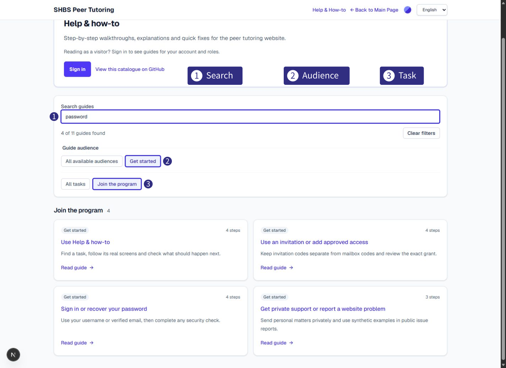

   /help · EN · 2026-11-16

   Guest search for password returns four authorized public guides, with audience and task filters selected. Clear filters is available; no private guide data is shown.

   [Original full screenshot](assets/use-help-catalogue-step-1.en.jpg) · `589c055e4b1cf166b48b353bd619ac1982e5d9f6` · Latest-main development baseline 589c055e with the Help candidate; synthetic demonstration data.

   Annotations added for this step. The original full screenshot is unchanged.

   - **1.** Search

   - **2.** Audience

   - **3.** Task

   **View 2**

   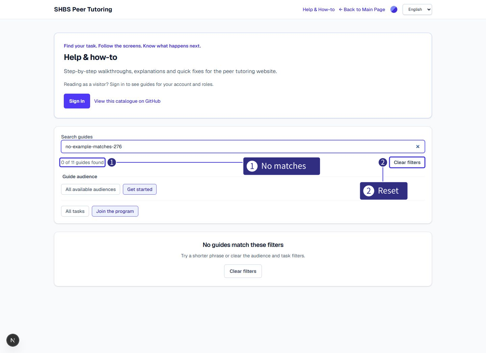

   /help · EN · 2026-11-16

   Guest Help catalogue shows zero matches for an intentionally unmatched query with both audience and task filters active; actual Clear filters controls offer reset.

   [Original full screenshot](assets/use-help-catalogue-step-1-view-2.en.jpg) · `589c055e4b1cf166b48b353bd619ac1982e5d9f6` · Latest-main development baseline 589c055e with the Help candidate; synthetic demonstration data.

   Annotations added for this step. The original full screenshot is unchanged.

   - **1.** No matches

   - **2.** Reset

   **View 3**

   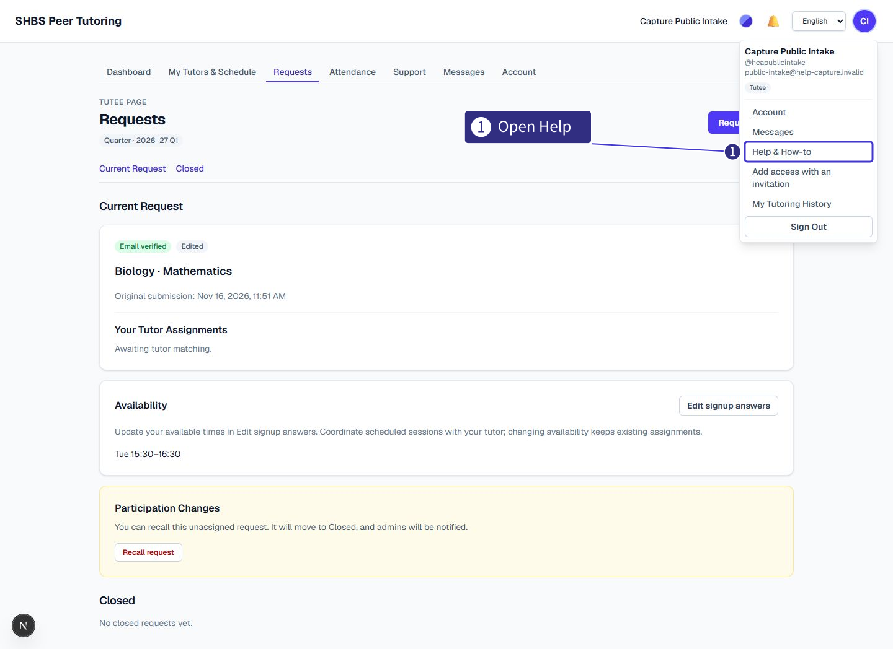

   /student?view=requests · EN · 2026-11-16

   An actually signed-in synthetic Tutee opens the account menu; Help & How-to is the real entry to guides for current account access. This supplementary frame explains signed-in discoverability, not staff access or a guest collection.

   [Original full screenshot](assets/use-help-catalogue-step-1-view-3.en.jpg) · `589c055e4b1cf166b48b353bd619ac1982e5d9f6` · Latest-main development baseline 589c055e with the Help candidate; synthetic demonstration data.

   Annotations added for this step. The original full screenshot is unchanged.

   - **1.** Open Help

   **View 4**

   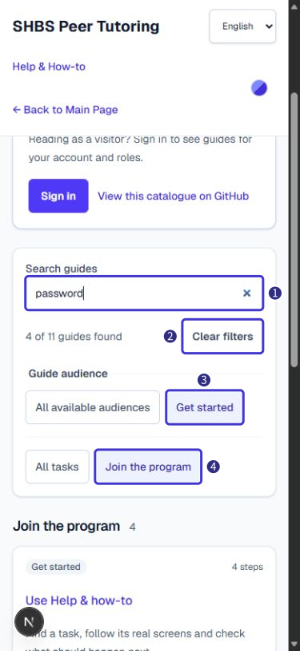

   /help · EN · 2026-11-16

   Actual 390×844 English mobile Help catalogue at a natural scroll position keeps Search guides, Clear filters, audience and task controls completely visible with four genuine password matches. Narrow frames use target outlines/numbers with the full legend outside the image.

   [Original full screenshot](assets/use-help-catalogue-step-1-view-4.en.jpg) · `589c055e4b1cf166b48b353bd619ac1982e5d9f6` · Latest-main development baseline 589c055e with the Help candidate; synthetic demonstration data.

   Annotations added for this step. The original full screenshot is unchanged.

   - **1.** Search

   - **2.** Reset

   - **3.** Audience

   - **4.** Task

2. **Follow the task guide** Choose Read guide, check Before you start, then follow numbered steps and Look for directions beside the screens. Use On this page to jump to What happens next, How it works or If something goes wrong. Open this page opens the actual feature; reading instructions grants no access.

   Look for: Numbered walkthrough, Look for and On this page

   **View 1**

   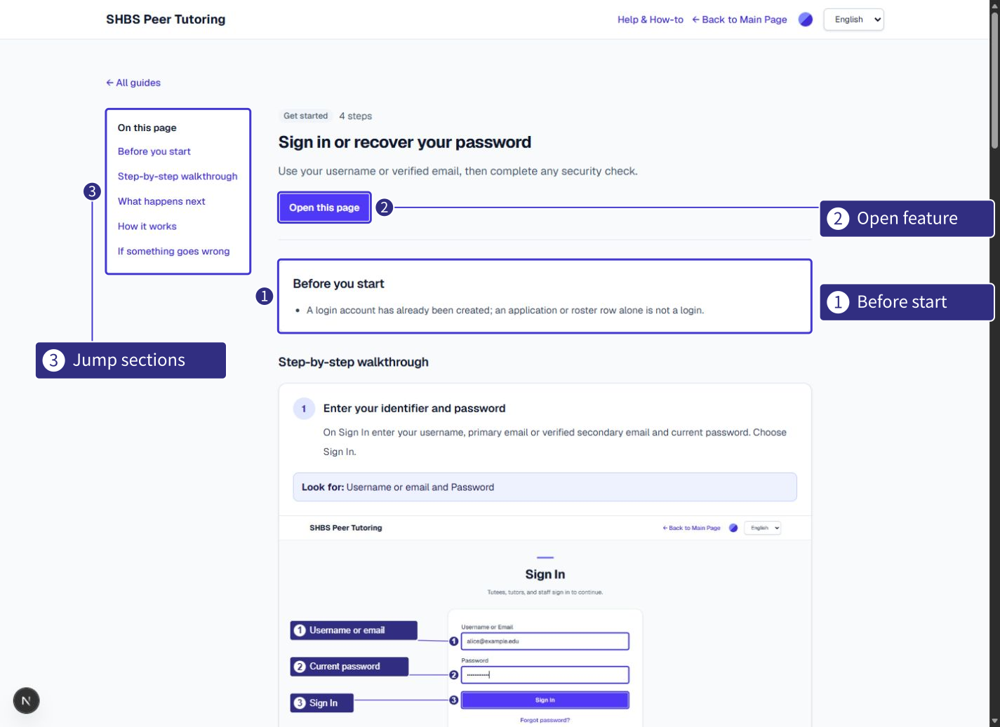

   /help/sign-in-recover · EN · 2026-11-16

   Actual public task guide header, prerequisite, numbered walkthrough and Look for direction are visible alongside On this page section links and the actual Open this page feature link.

   [Original full screenshot](assets/use-help-catalogue-step-2.en.jpg) · `589c055e4b1cf166b48b353bd619ac1982e5d9f6` · Latest-main development baseline 589c055e with the Help candidate; synthetic demonstration data.

   Annotations added for this step. The original full screenshot is unchanged.

   - **1.** Before start

   - **2.** Open feature

   - **3.** Jump sections

   **View 2**

   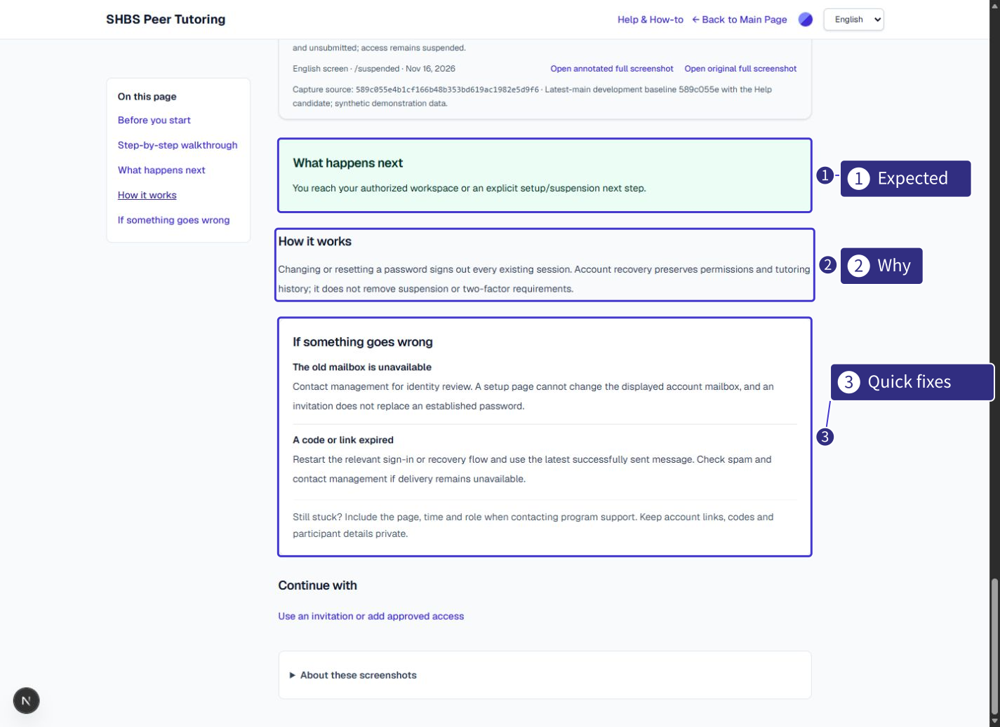

   /help/sign-in-recover · EN · 2026-11-16

   The real task guide has jumped to What happens next; actual expected outcome, How it works explanation and If something goes wrong troubleshooting are visible together.

   [Original full screenshot](assets/use-help-catalogue-step-2-view-2.en.jpg) · `589c055e4b1cf166b48b353bd619ac1982e5d9f6` · Latest-main development baseline 589c055e with the Help candidate; synthetic demonstration data.

   Annotations added for this step. The original full screenshot is unchanged.

   - **1.** Expected

   - **2.** Why

   - **3.** Quick fixes

3. **Enlarge and identify a screenshot** Choose Open full screenshot or select the image for a full-size view. Read the image's English/Chinese screen label, route and capture date. About these screenshots identifies source revision, release baseline and capture server; screenshots use synthetic demonstration accounts, and settings may change your visible controls.

   **View 1**

   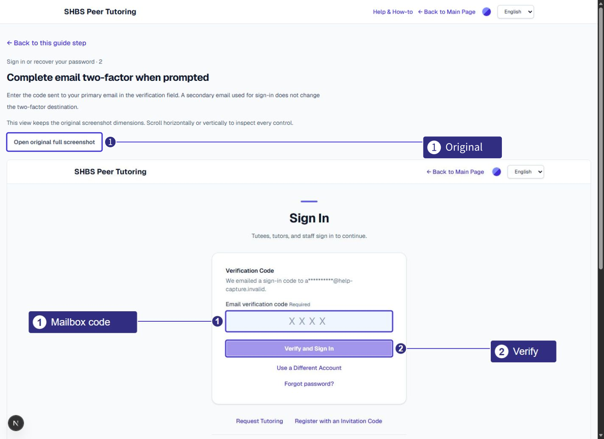

   /help/sign-in-recover/screenshots/2 · EN · 2026-11-16

   Actual full-size annotated screenshot viewer for the public two-factor guide; original screenshot link and scroll-inspection instruction are visible. The displayed source image is an empty real verification challenge; sign-in is not complete.

   [Original full screenshot](assets/use-help-catalogue-step-3.en.jpg) · `589c055e4b1cf166b48b353bd619ac1982e5d9f6` · Latest-main development baseline 589c055e with the Help candidate; synthetic demonstration data.

   Annotations added for this step. The original full screenshot is unchanged.

   - **1.** Original

   **View 2**

   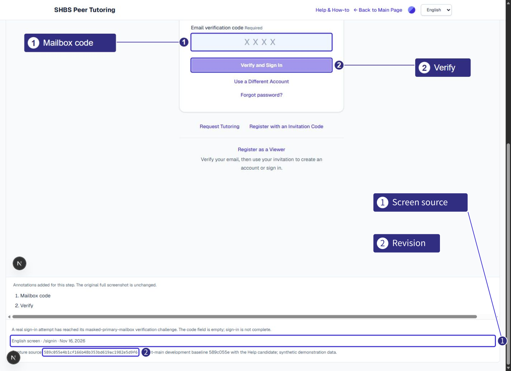

   /help/sign-in-recover/screenshots/2 · EN · 2026-11-16

   The actual full screenshot viewer is scrolled to its source footer, showing unchanged-original notice, numbered callout legend, English screen language, public route, date and exact source revision.

   [Original full screenshot](assets/use-help-catalogue-step-3-view-2.en.jpg) · `589c055e4b1cf166b48b353bd619ac1982e5d9f6` · Latest-main development baseline 589c055e with the Help candidate; synthetic demonstration data.

   Annotations added for this step. The original full screenshot is unchanged.

   - **1.** Screen source

   - **2.** Revision

   **View 3**

   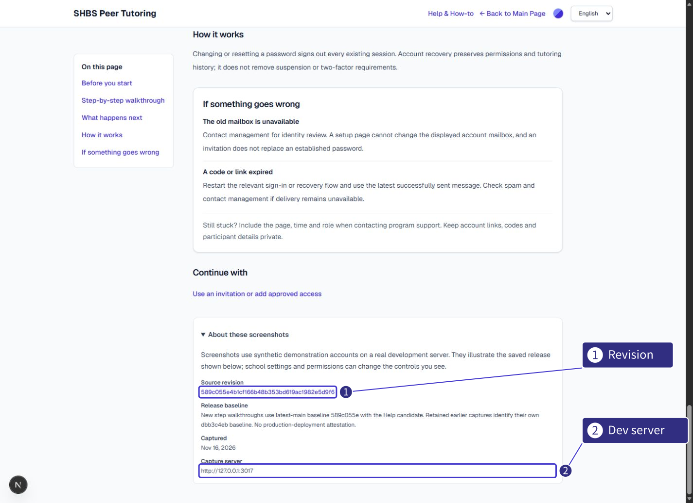

   /help/sign-in-recover#step-2 · EN · 2026-11-16

   The actual About these screenshots disclosure is expanded and scrolled into view, naming source revision, latest-main development baseline, captured date and owned capture server; it expressly disclaims production-deployment attestation.

   [Original full screenshot](assets/use-help-catalogue-step-3-view-3.en.jpg) · `589c055e4b1cf166b48b353bd619ac1982e5d9f6` · Latest-main development baseline 589c055e with the Help candidate; synthetic demonstration data.

   Annotations added for this step. The original full screenshot is unchanged.

   - **1.** Revision

   - **2.** Dev server

4. **Find your role collection or an offline handbook** Sign in to reveal current account, participation and assigned-role guides. Staff can use administration → PDF handbooks to download the editions available to their account. Old FAQ links continue to this catalogue. Use the catalogue's GitHub link for its maintained repository copy.

   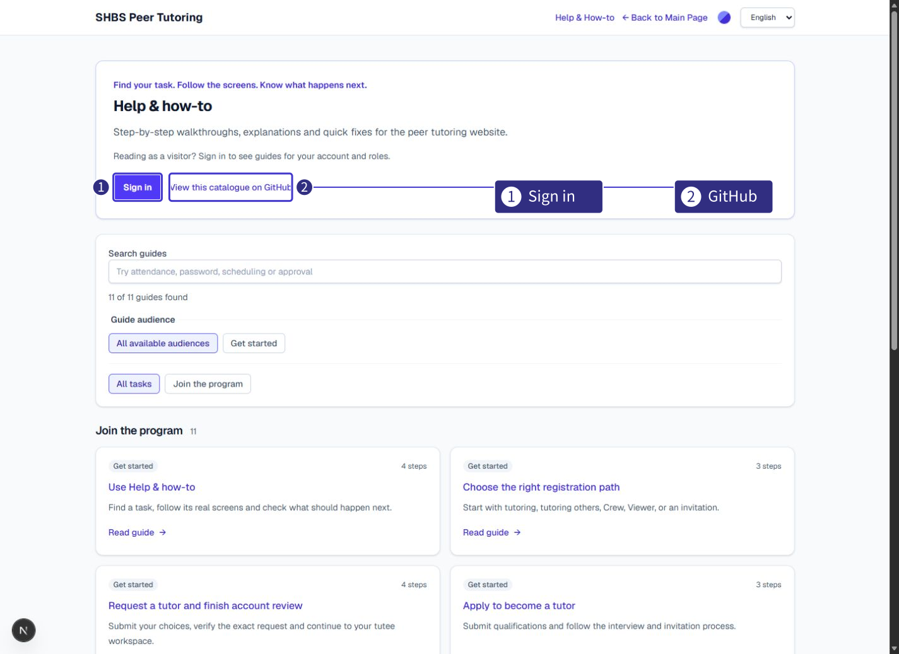

   /help · EN · 2026-11-16

   Guest Help shows Sign in for account-specific guides and the maintained GitHub copy. Privileged staff handbook pages are not shown in this public frame.

   [Original full screenshot](assets/use-help-catalogue-step-4.en.jpg) · `589c055e4b1cf166b48b353bd619ac1982e5d9f6` · Latest-main development baseline 589c055e with the Help candidate; synthetic demonstration data.

   Annotations added for this step. The original full screenshot is unchanged.

   - **1.** Sign in

   - **2.** GitHub

### What happens next

You find an available task guide, understand its expected result and can inspect the screenshot's origin.

### How it works

Audience and task filters only narrow guides already authorized by the server. Tutor, Tutee, Crew and Translator access are independent of management rank. Screenshot provenance records an illustrative release state; it does not prove every school configuration looks identical.

### Troubleshooting

- **No guide matches or your role collection is missing** Try a shorter phrase and Clear filters. Sign in with the intended account. If the collection still does not appear, ask management to check current membership/assignment and permissions; a filter or old bookmark cannot grant access.

- **The image language or controls differ** Read the caption and release baseline, use the named controls in your interface and enlarge the image. English is used when no Chinese capture is available. Report a persistent release mismatch with its guide title and capture date, without sharing private records.

## Choose the right registration path

Start with tutoring, tutoring others, Crew, Viewer, or an invitation.

Open: `/signin`

### Before you start

- Use the website address supplied by your program. Read Privacy policy from the homepage information menu/footer or /privacy before providing personal information; English and Chinese are available.

### Walkthrough

1. **Choose what you need** From Home, choose Request a Tutor to receive tutoring, Become a Tutor to apply to teach, or Join the crew for room patrol. Use Register as a Viewer for read-only observation when available.

   Look for: Registration links below Sign In

   **View 1**

   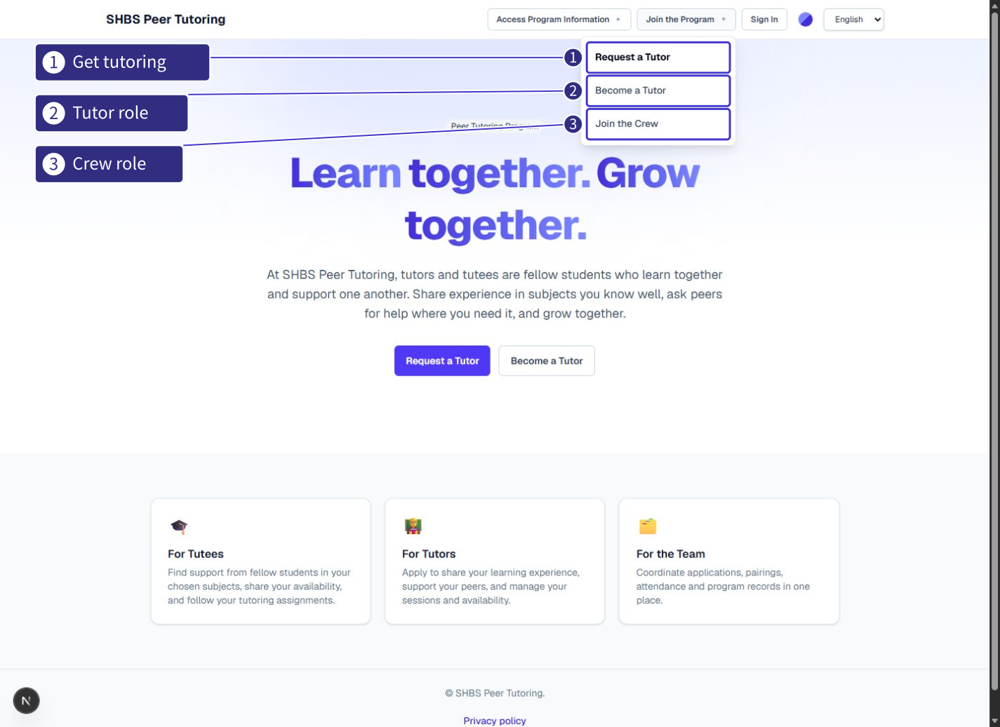

   / · EN · 2026-11-16

   Home with the real Join the Program menu expanded: tutoring request, tutor application and Crew entry. Viewer registration is shown separately on Sign In.

   [Original full screenshot](assets/choose-registration-step-1.en.jpg) · `589c055e4b1cf166b48b353bd619ac1982e5d9f6` · Latest-main development baseline 589c055e with the Help candidate; synthetic demonstration data.

   Annotations added for this step. The original full screenshot is unchanged.

   - **1.** Get tutoring

   - **2.** Tutor role

   - **3.** Crew role

   **View 2**

   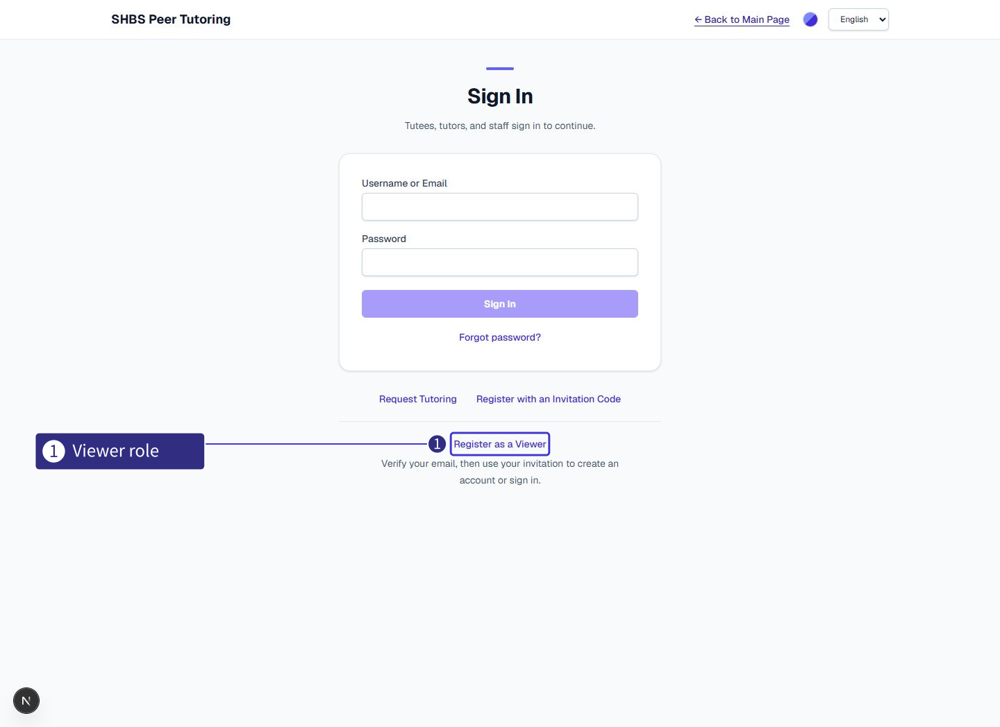

   /signin · EN · 2026-11-16

   Sign In offers the genuine Register as a Viewer entry; this is separate from the Home tutor, tutee and Crew choices.

   [Original full screenshot](assets/choose-registration-step-1-view-2.en.jpg) · `589c055e4b1cf166b48b353bd619ac1982e5d9f6` · Latest-main development baseline 589c055e with the Help candidate; synthetic demonstration data.

   Annotations added for this step. The original full screenshot is unchanged.

   - **1.** Viewer role

2. **Use an invitation when you have one** Choose Register with an Invitation Code. Existing accounts can use Add access from their account menu instead of creating another account.

   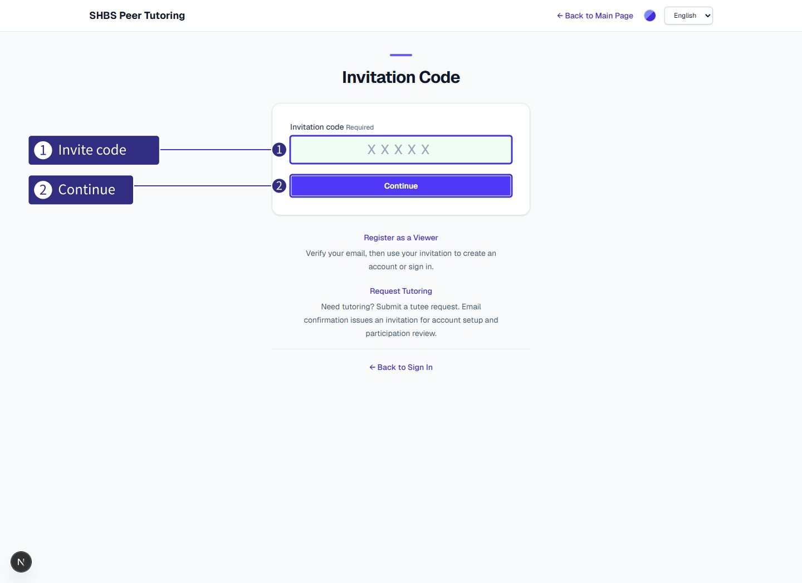

   /register-account · EN · 2026-11-16

   Guest invitation entry with empty code field and Continue; the existing-account Add access variant is a separate route.

   [Original full screenshot](assets/choose-registration-step-2.en.jpg) · `589c055e4b1cf166b48b353bd619ac1982e5d9f6` · Latest-main development baseline 589c055e with the Help candidate; synthetic demonstration data.

   Annotations added for this step. The original full screenshot is unchanged.

   - **1.** Invite code

   - **2.** Continue

3. **Check the opening notice** A tutor or tutee form outside recruitment is a read-only preview. Check its opening time in the displayed program timezone and return when intake opens.

   **View 1**

   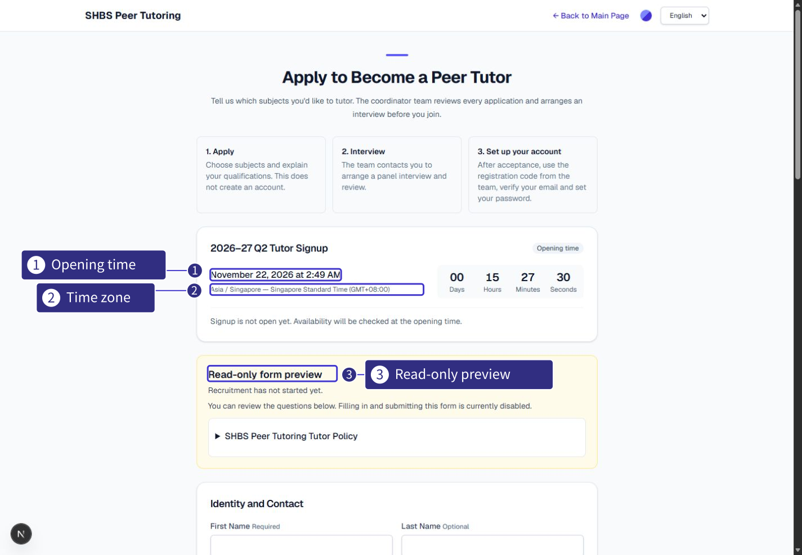

   /tutor-signup · EN · 2026-11-21

   The real Q2 Tutor signup notice shows its scheduled opening in the program timezone. You can read the form now and return after the opening time.

   [Original full screenshot](assets/choose-registration-step-3.en.jpg) · `1df44d6bb31cf04352adae9c65819139b7b747d8` · Latest-main development baseline 1df44d6b, selected 2026-11-21, with the Help candidate and synthetic demo records.

   Annotations added for this step. The original full screenshot is unchanged.

   - **1.** Opening time

   - **2.** Time zone

   - **3.** Read-only preview

   **View 2**

   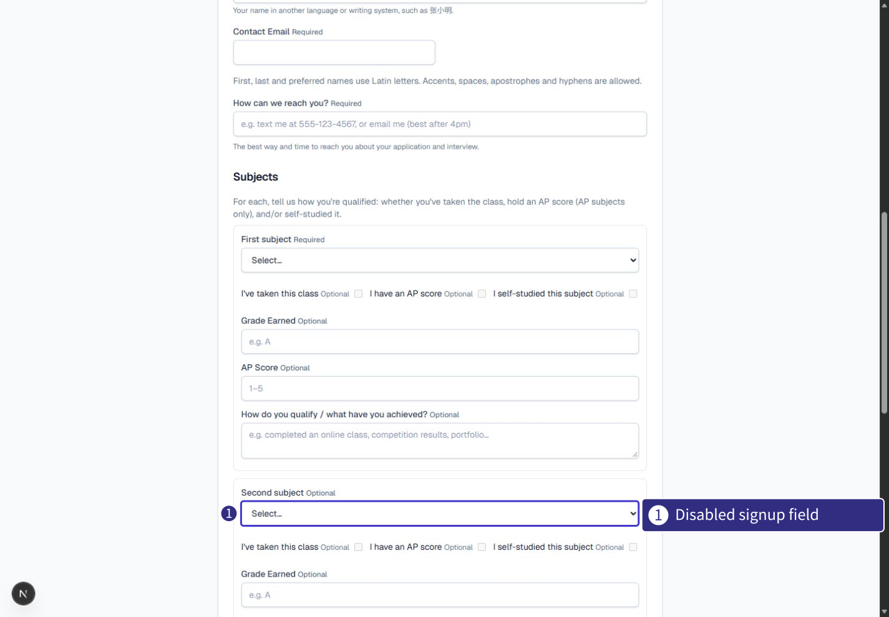

   /tutor-signup · EN · 2026-11-20

   The closed form can be read, but its Tutor application fields are disabled until recruitment opens.

   [Original full screenshot](assets/choose-registration-step-3-view-2.en.jpg) · `b5ece465681957c9fe579d26babdeb260c674fa0` · Latest-main development baseline b5ece465, selected 2026-11-20, with the Help candidate. Isolated synthetic first-report demonstration phase.

   Annotations added for this step. The original full screenshot is unchanged.

   - **1.** Disabled signup field

### What happens next

You are on the application or invitation page for your intended access.

### How it works

An application, an approved roster entry, email verification and a ready login are different stages. Participation and management authority are separate.

Tutor and tutee opening times can differ. A configured opening may still need activation and review. Return when the form is open to submit it.

### Troubleshooting

- **Viewer signup or another entry is missing** The program may have disabled that path. Ask management which application or authorized invitation to use; do not register a second account to bypass access rules.

## Request a tutor and finish account review

Submit your choices, verify the exact request and continue to your tutee workspace.

Open: `/tutee-signup`

### Before you start

- Tutee recruitment is open and a current participation policy is published.
- Use an email you can access, preferably an address already verified on your existing account.

### Walkthrough

1. **Complete the request** Choose Request a Tutor. Enter the required names, contact preference, subject choices and available catalogue times. Read the policy, scroll to its end, agree and sign before Save and verify email.

   Look for: Required fields, subject choices and policy agreement

   **View 1**

   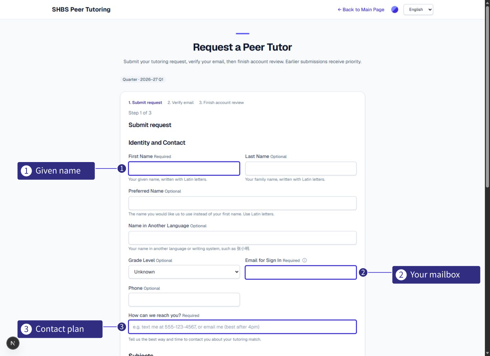

   /tutee-signup · EN · 2026-11-16

   Actual open Request a Peer Tutor form shows required identity and mailbox/contact fields before submission. All identity and contact fields are empty; no policy, signature or request has been submitted.

   [Original full screenshot](assets/request-tutoring-step-1.en.jpg) · `589c055e4b1cf166b48b353bd619ac1982e5d9f6` · Latest-main development baseline 589c055e with the Help candidate; synthetic demonstration data.

   Annotations added for this step. The original full screenshot is unchanged.

   - **1.** Given name

   - **2.** Your mailbox

   - **3.** Contact plan

   **View 2**

   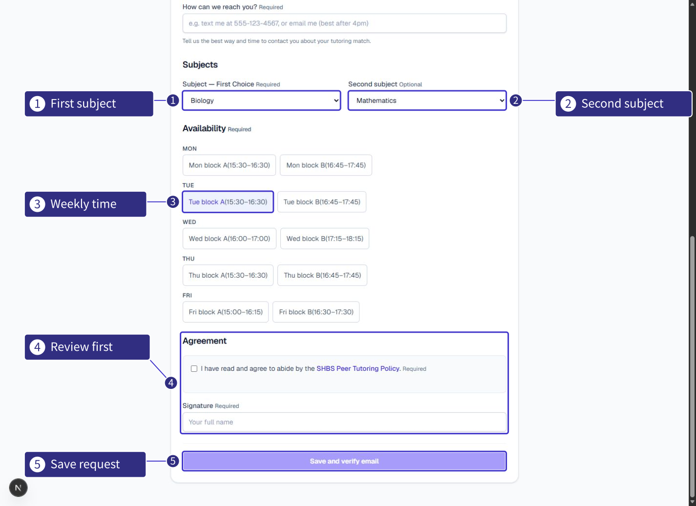

   /tutee-signup · EN · 2026-11-16

   Unsubmitted tutoring request draft shows Biology first choice, Mathematics optional second choice and Tuesday block A selected from the real catalogue. Policy agreement remains unchecked, signature empty and Save and verify email disabled.

   [Original full screenshot](assets/request-tutoring-step-1-view-2.en.jpg) · `589c055e4b1cf166b48b353bd619ac1982e5d9f6` · Latest-main development baseline 589c055e with the Help candidate; synthetic demonstration data.

   Annotations added for this step. The original full screenshot is unchanged.

   - **1.** First subject

   - **2.** Second subject

   - **3.** Weekly time

   - **4.** Review first

   - **5.** Save request

   **View 3**

   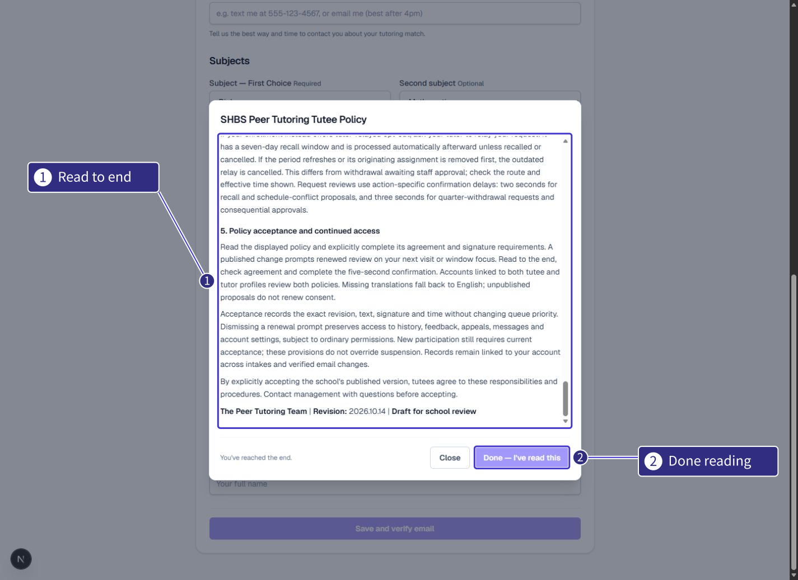

   /tutee-signup · EN · 2026-11-16

   The real tutee policy reader has been scrolled to its end; Done — I have read this is enabled. Reading is not agreement: the agreement checkbox has not been accepted, and no signature/request was submitted. Synthetic seed policy is labelled Draft for school review.

   [Original full screenshot](assets/request-tutoring-step-1-view-3.en.jpg) · `589c055e4b1cf166b48b353bd619ac1982e5d9f6` · Latest-main development baseline 589c055e with the Help candidate; synthetic demonstration data.

   Annotations added for this step. The original full screenshot is unchanged.

   - **1.** Read to end

   - **2.** Done reading

   **View 4**

   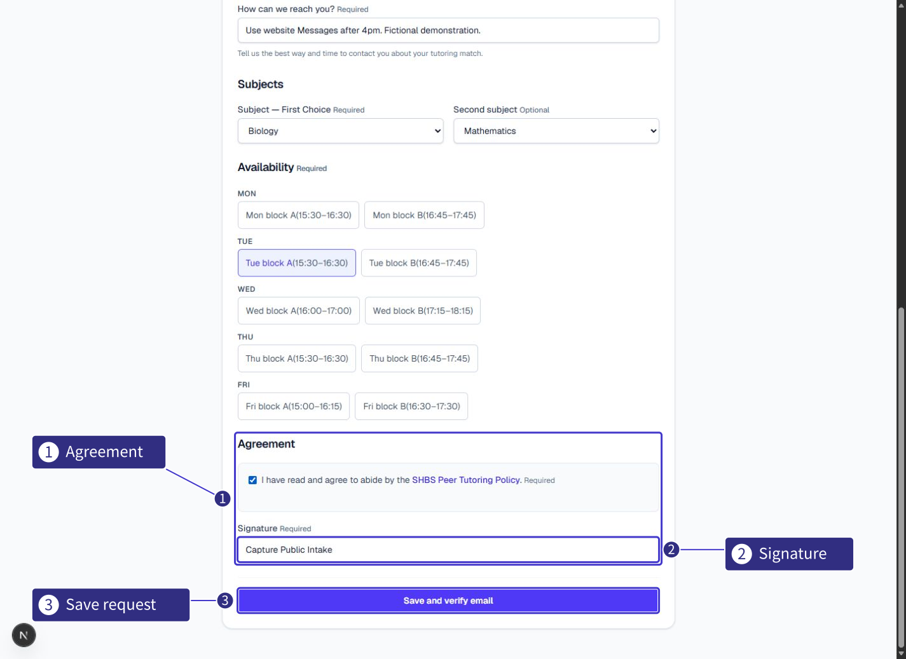

   /tutee-signup · EN · 2026-11-16

   Dedicated fictional existing-account request has actual policy reading completed, nonbinding demonstration agreement checked and synthetic signature Capture Public Intake entered. Save and verify email is now enabled; request has not yet been saved at this frame.

   [Original full screenshot](assets/request-tutoring-step-1-view-4.en.jpg) · `589c055e4b1cf166b48b353bd619ac1982e5d9f6` · Latest-main development baseline 589c055e with the Help candidate; synthetic demonstration data.

   Annotations added for this step. The original full screenshot is unchanged.

   - **1.** Agreement

   - **2.** Signature

   - **3.** Save request

2. **Verify this submission** Enter the four-digit emailed verification code, keeping leading zeros. An existing emailed confirmation link can also be opened and explicitly confirmed. Use the code step's resend if mail is missing.

   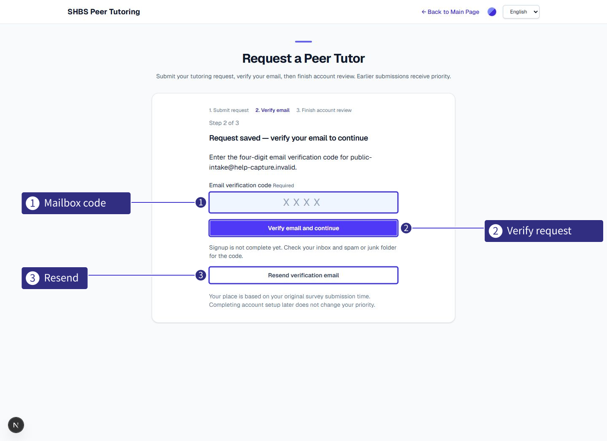

   /tutee-signup · EN · 2026-11-16

   Actual fictional tutoring request has been saved and reached Step 2: verify this exact submission with the separate four-digit mailbox code. The code field is empty, and Verify email and continue plus Resend verification email are visible. Signup is explicitly not complete yet.

   [Original full screenshot](assets/request-tutoring-step-2.en.jpg) · `589c055e4b1cf166b48b353bd619ac1982e5d9f6` · Latest-main development baseline 589c055e with the Help candidate; synthetic demonstration data.

   Annotations added for this step. The original full screenshot is unchanged.

   - **1.** Mailbox code

   - **2.** Verify request

   - **3.** Resend

3. **Finish the shared account review** In the invitation popup choose Finish account review. Review this submission's answers and signed policy; create only missing credentials. Existing accounts complete normal sign-in and any two-factor check, then explicitly accept the request.

   Look for: Continue to account review

   **View 1**

   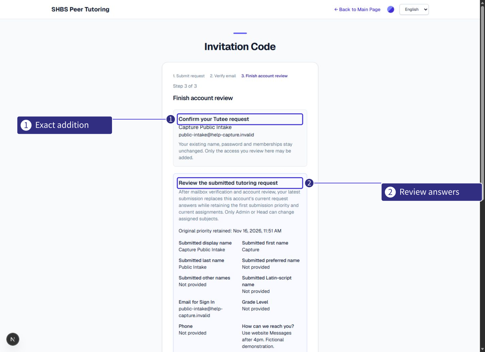

   /register-account · EN · 2026-11-16

   Actual verified dedicated fictional request is at Finish account review, showing exact Tutee addition and submitted identity/answers. Existing account credentials are retained; acceptance and any required ordinary sign-in are not yet completed. No invitation code is visible.

   [Original full screenshot](assets/request-tutoring-step-3.en.jpg) · `589c055e4b1cf166b48b353bd619ac1982e5d9f6` · Latest-main development baseline 589c055e with the Help candidate; synthetic demonstration data.

   Annotations added for this step. The original full screenshot is unchanged.

   - **1.** Exact addition

   - **2.** Review answers

   **View 2**

   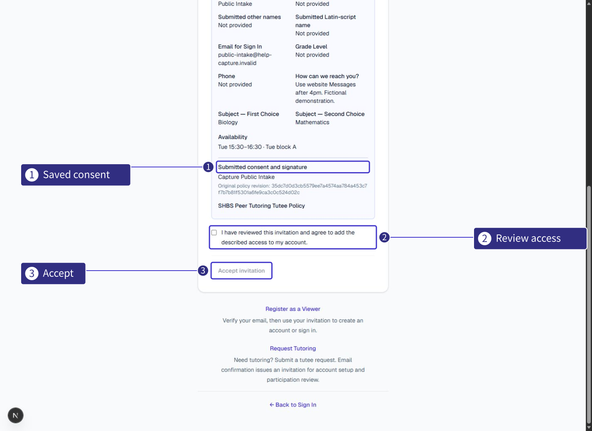

   /register-account · EN · 2026-11-16

   Actual account review lower section shows submitted subject/time choices, saved fictional consent/signature and exact original policy revision. The explicit review checkbox is unchecked and Accept invitation disabled; no acceptance has occurred yet.

   [Original full screenshot](assets/request-tutoring-step-3-view-2.en.jpg) · `589c055e4b1cf166b48b353bd619ac1982e5d9f6` · Latest-main development baseline 589c055e with the Help candidate; synthetic demonstration data.

   Annotations added for this step. The original full screenshot is unchanged.

   - **1.** Saved consent

   - **2.** Review access

   - **3.** Accept

4. **Check the confirmed request** Open Enter Tutee Page → Requests. Check request confirmation separately from tutor assignment and schedule status. You may close and reopen the invitation receipt without repeating mailbox verification while it remains valid.

   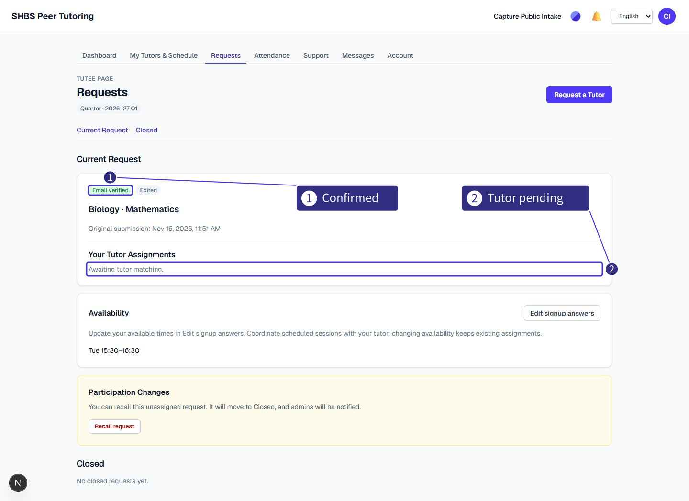

   /student?view=requests · EN · 2026-11-16

   The fictional accepted request is now in the real Student Requests workspace: Email verified, Biology/Mathematics and original submission time are shown, while tutor matching is separately Awaiting tutor matching. No tutor assignment or scheduled session is claimed.

   [Original full screenshot](assets/request-tutoring-step-4.en.jpg) · `589c055e4b1cf166b48b353bd619ac1982e5d9f6` · Latest-main development baseline 589c055e with the Help candidate; synthetic demonstration data.

   Annotations added for this step. The original full screenshot is unchanged.

   - **1.** Confirmed

   - **2.** Tutor pending

### What happens next

Requests shows your confirmed request, with assignment and scheduling states shown separately.

### How it works

The first eligible saved submission establishes queue priority; mailbox verification alone does not complete signup. A proven replacement of an existing open request preserves its original priority, assignments, attendance and original agreement while recording the new submission's consent.

A first assignment starts a fixed seven-day verification deadline. Resends, reassignment and replacement submissions do not extend it.

### Troubleshooting

- **Mail or saving failed** Keep the form open. Retry the unchanged submission or use its resend/recovery action; do not submit another application just because mail is delayed. After a saved result with failed refresh, retry the read.

- **The invitation or staged submission expired** Return to the originating request's recovery instructions or contact management, especially if the email was wrong. A resend cannot extend an expired fixed assignment deadline.

## Apply to become a tutor

Submit qualifications and follow the interview and invitation process.

Open: `/tutor-signup`

### Before you start

- Tutor recruitment is open and the tutor policy is available.

### Walkthrough

1. **Enter your application** Choose Become a Tutor. Fill required identity and contact fields, select up to three offered subjects and explain the requested qualifications, grades, AP scores or self-study experience when applicable.

   Look for: Subject qualification questions

   **View 1**

   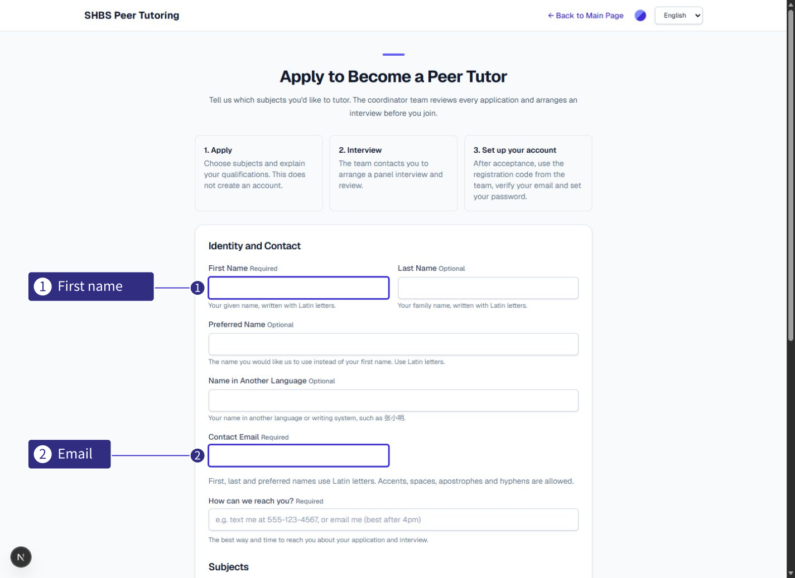

   /tutor-signup · EN · 2026-11-16

   Open tutor application identity/contact section with empty synthetic-entry fields; subject qualification controls are shown in a separate view. No application is submitted.

   [Original full screenshot](assets/apply-tutor-step-1.en.jpg) · `589c055e4b1cf166b48b353bd619ac1982e5d9f6` · Latest-main development baseline 589c055e with the Help candidate; synthetic demonstration data.

   Annotations added for this step. The original full screenshot is unchanged.

   - **1.** First name

   - **2.** Email

   **View 2**

   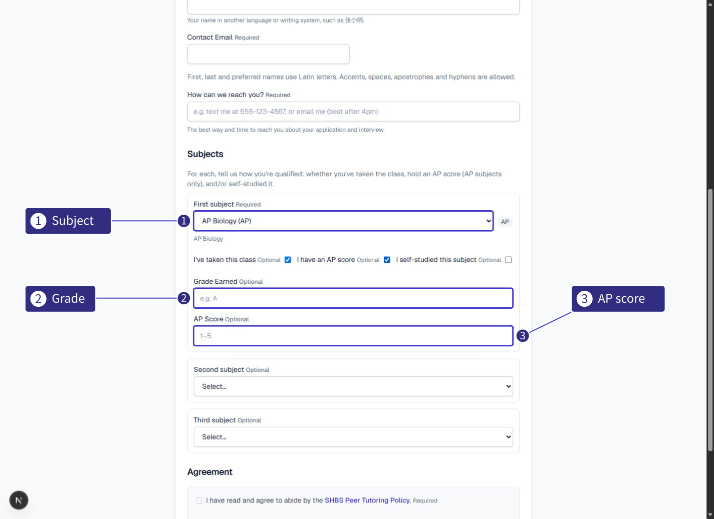

   /tutor-signup · EN · 2026-11-16

   Unsubmitted AP Biology example with class/AP options selected to reveal the actual Grade Earned and AP Score fields; no qualification is granted.

   [Original full screenshot](assets/apply-tutor-step-1-view-2.en.jpg) · `589c055e4b1cf166b48b353bd619ac1982e5d9f6` · Latest-main development baseline 589c055e with the Help candidate; synthetic demonstration data.

   Annotations added for this step. The original full screenshot is unchanged.

   - **1.** Subject

   - **2.** Grade

   - **3.** AP score

   **View 3**

   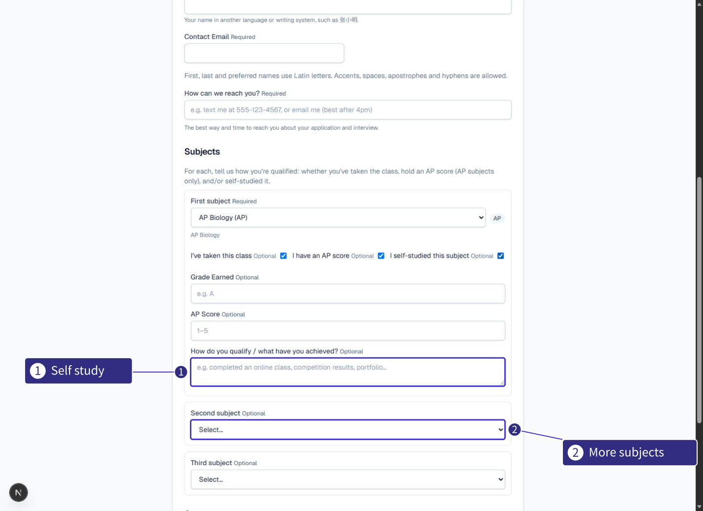

   /tutor-signup · EN · 2026-11-16

   Unsubmitted qualification draft with the self-study explanation field and additional-subject control visible; no policy or application has been accepted.

   [Original full screenshot](assets/apply-tutor-step-1-view-3.en.jpg) · `589c055e4b1cf166b48b353bd619ac1982e5d9f6` · Latest-main development baseline 589c055e with the Help candidate; synthetic demonstration data.

   Annotations added for this step. The original full screenshot is unchanged.

   - **1.** Self study

   - **2.** More subjects

2. **Read and submit** Read the displayed tutor policy and complete its agreement. Check the saved application receipt; wait for the team to arrange screening or an interview.

   **View 1**

   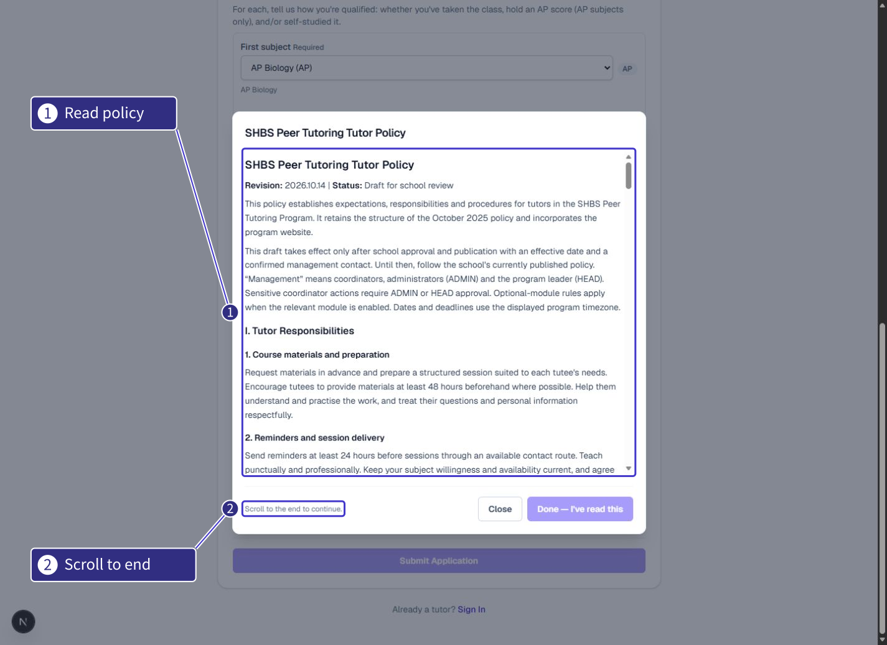

   /tutor-signup · EN · 2026-11-16

   Actual tutor policy reader before reading to the end; Continue remains disabled. No agreement is checked and no application is submitted.

   [Original full screenshot](assets/apply-tutor-step-2.en.jpg) · `589c055e4b1cf166b48b353bd619ac1982e5d9f6` · Latest-main development baseline 589c055e with the Help candidate; synthetic demonstration data.

   Annotations added for this step. The original full screenshot is unchanged.

   - **1.** Read policy

   - **2.** Scroll to end

   **View 2**

   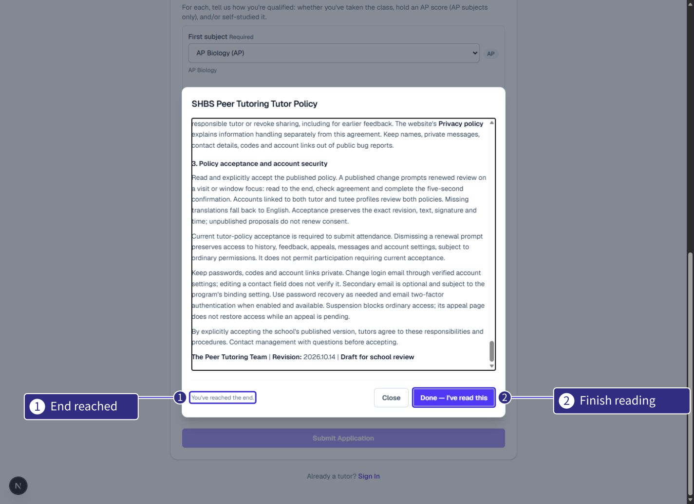

   /tutor-signup · EN · 2026-11-16

   The real policy reader has been scrolled to its end. Done is now available, but the agreement has not been checked and no application is submitted.

   [Original full screenshot](assets/apply-tutor-step-2-view-2.en.jpg) · `589c055e4b1cf166b48b353bd619ac1982e5d9f6` · Latest-main development baseline 589c055e with the Help candidate; synthetic demonstration data.

   Annotations added for this step. The original full screenshot is unchanged.

   - **1.** End reached

   - **2.** Finish reading

   **View 3**

   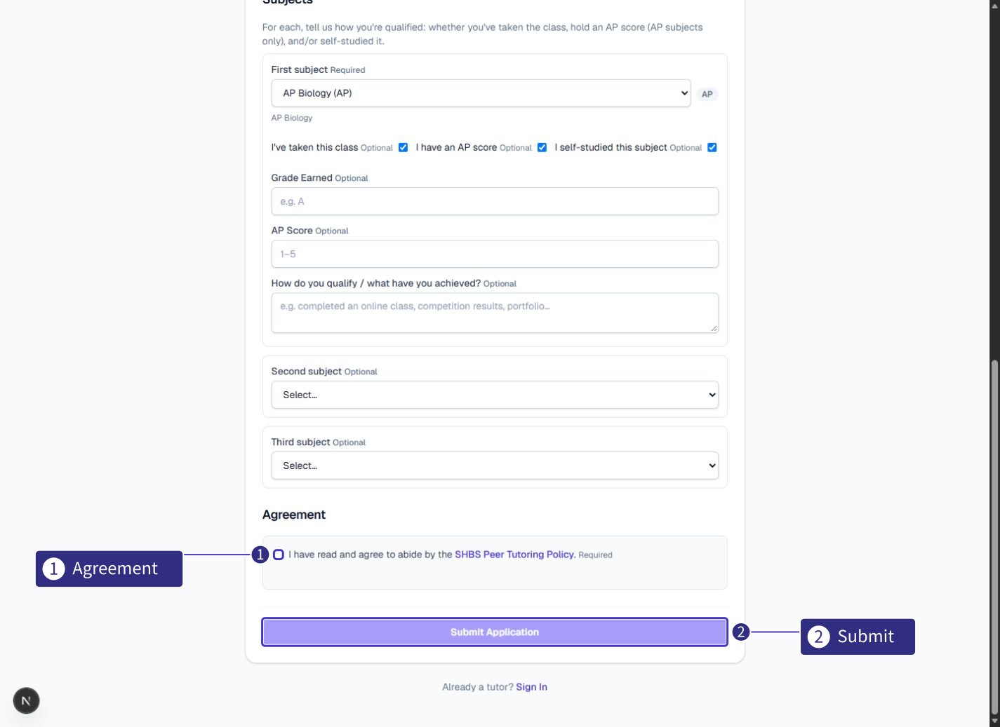

   /tutor-signup · EN · 2026-11-16

   Back on the application after reading the policy. The agreement remains unchecked and Submit is disabled because required answers/consent are incomplete; no application is submitted.

   [Original full screenshot](assets/apply-tutor-step-2-view-3.en.jpg) · `589c055e4b1cf166b48b353bd619ac1982e5d9f6` · Latest-main development baseline 589c055e with the Help candidate; synthetic demonstration data.

   Annotations added for this step. The original full screenshot is unchanged.

   - **1.** Agreement

   - **2.** Submit

3. **Follow your accepted invitation** After acceptance, use the supplied Tutor code or setup invitation, verify your email and finish shared account review. Then open the tutor workspace and check activation and current policy requirements.

   **View 1**

   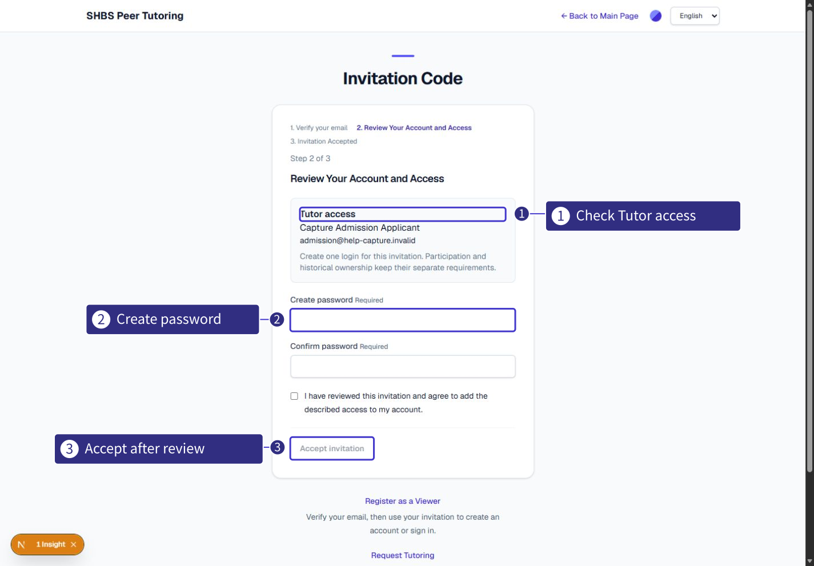

   /register-account · EN · 2026-11-20

   The approved Tutor’s verified mailbox opens a genuine review that offers Tutor access. The credentials are empty and no account was created.

   [Original full screenshot](assets/apply-tutor-step-3.en.jpg) · `b5ece465681957c9fe579d26babdeb260c674fa0` · Latest-main development baseline b5ece465, selected 2026-11-20, with the Help candidate and synthetic demo records.

   Annotations added for this step. The original full screenshot is unchanged.

   - **1.** Check Tutor access

   - **2.** Create password

   - **3.** Accept after review

   **View 2**

   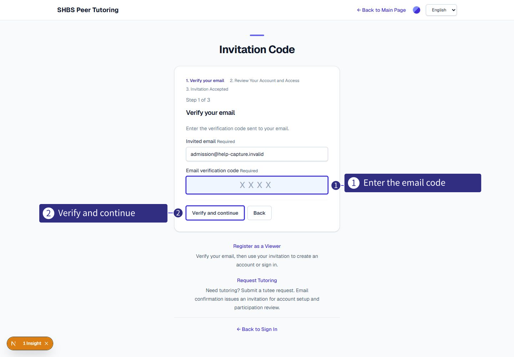

   /register-account · EN · 2026-11-20

   The actual approved synthetic Tutor invitation requested separate mailbox verification. The blue field is still empty.

   [Original full screenshot](assets/apply-tutor-step-3-view-2.en.jpg) · `b5ece465681957c9fe579d26babdeb260c674fa0` · Latest-main development baseline b5ece465, selected 2026-11-20, with the Help candidate and synthetic demo records.

   Annotations added for this step. The original full screenshot is unchanged.

   - **1.** Enter the email code

   - **2.** Verify and continue

### What happens next

A submission is recorded for review; only the later approved invitation/account workflow grants tutor access.

### How it works

Submitting again while the same email's application is under review preserves the original answers and does not notify the team again. Interview completion, admission and awarded interview hours are distinct evidence.

### Troubleshooting

- **Questions or policy do not load** Use Retry. The program needs configured subjects and a published policy; contact management if the form remains unavailable.

- **You need to correct a submitted answer** Contact the team rather than repeatedly applying. Staff can review eligible initial name corrections without rewriting your signed policy or other application evidence.

## Apply to Crew and check your application

Verify your mailbox, wait for staff approval and retrieve an approved invitation.

Open: `/crew-signup`

### Before you start

- Crew applications are available and you can access the submitted email.

### Walkthrough

1. **Apply and verify** Complete Join the crew and enter the emailed verification code. This sends the application to staff; it does not create a login or Crew membership.

   Look for: Application and check-status entry

   **View 1**

   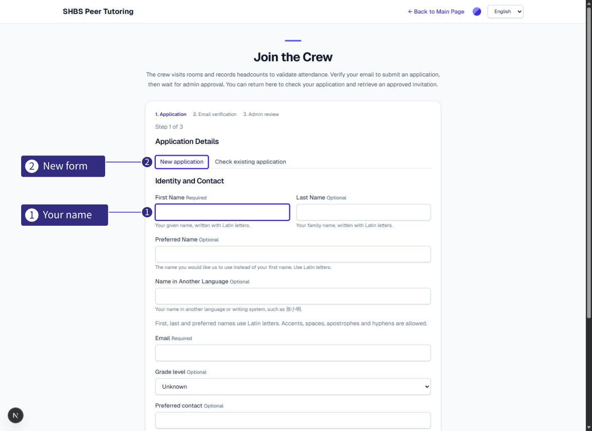

   /crew-signup · EN · 2026-11-16

   Actual Join the Crew new-application entry shows the required name controls and separate email verification/admin review progression. All fields are empty; no application, login or Crew membership created.

   [Original full screenshot](assets/apply-crew-step-1.en.jpg) · `589c055e4b1cf166b48b353bd619ac1982e5d9f6` · Latest-main development baseline 589c055e with the Help candidate; synthetic demonstration data.

   Annotations added for this step. The original full screenshot is unchanged.

   - **1.** Your name

   - **2.** New form

   **View 2**

   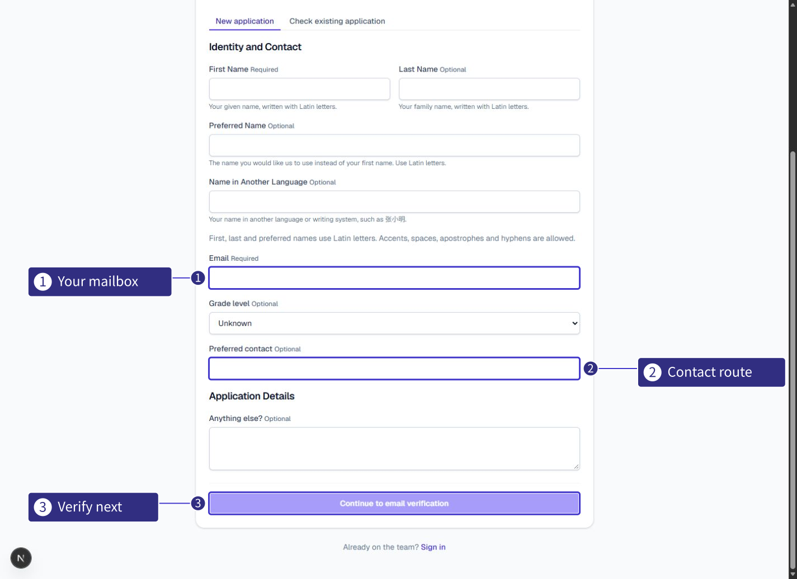

   /crew-signup · EN · 2026-11-16

   Actual lower Crew application form shows mailbox, optional grade/contact and supporting details plus Continue to email verification. The form is empty and disabled; no mailbox verification or staff approval has occurred.

   [Original full screenshot](assets/apply-crew-step-1-view-2.en.jpg) · `589c055e4b1cf166b48b353bd619ac1982e5d9f6` · Latest-main development baseline 589c055e with the Help candidate; synthetic demonstration data.

   Annotations added for this step. The original full screenshot is unchanged.

   - **1.** Your mailbox

   - **2.** Contact route

   - **3.** Verify next

2. **Check an existing application** On the same page, enter its email in the status-check flow and verify a fresh mailbox code. Pending and rejected applications show their status without an invitation.

   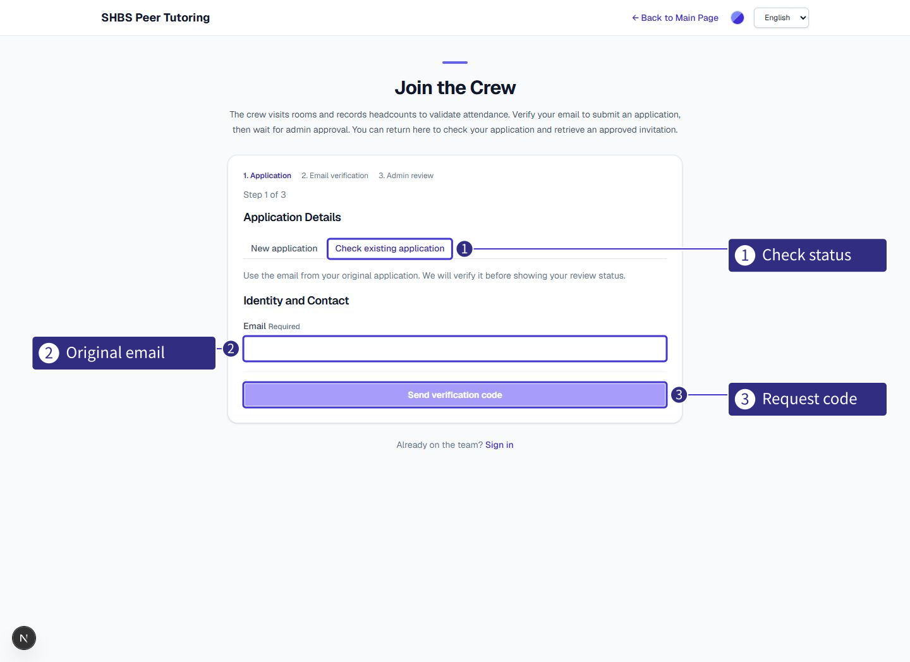

   /crew-signup · EN · 2026-11-16

   Actual Check existing application flow asks for the original application email and a fresh verification code before showing status. The field is empty and Send verification code disabled; no application status or invitation has been disclosed.

   [Original full screenshot](assets/apply-crew-step-2.en.jpg) · `589c055e4b1cf166b48b353bd619ac1982e5d9f6` · Latest-main development baseline 589c055e with the Help candidate; synthetic demonstration data.

   Annotations added for this step. The original full screenshot is unchanged.

   - **1.** Check status

   - **2.** Original email

   - **3.** Request code

3. **Accept approved access** An approved, usable invitation opens a popup. Copy the code, optionally Email code, or continue through the prefilled account review link. Existing accounts add approved Crew access while retaining credentials and other eligible access.

   **View 1**

   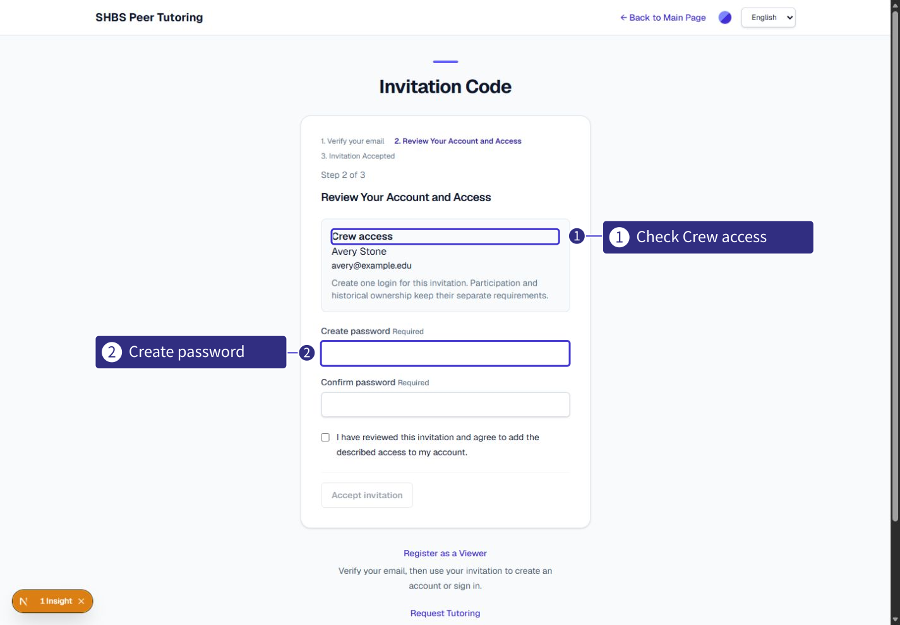

   /register-account · EN · 2026-11-20

   The saved Crew approval leads to a real account review with Crew access. Credentials remain blank and the invitation has not been accepted.

   [Original full screenshot](assets/apply-crew-step-3.en.jpg) · `b5ece465681957c9fe579d26babdeb260c674fa0` · Latest-main development baseline b5ece465, selected 2026-11-20, with the Help candidate and synthetic demo records.

   Annotations added for this step. The original full screenshot is unchanged.

   - **1.** Check Crew access

   - **2.** Create password

   **View 2**

   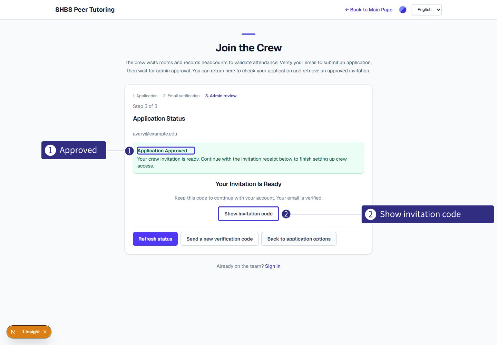

   /crew-signup · EN · 2026-11-20

   After email verification, the real synthetic Crew application shows Application Approved. The active invitation is available and the code dialog is closed.

   [Original full screenshot](assets/apply-crew-step-3-view-2.en.jpg) · `b5ece465681957c9fe579d26babdeb260c674fa0` · Latest-main development baseline b5ece465, selected 2026-11-20, with the Help candidate and synthetic demo records.

   Annotations added for this step. The original full screenshot is unchanged.

   - **1.** Approved

   - **2.** Show invitation code

### What happens next

Your status is visible, or approved Crew access is explicitly accepted through account review.

### How it works

Repeating an under-review Crew application keeps its original answers. Checking status or verifying email never substitutes for staff approval.

### Troubleshooting

- **Approval has no usable invitation** Follow the displayed expiry, revocation or already-used guidance and contact the team. Resending or changing the email requires a new verification code.

## Register for read-only Viewer access

Verify your email and review the access offered to your account.

Open: `/viewer-signup`

### Before you start

- Public Viewer signup is enabled by the program.

### Walkthrough

1. **Enter Viewer details** Choose Register as a Viewer and supply the requested name, affiliation and email. Verify the initial emailed code.

   Look for: Viewer Registration name, affiliation and email fields

   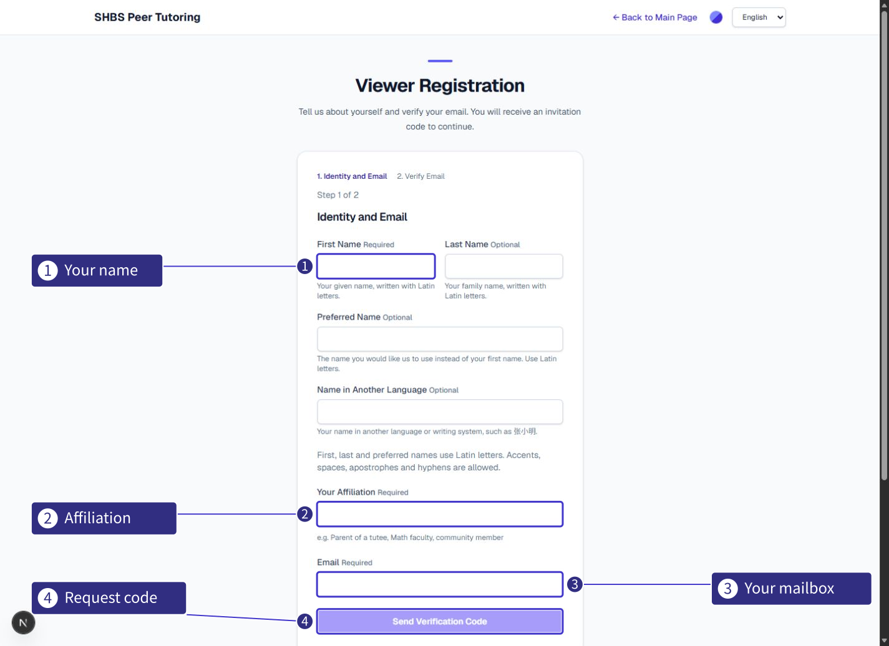

   /viewer-signup · EN · 2026-11-16

   Actual public Viewer Registration identity/email step before any submission: requested name, affiliation and mailbox fields are empty and Send Verification Code is disabled. No Viewer permission or account has been created.

   [Original full screenshot](assets/register-viewer-step-1.en.jpg) · `589c055e4b1cf166b48b353bd619ac1982e5d9f6` · Latest-main development baseline 589c055e with the Help candidate; synthetic demonstration data.

   Annotations added for this step. The original full screenshot is unchanged.

   - **1.** Your name

   - **2.** Affiliation

   - **3.** Your mailbox

   - **4.** Request code

2. **Continue from the invitation** Use the invitation popup's continuation link. A new account reviews the prefilled details and creates missing credentials. You can copy or optionally email its separate invitation code.

   **View 1**

   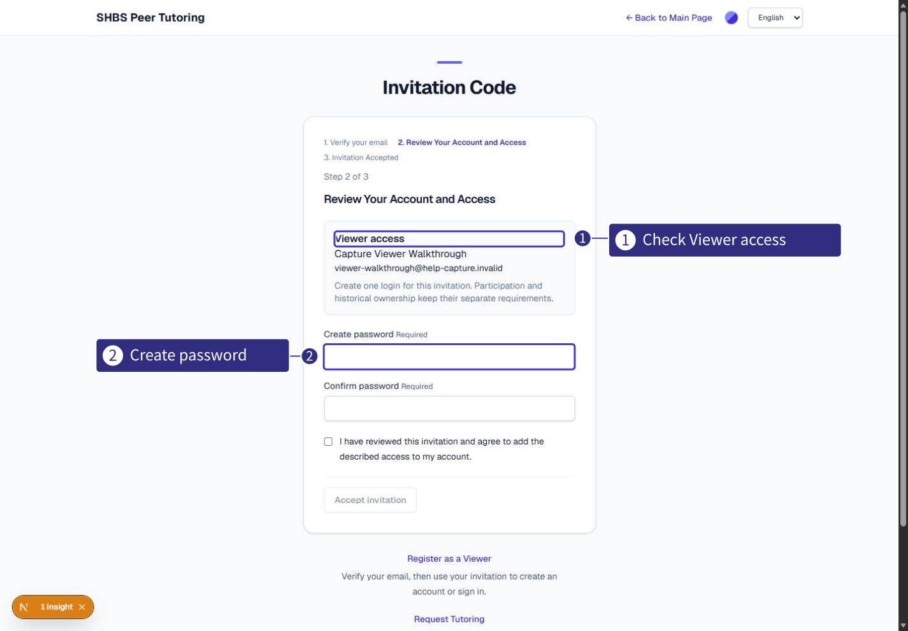

   /register-account · EN · 2026-11-20

   The verified synthetic invitation opens the account review with read-only Viewer access and an empty password field. No account or access was accepted.

   [Original full screenshot](assets/register-viewer-step-2.en.jpg) · `b5ece465681957c9fe579d26babdeb260c674fa0` · Latest-main development baseline b5ece465, selected 2026-11-20, with the Help candidate and synthetic demo records.

   Annotations added for this step. The original full screenshot is unchanged.

   - **1.** Check Viewer access

   - **2.** Create password

   **View 2**

   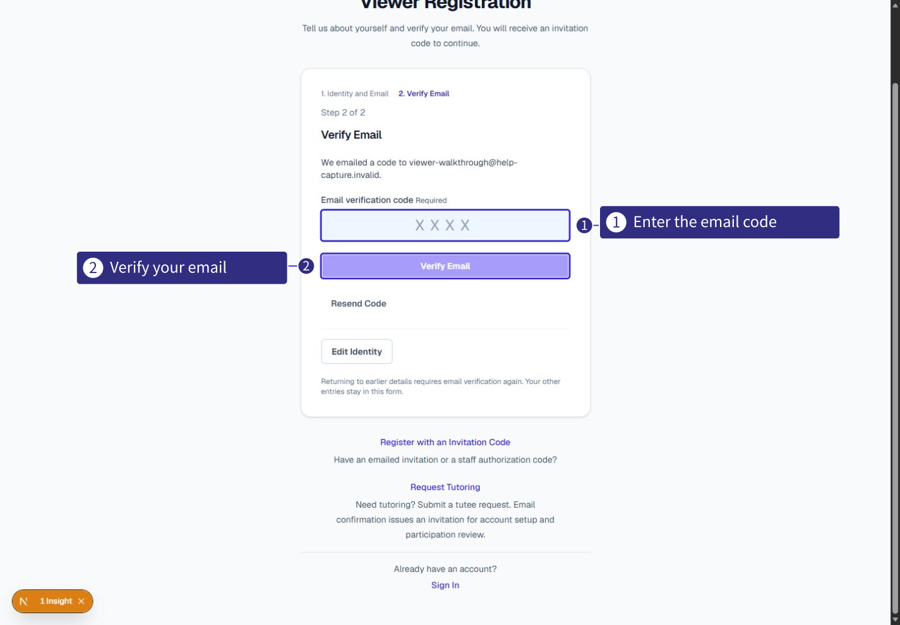

   /viewer-signup · EN · 2026-11-20

   The Viewer signup sends a separate code to the exact synthetic mailbox. The verification field is empty in this screenshot.

   [Original full screenshot](assets/register-viewer-step-2-view-2.en.jpg) · `b5ece465681957c9fe579d26babdeb260c674fa0` · Latest-main development baseline b5ece465, selected 2026-11-20, with the Help candidate and synthetic demo records.

   Annotations added for this step. The original full screenshot is unchanged.

   - **1.** Enter the email code

   - **2.** Verify your email

   **View 3**

   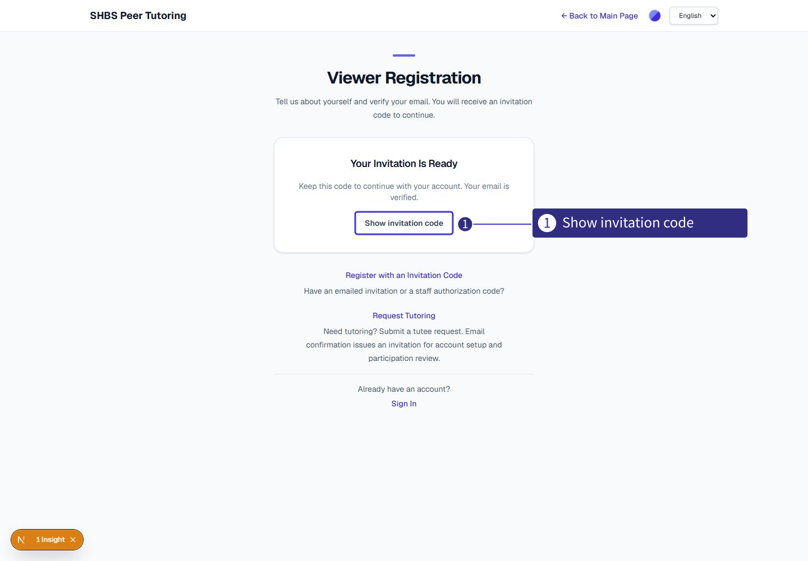

   /viewer-signup · EN · 2026-11-20

   The mailbox is verified and the specialized Viewer invitation is ready. The code dialog is closed.

   [Original full screenshot](assets/register-viewer-step-2-view-3.en.jpg) · `b5ece465681957c9fe579d26babdeb260c674fa0` · Latest-main development baseline b5ece465, selected 2026-11-20, with the Help candidate and synthetic demo records.

   Annotations added for this step. The original full screenshot is unchanged.

   - **1.** Show invitation code

3. **Read the permitted summaries** Open the read-only management area. If the email already belongs to an account, this public flow signs into that existing account without adding Viewer or changing its access.

   **View 1**

   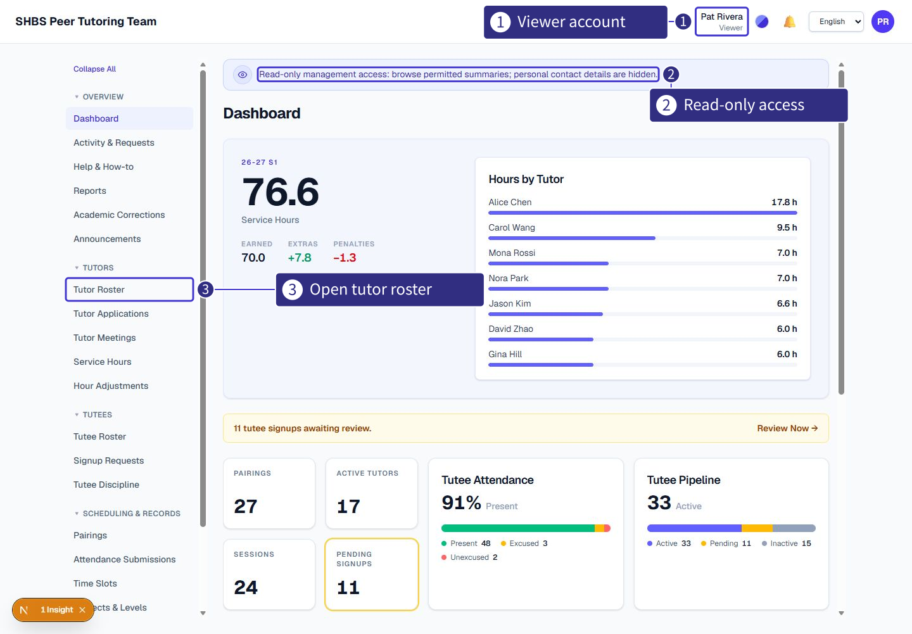

   /admin · EN · 2026-11-20

   Pat Rivera’s approved Viewer account opens the actual read-only portal. The permission banner explains the masked summaries, and Tutor Roster is one of the available pages.

   [Original full screenshot](assets/register-viewer-step-3.en.jpg) · `b5ece465681957c9fe579d26babdeb260c674fa0` · Latest-main development baseline b5ece465, selected 2026-11-20, with the Help candidate and synthetic demo records.

   Annotations added for this step. The original full screenshot is unchanged.

   - **1.** Viewer account

   - **2.** Read-only access

   - **3.** Open tutor roster

   **View 2**

   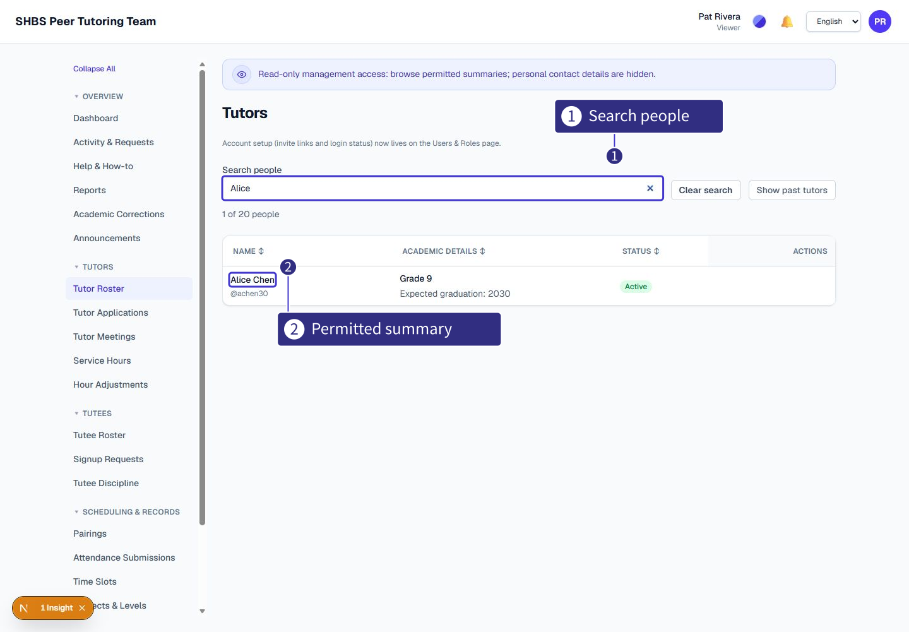

   /admin/tutors · EN · 2026-11-20

   The Viewer can filter a permitted roster summary. This example shows the synthetic tutor’s name, school details and active status, with personal contact fields hidden.

   [Original full screenshot](assets/register-viewer-step-3-view-2.en.jpg) · `b5ece465681957c9fe579d26babdeb260c674fa0` · Latest-main development baseline b5ece465, selected 2026-11-20, with the Help candidate and synthetic demo records.

   Annotations added for this step. The original full screenshot is unchanged.

   - **1.** Search people

   - **2.** Permitted summary

### What happens next

A new eligible account receives Viewer access; an existing account keeps its established access.

### How it works

Viewer is exclusive of participant, translation and other badges. Read-only summaries show some names and program information but hide private contact, reasons, signatures and application evidence.

### Troubleshooting

- **The Viewer link is unavailable** Ask management whether public signup is enabled. Use your existing sign-in or recovery if you already have an account.

## Use an invitation or add approved access

Keep invitation codes separate from mailbox codes and review the exact grant.

Open: `/register-account`

### Before you start

- Have a valid recipient invitation or staff key and access to the intended mailbox.

### Walkthrough

1. **Enter the whole invitation code** Open Register with an Invitation Code, or Add access when signed in. Enter the five-character letters-and-numbers code in the green invitation field and choose Continue. Older valid longer or numeric codes must be entered in full.

   Look for: Green invitation code field and Continue

   

   /register-account · EN · 2026-11-16

   Invitation Code entry before any code or identity is supplied; no invitation proof or account has been accepted.

   [Original full screenshot](assets/accept-invitation-step-1.en.jpg) · `589c055e4b1cf166b48b353bd619ac1982e5d9f6` · Latest-main development baseline 589c055e with the Help candidate; synthetic demonstration data.

   Annotations added for this step. The original full screenshot is unchanged.

   - **1.** Invite code

   - **2.** Continue

2. **Prove mailbox ownership** When requested, enter the separate emailed verification code in the blue field. Back or Edit Identity corrects earlier details before verification but requires fresh proof. An email-bound staff key keeps that address read only.

   **View 1**

   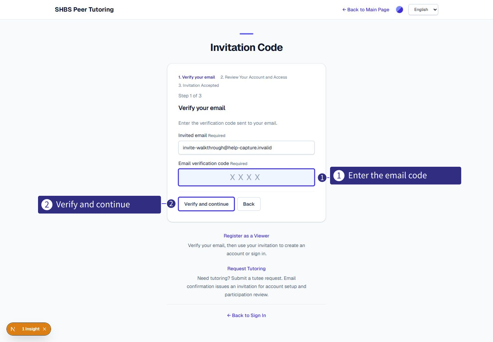

   /register-account · EN · 2026-11-20

   The local mailbox received a separate verification code for this bound Tutor invitation. The blue input is empty and the invitation has not been accepted.

   [Original full screenshot](assets/accept-invitation-step-2.en.jpg) · `b5ece465681957c9fe579d26babdeb260c674fa0` · Latest-main development baseline b5ece465, selected 2026-11-20, with the Help candidate and synthetic demo records.

   Annotations added for this step. The original full screenshot is unchanged.

   - **1.** Enter the email code

   - **2.** Verify and continue

   **View 2**

   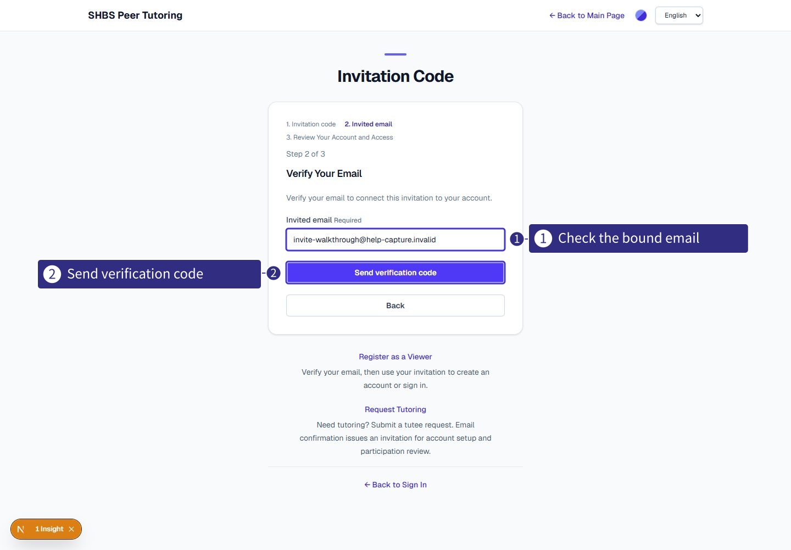

   /register-account · EN · 2026-11-20

   The practice invitation is bound to this mailbox. The recipient can request verification and cannot edit the invited address.

   [Original full screenshot](assets/accept-invitation-step-2-view-2.en.jpg) · `b5ece465681957c9fe579d26babdeb260c674fa0` · Latest-main development baseline b5ece465, selected 2026-11-20, with the Help candidate and synthetic demo records.

   Annotations added for this step. The original full screenshot is unchanged.

   - **1.** Check the bound email

   - **2.** Send verification code

3. **Review identity and access** Read the invitation's displayed role or participation addition and prefilled application details. New accounts create missing credentials; existing accounts retain their password and complete any required sign-in or two-factor check. Confirm the authorized addition explicitly.

   **View 1**

   

   /register-account · EN · 2026-11-16

   Actual Tutee participation invitation review displays the exact authorized addition and submitted fictional application details. Existing credentials remain unchanged. The invitation has not yet been accepted; no code or credential is visible.

   [Original full screenshot](assets/accept-invitation-step-3.en.jpg) · `589c055e4b1cf166b48b353bd619ac1982e5d9f6` · Latest-main development baseline 589c055e with the Help candidate; synthetic demonstration data.

   Annotations added for this step. The original full screenshot is unchanged.

   - **1.** Exact addition

   - **2.** Review answers

   **View 2**

   

   /register-account · EN · 2026-11-16

   Actual invitation review requires an explicit acknowledgement before Accept invitation; submitted fictional participation answers and consent are visible. Checkbox unchecked, acceptance disabled, existing credentials unchanged.

   [Original full screenshot](assets/accept-invitation-step-3-view-2.en.jpg) · `589c055e4b1cf166b48b353bd619ac1982e5d9f6` · Latest-main development baseline 589c055e with the Help candidate; synthetic demonstration data.

   Annotations added for this step. The original full screenshot is unchanged.

   - **1.** Saved consent

   - **2.** Review access

   - **3.** Accept

4. **Read the completion receipt** Follow the next step to the correct workspace, academic confirmation or exact history claim. When the sign-in access card appears, Copy link or Save QR keeps the public /signin entry for later; it contains no account-verification proof. If account acceptance saved but sign-in failed, use its sign-in recovery instead of accepting again.

   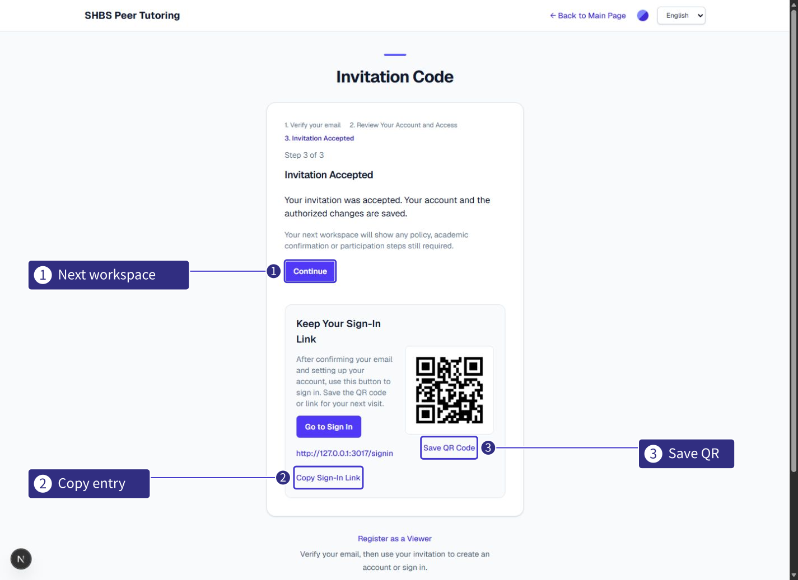

   /register-account · EN · 2026-11-16

   Actual fictional Tutee invitation acceptance succeeded: the receipt states account and authorized changes saved. Continue and the public /signin access card, Copy Sign-In Link and Save QR Code are visible. QR/link contain the public entry only; no account-verification proof is shown.

   [Original full screenshot](assets/accept-invitation-step-4.en.jpg) · `589c055e4b1cf166b48b353bd619ac1982e5d9f6` · Latest-main development baseline 589c055e with the Help candidate; synthetic demonstration data.

   Annotations added for this step. The original full screenshot is unchanged.

   - **1.** Next workspace

   - **2.** Copy entry

   - **3.** Save QR

### What happens next

The receipt names the access actually accepted; opening a code alone grants nothing.

### How it works

New invitations last up to 15 minutes, subject to earlier authorization deadlines. A copied invitation in another browser needs recipient mailbox proof. Management invitations retain the higher rank, never grant Head, and participation invitations do not bypass suspension or reviewed school-return rules.

An authorized participation or management addition replaces exclusive Viewer access after review. Historical access requires its separate exact-record linking confirmation.

### Troubleshooting

- **Expired, replaced or used code** Return to the original application's recovery/status action or ask the issuer for a usable invitation. Do not enter the mailbox code into the invitation field.

## Sign in or recover your password

Use your username or verified email, then complete any security check.

Open: `/signin`

### Before you start

- A login account has already been created; an application or roster row alone is not a login.

### Walkthrough

1. **Enter your identifier and password** On Sign In enter your username, primary email or verified secondary email and current password. Choose Sign In.

   Look for: Username or email and Password

   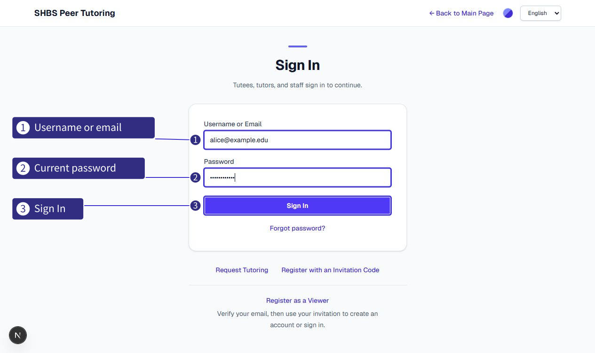

   /signin · EN · 2026-11-16

   Filled sign-in form before submission (synthetic tutor account)

   [Original full screenshot](assets/sign-in-recover-step-1.en.jpg) · `589c055e4b1cf166b48b353bd619ac1982e5d9f6` · Latest-main development baseline 589c055e with the Help candidate; synthetic demonstration data.

   Annotations added for this step. The original full screenshot is unchanged.

   - **1.** Username or email

   - **2.** Current password

   - **3.** Sign In

2. **Complete email two-factor when prompted** Enter the code sent to your primary email in the verification field. A secondary email used for sign-in does not change the two-factor destination.

   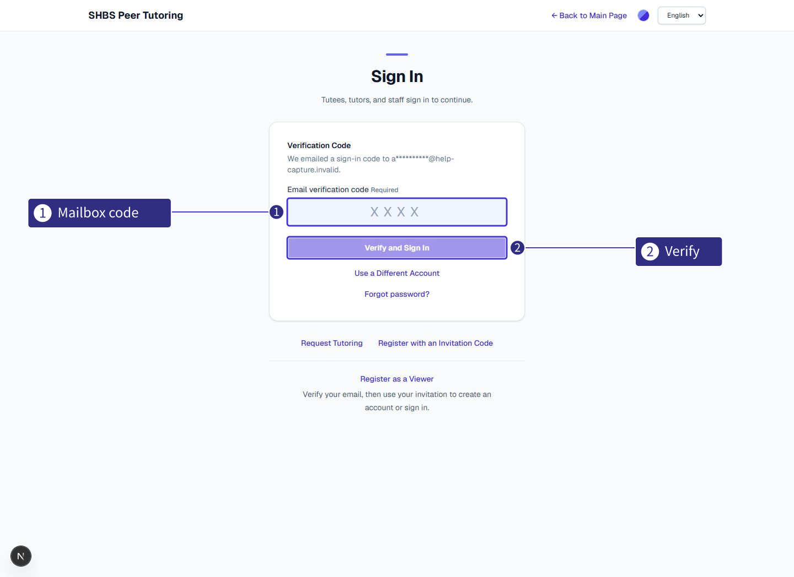

   /signin · EN · 2026-11-16

   A real sign-in attempt has reached its masked-primary-mailbox verification challenge. The code field is empty; sign-in is not complete.

   [Original full screenshot](assets/sign-in-recover-step-2.en.jpg) · `589c055e4b1cf166b48b353bd619ac1982e5d9f6` · Latest-main development baseline 589c055e with the Help candidate; synthetic demonstration data.

   Annotations added for this step. The original full screenshot is unchanged.

   - **1.** Mailbox code

   - **2.** Verify

3. **Use recovery when needed** Choose Forgot Password, request recovery with your username or a verified email, then follow the private link and set a new password. Username recovery goes to primary email; recovery with a secondary address goes to that address. Sign in again afterward.

   Look for: Username or verified email identifier and Send reset link

   **View 1**

   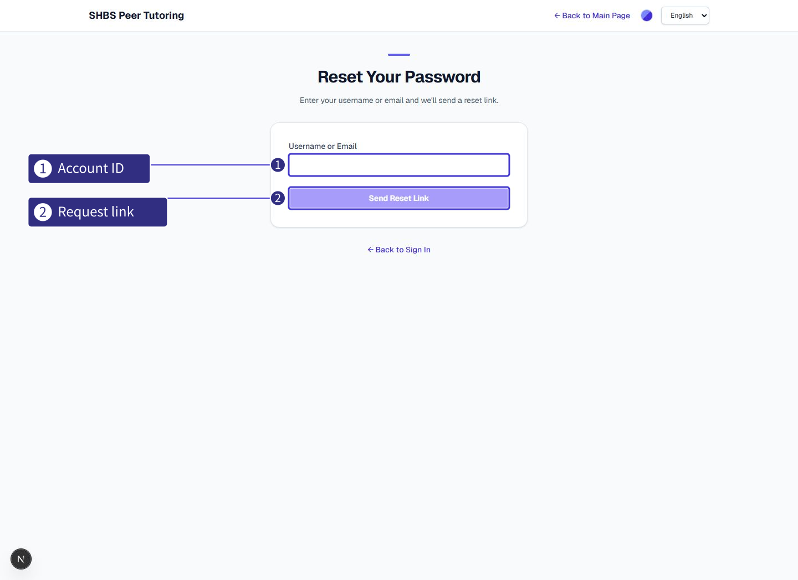

   /forgot-password · EN · 2026-11-16

   Password recovery request form with an empty identifier field; no reset email was requested and no credential was changed.

   [Original full screenshot](assets/sign-in-recover-step-3.en.jpg) · `589c055e4b1cf166b48b353bd619ac1982e5d9f6` · Latest-main development baseline 589c055e with the Help candidate; synthetic demonstration data.

   Annotations added for this step. The original full screenshot is unchanged.

   - **1.** Account ID

   - **2.** Request link

   **View 2**

   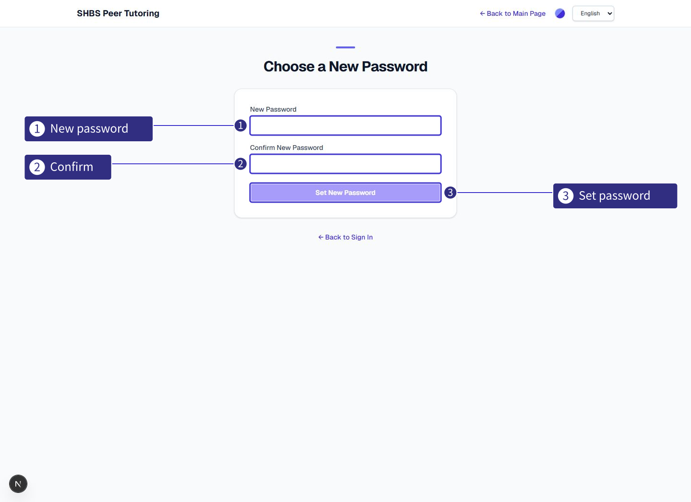

   /reset-password · EN · 2026-11-16

   The genuine successfully delivered private recovery link has opened Choose a New Password for an existing synthetic account. Both password fields remain empty and Set New Password is disabled; no credential was entered or changed. Capability query is omitted from published route metadata.

   [Original full screenshot](assets/sign-in-recover-step-3-view-2.en.jpg) · `589c055e4b1cf166b48b353bd619ac1982e5d9f6` · Latest-main development baseline 589c055e with the Help candidate; synthetic demonstration data.

   Annotations added for this step. The original full screenshot is unchanged.

   - **1.** New password

   - **2.** Confirm

   - **3.** Set password

4. **Handle unfinished setup or suspension** Use a supplied setup link if your account still needs email verification or password setup. Suspended users complete normal sign-in/security checks and use the suspension page to submit or review an account appeal.

   **View 1**

   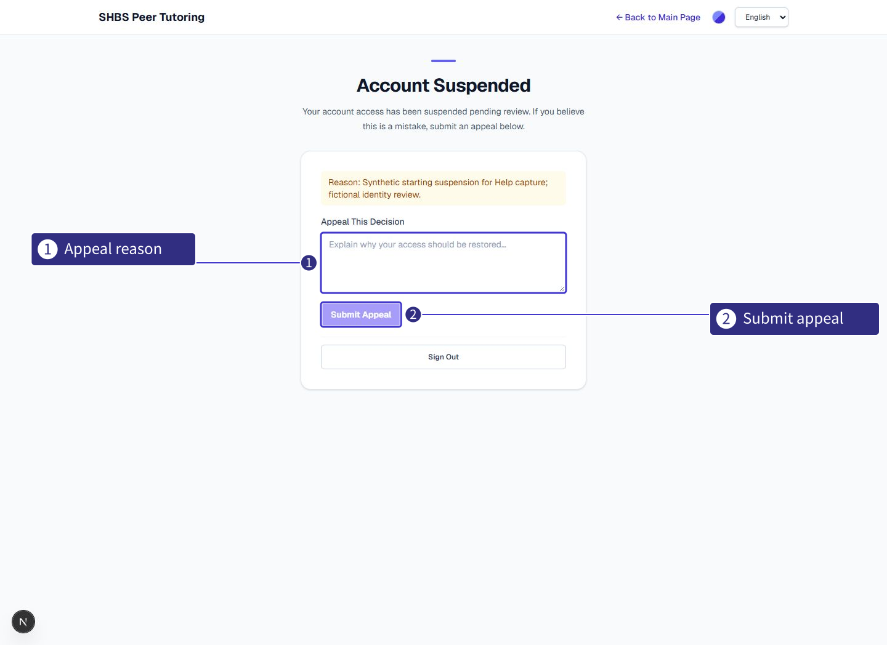

   /suspended · EN · 2026-11-16

   An existing synthetic suspended account has completed ordinary sign-in and reached its real appeal-only page. The appeal is empty and unsubmitted; access remains suspended.

   [Original full screenshot](assets/sign-in-recover-step-4.en.jpg) · `589c055e4b1cf166b48b353bd619ac1982e5d9f6` · Latest-main development baseline 589c055e with the Help candidate; synthetic demonstration data.

   Annotations added for this step. The original full screenshot is unchanged.

   - **1.** Appeal reason

   - **2.** Submit appeal

   **View 2**

   

   /reset-password · EN · 2026-11-16

   A genuine successfully delivered setup grant for an existing synthetic account without a password opens the real Choose a New Password form. Both fields are empty and Set New Password disabled; setup has not been completed and no new credential entered. The capability query is omitted from published route metadata.

   [Original full screenshot](assets/sign-in-recover-step-4-view-2.en.jpg) · `589c055e4b1cf166b48b353bd619ac1982e5d9f6` · Latest-main development baseline 589c055e with the Help candidate; synthetic demonstration data.

   Annotations added for this step. The original full screenshot is unchanged.

   - **1.** First password

   - **2.** Confirm

   - **3.** Finish setup

### What happens next

You reach your authorized workspace or an explicit setup/suspension next step.

### How it works

Changing or resetting a password signs out every existing session. Account recovery preserves permissions and tutoring history; it does not remove suspension or two-factor requirements.

### Troubleshooting

- **The old mailbox is unavailable** Contact management for identity review. A setup page cannot change the displayed account mailbox, and an invitation does not replace an established password.

- **A code or link expired** Restart the relevant sign-in or recovery flow and use the latest successfully sent message. Check spam and contact management if delivery remains unavailable.

## Get private support or report a website problem

Send personal matters privately and use synthetic examples in public issue reports.

[Open bug report form (GitHub)](https://github.com/DupeisTaken/shbs-peer-tutoring-website/issues/new?template=01-bug_report.yml)

### Before you start

- Identify the page, intended action and what happened.

### Walkthrough

1. **Choose the right channel** For your account, attendance, assignment or disciplinary matter use Messages or the program's verified private contact. Use the relevant appeal workflow for a decision; a software issue does not file an appeal.

   Look for: Sign In to reach your private workspace

   

   /signin · EN · 2026-11-16

   Actual public Sign In entry for reaching the account private workspace. This entry image does not display private messages or submit any support report or appeal.

   [Original full screenshot](assets/report-problem-step-1.en.jpg) · `589c055e4b1cf166b48b353bd619ac1982e5d9f6` · Latest-main development baseline 589c055e with the Help candidate; synthetic demonstration data.

   Annotations added for this step. The original full screenshot is unchanged.

   - **1.** Private access

2. **Describe a reproducible software problem** Use the repository's bug-report form. Include page path, role, browser/device, shortest steps, expected and actual result, and date/time with timezone. State unknown when you do not know the app revision.

   

   /help/report-problem · EN · 2026-11-20

   The public Help guide links to the repository’s bug-report form. Gather the page, attempted action, expected result and actual result before opening the form. The external form opens on GitHub.

   [Original full screenshot](assets/report-problem-step-2.en.jpg) · `b5ece465681957c9fe579d26babdeb260c674fa0` · Latest-main development baseline b5ece465, selected 2026-11-20, with the Help candidate and synthetic demo records.

   Annotations added for this step. The original full screenshot is unchanged.

   - **1.** Open the bug form

   - **2.** Prepare details

3. **Remove personal information** Use invented names and records. Remove names, contacts, private messages, disciplinary details, codes, cookies and account/verification links before posting screenshots or logs. Report suspected security issues privately to a verified operator or maintainer.

   

   /help/report-problem · EN · 2026-11-20

   The reporting guide’s privacy reminder keeps participant details and private account links out of public reports. Use synthetic examples as the guide does before preparing screenshots or logs.

   [Original full screenshot](assets/report-problem-step-3.en.jpg) · `b5ece465681957c9fe579d26babdeb260c674fa0` · Latest-main development baseline b5ece465, selected 2026-11-20, with the Help candidate and synthetic demo records.

   Annotations added for this step. The original full screenshot is unchanged.

   - **1.** Keep details private

   - **2.** Use synthetic data

### What happens next

The right team receives an actionable report without publishing private participant evidence.

### How it works

The repository also has enhancement, feature and documentation forms. Private support and appeals preserve their own access and decision process.

### Troubleshooting

- **You cannot sign in to send a private message** Try password recovery or use the program's verified contact. Suspended accounts sign in normally and use the suspension appeal page.

## Appeal an invalid signup from its email notice

Use your private request-specific link without needing a site login, and check the separate decision.

Open the complete private link from your email.

### Before you start

- Open the complete appeal link in the notice sent to the mailbox recorded on your request. This guide contains no usable appeal token; typing the page address alone cannot identify a request.

### Walkthrough

1. **Find your request's notice email** Open the invalid-signup notice in the mailbox used for the application. Choose Review and appeal or Appeal this decision, as shown in the notice. Use the complete private link. It opens the appeal page for that request.

   Look for: Request a Tutor is the originating public application shown here; the appeal itself opens from your private notice email

   **View 1**

   

   /tutee-signup/appeal · EN · 2026-11-20

   Open Review and appeal in the request’s email notice. The link lands on this private signup review without signing in.

   [Original full screenshot](assets/appeal-signup-from-email-step-1.en.jpg) · `b5ece465681957c9fe579d26babdeb260c674fa0` · Latest-main development baseline b5ece465, selected 2026-11-20, with the Help candidate, signup appeal first-load correction, and synthetic demo records.

   Annotations added for this step. The original full screenshot is unchanged.

   - **1.** From the notice

   - **2.** Review context

   **View 2**

   

   /tutee-signup · EN · 2026-11-20

   This is the original public signup. If it is flagged later, use Review and appeal in the notice delivered to its recorded mailbox.

   [Original full screenshot](assets/appeal-signup-from-email-step-1-view-2.en.jpg) · `b5ece465681957c9fe579d26babdeb260c674fa0` · Latest-main development baseline b5ece465, selected 2026-11-20, with the Help candidate and synthetic demo records.

   Annotations added for this step. The original full screenshot is unchanged.

   - **1.** Original signup page

   - **2.** Verify your mailbox

2. **Check the available request status** Check whether the appeal form is available or the page shows a saved appeal status. An older request may also show its type and original submission time. The private link permits review of this request's appeal only.

   

   /tutee-signup/appeal · EN · 2026-11-20

   An empty explanation field and the Submit appeal button show this request is eligible to appeal.

   [Original full screenshot](assets/appeal-signup-from-email-step-2.en.jpg) · `b5ece465681957c9fe579d26babdeb260c674fa0` · Latest-main development baseline b5ece465, selected 2026-11-20, with the Help candidate, signup appeal first-load correction, and synthetic demo records.

   Annotations added for this step. The original full screenshot is unchanged.

   - **1.** Explanation form

   - **2.** Enabled after typing

3. **Submit one explanation** If the form is available, enter your explanation and choose Submit appeal. Follow the form's length requirement: the legacy page needs 10–2,000 characters; the signup-specific page accepts a non-empty reason up to 2,000. Wait for the receipt; you cannot replace an appeal already recorded for that flag.

   

   /tutee-signup/appeal · EN · 2026-11-20

   Review the explanation and choose Submit appeal once. The filled draft shows what will be sent to staff.

   [Original full screenshot](assets/appeal-signup-from-email-step-3.en.jpg) · `b5ece465681957c9fe579d26babdeb260c674fa0` · Latest-main development baseline b5ece465, selected 2026-11-20, with the Help candidate, signup appeal first-load correction, and synthetic demo records.

   Annotations added for this step. The original full screenshot is unchanged.

   - **1.** Review draft

   - **2.** Submit appeal

4. **Read the decision separately** Appeal submitted is a receipt. Read Pending, Declined/Cleared or Accepted/Rejected separately to learn the review outcome. The invalid flag remains effective during review. If an accepted submission cannot refresh, use its read-only Retry instead of submitting again.

   

   /tutee-signup/appeal · EN · 2026-11-20

   The confirmation records submission. The separate awaiting-review status shows the flag still pauses matching.

   [Original full screenshot](assets/appeal-signup-from-email-step-4.en.jpg) · `b5ece465681957c9fe579d26babdeb260c674fa0` · Latest-main development baseline b5ece465, selected 2026-11-20, with the Help candidate, signup appeal first-load correction, and synthetic demo records.

   Annotations added for this step. The original full screenshot is unchanged.

   - **1.** Submission receipt

   - **2.** Pending review

### What happens next

The exact request has one recorded appeal and an independently visible review outcome.

### How it works

The private link authorizes only this limited request appeal and can work before account setup. Legacy request-appeal links expire 90 days after notice creation; signup-specific links also require the current eligible request/version and active period. Clearing or reflagging retires obsolete proof. Appeals and email resends do not extend verification deadlines.

### Troubleshooting

- **The link is invalid, expired or shows no form** Reopen the complete latest notice from your own mailbox; signup-specific proof may be removed from the address bar after opening, so a later copied bare address will not work. If it remains unavailable, contact the team privately. Existing receipts may be read-only; do not create a duplicate application to replace an appeal.

## Use a school-hours report link

Open your emailed report, enter each exact amount once, download CSV and schedule or cancel a personal reminder.

Open the complete private link from your email.

### Before you start

- An authorized school recipient's live report-only link from the report email. No site login is required. This guide never contains a live access token.

### Walkthrough

1. **Open the saved report** From your school email choose View Month Report. Check month and edition, then choose English or 中文. The live link grants report access, so share it only with authorized recipients.

   Look for: Use your own emailed View Month Report link; the screenshot uses a synthetic report with no reusable token.

   **View 1**

   

   /reports/service-hours/[private-link] · EN · 2026-11-20

   The actual personal email action opened the November revision 1 school report while signed out. Month, revision and language choices are visible.

   [Original full screenshot](assets/use-school-report-link-step-1.en.jpg) · `b5ece465681957c9fe579d26babdeb260c674fa0` · Latest-main development baseline b5ece465, selected 2026-11-20, with the Help candidate. Isolated synthetic first-report demonstration phase.

   Annotations added for this step. The original full screenshot is unchanged.

   - **1.** Month and revision

   - **2.** Language

   **View 2**

   

   /reports/service-hours/[private-link] · EN · 2026-11-20

   The emailed first edition stays the same when English is selected. Keyboard focus on its language link is visible.

   [Original full screenshot](assets/use-school-report-link-step-1-view-2.en.jpg) · `b5ece465681957c9fe579d26babdeb260c674fa0` · Latest-main development baseline b5ece465, selected 2026-11-20, with the Help candidate. Isolated synthetic first-report demonstration phase.

   Annotations added for this step. The original full screenshot is unchanged.

   - **1.** English

   - **2.** Same edition

2. **Read the exact amount** Use the highlighted Hours value once for the named person. Click Hours or — to open Details and verify the school-account reference. For a correction, find the comparison row for the edition already entered and use the incremental amount shown there.

   **View 1**

   

   /reports/service-hours/[private-link] · EN · 2026-11-20

   The delivered correction shows +0.5 h in Hours for Gina Hill when revision 1 was last applied. This amount opens that person’s Details.

   [Original full screenshot](assets/use-school-report-link-step-2.en.jpg) · `b5ece465681957c9fe579d26babdeb260c674fa0` · Latest-main development baseline b5ece465, selected 2026-11-20, with the Help candidate. Isolated synthetic first-report demonstration phase.

   Annotations added for this step. The original full screenshot is unchanged.

   - **1.** Hours details

   **View 2**

   

   /reports/service-hours/[private-link] · EN · 2026-11-20

   The saved Details list two alternatives: +0.5 h after r1, or +27.5 h once if nothing was applied. Each person’s school-account reference is shown above.

   [Original full screenshot](assets/use-school-report-link-step-2-view-2.en.jpg) · `b5ece465681957c9fe579d26babdeb260c674fa0` · Latest-main development baseline b5ece465, selected 2026-11-20, with the Help candidate. Isolated synthetic first-report demonstration phase.

   Annotations added for this step. The original full screenshot is unchanged.

   - **1.** From revision 1

   - **2.** Nothing applied

3. **Download or inspect details** Use Download CSV for the saved edition. Do not add Carry In, Raw Change or Carry Out as separate credits. Close Details with Close, Escape or outside click; on phones scroll the report table horizontally for all columns.

   **View 1**

   

   /reports/service-hours/[private-link] · EN · 2026-11-20

   The saved revision’s Download CSV action is keyboard-focused after closing Details with Escape. The report remains on the same revision.

   [Original full screenshot](assets/use-school-report-link-step-3.en.jpg) · `b5ece465681957c9fe579d26babdeb260c674fa0` · Latest-main development baseline b5ece465, selected 2026-11-20, with the Help candidate. Isolated synthetic first-report demonstration phase.

   Annotations added for this step. The original full screenshot is unchanged.

   - **1.** Download CSV

   - **2.** Saved revision

   **View 2**

   

   /reports/service-hours/[private-link] · EN · 2026-11-20

   A dash opens the saved Details too. This recipient example shows zero posting and its underlying values, with Close available.

   [Original full screenshot](assets/use-school-report-link-step-3-view-2.en.jpg) · `b5ece465681957c9fe579d26babdeb260c674fa0` · Latest-main development baseline b5ece465, selected 2026-11-20, with the Help candidate. Isolated synthetic first-report demonstration phase.

   Annotations added for this step. The original full screenshot is unchanged.

   - **1.** Close Details

   - **2.** No posting

4. **Manage your reminder** On a personal emailed link choose Email me a reminder, pick a future date/time in the report timezone and confirm the masked original mailbox. Use Cancel this reminder email for an unsent reminder. The reminder always sends the same saved report; already entered hours must not be entered again.

   **View 1**

   

   /reports/service-hours/[private-link] · EN · 2026-11-20

   The actual reminder review shows a masked original mailbox, November 23 at 09:00 in Asia/Shanghai, and the warning that the saved edition will not change.

   [Original full screenshot](assets/use-school-report-link-step-4.en.jpg) · `b5ece465681957c9fe579d26babdeb260c674fa0` · Latest-main development baseline b5ece465, selected 2026-11-20, with the Help candidate. Isolated synthetic first-report demonstration phase.

   Annotations added for this step. The original full screenshot is unchanged.

   - **1.** Masked mailbox

   - **2.** Chosen time

   - **3.** Schedule reminder

   **View 2**

   

   /reports/service-hours/[private-link] · EN · 2026-11-20

   The recipient opens the real reminder editor and selects a future time in Asia/Shanghai for the same saved edition.

   [Original full screenshot](assets/use-school-report-link-step-4-view-2.en.jpg) · `b5ece465681957c9fe579d26babdeb260c674fa0` · Latest-main development baseline b5ece465, selected 2026-11-20, with the Help candidate. Isolated synthetic first-report demonstration phase.

   Annotations added for this step. The original full screenshot is unchanged.

   - **1.** Future time

   - **2.** Review reminder

   **View 3**

   

   /reports/service-hours/[private-link] · EN · 2026-11-20

   The actual reminder is Scheduled for the future time on the same saved report and can still be cancelled before sending.

   [Original full screenshot](assets/use-school-report-link-step-4-view-3.en.jpg) · `b5ece465681957c9fe579d26babdeb260c674fa0` · Latest-main development baseline b5ece465, selected 2026-11-20, with the Help candidate. Isolated synthetic first-report demonstration phase.

   Annotations added for this step. The original full screenshot is unchanged.

   - **1.** Scheduled

   - **2.** Cancel reminder

   **View 4**

   

   /reports/service-hours/[private-link] · EN · 2026-11-20

   The same future reminder now shows Cancelled, and the cancel control is gone. The saved school report remains revision 2.

   [Original full screenshot](assets/use-school-report-link-step-4-view-4.en.jpg) · `b5ece465681957c9fe579d26babdeb260c674fa0` · Latest-main development baseline b5ece465, selected 2026-11-20, with the Help candidate. Isolated synthetic first-report demonstration phase.

   Annotations added for this step. The original full screenshot is unchanged.

   - **1.** Cancelled

### What happens next

You use the correct saved edition, post each amount once and can track your own unsent reminder.

### How it works

Anyone holding a live report link can read its report, but a personal reminder goes only to the original recipient mailbox, including after forwarding. One unfinished reminder and up to five requests per day are supported. Legacy shared links remain readable without personal reminder controls.

### Troubleshooting

- **The link is revoked or reminder is missing/blocked** Ask the issuing administrator for the current report link; do not guess tokens. For reminders, use your personal emailed link and inspect its own reminder status. A failed/blocked unsent reminder may be cancelled and scheduled again; delivery can be delayed.
