# 开始使用

由网站帮助目录生成。请修改内容源文件后运行 `npm run help:export`。

[目录与截图来源](README.md)

截图来源: `b5ece465681957c9fe579d26babdeb260c674fa0`. New captures use latest-main development baseline b5ece465, selected 2026-11-20, with the Help candidate. Earlier captures list their own revision and capture date.

此 GitHub 培训副本包含各角色操作说明。实际使用网站功能仍需登录并具备当前项目权限。所有示例数据均为虚构。

- [使用帮助与操作指南](#使用帮助与操作指南)
- [选择正确的注册入口](#选择正确的注册入口)
- [申请辅导并完成账户确认](#申请辅导并完成账户确认)
- [申请成为辅导伙伴](#申请成为辅导伙伴)
- [申请巡查团队并查询状态](#申请巡查团队并查询状态)
- [注册只读观察员权限](#注册只读观察员权限)
- [使用邀请或添加获批权限](#使用邀请或添加获批权限)
- [登录或找回密码](#登录或找回密码)
- [获得私密帮助或报告网站问题](#获得私密帮助或报告网站问题)
- [通过邮件通知申诉无效报名](#通过邮件通知申诉无效报名)
- [使用学校学时报表链接](#使用学校学时报表链接)

## 使用帮助与操作指南

查找任务、跟随真实界面，并检查接下来应出现的结果。

打开: `/help`

### 开始之前

- 无需登录即可阅读公开入门指南；登录后可查看当前权限对应的指南集。

### 操作步骤

1. **搜索或筛选目录** 打开帮助与操作指南。搜索任务或症状，例如密码、出勤或审核；搜索范围包括步骤及故障排查。使用指南适用对象及按任务浏览缩小结果，再用清除筛选重置搜索和两类筛选。

   请注意: 搜索指南、指南适用对象、按任务浏览及清除筛选

   **视图 1**

   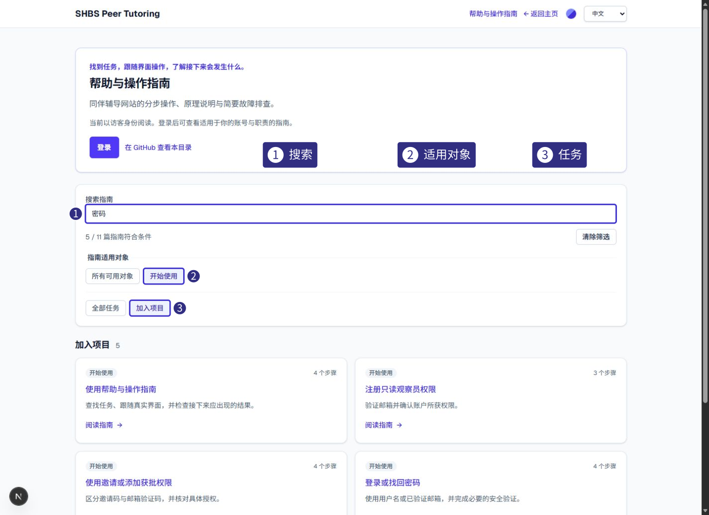

   /help · ZH · 2026-11-16

   真实中文访客帮助目录使用“密码”搜索，同时选中“开始使用”和“加入项目”，显示5篇符合条件的公开指南及“清除筛选”。搜索涵盖正文和故障排查；没有展示登录后受限指南。

   [原始完整截图](assets/use-help-catalogue-step-1.zh.jpg) · `589c055e4b1cf166b48b353bd619ac1982e5d9f6` · Latest-main development baseline 589c055e with the Help candidate; synthetic demonstration data.

   已为本步骤添加标注，原始完整截图保持不变。

   - **1.** 搜索

   - **2.** 适用对象

   - **3.** 任务

   **视图 2**

   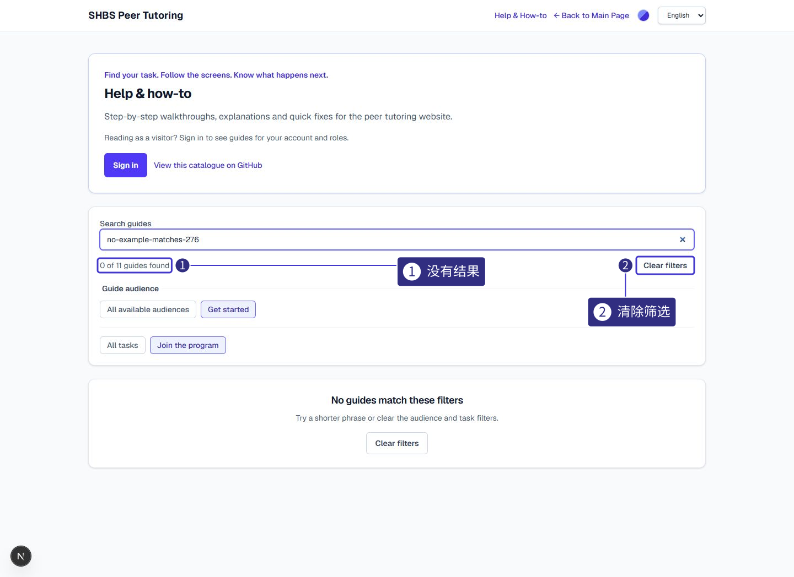

   /help · EN · 2026-11-16

   访客帮助目录使用刻意不匹配的查询，且对象与任务筛选均已启用，因此没有结果；真实的“清除筛选”控件可重置查询与筛选。

   [原始完整截图](assets/use-help-catalogue-step-1-view-2.en.jpg) · `589c055e4b1cf166b48b353bd619ac1982e5d9f6` · Latest-main development baseline 589c055e with the Help candidate; synthetic demonstration data.

   已为本步骤添加标注，原始完整截图保持不变。

   - **1.** 没有结果

   - **2.** 清除筛选

   **视图 3**

   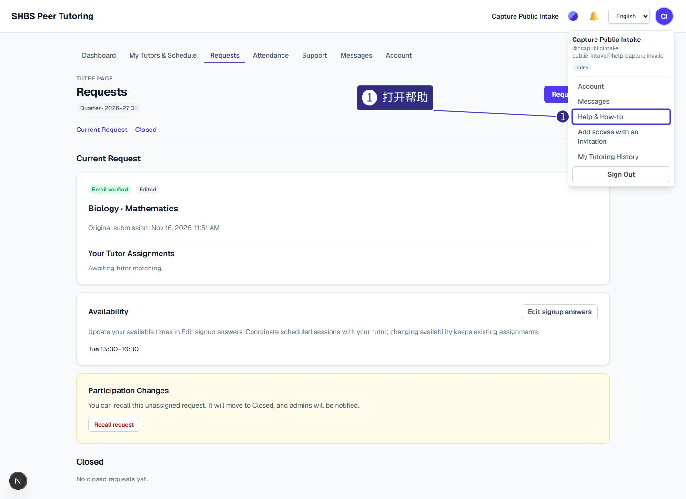

   /student?view=requests · EN · 2026-11-16

   实际已登录的虚构学习伙伴打开账户菜单；“帮助与操作指南”是进入当前账户权限对应指南的真实入口。此补充图说明登录后的发现入口，不表示工作人员权限或访客指南集。

   [原始完整截图](assets/use-help-catalogue-step-1-view-3.en.jpg) · `589c055e4b1cf166b48b353bd619ac1982e5d9f6` · Latest-main development baseline 589c055e with the Help candidate; synthetic demonstration data.

   已为本步骤添加标注，原始完整截图保持不变。

   - **1.** 打开帮助

   **视图 4**

   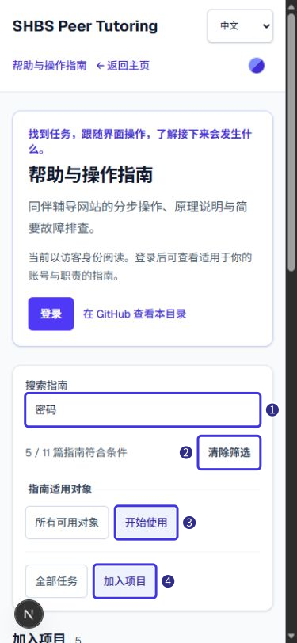

   /help · ZH · 2026-11-16

   真实390×844移动端中文帮助目录，搜索“密码”并保留对象／任务筛选。搜索框、清除筛选及两类已选按钮完整可见；窄屏使用目标边框和编号，完整说明在截图外。

   [原始完整截图](assets/use-help-catalogue-step-1-view-4.zh.jpg) · `589c055e4b1cf166b48b353bd619ac1982e5d9f6` · Latest-main development baseline 589c055e with the Help candidate; synthetic demonstration data.

   已为本步骤添加标注，原始完整截图保持不变。

   - **1.** 搜索

   - **2.** 清除筛选

   - **3.** 适用对象

   - **4.** 任务

2. **按任务指南操作** 选择阅读指南，先检查开始之前，再按编号步骤及截图旁的请找到提示操作。可用本页目录跳转至接下来会发生什么、运作原理或遇到问题时。打开相关页面会进入实际功能；阅读说明不会授予权限。

   请注意: 编号操作、请找到及本页目录

   **视图 1**

   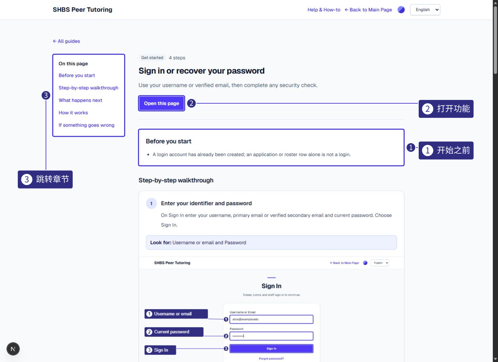

   /help/sign-in-recover · EN · 2026-11-16

   真实公开任务指南同时显示标题、开始前条件、编号操作及“请找到”提示，旁边列出“本页目录”章节链接，并提供进入实际功能的“打开相关页面”链接。

   [原始完整截图](assets/use-help-catalogue-step-2.en.jpg) · `589c055e4b1cf166b48b353bd619ac1982e5d9f6` · Latest-main development baseline 589c055e with the Help candidate; synthetic demonstration data.

   已为本步骤添加标注，原始完整截图保持不变。

   - **1.** 开始之前

   - **2.** 打开功能

   - **3.** 跳转章节

   **视图 2**

   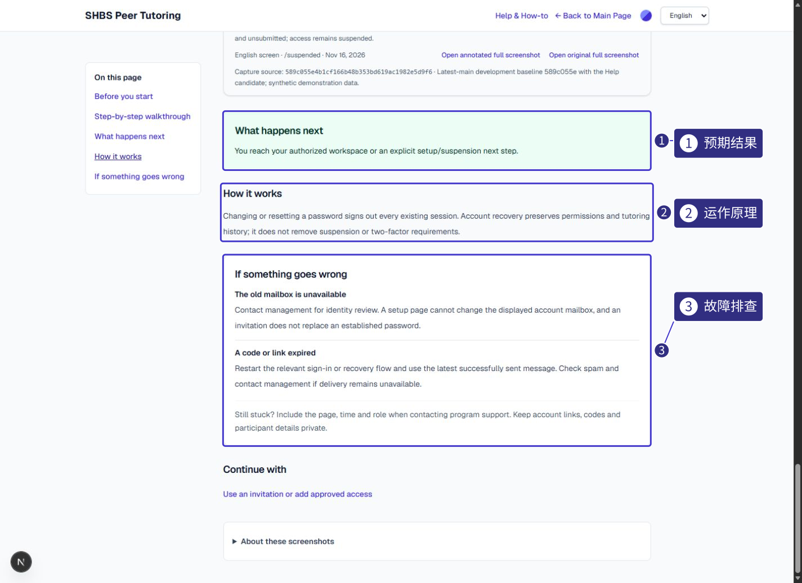

   /help/sign-in-recover · EN · 2026-11-16

   真实任务指南已跳转至“接下来会发生什么”；预期结果、“运作原理”说明及“遇到问题时”故障排查同时可见。

   [原始完整截图](assets/use-help-catalogue-step-2-view-2.en.jpg) · `589c055e4b1cf166b48b353bd619ac1982e5d9f6` · Latest-main development baseline 589c055e with the Help candidate; synthetic demonstration data.

   已为本步骤添加标注，原始完整截图保持不变。

   - **1.** 预期结果

   - **2.** 运作原理

   - **3.** 故障排查

3. **放大并识别截图** 选择打开完整截图或点击图片查看全尺寸。阅读图片的英文／中文界面标记、路径及截图时间。关于这些截图列明源代码版本、发布版本基线及截图服务器；截图使用虚构演示账户，配置可能使本人可见控件有所不同。

   **视图 1**

   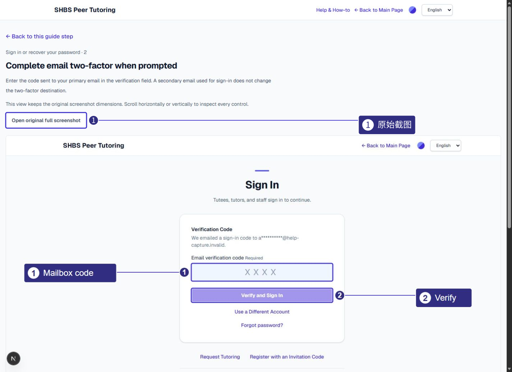

   /help/sign-in-recover/screenshots/2 · EN · 2026-11-16

   公开双重验证指南的真实全尺寸标注截图查看器，显示原始截图链接及滚动检查说明。所示源图为真实的空白验证码步骤；登录尚未完成。

   [原始完整截图](assets/use-help-catalogue-step-3.en.jpg) · `589c055e4b1cf166b48b353bd619ac1982e5d9f6` · Latest-main development baseline 589c055e with the Help candidate; synthetic demonstration data.

   已为本步骤添加标注，原始完整截图保持不变。

   - **1.** 原始截图

   **视图 2**

   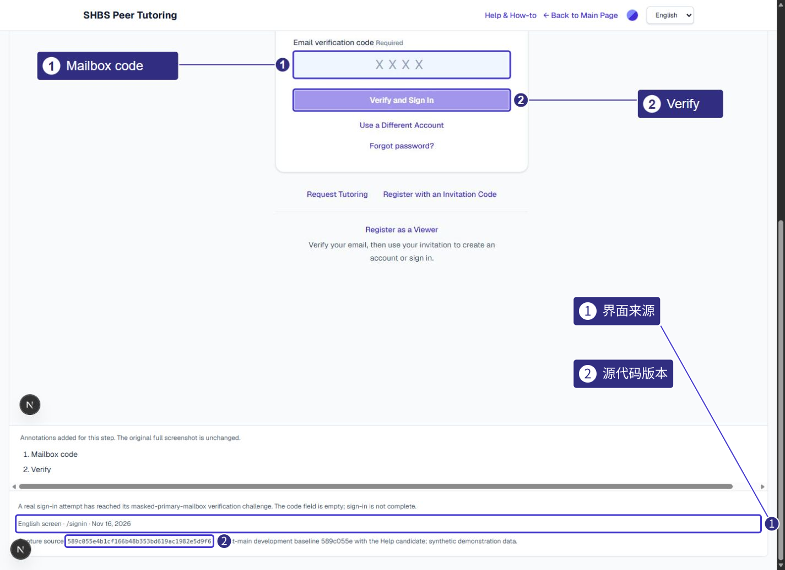

   /help/sign-in-recover/screenshots/2 · EN · 2026-11-16

   真实完整截图查看器已滚至来源页脚，显示原图未更改说明、编号标注图例、英文界面标记、公开路径、日期及准确源代码版本。

   [原始完整截图](assets/use-help-catalogue-step-3-view-2.en.jpg) · `589c055e4b1cf166b48b353bd619ac1982e5d9f6` · Latest-main development baseline 589c055e with the Help candidate; synthetic demonstration data.

   已为本步骤添加标注，原始完整截图保持不变。

   - **1.** 界面来源

   - **2.** 源代码版本

   **视图 3**

   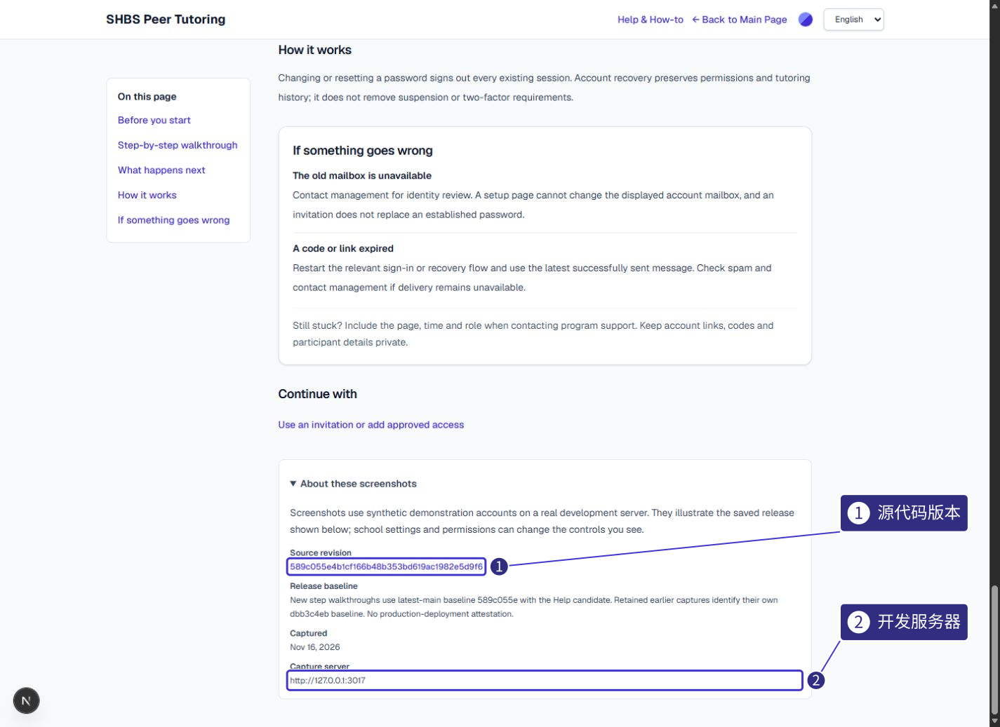

   /help/sign-in-recover#step-2 · EN · 2026-11-16

   真实“关于这些截图”说明已展开并滚入视野，列出源代码版本、最新主分支开发基线、截图日期和本次专用截图服务器，并明确说明这并非生产部署证明。

   [原始完整截图](assets/use-help-catalogue-step-3-view-3.en.jpg) · `589c055e4b1cf166b48b353bd619ac1982e5d9f6` · Latest-main development baseline 589c055e with the Help candidate; synthetic demonstration data.

   已为本步骤添加标注，原始完整截图保持不变。

   - **1.** 源代码版本

   - **2.** 开发服务器

4. **查找本人职责指南集或离线手册** 登录后显示当前账户、参与资格及分工对应指南。工作人员可从管理区→PDF操作手册下载本人可用版本。旧常见问题链接会继续进入本目录。可通过目录的GitHub链接查看仓库中维护的副本。

   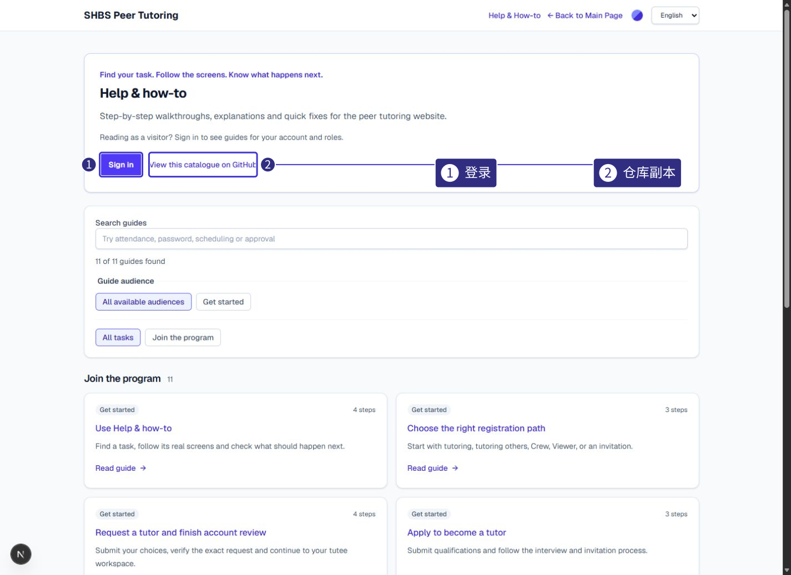

   /help · EN · 2026-11-16

   访客帮助页显示登录入口及维护中的GitHub副本；本公开截图不展示工作人员专属手册页面。

   [原始完整截图](assets/use-help-catalogue-step-4.en.jpg) · `589c055e4b1cf166b48b353bd619ac1982e5d9f6` · Latest-main development baseline 589c055e with the Help candidate; synthetic demonstration data.

   已为本步骤添加标注，原始完整截图保持不变。

   - **1.** 登录

   - **2.** 仓库副本

### 预期结果

找到可用任务指南、了解预期结果，并能检查截图来源。

### 工作原理

适用对象与任务筛选仅缩小服务器已授权指南范围。辅导伙伴、学习伙伴、巡查及翻译权限独立于管理职级。截图来源记录所示发布状态，不代表每所学校配置下界面完全一致。

### 问题排查

- **没有匹配指南或缺少本人职责指南集** 尝试更短关键词并清除筛选，使用正确账户登录。仍未显示时，请管理团队检查当前资格、分工及权限；筛选或旧书签不能授予访问权。

- **截图语言或控件不同** 阅读图注及发布版本基线，按本人界面的控件名称操作，并放大图片。无中文截图时使用英语。持续存在版本差异时，报告指南标题及截图时间，不要分享私人记录。

## 选择正确的注册入口

根据申请辅导、成为辅导伙伴、巡查、观察员或邀请选择入口。

打开: `/signin`

### 开始之前

- 使用项目团队提供的网站地址。提供个人信息前，请通过首页信息菜单、页脚或/privacy阅读隐私政策，提供英语及中文版本。

### 操作步骤

1. **选择所需服务** 在首页选择“申请辅导”接受辅导、“成为辅导伙伴”申请授课，或“加入巡查团队”申请巡查。只需查看信息时，可在开放期间选择“注册为观察员”。

   请注意: 登录下方的注册链接

   **视图 1**

   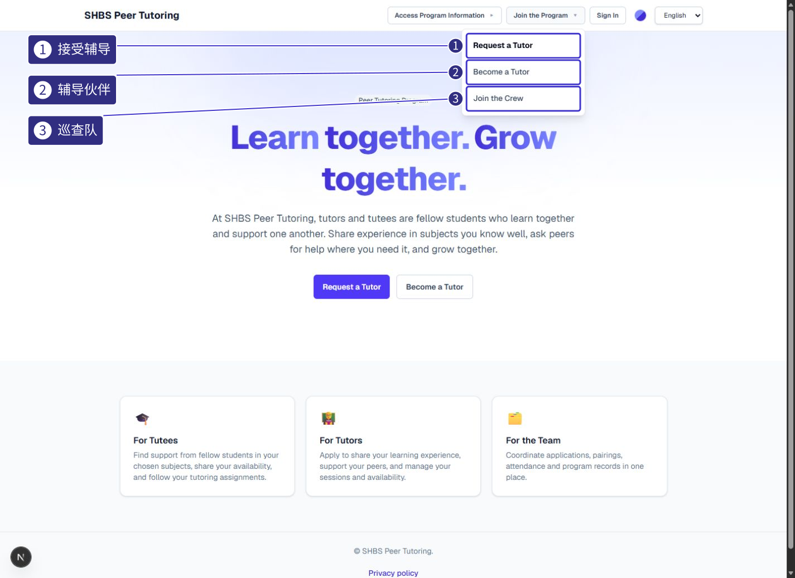

   / · EN · 2026-11-16

   主页展开真实的加入项目菜单，显示申请辅导、申请辅导伙伴与巡查队入口；观察员注册另见登录页。

   [原始完整截图](assets/choose-registration-step-1.en.jpg) · `589c055e4b1cf166b48b353bd619ac1982e5d9f6` · Latest-main development baseline 589c055e with the Help candidate; synthetic demonstration data.

   已为本步骤添加标注，原始完整截图保持不变。

   - **1.** 接受辅导

   - **2.** 辅导伙伴

   - **3.** 巡查队

   **视图 2**

   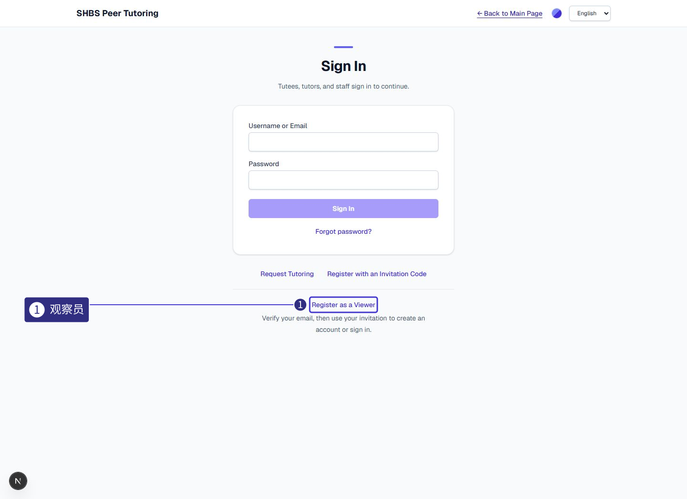

   /signin · EN · 2026-11-16

   登录页提供真实的观察员注册入口，与主页的辅导伙伴、学习伙伴及巡查队入口分别显示。

   [原始完整截图](assets/choose-registration-step-1-view-2.en.jpg) · `589c055e4b1cf166b48b353bd619ac1982e5d9f6` · Latest-main development baseline 589c055e with the Help candidate; synthetic demonstration data.

   已为本步骤添加标注，原始完整截图保持不变。

   - **1.** 观察员

2. **已有邀请时使用邀请入口** 选择“使用邀请码注册”。已有账户可从账户菜单选择“添加权限”，无需再创建账户。

   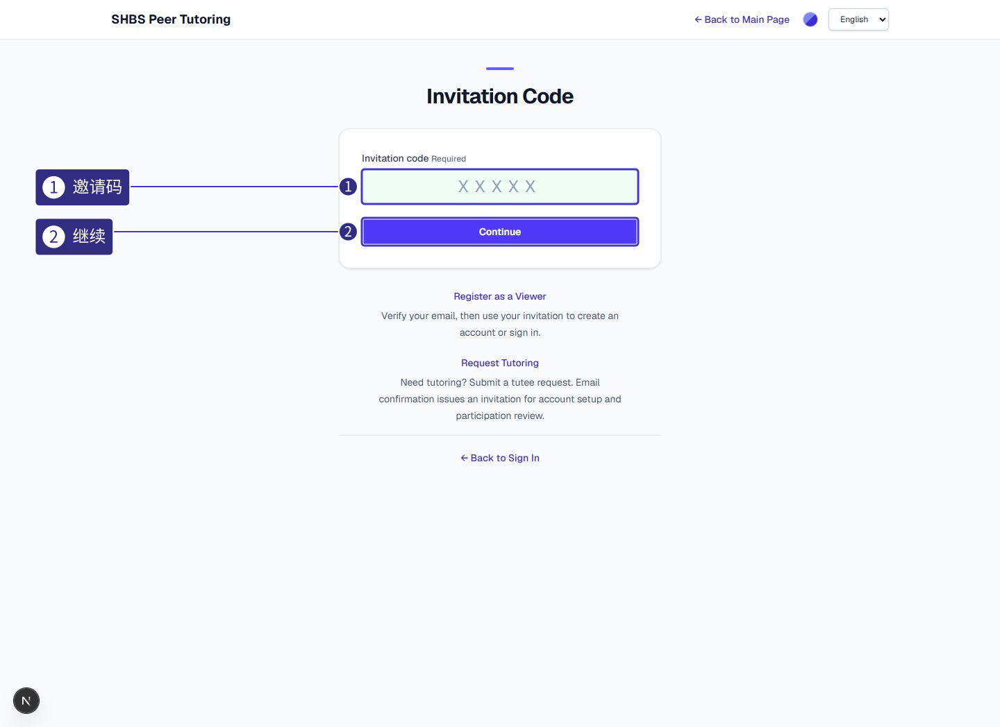

   /register-account · EN · 2026-11-16

   访客邀请入口显示空白邀请码字段及继续按钮；现有账户的添加权限入口属于另一种路径。

   [原始完整截图](assets/choose-registration-step-2.en.jpg) · `589c055e4b1cf166b48b353bd619ac1982e5d9f6` · Latest-main development baseline 589c055e with the Help candidate; synthetic demonstration data.

   已为本步骤添加标注，原始完整截图保持不变。

   - **1.** 邀请码

   - **2.** 继续

3. **查看开放提示** 辅导伙伴或学习伙伴招募未开放时，表单仅供预览。查看项目时区下的开放时间，并在开放后返回。

   **视图 1**

   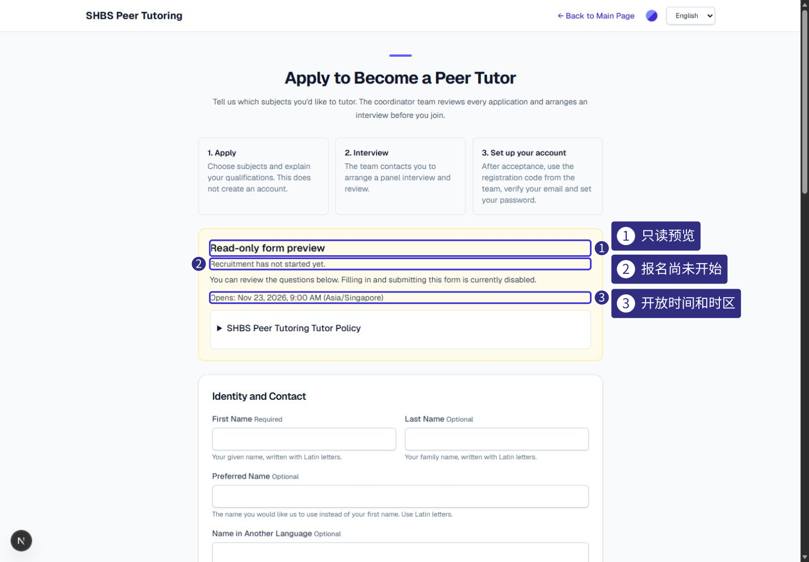

   /tutor-signup · EN · 2026-11-20

   公开导师报名显示只读预览、暂停报名的原因，以及按项目时区显示的下次开放时间。

   [原始完整截图](assets/choose-registration-step-3.en.jpg) · `b5ece465681957c9fe579d26babdeb260c674fa0` · Latest-main development baseline b5ece465, selected 2026-11-20, with the Help candidate. Isolated synthetic first-report demonstration phase.

   已为本步骤添加标注，原始完整截图保持不变。

   - **1.** 只读预览

   - **2.** 报名尚未开始

   - **3.** 开放时间和时区

   **视图 2**

   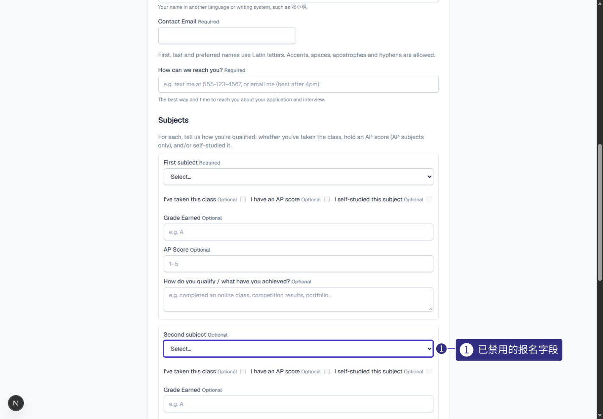

   /tutor-signup · EN · 2026-11-20

   关闭期间可阅读导师报名表，但在重新开放前无法填写这些字段。

   [原始完整截图](assets/choose-registration-step-3-view-2.en.jpg) · `b5ece465681957c9fe579d26babdeb260c674fa0` · Latest-main development baseline b5ece465, selected 2026-11-20, with the Help candidate. Isolated synthetic first-report demonstration phase.

   已为本步骤添加标注，原始完整截图保持不变。

   - **1.** 已禁用的报名字段

### 预期结果

进入与所需权限对应的申请或邀请页面。

### 工作原理

提交申请、名册获批、邮箱验证和可用登录账户属于不同阶段。参与资格与管理权限也相互独立。

### 问题排查

- **找不到观察员注册或其他入口** 项目可能关闭了该入口。请向管理团队确认应使用哪种申请或授权邀请，不要通过创建第二个账户绕过权限。

## 申请辅导并完成账户确认

提交科目和时间，验证本次申请，然后进入学习伙伴页面。

打开: `/tutee-signup`

### 开始之前

- 学习伙伴招募已开放，且已发布当前参与政策。
- 使用可以收信的邮箱；已有账户时，优先使用该账户已验证的邮箱。

### 操作步骤

1. **填写申请** 选择“申请辅导”，填写必填姓名、联系方式偏好、科目和可用时间。阅读政策并滚动到底部，勾选同意并签名，然后选择“保存并验证邮箱”。

   请注意: 必填项、科目选择和政策同意区

   **视图 1**

   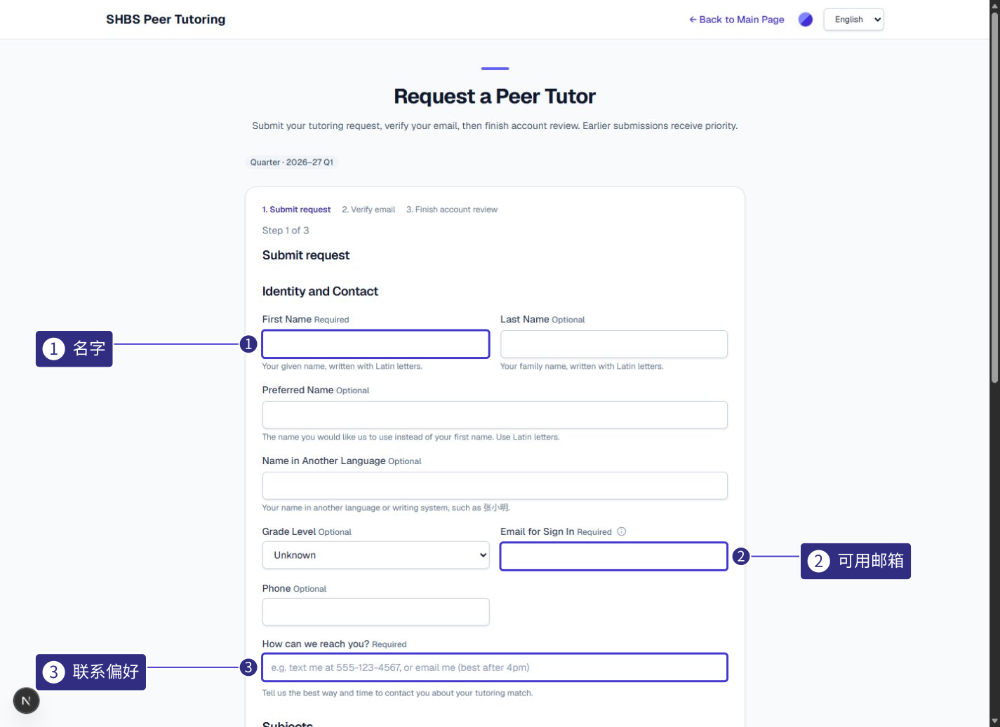

   /tutee-signup · EN · 2026-11-16

   真实已开放的“申请同伴辅导”表单显示提交前的必填身份、邮箱及联系字段。身份和联系字段均为空；尚未提交政策同意、签名或申请。

   [原始完整截图](assets/request-tutoring-step-1.en.jpg) · `589c055e4b1cf166b48b353bd619ac1982e5d9f6` · Latest-main development baseline 589c055e with the Help candidate; synthetic demonstration data.

   已为本步骤添加标注，原始完整截图保持不变。

   - **1.** 名字

   - **2.** 可用邮箱

   - **3.** 联系偏好

   **视图 2**

   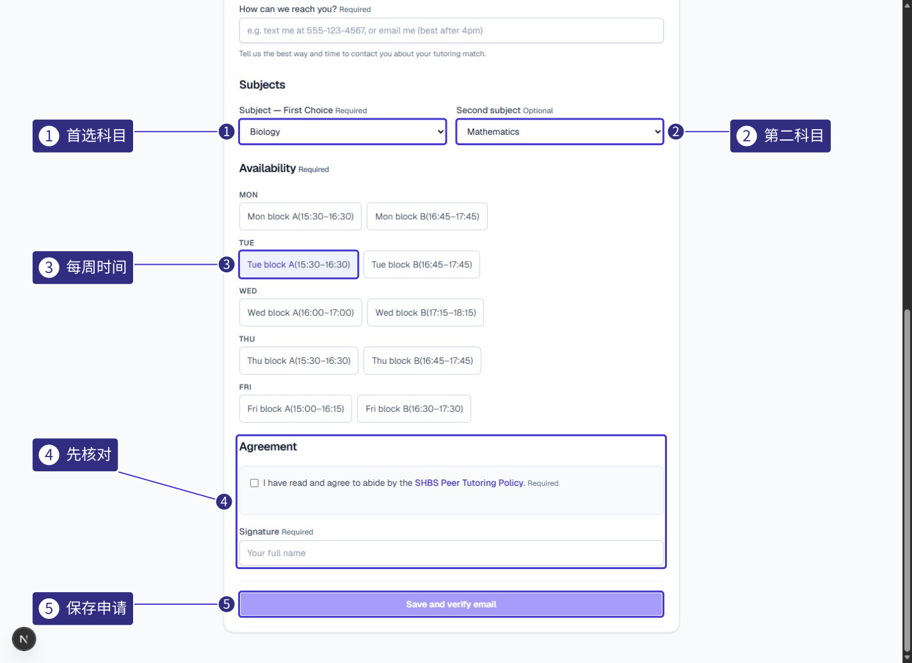

   /tutee-signup · EN · 2026-11-16

   未提交的辅导申请草稿在真实目录中选择生物为首选科目、数学为可选第二科目，以及周二A时段。政策同意框仍未勾选，签名为空，“保存并验证邮箱”已禁用。

   [原始完整截图](assets/request-tutoring-step-1-view-2.en.jpg) · `589c055e4b1cf166b48b353bd619ac1982e5d9f6` · Latest-main development baseline 589c055e with the Help candidate; synthetic demonstration data.

   已为本步骤添加标注，原始完整截图保持不变。

   - **1.** 首选科目

   - **2.** 第二科目

   - **3.** 每周时间

   - **4.** 先核对

   - **5.** 保存申请

   **视图 3**

   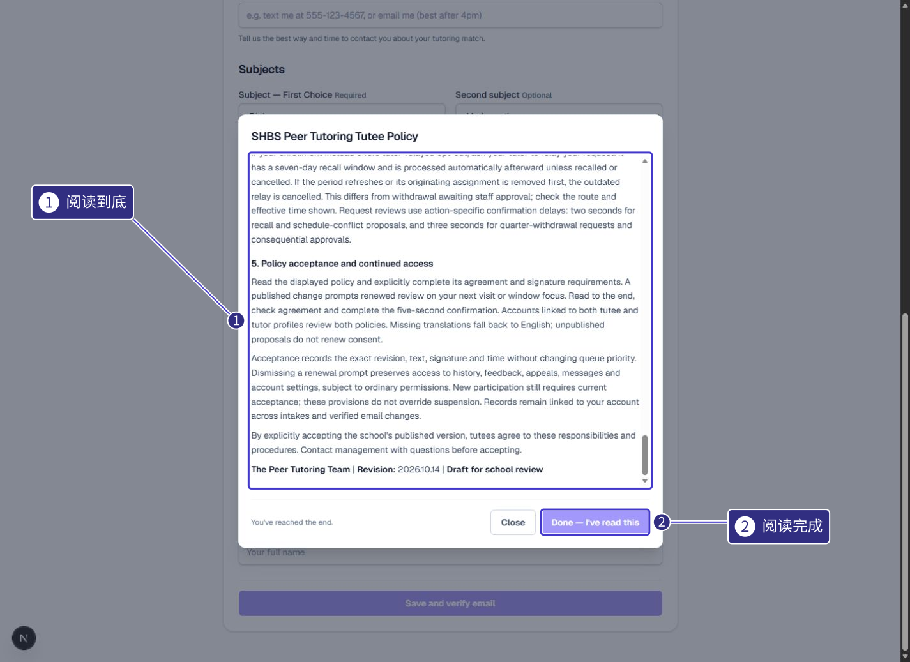

   /tutee-signup · EN · 2026-11-16

   真实学习伙伴政策阅读器已滚至末尾，“完成——我已读完”可用。阅读不等于同意：尚未勾选协议，也未提交签名或申请。虚构种子政策标有“供学校审核的草稿”。

   [原始完整截图](assets/request-tutoring-step-1-view-3.en.jpg) · `589c055e4b1cf166b48b353bd619ac1982e5d9f6` · Latest-main development baseline 589c055e with the Help candidate; synthetic demonstration data.

   已为本步骤添加标注，原始完整截图保持不变。

   - **1.** 阅读到底

   - **2.** 阅读完成

   **视图 4**

   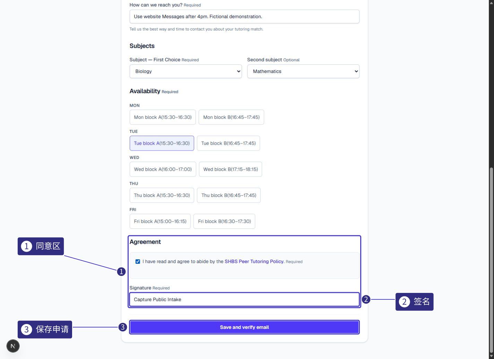

   /tutee-signup · EN · 2026-11-16

   现有虚构专用账户已实际读完政策、勾选不具真实约束力的演示同意，并输入虚构签名Capture Public Intake。“保存并验证邮箱”现已可用；此图拍摄时尚未保存申请。

   [原始完整截图](assets/request-tutoring-step-1-view-4.en.jpg) · `589c055e4b1cf166b48b353bd619ac1982e5d9f6` · Latest-main development baseline 589c055e with the Help candidate; synthetic demonstration data.

   已为本步骤添加标注，原始完整截图保持不变。

   - **1.** 同意区

   - **2.** 签名

   - **3.** 保存申请

2. **验证本次提交** 输入邮件中的四位验证码，并保留开头的零。已有确认邮件链接也可打开后明确确认。未收到邮件时使用验证码步骤中的重发操作。

   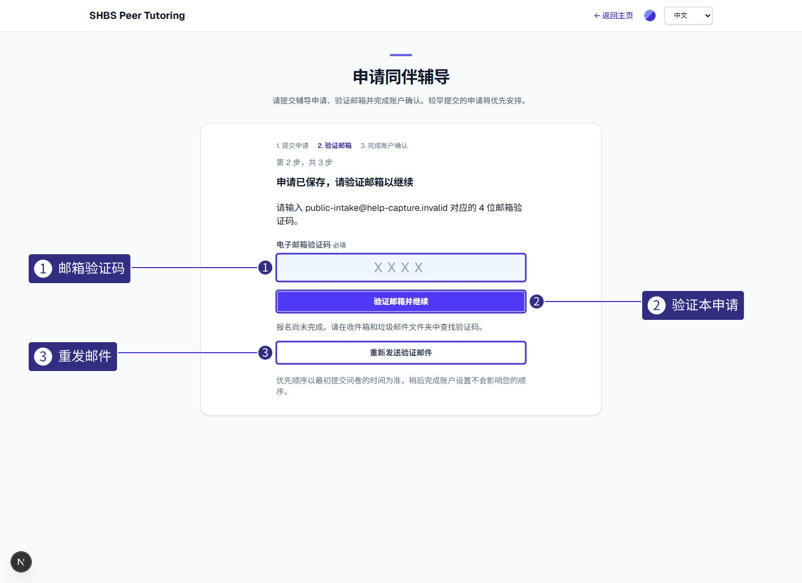

   /tutee-signup · ZH · 2026-11-16

   真实已保存的虚构辅导申请处于第2步邮箱验证。蓝色验证码框为空，实际“验证邮箱并继续”和“重新发送验证邮件”可见；报名尚未完成，未显示任何验证码。

   [原始完整截图](assets/request-tutoring-step-2.zh.jpg) · `589c055e4b1cf166b48b353bd619ac1982e5d9f6` · Latest-main development baseline 589c055e with the Help candidate; synthetic demonstration data.

   已为本步骤添加标注，原始完整截图保持不变。

   - **1.** 邮箱验证码

   - **2.** 验证本申请

   - **3.** 重发邮件

3. **完成统一账户确认** 在邀请弹窗中选择“完成账户确认”。核对本次答案和已签政策，仅补充缺少的登录资料。已有账户需完成正常登录和双重验证，再明确接受本次申请。

   请注意: 继续账户确认

   **视图 1**

   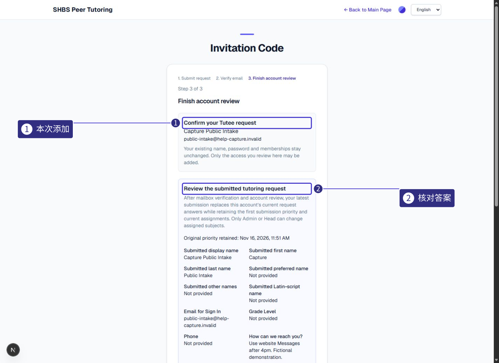

   /register-account · EN · 2026-11-16

   已验证的虚构专用申请进入真实“完成账户确认”，显示本次准确的学习伙伴参与资格及已提交身份／答案。保留现有凭据；尚未完成接受及任何必要的正常登录。没有显示邀请码。

   [原始完整截图](assets/request-tutoring-step-3.en.jpg) · `589c055e4b1cf166b48b353bd619ac1982e5d9f6` · Latest-main development baseline 589c055e with the Help candidate; synthetic demonstration data.

   已为本步骤添加标注，原始完整截图保持不变。

   - **1.** 本次添加

   - **2.** 核对答案

   **视图 2**

   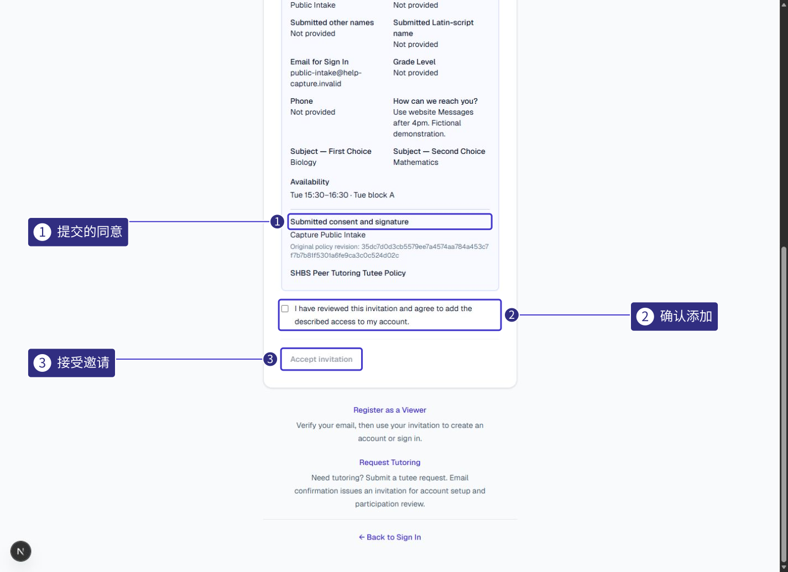

   /register-account · EN · 2026-11-16

   真实账户确认下半部显示已提交科目／时间、保存的虚构同意／签名及准确的原政策版本。明确核对的复选框未勾选，“接受邀请”已禁用；尚未接受。

   [原始完整截图](assets/request-tutoring-step-3-view-2.en.jpg) · `589c055e4b1cf166b48b353bd619ac1982e5d9f6` · Latest-main development baseline 589c055e with the Help candidate; synthetic demonstration data.

   已为本步骤添加标注，原始完整截图保持不变。

   - **1.** 提交的同意

   - **2.** 确认添加

   - **3.** 接受邀请

4. **查看确认后的申请** 打开“进入学习伙伴页面”→“申请”。分别查看申请确认、辅导伙伴分配和排课状态。在邀请仍有效时，可以关闭并重新打开邀请回执，无需重复邮箱验证。

   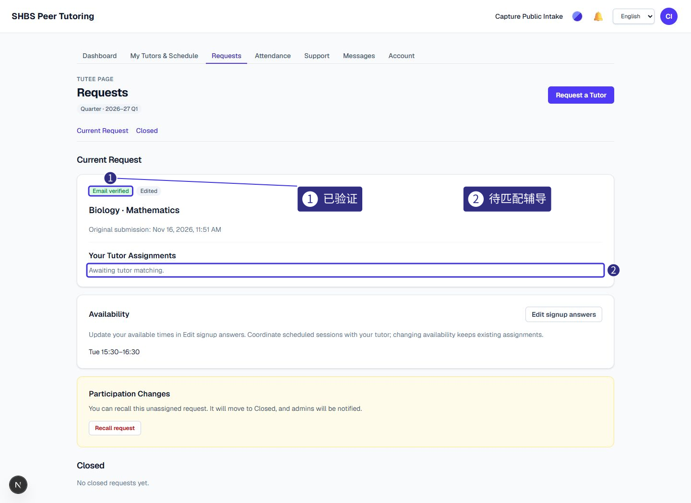

   /student?view=requests · EN · 2026-11-16

   已接受的虚构申请进入真实学习伙伴“申请”工作区：显示“邮箱已验证”、生物／数学及原提交时间，而辅导伙伴匹配单独显示为等待匹配。此图不表示已分配辅导伙伴或已排定课次。

   [原始完整截图](assets/request-tutoring-step-4.en.jpg) · `589c055e4b1cf166b48b353bd619ac1982e5d9f6` · Latest-main development baseline 589c055e with the Help candidate; synthetic demonstration data.

   已为本步骤添加标注，原始完整截图保持不变。

   - **1.** 已验证

   - **2.** 待匹配辅导

### 预期结果

“申请”显示已确认的申请，分配和排课状态单独呈现。

### 工作原理

首次符合条件的保存确定排队优先时间；仅验证邮箱并不代表报名完成。经验证后替换现有未结申请，会保留原优先时间、分配、出勤和原协议，同时记录新提交的同意证据。

首次分配启动固定七天验证期限。重发、重新分配或替换提交均不会延长该期限。

### 问题排查

- **邮件发送或保存失败** 保持页面打开。重试未修改的提交，或使用重发、恢复操作；不要因为邮件延迟就另交申请。已保存但刷新失败时，应重试读取。

- **邀请或待确认提交已过期** 返回原申请的恢复说明，或联系管理团队，尤其是邮箱填错时。重发不能延长已到期的固定分配验证期限。

## 申请成为辅导伙伴

提交资质说明，并完成面试及邀请流程。

打开: `/tutor-signup`

### 开始之前

- 辅导伙伴招募已开放，且辅导伙伴政策可读。

### 操作步骤

1. **填写申请** 选择“成为辅导伙伴”，填写必填身份和联系信息，选择最多三个开放科目，并按要求说明资质、成绩、AP分数或自学经历。

   请注意: 科目资质问题

   **视图 1**

   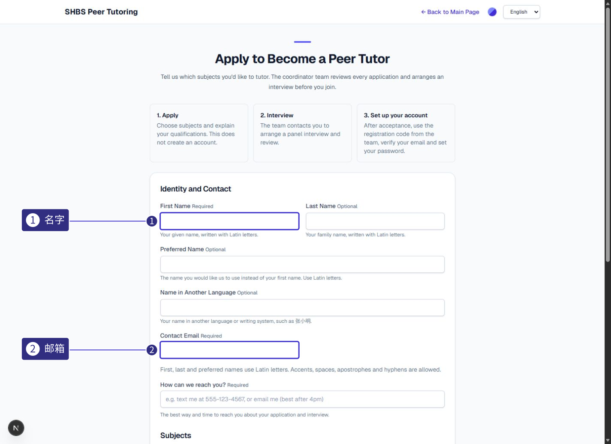

   /tutor-signup · EN · 2026-11-16

   公开辅导申请的身份与联系区域，字段为空；学科资历控件另图展示，未提交申请。

   [原始完整截图](assets/apply-tutor-step-1.en.jpg) · `589c055e4b1cf166b48b353bd619ac1982e5d9f6` · Latest-main development baseline 589c055e with the Help candidate; synthetic demonstration data.

   已为本步骤添加标注，原始完整截图保持不变。

   - **1.** 名字

   - **2.** 邮箱

   **视图 2**

   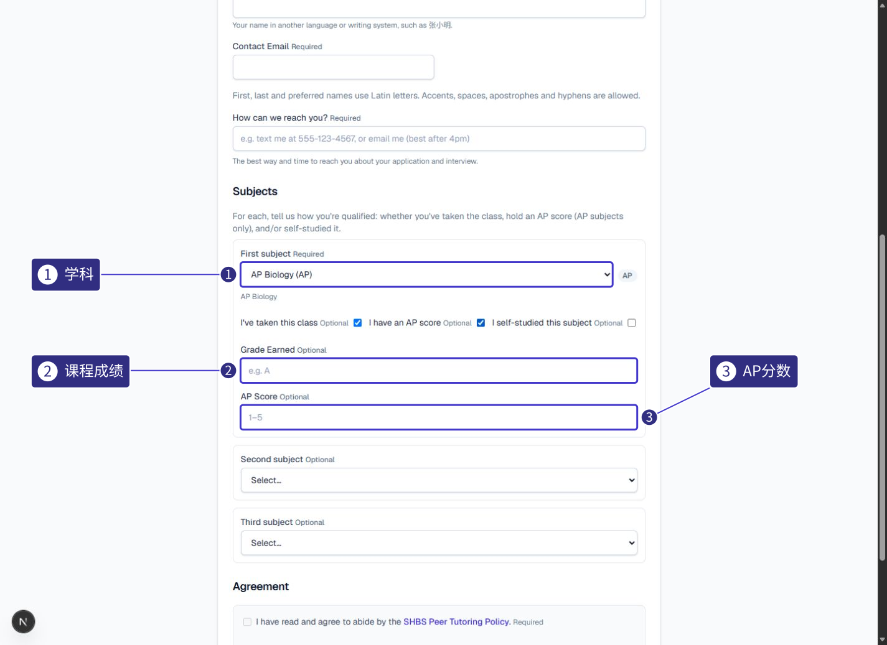

   /tutor-signup · EN · 2026-11-16

   未提交的AP生物示例，选择课程与AP选项以显示成绩及AP分数字段；未授予任何资历。

   [原始完整截图](assets/apply-tutor-step-1-view-2.en.jpg) · `589c055e4b1cf166b48b353bd619ac1982e5d9f6` · Latest-main development baseline 589c055e with the Help candidate; synthetic demonstration data.

   已为本步骤添加标注，原始完整截图保持不变。

   - **1.** 学科

   - **2.** 课程成绩

   - **3.** AP分数

   **视图 3**

   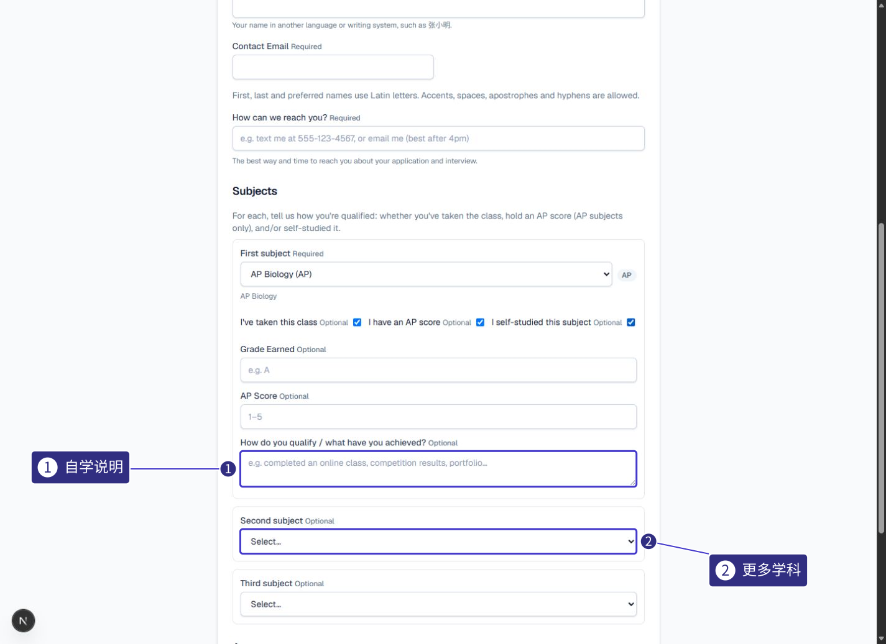

   /tutor-signup · EN · 2026-11-16

   未提交的资历草稿，显示自学说明字段及追加学科控件；未接受政策，也未提交申请。

   [原始完整截图](assets/apply-tutor-step-1-view-3.en.jpg) · `589c055e4b1cf166b48b353bd619ac1982e5d9f6` · Latest-main development baseline 589c055e with the Help candidate; synthetic demonstration data.

   已为本步骤添加标注，原始完整截图保持不变。

   - **1.** 自学说明

   - **2.** 更多学科

2. **阅读并提交** 阅读页面上的辅导伙伴政策并完成同意。查看申请保存回执，然后等待团队安排审核或面试。

   **视图 1**

   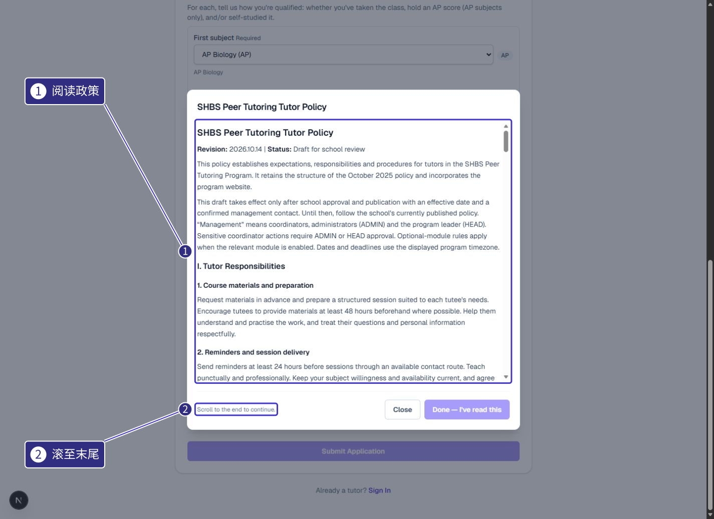

   /tutor-signup · EN · 2026-11-16

   真实辅导伙伴政策阅读器，尚未读至末尾，继续按钮仍禁用；未勾选同意，也未提交申请。

   [原始完整截图](assets/apply-tutor-step-2.en.jpg) · `589c055e4b1cf166b48b353bd619ac1982e5d9f6` · Latest-main development baseline 589c055e with the Help candidate; synthetic demonstration data.

   已为本步骤添加标注，原始完整截图保持不变。

   - **1.** 阅读政策

   - **2.** 滚至末尾

   **视图 2**

   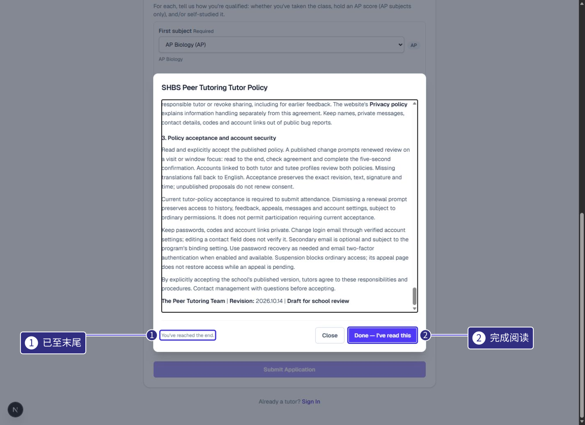

   /tutor-signup · EN · 2026-11-16

   真实政策阅读器已滚至末尾，可以完成阅读；尚未勾选同意，也未提交申请。

   [原始完整截图](assets/apply-tutor-step-2-view-2.en.jpg) · `589c055e4b1cf166b48b353bd619ac1982e5d9f6` · Latest-main development baseline 589c055e with the Help candidate; synthetic demonstration data.

   已为本步骤添加标注，原始完整截图保持不变。

   - **1.** 已至末尾

   - **2.** 完成阅读

   **视图 3**

   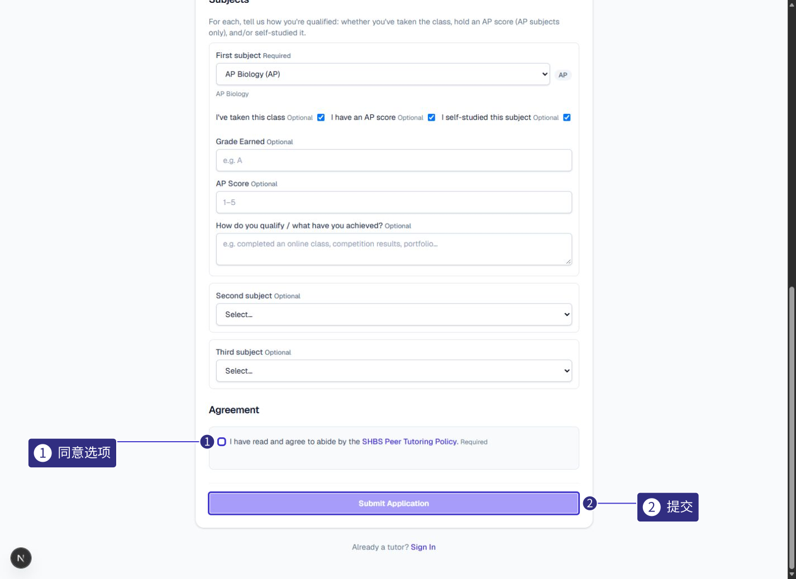

   /tutor-signup · EN · 2026-11-16

   阅读政策后返回申请表，同意框仍未勾选；必填回答及同意尚未完成，提交仍禁用，未提交申请。

   [原始完整截图](assets/apply-tutor-step-2-view-3.en.jpg) · `589c055e4b1cf166b48b353bd619ac1982e5d9f6` · Latest-main development baseline 589c055e with the Help candidate; synthetic demonstration data.

   已为本步骤添加标注，原始完整截图保持不变。

   - **1.** 同意选项

   - **2.** 提交

3. **使用获批后的邀请** 获批后，使用提供的辅导伙伴邀请码或设置邀请，验证邮箱并完成统一账户确认。随后进入辅导伙伴页面，检查激活状态及当前政策要求。

   **视图 1**

   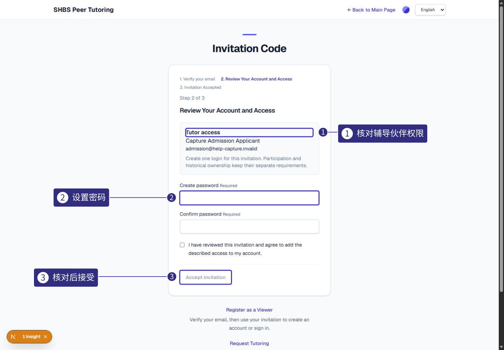

   /register-account · EN · 2026-11-20

   验证获批辅导伙伴的邮箱后，真实审阅页面显示辅导伙伴权限。登录凭据未填写，也未创建账户。

   [原始完整截图](assets/apply-tutor-step-3.en.jpg) · `b5ece465681957c9fe579d26babdeb260c674fa0` · Latest-main development baseline b5ece465, selected 2026-11-20, with the Help candidate and synthetic demo records.

   已为本步骤添加标注，原始完整截图保持不变。

   - **1.** 核对辅导伙伴权限

   - **2.** 设置密码

   - **3.** 核对后接受

   **视图 2**

   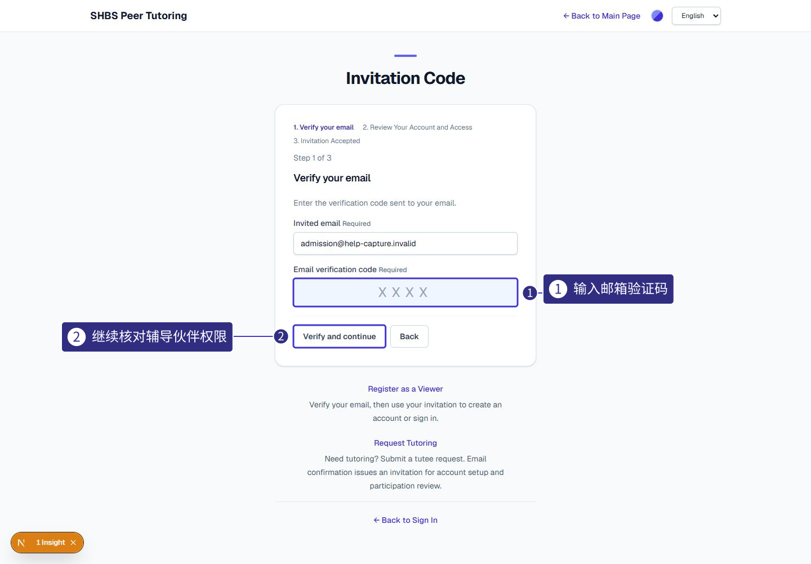

   /register-account · EN · 2026-11-20

   获批的演示辅导伙伴邀请要求独立邮箱验证。蓝色输入框仍为空。

   [原始完整截图](assets/apply-tutor-step-3-view-2.en.jpg) · `b5ece465681957c9fe579d26babdeb260c674fa0` · Latest-main development baseline b5ece465, selected 2026-11-20, with the Help candidate and synthetic demo records.

   已为本步骤添加标注，原始完整截图保持不变。

   - **1.** 输入邮箱验证码

   - **2.** 继续核对辅导伙伴权限

### 预期结果

申请进入审核；之后获批的邀请和账户流程才会授予辅导权限。

### 工作原理

同一邮箱的申请仍在审核时重复提交，会保留原答案，也不会再次通知团队。面试完成、录取决定和面试时数分别记录。

### 问题排查

- **问题或政策无法加载** 使用“重试”。项目需先配置科目并发布政策；表单持续不可用时请联系管理团队。

- **需要更正已提交答案** 请联系团队，不要反复提交。工作人员可审核符合条件的初次姓名更正，同时保留签署政策及其他申请证据。

## 申请巡查团队并查询状态

验证邮箱、等待工作人员批准，并领取获批邀请。

打开: `/crew-signup`

### 开始之前

- 巡查申请已开放，且能使用所填邮箱。

### 操作步骤

1. **申请并验证** 填写“加入巡查团队”并输入邮件验证码。此操作仅将申请送交工作人员，不会创建登录账户或巡查资格。

   请注意: 申请及状态查询入口

   **视图 1**

   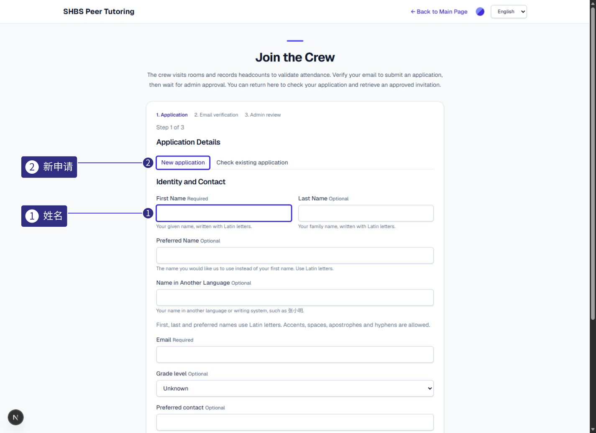

   /crew-signup · EN · 2026-11-16

   真实“加入巡查团队”新申请入口显示必填姓名控件，以及相互独立的邮箱验证和管理员审核进度。所有字段为空；尚未提交申请、创建登录账户或添加巡查资格。

   [原始完整截图](assets/apply-crew-step-1.en.jpg) · `589c055e4b1cf166b48b353bd619ac1982e5d9f6` · Latest-main development baseline 589c055e with the Help candidate; synthetic demonstration data.

   已为本步骤添加标注，原始完整截图保持不变。

   - **1.** 姓名

   - **2.** 新申请

   **视图 2**

   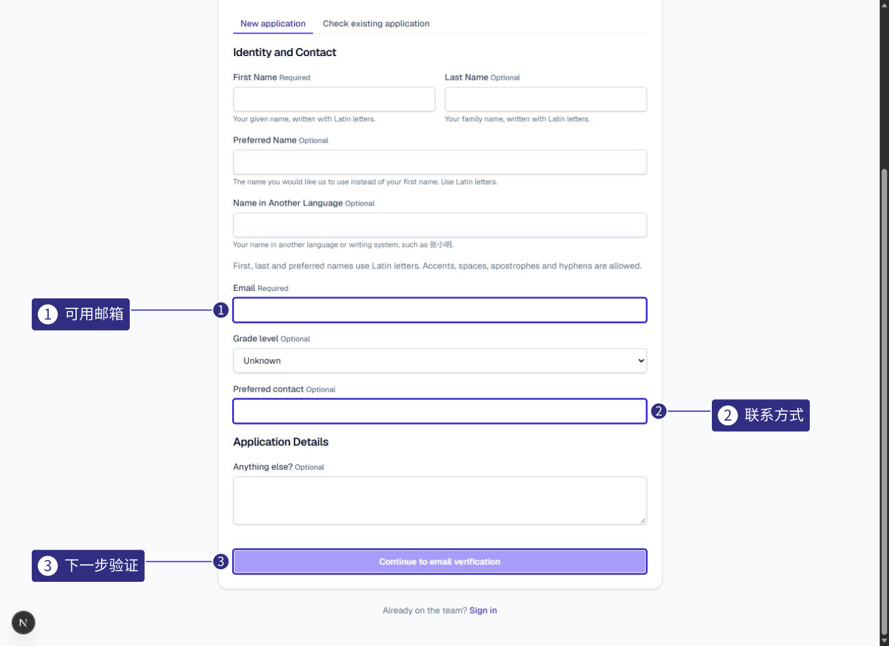

   /crew-signup · EN · 2026-11-16

   真实巡查申请表下半部显示邮箱、可选年级／联系方式、补充资料及“继续邮箱验证”。表单为空，继续按钮已禁用；尚未完成邮箱验证或工作人员批准。

   [原始完整截图](assets/apply-crew-step-1-view-2.en.jpg) · `589c055e4b1cf166b48b353bd619ac1982e5d9f6` · Latest-main development baseline 589c055e with the Help candidate; synthetic demonstration data.

   已为本步骤添加标注，原始完整截图保持不变。

   - **1.** 可用邮箱

   - **2.** 联系方式

   - **3.** 下一步验证

2. **查询现有申请** 在同一页面的状态查询流程中输入申请邮箱，并验证新的邮件验证码。待审核或已拒绝申请仅显示状态，不会提供邀请。

   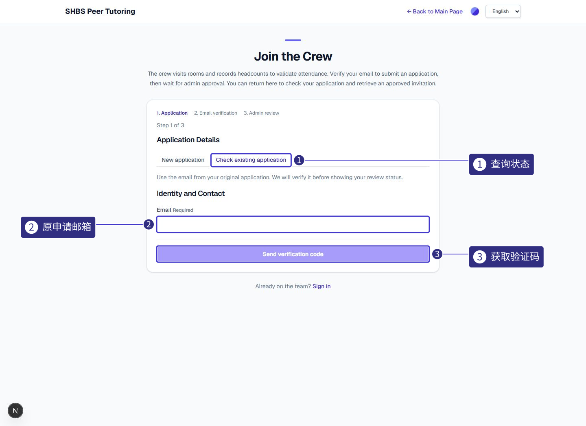

   /crew-signup · EN · 2026-11-16

   真实“查询现有申请”流程要求输入原申请邮箱并验证新的邮箱代码，之后才显示状态。字段为空，“发送验证码”已禁用；尚未显示申请状态或邀请。

   [原始完整截图](assets/apply-crew-step-2.en.jpg) · `589c055e4b1cf166b48b353bd619ac1982e5d9f6` · Latest-main development baseline 589c055e with the Help candidate; synthetic demonstration data.

   已为本步骤添加标注，原始完整截图保持不变。

   - **1.** 查询状态

   - **2.** 原申请邮箱

   - **3.** 获取验证码

3. **接受获批权限** 获批且可用的邀请会打开弹窗。可复制邀请码、选择发送至邮箱，或通过预填链接继续账户确认。已有账户会添加获批巡查权限，并保留登录资料及其他符合条件的权限。

   **视图 1**

   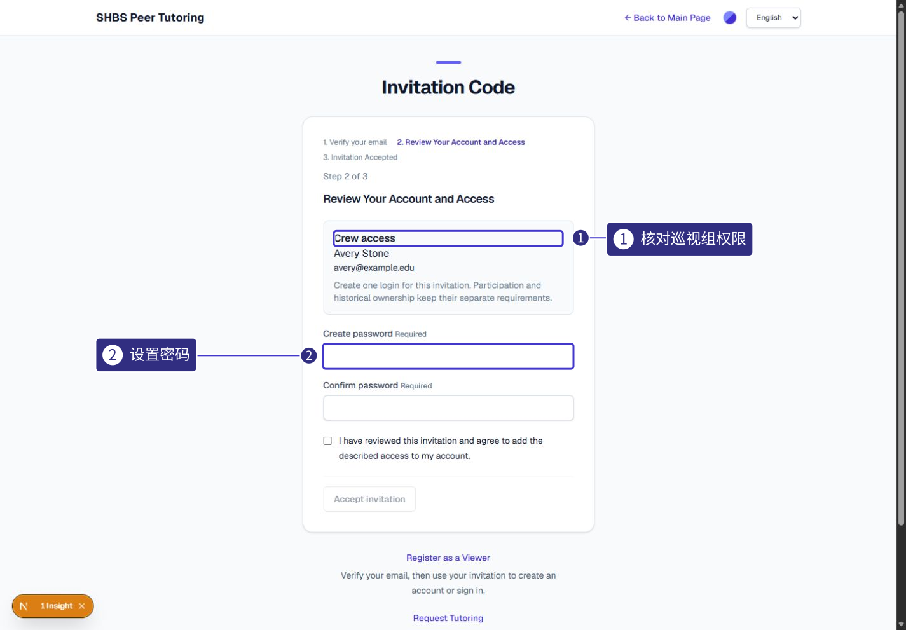

   /register-account · EN · 2026-11-20

   已保存的巡视组批准进入真实账户审阅并显示巡视组权限。登录凭据仍为空，邀请尚未接受。

   [原始完整截图](assets/apply-crew-step-3.en.jpg) · `b5ece465681957c9fe579d26babdeb260c674fa0` · Latest-main development baseline b5ece465, selected 2026-11-20, with the Help candidate and synthetic demo records.

   已为本步骤添加标注，原始完整截图保持不变。

   - **1.** 核对巡视组权限

   - **2.** 设置密码

   **视图 2**

   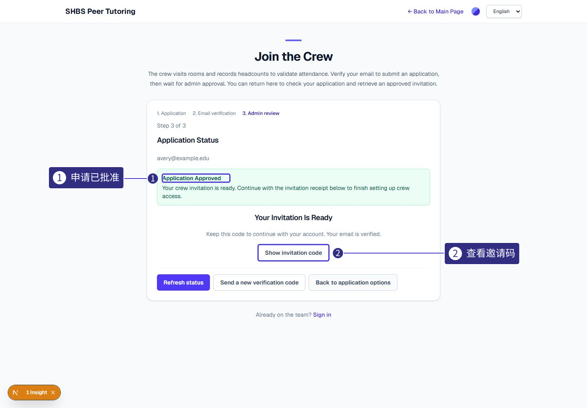

   /crew-signup · EN · 2026-11-20

   验证邮箱后，演示巡视组申请显示批准。有效邀请可打开，邀请码对话框已关闭。

   [原始完整截图](assets/apply-crew-step-3-view-2.en.jpg) · `b5ece465681957c9fe579d26babdeb260c674fa0` · Latest-main development baseline b5ece465, selected 2026-11-20, with the Help candidate and synthetic demo records.

   已为本步骤添加标注，原始完整截图保持不变。

   - **1.** 申请已批准

   - **2.** 查看邀请码

### 预期结果

可查看申请状态，或通过账户确认明确接受获批巡查权限。

### 工作原理

重复提交审核中的巡查申请会保留原答案。查询状态或验证邮箱不能代替工作人员批准。

### 问题排查

- **已获批但邀请不可用** 根据页面上的过期、撤销或已使用提示操作，并联系团队。重发或修改邮箱后需要新的验证码。

## 注册只读观察员权限

验证邮箱并确认账户所获权限。

打开: `/viewer-signup`

### 开始之前

- 项目已启用公开观察员注册。

### 操作步骤

1. **填写观察员信息** 选择“注册为观察员”，填写所需姓名、所属机构和邮箱，然后验证邮件中的初始验证码。

   请注意: 观察员注册的姓名、所属机构及邮箱字段

   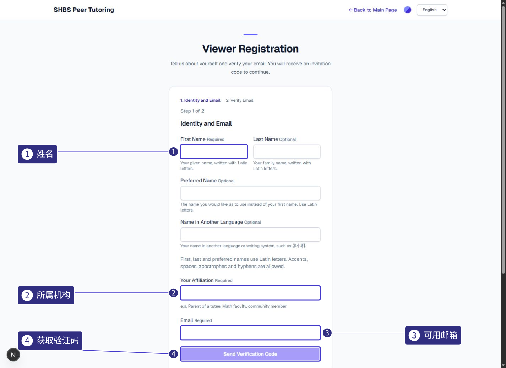

   /viewer-signup · EN · 2026-11-16

   提交前的真实公开观察员注册身份／邮箱步骤：姓名、所属机构和邮箱均为空，“发送验证码”已禁用。尚未创建观察员权限或账户。

   [原始完整截图](assets/register-viewer-step-1.en.jpg) · `589c055e4b1cf166b48b353bd619ac1982e5d9f6` · Latest-main development baseline 589c055e with the Help candidate; synthetic demonstration data.

   已为本步骤添加标注，原始完整截图保持不变。

   - **1.** 姓名

   - **2.** 所属机构

   - **3.** 可用邮箱

   - **4.** 获取验证码

2. **通过邀请继续** 使用邀请弹窗中的继续链接。新账户需核对预填信息并补充缺少的登录资料；也可复制或选择通过邮件发送单独的邀请码。

   **视图 1**

   

   /register-account · EN · 2026-11-20

   已验证的演示邀请打开账户审阅，显示只读观察员权限及未填写的密码字段。未创建账户或接受权限。

   [原始完整截图](assets/register-viewer-step-2.en.jpg) · `b5ece465681957c9fe579d26babdeb260c674fa0` · Latest-main development baseline b5ece465, selected 2026-11-20, with the Help candidate and synthetic demo records.

   已为本步骤添加标注，原始完整截图保持不变。

   - **1.** 核对观察员权限

   - **2.** 设置密码

   **视图 2**

   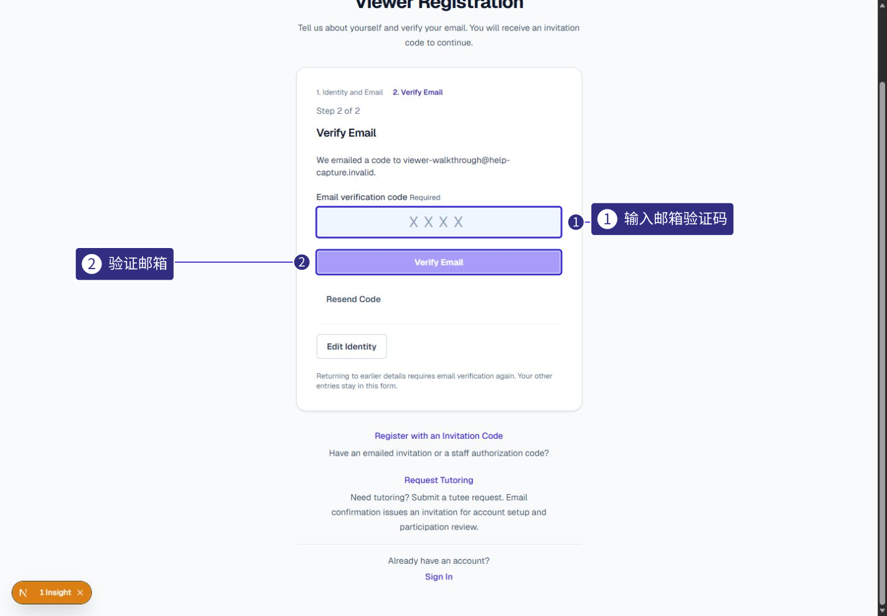

   /viewer-signup · EN · 2026-11-20

   观察员注册向指定演示邮箱发送了独立验证码。截图中的验证码字段为空。

   [原始完整截图](assets/register-viewer-step-2-view-2.en.jpg) · `b5ece465681957c9fe579d26babdeb260c674fa0` · Latest-main development baseline b5ece465, selected 2026-11-20, with the Help candidate and synthetic demo records.

   已为本步骤添加标注，原始完整截图保持不变。

   - **1.** 输入邮箱验证码

   - **2.** 验证邮箱

   **视图 3**

   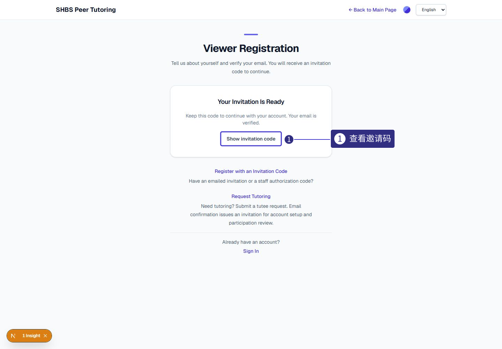

   /viewer-signup · EN · 2026-11-20

   邮箱已验证，观察员专用邀请已准备好。邀请码对话框已关闭。

   [原始完整截图](assets/register-viewer-step-2-view-3.en.jpg) · `b5ece465681957c9fe579d26babdeb260c674fa0` · Latest-main development baseline b5ece465, selected 2026-11-20, with the Help candidate and synthetic demo records.

   已为本步骤添加标注，原始完整截图保持不变。

   - **1.** 查看邀请码

3. **查看允许访问的概览** 进入只读管理区。如果邮箱已属于某个账户，此公开流程仅登录原账户，不会新增观察员身份或改变其权限。

   **视图 1**

   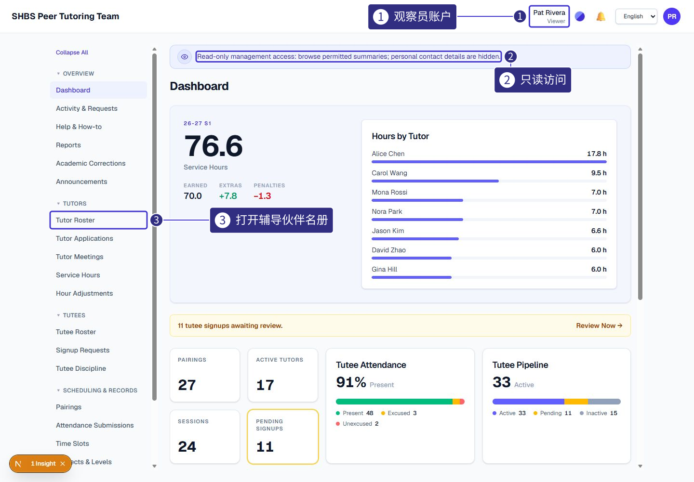

   /admin · EN · 2026-11-20

   Pat Rivera 的已获批观察员账户进入真实只读门户。权限提示说明可浏览经过遮蔽的概览，辅导伙伴名册是可用页面之一。

   [原始完整截图](assets/register-viewer-step-3.en.jpg) · `b5ece465681957c9fe579d26babdeb260c674fa0` · Latest-main development baseline b5ece465, selected 2026-11-20, with the Help candidate and synthetic demo records.

   已为本步骤添加标注，原始完整截图保持不变。

   - **1.** 观察员账户

   - **2.** 只读访问

   - **3.** 打开辅导伙伴名册

   **视图 2**

   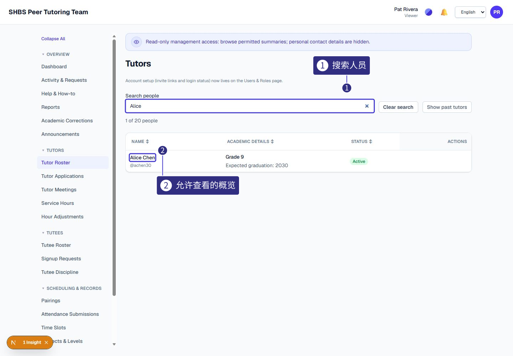

   /admin/tutors · EN · 2026-11-20

   观察员可以筛选允许查看的名册概览。本例显示虚构辅导伙伴的姓名、学业信息和有效状态，个人联系方式保持隐藏。

   [原始完整截图](assets/register-viewer-step-3-view-2.en.jpg) · `b5ece465681957c9fe579d26babdeb260c674fa0` · Latest-main development baseline b5ece465, selected 2026-11-20, with the Help candidate and synthetic demo records.

   已为本步骤添加标注，原始完整截图保持不变。

   - **1.** 搜索人员

   - **2.** 允许查看的概览

### 预期结果

符合条件的新账户获得观察员权限；已有账户保留原权限。

### 工作原理

观察员身份不能与参与资格、翻译或其他徽章共存。只读概览可能显示姓名及项目信息，但隐藏私人联系方式、原因、签名和申请证据。

### 问题排查

- **观察员链接不可用** 请向管理团队确认是否开放公开注册。已有账户时使用正常登录或密码恢复。

## 使用邀请或添加获批权限

区分邀请码与邮箱验证码，并核对具体授权。

打开: `/register-account`

### 开始之前

- 持有有效收件人邀请或工作人员密钥，并能使用对应邮箱。

### 操作步骤

1. **输入完整邀请码** 打开“使用邀请码注册”，或登录后选择“添加权限”。在绿色邀请码框中输入五位字母数字组合，然后选择“继续”。仍有效的旧版长码或数字码必须完整输入。

   请注意: 绿色邀请码输入框与继续按钮

   

   /register-account · EN · 2026-11-16

   尚未提供邀请码或身份的邀请输入页；未接受邀请证明，也未创建账户。

   [原始完整截图](assets/accept-invitation-step-1.en.jpg) · `589c055e4b1cf166b48b353bd619ac1982e5d9f6` · Latest-main development baseline 589c055e with the Help candidate; synthetic demonstration data.

   已为本步骤添加标注，原始完整截图保持不变。

   - **1.** 邀请码

   - **2.** 继续

2. **证明邮箱所有权** 按提示在蓝色输入框中填写单独的邮件验证码。验证前可用“返回”或“编辑身份”更正资料，但随后需重新验证。绑定邮箱的工作人员密钥不允许修改该地址。

   **视图 1**

   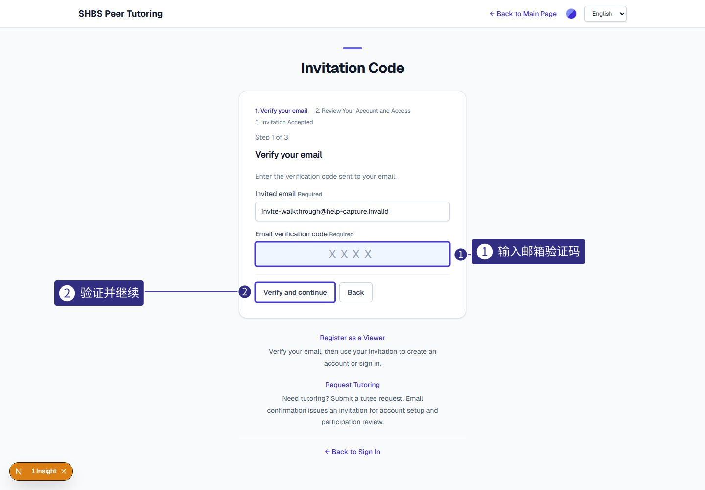

   /register-account · EN · 2026-11-20

   本地邮箱已收到该绑定辅导伙伴邀请的独立验证码。蓝色输入框为空，邀请尚未接受。

   [原始完整截图](assets/accept-invitation-step-2.en.jpg) · `b5ece465681957c9fe579d26babdeb260c674fa0` · Latest-main development baseline b5ece465, selected 2026-11-20, with the Help candidate and synthetic demo records.

   已为本步骤添加标注，原始完整截图保持不变。

   - **1.** 输入邮箱验证码

   - **2.** 验证并继续

   **视图 2**

   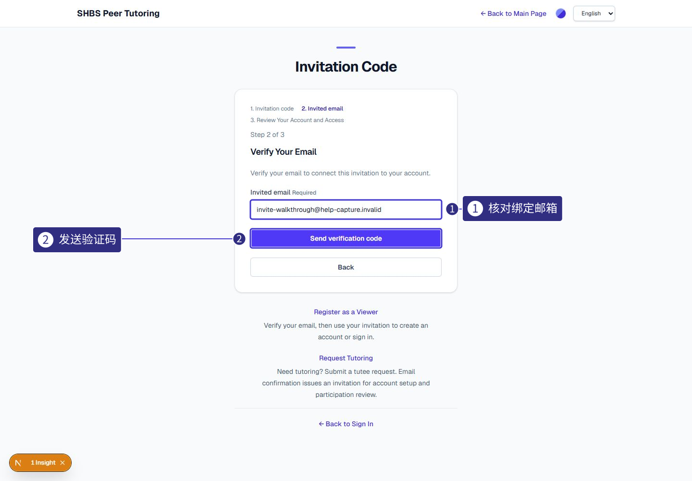

   /register-account · EN · 2026-11-20

   演示邀请已绑定此邮箱。收件人可请求验证，不能修改受邀地址。

   [原始完整截图](assets/accept-invitation-step-2-view-2.en.jpg) · `b5ece465681957c9fe579d26babdeb260c674fa0` · Latest-main development baseline b5ece465, selected 2026-11-20, with the Help candidate and synthetic demo records.

   已为本步骤添加标注，原始完整截图保持不变。

   - **1.** 核对绑定邮箱

   - **2.** 发送验证码

3. **核对身份与权限** 阅读邀请显示的角色或参与资格，以及预填申请信息。新账户补充缺少的登录资料；已有账户保留密码，并完成必要的登录或双重验证。最后明确确认添加授权。

   **视图 1**

   

   /register-account · EN · 2026-11-16

   真实学习伙伴参与邀请确认显示准确的授权添加及虚构申请资料。现有凭据保持不变；尚未接受邀请，也未显示代码或凭据。

   [原始完整截图](assets/accept-invitation-step-3.en.jpg) · `589c055e4b1cf166b48b353bd619ac1982e5d9f6` · Latest-main development baseline 589c055e with the Help candidate; synthetic demonstration data.

   已为本步骤添加标注，原始完整截图保持不变。

   - **1.** 本次添加

   - **2.** 核对答案

   **视图 2**

   

   /register-account · EN · 2026-11-16

   真实邀请确认要求先明确勾选核对声明，再选择“接受邀请”；已提交的虚构参与答案和同意可见。复选框未勾选，接受按钮已禁用，现有凭据保持不变。

   [原始完整截图](assets/accept-invitation-step-3-view-2.en.jpg) · `589c055e4b1cf166b48b353bd619ac1982e5d9f6` · Latest-main development baseline 589c055e with the Help candidate; synthetic demonstration data.

   已为本步骤添加标注，原始完整截图保持不变。

   - **1.** 提交的同意

   - **2.** 确认添加

   - **3.** 接受邀请

4. **查看完成回执** 根据下一步提示进入相应页面、确认学业信息或认领指定历史记录。出现登录入口卡时，可复制链接或保存二维码，保留公开/signin入口供以后使用；它不包含账户验证凭证。账户接受操作已保存但登录失败时，应使用登录恢复，避免再次接受。

   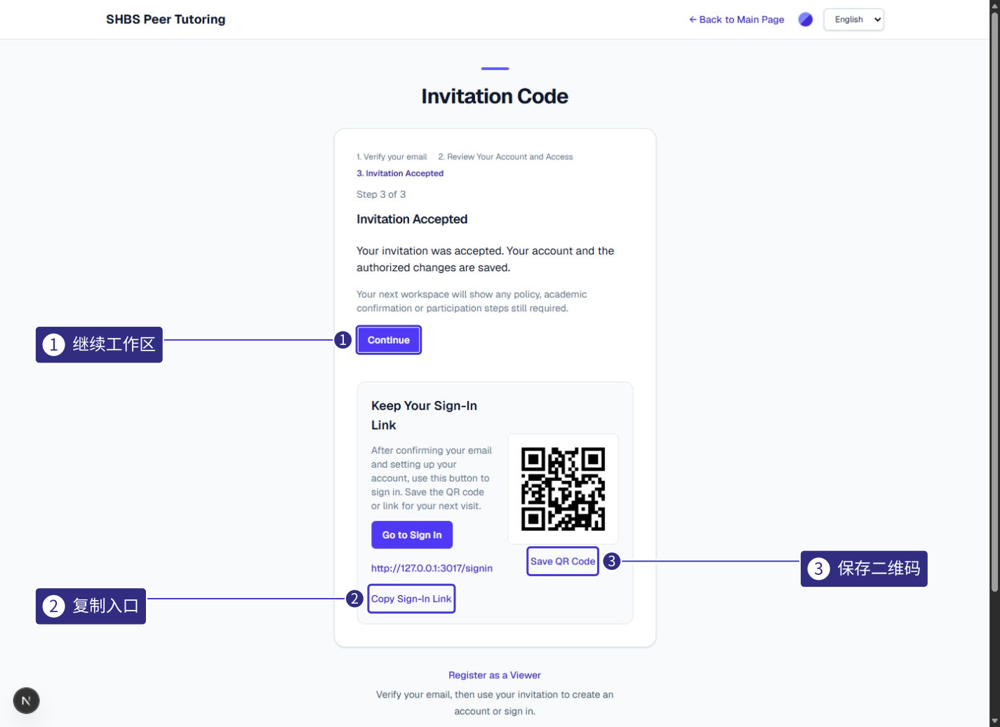

   /register-account · EN · 2026-11-16

   虚构学习伙伴邀请已实际接受成功：回执说明账户及授权变更均已保存。“继续”、公开/signin入口卡、“复制登录链接”和“保存二维码”可见。二维码／链接仅包含公开入口，不展示账户验证证明。

   [原始完整截图](assets/accept-invitation-step-4.en.jpg) · `589c055e4b1cf166b48b353bd619ac1982e5d9f6` · Latest-main development baseline 589c055e with the Help candidate; synthetic demonstration data.

   已为本步骤添加标注，原始完整截图保持不变。

   - **1.** 继续工作区

   - **2.** 复制入口

   - **3.** 保存二维码

### 预期结果

回执说明实际接受的权限；仅打开邀请码不会授予权限。

### 工作原理

新邀请最长有效十五分钟，且受更早授权期限约束。复制到另一浏览器的邀请码需要收件人邮箱验证。管理邀请保留更高的现有职级，不能授予负责人权限；参与邀请也不能绕过停用或返校审核。

经确认的参与或管理权限会替换独占的观察员身份。历史访问仍需单独确认关联指定记录。

### 问题排查

- **邀请码已过期、被替换或已使用** 返回原申请的恢复或状态查询操作，或请签发人提供可用邀请。不要把邮箱验证码填入邀请码框。

## 登录或找回密码

使用用户名或已验证邮箱，并完成必要的安全验证。

打开: `/signin`

### 开始之前

- 已创建登录账户；仅有申请或名册记录并不代表已有登录。

### 操作步骤

1. **输入登录标识和密码** 在登录页输入用户名、主要邮箱或已验证备用邮箱，以及当前密码，然后选择“登录”。

   请注意: 用户名或邮箱与密码输入框

   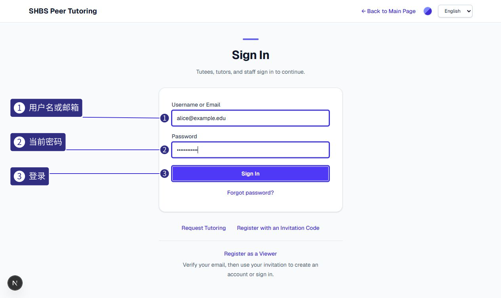

   /signin · EN · 2026-11-16

   提交前填写完整的登录表单（虚构辅导伙伴账户）

   [原始完整截图](assets/sign-in-recover-step-1.en.jpg) · `589c055e4b1cf166b48b353bd619ac1982e5d9f6` · Latest-main development baseline 589c055e with the Help candidate; synthetic demonstration data.

   已为本步骤添加标注，原始完整截图保持不变。

   - **1.** 用户名或邮箱

   - **2.** 当前密码

   - **3.** 登录

2. **按提示完成邮箱双重验证** 在验证码框中输入发送到主要邮箱的验证码。使用备用邮箱登录不会改变双重验证码的接收地址。

   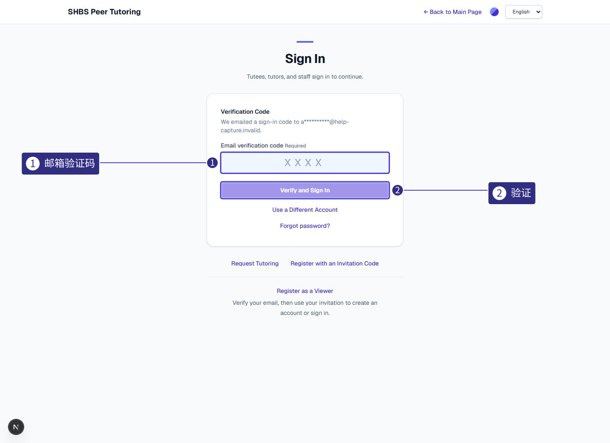

   /signin · EN · 2026-11-16

   真实登录尝试已进入主要邮箱验证码阶段，收件地址已遮蔽，验证码字段为空，尚未完成登录。

   [原始完整截图](assets/sign-in-recover-step-2.en.jpg) · `589c055e4b1cf166b48b353bd619ac1982e5d9f6` · Latest-main development baseline 589c055e with the Help candidate; synthetic demonstration data.

   已为本步骤添加标注，原始完整截图保持不变。

   - **1.** 邮箱验证码

   - **2.** 验证

3. **需要时使用恢复功能** 选择“忘记密码”，以用户名或已验证邮箱申请恢复，再通过私密链接设置新密码。用户名恢复发送到主要邮箱，以备用邮箱申请则发送到该地址。之后重新登录。

   请注意: 用户名或已验证邮箱输入框及发送重置链接

   **视图 1**

   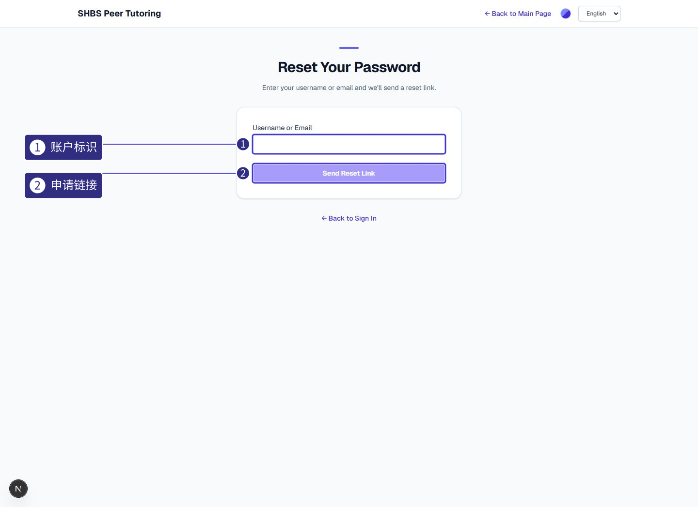

   /forgot-password · EN · 2026-11-16

   密码找回申请页及空白账户标识字段；未请求重置邮件，也未更改凭据。

   [原始完整截图](assets/sign-in-recover-step-3.en.jpg) · `589c055e4b1cf166b48b353bd619ac1982e5d9f6` · Latest-main development baseline 589c055e with the Help candidate; synthetic demonstration data.

   已为本步骤添加标注，原始完整截图保持不变。

   - **1.** 账户标识

   - **2.** 申请链接

   **视图 2**

   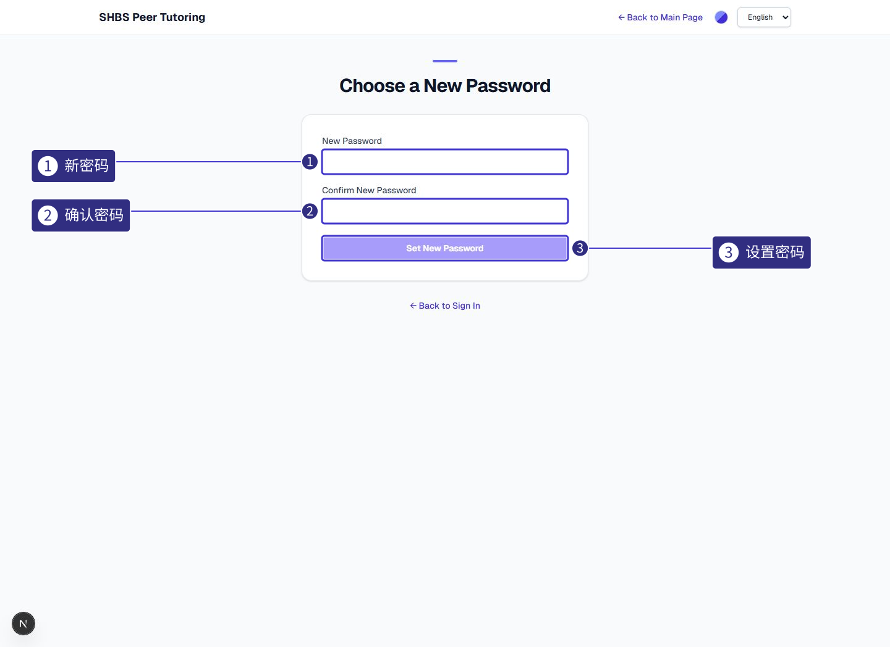

   /reset-password · EN · 2026-11-16

   通过实际成功送达的私密找回链接，现有虚构账户打开真实“选择新密码”表单。两个密码框均为空，“设置新密码”已禁用；未输入或更改任何凭据。公开路径元数据省略了授权查询参数。

   [原始完整截图](assets/sign-in-recover-step-3-view-2.en.jpg) · `589c055e4b1cf166b48b353bd619ac1982e5d9f6` · Latest-main development baseline 589c055e with the Help candidate; synthetic demonstration data.

   已为本步骤添加标注，原始完整截图保持不变。

   - **1.** 新密码

   - **2.** 确认密码

   - **3.** 设置密码

4. **处理未完成设置或停用状态** 账户仍需验证邮箱或设置密码时，使用团队提供的设置链接。被停用账户需完成正常登录和安全检查，再在停用页面提交或查看账户申诉。

   **视图 1**

   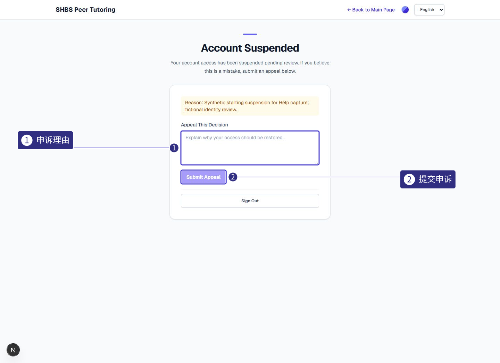

   /suspended · EN · 2026-11-16

   现有虚构停用账户完成正常登录后进入真实的申诉专页；申诉为空且未提交，账户仍处于停用状态。

   [原始完整截图](assets/sign-in-recover-step-4.en.jpg) · `589c055e4b1cf166b48b353bd619ac1982e5d9f6` · Latest-main development baseline 589c055e with the Help candidate; synthetic demonstration data.

   已为本步骤添加标注，原始完整截图保持不变。

   - **1.** 申诉理由

   - **2.** 提交申诉

   **视图 2**

   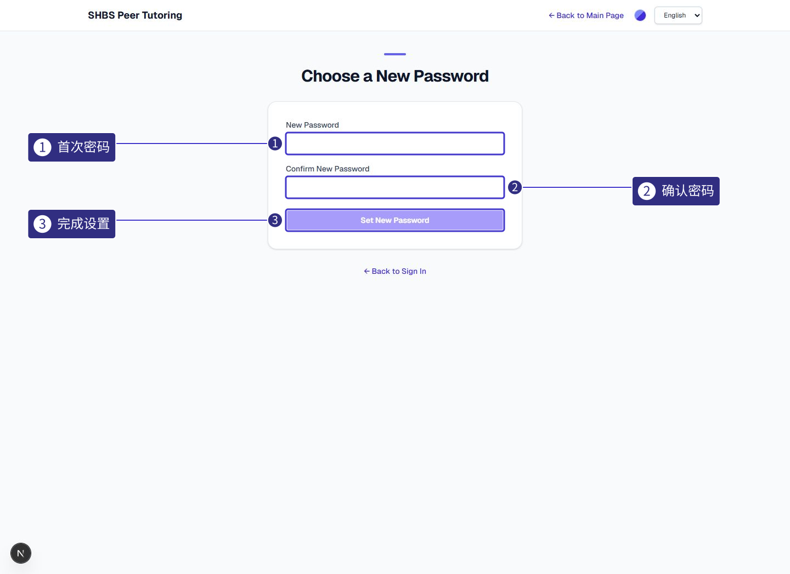

   /reset-password · EN · 2026-11-16

   实际成功送达的设置授权让尚无密码的现有虚构账户打开真实“选择新密码”表单。两个字段为空，“设置新密码”已禁用；尚未完成设置，也未输入新凭据。公开路径元数据省略了授权查询参数。

   [原始完整截图](assets/sign-in-recover-step-4-view-2.en.jpg) · `589c055e4b1cf166b48b353bd619ac1982e5d9f6` · Latest-main development baseline 589c055e with the Help candidate; synthetic demonstration data.

   已为本步骤添加标注，原始完整截图保持不变。

   - **1.** 首次密码

   - **2.** 确认密码

   - **3.** 完成设置

### 预期结果

进入获授权的页面，或看到明确的设置、停用后续步骤。

### 工作原理

更改或重置密码会退出所有现有会话。账户恢复保留权限和辅导历史，但不会解除停用或双重验证要求。

### 问题排查

- **原邮箱无法使用** 请联系管理团队进行身份审核。设置页面不能修改显示的账户邮箱；邀请也不会替换已有密码。

- **验证码或链接过期** 重新开始对应登录或恢复流程，使用最新成功发送的邮件。检查垃圾邮件；持续无法收信时联系管理团队。

## 获得私密帮助或报告网站问题

私人事务通过私密渠道处理，公开问题报告使用虚构示例。

[打开缺陷报告表单（GitHub）](https://github.com/DupeisTaken/shbs-peer-tutoring-website/issues/new?template=01-bug_report.yml)

### 开始之前

- 明确页面、原本操作和实际结果。

### 操作步骤

1. **选择合适渠道** 账户、出勤、分配或纪律事务请使用消息或项目确认的私密联系方式。对决定提出异议应使用对应申诉流程；报告软件问题不等于提交申诉。

   请注意: 登录后进入个人私密工作区

   

   /signin · EN · 2026-11-16

   真实公开登录入口，用于进入账户的私密工作区。此入口图不展示私信，也未提交任何求助报告或申诉。

   [原始完整截图](assets/report-problem-step-1.en.jpg) · `589c055e4b1cf166b48b353bd619ac1982e5d9f6` · Latest-main development baseline 589c055e with the Help candidate; synthetic demonstration data.

   已为本步骤添加标注，原始完整截图保持不变。

   - **1.** 私密工作区

2. **描述可复现软件问题** 使用仓库的缺陷报告表单，提供页面路径、角色、浏览器／设备、最短复现步骤、预期与实际结果，以及含时区的时间。不知道应用版本时注明未知。

   

   /help/report-problem · EN · 2026-11-20

   公开帮助指南链接到仓库的缺陷报告表单。打开表单前整理页面、尝试的操作、预期结果和实际结果。外部表单在 GitHub 打开。

   [原始完整截图](assets/report-problem-step-2.en.jpg) · `b5ece465681957c9fe579d26babdeb260c674fa0` · Latest-main development baseline b5ece465, selected 2026-11-20, with the Help candidate and synthetic demo records.

   已为本步骤添加标注，原始完整截图保持不变。

   - **1.** 打开缺陷报告表单

   - **2.** 准备复现信息

3. **移除个人信息** 使用虚构姓名和记录。公开截图或日志前，移除姓名、联系方式、私信、纪律详情、验证码、Cookie及账户／验证链接。疑似安全问题请私下报告给已确认的运营人员或维护者。

   

   /help/report-problem · EN · 2026-11-20

   报告指南提醒不要在公开报告中包含参与者资料及私密账户链接。准备截图或日志时，按指南使用虚构示例。

   [原始完整截图](assets/report-problem-step-3.en.jpg) · `b5ece465681957c9fe579d26babdeb260c674fa0` · Latest-main development baseline b5ece465, selected 2026-11-20, with the Help candidate and synthetic demo records.

   已为本步骤添加标注，原始完整截图保持不变。

   - **1.** 保护私密资料

   - **2.** 使用虚构示例

### 预期结果

正确团队收到可处理报告，同时避免公开参与者隐私证据。

### 工作原理

仓库也有改进、功能和文档表单。私密支持及申诉仍保留各自访问权限和决定流程。

### 问题排查

- **无法登录发送私信** 尝试密码恢复或使用项目确认的联系方式。停用账户仍需正常登录，并使用停用申诉页面。

## 通过邮件通知申诉无效报名

无需网站登录，通过本人私密申请链接提交申诉，并查看独立决定。

请使用邮件中的完整私密链接。

### 开始之前

- 从发送到申请所填邮箱的通知中，打开完整申诉链接。本指南不含可用申诉令牌；仅输入页面地址不能识别申请。

### 操作步骤

1. **找到本人的申请通知邮件** 在提交申请时使用的邮箱中打开报名无效通知。按通知显示选择“查看并申诉”或“对此决定提出申诉”。使用完整私密链接打开这份申请的申诉页面。

   请注意: 图中申请辅导是原公开申请入口；申诉本身通过本人私密通知邮件打开

   **视图 1**

   

   /tutee-signup/appeal · EN · 2026-11-20

   打开申请通知邮件中的“查看并申诉”。该链接会进入此报名审阅页面，无需登录。

   [原始完整截图](assets/appeal-signup-from-email-step-1.en.jpg) · `b5ece465681957c9fe579d26babdeb260c674fa0` · Latest-main development baseline b5ece465, selected 2026-11-20, with the Help candidate, signup appeal first-load correction, and synthetic demo records.

   已为本步骤添加标注，原始完整截图保持不变。

   - **1.** 从通知打开

   - **2.** 审阅说明

   **视图 2**

   

   /tutee-signup · EN · 2026-11-20

   这是原公开报名页面。若报名随后被标记，请使用寄至记录邮箱的通知中的“查看并申诉”。

   [原始完整截图](assets/appeal-signup-from-email-step-1-view-2.en.jpg) · `b5ece465681957c9fe579d26babdeb260c674fa0` · Latest-main development baseline b5ece465, selected 2026-11-20, with the Help candidate and synthetic demo records.

   已为本步骤添加标注，原始完整截图保持不变。

   - **1.** 原报名页面

   - **2.** 验证邮箱

2. **查看可用申请状态** 查看页面是否提供申诉表单，或是否显示已保存的申诉状态。较早的申请还可能显示类型及原提交时间。私密链接仅允许查看这份申请的申诉。

   

   /tutee-signup/appeal · EN · 2026-11-20

   空白说明栏及“提交申诉”按钮表明此申请可提出申诉。

   [原始完整截图](assets/appeal-signup-from-email-step-2.en.jpg) · `b5ece465681957c9fe579d26babdeb260c674fa0` · Latest-main development baseline b5ece465, selected 2026-11-20, with the Help candidate, signup appeal first-load correction, and synthetic demo records.

   已为本步骤添加标注，原始完整截图保持不变。

   - **1.** 申诉说明栏

   - **2.** 填写后可提交

3. **提交一次说明** 表单可用时，填写说明并选择提交申诉。遵循表单长度要求：旧版页面要求十至两千字符；指定报名页面接受不超过两千字符的非空原因。等待回执；针对该标记已记录的申诉不能被替换。

   

   /tutee-signup/appeal · EN · 2026-11-20

   核对说明后仅选择一次“提交申诉”。所填草稿显示将提交给工作人员的内容。

   [原始完整截图](assets/appeal-signup-from-email-step-3.en.jpg) · `b5ece465681957c9fe579d26babdeb260c674fa0` · Latest-main development baseline b5ece465, selected 2026-11-20, with the Help candidate, signup appeal first-load correction, and synthetic demo records.

   已为本步骤添加标注，原始完整截图保持不变。

   - **1.** 核对申诉说明

   - **2.** 提交申诉

4. **单独阅读决定** 申诉已提交只是回执。应单独查看待处理、拒绝／清除或接受／拒绝状态，了解审核结果。审核期间无效标记仍有效。已接受提交后刷新失败时，使用只读重试，不要再次提交。

   

   /tutee-signup/appeal · EN · 2026-11-20

   确认信息记录申诉已提交。单独的待审核状态表明标记仍暂停匹配。

   [原始完整截图](assets/appeal-signup-from-email-step-4.en.jpg) · `b5ece465681957c9fe579d26babdeb260c674fa0` · Latest-main development baseline b5ece465, selected 2026-11-20, with the Help candidate, signup appeal first-load correction, and synthetic demo records.

   已为本步骤添加标注，原始完整截图保持不变。

   - **1.** 提交回执

   - **2.** 待审核

### 预期结果

指定申请有一份已记录申诉，审核结果独立显示。

### 工作原理

私密链接仅授权该有限申请申诉，可在账户设置前使用。旧版申请申诉链接在通知创建九十天后过期；指定报名链接还要求当前符合条件的申请、版本及有效时期。清除或重新标记会使旧凭证失效。申诉和重发邮件不会延长验证期限。

### 问题排查

- **链接无效、过期或没有表单** 从本人邮箱重新打开最新完整通知；指定报名凭证可能在打开后从地址栏移除，所以之后复制的单独地址无效。仍不可用时，私下联系团队。已有回执可能仅供阅读；不要创建重复申请来替代申诉。

## 使用学校学时报表链接

打开邮件报表、每项准确数量只录入一次、下载CSV，并安排或取消个人提醒。

请使用邮件中的完整私密链接。

### 开始之前

- 需要授权学校收件人从报表邮件取得有效仅报表链接，无需网站登录。本指南不包含实际访问令牌。

### 操作步骤

1. **打开已保存报表** 从学校邮件选择查看月度报表。检查月份及版本，再选择英文或中文。有效链接授予报表访问，因此只应分享给授权收件人。

   请注意: 使用本人邮件中的查看月度报表链接；截图使用合成报表且没有可复用令牌。

   **视图 1**

   

   /reports/service-hours/[private-link] · EN · 2026-11-20

   实际专属邮件操作在退出登录后打开 11 月第 1 版学校报告，可查看月份、版本和语言选项。

   [原始完整截图](assets/use-school-report-link-step-1.en.jpg) · `b5ece465681957c9fe579d26babdeb260c674fa0` · Latest-main development baseline b5ece465, selected 2026-11-20, with the Help candidate. Isolated synthetic first-report demonstration phase.

   已为本步骤添加标注，原始完整截图保持不变。

   - **1.** 月份和版本

   - **2.** 报告语言

   **视图 2**

   

   /reports/service-hours/[private-link] · ZH · 2026-11-20

   切换到中文后仍显示同一份 11 月第 1 版报告，同时界面使用中文。

   [原始完整截图](assets/use-school-report-link-step-1-view-2.zh.jpg) · `b5ece465681957c9fe579d26babdeb260c674fa0` · Latest-main development baseline b5ece465, selected 2026-11-20, with the Help candidate. Isolated synthetic first-report demonstration phase.

   已为本步骤添加标注，原始完整截图保持不变。

   - **1.** 同一版本

   - **2.** 中文

2. **阅读准确入账数量** 对具体人员仅使用突出显示的入账时数一次。点击入账时数或横线打开“详情”，核对学校账户参考。需要修正时，找到此前已入账版本的对照行，使用该行显示的增量时数。

   **视图 1**

   

   /reports/service-hours/[private-link] · EN · 2026-11-20

   实际送达的更正版中，若 Gina Hill 上次按第 1 版入账，入账时数为 +0.5 h；点击该时数可打开此人详情。

   [原始完整截图](assets/use-school-report-link-step-2.en.jpg) · `b5ece465681957c9fe579d26babdeb260c674fa0` · Latest-main development baseline b5ece465, selected 2026-11-20, with the Help candidate. Isolated synthetic first-report demonstration phase.

   已为本步骤添加标注，原始完整截图保持不变。

   - **1.** 打开入账时数详情

   **视图 2**

   

   /reports/service-hours/[private-link] · EN · 2026-11-20

   已保存详情列出两种选择：上一笔为第 1 版时追加 +0.5 h；从未入账时一次录入 +27.5 h。上方显示个人学校账户标识。

   [原始完整截图](assets/use-school-report-link-step-2-view-2.en.jpg) · `b5ece465681957c9fe579d26babdeb260c674fa0` · Latest-main development baseline b5ece465, selected 2026-11-20, with the Help candidate. Isolated synthetic first-report demonstration phase.

   已为本步骤添加标注，原始完整截图保持不变。

   - **1.** 相对第 1 版

   - **2.** 从未入账

3. **下载或查看详情** 使用下载CSV获取保存版本。不要将转入余额、原始变化或转出余额作为另行学时。详情可用关闭、Escape或点外部关闭；手机上水平滚动报表以查看所有列。

   **视图 1**

   

   /reports/service-hours/[private-link] · EN · 2026-11-20

   通过 Escape 关闭详情后，键盘焦点位于已保存版本的“下载 CSV”操作；报告仍为同一版。

   [原始完整截图](assets/use-school-report-link-step-3.en.jpg) · `b5ece465681957c9fe579d26babdeb260c674fa0` · Latest-main development baseline b5ece465, selected 2026-11-20, with the Help candidate. Isolated synthetic first-report demonstration phase.

   已为本步骤添加标注，原始完整截图保持不变。

   - **1.** 下载 CSV

   - **2.** 已保存版本

   **视图 2**

   

   /reports/service-hours/[private-link] · EN · 2026-11-20

   破折号也可打开已保存详情。该收件人示例显示零入账和相关数值，并可选择“关闭”。

   [原始完整截图](assets/use-school-report-link-step-3-view-2.en.jpg) · `b5ece465681957c9fe579d26babdeb260c674fa0` · Latest-main development baseline b5ece465, selected 2026-11-20, with the Help candidate. Isolated synthetic first-report demonstration phase.

   已为本步骤添加标注，原始完整截图保持不变。

   - **1.** 关闭详情

   - **2.** 无需入账

4. **管理个人提醒** 在个人邮件链接选择发送邮件提醒，按报表时区选择未来时间并确认遮蔽的原收件邮箱。未发提醒可用取消此提醒邮件。提醒始终发送同一保存报表，已录入学时不得再次录入。

   **视图 1**

   

   /reports/service-hours/[private-link] · EN · 2026-11-20

   实际提醒复核显示原邮箱的掩码、Asia/Shanghai 11 月 23 日 09:00，并提示提醒不会更改已保存版本。

   [原始完整截图](assets/use-school-report-link-step-4.en.jpg) · `b5ece465681957c9fe579d26babdeb260c674fa0` · Latest-main development baseline b5ece465, selected 2026-11-20, with the Help candidate. Isolated synthetic first-report demonstration phase.

   已为本步骤添加标注，原始完整截图保持不变。

   - **1.** 已遮盖邮箱

   - **2.** 所选时间

   - **3.** 安排提醒

   **视图 2**

   

   /reports/service-hours/[private-link] · EN · 2026-11-20

   收件人打开实际提醒编辑器，在 Asia/Shanghai 时区选择未来时间，并保留同一已保存版本。

   [原始完整截图](assets/use-school-report-link-step-4-view-2.en.jpg) · `b5ece465681957c9fe579d26babdeb260c674fa0` · Latest-main development baseline b5ece465, selected 2026-11-20, with the Help candidate. Isolated synthetic first-report demonstration phase.

   已为本步骤添加标注，原始完整截图保持不变。

   - **1.** 未来时间

   - **2.** 核对提醒

   **视图 3**

   

   /reports/service-hours/[private-link] · EN · 2026-11-20

   该提醒已按未来时间实际安排，对应同一已保存报告，发送前仍可取消。

   [原始完整截图](assets/use-school-report-link-step-4-view-3.en.jpg) · `b5ece465681957c9fe579d26babdeb260c674fa0` · Latest-main development baseline b5ece465, selected 2026-11-20, with the Help candidate. Isolated synthetic first-report demonstration phase.

   已为本步骤添加标注，原始完整截图保持不变。

   - **1.** 已安排

   - **2.** 取消提醒

   **视图 4**

   

   /reports/service-hours/[private-link] · EN · 2026-11-20

   同一条未来提醒现在显示“已取消”，取消操作已不再显示。学校报告仍为已保存的第 2 版。

   [原始完整截图](assets/use-school-report-link-step-4-view-4.en.jpg) · `b5ece465681957c9fe579d26babdeb260c674fa0` · Latest-main development baseline b5ece465, selected 2026-11-20, with the Help candidate. Isolated synthetic first-report demonstration phase.

   已为本步骤添加标注，原始完整截图保持不变。

   - **1.** 已取消

### 预期结果

使用正确保存版本、每项数量只入账一次，并能跟踪本人未发提醒。

### 工作原理

持有效报表链接者均可读取该报表，但个人提醒仅发至原收件邮箱，转发后也不改变。支持一个未完成提醒，每天至多五次申请。旧共享链接仍可读，但没有个人提醒控件。

### 问题排查

- **链接已撤销或提醒缺失、受阻** 请发放管理员提供当前报表链接，不要猜测令牌。提醒须使用本人邮件链接并查看其提醒状态。失败或被阻止的未发提醒可取消后重新安排，投递可能延迟。
