# Manage the program

Generated from the website help catalogue. Edit the content records, then run `npm run help:export`.

[Catalogue & capture provenance](README.md)

Screenshot source: `1df44d6bb31cf04352adae9c65819139b7b747d8`. New captures use latest-main development baseline 1df44d6b, selected 2026-11-21, with the Help candidate. Earlier captures list their own revision and capture date.

This GitHub training copy includes role-specific instructions. Signing in and current program permissions are still required to use the corresponding website features. All examples are synthetic.

- [Find daily management work](#find-daily-management-work)
- [Match a tutoring request](#match-a-tutoring-request)
- [Flag, clear or appeal an invalid signup](#flag-clear-or-appeal-an-invalid-signup)
- [Review tutor applications and correct names](#review-tutor-applications-and-correct-names)
- [Assign and complete an interview panel](#assign-and-complete-an-interview-panel)
- [Compare qualifications and tutoring willingness](#compare-qualifications-and-tutoring-willingness)
- [Grant or remove a manual subject qualification](#grant-or-remove-a-manual-subject-qualification)
- [Inspect and edit the tutor roster](#inspect-and-edit-the-tutor-roster)
- [Inspect and edit the tutee roster](#inspect-and-edit-the-tutee-roster)
- [Create or edit a teaching assignment](#create-or-edit-a-teaching-assignment)
- [Allocate rooms and resolve shortages](#allocate-rooms-and-resolve-shortages)
- [Maintain recurring time slots](#maintain-recurring-time-slots)
- [Maintain rooms and unavailable periods](#maintain-rooms-and-unavailable-periods)
- [Maintain subjects, groups and levels](#maintain-subjects-groups-and-levels)
- [Review tutor opt-out and reentry](#review-tutor-opt-out-and-reentry)
- [Review tutee withdrawals and removals](#review-tutee-withdrawals-and-removals)
- [Manage Crew applications and patrol settings](#manage-crew-applications-and-patrol-settings)
- [Create meetings and record attendance](#create-meetings-and-record-attendance)
- [Inspect and correct lesson attendance](#inspect-and-correct-lesson-attendance)
- [Review patrol evidence and attendance flags](#review-patrol-evidence-and-attendance-flags)
- [Review disciplinary cards and appeals](#review-disciplinary-cards-and-appeals)
- [Review feedback and tutee support](#review-feedback-and-tutee-support)
- [Read service-hour totals and breakdowns](#read-service-hour-totals-and-breakdowns)
- [Record or remove an hour adjustment](#record-or-remove-an-hour-adjustment)
- [Configure school-report recipients and delivery](#configure-school-report-recipients-and-delivery)
- [Read, print and export period reports](#read-print-and-export-period-reports)
- [Publish and maintain an announcement](#publish-and-maintain-an-announcement)
- [Edit website pages, news and images](#edit-website-pages-news-and-images)
- [Publish a policy revision and translations](#publish-a-policy-revision-and-translations)
- [Issue and share an account invitation](#issue-and-share-an-account-invitation)
- [Find accounts, participation and original records](#find-accounts-participation-and-original-records)
- [Edit names and academic profiles](#edit-names-and-academic-profiles)
- [Correct historical academic evidence](#correct-historical-academic-evidence)
- [Submit and follow a management proposal](#submit-and-follow-a-management-proposal)
- [Find an audit event and read exact evidence](#find-an-audit-event-and-read-exact-evidence)
- [Preview and apply supported admission recovery](#preview-and-apply-supported-admission-recovery)
- [Configure recruitment and next-period openings](#configure-recruitment-and-next-period-openings)
- [Set school days and no-tutoring notices](#set-school-days-and-no-tutoring-notices)
- [Configure signup fields, names and academics](#configure-signup-fields-names-and-academics)
- [Configure email, notification and access controls](#configure-email-notification-and-access-controls)
- [Prepare optional-feature changes](#prepare-optional-feature-changes)
- [Download and maintain help handbooks](#download-and-maintain-help-handbooks)
- [Review and change the program timezone](#review-and-change-the-program-timezone)

## Find daily management work

Use the management overview, activity queues and mobile navigation to find the next task.

Open: `/admin`

### Before you start

- Sign in with current management access. Optional modules must be enabled. Coordinators submit permitted changes for review; Admin and Head apply non-refresh changes directly.

### Walkthrough

1. **Open management** Choose Back to Management from the header or account menu, or Enter management when that label is offered. On a phone, open the menu below the brand to reveal the same groups.

   Look for: Start with the overview and the grouped navigation at the left.

   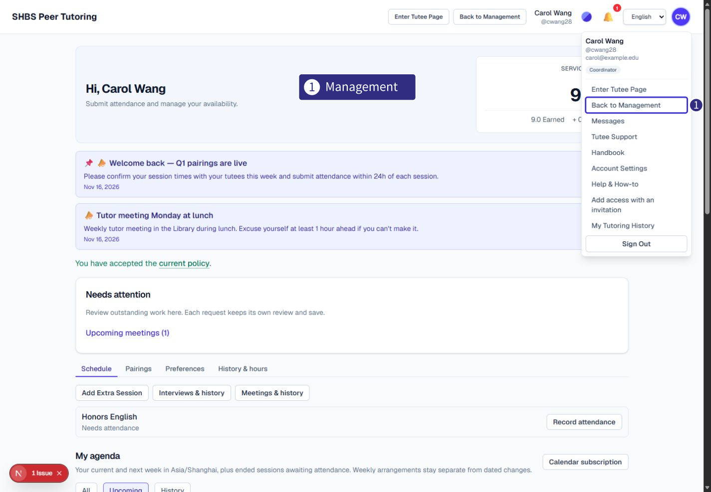

   

   
Capture details

   Carol opens the tutor account menu and uses the actual Back to Management link to return to management.

   /dashboard · EN · 2026-11-16

   [Original full screenshot](assets/manage-daily-work-step-1.en.jpg) · `589c055e4b1cf166b48b353bd619ac1982e5d9f6` · Latest-main development baseline 589c055e with the Help candidate; synthetic demonstration data.

   

2. **Open Activity** Read the named queues and open the relevant request. Check its period, current status and person before acting; a notification is a shortcut to the record, not a decision.

   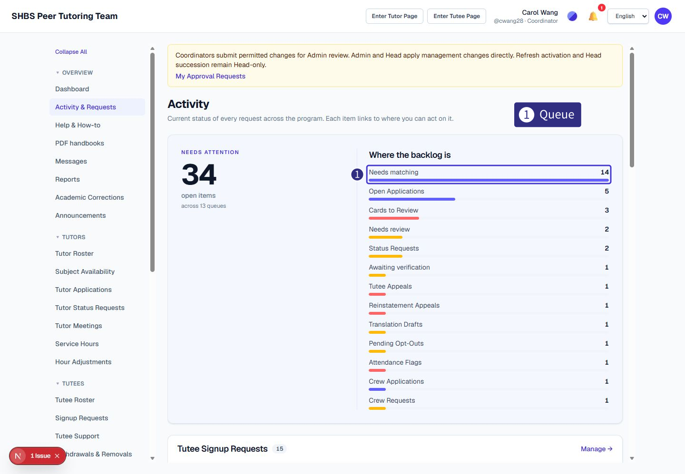

   

   
Capture details

   Activity shows the current named queues and their counts; Needs matching links to its own signup request records.

   /admin/activity · EN · 2026-11-16

   [Original full screenshot](assets/manage-daily-work-step-2.en.jpg) · `589c055e4b1cf166b48b353bd619ac1982e5d9f6` · Latest-main development baseline 589c055e with the Help candidate; synthetic demonstration data.

   

3. **Find the right record** Use the page search, filters and rightmost Actions column. A sortable heading cycles ascending, descending and original order. Clear filters when looking for missing records.

   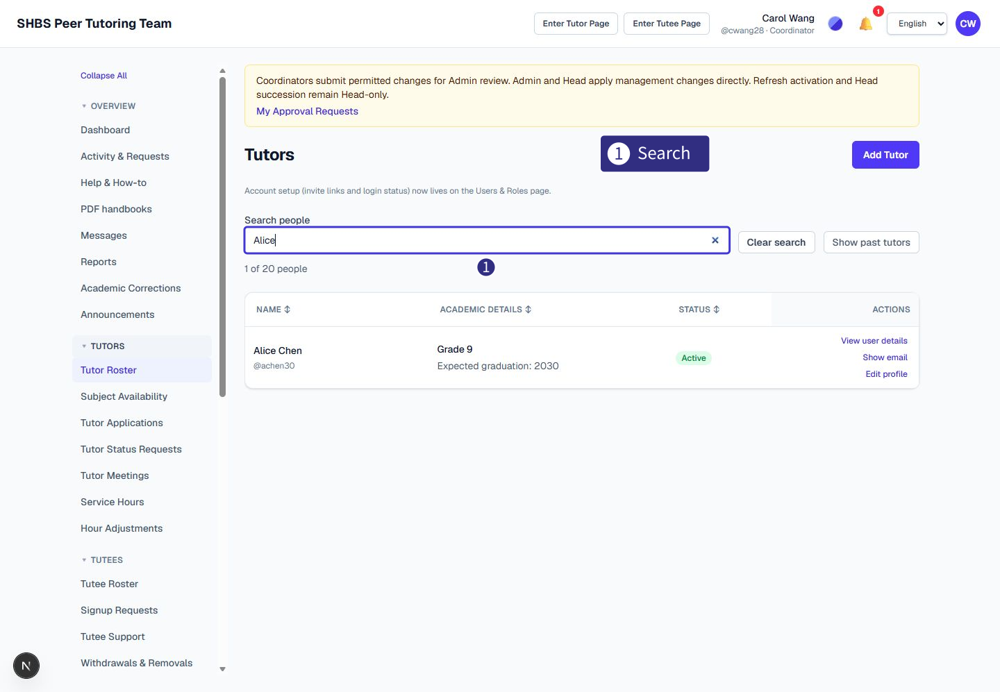

   

   
Capture details

   Search people narrows the roster to Alice; sortable headings and the rightmost Actions controls remain visible.

   /admin/tutors · EN · 2026-11-16

   [Original full screenshot](assets/manage-daily-work-step-3.en.jpg) · `589c055e4b1cf166b48b353bd619ac1982e5d9f6` · Latest-main development baseline 589c055e with the Help candidate; synthetic demonstration data.

   

4. **Read the result** Saved means the live write completed. Submitted for Review means a Management Actions request exists and live records have not changed. Open that receipt to follow its decision.

   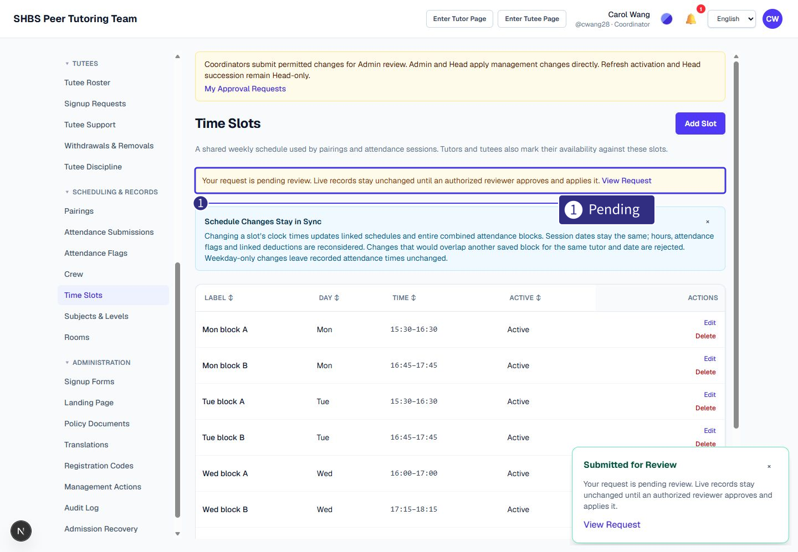

   

   
Capture details

   The real request was submitted for review; live weekly slots remain unchanged and View Request opens its receipt.

   /admin/time-slots · EN · 2026-11-16

   [Original full screenshot](assets/manage-daily-work-step-4.en.jpg) · `589c055e4b1cf166b48b353bd619ac1982e5d9f6` · Latest-main development baseline 589c055e with the Help candidate; synthetic demonstration data.

   

### What happens next

You can identify a task, open its current record and distinguish an applied change from a pending proposal.

### How it works

Navigation follows both current permissions and effective feature switches. Read-only observers have a different, masked view and cannot submit management writes.

### Troubleshooting

- **A section or record is missing** Clear search and status/period filters. Check whether the module is enabled and your access still applies. Use Retry for a failed read; do not interpret an unavailable queue as empty.

## Match a tutoring request

Review verified demand, compare tutor qualifications and workload, then assign a subject choice.

Open: `/admin/requests`

### Before you start

- Sign in with current management access. Optional modules must be enabled. Coordinators submit permitted changes for review; Admin and Head apply non-refresh changes directly.

### Walkthrough

1. **Choose the request tab** Open Signup Requests → Needs matching. Find the student in the list and expand the request. Check its source and verification labels, subject choices, available times and current answer revisions.

   Look for: Use Needs matching, then Select tutor on the relevant subject choice.

   **View 1**

   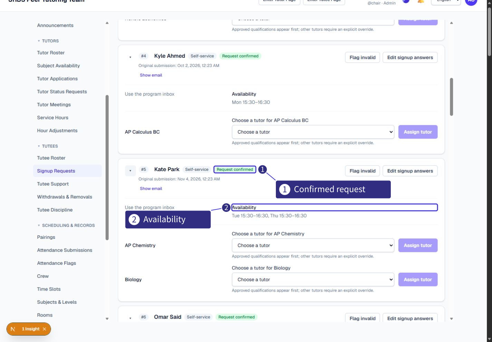

   

   
Capture details

   Kate Park’s confirmed self-service request lists AP Chemistry and Biology as unassigned choices. The availability row records Tuesday and Thursday at 15:30–16:30.

   /admin/requests · EN · 2026-11-20

   [Original full screenshot](assets/match-tutoring-requests-step-1.en.jpg) · `b5ece465681957c9fe579d26babdeb260c674fa0` · Latest-main development baseline b5ece465, selected 2026-11-20, with the Help candidate and synthetic demo records.

   

   **View 2**

   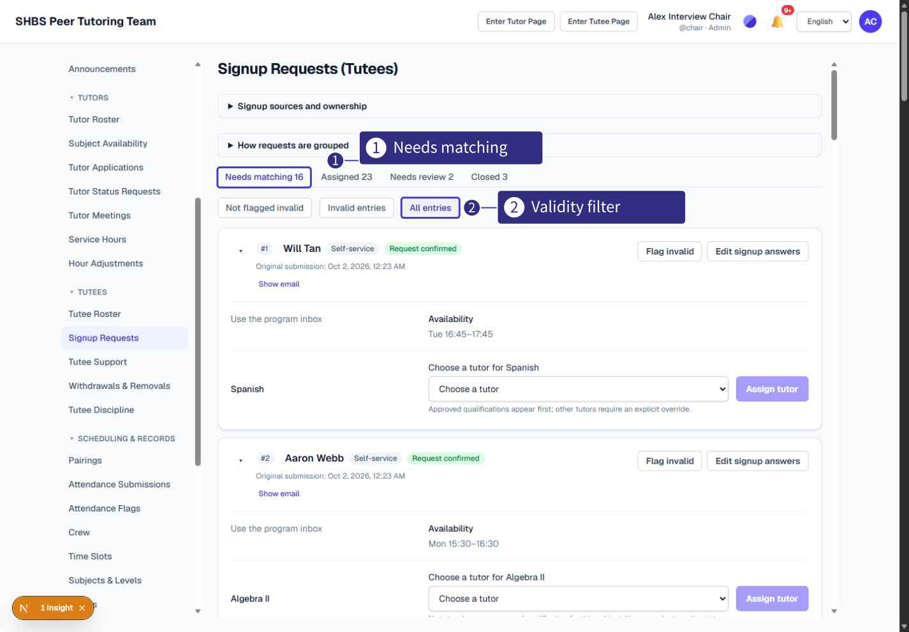

   

   
Capture details

   The live Signup Requests board is on Needs matching. Its request-validity controls narrow which rows appear. Find a current student’s row there and open it for the verification and submitted choices.

   /admin/requests · EN · 2026-11-20

   [Original full screenshot](assets/match-tutoring-requests-step-1-view-2.en.jpg) · `b5ece465681957c9fe579d26babdeb260c674fa0` · Latest-main development baseline b5ece465, selected 2026-11-20, with the Help candidate and synthetic demo records.

   

2. **Compare tutors** Choose Select tutor for one choice. Review qualification, willingness, availability, assigned teaching blocks and the tutor's preferred maximum. Preferred capacity is advisory; it is not an automatic prohibition.

   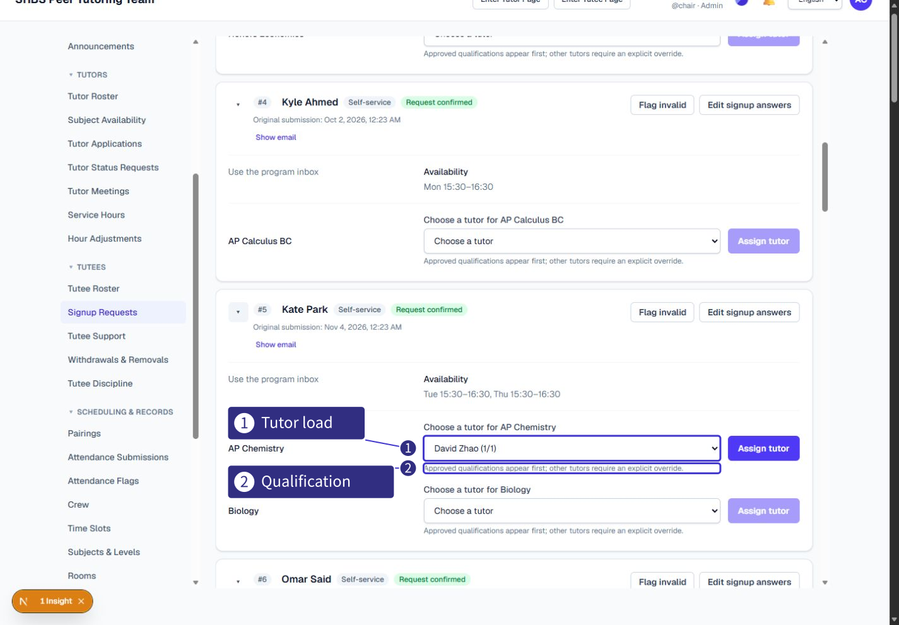

   

   
Capture details

   The AP Chemistry chooser displays David Zhao (1/1), one assigned session against his preferred maximum of one. The visible qualification note explains which choices require an override.

   /admin/requests · EN · 2026-11-20

   [Original full screenshot](assets/match-tutoring-requests-step-2.en.jpg) · `b5ece465681957c9fe579d26babdeb260c674fa0` · Latest-main development baseline b5ece465, selected 2026-11-20, with the Help candidate and synthetic demo records.

   

3. **Review the assignment** Choose the intended tutor and inspect any qualification warning before continuing. Confirm the exact student, subject and period. Use normal matching before considering manual roster or pairing creation.

   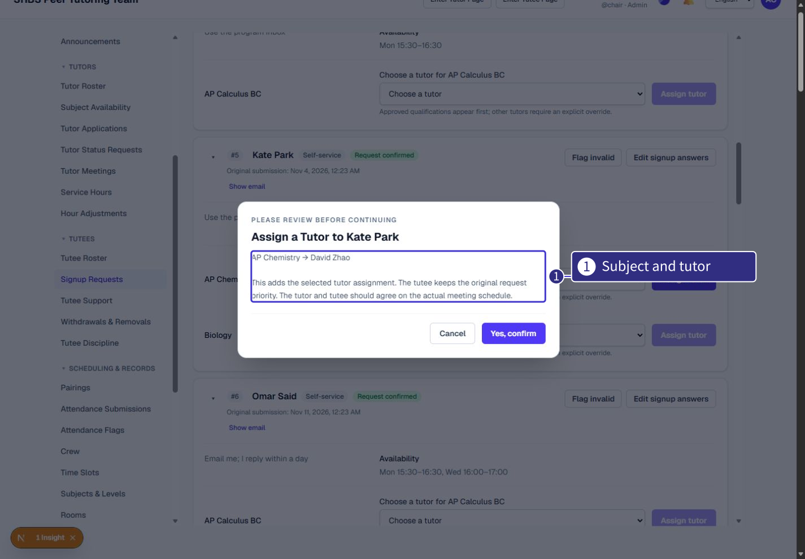

   

   
Capture details

   The first assignment review names Kate Park, AP Chemistry and David Zhao and explains the retained request priority. The example stopped at this review and no tutor was assigned.

   /admin/requests · EN · 2026-11-20

   [Original full screenshot](assets/match-tutoring-requests-step-3.en.jpg) · `b5ece465681957c9fe579d26babdeb260c674fa0` · Latest-main development baseline b5ece465, selected 2026-11-20, with the Help candidate and synthetic demo records.

   

4. **Check the saved placement** Complete the review and read the save or approval receipt. Find applied assignments under Assigned and in Pairings. Recurring scheduling and room allocation remain separate steps.

   **View 1**

   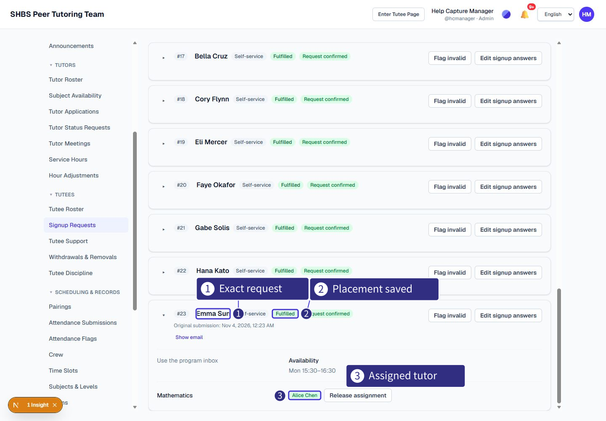

   

   
Capture details

   This saved request is in Assigned. Emma Sun’s Mathematics choice already names Alice Chen as tutor.

   /admin/requests · EN · 2026-11-20

   [Original full screenshot](assets/match-tutoring-requests-step-4.en.jpg) · `b5ece465681957c9fe579d26babdeb260c674fa0` · Latest-main development baseline b5ece465, selected 2026-11-20, with the Help candidate and synthetic demo records.

   

   **View 2**

   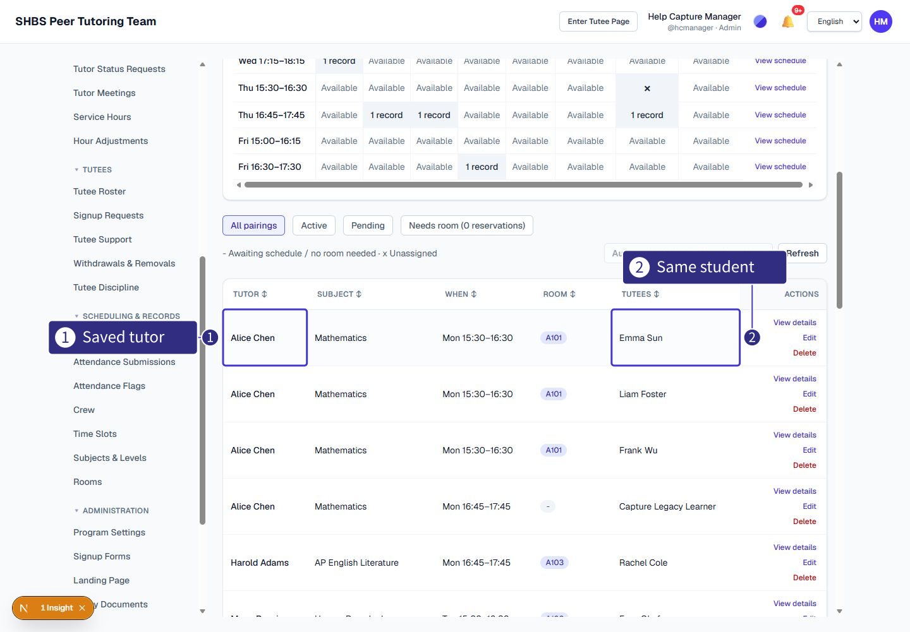

   

   
Capture details

   Pairings shows the same saved student, Mathematics and tutor. The existing weekly time and room are recorded separately.

   /admin/pairings · EN · 2026-11-20

   [Original full screenshot](assets/match-tutoring-requests-step-4-view-2.en.jpg) · `b5ece465681957c9fe579d26babdeb260c674fa0` · Latest-main development baseline b5ece465, selected 2026-11-20, with the Help candidate and synthetic demo records.

   

### What happens next

The intended subject choice is assigned, or a clearly identified proposal waits for approval.

### How it works

Self-service, Staff-entered and Earlier signup describe provenance. Earlier signup means the entry source is unknown, not that it has older priority. The verified survey retains its original submission priority.

### Troubleshooting

- **A tutor cannot be selected or the request is blocked** Inspect the stated qualification, membership, verification, invalidity or period restriction. Fix that source through its owning workflow; changing filters or creating a duplicate request does not resolve it.

## Flag, clear or appeal an invalid signup

Record a reason, inspect status mail and resolve request-invalidity appeals without erasing evidence.

Open: `/admin/requests`

### Before you start

- Sign in with current management access. Optional modules must be enabled. Coordinators submit permitted changes for review; Admin and Head apply non-refresh changes directly.

### Walkthrough

1. **Inspect the exact request** Open Signup Requests or Tutor Applications. Use Request validity to find flagged or unflagged entries, then open the request before making a change.

   Look for: Find Request validity, Flag invalid and Review invalid flag on the request.

   **View 1**

   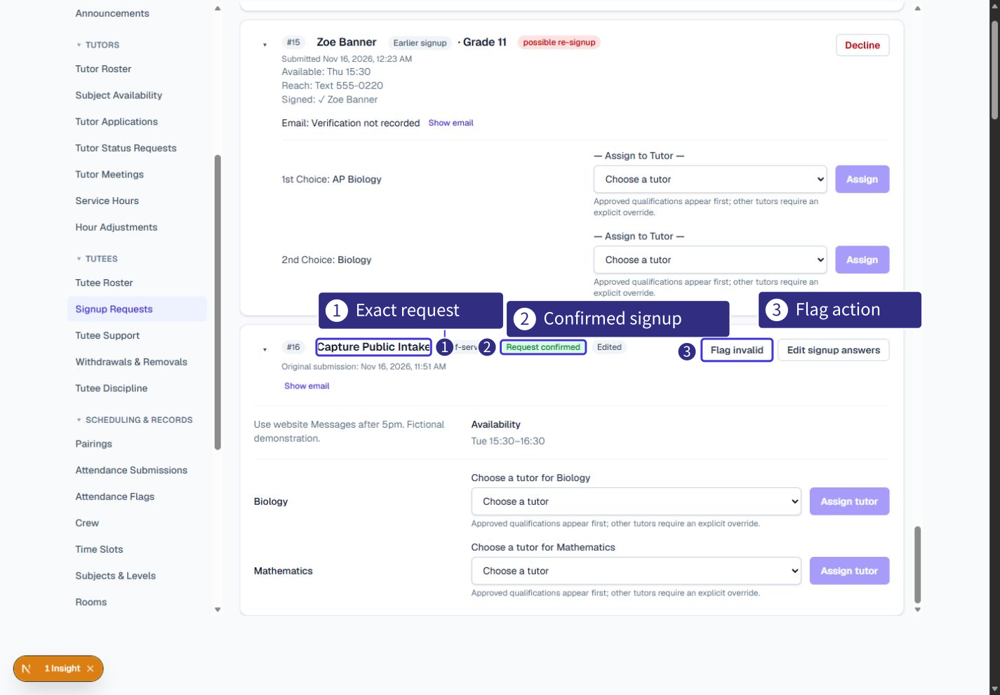

   

   
Capture details

   Open the confirmed request before reviewing its validity. The example still has both subject choices awaiting matching.

   /admin/requests · EN · 2026-11-20

   [Original full screenshot](assets/review-signup-validity-step-1.en.jpg) · `b5ece465681957c9fe579d26babdeb260c674fa0` · Latest-main development baseline b5ece465, selected 2026-11-20, with the Help candidate and synthetic demo records.

   

   **View 2**

   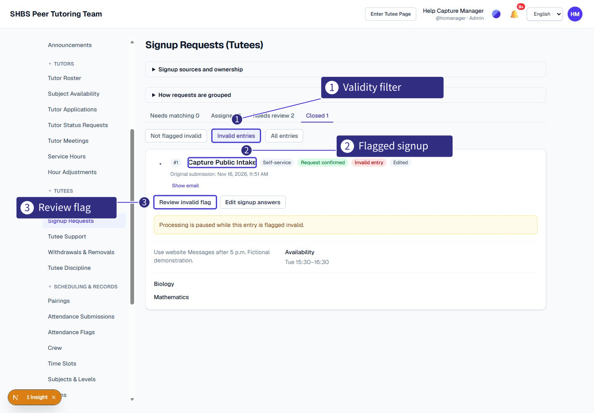

   

   
Capture details

   The Invalid entries filter shows the exact flagged record under Closed. Its original submission time remains visible.

   /admin/requests · EN · 2026-11-20

   [Original full screenshot](assets/review-signup-validity-step-1-view-2.en.jpg) · `b5ece465681957c9fe579d26babdeb260c674fa0` · Latest-main development baseline b5ece465, selected 2026-11-20, with the Help candidate and synthetic demo records.

   

2. **Explain the flag or correction** Choose Flag invalid or Review invalid flag → Clear invalid flag. Enter a reason suitable for the submitter to read, review the named entry, then save or submit for review.

   **View 1**

   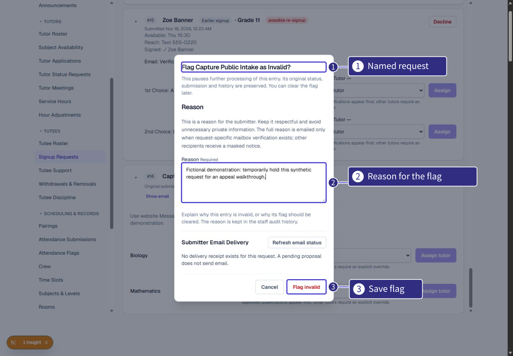

   

   
Capture details

   Read the named request, enter a reason appropriate for the submitter and check the flag action before saving.

   /admin/requests · EN · 2026-11-20

   [Original full screenshot](assets/review-signup-validity-step-2.en.jpg) · `b5ece465681957c9fe579d26babdeb260c674fa0` · Latest-main development baseline b5ece465, selected 2026-11-20, with the Help candidate and synthetic demo records.

   

   **View 2**

   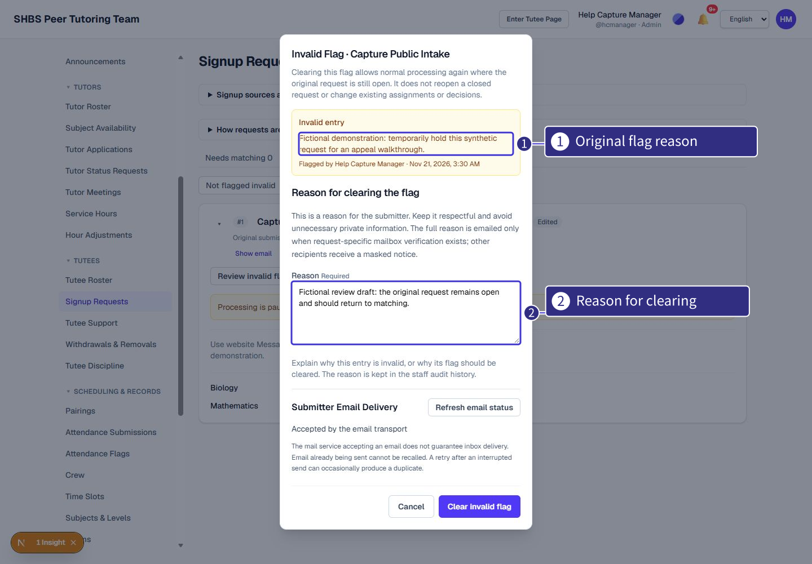

   

   
Capture details

   A separate clear-flag review shows the saved flag above a new explanation field. This draft was cancelled.

   /admin/requests · EN · 2026-11-20

   [Original full screenshot](assets/review-signup-validity-step-2-view-2.en.jpg) · `b5ece465681957c9fe579d26babdeb260c674fa0` · Latest-main development baseline b5ece465, selected 2026-11-20, with the Help candidate and synthetic demo records.

   

3. **Check email and appeals** Read the invalidity dialog's email state and latest appeal. Refresh status reads only. Admin/Head may retry an eligible failed status email and decide a tutee invalidity appeal after reading its full reason.

   **View 1**

   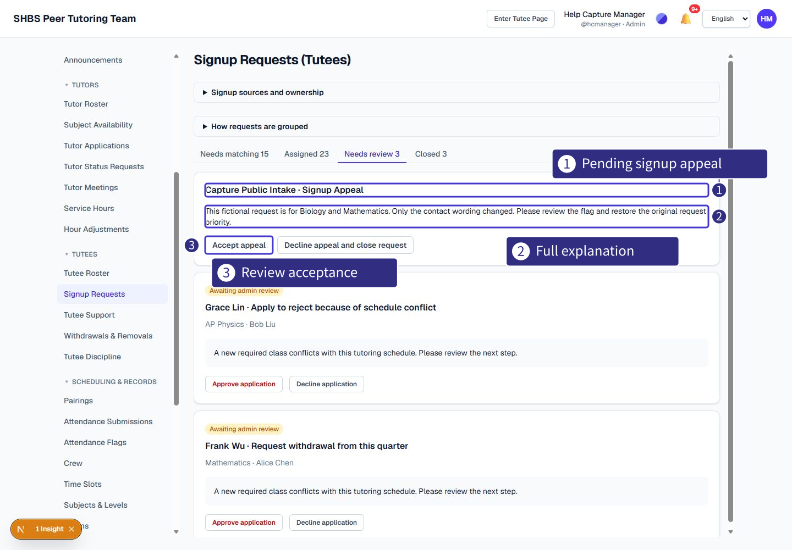

   

   
Capture details

   Read the latest explanation in Needs review before choosing the named decision. The email receipt is in the flag review.

   /admin/requests · EN · 2026-11-20

   [Original full screenshot](assets/review-signup-validity-step-3.en.jpg) · `b5ece465681957c9fe579d26babdeb260c674fa0` · Latest-main development baseline b5ece465, selected 2026-11-20, with the Help candidate and synthetic demo records.

   

   **View 2**

   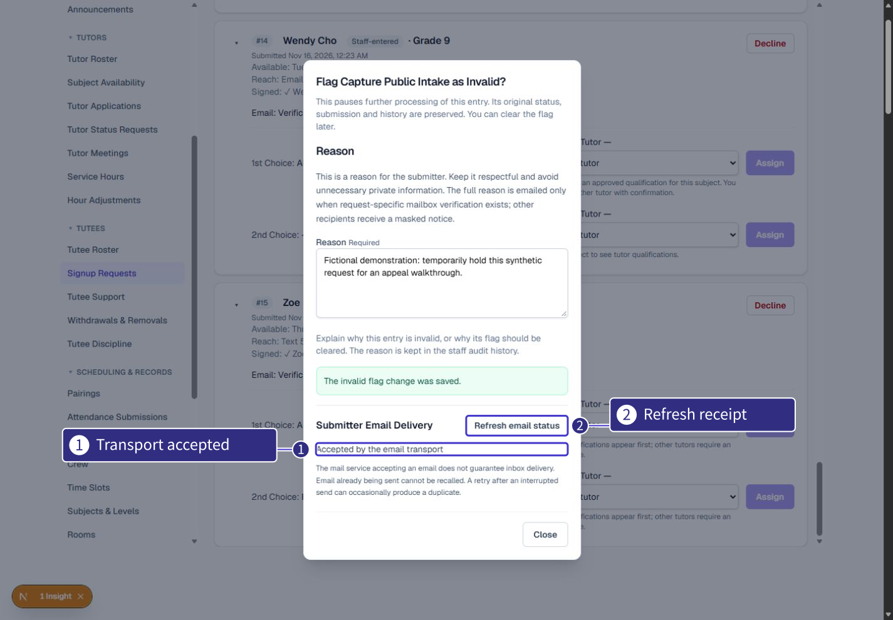

   

   
Capture details

   The flag saved and the email transport accepted the notice. Refresh email status reads the existing receipt.

   /admin/requests · EN · 2026-11-20

   [Original full screenshot](assets/review-signup-validity-step-3-view-2.en.jpg) · `b5ece465681957c9fe579d26babdeb260c674fa0` · Latest-main development baseline b5ece465, selected 2026-11-20, with the Help candidate and synthetic demo records.

   

   **View 3**

   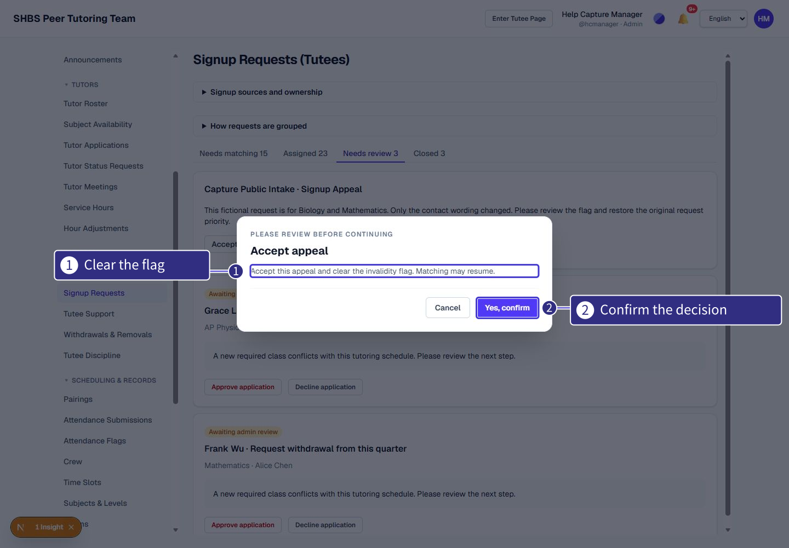

   

   
Capture details

   Read the consequences of accepting the pending appeal. The confirmation clears the flag so matching can resume.

   /admin/requests · EN · 2026-11-20

   [Original full screenshot](assets/review-signup-validity-step-3-view-3.en.jpg) · `b5ece465681957c9fe579d26babdeb260c674fa0` · Latest-main development baseline b5ece465, selected 2026-11-20, with the Help candidate and synthetic demo records.

   

4. **Confirm the decision** An accepted tutee appeal clears the flag. Final rejection closes the active request and removes its priority. Check the retained history and resulting request state before continuing processing.

   **View 1**

   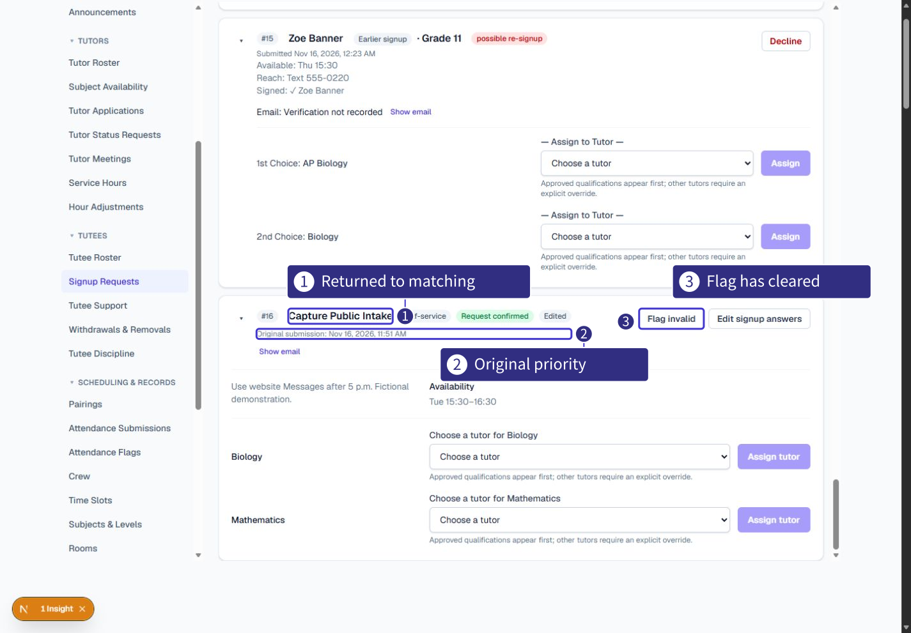

   

   
Capture details

   After staff accepted the appeal, the request returned to Needs matching at its original submission time. Both subject choices remain unassigned.

   /admin/requests · EN · 2026-11-20

   [Original full screenshot](assets/review-signup-validity-step-4.en.jpg) · `b5ece465681957c9fe579d26babdeb260c674fa0` · Latest-main development baseline b5ece465, selected 2026-11-20, with the Help candidate and synthetic demo records.

   

   **View 2**

   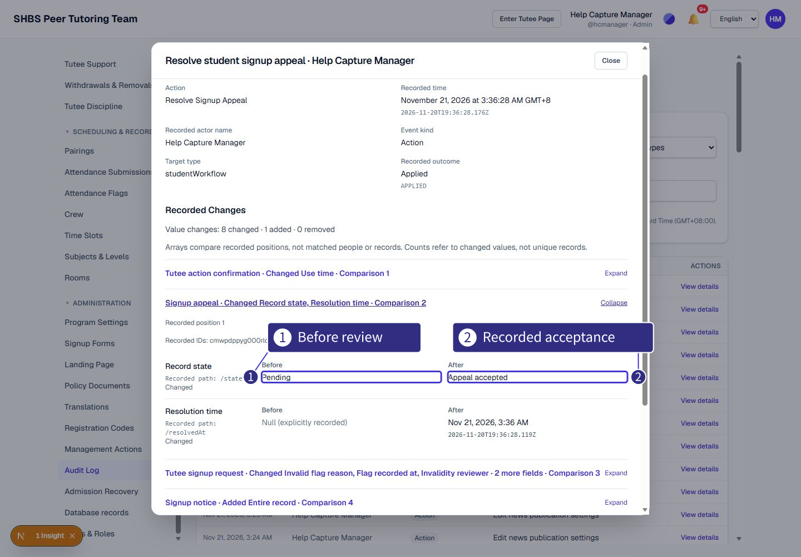

   

   
Capture details

   The audit comparison records the same appeal moving from Pending to Appeal accepted, with a recorded resolution time.

   /admin/audit · EN · 2026-11-20

   [Original full screenshot](assets/review-signup-validity-step-4-view-2.en.jpg) · `b5ece465681957c9fe579d26babdeb260c674fa0` · Latest-main development baseline b5ece465, selected 2026-11-20, with the Help candidate and synthetic demo records.

   

### What happens next

The current flag and any appeal decision are visible with their reasons and delivery status.

### How it works

A flag blocks processing but does not delete an entry or impose discipline. Clearing it preserves evidence and does not revive an expired request or restore membership. Verification deadlines continue while flagged; only request-specific mailbox proof permits disclosure of the reason.

### Troubleshooting

- **Status email is Blocked or the list did not refresh** Inspect the recorded address and the stated delivery restriction. Retry refresh reloads records after a completed save; it does not resend or repeat the decision. Pending Coordinator proposals send no invalidity notice until applied.

## Review tutor applications and correct names

Find current or completed applications, inspect setup status and correct initial application identity.

Open: `/admin/applications`

### Before you start

- Sign in with current management access. Optional modules must be enabled. Coordinators submit permitted changes for review; Admin and Head apply non-refresh changes directly.

### Walkthrough

1. **Find the application** At the top, search Name or email and use the application-status, requested-subject, interview-completion and sort filters. The separate Interview records section searches applicants, panelists or subjects; choose Needs completion, Completed or All there, then Search. Panelist search belongs to that lower section.

   Look for: Use the application filters and expand the intended application.

   **View 1**

   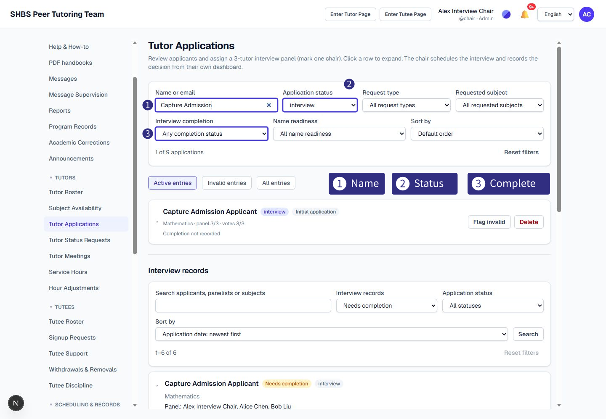

   

   
Capture details

   Top application filters find the one Capture Admission Applicant in interview status; this is the applicant-name/email search, separate from the lower interview-history search.

   /admin/applications · EN · 2026-11-16

   [Original full screenshot](assets/review-tutor-applications-step-1.en.jpg) · `dd970ea426016e85cb514beeeab537c3ab2e5098` · Latest-main development baseline dd970ea4, selected 2026-11-16, with the Help candidate; synthetic demonstration data.

   

   **View 2**

   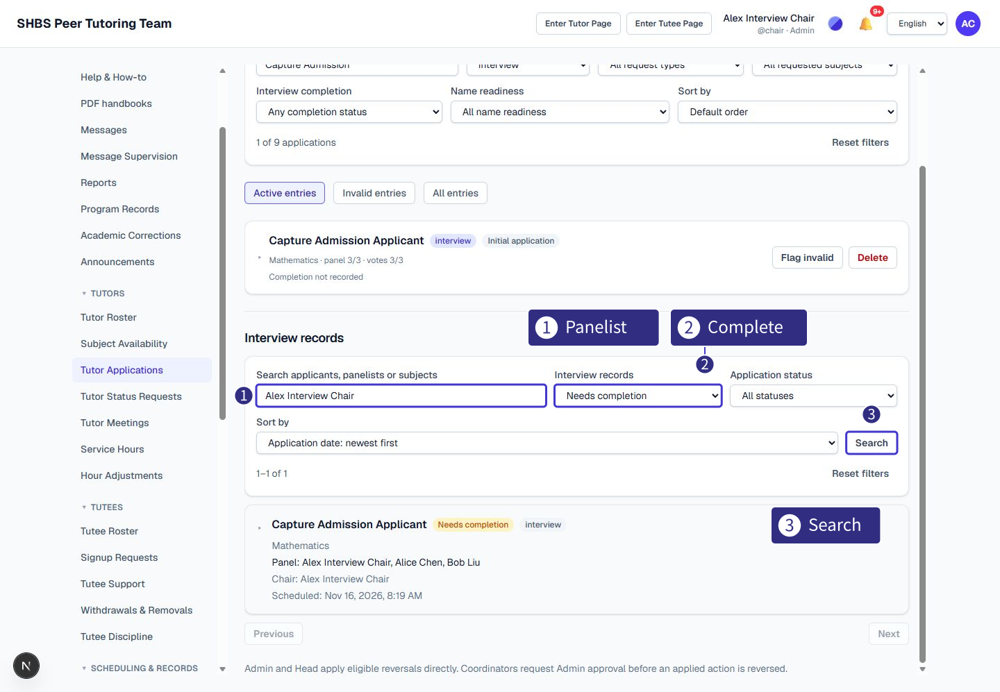

   

   
Capture details

   The separate Interview records search matches panelist Alex Interview Chair and Needs completion, returning the one pending Capture Admission interview; the upper applicant search remains independent.

   /admin/applications · EN · 2026-11-16

   [Original full screenshot](assets/review-tutor-applications-step-1-view-2.en.jpg) · `dd970ea426016e85cb514beeeab537c3ab2e5098` · Latest-main development baseline dd970ea4, selected 2026-11-16, with the Help candidate; synthetic demonstration data.

   

2. **Read the evidence** Expand the record and inspect requested qualification, panel, chair, schedule, completion and account setup status. Open its existing panel link from interview history when relevant.

   **View 1**

   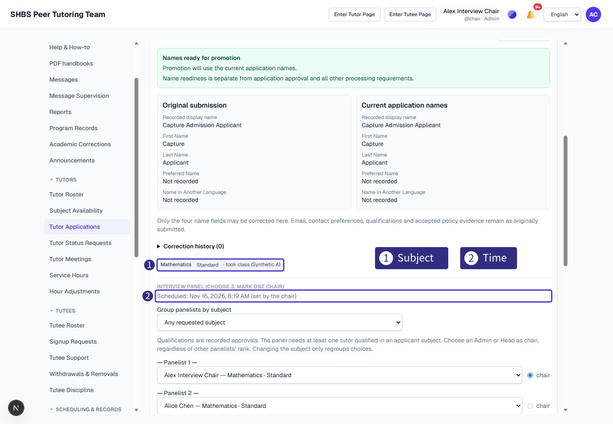

   

   
Capture details

   The saved pending initial application preserves original/current names, Mathematics qualification evidence and the scheduled interview time. No name, panel, completion or decision has changed.

   /admin/applications · EN · 2026-11-16

   [Original full screenshot](assets/review-tutor-applications-step-2.en.jpg) · `dd970ea426016e85cb514beeeab537c3ab2e5098` · Latest-main development baseline dd970ea4, selected 2026-11-16, with the Help candidate; synthetic demonstration data.

   

   **View 2**

   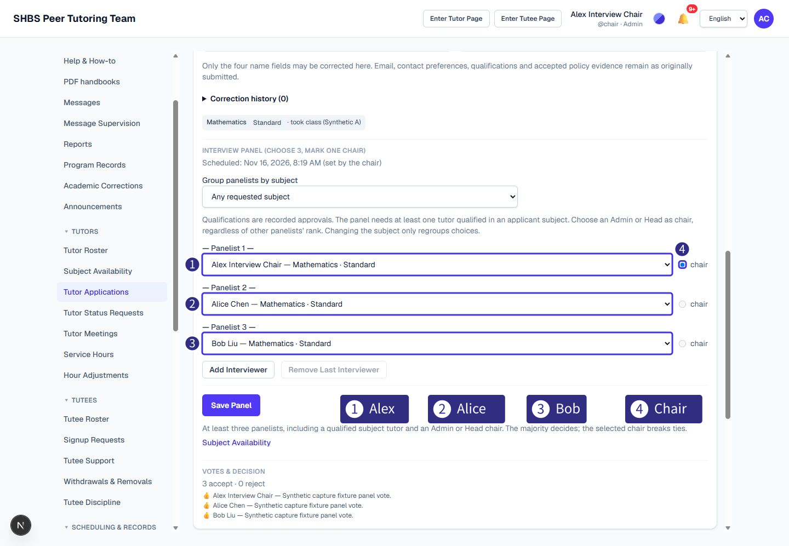

   

   
Capture details

   The saved three-person panel remains Alex Interview Chair, Alice Chen and Bob Liu, with Alex selected as Admin chair. Save Panel has not been clicked; the original three yes votes remain visible.

   /admin/applications · EN · 2026-11-16

   [Original full screenshot](assets/review-tutor-applications-step-2-view-2.en.jpg) · `dd970ea426016e85cb514beeeab537c3ab2e5098` · Latest-main development baseline dd970ea4, selected 2026-11-16, with the Help candidate; synthetic demonstration data.

   

   **View 3**

   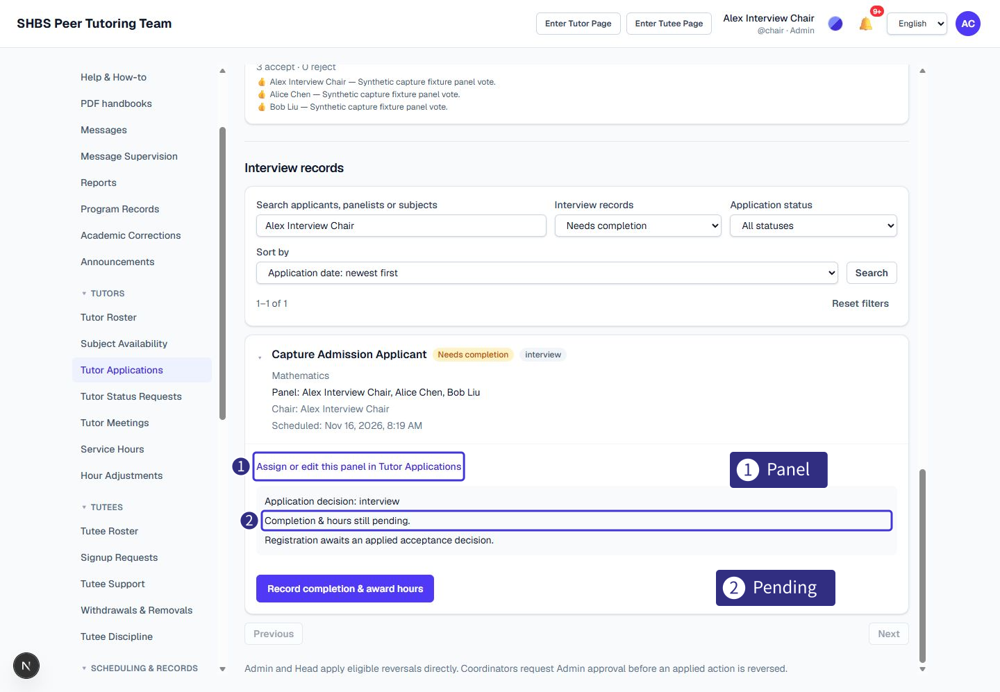

   

   
Capture details

   Expanded interview history shows the existing panel link, pending completion/hours and registration waiting for an applied acceptance decision. No completion, award or acceptance action is taken.

   /admin/applications · EN · 2026-11-16

   [Original full screenshot](assets/review-tutor-applications-step-2-view-3.en.jpg) · `dd970ea426016e85cb514beeeab537c3ab2e5098` · Latest-main development baseline dd970ea4, selected 2026-11-16, with the Help candidate; synthetic demonstration data.

   

3. **Correct an initial name** For an eligible initial application, open the name-correction action, edit the four name fields and enter a reason. Review the before/after identity before saving or submitting a Coordinator proposal.

   **View 1**

   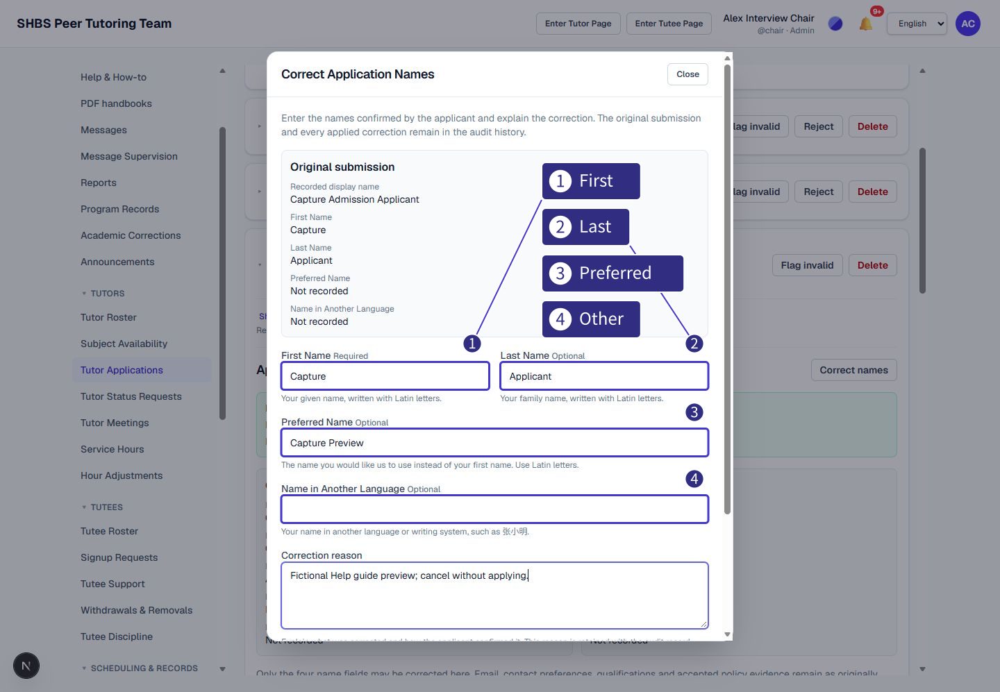

   

   
Capture details

   Correct Application Names shows the preserved original submission and an unsent Preferred Name draft, Capture Preview. The reason explicitly says this fictional preview will be canceled; Apply name correction has not been used.

   /admin/applications · EN · 2026-11-16

   [Original full screenshot](assets/review-tutor-applications-step-3.en.jpg) · `dd970ea426016e85cb514beeeab537c3ab2e5098` · Latest-main development baseline dd970ea4, selected 2026-11-16, with the Help candidate; synthetic demonstration data.

   

   **View 2**

   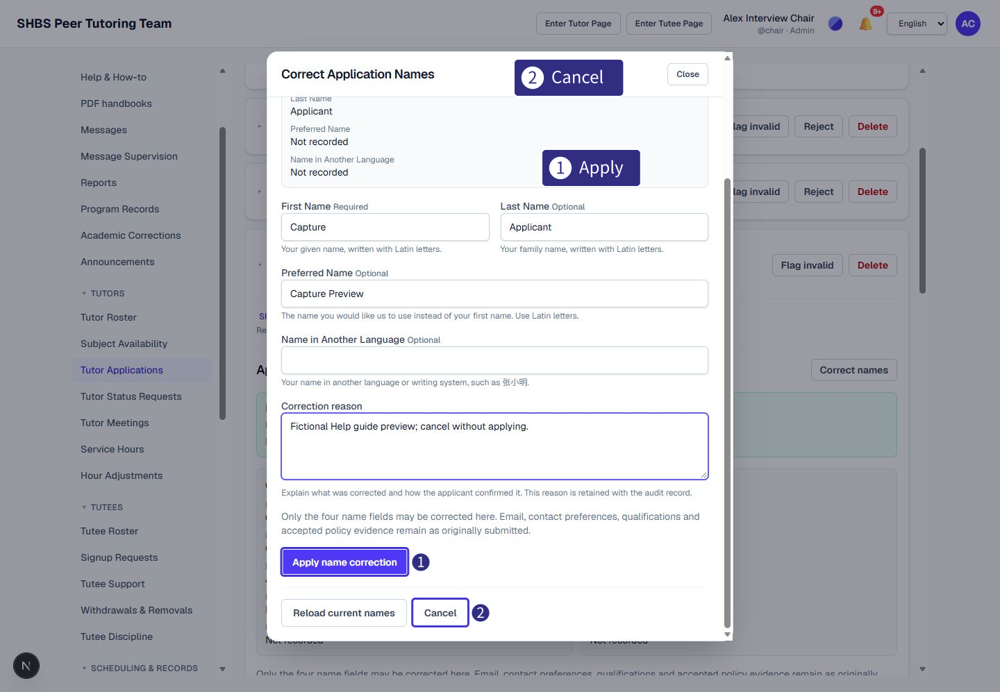

   

   
Capture details

   The unsent correction includes a clearly fictional reason and shows Apply name correction separately from Cancel. The demonstration ends with Cancel; no application identity correction is saved or proposed.

   /admin/applications · EN · 2026-11-16

   [Original full screenshot](assets/review-tutor-applications-step-3-view-2.en.jpg) · `dd970ea426016e85cb514beeeab537c3ab2e5098` · Latest-main development baseline dd970ea4, selected 2026-11-16, with the Help candidate; synthetic demonstration data.

   

4. **Continue the proper workflow** Use panel assignment and interview review for qualification decisions. Use the offered account-setup action only when the source is eligible; a roster or accepted application is not itself a usable login.

   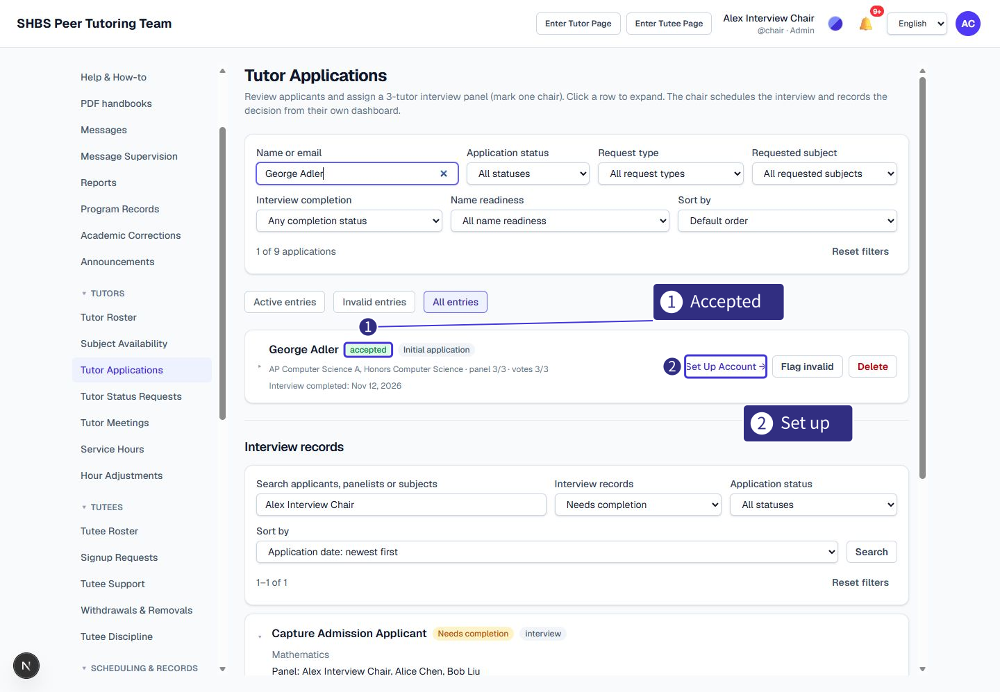

   

   
Capture details

   An accepted application offers Set Up Account. The entry is shown before opening account-setup details; no login or invitation has been created in this walkthrough.

   /admin/applications · EN · 2026-11-16

   [Original full screenshot](assets/review-tutor-applications-step-4.en.jpg) · `dd970ea426016e85cb514beeeab537c3ab2e5098` · Latest-main development baseline dd970ea4, selected 2026-11-16, with the Help candidate; synthetic demonstration data.

   

### What happens next

The application and its interview/setup status are clear; any name correction has its own recorded reason.

### How it works

Name correction changes only the application name fields and reason. It does not accept the application, clear invalidity, change contacts or manufacture qualification/policy evidence.

### Troubleshooting

- **A completed interview or application cannot be found** Switch to completed or all records and clear status filters. History sorting happens before pagination; use the displayed page controls rather than assuming the first page is the complete list.

## Assign and complete an interview panel

Choose a qualified panel and valid chair, schedule the interview, then record its actual completion.

Open: `/admin/applications`

### Before you start

- Sign in with current management access. Optional modules must be enabled. Coordinators submit permitted changes for review; Admin and Head apply non-refresh changes directly.

### Walkthrough

1. **Select the panel** Open the applicant's panel editor. Choose 3–8 active account-linked tutors, including at least one with staff-confirmed qualification in an applicant subject. Select an Admin or Head panelist as chair, then review and save the panel.

   Look for: Expand the applicant to find panel assignment and interview management.

   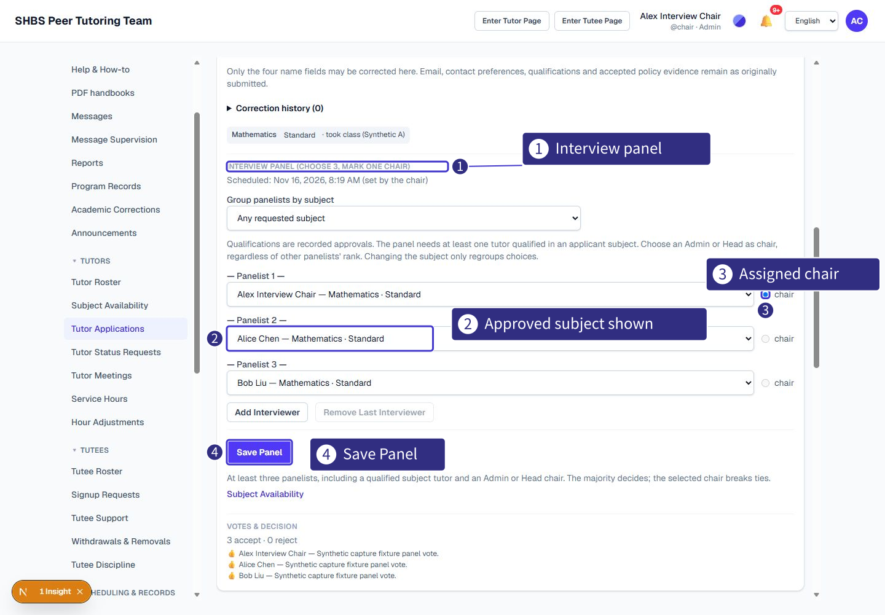

   

   
Capture details

   The pending Mathematics application has three selected panelists with recorded subject approvals. Alex is marked as chair. Save Panel would apply changes to this specific record.

   /admin/applications · EN · 2026-11-20

   [Original full screenshot](assets/manage-interview-panels-step-1.en.jpg) · `b5ece465681957c9fe579d26babdeb260c674fa0` · Latest-main development baseline b5ece465, selected 2026-11-20, with the Help candidate and synthetic demo records.

   

2. **Arrange the interview** The assigned chair opens Interviews to Conduct in Tutor Schedule and chooses Set Time. Enter the date and time in the program time zone. Each panelist submits their own vote.

   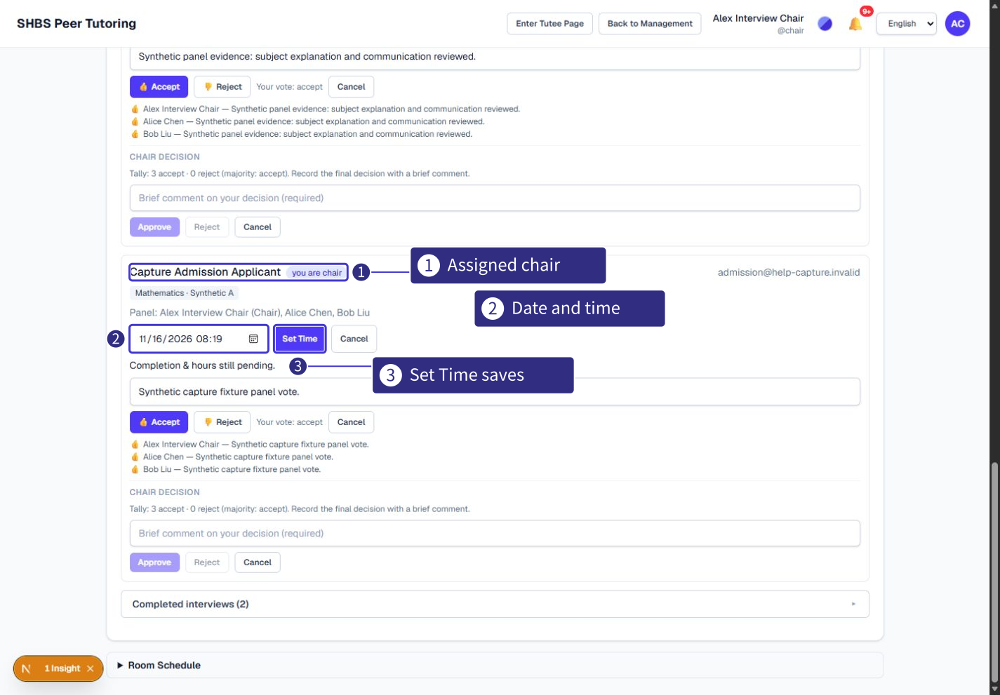

   

   
Capture details

   The assigned Admin chair’s Tutor Schedule shows the existing date in the Set Time input and its separate save button. The displayed time remains unchanged.

   /dashboard#sessions · EN · 2026-11-20

   [Original full screenshot](assets/manage-interview-panels-step-2.en.jpg) · `b5ece465681957c9fe579d26babdeb260c674fa0` · Latest-main development baseline b5ece465, selected 2026-11-20, with the Help candidate and synthetic demo records.

   

3. **Record the decision** Open Votes & Decision in Tutor Applications to read the tally. After all panelists vote, an eligible chair follows the displayed majority or tie rules in Interviews to Conduct and confirms the decision from there.

   **View 1**

   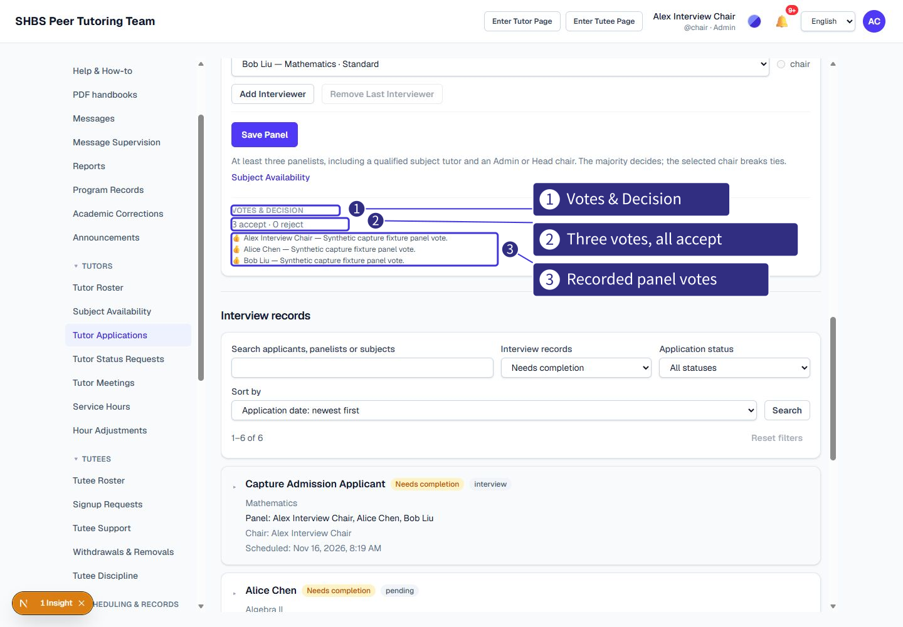

   

   
Capture details

   Votes & Decision lists all three saved panel votes and a 3–0 tally. The application remains undecided in this staff view.

   /admin/applications · EN · 2026-11-20

   [Original full screenshot](assets/manage-interview-panels-step-3.en.jpg) · `b5ece465681957c9fe579d26babdeb260c674fa0` · Latest-main development baseline b5ece465, selected 2026-11-20, with the Help candidate and synthetic demo records.

   

   **View 2**

   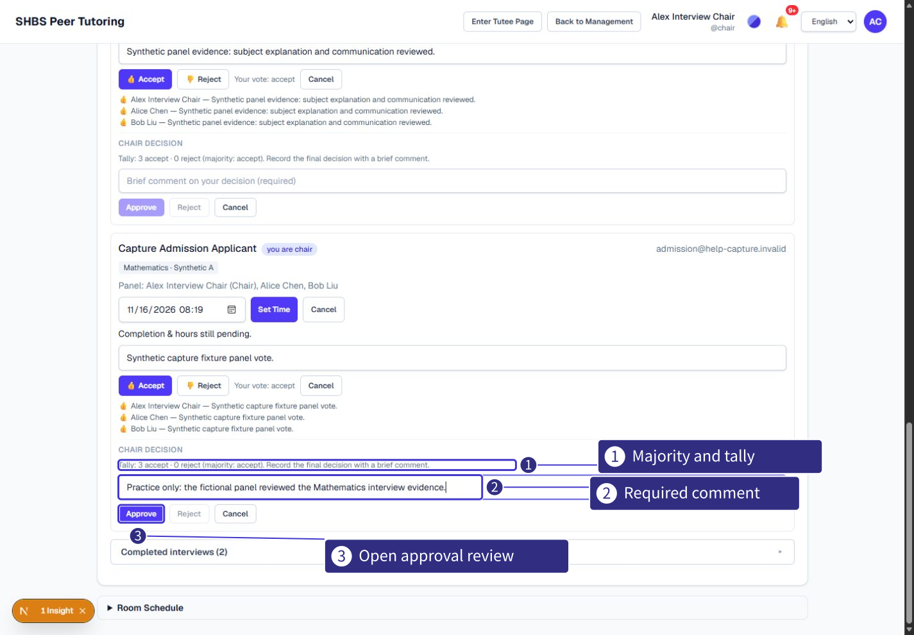

   

   
Capture details

   The actual assigned chair can review the 3–0 majority and enter the required decision comment. Approve opens a further review for this initial application.

   /dashboard#sessions · EN · 2026-11-20

   [Original full screenshot](assets/manage-interview-panels-step-3-view-2.en.jpg) · `b5ece465681957c9fe579d26babdeb260c674fa0` · Latest-main development baseline b5ece465, selected 2026-11-20, with the Help candidate and synthetic demo records.

   

4. **Complete actual attendance** Record actual completion time, duration and attending panelists. For a later correction, enter the reason and review replacement credits before applying or proposing the whole correction.

   **View 1**

   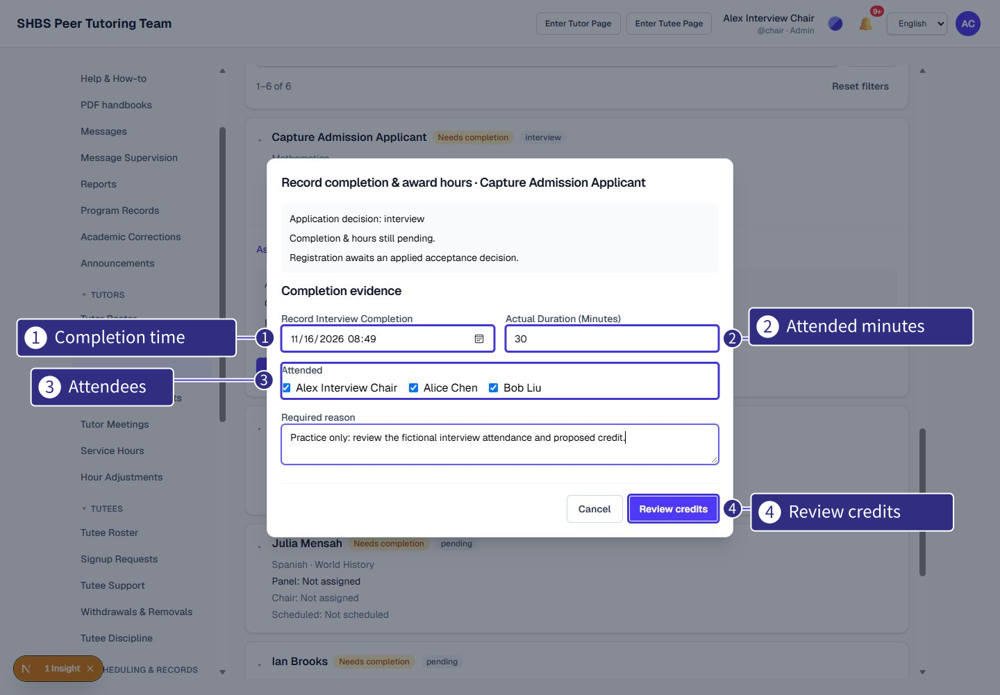

   

   
Capture details

   A draft records the actual completion time, minutes and the attending panelists before the credit review. The application still needs completion and hours.

   /admin/applications · EN · 2026-11-20

   [Original full screenshot](assets/manage-interview-panels-step-4.en.jpg) · `b5ece465681957c9fe579d26babdeb260c674fa0` · Latest-main development baseline b5ece465, selected 2026-11-20, with the Help candidate and synthetic demo records.

   

   **View 2**

   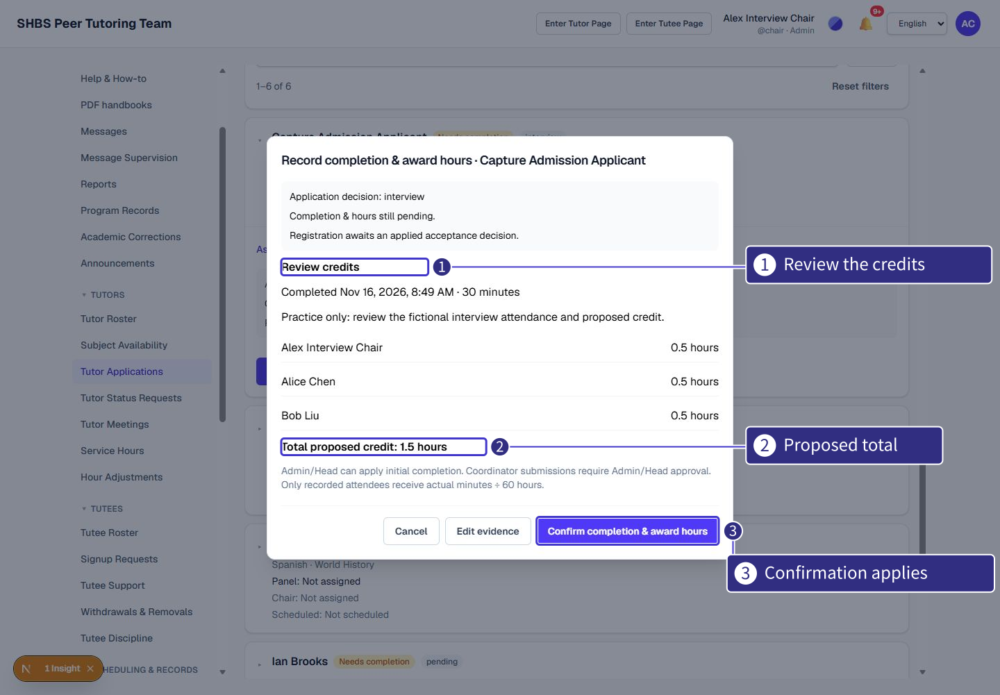

   

   
Capture details

   The same unsaved review lists 0.5 hours for each of the three selected attendees and 1.5 hours proposed in total. Cancel preserves the pending record.

   /admin/applications · EN · 2026-11-20

   [Original full screenshot](assets/manage-interview-panels-step-4-view-2.en.jpg) · `b5ece465681957c9fe579d26babdeb260c674fa0` · Latest-main development baseline b5ece465, selected 2026-11-20, with the Help candidate and synthetic demo records.

   

   **View 3**

   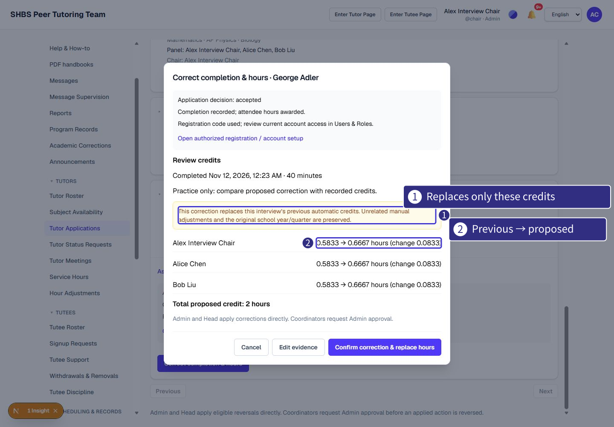

   

   
Capture details

   A later correction review compares George’s previous recorded 35-minute credits with an unsaved 40-minute example. The replacement scope and Cancel are visible.

   /admin/applications · EN · 2026-11-20

   [Original full screenshot](assets/manage-interview-panels-step-4-view-3.en.jpg) · `b5ece465681957c9fe579d26babdeb260c674fa0` · Latest-main development baseline b5ece465, selected 2026-11-20, with the Help candidate and synthetic demo records.

   

### What happens next

The saved panel, chair, schedule, votes, decision and completion remain attached to the application.

### How it works

A valid Admin/Head chair is required for new scheduling, decisions and first completion. Historical hour correction retains the recorded chair rather than rechecking today's rank. Qualification, tutoring willingness and account access remain separate.

### Troubleshooting

- **Panel or completion controls are blocked** Check active panel membership, recorded qualifications, the chair's current authority and the Interviews feature. History remains readable when interviews are off; writes wait until the module and eligibility permit them.

## Compare qualifications and tutoring willingness

Read direct and inherited qualification grants without confusing them with willingness or timetable availability.

Open: `/admin/subject-availability`

### Before you start

- Sign in with current management access. Optional modules must be enabled. Coordinators submit permitted changes for review; Admin and Head apply non-refresh changes directly.

### Walkthrough

1. **Find and expand the tutor** Open Subject Availability below Tutor Roster. Search the tutor or subject and expand the tutor to see grouped subjects and named level variants.

   Look for: Expand a tutor and use Qualified, Pending Review or Willing to tutor.

   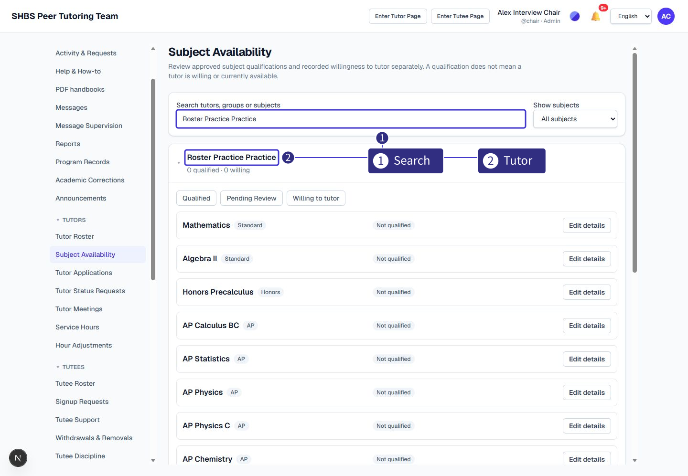

   

   
Capture details

   Search isolates the dedicated Roster Practice Practice tutor, and the expanded row lists subject names and level variants. This tutor currently has no approved qualifications or recorded willingness; no detail action was changed.

   /admin/subject-availability · EN · 2026-11-16

   [Original full screenshot](assets/inspect-subject-availability-step-1.en.jpg) · `dd970ea426016e85cb514beeeab537c3ab2e5098` · Latest-main development baseline dd970ea4, selected 2026-11-16, with the Help candidate; synthetic demonstration data.

   

2. **Apply one local filter** Choose Qualified, Pending Review or Willing to tutor for that tutor. Click the selected filter again to clear it; it combines with page-level search and filters.

   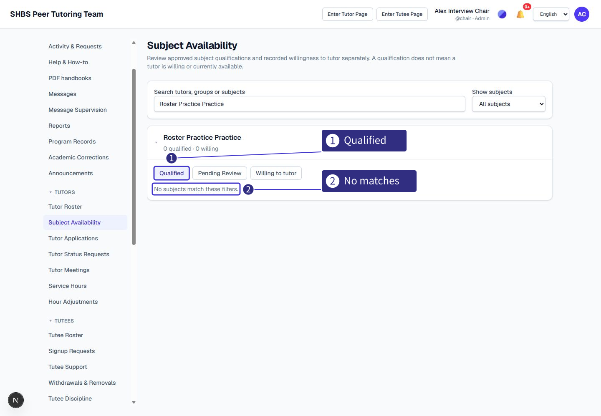

   

   
Capture details

   Before the actual Honors approval shown in step 4, the combined Qualified filter/search finds no matching subjects for Roster Practice Practice. Click Qualified again to clear it. Filtering or opening Edit details grants nothing.

   /admin/subject-availability · EN · 2026-11-16

   [Original full screenshot](assets/inspect-subject-availability-step-2.en.jpg) · `dd970ea426016e85cb514beeeab537c3ab2e5098` · Latest-main development baseline dd970ea4, selected 2026-11-16, with the Help candidate; synthetic demonstration data.

   

3. **Inspect qualification sources** Read the direct approval and recorded inherited lower-level grants. Compare willingness separately: Not recorded means the tutor has not saved a choice.

   **View 1**

   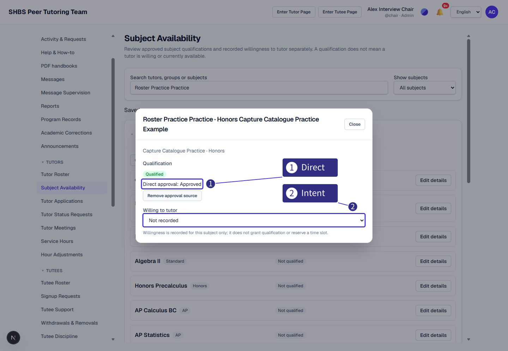

   

   
Capture details

   Saved after the actual Approve this subject action shown in step 4: Honors has Direct approval: Approved; willingness remains Not recorded. Opening Edit details grants nothing. Remove approval source has not been used.

   /admin/subject-availability · EN · 2026-11-16

   [Original full screenshot](assets/inspect-subject-availability-step-3.en.jpg) · `dd970ea426016e85cb514beeeab537c3ab2e5098` · Latest-main development baseline dd970ea4, selected 2026-11-16, with the Help candidate; synthetic demonstration data.

   

   **View 2**

   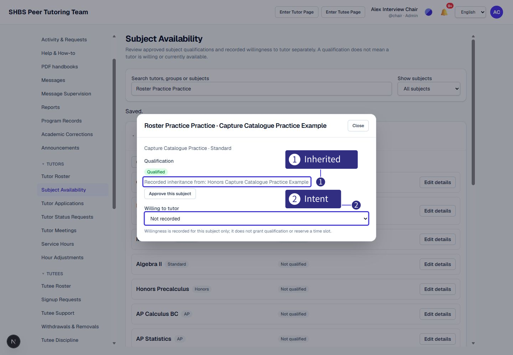

   

   
Capture details

   Saved after the Honors approval shown in step 4: Standard has Recorded inheritance from Honors Capture Catalogue Practice Example, with no direct Standard approval. Willingness is still Not recorded, before the separate willingness change shown in step 4’s later view.

   /admin/subject-availability · EN · 2026-11-16

   [Original full screenshot](assets/inspect-subject-availability-step-3-view-2.en.jpg) · `dd970ea426016e85cb514beeeab537c3ab2e5098` · Latest-main development baseline dd970ea4, selected 2026-11-16, with the Help candidate; synthetic demonstration data.

   

4. **Use the correct follow-up** Open Edit details. Changing Willing to tutor saves immediately; Approve this subject and Remove approval source also submit immediately. Read the saved or Coordinator approval-request outcome before continuing. Admin/Head decide additional qualification applications separately. Check schedule and capacity independently when matching.

   **View 1**

   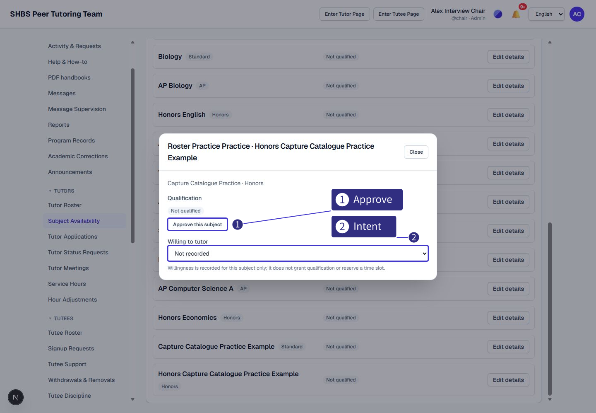

   

   
Capture details

   The active owned Honors variant is not qualified for Roster Practice Practice, and willingness is Not recorded. Approve this subject and changing willingness submit immediately; this screenshot is before either action.

   /admin/subject-availability · EN · 2026-11-16

   [Original full screenshot](assets/inspect-subject-availability-step-4.en.jpg) · `dd970ea426016e85cb514beeeab537c3ab2e5098` · Latest-main development baseline dd970ea4, selected 2026-11-16, with the Help candidate; synthetic demonstration data.

   

   **View 2**

   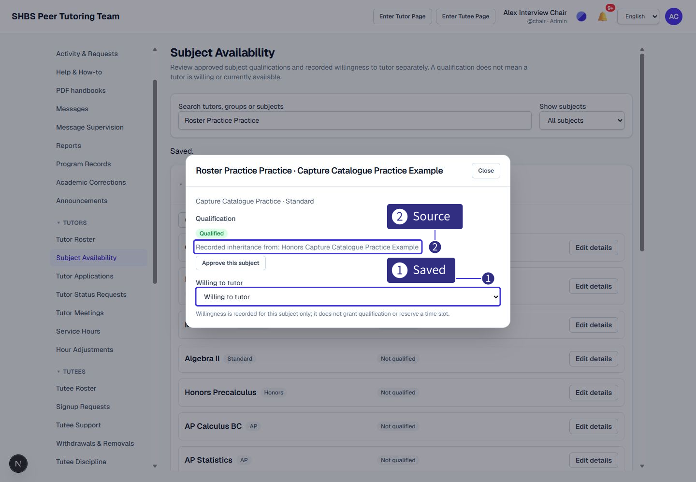

   

   
Capture details

   Changing only the Standard willingness has now saved Willing to tutor. The actual tutor summary is 2 qualified and 1 willing. Its recorded Honors inheritance is unchanged; no direct Standard approval or matching reservation was made.

   /admin/subject-availability · EN · 2026-11-16

   [Original full screenshot](assets/inspect-subject-availability-step-4-view-2.en.jpg) · `dd970ea426016e85cb514beeeab537c3ab2e5098` · Latest-main development baseline dd970ea4, selected 2026-11-16, with the Help candidate; synthetic demonstration data.

   

### What happens next

You can explain whether the tutor is qualified, willing, pending review and otherwise eligible for an assignment.

### How it works

Approving a higher variant records the lower offered levels at that time. Later catalogue reordering does not recalculate those grants. Archived subjects with recorded evidence remain visible. Qualification alone does not set willingness.

### Troubleshooting

- **The expected qualification is missing** Clear filters and inspect the recorded approval sources and active catalogue variant. Do not infer a grant from present-day level order; ask Admin/Head to review the actual evidence.

## Grant or remove a manual subject qualification

Review evidence and grant sources; keep qualifications independent of willingness and account badges.

Open: `/admin/subject-availability`

### Before you start

- Current management access. Admin/Head apply manual grants/source removals; Coordinators submit permitted changes for review. Additional qualification-application decisions use a separate Admin/Head workflow.

### Walkthrough

1. **Read the recorded grant** In Subject Availability, expand the tutor and locate the exact subject variant. Read its qualification evidence, existing approval sources and independent willingness before using the manual approval action.

   Look for: Expand the tutor and inspect the exact variant and its approval source.

   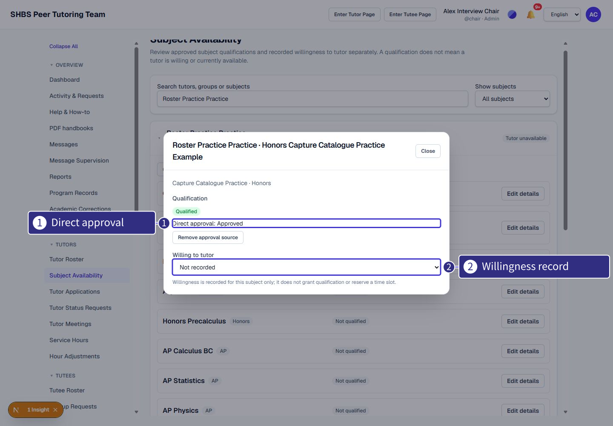

   

   
Capture details

   The unavailable practice tutor’s Honors record remains readable. It shows a saved direct approval and independent willingness of Not recorded. This example changes neither field.

   /admin/subject-availability · EN · 2026-11-20

   [Original full screenshot](assets/decide-subject-qualifications-step-1.en.jpg) · `b5ece465681957c9fe579d26babdeb260c674fa0` · Latest-main development baseline b5ece465, selected 2026-11-20, with the Help candidate and synthetic demo records.

   

2. **Check and grant the qualification** In Edit details, check the named tutor, subject and level. Inspect the group's lower levels, then choose Approve this subject to submit immediately. Admin and Head apply the grant directly. A Coordinator follows the pending proposal in Management Actions.

   **View 1**

   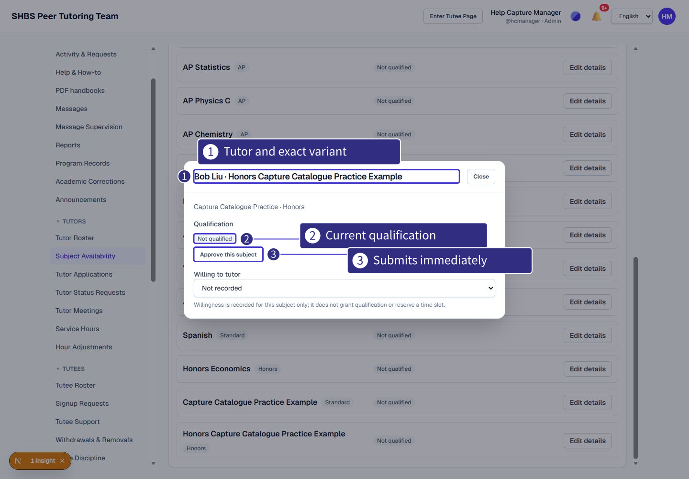

   

   
Capture details

   Verify the named tutor and Honors offering before choosing Approve this subject. The new approval has yet to be submitted.

   /admin/subject-availability · EN · 2026-11-20

   [Original full screenshot](assets/decide-subject-qualifications-step-2.en.jpg) · `b5ece465681957c9fe579d26babdeb260c674fa0` · Latest-main development baseline b5ece465, selected 2026-11-20, with the Help candidate and synthetic demo records.

   

   **View 2**

   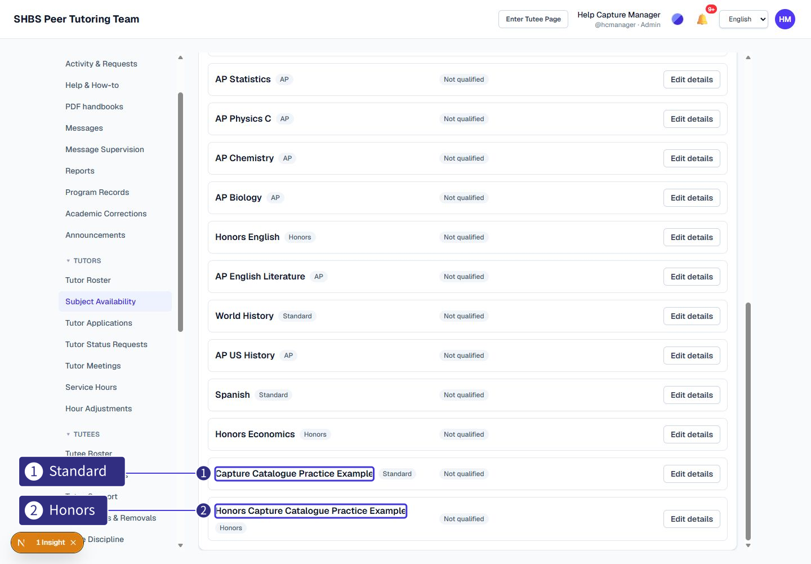

   

   
Capture details

   Compare the Standard and Honors rows for the same course group before choosing an approval source. Bob’s current rows show Not qualified.

   /admin/subject-availability · EN · 2026-11-20

   [Original full screenshot](assets/decide-subject-qualifications-step-2-view-2.en.jpg) · `b5ece465681957c9fe579d26babdeb260c674fa0` · Latest-main development baseline b5ece465, selected 2026-11-20, with the Help candidate and synthetic demo records.

   

3. **Remove only the intended source** Open Edit details for the variant with direct approval. Read its direct and inherited sources before choosing Remove approval source, which submits immediately. Once the change is applied, reopen the record and check which qualifications still have another source.

   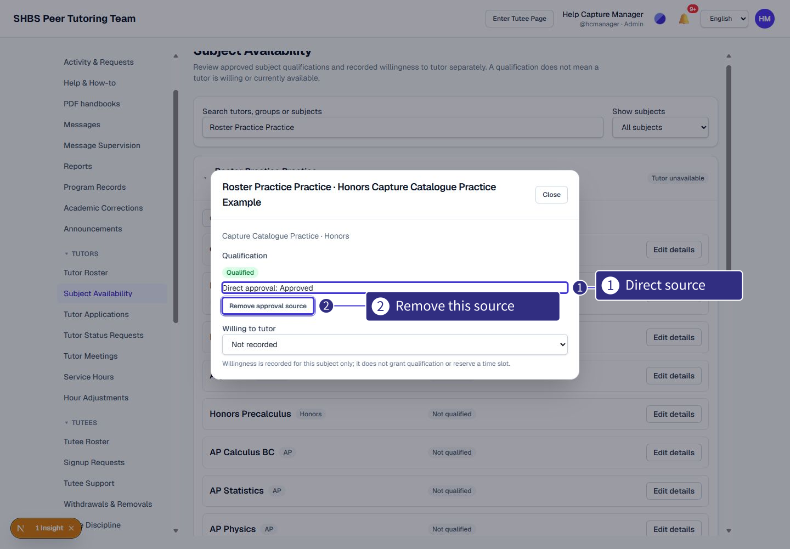

   

   
Capture details

   Identify this exact direct Honors approval before removing its source. Remove approval source submits immediately. This preview shows the approved source before any change.

   /admin/subject-availability · EN · 2026-11-20

   [Original full screenshot](assets/decide-subject-qualifications-step-3.en.jpg) · `b5ece465681957c9fe579d26babdeb260c674fa0` · Latest-main development baseline b5ece465, selected 2026-11-20, with the Help candidate and synthetic demo records.

   

4. **Verify willingness separately** Reload the tutor's qualifications and independently inspect the Willing to tutor value. Return to Tutor Applications for panel/interview evidence when needed.

   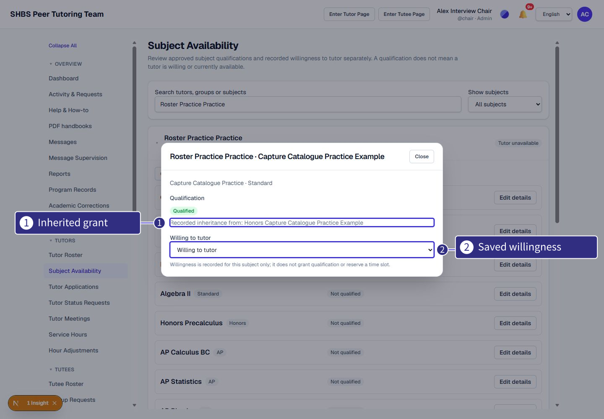

   

   
Capture details

   The Standard record shows the saved willingness Willing to tutor alongside a separately recorded inheritance from Honors. The tutor remains unavailable and no field was changed.

   /admin/subject-availability · EN · 2026-11-20

   [Original full screenshot](assets/decide-subject-qualifications-step-4.en.jpg) · `b5ece465681957c9fe579d26babdeb260c674fa0` · Latest-main development baseline b5ece465, selected 2026-11-20, with the Help candidate and synthetic demo records.

   

### What happens next

The reviewed qualification decision is recorded with its source, without silently changing willingness.

### How it works

Manual grant/source removal and an additional qualification-application decision are separate operations. Neither restores suspended/revoked participation, creates a login or silently records tutoring willingness.

### Troubleshooting

- **Acceptance reports restricted participation** Review suspension, school departure and revoked tutoring access in Users & Roles. Restore access only through its authorized workflow, then retry the qualification decision from fresh evidence.

## Inspect and edit the tutor roster

Read profiles, status, qualifications and account evidence, or create a roster record after the manual-entry warning.

Open: `/admin/tutors`

### Before you start

- Sign in with current management access. Optional modules must be enabled. Coordinators submit permitted changes for review; Admin and Head apply non-refresh changes directly.

### Walkthrough

1. **Choose current or past records** Search the tutor's saved names and inspect the current/past filters. Read status and academic summary before opening View user details.

   Look for: Find Edit profile and View user details in the rightmost Actions column.

   

   

   
Capture details

   The current tutor roster filtered to Alice, with Active status, academic summary and Show past tutors available.

   /admin/tutors · EN · 2026-11-16

   [Original full screenshot](assets/manage-tutor-roster-step-1.en.jpg) · `589c055e4b1cf166b48b353bd619ac1982e5d9f6` · Latest-main development baseline 589c055e with the Help candidate; synthetic demonstration data.

   

2. **Read or edit the profile** View details shows grouped subjects, qualification sources, willingness, login status and account policy history. Use Edit profile for permitted changes and review old enrollment academics separately from current account academics.

   **View 1**

   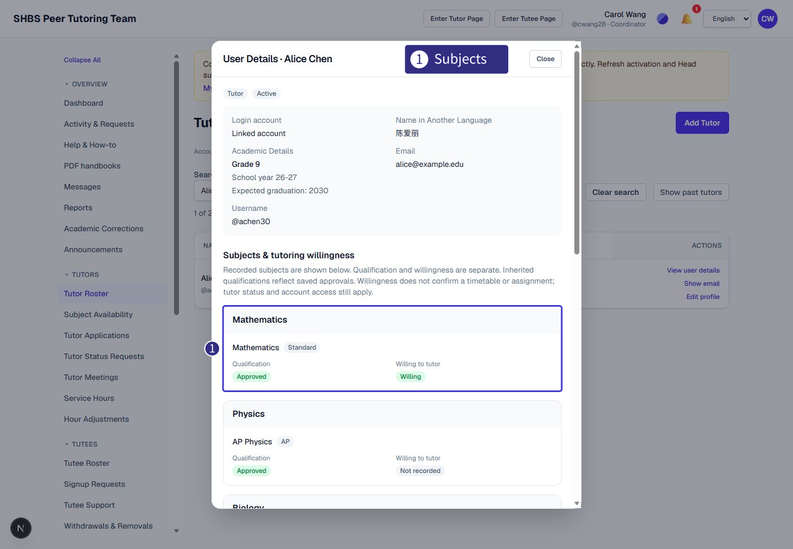

   

   
Capture details

   Alice’s real details show linked login, academic summary, grouped approved subjects and separately recorded tutoring willingness.

   /admin/tutors · EN · 2026-11-16

   [Original full screenshot](assets/manage-tutor-roster-step-2.en.jpg) · `589c055e4b1cf166b48b353bd619ac1982e5d9f6` · Latest-main development baseline 589c055e with the Help candidate; synthetic demonstration data.

   

   **View 2**

   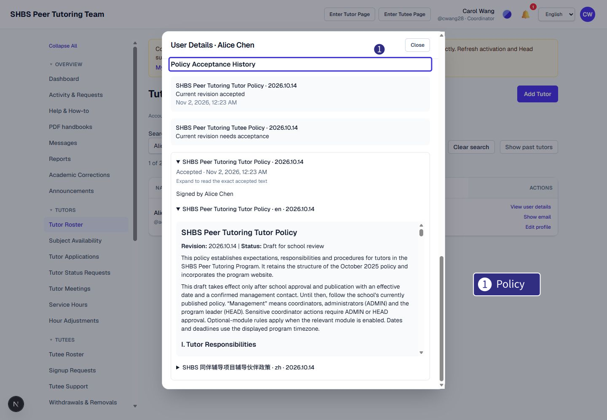

   

   
Capture details

   Alice’s retained policy history distinguishes accepted Tutor revision from Tutee acceptance still required, with the exact accepted English text expanded.

   /admin/tutors · EN · 2026-11-16

   [Original full screenshot](assets/manage-tutor-roster-step-2-view-2.en.jpg) · `589c055e4b1cf166b48b353bd619ac1982e5d9f6` · Latest-main development baseline 589c055e with the Help candidate; synthetic demonstration data.

   

3. **Change roster status deliberately** Open Edit profile and use Status to choose a permitted roster state, then save that section. Review account access separately in Users & Roles. An archived roster, a revoked Tutor badge and an opted-out member represent different states.

   **View 1**

   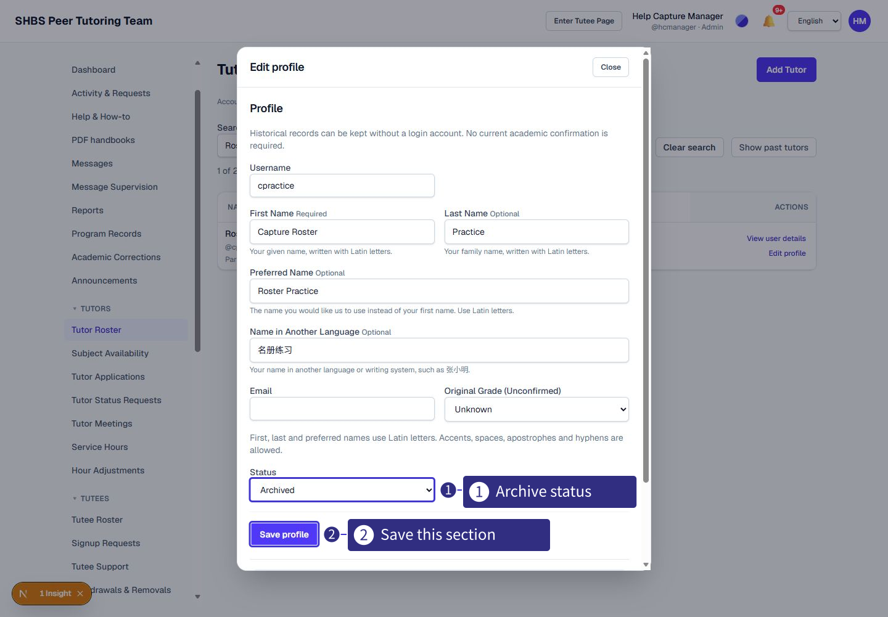

   

   
Capture details

   The roster profile of the fictional practice tutor has Archived selected in Status. The profile is still an unsaved draft. Save profile applies this status to the roster record.

   /admin/tutors · EN · 2026-11-20

   [Original full screenshot](assets/manage-tutor-roster-step-3.en.jpg) · `b5ece465681957c9fe579d26babdeb260c674fa0` · Latest-main development baseline b5ece465, selected 2026-11-20, with the Help candidate and synthetic demo records.

   

   **View 2**

   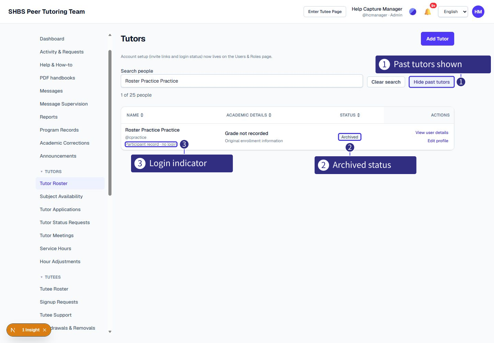

   

   
Capture details

   After saving once, Show past tutors reveals the same practice tutor with Archived status. The separate Participant record · no login indicator is still visible.

   /admin/tutors · EN · 2026-11-20

   [Original full screenshot](assets/manage-tutor-roster-step-3-view-2.en.jpg) · `b5ece465681957c9fe579d26babdeb260c674fa0` · Latest-main development baseline b5ece465, selected 2026-11-20, with the Help candidate and synthetic demo records.

   

4. **Create only when normal intake cannot** Choose Add Tutor, read the warning, check the acknowledgement and Continue. Complete the name fields marked required by the current form policy and optional Email/Grade, then choose Add Tutor. Read the saved or submitted-for-review result and inspect whether a separate account-setup step is needed.

   **View 1**

   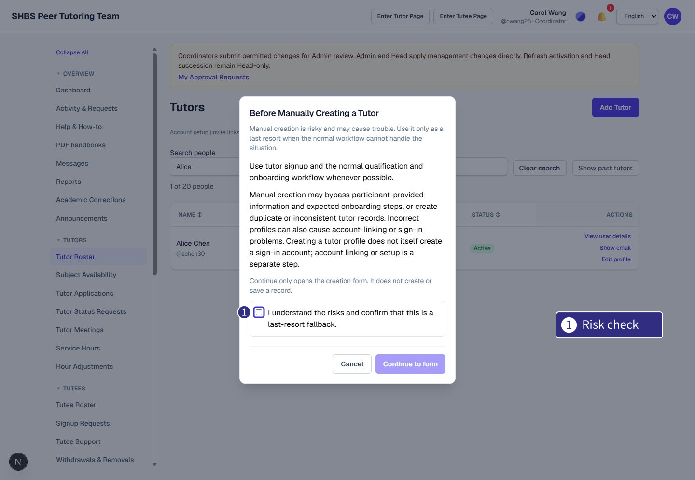

   

   
Capture details

   The real manual-creation risk warning requires acknowledgement before Continue to form; no participant record has been created.

   /admin/tutors · EN · 2026-11-16

   [Original full screenshot](assets/manage-tutor-roster-step-4.en.jpg) · `589c055e4b1cf166b48b353bd619ac1982e5d9f6` · Latest-main development baseline 589c055e with the Help candidate; synthetic demonstration data.

   

   **View 2**

   

   

   
Capture details

   The manual tutor form is populated as a draft under the current required-name policy. No participant or login was created.

   /admin/tutors · EN · 2026-11-16

   [Original full screenshot](assets/manage-tutor-roster-step-4-view-2.en.jpg) · `589c055e4b1cf166b48b353bd619ac1982e5d9f6` · Latest-main development baseline 589c055e with the Help candidate; synthetic demonstration data.

   

### What happens next

The roster reflects only the reviewed profile or membership change; accountless records remain explicitly accountless.

### How it works

Opening details grants no role-edit permission. A linked login and historical ownership are distinct from current participation. Legacy unsplit full names can be preserved when unrelated profile fields are edited.

### Troubleshooting

- **Save rejects a name or the tutor has no login** If changing Latin name fields, provide the person's actual valid First Name; do not guess a split of an old full name. A missing email leaves manual creation accountless. Use the authorized setup workflow instead of creating another person.

## Inspect and edit the tutee roster

Use one details reader for enrollment, choices, contact and history; understand accountless records and manual creation.

Open: `/admin/tutees`

### Before you start

- Sign in with current management access. Optional modules must be enabled. Coordinators submit permitted changes for review; Admin and Head apply non-refresh changes directly.

### Walkthrough

1. **Find the enrollment** Choose Current, History or All Records and search saved first, last, preferred or additional-language names. Inspect the record's period rather than assuming one row represents all enrollments.

   Look for: Use Current, History or All Records, then View details at the right.

   **View 1**

   

   

   
Capture details

   Current is selected. Searching Emma Sun finds her active enrollment with school year 26-27 on the row.

   /admin/tutees · EN · 2026-11-20

   [Original full screenshot](assets/manage-tutee-roster-step-1.en.jpg) · `b5ece465681957c9fe579d26babdeb260c674fa0` · Latest-main development baseline b5ece465, selected 2026-11-20, with the Help candidate and synthetic demo records.

   

   **View 2**

   

   

   
Capture details

   History is selected. Searching Adam Frost returns a genuine inactive record from the previous synthetic cohort.

   /admin/tutees · EN · 2026-11-20

   [Original full screenshot](assets/manage-tutee-roster-step-1-view-2.en.jpg) · `b5ece465681957c9fe579d26babdeb260c674fa0` · Latest-main development baseline b5ece465, selected 2026-11-20, with the Help candidate and synthetic demo records.

   

2. **Open full details** Choose View details in Actions. Read enrollment summary, first/second choices, email/account information and tutoring history. Use Previous/Next for history and Close to return to the same roster.

   **View 1**

   

   

   
Capture details

   View details opens Emma Sun’s enrollment overview and her saved subject choices. The staff reader also shows verified contact and tutoring history further down.

   /admin/tutees · EN · 2026-11-20

   [Original full screenshot](assets/manage-tutee-roster-step-2.en.jpg) · `b5ece465681957c9fe579d26babdeb260c674fa0` · Latest-main development baseline b5ece465, selected 2026-11-20, with the Help candidate and synthetic demo records.

   

   **View 2**

   

   

   
Capture details

   Emma’s tutoring history is loaded. The current account academics and the original enrollment record are separately identified. This example is one page.

   /admin/tutees · EN · 2026-11-20

   [Original full screenshot](assets/manage-tutee-roster-step-2-view-2.en.jpg) · `b5ece465681957c9fe579d26babdeb260c674fa0` · Latest-main development baseline b5ece465, selected 2026-11-20, with the Help candidate and synthetic demo records.

   

3. **Edit the right evidence** Use Edit Profile for permitted contact/profile changes. Admin/Head manage historical links and invitations there. Compare original enrollment academics with current account academics before correcting either.

   **View 1**

   

   

   
Capture details

   Edit profile opens the exact linked enrollment. Its canonical email is protected and account-owned. This view is a review with no changes saved.

   /admin/tutees · EN · 2026-11-20

   [Original full screenshot](assets/manage-tutee-roster-step-3.en.jpg) · `b5ece465681957c9fe579d26babdeb260c674fa0` · Latest-main development baseline b5ece465, selected 2026-11-20, with the Help candidate and synthetic demo records.

   

   **View 2**

   

   

   
Capture details

   Academic Details is a separate panel for Emma’s current account. The original enrollment remains in the details and history reader. No values were changed.

   /admin/tutees · EN · 2026-11-20

   [Original full screenshot](assets/manage-tutee-roster-step-3-view-2.en.jpg) · `b5ece465681957c9fe579d26babdeb260c674fa0` · Latest-main development baseline b5ece465, selected 2026-11-20, with the Help candidate and synthetic demo records.

   

4. **Use manual creation sparingly** For Add a Tutee, acknowledge the warning first, then enter names, academics and subject choices. Hide form preserves the draft during this visit; save or submit for review and verify the resulting roster entry.

   **View 1**

   

   

   
Capture details

   The last-resort warning is acknowledged and Continue to form is enabled. This step only opens a local tutee draft.

   /admin/tutees · EN · 2026-11-20

   [Original full screenshot](assets/manage-tutee-roster-step-4.en.jpg) · `b5ece465681957c9fe579d26babdeb260c674fa0` · Latest-main development baseline b5ece465, selected 2026-11-20, with the Help candidate and synthetic demo records.

   

   **View 2**

   

   

   
Capture details

   Capture Draft Learner has a name, Grade 9 and Mathematics as First Choice. The form is still an unsaved draft.

   /admin/tutees · EN · 2026-11-20

   [Original full screenshot](assets/manage-tutee-roster-step-4-view-2.en.jpg) · `b5ece465681957c9fe579d26babdeb260c674fa0` · Latest-main development baseline b5ece465, selected 2026-11-20, with the Help candidate and synthetic demo records.

   

### What happens next

The intended enrollment and history are visible; any edit or creation has a clear save/approval outcome.

### How it works

Accountless tutees remain in the roster. Historical ownership alone does not enable current-account verification. Observers see enrollment/subjects, while private contacts and history retain staff authorization.

### Troubleshooting

- **History failed or no email is available** Use Retry inside history; the rest of the details remain available. A missing address is not a failed account read. Check the source profile and authorized ownership link before offering verification or setup.

## Create or edit a teaching assignment

Review tutor, subjects, students and schedule; preserve saved groups and avoid duplicate manual creation.

Open: `/admin/pairings`

### Before you start

- Sign in with current management access. Optional modules must be enabled. Coordinators submit permitted changes for review; Admin and Head apply non-refresh changes directly.

### Walkthrough

1. **Inspect the existing assignment** Search/filter Pairings and open View details. Read the tutor, subject, students, schedule, room intent and explicit group membership before editing.

   Look for: Use View details or Edit in the Pairings table's Actions column.

   

   

   
Capture details

   Emma Sun’s Mathematics pairing belongs to a confirmed shared schedule with Liam Foster and Frank Wu. The recurring slot is Monday 15:30–16:30 and A101 is fixed by staff.

   /admin/pairings · EN · 2026-11-20

   [Original full screenshot](assets/edit-pairings-step-1.en.jpg) · `b5ece465681957c9fe579d26babdeb260c674fa0` · Latest-main development baseline b5ece465, selected 2026-11-20, with the Help candidate and synthetic demo records.

   

2. **Edit the intended fields** Open Edit and choose the correct tutor, subject, students and recurring time. Search does not remove already selected students; inspect the complete selected list before saving.

   

   

   
Capture details

   The editor still has Mathematics, Alice Chen and the recurring Monday slot selected. Searching for Liam leaves Emma in the selected student list. No changes were submitted.

   /admin/pairings · EN · 2026-11-20

   [Original full screenshot](assets/edit-pairings-step-2.en.jpg) · `b5ece465681957c9fe579d26babdeb260c674fa0` · Latest-main development baseline b5ece465, selected 2026-11-20, with the Help candidate and synthetic demo records.

   

3. **Review save or removal** Review named consequences, including affected group members and room changes. Confirm the intended change or the separate removal action, then read whether it applied or waits for approval.

   

   

   
Capture details

   The removal review names Alice Chen, Mathematics and Emma Sun and explains the assignment and attendance-history rule. This review was cancelled.

   /admin/pairings · EN · 2026-11-20

   [Original full screenshot](assets/edit-pairings-step-3.en.jpg) · `b5ece465681957c9fe579d26babdeb260c674fa0` · Latest-main development baseline b5ece465, selected 2026-11-20, with the Help candidate and synthetic demo records.

   

4. **Create only when required** New Pairing first requires the manual-creation warning acknowledgement. Keep its draft open if a response is lost; retry the unchanged attempt to recover the saved pairing. Start a new attempt explicitly for another assignment.

   

   

   
Capture details

   New Pairing first shows the manual-creation warning. Continue to form is disabled until the acknowledgement is selected and merely opens the draft. This example cancels before creating a pairing.

   /admin/pairings · EN · 2026-11-20

   [Original full screenshot](assets/edit-pairings-step-4.en.jpg) · `b5ece465681957c9fe579d26babdeb260c674fa0` · Latest-main development baseline b5ece465, selected 2026-11-20, with the Help candidate and synthetic demo records.

   

### What happens next

The reviewed assignment is saved once, or its pending proposal is identifiable.

### How it works

Sharing a time or attendance submission does not combine independent bookings. Only explicit combined groups share the primary assignment's recurring schedule and planned room.

### Troubleshooting

- **An attempt already succeeded or the data changed** Reload the saved record instead of changing and replaying an accepted creation draft. For stale edits, explicitly reload current evidence and review again. Retry refresh only reads after a completed save.

## Allocate rooms and resolve shortages

Choose automatic, fixed or no-room intent and review batch allocation across all pairings.

Open: `/admin/pairings`

### Before you start

- Sign in with current management access. Optional modules must be enabled. Coordinators submit permitted changes for review; Admin and Head apply non-refresh changes directly.

### Walkthrough

1. **Read the room state** Open View details to distinguish Awaiting schedule, Needs room, No physical room and legacy unallocated records. Use Needs room to show actual shortages rather than every x badge.

   Look for: Inspect Room badges, Needs room and Auto assign all unassigned sessions.

   **View 1**

   

   

   
Capture details

   This saved Mathematics assignment has a published weekly time and explicitly No physical room. It does not count as a room shortage.

   /admin/pairings · EN · 2026-11-20

   [Original full screenshot](assets/allocate-planned-rooms-step-1.en.jpg) · `b5ece465681957c9fe579d26babdeb260c674fa0` · Latest-main development baseline b5ece465, selected 2026-11-20, with the Help candidate and synthetic demo records.

   

   **View 2**

   

   

   
Capture details

   Needs room is selected and the current count is zero reservations. Intentional no-room pairings are excluded from this filter.

   /admin/pairings · EN · 2026-11-20

   [Original full screenshot](assets/allocate-planned-rooms-step-1-view-2.en.jpg) · `b5ece465681957c9fe579d26babdeb260c674fa0` · Latest-main development baseline b5ece465, selected 2026-11-20, with the Help candidate and synthetic demo records.

   

2. **Choose room intent** Edit the pairing and select Automatic room allocation, a fixed staff-selected room, or No physical room. Review group subjects affected. A fixed room must be deliberately released to Automatic if desired.

   

   

   
Capture details

   No physical room is selected in the pairing editor. The draft identifies all three Mathematics assignments sharing the room choice. Closing the editor preserves the saved staff-fixed A101 room.

   /admin/pairings · EN · 2026-11-20

   [Original full screenshot](assets/allocate-planned-rooms-step-2.en.jpg) · `b5ece465681957c9fe579d26babdeb260c674fa0` · Latest-main development baseline b5ece465, selected 2026-11-20, with the Help candidate and synthetic demo records.

   

3. **Retry or batch allocate** After capacity becomes available, retry the shortage or choose Auto assign all unassigned sessions. Review the full unfiltered reservation list; a combined group appears once. Confirm or submit for review.

   **View 1**

   

   

   
Capture details

   After A101 becomes available, the batch review lists the single Monday Mathematics reservation before applying any room assignment.

   /admin/pairings · EN · 2026-11-21

   [Original full screenshot](assets/allocate-planned-rooms-step-3.en.jpg) · `b5ece465681957c9fe579d26babdeb260c674fa0` · Latest-main development baseline b5ece465, selected 2026-11-20, with the Help candidate. Isolated synthetic first-report demonstration phase.

   

   **View 2**

   

   

   
Capture details

   The scheduled Mathematics pairing has no room available and appears as one Needs room reservation.

   /admin/pairings · EN · 2026-11-21

   [Original full screenshot](assets/allocate-planned-rooms-step-3-view-2.en.jpg) · `b5ece465681957c9fe579d26babdeb260c674fa0` · Latest-main development baseline b5ece465, selected 2026-11-20, with the Help candidate. Isolated synthetic first-report demonstration phase.

   

4. **Check the result counts** Read assigned and still-unassigned counts and return to remaining shortages. Existing rooms, fixed choices, awaiting schedules and intentional no-room choices are preserved by the batch.

   **View 1**

   

   

   
Capture details

   The applied batch checked one reservation, assigned one room and left none unassigned. The refreshed pairing shows A101.

   /admin/pairings · EN · 2026-11-21

   [Original full screenshot](assets/allocate-planned-rooms-step-4.en.jpg) · `b5ece465681957c9fe579d26babdeb260c674fa0` · Latest-main development baseline b5ece465, selected 2026-11-20, with the Help candidate. Isolated synthetic first-report demonstration phase.

   

   **View 2**

   

   

   
Capture details

   The refreshed Mathematics pairing is assigned A101 in Automatic mode, with zero remaining room shortages.

   /admin/pairings · EN · 2026-11-21

   [Original full screenshot](assets/allocate-planned-rooms-step-4-view-2.en.jpg) · `b5ece465681957c9fe579d26babdeb260c674fa0` · Latest-main development baseline b5ece465, selected 2026-11-20, with the Help candidate. Isolated synthetic first-report demonstration phase.

   

### What happens next

Each reviewed reservation has its current room state; remaining shortages stay visible for follow-up.

### How it works

A pending automatic-room proposal reserves nothing: allocation occurs on approval. Planned-room changes do not rewrite actual attendance locations. Automatic assignment must be effectively enabled and the batch is bounded to 500 pairing records.

### Troubleshooting

- **Saving leaves Needs room** The schedule may have saved successfully without capacity. Check room blocks and conflicting fixed reservations, then deliberately retry when capacity changes. Repeated unchanged retries do not create capacity or move fixed bookings.

## Maintain recurring time slots

Create, edit, deactivate/reactivate or delete timetable slots and inspect changes before they propagate.

Open: `/admin/time-slots`

### Before you start

- Sign in with current management access. Optional modules must be enabled. Coordinators submit permitted changes for review; Admin and Head apply non-refresh changes directly.

### Walkthrough

1. **Read existing slots** Open Time Slots and locate the relevant day/time in the list. Read its Active state and inspect the program timezone before entering clock times.

   Look for: Use the time-slot list and its named row actions.

   

   

   
Capture details

   The current weekly slot catalogue before changes; Mon block A shows its weekday, clock range and Active state.

   /admin/time-slots · EN · 2026-11-16

   [Original full screenshot](assets/maintain-time-slots-step-1.en.jpg) · `589c055e4b1cf166b48b353bd619ac1982e5d9f6` · Latest-main development baseline 589c055e with the Help candidate; synthetic demonstration data.

   

2. **Create or edit** Use the add or edit action, enter the labelled day and start/end values, and read validation. Review which existing assignments may use the slot before saving.

   

   

   
Capture details

   The populated Add Slot editor for a separate Saturday 15:30–16:00 slot, before submitting any change.

   /admin/time-slots · EN · 2026-11-16

   [Original full screenshot](assets/maintain-time-slots-step-2.en.jpg) · `589c055e4b1cf166b48b353bd619ac1982e5d9f6` · Latest-main development baseline 589c055e with the Help candidate; synthetic demonstration data.

   

3. **Deactivate or delete deliberately** In Edit, change the Active checkbox to deactivate/reactivate the slot and review the named change. Delete is a separate consequence-reviewed action. Save or submit the permitted Coordinator proposal as shown.

   

   

   
Capture details

   The Admin reviews the named Capture Guide Slot A edit with Active cleared. Save changes will deactivate this separate unassigned slot.

   /admin/time-slots · EN · 2026-11-16

   [Original full screenshot](assets/maintain-time-slots-step-3.en.jpg) · `589c055e4b1cf166b48b353bd619ac1982e5d9f6` · Latest-main development baseline 589c055e with the Help candidate; synthetic demonstration data.

   

4. **Check dependent scheduling** After an applied change, inspect Pairings and relevant timetable displays. Read Retry recovery if a refresh failed instead of repeating the edit.

   **View 1**

   

   

   
Capture details

   Pairings shows the existing published weekly room timetable after the separate unassigned Capture Guide Slot A was deactivated. Existing Monday bookings remain unchanged.

   /admin/pairings · EN · 2026-11-16

   [Original full screenshot](assets/maintain-time-slots-step-4.en.jpg) · `dd970ea426016e85cb514beeeab537c3ab2e5098` · Latest-main development baseline dd970ea4, selected 2026-11-16, with the Help candidate; synthetic demonstration data.

   

   **View 2**

   

   

   
Capture details

   The separate unassigned Capture Guide Slot A is now saved as Inactive, while the original weekly slots remain Active.

   /admin/time-slots · EN · 2026-11-16

   [Original full screenshot](assets/maintain-time-slots-step-4-view-2.en.jpg) · `589c055e4b1cf166b48b353bd619ac1982e5d9f6` · Latest-main development baseline 589c055e with the Help candidate; synthetic demonstration data.

   

### What happens next

The reviewed slot and active state are visible with any required approval receipt.

### How it works

A shared slot is timetable configuration, not a dated attendance record. Review dependent schedules when changing it; historical actual lesson evidence retains its own recorded values.

### Troubleshooting

- **The form or list cannot reload** Keep the draft open and use Retry for the required read. If the source changed, use explicit Reload and reread the values. Do not create a near-duplicate slot to bypass the error.

## Maintain rooms and unavailable periods

Keep the room catalogue accurate and block unavailable periods before allocating lessons.

Open: `/admin/rooms`

### Before you start

- Sign in with current management access. Optional modules must be enabled. Coordinators submit permitted changes for review; Admin and Head apply non-refresh changes directly.

### Walkthrough

1. **Inspect the room** Open Rooms, locate the saved room name and choose Edit details to inspect its recurring unavailable periods. Check existing bookings in Pairings before changing room availability.

   Look for: Open room actions and the room-unavailability grid.

   **View 1**

   

   

   
Capture details

   A101 is expanded to read its saved Wednesday 16:00–17:00 recurring Faculty meeting block before any room change.

   /admin/rooms · EN · 2026-11-16

   [Original full screenshot](assets/maintain-rooms-step-1.en.jpg) · `dd970ea426016e85cb514beeeab537c3ab2e5098` · Latest-main development baseline dd970ea4, selected 2026-11-16, with the Help candidate; synthetic demonstration data.

   

   **View 2**

   

   

   
Capture details

   The existing Monday 15:30–16:30 A101 reservations are filtered in Pairings before changing room availability; the saved Mathematics/Alice records remain unchanged.

   /admin/pairings · EN · 2026-11-16

   [Original full screenshot](assets/maintain-rooms-step-1-view-2.en.jpg) · `dd970ea426016e85cb514beeeab537c3ab2e5098` · Latest-main development baseline dd970ea4, selected 2026-11-16, with the Help candidate; synthetic demonstration data.

   

2. **Edit catalogue details** Use Add Room for a new name or the existing room's edit action to rename it. Review deletion separately and inspect affected-booking consequences. Use the room-order editor when changing allocation priority/order.

   **View 1**

   

   

   
Capture details

   A new Capture Guide Room name is entered before Add Room; the catalogue has not yet been changed by this draft.

   /admin/rooms · EN · 2026-11-16

   [Original full screenshot](assets/maintain-rooms-step-2.en.jpg) · `dd970ea426016e85cb514beeeab537c3ab2e5098` · Latest-main development baseline dd970ea4, selected 2026-11-16, with the Help candidate; synthetic demonstration data.

   

   **View 2**

   

   

   
Capture details

   The newly created Capture Guide Room is expanded at Room settings. A rename to Capture Guide Room A is drafted before Save room name; no shared room is being renamed.

   /admin/rooms · EN · 2026-11-16

   [Original full screenshot](assets/maintain-rooms-step-2-view-2.en.jpg) · `dd970ea426016e85cb514beeeab537c3ab2e5098` · Latest-main development baseline dd970ea4, selected 2026-11-16, with the Help candidate; synthetic demonstration data.

   

   **View 3**

   

   

   
Capture details

   The named deletion review explains that Capture Guide Room A and its blocks would be removed, while booked rooms cannot be deleted. This demonstration will cancel the review and retain the room.

   /admin/rooms · EN · 2026-11-16

   [Original full screenshot](assets/maintain-rooms-step-2-view-3.en.jpg) · `dd970ea426016e85cb514beeeab537c3ab2e5098` · Latest-main development baseline dd970ea4, selected 2026-11-16, with the Help candidate; synthetic demonstration data.

   

   **View 4**

   

   

   
Capture details

   The Capture-only room has been moved one place in an unsaved room-order draft. Save order would apply the complete order; this demonstration will use Reload order to discard the draft.

   /admin/rooms · EN · 2026-11-16

   [Original full screenshot](assets/maintain-rooms-step-2-view-4.en.jpg) · `dd970ea426016e85cb514beeeab537c3ab2e5098` · Latest-main development baseline dd970ea4, selected 2026-11-16, with the Help candidate; synthetic demonstration data.

   

3. **Mark unavailability** Choose Edit details, then Add blocked period. Enter Day, Start time, End time and optional Reason, check the named room and range, then choose Save blocked period or the Coordinator's Submit request. Use Edit period for an existing block and review removal separately.

   **View 1**

   

   

   
Capture details

   A Sunday 09:00–10:00 recurring block with a demonstration maintenance reason is drafted for Capture Guide Room A before Save blocked period.

   /admin/rooms · EN · 2026-11-16

   [Original full screenshot](assets/maintain-rooms-step-3.en.jpg) · `dd970ea426016e85cb514beeeab537c3ab2e5098` · Latest-main development baseline dd970ea4, selected 2026-11-16, with the Help candidate; synthetic demonstration data.

   

   **View 2**

   

   The saved Sunday block appears above the editor.

   

   
Capture details

   /admin/rooms · EN · 2026-11-16

   [Original full screenshot](assets/maintain-rooms-step-3-view-2.en.jpg) · `dd970ea426016e85cb514beeeab537c3ab2e5098` · Latest-main development baseline dd970ea4, selected 2026-11-16, with the Help candidate; synthetic demonstration data.

   

   **View 3**

   

   

   
Capture details

   The inline removal review names Sunday 09:00–10:00 and offers Confirm removal or Cancel. This demonstration will cancel and keep the saved block.

   /admin/rooms · EN · 2026-11-16

   [Original full screenshot](assets/maintain-rooms-step-3-view-3.en.jpg) · `dd970ea426016e85cb514beeeab537c3ab2e5098` · Latest-main development baseline dd970ea4, selected 2026-11-16, with the Help candidate; synthetic demonstration data.

   

4. **Recheck pairings** Inspect affected Pairings and any remaining Needs room records. A room catalogue edit is not an instruction to silently move a staff-fixed booking.

   

   

   
Capture details

   After the Sunday block was saved on the unassigned demonstration room, the Needs room filter shows zero reservations and the genuine current empty queue.

   /admin/pairings · EN · 2026-11-16

   [Original full screenshot](assets/maintain-rooms-step-4.en.jpg) · `dd970ea426016e85cb514beeeab537c3ab2e5098` · Latest-main development baseline dd970ea4, selected 2026-11-16, with the Help candidate; synthetic demonstration data.

   

### What happens next

The catalogue and blocked periods match the reviewed room availability.

### How it works

Planned allocation uses room capacity and booking constraints. Actual lesson location is recorded separately in attendance. Inspect the full room reader when a compact grid cell cannot show every detail.

### Troubleshooting

- **A reservation still conflicts** Open the pairing's room intent and identify fixed, automatic or intentional no-room state. Resolve the specific room/time conflict before retrying allocation; do not overwrite attendance to fix a planned booking.

## Maintain subjects, groups and levels

Search and batch-edit offered courses or import a reviewed catalogue without changing saved qualification history.

Open: `/admin/subjects`

### Before you start

- Sign in with current management access. Optional modules must be enabled. Coordinators submit permitted changes for review; Admin and Head apply non-refresh changes directly.

### Walkthrough

1. **Find the course group** Open Subjects & Levels and search the saved course/group/variant names. Inspect inactive entries as well as the currently offered catalogue.

   Look for: Use course search, group/level editors and visible-row batch selection.

   

   

   
Capture details

   The Offered Course Catalogue is searched for Mathematics. Its saved Standard offering is shown, while the Status control can include active or inactive entries.

   /admin/subjects · EN · 2026-11-16

   [Original full screenshot](assets/maintain-subject-catalogue-step-1.en.jpg) · `dd970ea426016e85cb514beeeab537c3ab2e5098` · Latest-main development baseline dd970ea4, selected 2026-11-16, with the Help candidate; synthetic demonstration data.

   

2. **Edit an individual course or level** In the group editor choose the offered levels, then Save group; unselected levels become inactive. Select an offering again and save to restore it. Level-name and prefix fields save when you leave them; AP-score toggles and ordering arrows submit immediately. Read the saved or Coordinator review-request result after each change.

   **View 1**

   

   

   
Capture details

   Mathematics group editor before Save group: Standard selected, existing names retained; no catalogue change submitted.

   /admin/subjects · EN · 2026-11-16

   [Original full screenshot](assets/maintain-subject-catalogue-step-2.en.jpg) · `dd970ea426016e85cb514beeeab537c3ab2e5098` · Latest-main development baseline dd970ea4, selected 2026-11-16, with the Help candidate; synthetic demonstration data.

   

   **View 2**

   

   

   
Capture details

   The imported practice group retains its Standard offering. A new base subject name is drafted and previewed before Save group; Honors and AP remain unselected. No seeded subject is edited.

   /admin/subjects · EN · 2026-11-16

   [Original full screenshot](assets/maintain-subject-catalogue-step-2-view-2.en.jpg) · `dd970ea426016e85cb514beeeab537c3ab2e5098` · Latest-main development baseline dd970ea4, selected 2026-11-16, with the Help candidate; synthetic demonstration data.

   

   **View 3**

   

   After saving one level, the group lists the Standard offering.

   

   
Capture details

   /admin/subjects · EN · 2026-11-16

   [Original full screenshot](assets/maintain-subject-catalogue-step-2-view-3.en.jpg) · `dd970ea426016e85cb514beeeab537c3ab2e5098` · Latest-main development baseline dd970ea4, selected 2026-11-16, with the Help candidate; synthetic demonstration data.

   

   **View 4**

   

   

   
Capture details

   The owned group name remains Capture Catalogue Practice. Its inactive renamed Standard variant is selected for reuse, while Honors is a new variant with the same base name. This is the unsaved two-offering draft; AP and every seeded offering remain unchanged.

   /admin/subjects · EN · 2026-11-16

   [Original full screenshot](assets/maintain-subject-catalogue-step-2-view-4.en.jpg) · `dd970ea426016e85cb514beeeab537c3ab2e5098` · Latest-main development baseline dd970ea4, selected 2026-11-16, with the Help candidate; synthetic demonstration data.

   

   **View 5**

   

   After reusing Standard and adding Honors, both offerings appear in the group.

   

   
Capture details

   /admin/subjects · EN · 2026-11-16

   [Original full screenshot](assets/maintain-subject-catalogue-step-2-view-5.en.jpg) · `dd970ea426016e85cb514beeeab537c3ab2e5098` · Latest-main development baseline dd970ea4, selected 2026-11-16, with the Help candidate; synthetic demonstration data.

   

3. **Review batch selection** Select the intended visible courses. Choose Set level and/or Set status, check the selected count and hidden-selection notice, then choose Apply to N visible selected. This submits immediately; only visible selected courses change. Read the actual save or approval-request result.

   **View 1**

   

   

   
Capture details

   One visible Mathematics offering selected; Inactive is an unsent batch choice. Apply has not been clicked and Mathematics remains Active.

   /admin/subjects · EN · 2026-11-16

   [Original full screenshot](assets/maintain-subject-catalogue-step-3.en.jpg) · `dd970ea426016e85cb514beeeab537c3ab2e5098` · Latest-main development baseline dd970ea4, selected 2026-11-16, with the Help candidate; synthetic demonstration data.

   

   **View 2**

   

   

   
Capture details

   Only the imported practice offering is selected: one visible selected, zero hidden. Set status is drafted as Inactive while the saved row still says Active; Apply to 1 visible selected has not been pressed.

   /admin/subjects · EN · 2026-11-16

   [Original full screenshot](assets/maintain-subject-catalogue-step-3-view-2.en.jpg) · `dd970ea426016e85cb514beeeab537c3ab2e5098` · Latest-main development baseline dd970ea4, selected 2026-11-16, with the Help candidate; synthetic demonstration data.

   

   **View 3**

   

   

   
Capture details

   The immediate batch update completed. The imported practice course is now Inactive, while the selection count has reset to zero; no separate review dialog was required.

   /admin/subjects · EN · 2026-11-16

   [Original full screenshot](assets/maintain-subject-catalogue-step-3-view-3.en.jpg) · `dd970ea426016e85cb514beeeab537c3ab2e5098` · Latest-main development baseline dd970ea4, selected 2026-11-16, with the Help candidate; synthetic demonstration data.

   

4. **Import a catalogue deliberately** Read the import help and download the example before selecting a JSON or CSV file. Selecting a valid file immediately submits its parsed catalogue changes. A permitted Coordinator import queues a review request. Read the actual import result or error, then reload the course list after an applied change.

   **View 1**

   

   

   
Capture details

   The real Import Subjects help and JSON example are visible before choosing a file. No file has been selected; selecting a valid file will immediately submit its additive catalogue changes.

   /admin/subjects · EN · 2026-11-16

   [Original full screenshot](assets/maintain-subject-catalogue-step-4.en.jpg) · `dd970ea426016e85cb514beeeab537c3ab2e5098` · Latest-main development baseline dd970ea4, selected 2026-11-16, with the Help candidate; synthetic demonstration data.

   

   **View 2**

   

   

   
Capture details

   The one-file synthetic import completed: one of one groups created, zero unchanged groups skipped. The new Capture Catalogue Practice group is visible; the file input has reset after processing.

   /admin/subjects · EN · 2026-11-16

   [Original full screenshot](assets/maintain-subject-catalogue-step-4-view-2.en.jpg) · `dd970ea426016e85cb514beeeab537c3ab2e5098` · Latest-main development baseline dd970ea4, selected 2026-11-16, with the Help candidate; synthetic demonstration data.

   

### What happens next

The intended catalogue changes are saved or queued, with existing qualification evidence retained.

### How it works

Saved qualification grants are snapshots of approved sources. Reordering levels does not retroactively grant or remove historical qualifications. Restoring an archived group/level remains subject to current management authority.

### Troubleshooting

- **Import validation fails or a batch contains the wrong courses** For an import error, correct the file using the displayed format before selecting it again. For a batch that has not been applied, use Clear selection or correct the visible selections. Inspect IDs/names again; a hidden selection may not match the current filter.

## Review tutor opt-out and reentry

Check pending membership requests, respect waiting periods and requeue affected students explicitly.

Open: `/admin/tutor-requests`

### Before you start

- Sign in with current management access. Optional modules must be enabled. Coordinators submit permitted changes for review; Admin and Head apply non-refresh changes directly.

### Walkthrough

1. **Find the pending request** In Tutor Status Requests, check the tutor, request type and reason. An opt-out may show the approval date and number of affected students. Check current membership in Tutor Roster and earlier decisions in the Audit Log if you have access.

   Look for: Find the pending tutor, request type, reason and available decision controls.

   

   

   
Capture details

   Tutor Status Requests lists the tutor and request type, plus a reason when supplied. Both illustrated reentry requests are still pending.

   /admin/tutor-requests · EN · 2026-11-20

   [Original full screenshot](assets/review-tutor-membership-step-1.en.jpg) · `b5ece465681957c9fe579d26babdeb260c674fa0` · Latest-main development baseline b5ece465, selected 2026-11-20, with the Help candidate and synthetic demo records.

   

2. **Check eligibility and timing** Opt-out approval requires seven elapsed days; reentry has no seven-day wait. Confirm the request is still pending and membership has not changed since submission.

   

   

   
Capture details

   The pending Opt-Out row shows its elapsed cooldown and affected tutees. The separate Reentry row has no cooldown date and still requires a staff decision.

   /admin/tutor-requests · EN · 2026-11-20

   [Original full screenshot](assets/review-tutor-membership-step-2.en.jpg) · `b5ece465681957c9fe579d26babdeb260c674fa0` · Latest-main development baseline b5ece465, selected 2026-11-20, with the Help candidate and synthetic demo records.

   

3. **Submit the decision** Check the tutor, reason and any affected students before choosing Approve or Deny. Both buttons submit immediately. Verify the updated roster after a direct decision or follow the Coordinator proposal in Management Actions.

   

   

   
Capture details

   Check the exact row first. Approve and Deny each submit a decision immediately. The buttons are shown before submitting and the request remains pending.

   /admin/tutor-requests · EN · 2026-11-20

   [Original full screenshot](assets/review-tutor-membership-step-3.en.jpg) · `b5ece465681957c9fe579d26babdeb260c674fa0` · Latest-main development baseline b5ece465, selected 2026-11-20, with the Help candidate and synthetic demo records.

   

4. **Requeue affected students** After an opt-out is applied, the prompt identifies any affected students. Choose Re-Queue Tutees to return them to matching, or Not Now to leave them for later review. Verify the signup queue and remaining pairings.

   **View 1**

   

   

   
Capture details

   After Leo’s opt-out was approved, the app offered a separate requeue for two students. This example chose Not Now and retained both assignments.

   /admin/tutor-requests · EN · 2026-11-20

   [Original full screenshot](assets/review-tutor-membership-step-4.en.jpg) · `b5ece465681957c9fe579d26babdeb260c674fa0` · Latest-main development baseline b5ece465, selected 2026-11-20, with the Help candidate and synthetic demo records.

   

   **View 2**

   

   

   
Capture details

   After Not Now, Pairings still lists Xena Ross and Sam Diaz in Leo’s AP US History assignments.

   /admin/pairings · EN · 2026-11-20

   [Original full screenshot](assets/review-tutor-membership-step-4-view-2.en.jpg) · `b5ece465681957c9fe579d26babdeb260c674fa0` · Latest-main development baseline b5ece465, selected 2026-11-20, with the Help candidate and synthetic demo records.

   

   **View 3**

   

   

   
Capture details

   The tutor roster confirms Leo is Opted Out after staff approval. His two student assignments were left for later review.

   /admin/tutors · EN · 2026-11-20

   [Original full screenshot](assets/review-tutor-membership-step-4-view-3.en.jpg) · `b5ece465681957c9fe579d26babdeb260c674fa0` · Latest-main development baseline b5ece465, selected 2026-11-20, with the Help candidate and synthetic demo records.

   

### What happens next

Membership changes only through the reviewed decision; student matching consequences are handled explicitly.

### How it works

A participant's request does not immediately end ACTIVE membership. Recall, withdrawal of an unapplied proposal and reversal of an applied decision are different actions with different authority.

### Troubleshooting

- **Decision is unavailable or stale** Check the elapsed waiting period and current membership. If another change superseded the request, decline the stale request and review the current roster rather than force-applying old evidence.

## Review tutee withdrawals and removals

Distinguish self-submitted withdrawal, tutor relay and disciplinary removal before deciding.

Open: `/admin/tutee-requests`

### Before you start

- Sign in with current management access. Optional modules must be enabled. Coordinators submit permitted changes for review; Admin and Head apply non-refresh changes directly.

### Walkthrough

1. **Choose the correct request section** Open Withdrawal Requests & Removals. Separate self-submitted withdrawals from tutor-relayed requests and read the student, source, scope and submitted time.

   Look for: Read source, scope and effective date in Withdrawal Requests & Removals.

   

   

   
Capture details

   Frank Wu is listed under tutee-submitted withdrawals with the full-quarter scope and submitted time. The separate tutor-relayed section currently has no pending request.

   /admin/tutee-requests · EN · 2026-11-20

   [Original full screenshot](assets/review-tutee-withdrawals-step-1.en.jpg) · `b5ece465681957c9fe579d26babdeb260c674fa0` · Latest-main development baseline b5ece465, selected 2026-11-20, with the Help candidate and synthetic demo records.

   

2. **Review effective timing** Read the approval-dependent effective date for a self-request. Tutor relays retain their own seven-day recall window and exact scheduled effective time; staff can cancel a relay before it takes effect.

   

   

   
Capture details

   Frank’s direct request takes effect only after approval. Tutor-relayed requests have a separate seven-day recall rule; none are awaiting their effective date in this example.

   /admin/tutee-requests · EN · 2026-11-20

   [Original full screenshot](assets/review-tutee-withdrawals-step-2.en.jpg) · `b5ece465681957c9fe579d26babdeb260c674fa0` · Latest-main development baseline b5ece465, selected 2026-11-20, with the Help candidate and synthetic demo records.

   

3. **Decide the exact scope** Open the full reason and related participation evidence, review the affected choices or membership and confirm the appropriate approval, decline or cancellation action.

   

   

   
Capture details

   The named review is for all tutoring this quarter. It explains that approval releases every tutor assignment, closes the request and blocks another signup this quarter. This review was cancelled.

   /admin/tutee-requests · EN · 2026-11-20

   [Original full screenshot](assets/review-tutee-withdrawals-step-3.en.jpg) · `b5ece465681957c9fe579d26babdeb260c674fa0` · Latest-main development baseline b5ece465, selected 2026-11-20, with the Help candidate and synthetic demo records.

   

4. **Check the retained history** After an applied result, inspect current request status and affected assignments. Use resolved history to verify the source and timing rather than deleting old request evidence.

   

   

   
Capture details

   The existing reviewed history shows Wren Withdrawn as Approved, submitted by the tutee for all tutoring this quarter, with its retained resolved time. This is a previously saved result.

   /admin/tutee-requests · EN · 2026-11-20

   [Original full screenshot](assets/review-tutee-withdrawals-step-4.en.jpg) · `b5ece465681957c9fe579d26babdeb260c674fa0` · Latest-main development baseline b5ece465, selected 2026-11-20, with the Help candidate and synthetic demo records.

   

### What happens next

The correct withdrawal/removal scope and timing are recorded without confusing separate request types.

### How it works

Signup-invalidity appeals and disciplinary-card appeals are separate from withdrawal review. A reversal of applied participation consequences requires the current review authority and fresh evidence.

### Troubleshooting

- **The student's status changed while reviewing** Keep your note, reload the authoritative request and reread the affected scope. Do not treat a transient queue error as no pending work or submit an old decision after a confirmed conflict.

## Manage Crew applications and patrol settings

Review public applications, membership requests, the roster and patrol configuration in separate panels.

Open: `/admin/crew`

### Before you start

- Sign in with current management access. Optional modules must be enabled. Coordinators submit permitted changes for review; Admin and Head apply non-refresh changes directly.

### Walkthrough

1. **Review the application** Open Crew review work and inspect the verified application and current membership. Approve or decline the intended application after reading its reason and identity.

   Look for: Use the Crew review, roster and patrol-settings panels.

   

   

   
Capture details

   The named review identifies Dorian West, includes the original application message, and explains acceptance issues a registration invitation. The review was canceled.

   /admin/crew · EN · 2026-11-20

   [Original full screenshot](assets/manage-crew-membership-step-1.en.jpg) · `b5ece465681957c9fe579d26babdeb260c674fa0` · Latest-main development baseline b5ece465, selected 2026-11-20, with the Help candidate and synthetic demo records.

   

2. **Follow invitation setup** An approved public applicant still completes fresh mailbox verification and the shared invitation/account review before Crew access is added. Check the displayed setup status instead of assuming approval created a login.

   

   

   
Capture details

   Issued Codes lists an accepted applicant who is awaiting registration and shows the expiration. The legitimate Viewer view displays setup status with the invitation secret withheld.

   /admin/crew · EN · 2026-11-20

   [Original full screenshot](assets/manage-crew-membership-step-2.en.jpg) · `b5ece465681957c9fe579d26babdeb260c674fa0` · Latest-main development baseline b5ece465, selected 2026-11-20, with the Help candidate and synthetic demo records.

   

3. **Review opt-out or reentry** Read membership requests separately. Opt-out approval waits seven days; reentry has no seven-day wait. Check recalls and the current member status before confirming.

   

   

   
Capture details

   Separate pending requests show Cora’s opt-out after the cooldown and the dedicated Crew member’s reentry. No membership decision was applied.

   /admin/crew · EN · 2026-11-20

   [Original full screenshot](assets/manage-crew-membership-step-3.en.jpg) · `b5ece465681957c9fe579d26babdeb260c674fa0` · Latest-main development baseline b5ece465, selected 2026-11-20, with the Help candidate and synthetic demo records.

   

4. **Edit patrol settings** Open the settings panel, review the labelled patrol requirements and save through the shown authority path. Read patrol history or use its correction workflow for an existing observation.

   

   

   
Capture details

   Patrol settings shows the current room order and movement controls. Save Order becomes available after a changed order; this view preserves all existing settings.

   /admin/crew · EN · 2026-11-20

   [Original full screenshot](assets/manage-crew-membership-step-4.en.jpg) · `b5ece465681957c9fe579d26babdeb260c674fa0` · Latest-main development baseline b5ece465, selected 2026-11-20, with the Help candidate and synthetic demo records.

   

### What happens next

Application, account setup, membership and patrol configuration remain clearly separated.

### How it works

Crew membership can coexist with Tutor access. Turning off the optional Crew module affects entry and actions; saved patrol and membership evidence remains historical evidence.

### Troubleshooting

- **An approved applicant cannot enter Patrol** Check invitation redemption, current ACTIVE Crew status, account suspension/departure and the effective Crew feature. Reissue/setup controls follow their own eligibility and do not bypass account review.

## Create meetings and record attendance

Maintain meeting details, excuses, per-meeting drafts and historical comparison by period.

Open: `/admin/meetings`

### Before you start

- Sign in with current management access. Optional modules must be enabled. Coordinators submit permitted changes for review; Admin and Head apply non-refresh changes directly.

### Walkthrough

1. **Choose the period and meeting** Meetings starts in the current program period, including meetings already held. Open Meeting history and a labelled period for earlier records; Show past tutors changes people, not meeting periods.

   Look for: Open a meeting for attendance; use Meeting history for previous periods.

   **View 1**

   

   

   
Capture details

   Meetings opens in the actual current group, 2026–27 Q1, and includes the already-held Weekly tutor meeting. Meeting history is a separate period reader; no meeting or attendance has been edited.

   /admin/meetings · EN · 2026-11-16

   [Original full screenshot](assets/manage-meetings-step-1.en.jpg) · `dd970ea426016e85cb514beeeab537c3ab2e5098` · Latest-main development baseline dd970ea4, selected 2026-11-16, with the Help candidate; synthetic demonstration data.

   

   **View 2**

   

   

   
Capture details

   Meeting history is open, and the actual 2025–26 Q4 group shows its recorded 25-26 Q4 tutor meeting and attendance. This is a period switch, independent of Show past tutors. No historical evidence was changed.

   /admin/meetings · EN · 2026-11-16

   [Original full screenshot](assets/manage-meetings-step-1-view-2.en.jpg) · `dd970ea426016e85cb514beeeab537c3ab2e5098` · Latest-main development baseline dd970ea4, selected 2026-11-16, with the Help candidate; synthetic demonstration data.

   

2. **Create a meeting or review deletion** In the current period, enter Meeting title, Date and Time, check the date and program timezone, then choose Create. Use a meeting's Delete action for its separate named confirmation; Cancel returns without deleting it.

   **View 1**

   

   

   
Capture details

   This is the unsaved owned meeting draft: Capture Guide Meeting - 2026-11-16, 16 November 2026 at 16:00 in the configured program timezone. The time is after the practice tutor creation at14:33 local and before this capture. Create submits directly; no meeting has been created yet.

   /admin/meetings · EN · 2026-11-16

   [Original full screenshot](assets/manage-meetings-step-2.en.jpg) · `dd970ea426016e85cb514beeeab537c3ab2e5098` · Latest-main development baseline dd970ea4, selected 2026-11-16, with the Help candidate; synthetic demonstration data.

   

   **View 2**

   

   

   
Capture details

   Create completed once, and the genuine saved card shows Capture Guide Meeting - 2026-11-16 at Nov 16, 2026, 4:00 PM in the program timezone. The current group is 2026–27 Q1. No attendance has been recorded for this new meeting yet.

   /admin/meetings · EN · 2026-11-16

   [Original full screenshot](assets/manage-meetings-step-2-view-2.en.jpg) · `dd970ea426016e85cb514beeeab537c3ab2e5098` · Latest-main development baseline dd970ea4, selected 2026-11-16, with the Help candidate; synthetic demonstration data.

   

   **View 3**

   

   

   
Capture details

   The actual Delete meeting? confirmation names only the owned Capture Guide Meeting - 2026-11-16 and warns that its meeting/attendance deletion cannot be undone. The review will be canceled; Delete has not been confirmed.

   /admin/meetings · EN · 2026-11-16

   [Original full screenshot](assets/manage-meetings-step-2-view-3.en.jpg) · `dd970ea426016e85cb514beeeab537c3ab2e5098` · Latest-main development baseline dd970ea4, selected 2026-11-16, with the Help candidate; synthetic demonstration data.

   

3. **Save attendance explicitly** Expand a meeting, choose each tutor's attendance status and inspect excuse evidence, then use that meeting's attendance save action. Collapsing the meeting does not save or discard its current-visit draft.

   **View 1**

   

   

   
Capture details

   Inside the new owned Capture Guide Meeting - 2026-11-16, only Roster Practice Practice has a local Present selection. Every other selectable tutor remains unrecorded; inactive tutors show read-only Exempt. Save Attendance has not been pressed and Cancel would restore the empty saved state.

   /admin/meetings · EN · 2026-11-16

   [Original full screenshot](assets/manage-meetings-step-3.en.jpg) · `dd970ea426016e85cb514beeeab537c3ab2e5098` · Latest-main development baseline dd970ea4, selected 2026-11-16, with the Help candidate; synthetic demonstration data.

   

   **View 2**

   

   

   
Capture details

   Save Attendance completed once and the editor displays Saved. Roster Practice Practice is the only selected Present record in this newly owned meeting; no other tutor attendance was submitted. Present does not itself award service credit.

   /admin/meetings · EN · 2026-11-16

   [Original full screenshot](assets/manage-meetings-step-3-view-2.en.jpg) · `dd970ea426016e85cb514beeeab537c3ab2e5098` · Latest-main development baseline dd970ea4, selected 2026-11-16, with the Help candidate; synthetic demonstration data.

   

4. **Compare and correct** Use the period's totals/comparison to inspect outcomes. For a correction, review credits and related consequences as one change. If period grouping changes, review Reload groups before discarding drafts.

   **View 1**

   

   

   
Capture details

   Show summary is open for current 2026–27 Q1. The matrix compares recorded attendance across the actual meeting dates, including the new Nov16 meeting. Scroll the same table to the named practice row for its saved Present; no attendance correction has been submitted.

   /admin/meetings · EN · 2026-11-16

   [Original full screenshot](assets/manage-meetings-step-4.en.jpg) · `dd970ea426016e85cb514beeeab537c3ab2e5098` · Latest-main development baseline dd970ea4, selected 2026-11-16, with the Help candidate; synthetic demonstration data.

   

   **View 2**

   

   

   
Capture details

   The real Tutor column sort is descending, bringing Roster Practice Practice to the top. Its saved P (Present) lies under Nov16,2026; the other meeting dates remain unrecorded for this tutor. Sorting only changes the display order.

   /admin/meetings · EN · 2026-11-16

   [Original full screenshot](assets/manage-meetings-step-4-view-2.en.jpg) · `dd970ea426016e85cb514beeeab537c3ab2e5098` · Latest-main development baseline dd970ea4, selected 2026-11-16, with the Help candidate; synthetic demonstration data.

   

   **View 3**

   

   

   
Capture details

   The named Roster Practice Practice reader shows the actual owned meeting on Monday, November 16, 2026 at 4:00 PM with Present. The other three current-period meetings are unrecorded for this tutor, shown by a dash. No records have been edited in this reader.

   /admin/meetings · EN · 2026-11-16

   [Original full screenshot](assets/manage-meetings-step-4-view-3.en.jpg) · `dd970ea426016e85cb514beeeab537c3ab2e5098` · Latest-main development baseline dd970ea4, selected 2026-11-16, with the Help candidate; synthetic demonstration data.

   

   **View 4**

   

   

   
Capture details

   Only an unsent correction draft changes the owned meeting practice row from saved Present to Unexcused Absent. Submit attendance correction would apply the change directly for Admin; it has not been pressed. This walkthrough cancels the draft and keeps the saved Present record.

   /admin/meetings · EN · 2026-11-16

   [Original full screenshot](assets/manage-meetings-step-4-view-4.en.jpg) · `dd970ea426016e85cb514beeeab537c3ab2e5098` · Latest-main development baseline dd970ea4, selected 2026-11-16, with the Help candidate; synthetic demonstration data.

   

### What happens next

Meeting details and attendance have explicit saved results, with historical period evidence retained.

### How it works

Recorded attendance takes precedence over a tutor's present-day membership in historical views. Drafts are retained per opened meeting during this visit; a browser reload is not draft storage.

### Troubleshooting

- **Save succeeded but totals did not refresh** Use the read-only Retry refresh; do not save the attendance a second time. Scroll the comparison table's own horizontal region on small screens to reach remaining columns.

## Inspect and correct lesson attendance

Read actual session evidence and submit a reasoned correction with its hours and discipline consequences.

Open: `/admin/attendance`

### Before you start

- Sign in with current management access. Optional modules must be enabled. Coordinators submit permitted changes for review; Admin and Head apply non-refresh changes directly.

### Walkthrough

1. **Find the submitted session** Open Attendance Submissions and use the available person/date/period filters. Read the actual time, room, tutor/student attendance, comments and any cards rather than relying on the recurring plan.

   Look for: Locate the lesson and open its full attendance details before correcting.

   

   

   
Capture details

   Filter by month and tutor and open View details on the submitted lesson. The read-only record shows the actual recorded time, attendance, service hours and comments.

   /admin/attendance · EN · 2026-11-20

   [Original full screenshot](assets/correct-attendance-step-1.en.jpg) · `b5ece465681957c9fe579d26babdeb260c674fa0` · Latest-main development baseline b5ece465, selected 2026-11-20, with the Help candidate and synthetic demo records.

   

2. **Open the correction** Choose the authorized correction action and enter corrected actual values with a clear reason. Review the original and proposed evidence together.

   

   

   
Capture details

   Correct Attendance opens the exact merged lesson’s current values. Verify its date, time, tutor status and room before drafting a correction.

   /admin/attendance · EN · 2026-11-20

   [Original full screenshot](assets/correct-attendance-step-2.en.jpg) · `b5ece465681957c9fe579d26babdeb260c674fa0` · Latest-main development baseline b5ece465, selected 2026-11-20, with the Help candidate and synthetic demo records.

   

3. **Review all consequences** Read any recalculated credits, flags, deductions or participation effects. Submit the complete correction through direct Admin/Head application or the eligible Coordinator review path.

   

   

   
Capture details

   Read the form’s recalculation guidance and the reversal authority, document the reason, then submit only after checking the exact proposed correction. This is an unsaved draft.

   /admin/attendance · EN · 2026-11-20

   [Original full screenshot](assets/correct-attendance-step-3.en.jpg) · `b5ece465681957c9fe579d26babdeb260c674fa0` · Latest-main development baseline b5ece465, selected 2026-11-20, with the Help candidate and synthetic demo records.

   

4. **Verify related records** Check corrected attendance, Service Hours and affected discipline/flag history. A successful result followed by a failed read calls for Retry refresh, not another correction.

   **View 1**

   

   

   
Capture details

   Reopen the saved lesson. The updated comment is visible, with the same 60-minute duration, two present students and 3.0 service hours.

   /admin/attendance · EN · 2026-11-20

   [Original full screenshot](assets/correct-attendance-step-4.en.jpg) · `b5ece465681957c9fe579d26babdeb260c674fa0` · Latest-main development baseline b5ece465, selected 2026-11-20, with the Help candidate and synthetic demo records.

   

   **View 2**

   

   

   
Capture details

   Before correction, this separate lesson shows the original comment and 3.0 service hours. Vera Ng and Yuki Sato were both marked present.

   /admin/attendance · EN · 2026-11-20

   [Original full screenshot](assets/correct-attendance-step-4-view-2.en.jpg) · `b5ece465681957c9fe579d26babdeb260c674fa0` · Latest-main development baseline b5ece465, selected 2026-11-20, with the Help candidate and synthetic demo records.

   

   **View 3**

   

   

   
Capture details

   The Service Hours summary still shows Jason’s two sessions and the same November total of 6.6 hours.

   /admin/service-hours · EN · 2026-11-20

   [Original full screenshot](assets/correct-attendance-step-4-view-3.en.jpg) · `b5ece465681957c9fe579d26babdeb260c674fa0` · Latest-main development baseline b5ece465, selected 2026-11-20, with the Help candidate and synthetic demo records.

   

### What happens next

The actual attendance and dependent effects reflect the one reviewed correction, with its reason retained.

### How it works

Planned schedules and actual records are different evidence. A correction can reverse already reviewed effects, so the entire consequence set follows current review authority rather than applying safe-looking fields early.

### Troubleshooting

- **The historical record is locked or changed** Read the stated period, source or review restriction. Reload fresh evidence for a version conflict and use the supported correction route; never edit a planned pairing to imitate a historical correction.

## Review patrol evidence and attendance flags

Compare lesson and patrol evidence, decide a flag and correct an observation through its own workflow.

Open: `/admin/session-flags`

### Before you start

- Sign in with current management access. Optional modules must be enabled. Coordinators submit permitted changes for review; Admin and Head apply non-refresh changes directly.

### Walkthrough

1. **Read all evidence** Open Attendance Flags and inspect the lesson, claimed time/location and related Crew observations. Check observation times and headcounts; a mismatch needs human review.

   Look for: Open a flagged lesson to compare attendance and patrol observations.

   

   

   
Capture details

   Open the pending flag and compare the claimed room and time with the two reported counts. Verify a patrol’s own observation timestamp in Patrol History before treating it as supporting evidence.

   /admin/session-flags · EN · 2026-11-20

   [Original full screenshot](assets/review-patrol-flags-step-1.en.jpg) · `b5ece465681957c9fe579d26babdeb260c674fa0` · Latest-main development baseline b5ece465, selected 2026-11-20, with the Help candidate and synthetic demo records.

   

2. **Record a reasoned decision** Open the flag review, read prior status and enter the required reason. Confirm only the displayed decision and any associated deductions or other consequences.

   

   

   
Capture details

   The draft names the selected penalty, shows the current discrepancy, and exposes the note and penalty-hours fields. Close leaves the original flag pending.

   /admin/session-flags · EN · 2026-11-20

   [Original full screenshot](assets/review-patrol-flags-step-2.en.jpg) · `b5ece465681957c9fe579d26babdeb260c674fa0` · Latest-main development baseline b5ece465, selected 2026-11-20, with the Help candidate and synthetic demo records.

   

3. **Correct the source when necessary** If patrol evidence is wrong, open Crew patrol history and use its correction action with a reason. If attendance is wrong, use the lesson correction. Do not overwrite one source to conceal a mismatch in another.

   

   

   
Capture details

   From Crew Patrol settings, Correct Patrol opens the saved observation and requires a reason. This separate example shows how to correct Crew evidence; the draft was not saved.

   /admin/crew · EN · 2026-11-20

   [Original full screenshot](assets/review-patrol-flags-step-3.en.jpg) · `b5ece465681957c9fe579d26babdeb260c674fa0` · Latest-main development baseline b5ece465, selected 2026-11-20, with the Help candidate and synthetic demo records.

   

4. **Verify recalculation** After the applied correction/decision, inspect the flag state and relevant hours. Later changes to reviewed deductions must follow current reversal authority.

   **View 1**

   

   

   
Capture details

   Reopen the Dismissed flag to confirm the reason, reviewer and decision time. The original attendance record and credit were retained in this practice case.

   /admin/session-flags · EN · 2026-11-21

   [Original full screenshot](assets/review-patrol-flags-step-4.en.jpg) · `b5ece465681957c9fe579d26babdeb260c674fa0` · Latest-main development baseline b5ece465, selected 2026-11-20, with the Help candidate. Isolated synthetic first-report demonstration phase.

   

   **View 2**

   

   

   
Capture details

   This isolated flag has no matching observation for the recorded room and period. The reviewer logs that reason and selects Dismiss as Valid to retain the recorded attendance.

   /admin/session-flags · EN · 2026-11-21

   [Original full screenshot](assets/review-patrol-flags-step-4-view-2.en.jpg) · `b5ece465681957c9fe579d26babdeb260c674fa0` · Latest-main development baseline b5ece465, selected 2026-11-20, with the Help candidate. Isolated synthetic first-report demonstration phase.

   

### What happens next

The reviewed flag has a recorded outcome and each evidence source retains its own correction trail.

### How it works

A patrol observation is supporting evidence, not an automatic verdict. Correcting observations can reconsider related flags/deductions while preserving the saved patrol hours; it does not re-award Crew credit.

### Troubleshooting

- **The flag reappears or a correction awaits review** Read the latest underlying attendance/patrol versions and the correction receipt. A pending proposal changes no live evidence; resolve its review before assuming the flag was cleared.

## Review disciplinary cards and appeals

Inspect the complete lesson record, decide a card and handle school-day appeal deadlines.

Open: `/admin/discipline`

### Before you start

- Sign in with current management access. Optional modules must be enabled. Coordinators submit permitted changes for review; Admin and Head apply non-refresh changes directly.

### Walkthrough

1. **Inspect the card evidence** In Tutee Discipline, find the named card in Pending Review. Read its reason, issuer and recorded session context. Open View details in Tutee Standing to check the student's current effective cards.

   Look for: Open the card's review and full record before deciding.

   **View 1**

   

   

   
Capture details

   Cory Flynn’s saved card detail shows the tutor’s recorded reason, source and pending status. This pending card has not changed the effective standing.

   /admin/discipline · EN · 2026-11-20

   [Original full screenshot](assets/review-discipline-and-appeals-step-1.en.jpg) · `b5ece465681957c9fe579d26babdeb260c674fa0` · Latest-main development baseline b5ece465, selected 2026-11-20, with the Help candidate and synthetic demo records.

   

   **View 2**

   

   

   
Capture details

   The Discipline Status row shows Cory Flynn as ok, while separately listing one card pending review. View details opens the recorded reason.

   /admin/discipline · EN · 2026-11-20

   [Original full screenshot](assets/review-discipline-and-appeals-step-1-view-2.en.jpg) · `b5ece465681957c9fe579d26babdeb260c674fa0` · Latest-main development baseline b5ece465, selected 2026-11-20, with the Help candidate and synthetic demo records.

   

2. **Review validation** Choose Edit on the named pending card. Check its reason and add relevant context in Review note (optional). Valid or Invalid submits the decision immediately. Changes to a prior decision follow current Admin/Head review rules.

   

   

   
Capture details

   This Pending Review editor shows Cory Flynn’s named card and an optional synthetic draft note. Valid and Invalid are decision controls. The draft was closed without recording a decision.

   /admin/discipline · EN · 2026-11-20

   [Original full screenshot](assets/review-discipline-and-appeals-step-2.en.jpg) · `b5ece465681957c9fe579d26babdeb260c674fa0` · Latest-main development baseline b5ece465, selected 2026-11-20, with the Help candidate and synthetic demo records.

   

3. **Open card appeals** In Tutee Support, open Tutee Appeals and select Pending. Read the card reason and appeal, choose Overturn Card or Reject Appeal, then enter a Decision Reason and submit. Use the School calendar in Program Settings link to check which days count as school days.

   

   

   
Capture details

   Pending Tutee Appeals displays Frank Wu’s original card reason and his submitted appeal. Overturn Card and Reject Appeal are available for a separate decision. No decision was entered here.

   /admin/student-support · EN · 2026-11-20

   [Original full screenshot](assets/review-discipline-and-appeals-step-3.en.jpg) · `b5ece465681957c9fe579d26babdeb260c674fa0` · Latest-main development baseline b5ece465, selected 2026-11-20, with the Help candidate and synthetic demo records.

   

4. **Verify the resulting standing** In Tutee Standing, check the current status and choose View details to see the valid cards. Select Resolved in Tutee Appeals for any appeal decision. If standing shows removal pending, track the participation change separately in Withdrawal Requests & Removals.

   **View 1**

   

   

   
Capture details

   Zoe Banner’s retained standing is removal pending at six filled card slots. The standing row and View details are read-only evidence; follow any removal separately.

   /admin/discipline · EN · 2026-11-20

   [Original full screenshot](assets/review-discipline-and-appeals-step-4.en.jpg) · `b5ece465681957c9fe579d26babdeb260c674fa0` · Latest-main development baseline b5ece465, selected 2026-11-20, with the Help candidate and synthetic demo records.

   

   **View 2**

   

   

   
Capture details

   Zoe Banner’s retained discipline history lists two red cards already marked valid. These are existing card records. No decision was recorded during capture.

   /admin/discipline · EN · 2026-11-20

   [Original full screenshot](assets/review-discipline-and-appeals-step-4-view-2.en.jpg) · `b5ece465681957c9fe579d26babdeb260c674fa0` · Latest-main development baseline b5ece465, selected 2026-11-20, with the Help candidate and synthetic demo records.

   

   **View 3**

   

   

   
Capture details

   The separate Resolved appeal filter is empty in this synthetic queue. It does not show a new appeal decision for the standing example.

   /admin/student-support · EN · 2026-11-20

   [Original full screenshot](assets/review-discipline-and-appeals-step-4-view-3.en.jpg) · `b5ece465681957c9fe579d26babdeb260c674fa0` · Latest-main development baseline b5ece465, selected 2026-11-20, with the Help candidate and synthetic demo records.

   

### What happens next

The card and appeal have a reasoned current outcome, with historical evidence retained.

### How it works

Effective cards, not every submitted allegation, determine standing. School-calendar overrides affect the five-school-day disciplinary appeal window. Signup-invalidity appeals use the signup request's separate review.

### Troubleshooting

- **The deadline seems different from calendar days** Follow the school-calendar link to Program Settings → Recruitment and Refresh and inspect overrides. Do not extend an appeal by changing unrelated request dates; use the displayed authoritative deadline.

## Review feedback and tutee support

Keep feedback, private conversations and appeals in their own authorized views.

Open: `/admin/student-support`

### Before you start

- Sign in with current management access. Optional modules must be enabled. Coordinators submit permitted changes for review; Admin and Head apply non-refresh changes directly.

### Walkthrough

1. **Choose the support panel** Open Tutee Support. Use Feedback for staff-authorized feedback, or Appeals for pending/resolved disciplinary appeals. Staff access to feedback is independent of the share-with-tutors setting.

   Look for: Choose Feedback or Appeals; each list keeps its own page controls.

   

   

   
Capture details

   Tutee Support opens on Session Feedback. Tutee Appeals is a separate tab. Staff can read the feedback card while tutor sharing is unchecked.

   /admin/student-support · EN · 2026-11-20

   [Original full screenshot](assets/review-student-feedback-step-1.en.jpg) · `b5ece465681957c9fe579d26babdeb260c674fa0` · Latest-main development baseline b5ece465, selected 2026-11-20, with the Help candidate and synthetic demo records.

   

2. **Read the full context** Read the name, subject, rating, full feedback and last update on the feedback card. For an appeal, read the card reason and appeal text on its entry. Use each list's own pagination when more records are available. Switching panels keeps current filters and drafts.

   

   

   
Capture details

   The inline Emma Sun record shows Mathematics, the saved 5/5 rating, the full comment and its timestamp. The feedback pager currently has one page.

   /admin/student-support · EN · 2026-11-20

   [Original full screenshot](assets/review-student-feedback-step-2.en.jpg) · `b5ece465681957c9fe579d26babdeb260c674fa0` · Latest-main development baseline b5ece465, selected 2026-11-20, with the Help candidate and synthetic demo records.

   

3. **Follow the appropriate response route** For an appeal, choose Overturn Card or Reject Appeal and enter a Decision Reason. For private follow-up, open Messages from the Feedback panel and select an allowed contact.

   

   

   
Capture details

   Reject Appeal opens the Decision Reason draft for the pending record. The note is empty and Submit is disabled. This example cancelled the draft and left the appeal pending.

   /admin/student-support · EN · 2026-11-20

   [Original full screenshot](assets/review-student-feedback-step-3.en.jpg) · `b5ece465681957c9fe579d26babdeb260c674fa0` · Latest-main development baseline b5ece465, selected 2026-11-20, with the Help candidate and synthetic demo records.

   

4. **Review tutor sharing separately** Check Allow assigned tutors to read tutee feedback. Changing the checkbox submits immediately for Admin/Head or requests review for a Coordinator. It applies to past and future feedback. Authorized staff can read feedback regardless of this setting.

   

   

   
Capture details

   Keyboard focus is on the saved unchecked tutor-sharing control. The explanation covers existing and future feedback while private messages remain separate. The setting was left unchanged.

   /admin/student-support · EN · 2026-11-20

   [Original full screenshot](assets/review-student-feedback-step-4.en.jpg) · `b5ece465681957c9fe579d26babdeb260c674fa0` · Latest-main development baseline b5ece465, selected 2026-11-20, with the Help candidate and synthetic demo records.

   

### What happens next

You read staff-authorized feedback and route each support item to its own workflow.

### How it works

A feedback note and a disciplinary appeal are different evidence. Support visibility does not grant general access to private messages or unrelated students' records.

### Troubleshooting

- **A feedback item is absent** Check panel, period, pagination and current staff authorization, then Retry a failed read. For a tutor's missing feedback, inspect the separate share-with-tutors setting and current assignment ownership.

## Read service-hour totals and breakdowns

Compare full-period totals with the filtered tutor roster and inspect each credit or deduction.

Open: `/admin/service-hours`

### Before you start

- Sign in with current management access. Optional modules must be enabled. Coordinators submit permitted changes for review; Admin and Head apply non-refresh changes directly.

### Walkthrough

1. **Select the reporting period** Open Service Hours and choose the intended period. Read the complete program totals before narrowing the roster.

   Look for: Compare the period totals above the roster with its Active/Inactive/All filters.

   

   

   
Capture details

   November 2026 is committed: Selected period reads 2026-11 and Clear is available. Before roster filtering, program totals include every tutor: 73.1 net, 67.0 earned, 7.3 extras and 1.3 penalties.

   /admin/service-hours · EN · 2026-11-16

   [Original full screenshot](assets/inspect-service-hours-step-1.en.jpg) · `dd970ea426016e85cb514beeeab537c3ab2e5098` · Latest-main development baseline dd970ea4, selected 2026-11-16, with the Help candidate; synthetic demonstration data.

   

2. **Filter the roster independently** Choose Active, Inactive or All, then filter records/no records in the period and search by name. A recorded zero or offsetting deduction still counts as a record.

   

   

   
Capture details

   For the committed November period, Active plus No records and the name search show only Roster Practice Practice with zero sessions and 0.0 hours. Program totals remain 73.1/67.0/7.3/1.3; only the filtered subtotal becomes zero.

   /admin/service-hours · EN · 2026-11-16

   [Original full screenshot](assets/inspect-service-hours-step-2.en.jpg) · `dd970ea426016e85cb514beeeab537c3ab2e5098` · Latest-main development baseline dd970ea4, selected 2026-11-16, with the Help candidate; synthetic demonstration data.

   

3. **Switch Summary and Breakdown** Use Summary for totals and Details, or Breakdown for earned hours, extras and deductions. Open the person's details to inspect the source contributions rather than adding display subtotals together.

   **View 1**

   

   

   
Capture details

   Summary is selected for November 2026. The filtered row for Alice Chen shows six sessions, 17.8 net hours and its own View details action.

   /admin/service-hours · EN · 2026-11-20

   [Original full screenshot](assets/inspect-service-hours-step-3.en.jpg) · `b5ece465681957c9fe579d26babdeb260c674fa0` · Latest-main development baseline b5ece465, selected 2026-11-20, with the Help candidate and synthetic demo records.

   

   **View 2**

   

   

   
Capture details

   The Summary row detail shows Alice’s six sessions, 15.0 earned hours, 2.8 extras, 0.0 penalties and 17.8 net hours.

   /admin/service-hours · EN · 2026-11-20

   [Original full screenshot](assets/inspect-service-hours-step-3-view-2.en.jpg) · `b5ece465681957c9fe579d26babdeb260c674fa0` · Latest-main development baseline b5ece465, selected 2026-11-20, with the Help candidate and synthetic demo records.

   

   **View 3**

   

   

   
Capture details

   Breakdown keeps the same November scope and Alice row, with distinct Earned, Extras, Penalties and Total columns.

   /admin/service-hours · EN · 2026-11-20

   [Original full screenshot](assets/inspect-service-hours-step-3-view-3.en.jpg) · `b5ece465681957c9fe579d26babdeb260c674fa0` · Latest-main development baseline b5ece465, selected 2026-11-20, with the Help candidate and synthetic demo records.

   

4. **Reveal hidden contributors** If Active hides people who contributed in the selected period, use the offered reveal action or All. On mobile, scroll inside the labelled table to reach the remaining columns.

   **View 1**

   

   

   
Capture details

   Active hides one November contributor with records. The selected-period program totals still include them. Choose View inactive contributors to open the matching roster.

   /admin/service-hours · EN · 2026-11-20

   [Original full screenshot](assets/inspect-service-hours-step-4.en.jpg) · `b5ece465681957c9fe579d26babdeb260c674fa0` · Latest-main development baseline b5ece465, selected 2026-11-20, with the Help candidate and synthetic demo records.

   

   **View 2**

   

   

   
Capture details

   View inactive contributors selected Inactive and With records. The practice tutor appears as inactive with Extras 0.5 and Total 0.5. Program totals are unchanged by this roster filter.

   /admin/service-hours · EN · 2026-11-20

   [Original full screenshot](assets/inspect-service-hours-step-4-view-2.en.jpg) · `b5ece465681957c9fe579d26babdeb260c674fa0` · Latest-main development baseline b5ece465, selected 2026-11-20, with the Help candidate and synthetic demo records.

   

### What happens next

You can explain both the complete period total and the shown roster subtotal using original records.

### How it works

Active/Inactive describes current membership, not historical-month status. The filtered subtotal covers shown rows; program totals cover the complete selected period. These views do not themselves issue school credit.

### Troubleshooting

- **Totals differ after filtering** Compare period, current-status and activity filters, then inspect All. Do not assume inactive contributors disappeared from program totals or school reports because a roster filter hides them.

## Record or remove an hour adjustment

Add a reasoned extra or punishment adjustment for the correct tutor and month.

Open: `/admin/hour-adjustments`

### Before you start

- Sign in with current management access. Optional modules must be enabled. Coordinators submit permitted changes for review; Admin and Head apply non-refresh changes directly.

### Walkthrough

1. **Check existing adjustments** Open Hour Adjustments and locate the tutor/month. Show past tutors is inside New hour adjustment; use it when the intended historical tutor is not offered in that dialog. Showing a person does not reactivate them.

   Look for: Use the creation action, then inspect Tutor, Month, Type, Amount and Reason.

   **View 1**

   

   

   
Capture details

   The existing adjustments table shows tutor, month, type and amount. In the visible November records, Jason Kim has a saved Extra adjustment. Open New hour adjustment to reach the past-tutors toggle.

   /admin/hour-adjustments · EN · 2026-11-20

   [Original full screenshot](assets/record-hour-adjustments-step-1.en.jpg) · `b5ece465681957c9fe579d26babdeb260c674fa0` · Latest-main development baseline b5ece465, selected 2026-11-20, with the Help candidate and synthetic demo records.

   

   **View 2**

   

   

   
Capture details

   In New hour adjustment, showing past tutors makes the archived practice tutor selectable. The toggle now reads Hide past tutors. This display did not change their membership or submit a second adjustment.

   /admin/hour-adjustments · EN · 2026-11-20

   [Original full screenshot](assets/record-hour-adjustments-step-1-view-2.en.jpg) · `b5ece465681957c9fe579d26babdeb260c674fa0` · Latest-main development baseline b5ece465, selected 2026-11-20, with the Help candidate and synthetic demo records.

   

2. **Enter the adjustment** Open New hour adjustment. Select Tutor, Month and Type, enter a positive amount in the form's half-hour increments, such as 0.5, and give a specific reason. Check whether the type adds or deducts hours, then choose Add. This submits immediately.

   

   

   
Capture details

   The unsent draft selects Roster Practice Practice and November 2026, with Extra (+), 0.5 and a specific reason. Add submits immediately.

   /admin/hour-adjustments · EN · 2026-11-20

   [Original full screenshot](assets/record-hour-adjustments-step-2.en.jpg) · `b5ece465681957c9fe579d26babdeb260c674fa0` · Latest-main development baseline b5ece465, selected 2026-11-20, with the Help candidate and synthetic demo records.

   

3. **Review a removal separately** Open an existing row's details to read its full reason. Use its delete/removal action only after reviewing the named adjustment and effect on totals; this is a reversal of saved evidence.

   **View 1**

   

   

   
Capture details

   The removal review names the exact practice tutor, November 2026, Extra 0.5 and its saved reason. Deleting would reduce the tutor’s total by 0.5. This review was canceled and the saved row was retained.

   /admin/hour-adjustments · EN · 2026-11-20

   [Original full screenshot](assets/record-hour-adjustments-step-3.en.jpg) · `b5ece465681957c9fe579d26babdeb260c674fa0` · Latest-main development baseline b5ece465, selected 2026-11-20, with the Help candidate and synthetic demo records.

   

   **View 2**

   

   

   
Capture details

   View details shows the exact saved adjustment: November 2026, Extra 0.5 and the original fictional reason. Read this evidence before opening any removal review.

   /admin/hour-adjustments · EN · 2026-11-20

   [Original full screenshot](assets/record-hour-adjustments-step-3-view-2.en.jpg) · `b5ece465681957c9fe579d26babdeb260c674fa0` · Latest-main development baseline b5ece465, selected 2026-11-20, with the Help candidate and synthetic demo records.

   

4. **Verify totals** Read the saved or approval result and inspect Service Hours for the same month. A successful write with a failed refresh uses read-only recovery.

   **View 1**

   

   

   
Capture details

   Service Hours confirms the same selected month, November 2026. The practice tutor has no sessions and shows Extras 0.5 and Total 0.5 in Breakdown.

   /admin/service-hours · EN · 2026-11-20

   [Original full screenshot](assets/record-hour-adjustments-step-4.en.jpg) · `b5ece465681957c9fe579d26babdeb260c674fa0` · Latest-main development baseline b5ece465, selected 2026-11-20, with the Help candidate and synthetic demo records.

   

   **View 2**

   

   

   
Capture details

   The form confirms Change applied for the single November practice adjustment. Close the result and verify that month in Service Hours.

   /admin/hour-adjustments · EN · 2026-11-20

   [Original full screenshot](assets/record-hour-adjustments-step-4-view-2.en.jpg) · `b5ece465681957c9fe579d26babdeb260c674fa0` · Latest-main development baseline b5ece465, selected 2026-11-20, with the Help candidate and synthetic demo records.

   

### What happens next

One explained adjustment or reviewed reversal is reflected in the correct period totals.

### How it works

Adjustments are distinct source records. The creation draft survives closing/reopening during this visit, while navigating away or reloading does not store it.

### Troubleshooting

- **The amount looks wrong** Check the selected month, amount and Extra/Punishment type, then inspect source details. Correct the saved adjustment through its reviewed workflow; do not add compensating duplicates without understanding the original error.

## Configure school-report recipients and delivery

Save the recipient list and timezone, inspect delivery receipts and manage report-only links.

Open: `/admin/service-hours`

### Before you start

- Sign in with current management access. Optional modules must be enabled. Coordinators submit permitted changes for review; Admin and Head apply non-refresh changes directly.

### Walkthrough

1. **Edit the recipient draft** Under School reports, choose Add recipient and enter each school email plus optional internal label. Use Edit or Remove for existing entries. Finish or cancel the recipient editor before saving the schedule.

   Look for: Find recipient editing, the schedule and saved report delivery history.

   **View 1**

   

   

   
Capture details

   The open Add recipient editor contains the single fictional school mailbox and its optional internal label. The schedule has not been saved.

   /admin/service-hours · EN · 2026-11-20

   [Original full screenshot](assets/schedule-school-report-delivery-step-1.en.jpg) · `b5ece465681957c9fe579d26babdeb260c674fa0` · Latest-main development baseline b5ece465, selected 2026-11-20, with the Help candidate. Isolated synthetic first-report demonstration phase.

   

   **View 2**

   

   

   
Capture details

   The local schedule draft contains one labeled fictional recipient, with Edit and Remove available.

   /admin/service-hours · EN · 2026-11-20

   [Original full screenshot](assets/schedule-school-report-delivery-step-1-view-2.en.jpg) · `b5ece465681957c9fe579d26babdeb260c674fa0` · Latest-main development baseline b5ece465, selected 2026-11-20, with the Help candidate. Isolated synthetic first-report demonstration phase.

   

2. **Review schedule and timezone** Review the timezone and default noon on the last day of the month, or set month-specific dates. Save through the displayed approval path. List edits remain drafts until this save; saving settings sends no report.

   **View 1**

   

   

   
Capture details

   The unsaved schedule uses Asia/Shanghai and the default noon on the final day of the month. No occurrence override was entered.

   /admin/service-hours · EN · 2026-11-20

   [Original full screenshot](assets/schedule-school-report-delivery-step-2.en.jpg) · `b5ece465681957c9fe579d26babdeb260c674fa0` · Latest-main development baseline b5ece465, selected 2026-11-20, with the Help candidate. Isolated synthetic first-report demonstration phase.

   

   **View 2**

   

   

   
Capture details

   The schedule review shows one synthetic recipient and explains that saving does not issue a report.

   /admin/service-hours · EN · 2026-11-20

   [Original full screenshot](assets/schedule-school-report-delivery-step-2-view-2.en.jpg) · `b5ece465681957c9fe579d26babdeb260c674fa0` · Latest-main development baseline b5ece465, selected 2026-11-20, with the Help candidate. Isolated synthetic first-report demonstration phase.

   

   **View 3**

   

   

   
Capture details

   The saved schedule is enabled for one synthetic recipient. Its next send is November 30 at noon in Asia/Shanghai.

   /admin/service-hours · EN · 2026-11-20

   [Original full screenshot](assets/schedule-school-report-delivery-step-2-view-3.en.jpg) · `b5ece465681957c9fe579d26babdeb260c674fa0` · Latest-main development baseline b5ece465, selected 2026-11-20, with the Help candidate. Isolated synthetic first-report demonstration phase.

   

3. **Inspect an edition's delivery** Admin/Head can open School Delivery Status and check the state, attempts and any delivery notice. Retry delivery reuses the same saved edition and link when eligible. Report link opened records access separately from transport acceptance. Automated link checks can trigger it too.

   **View 1**

   

   

   
Capture details

   Revision 1 was saved while program email was off. Its delivery is Blocked with zero attempts, no recorded visit, and a same-edition Retry delivery control.

   /admin/service-hours/school-reports/77a833d6-d3a3-42ce-a219-a97d82b15125 · EN · 2026-11-20

   [Original full screenshot](assets/schedule-school-report-delivery-step-3.en.jpg) · `b5ece465681957c9fe579d26babdeb260c674fa0` · Latest-main development baseline b5ece465, selected 2026-11-20, with the Help candidate. Isolated synthetic first-report demonstration phase.

   

   **View 2**

   

   

   
Capture details

   The real retry review is for the same saved edition and link. It explains that the retry creates no new report or credit.

   /admin/service-hours/school-reports/77a833d6-d3a3-42ce-a219-a97d82b15125 · EN · 2026-11-20

   [Original full screenshot](assets/schedule-school-report-delivery-step-3-view-2.en.jpg) · `b5ece465681957c9fe579d26babdeb260c674fa0` · Latest-main development baseline b5ece465, selected 2026-11-20, with the Help candidate. Isolated synthetic first-report demonstration phase.

   

   **View 3**

   

   

   
Capture details

   The accepted retry queued the delivery for November revision 1. The saved edition did not change.

   /admin/service-hours/school-reports/77a833d6-d3a3-42ce-a219-a97d82b15125 · EN · 2026-11-20

   [Original full screenshot](assets/schedule-school-report-delivery-step-3-view-3.en.jpg) · `b5ece465681957c9fe579d26babdeb260c674fa0` · Latest-main development baseline b5ece465, selected 2026-11-20, with the Help candidate. Isolated synthetic first-report demonstration phase.

   

   **View 4**

   

   

   
Capture details

   The same November revision 1 shows Sent after one attempt and a separate recorded link visit. The recorded visit followed opening the actual email action in the signed-out browser.

   /admin/service-hours/school-reports/77a833d6-d3a3-42ce-a219-a97d82b15125 · EN · 2026-11-20

   [Original full screenshot](assets/schedule-school-report-delivery-step-3-view-4.en.jpg) · `b5ece465681957c9fe579d26babdeb260c674fa0` · Latest-main development baseline b5ece465, selected 2026-11-20, with the Help candidate. Isolated synthetic first-report demonstration phase.

   

4. **Manage report links** Admin/Head can revoke or replace a report-only link when appropriate. Recipients need no login, so treat the live URL as access to the report and share only with the intended school recipients.

   **View 1**

   

   

   
Capture details

   The real revoke review explains the current report link would stop opening. The review was cancelled.

   /admin/service-hours/school-reports/77a833d6-d3a3-42ce-a219-a97d82b15125 · EN · 2026-11-20

   [Original full screenshot](assets/schedule-school-report-delivery-step-4.en.jpg) · `b5ece465681957c9fe579d26babdeb260c674fa0` · Latest-main development baseline b5ece465, selected 2026-11-20, with the Help candidate. Isolated synthetic first-report demonstration phase.

   

   **View 2**

   

   

   
Capture details

   The separate reissue review would replace access to the same saved edition, without creating another posting instruction. It was cancelled.

   /admin/service-hours/school-reports/77a833d6-d3a3-42ce-a219-a97d82b15125 · EN · 2026-11-20

   [Original full screenshot](assets/schedule-school-report-delivery-step-4-view-2.en.jpg) · `b5ece465681957c9fe579d26babdeb260c674fa0` · Latest-main development baseline b5ece465, selected 2026-11-20, with the Help candidate. Isolated synthetic first-report demonstration phase.

   

### What happens next

The reviewed recipient/schedule settings and each edition's delivery state are visible.

### How it works

Automation starts off. Transport acceptance and a link visit do not confirm inbox reading or school entry; security scans/forwarding can create visits. Personal recipient reminders are independent of automatic monthly issuance.

### Troubleshooting

- **Automatic sending did not run** Check that the saved schedule is enabled, program mail and Service Hours are effective, recipients are valid and required accounting reviews are resolved. Read the saved edition's delivery state before retrying anything.

## Read, print and export period reports

Choose the right historical scope and privacy setting before printing or downloading report tables.

Open: `/admin/history`

### Before you start

- Sign in with current management access. Optional modules must be enabled. Coordinators submit permitted changes for review; Admin and Head apply non-refresh changes directly.

### Walkthrough

1. **Choose scope** Open Reports and select the intended period/report. Wait for the required records and inspect the report title and date scope before interpreting totals.

   Look for: Choose a period and report, then inspect masking and output controls.

   

   

   
Capture details

   School Year 25-26 and Whole Year are selected. The loaded report heading confirms the selected historical scope, with masking enabled.

   /admin/history · EN · 2026-11-20

   [Original full screenshot](assets/export-period-reports-step-1.en.jpg) · `b5ece465681957c9fe579d26babdeb260c674fa0` · Latest-main development baseline b5ece465, selected 2026-11-20, with the Help candidate and synthetic demo records.

   

2. **Inspect detail and privacy** Open relevant breakdowns and review the privacy/masking selection. Observer reports remain restricted; revealing a roster row elsewhere does not authorize private report data.

   **View 1**

   

   

   
Capture details

   Detailed is selected and Mask Personal Info is checked. The generated report confirms personal info is hidden and shows the authorized tutor table below.

   /admin/history · EN · 2026-11-20

   [Original full screenshot](assets/export-period-reports-step-2.en.jpg) · `b5ece465681957c9fe579d26babdeb260c674fa0` · Latest-main development baseline b5ece465, selected 2026-11-20, with the Help candidate and synthetic demo records.

   

   **View 2**

   

   

   
Capture details

   The historical row detail shows the saved per-tutor breakdown for eight sessions. Earned, extras, penalties and total are separate fields.

   /admin/history · EN · 2026-11-20

   [Original full screenshot](assets/export-period-reports-step-2-view-2.en.jpg) · `b5ece465681957c9fe579d26babdeb260c674fa0` · Latest-main development baseline b5ece465, selected 2026-11-20, with the Help candidate and synthetic demo records.

   

3. **Print or download** Use Print for the selected report and inspect print preview. Report-table CSV downloads require Admin/Head. Choose the intended table and retain its period/header context when sharing the file.

   **View 1**

   

   

   
Capture details

   Print / Save as PDF is available for the loaded masked 25-26 Whole Year report. The same scope stays selected.

   /admin/history · EN · 2026-11-20

   [Original full screenshot](assets/export-period-reports-step-3.en.jpg) · `b5ece465681957c9fe579d26babdeb260c674fa0` · Latest-main development baseline b5ece465, selected 2026-11-20, with the Help candidate and synthetic demo records.

   

   **View 2**

   

   

   
Capture details

   The CSV control belongs to Service Hours by Tutor. In this detailed historical report each table has its own export action.

   /admin/history · EN · 2026-11-20

   [Original full screenshot](assets/export-period-reports-step-3-view-2.en.jpg) · `b5ece465681957c9fe579d26babdeb260c674fa0` · Latest-main development baseline b5ece465, selected 2026-11-20, with the Help candidate and synthetic demo records.

   

4. **Keep school posting separate** Use School reports in Service Hours for exact school posting instructions. General historical totals and program-record archives are not another instruction to credit the same hours.

   

   

   
Capture details

   School Month Reports is a separate section of Tutor Service Hours. Its guidance says to report each unreported change once, and that issuing the report does not confirm school posting.

   /admin/service-hours · EN · 2026-11-20

   [Original full screenshot](assets/export-period-reports-step-4.en.jpg) · `b5ece465681957c9fe579d26babdeb260c674fa0` · Latest-main development baseline b5ece465, selected 2026-11-20, with the Help candidate and synthetic demo records.

   

### What happens next

The printed/exported report reflects the selected period and permitted data scope.

### How it works

CSV preserves numeric quantities and quotes commas, quotes and newlines. Formula-like text receives a protective apostrophe; preserve it when opening or moving the export between spreadsheet tools.

### Troubleshooting

- **A report prerequisite failed** Use the offered Retry to recover the selected report and its unavailable prerequisite. Keep the scope and masking choice; do not treat a partly loaded report as complete or export guessed totals.

## Publish and maintain an announcement

Preview the exact recipient snapshot, then publish, pin, edit or archive the announcement.

Open: `/admin/announcements`

### Before you start

- Sign in with current management access. Optional modules must be enabled. Coordinators submit permitted changes for review; Admin and Head apply non-refresh changes directly.

### Walkthrough

1. **Start a draft** Open Announcements and its creation action. Enter the title/body and relevant options. Closing and reopening preserves the draft during this visit; navigating away does not.

   Look for: Use the creation action and the audience's Include/Exclude controls.

   

   

   
Capture details

   This unsent announcement draft keeps its Title and Message after closing and reopening the dialog during the same visit.

   /admin/announcements · EN · 2026-11-20

   [Original full screenshot](assets/publish-announcements-step-1.en.jpg) · `b5ece465681957c9fe579d26babdeb260c674fa0` · Latest-main development baseline b5ece465, selected 2026-11-20, with the Help candidate and synthetic demo records.

   

2. **Review the audience** Choose the audience filters and individual Include/Exclude overrides. Open the recipient preview and read the fixed count and actual intended recipients before publishing.

   **View 1**

   

   

   
Capture details

   Filter tutors shows 17 active recipients. Searching for Alice narrows the override list while the preview still displays everyone selected by the active filter.

   /admin/announcements · EN · 2026-11-20

   [Original full screenshot](assets/publish-announcements-step-2.en.jpg) · `b5ece465681957c9fe579d26babdeb260c674fa0` · Latest-main development baseline b5ece465, selected 2026-11-20, with the Help candidate and synthetic demo records.

   

   **View 2**

   

   

   
Capture details

   Specific tutors only with Include for Alice Chen yields exactly one intended recipient in the unsent draft.

   /admin/announcements · EN · 2026-11-20

   [Original full screenshot](assets/publish-announcements-step-2-view-2.en.jpg) · `b5ece465681957c9fe579d26babdeb260c674fa0` · Latest-main development baseline b5ece465, selected 2026-11-20, with the Help candidate and synthetic demo records.

   

3. **Publish and verify** Review the named announcement and publish or submit for review. Check the applied state and recipient snapshot; a pending proposal is not yet a published announcement.

   **View 1**

   

   

   
Capture details

   The synthetic notice is ready to publish to exactly one selected tutor. The Publish announcement button applies immediately for Head.

   /admin/announcements · EN · 2026-11-20

   [Original full screenshot](assets/publish-announcements-step-3.en.jpg) · `b5ece465681957c9fe579d26babdeb260c674fa0` · Latest-main development baseline b5ece465, selected 2026-11-20, with the Help candidate. Isolated synthetic first-report demonstration phase.

   

   **View 2**

   

   

   
Capture details

   The saved Practice announcement is active and its published recipient list contains exactly one tutor.

   /admin/announcements · EN · 2026-11-20

   [Original full screenshot](assets/publish-announcements-step-3-view-2.en.jpg) · `b5ece465681957c9fe579d26babdeb260c674fa0` · Latest-main development baseline b5ece465, selected 2026-11-20, with the Help candidate. Isolated synthetic first-report demonstration phase.

   

4. **Maintain the saved record** Use Save for edits, Pin or Unpin for placement, and Deactivate or Reactivate for visibility. Read the Dismissed count and recipient information separately. Delete opens its own review.

   **View 1**

   

   

   
Capture details

   The saved active seed announcement has inline Save, Unpin and Deactivate controls. The Dismissed count is listed separately.

   /admin/announcements · EN · 2026-11-20

   [Original full screenshot](assets/publish-announcements-step-4.en.jpg) · `b5ece465681957c9fe579d26babdeb260c674fa0` · Latest-main development baseline b5ece465, selected 2026-11-20, with the Help candidate and synthetic demo records.

   

   **View 2**

   

   

   
Capture details

   This independent earlier announcement is inactive. Reactivate is the available action; it has not been used.

   /admin/announcements · EN · 2026-11-20

   [Original full screenshot](assets/publish-announcements-step-4-view-2.en.jpg) · `b5ece465681957c9fe579d26babdeb260c674fa0` · Latest-main development baseline b5ece465, selected 2026-11-20, with the Help candidate and synthetic demo records.

   

### What happens next

A published announcement has the reviewed content and a recorded recipient snapshot.

### How it works

Audience preview captures recipients for the publication, so later role or roster changes are not a reason to assume the original audience changed. Acknowledgement, notification delivery and email transport are distinct signals.

### Troubleshooting

- **The expected recipient is absent** Review both group filters and individual exclusions, then refresh the intended recipient preview before publishing. If already published, inspect that edition's snapshot instead of assuming today's filter results describe it.

## Edit website pages, news and images

Use Landing Editor's independent tabs and language drafts, preview changes and publish deliberately.

Open: `/admin/landing`

### Before you start

- Current Coordinator/Admin/Head access and an explicit Translator assignment. Management rank alone does not grant Landing Editor access.

### Walkthrough

1. **Choose a content area** Open Landing Page and choose Layout, Main Page Content, Sections, Program News, Pages or Images. Use the arrow keys to move focus between tabs, then Enter or Space to open the focused tab.

   Look for: Use Layout, Main Page Content, Sections, Program News, Pages and Images tabs.

   

   

   
Capture details

   Layout is selected while Arrow Right moves keyboard focus to Main Page Content. Enter or Space opens the focused tab.

   /admin/landing · EN · 2026-11-20

   [Original full screenshot](assets/edit-website-content-step-1.en.jpg) · `b5ece465681957c9fe579d26babdeb260c674fa0` · Latest-main development baseline b5ece465, selected 2026-11-20, with the Help candidate and synthetic demo records.

   

2. **Edit the current draft** Choose Language and edit the intended field. Fields with their own Save keep independent drafts across tabs and languages during this visit. In Pages, leaving a title or page-address field submits its change. Show in top nav submits immediately.

   **View 1**

   

   

   
Capture details

   The English Hero Title draft is still present after switching the content language to Chinese and back. Its enabled Save applies only to that field.

   /admin/landing · EN · 2026-11-20

   [Original full screenshot](assets/edit-website-content-step-2.en.jpg) · `b5ece465681957c9fe579d26babdeb260c674fa0` · Latest-main development baseline b5ece465, selected 2026-11-20, with the Help candidate and synthetic demo records.

   

   **View 2**

   

   

   
Capture details

   The saved About the Program page shows its page address and enabled top-navigation placement. No page setting was edited for this view.

   /admin/landing · EN · 2026-11-20

   [Original full screenshot](assets/edit-website-content-step-2-view-2.en.jpg) · `b5ece465681957c9fe579d26babdeb260c674fa0` · Latest-main development baseline b5ece465, selected 2026-11-20, with the Help candidate and synthetic demo records.

   

3. **Preview before publication** Open Preview to inspect the saved layout, titles, links and images. Editors can also see saved drafts and hidden sections in this preview. For an unsaved Markdown edit, use the inline Preview. Check links and image framing on small screens.

   **View 1**

   

   

   
Capture details

   The authorized landing Preview shows the live layout and public entry links. The unsaved trial title is absent.

   /landing-preview · EN · 2026-11-20

   [Original full screenshot](assets/edit-website-content-step-3.en.jpg) · `b5ece465681957c9fe579d26babdeb260c674fa0` · Latest-main development baseline b5ece465, selected 2026-11-20, with the Help candidate and synthetic demo records.

   

   **View 2**

   

   - **1.** Headline

   - **2.** Public link

   

   
Capture details

   The same saved landing preview at mobile width shows the headline and both public entry links in one column.

   /landing-preview · EN · 2026-11-20

   [Original full screenshot](assets/edit-website-content-step-3-view-2.en.jpg) · `b5ece465681957c9fe579d26babdeb260c674fa0` · Latest-main development baseline b5ece465, selected 2026-11-20, with the Help candidate and synthetic demo records.

   

4. **Save, publish or restore** Use each area's Save or Publish control and verify the public page after the change applies. Use Archive or Restore for Program News and Show or Hide for custom pages. Applied content appears without a redeploy.

   **View 1**

   

   

   
Capture details

   The exact owned practice post is Published. The editor shows the saved status, publication date, and Unpublish control.

   /admin/landing · EN · 2026-11-20

   [Original full screenshot](assets/edit-website-content-step-4.en.jpg) · `b5ece465681957c9fe579d26babdeb260c674fa0` · Latest-main development baseline b5ece465, selected 2026-11-20, with the Help candidate and synthetic demo records.

   

   **View 2**

   

   

   
Capture details

   Enter the title and body in New Post. Create Draft stores the practice post for editors before it can be published.

   /admin/landing · EN · 2026-11-20

   [Original full screenshot](assets/edit-website-content-step-4-view-2.en.jpg) · `b5ece465681957c9fe579d26babdeb260c674fa0` · Latest-main development baseline b5ece465, selected 2026-11-20, with the Help candidate and synthetic demo records.

   

   **View 3**

   

   

   
Capture details

   The exact saved Program News item is marked Draft. An authorized Admin can publish that one post from its own card.

   /admin/landing · EN · 2026-11-20

   [Original full screenshot](assets/edit-website-content-step-4-view-3.en.jpg) · `b5ece465681957c9fe579d26babdeb260c674fa0` · Latest-main development baseline b5ece465, selected 2026-11-20, with the Help candidate and synthetic demo records.

   

   **View 4**

   

   

   
Capture details

   The editor-only page preview includes the saved practice post with a Draft badge under Program News.

   /landing-preview · EN · 2026-11-20

   [Original full screenshot](assets/edit-website-content-step-4-view-4.en.jpg) · `b5ece465681957c9fe579d26babdeb260c674fa0` · Latest-main development baseline b5ece465, selected 2026-11-20, with the Help candidate and synthetic demo records.

   

   **View 5**

   

   

   
Capture details

   The signed-out public homepage shows the exact published practice post under Program News.

   / · EN · 2026-11-20

   [Original full screenshot](assets/edit-website-content-step-4-view-5.en.jpg) · `b5ece465681957c9fe579d26babdeb260c674fa0` · Latest-main development baseline b5ece465, selected 2026-11-20, with the Help candidate and synthetic demo records.

   

   **View 6**

   

   

   
Capture details

   Archive hid this exact post from the public feed. The Archived card offers Restore to bring it back as a draft.

   /admin/landing · EN · 2026-11-20

   [Original full screenshot](assets/edit-website-content-step-4-view-6.en.jpg) · `b5ece465681957c9fe579d26babdeb260c674fa0` · Latest-main development baseline b5ece465, selected 2026-11-20, with the Help candidate and synthetic demo records.

   

   **View 7**

   

   

   
Capture details

   After Restore, the same post is Draft again. The retained publication date does not change its Draft status.

   /admin/landing · EN · 2026-11-20

   [Original full screenshot](assets/edit-website-content-step-4-view-7.en.jpg) · `b5ece465681957c9fe579d26babdeb260c674fa0` · Latest-main development baseline b5ece465, selected 2026-11-20, with the Help candidate and synthetic demo records.

   

### What happens next

The public website reflects applied content while unrelated drafts remain independent.

### How it works

A custom page is public content, not a protected participant record or a replacement for the policy versioning workflow. Help & how-to is a maintained catalogue; the legacy FAQ URL redirects there.

### Troubleshooting

- **The preview is denied or a save is not public** Check both management access and explicit Translator assignment, then inspect the returned save/review state. Retry failed reads to recover drafts and verify the selected language. Repository policy edits do not publish site policies.

## Publish a policy revision and translations

Save reviewed English source, add translations and inspect exact archived versions and renewed acceptance.

Open: `/admin/policies`

### Before you start

- Sign in with current management access. Optional modules must be enabled. Coordinators submit permitted changes for review; Admin and Head apply non-refresh changes directly.

### Walkthrough

1. **Choose the document** Open Policies and choose Tutor Policy or Tutee Policy. On a fresh site the editors begin blank; obtain the school's reviewed wording before publication.

   Look for: Choose Tutor Policy or Tutee Policy and the editing language.

   

   

   
Capture details

   Policy Documents contains separate published Tutee and Tutor cards. The existing Tutor Policy is the selected demonstration document.

   /admin/policies · EN · 2026-11-20

   [Original full screenshot](assets/publish-policy-revisions-step-1.en.jpg) · `b5ece465681957c9fe579d26babdeb260c674fa0` · Latest-main development baseline b5ece465, selected 2026-11-20, with the Help candidate. Isolated synthetic first-report demonstration phase.

   

2. **Save the reviewed English source** Choose English and review the document title, version and policy text. Admin/Head use Save to publish. Coordinators use Request Admin approval. Check the resulting version before adding translations.

   **View 1**

   

   

   
Capture details

   The English Tutor Policy now shows Saved and the published isolated-demo version. All earlier policy wording remains in this copy.

   /admin/policies · EN · 2026-11-20

   [Original full screenshot](assets/publish-policy-revisions-step-2.en.jpg) · `b5ece465681957c9fe579d26babdeb260c674fa0` · Latest-main development baseline b5ece465, selected 2026-11-20, with the Help candidate. Isolated synthetic first-report demonstration phase.

   

   **View 2**

   

   

   
Capture details

   The Tutor Policy English draft retains its published wording and adds an isolated-demo note and explicit version. Save is the publication action.

   /admin/policies · EN · 2026-11-20

   [Original full screenshot](assets/publish-policy-revisions-step-2-view-2.en.jpg) · `b5ece465681957c9fe579d26babdeb260c674fa0` · Latest-main development baseline b5ece465, selected 2026-11-20, with the Help candidate. Isolated synthetic first-report demonstration phase.

   

3. **Save each translation** Choose another editing language, enter the reviewed translation and save it explicitly. Opened language drafts survive switching during the visit but are not stored by browser reload or navigation.

   **View 1**

   

   

   
Capture details

   The Chinese Tutor Policy shows its own saved version and matching demo note. The current editing language is Chinese.

   /admin/policies · EN · 2026-11-20

   [Original full screenshot](assets/publish-policy-revisions-step-3.en.jpg) · `b5ece465681957c9fe579d26babdeb260c674fa0` · Latest-main development baseline b5ece465, selected 2026-11-20, with the Help candidate. Isolated synthetic first-report demonstration phase.

   

   **View 2**

   

   

   
Capture details

   The Chinese Tutor Policy draft uses its own editing language. The translated demo note and version are ready for their separate Save.

   /admin/policies · EN · 2026-11-20

   [Original full screenshot](assets/publish-policy-revisions-step-3-view-2.en.jpg) · `b5ece465681957c9fe579d26babdeb260c674fa0` · Latest-main development baseline b5ece465, selected 2026-11-20, with the Help candidate. Isolated synthetic first-report demonstration phase.

   

4. **Inspect exact history** Use Version History → View for the archived title/text in its recorded language. Check the published revision and participants' renewed-acceptance requirements without altering their previous signatures.

   **View 1**

   

   

   
Capture details

   The previous English Tutor Policy opens at its recorded 2026.10.14 version. The current demo version is separate from archived text and previous acceptance records.

   /admin/policies · EN · 2026-11-20

   [Original full screenshot](assets/publish-policy-revisions-step-4.en.jpg) · `b5ece465681957c9fe579d26babdeb260c674fa0` · Latest-main development baseline b5ece465, selected 2026-11-20, with the Help candidate. Isolated synthetic first-report demonstration phase.

   

   **View 2**

   

   

   
Capture details

   View opens the separately archived Chinese Tutor Policy from version 2026.10.14 in its recorded language.

   /admin/policies · EN · 2026-11-20

   [Original full screenshot](assets/publish-policy-revisions-step-4-view-2.en.jpg) · `b5ece465681957c9fe579d26babdeb260c674fa0` · Latest-main development baseline b5ece465, selected 2026-11-20, with the Help candidate. Isolated synthetic first-report demonstration phase.

   

   **View 3**

   

   

   
Capture details

   The expanded English Version History lists the outgoing 2026.10.14 copy with its own View action.

   /admin/policies · EN · 2026-11-20

   [Original full screenshot](assets/publish-policy-revisions-step-4-view-3.en.jpg) · `b5ece465681957c9fe579d26babdeb260c674fa0` · Latest-main development baseline b5ece465, selected 2026-11-20, with the Help candidate. Isolated synthetic first-report demonstration phase.

   

   **View 4**

   

   

   
Capture details

   A fresh sign-in to the Tutor-linked account prompts for the updated Tutor Policy before new participation. No acceptance is recorded in this view.

   /admin · EN · 2026-11-20

   [Original full screenshot](assets/publish-policy-revisions-step-4-view-4.en.jpg) · `b5ece465681957c9fe579d26babdeb260c674fa0` · Latest-main development baseline b5ece465, selected 2026-11-20, with the Help candidate. Isolated synthetic first-report demonstration phase.

   

### What happens next

The intended version and language are published through the authorized workflow, and archived text remains readable.

### How it works

Policy acceptance records the exact accepted version, text, signature and time. A later revision does not overwrite the earlier acceptance; renewed acceptance is a separate participant action.

### Troubleshooting

- **Save succeeded but history or document cannot refresh** Use the separate read-only refresh action before editing again. Do not republish the same change merely because its history read failed. For a missing translation, verify the document and editing language.

## Issue and share an account invitation

Choose the authorized role, review binding/expiry, share an active card or export its image.

Open: `/admin/registration-codes`

### Before you start

- Sign in with current management access. Optional modules must be enabled. Coordinators submit permitted changes for review; Admin and Head apply non-refresh changes directly.

### Walkthrough

1. **Choose the permitted invitation kind** Open Registration Codes. Admin/Head may issue Tutor, Crew, Admin or Coordinator invitations. Coordinators may request Tutor/Crew invitations for review, not management-rank grants. No code grants Head.

   Look for: Inspect the role on the invitation card and active/used/expired states.

   

   

   
Capture details

   Admin can choose Tutor, Crew, Admin or Coordinator when issuing a registration invitation. The form is still unsaved.

   /admin/registration-codes · EN · 2026-11-20

   [Original full screenshot](assets/issue-account-invitations-step-1.en.jpg) · `b5ece465681957c9fe579d26babdeb260c674fa0` · Latest-main development baseline b5ece465, selected 2026-11-20, with the Help candidate and synthetic demo records.

   

2. **Check binding and issue** Select Kind, enter Label and optional Email, then check the role and recipient binding. For Admin/Head, Issue submits directly. Read the resulting expiry and Active status on the card or list. A Coordinator's issuance request remains pending until approved.

   **View 1**

   

   

   
Capture details

   The Tutor invitation draft has a synthetic label and a fixed recipient email. Issue Code submits this invitation directly.

   /admin/registration-codes · EN · 2026-11-20

   [Original full screenshot](assets/issue-account-invitations-step-2.en.jpg) · `b5ece465681957c9fe579d26babdeb260c674fa0` · Latest-main development baseline b5ece465, selected 2026-11-20, with the Help candidate and synthetic demo records.

   

   **View 2**

   

   

   
Capture details

   The saved bound Tutor invitation is active and has a visible expiration date. The invitation card is closed.

   /admin/registration-codes · EN · 2026-11-20

   [Original full screenshot](assets/issue-account-invitations-step-2-view-2.en.jpg) · `b5ece465681957c9fe579d26babdeb260c674fa0` · Latest-main development baseline b5ece465, selected 2026-11-20, with the Help candidate and synthetic demo records.

   

3. **Share the active card** Expand an active code and use its copy/share controls. Export Image downloads account-setup.png with only the setup card in the current language/accent; share it only with the intended recipient.

   **View 1**

   

   

   
Capture details

   The expanded active card can be exported from its sharing controls. The short viewport keeps the actual code above the scrollable region.

   /admin/registration-codes · EN · 2026-11-20

   [Original full screenshot](assets/issue-account-invitations-step-3.en.jpg) · `b5ece465681957c9fe579d26babdeb260c674fa0` · Latest-main development baseline b5ece465, selected 2026-11-20, with the Help candidate and synthetic demo records.

   

   **View 2**

   

   

   
Capture details

   The collapsed active Tutor row exposes Copy without showing the invitation key. Share the key only with the intended recipient.

   /admin/registration-codes · EN · 2026-11-20

   [Original full screenshot](assets/issue-account-invitations-step-3-view-2.en.jpg) · `b5ece465681957c9fe579d26babdeb260c674fa0` · Latest-main development baseline b5ece465, selected 2026-11-20, with the Help candidate and synthetic demo records.

   

4. **Inspect use or revoke** Read used/expired cards as retained evidence; they show a crossed-out code without sharing actions. Admin/Head can revoke an eligible invitation through the named review action.

   **View 1**

   

   

   
Capture details

   The list retains an expired Tutor invitation and a used Tutor invitation. Neither inactive row offers Copy or Revoke.

   /admin/registration-codes · EN · 2026-11-20

   [Original full screenshot](assets/issue-account-invitations-step-4.en.jpg) · `b5ece465681957c9fe579d26babdeb260c674fa0` · Latest-main development baseline b5ece465, selected 2026-11-20, with the Help candidate and synthetic demo records.

   

   **View 2**

   

   

   
Capture details

   The revocation review names the exact active practice invitation and its expiration. This review was cancelled.

   /admin/registration-codes · EN · 2026-11-20

   [Original full screenshot](assets/issue-account-invitations-step-4-view-2.en.jpg) · `b5ece465681957c9fe579d26babdeb260c674fa0` · Latest-main development baseline b5ece465, selected 2026-11-20, with the Help candidate and synthetic demo records.

   

### What happens next

The intended active invitation or review receipt is visible, with the exact authorized role.

### How it works

The displayed invitation code authorizes inspection; separate mailbox verification proves the recipient. Existing accounts retain credentials and other access, adding only the authorized reviewed upgrade. Exporting changes neither code nor expiry.

### Troubleshooting

- **Image export fails or the recipient cannot redeem** Retry image export from the same active card; do not issue a new code just for a download failure. For redemption, inspect expiry, recipient binding and used/revoked status; mailbox proof remains a separate recipient step.

## Find accounts, participation and original records

Use Users & Roles filters and on-demand details to distinguish login readiness, badges and retained history.

Open: `/admin/users`

### Before you start

- Sign in with current management access. Optional modules must be enabled. Coordinators submit permitted changes for review; Admin and Head apply non-refresh changes directly.

### Walkthrough

1. **Combine search and filters** Open Users & Roles and search the person. Combine Role and Account filters, exclusions, historical-record visibility and unverified-account visibility. Tutor Status appears only for a Tutor-only included-role selection.

   Look for: Read User, Login setup, Roles & participation and Actions independently.

   **View 1**

   

   

   
Capture details

   The directory is narrowed to Alice Chen with Tutor included, Viewer excluded, and Setup complete included under Account. Tutor Status is visible alongside those filters.

   /admin/users · EN · 2026-11-20

   [Original full screenshot](assets/inspect-accounts-and-identities-step-1.en.jpg) · `b5ece465681957c9fe579d26babdeb260c674fa0` · Latest-main development baseline b5ece465, selected 2026-11-20, with the Help candidate and synthetic demo records.

   

   **View 2**

   

   

   
Capture details

   The open Role filter includes Tutor and excludes Viewer. Tutor Status is available because Tutor is the only included role.

   /admin/users · EN · 2026-11-20

   [Original full screenshot](assets/inspect-accounts-and-identities-step-1-view-2.en.jpg) · `b5ece465681957c9fe579d26babdeb260c674fa0` · Latest-main development baseline b5ece465, selected 2026-11-20, with the Help candidate and synthetic demo records.

   

2. **Read login readiness separately** Distinguish Setup complete, Setup incomplete, Invitation pending and No direct login attached. A complete setup does not guarantee current access; suspension and participation status remain independent.

   **View 1**

   

   

   
Capture details

   A synthetic observer has Setup complete and Suspended at the same time. Read the setup and access badges together to determine current access.

   /admin/users · EN · 2026-11-20

   [Original full screenshot](assets/inspect-accounts-and-identities-step-2.en.jpg) · `b5ece465681957c9fe579d26babdeb260c674fa0` · Latest-main development baseline b5ece465, selected 2026-11-20, with the Help candidate and synthetic demo records.

   

   **View 2**

   

   

   
Capture details

   Roster Practice Practice has a Tutor participation badge and No direct login attached. Its roster history exists independently of any password or login.

   /admin/users · EN · 2026-11-20

   [Original full screenshot](assets/inspect-accounts-and-identities-step-2-view-2.en.jpg) · `b5ece465681957c9fe579d26babdeb260c674fa0` · Latest-main development baseline b5ece465, selected 2026-11-20, with the Help candidate and synthetic demo records.

   

3. **Open User details** Read Login, Permissions and memberships, Attached participant profiles, Historical records and Combined records. Inspect exact account policy acceptance history and original enrollment academics without assuming names prove ownership.

   **View 1**

   

   

   
Capture details

   Alice’s User Details opens the combined directory identity and the separate Login section. The same dialog keeps permissions and attached profiles below.

   /admin/users · EN · 2026-11-20

   [Original full screenshot](assets/inspect-accounts-and-identities-step-3.en.jpg) · `b5ece465681957c9fe579d26babdeb260c674fa0` · Latest-main development baseline b5ece465, selected 2026-11-20, with the Help candidate and synthetic demo records.

   

   **View 2**

   

   

   
Capture details

   Permissions and memberships displays the account’s role and its separate Policy Acceptance History for review.

   /admin/users · EN · 2026-11-20

   [Original full screenshot](assets/inspect-accounts-and-identities-step-3-view-2.en.jpg) · `b5ece465681957c9fe579d26babdeb260c674fa0` · Latest-main development baseline b5ece465, selected 2026-11-20, with the Help candidate and synthetic demo records.

   

   **View 3**

   

   

   
Capture details

   Attached participant profiles shows Alice’s directly linked tutor record and current account academics. Historical records is separate and empty for this account.

   /admin/users · EN · 2026-11-20

   [Original full screenshot](assets/inspect-accounts-and-identities-step-3-view-3.en.jpg) · `b5ece465681957c9fe579d26babdeb260c674fa0` · Latest-main development baseline b5ece465, selected 2026-11-20, with the Help candidate and synthetic demo records.

   

4. **Choose the right account pathway** Use Which account pathway should I use? when deciding between setup invitation, Forgot password, existing-account membership, history-only access and Combine records. Do not create a second login to solve a setup-state problem.

   

   

   
Capture details

   The expanded account pathway guide distinguishes setup and password recovery, existing memberships, history-only access and reviewed account combinations.

   /admin/users · EN · 2026-11-20

   [Original full screenshot](assets/inspect-accounts-and-identities-step-4.en.jpg) · `b5ece465681957c9fe579d26babdeb260c674fa0` · Latest-main development baseline b5ece465, selected 2026-11-20, with the Help candidate and synthetic demo records.

   

### What happens next

You can identify the exact person, login state, independent capabilities and original evidence before editing.

### How it works

The directory has one row per explicitly combined person, including accountless profiles. Filters require one member to match the complete expression; they do not union different accounts' privileges. Tutor and Tutee memberships can coexist even when the compact row suppresses a redundant badge.

### Troubleshooting

- **A known person is hidden** Clear exclusions and check Show historical records, Show unverified accounts and Account setup filters. Clearing search alone does not clear other filters. Inspect original source records rather than assuming the person was deleted.

## Edit names and academic profiles

Save independent profile sections without replacing original enrollment evidence or other drafts.

Open: `/admin/users`

### Before you start

- Sign in with current management access. Optional modules must be enabled. Coordinators submit permitted changes for review; Admin and Head apply non-refresh changes directly.

### Walkthrough

1. **Choose the exact source** Find the account or unlinked participant and open Edit profile. Compare current account academics with the participant's original enrollment evidence before deciding which profile needs correction.

   Look for: Open Edit profile and review each section's own Save action.

   

   

   
Capture details

   The linked archived Tutor record shows its original enrollment independently of current account academics.

   /admin/users · EN · 2026-11-20

   [Original full screenshot](assets/edit-account-profile-step-1.en.jpg) · `b5ece465681957c9fe579d26babdeb260c674fa0` · Latest-main development baseline b5ece465, selected 2026-11-20, with the Help candidate and synthetic demo records.

   

2. **Edit one section** Update the named fields in that section. For academic records, confirm grade and reference school year or explicit graduation/departure state; do not use the username's suffix as academic evidence.

   **View 1**

   

   

   
Capture details

   This draft changes only the alternate-language name. The previously recorded Latin name stays in use.

   /admin/users · EN · 2026-11-20

   [Original full screenshot](assets/edit-account-profile-step-2.en.jpg) · `b5ece465681957c9fe579d26babdeb260c674fa0` · Latest-main development baseline b5ece465, selected 2026-11-20, with the Help candidate and synthetic demo records.

   

   **View 2**

   

   

   
Capture details

   The unsaved Academic Details form identifies the reported grade and its reference school year.

   /admin/users · EN · 2026-11-20

   [Original full screenshot](assets/edit-account-profile-step-2-view-2.en.jpg) · `b5ece465681957c9fe579d26babdeb260c674fa0` · Latest-main development baseline b5ece465, selected 2026-11-20, with the Help candidate and synthetic demo records.

   

3. **Save and wait for refresh** Use that section's Save and review the result. During any save the editor cannot close. After an accepted write, the section refreshes itself before becoming editable again; other section drafts remain independent.

   **View 1**

   

   

   
Capture details

   The refreshed Name section contains the saved value, with reported grade still shown in the separate Academic Details editor.

   /admin/users · EN · 2026-11-20

   [Original full screenshot](assets/edit-account-profile-step-3.en.jpg) · `b5ece465681957c9fe579d26babdeb260c674fa0` · Latest-main development baseline b5ece465, selected 2026-11-20, with the Help candidate and synthetic demo records.

   

   **View 2**

   

   

   
Capture details

   Reopening the profile after a page reload confirms the alternate name is still saved.

   /admin/users · EN · 2026-11-20

   [Original full screenshot](assets/edit-account-profile-step-3-view-2.en.jpg) · `b5ece465681957c9fe579d26babdeb260c674fa0` · Latest-main development baseline b5ece465, selected 2026-11-20, with the Help candidate and synthetic demo records.

   

4. **Review proposals explicitly** Follow a Coordinator proposal in Management Actions. A pending profile request does not change live identity, academics or participation. Close only after confirming all intended sections are saved.

   **View 1**

   

   

   
Capture details

   In Management Actions, the Coordinator’s request names the account and shows the pending, unapplied alternate-name change.

   /admin/approvals · EN · 2026-11-20

   [Original full screenshot](assets/edit-account-profile-step-4.en.jpg) · `b5ece465681957c9fe579d26babdeb260c674fa0` · Latest-main development baseline b5ece465, selected 2026-11-20, with the Help candidate and synthetic demo records.

   

   **View 2**

   

   

   
Capture details

   The Coordinator can propose a cosmetic alternate-name change for Admin review.

   /admin/users · EN · 2026-11-20

   [Original full screenshot](assets/edit-account-profile-step-4-view-2.en.jpg) · `b5ece465681957c9fe579d26babdeb260c674fa0` · Latest-main development baseline b5ece465, selected 2026-11-20, with the Help candidate and synthetic demo records.

   

   **View 3**

   

   

   
Capture details

   The request submission notice confirms that no live record has been changed by the proposed edit.

   /admin/users · EN · 2026-11-20

   [Original full screenshot](assets/edit-account-profile-step-4-view-3.en.jpg) · `b5ece465681957c9fe579d26babdeb260c674fa0` · Latest-main development baseline b5ece465, selected 2026-11-20, with the Help candidate and synthetic demo records.

   

### What happens next

Only the saved sections change, while original enrollment and unrelated drafts retain their own evidence.

### How it works

Legacy profiles can retain an unsplit full name when other fields change. Changing First Name, Last Name or Preferred Name requires a valid Latin First Name; Name in Another Language supports another writing system.

### Troubleshooting

- **A section stays read-only after saving** Use Retry refresh to read the accepted values without resubmitting. A version conflict's explicit Reload replaces only after the fresh read succeeds; inspect the new values before saving again.

## Correct historical academic evidence

Review original enrollment values and apply a validated single or CSV batch correction.

Open: `/admin/academic-corrections`

### Before you start

- Sign in with current management access. Optional modules must be enabled. Coordinators submit permitted changes for review; Admin and Head apply non-refresh changes directly.

### Walkthrough

1. **Find the historical source** Open Academic Corrections, choose Tutor or Tutee and search the exact participant. Read original enrollment year, grade/reference year and any existing evidence gaps.

   Look for: Choose Tutor/Tutee records and inspect before/after evidence in the correction preview.

   

   

   
Capture details

   The Tutees search finds Hugo Mraz’s exact historical record. Its original enrollment shows grade 12, an unknown reference year, and no recorded confirmation date.

   /admin/academic-corrections · EN · 2026-11-20

   [Original full screenshot](assets/correct-historical-academics-step-1.en.jpg) · `b5ece465681957c9fe579d26babdeb260c674fa0` · Latest-main development baseline b5ece465, selected 2026-11-20, with the Help candidate. Isolated synthetic first-report demonstration phase.

   

2. **Prepare the correction** Edit the intended historical fields and reason. For a batch, use the offered CSV format/export and keep its source fingerprints; the website and CSV share the validated preview.

   

   

   
Capture details

   The draft spells out the same grade 12 value. It keeps the reference year empty and records the original evidence and reason.

   /admin/academic-corrections · EN · 2026-11-20

   [Original full screenshot](assets/correct-historical-academics-step-2.en.jpg) · `b5ece465681957c9fe579d26babdeb260c674fa0` · Latest-main development baseline b5ece465, selected 2026-11-20, with the Help candidate. Isolated synthetic first-report demonstration phase.

   

3. **Review every before/after value** Inspect the full correction review, original sources and changed academic values. Admin/Head apply directly; a Coordinator submits the complete batch for review.

   **View 1**

   

   

   
Capture details

   The reviewed single record shows 12 before and Grade 12 after, with the reference year still unknown. The original evidence is preserved and no correction has been applied.

   /admin/academic-corrections · EN · 2026-11-20

   [Original full screenshot](assets/correct-historical-academics-step-3.en.jpg) · `b5ece465681957c9fe579d26babdeb260c674fa0` · Latest-main development baseline b5ece465, selected 2026-11-20, with the Help candidate. Isolated synthetic first-report demonstration phase.

   

   **View 2**

   

   

   
Capture details

   The acknowledgement is checked after reviewing the exact original, proposed wording and unknown year. The enabled button will apply only this reviewed record.

   /admin/academic-corrections · EN · 2026-11-20

   [Original full screenshot](assets/correct-historical-academics-step-3-view-2.en.jpg) · `b5ece465681957c9fe579d26babdeb260c674fa0` · Latest-main development baseline b5ece465, selected 2026-11-20, with the Help candidate. Isolated synthetic first-report demonstration phase.

   

4. **Verify the accepted evidence** After the result, reread the historical record and its audit evidence. Check current-account academics separately; a historical correction is not permission to invent present-day enrollment data.

   **View 1**

   

   

   
Capture details

   The single correction is saved. The current historical label reads Grade 12 while the preserved original still reads 12, and the reference year and confirmation date remain unrecorded.

   /admin/academic-corrections · EN · 2026-11-20

   [Original full screenshot](assets/correct-historical-academics-step-4.en.jpg) · `b5ece465681957c9fe579d26babdeb260c674fa0` · Latest-main development baseline b5ece465, selected 2026-11-20, with the Help candidate. Isolated synthetic first-report demonstration phase.

   

   **View 2**

   

   

   
Capture details

   The record’s saved correction history shows revision 1, the preserved unknown reference year, and the exact evidence and reason.

   /admin/academic-corrections · EN · 2026-11-20

   [Original full screenshot](assets/correct-historical-academics-step-4-view-2.en.jpg) · `b5ece465681957c9fe579d26babdeb260c674fa0` · Latest-main development baseline b5ece465, selected 2026-11-20, with the Help candidate. Isolated synthetic first-report demonstration phase.

   

   **View 3**

   

   

   
Capture details

   The Audit Log records one applied website correction for the exact historical academic record.

   /admin/audit · EN · 2026-11-20

   [Original full screenshot](assets/correct-historical-academics-step-4-view-3.en.jpg) · `b5ece465681957c9fe579d26babdeb260c674fa0` · Latest-main development baseline b5ece465, selected 2026-11-20, with the Help candidate. Isolated synthetic first-report demonstration phase.

   

   **View 4**

   

   

   
Capture details

   The separate roster read still shows the same inactive historical participant record, its Grade 12 enrollment display and no linked login.

   /admin/tutees · EN · 2026-11-20

   [Original full screenshot](assets/correct-historical-academics-step-4-view-4.en.jpg) · `b5ece465681957c9fe579d26babdeb260c674fa0` · Latest-main development baseline b5ece465, selected 2026-11-20, with the Help candidate. Isolated synthetic first-report demonstration phase.

   

### What happens next

The reviewed historical values change atomically with source evidence and reason retained.

### How it works

Drafts retain exported fingerprints and are not silently rebased by background refresh. A batch is reviewed as one validated change; original enrollment values remain distinct from current account profiles.

### Troubleshooting

- **The CSV or preview is stale** Read the reported row/field errors. Reload fresh source evidence and regenerate/review the batch; do not strip fingerprints or retry old academic assumptions after a version conflict.

## Submit and follow a management proposal

Capture a permitted change, read its request receipt and withdraw an unapplied proposal when needed.

Open: `/admin/approvals`

### Before you start

- Sign in with current management access. Optional modules must be enabled. Coordinators submit permitted changes for review; Admin and Head apply non-refresh changes directly.

### Walkthrough

1. **Prepare the change in its own page** Edit the intended operation where its records live, inspect the proposed values and any offered consequence review, then choose the shown request/review action. Coordinator authority is explicit; an unavailable action is not a generic permission to propose it elsewhere.

   Look for: Use status/requester filters and open the exact request's evidence.

   

   

   
Capture details

   Carol prepares Capture Guide Slot A in its owning Time Slots editor. Add Slot submits a proposal for Admin review.

   /admin/time-slots · EN · 2026-11-16

   [Original full screenshot](assets/submit-management-proposals-step-1.en.jpg) · `589c055e4b1cf166b48b353bd619ac1982e5d9f6` · Latest-main development baseline 589c055e with the Help candidate; synthetic demonstration data.

   

2. **Open the request receipt** When Submitted for Review appears, open its Management Actions link and verify requester, target, operation, submitted time and captured before/after evidence.

   

   

   
Capture details

   Carol opens the real pending slot request, with requester, operation and captured requested values. The request is not applied.

   /admin/approvals · EN · 2026-11-16

   [Original full screenshot](assets/submit-management-proposals-step-2.en.jpg) · `589c055e4b1cf166b48b353bd619ac1982e5d9f6` · Latest-main development baseline 589c055e with the Help candidate; synthetic demonstration data.

   

3. **Follow pending and resolved states** Use Status to follow your requests. Admin/Head can also filter Requester; Coordinators see their own requests. Read the decision and resulting record rather than assuming the requested change was immediately saved.

   **View 1**

   

   

   
Capture details

   Carol filters her own requests by Pending Review. Coordinators see their own requests; reviewer requester filters are shown separately.

   /admin/approvals · EN · 2026-11-16

   [Original full screenshot](assets/submit-management-proposals-step-3.en.jpg) · `589c055e4b1cf166b48b353bd619ac1982e5d9f6` · Latest-main development baseline 589c055e with the Help candidate; synthetic demonstration data.

   

   **View 2**

   

   

   
Capture details

   Admin/Head reviewers can filter Requested By as well as Status. This real view is limited to Carol’s pending requests.

   /admin/approvals · EN · 2026-11-16

   [Original full screenshot](assets/submit-management-proposals-step-3-view-2.en.jpg) · `589c055e4b1cf166b48b353bd619ac1982e5d9f6` · Latest-main development baseline 589c055e with the Help candidate; synthetic demonstration data.

   

4. **Withdraw an unapplied request** If your pending proposal is no longer needed, check its exact target and choose Withdraw Request. This button submits withdrawal immediately. Reversing a live applied change requires the owning feature's reviewed reversal.

   **View 1**

   

   

   
Capture details

   Carol reviews the exact pending Capture Guide Slot B values and the Withdraw Request action before withdrawing it.

   /admin/approvals · EN · 2026-11-16

   [Original full screenshot](assets/submit-management-proposals-step-4.en.jpg) · `589c055e4b1cf166b48b353bd619ac1982e5d9f6` · Latest-main development baseline 589c055e with the Help candidate; synthetic demonstration data.

   

   **View 2**

   

   

   
Capture details

   The genuine withdrawn request retains Capture Guide Slot B and states that it was not applied.

   /admin/approvals · EN · 2026-11-16

   [Original full screenshot](assets/submit-management-proposals-step-4-view-2.en.jpg) · `589c055e4b1cf166b48b353bd619ac1982e5d9f6` · Latest-main development baseline 589c055e with the Help candidate; synthetic demonstration data.

   

### What happens next

A clearly identified proposal has the intended evidence and an honest pending/resolved state.

### How it works

Pending proposals change no live records. Original submitted evidence stays immutable; current roles, policy and target versions are rechecked when a reviewer applies the request.

### Troubleshooting

- **The request is stale or rejected** Read the decision and changed evidence, return to the owning page, reload current values and submit a newly reviewed intent if still needed. Do not replay an old confirmation or submit duplicate proposals while waiting.

## Find an audit event and read exact evidence

Filter by stable actor, operation, record and displayed program dates; inspect stored values without reconstructing history.

Open: `/admin/audit`

### Before you start

- Sign in with current management access. Optional modules must be enabled. Coordinators submit permitted changes for review; Admin and Head apply non-refresh changes directly.

### Walkthrough

1. **Set the filters** Open Audit Log and choose actor, event, operation, record or date filters. Date controls use the displayed program timezone. Actors with the same name remain separate stable accounts; removed users appear as Former account.

   Look for: Use the actor/event/operation/record/date filters, then Actions → Details.

   

   

   
Capture details

   Filter by Help Capture Manager, the roster-creation action and the Admin record type. One stored action matches. The timezone note applies when you add dates.

   /admin/audit · EN · 2026-11-20

   [Original full screenshot](assets/inspect-audit-evidence-step-1.en.jpg) · `dd970ea426016e85cb514beeeab537c3ab2e5098` · Latest-main development baseline dd970ea4, selected 2026-11-16, with the Help candidate; synthetic demonstration data.

   

2. **Open event details** Choose Actions → Details to inspect recorded actor/account IDs, target, operation, exact timestamp including UTC, approval link and undo time. A proposal and its applied action are separate events.

   

   

   
Capture details

   View details opens the stored event. Compare program time with the exact UTC timestamp, then expand Technical details for the actor account ID and operation. A target ID and approval were not recorded for this event.

   /admin/audit · EN · 2026-11-20

   [Original full screenshot](assets/inspect-audit-evidence-step-2.en.jpg) · `dd970ea426016e85cb514beeeab537c3ab2e5098` · Latest-main development baseline dd970ea4, selected 2026-11-16, with the Help candidate; synthetic demonstration data.

   

3. **Read captured values** Inspect the readable before/after fields and evidence. Use View stored JSON when exact types, field names or escaped text matter. Missing detailed evidence means it was not recorded, not that the current profile supplies it.

   **View 1**

   

   

   
Capture details

   Expand the Tutor comparison to read the captured values. This creation has no recorded Before record. After shows the historical Roster Practice Practice entry.

   /admin/audit · EN · 2026-11-20

   [Original full screenshot](assets/inspect-audit-evidence-step-3.en.jpg) · `dd970ea426016e85cb514beeeab537c3ab2e5098` · Latest-main development baseline dd970ea4, selected 2026-11-16, with the Help candidate; synthetic demonstration data.

   

   **View 2**

   

   

   
Capture details

   Open View stored JSON to read the original field names, null values, numbers and strings exactly as recorded.

   /admin/audit · EN · 2026-11-20

   [Original full screenshot](assets/inspect-audit-evidence-step-3-view-2.en.jpg) · `dd970ea426016e85cb514beeeab537c3ab2e5098` · Latest-main development baseline dd970ea4, selected 2026-11-16, with the Help candidate; synthetic demonstration data.

   

4. **Follow recovery separately** If a captured admission needs recovery, open the supported Recovery workflow or ask the technical operator using an exact record reference. Audit details and old Undo summaries do not establish a complete reversible chain.

   

   

   
Capture details

   Open Admission Recovery separately from Audit Log. Supply a supported recovery reference when one exists. This demo lists no captured initial admissions.

   /admin/recovery · EN · 2026-11-20

   [Original full screenshot](assets/inspect-audit-evidence-step-4.en.jpg) · `dd970ea426016e85cb514beeeab537c3ab2e5098` · Latest-main development baseline dd970ea4, selected 2026-11-16, with the Help candidate; synthetic demonstration data.

   

### What happens next

You can cite the recorded event and distinguish known evidence from information never captured.

### How it works

Stored evidence is historical. Current names or roles do not rewrite the event's recorded actor; event summaries and detailed values have different limits. Observer summaries remain masked.

### Troubleshooting

- **Details failed or no evidence appears** Retry the event read without repeating its action. If the event explicitly lacks detail, document that limit and use other recorded sources; do not infer that nothing happened or invent before/after values.

## Preview and apply supported admission recovery

Inspect captured initial actions and their dependent consequences before any recovery is admitted.

Open: `/admin/recovery`

### Before you start

- Sign in with current management access. Optional modules must be enabled. Coordinators submit permitted changes for review; Admin and Head apply non-refresh changes directly.

### Walkthrough

1. **Identify the target** Open Recovery and select the captured initial admission from recorded evidence. Use exact actor/record references from Audit Log or Database records rather than a similar name.

   Look for: Choose the exact captured admission and inspect the complete recovery plan.

   

   

   
Capture details

   The real chair approval created a native initial-admission action for the owned synthetic Tutor application. Review the exact recorded reference.

   /admin/recovery · EN · 2026-11-20

   [Original full screenshot](assets/preview-admission-recovery-step-1.en.jpg) · `b5ece465681957c9fe579d26babdeb260c674fa0` · Latest-main development baseline b5ece465, selected 2026-11-20, with the Help candidate and synthetic demo records.

   

2. **Preview the complete plan** Read the original effect, later dependent actions and resulting before/after records. The website supports a complete plan with at most one later dependent action; longer chains require the operator CLI.

   **View 1**

   

   

   
Capture details

   Before the recipient verification, the native admission has complete evidence and zero later actions. The advanced review is available.

   /admin/recovery · EN · 2026-11-20

   [Original full screenshot](assets/preview-admission-recovery-step-2.en.jpg) · `b5ece465681957c9fe579d26babdeb260c674fa0` · Latest-main development baseline b5ece465, selected 2026-11-20, with the Help candidate and synthetic demo records.

   

   **View 2**

   

   

   
Capture details

   The unredeemed synthetic admission has one registration code to revoke, zero accounts to review and zero assignments to release. Historical interview attendance and hours remain.

   /admin/recovery · EN · 2026-11-20

   [Original full screenshot](assets/preview-admission-recovery-step-2-view-2.en.jpg) · `b5ece465681957c9fe579d26babdeb260c674fa0` · Latest-main development baseline b5ece465, selected 2026-11-20, with the Help candidate and synthetic demo records.

   

   **View 3**

   

   

   
Capture details

   After separate mailbox verification, the same admission has one recorded invitation action. The current plan still qualifies for website recovery. No new account or assignments were created.

   /admin/recovery · EN · 2026-11-21

   [Original full screenshot](assets/preview-admission-recovery-step-2-view-3.en.jpg) · `b5ece465681957c9fe579d26babdeb260c674fa0` · Latest-main development baseline b5ece465, selected 2026-11-20, with the Help candidate and synthetic demo records.

   

3. **Confirm through the authorized path** Enter the required recovery evidence/reason and review all consequences. Admin/Head apply an eligible plan; Coordinator submissions require review. Cancel if the preview does not establish the intended recovery boundary.

   

   

   
Capture details

   Final review names the consequence of voiding this synthetic admission. This review was cancelled before opening the recipient walkthrough.

   /admin/recovery · EN · 2026-11-20

   [Original full screenshot](assets/preview-admission-recovery-step-3.en.jpg) · `b5ece465681957c9fe579d26babdeb260c674fa0` · Latest-main development baseline b5ece465, selected 2026-11-20, with the Help candidate and synthetic demo records.

   

4. **Verify receipt and downstream state** After the accepted result, inspect the recovery receipt and affected records. Use read-only recovery after a refresh failure; unsupported chains should be handed to the technical operator with exact references.

   **View 1**

   

   

   
Capture details

   This saved receipt belongs to the exact synthetic admission reviewed above. It has a durable link and retains the operator’s reason.

   /admin/recovery · EN · 2026-11-21

   [Original full screenshot](assets/preview-admission-recovery-step-4.en.jpg) · `b5ece465681957c9fe579d26babdeb260c674fa0` · Latest-main development baseline b5ece465, selected 2026-11-20, with the Help candidate and synthetic demo records.

   

   **View 2**

   

   

   
Capture details

   A fresh interview-record read shows the applicant back at Interview. The original 30-minute completion and its recorded attendee credit remain.

   /admin/applications · EN · 2026-11-21

   [Original full screenshot](assets/preview-admission-recovery-step-4-view-2.en.jpg) · `b5ece465681957c9fe579d26babdeb260c674fa0` · Latest-main development baseline b5ece465, selected 2026-11-20, with the Help candidate and synthetic demo records.

   

   **View 3**

   

   

   
Capture details

   The registration code from this exact synthetic admission is expired in the real invitation list. The inactive code is closed.

   /admin/registration-codes · EN · 2026-11-21

   [Original full screenshot](assets/preview-admission-recovery-step-4-view-3.en.jpg) · `b5ece465681957c9fe579d26babdeb260c674fa0` · Latest-main development baseline b5ece465, selected 2026-11-20, with the Help candidate and synthetic demo records.

   

### What happens next

Only a complete supported recovery plan is admitted, with its evidence and outcome recorded.

### How it works

Old one-click audit Undo is unavailable because legacy payloads do not prove the whole consequence chain. A read-only preview or database inspector does not itself change records or authorize an unsupported recovery.

### Troubleshooting

- **The plan is unsupported or changed** Read the named dependency/blocker and load a fresh plan. Do not selectively undo easy fields. Use the maintained recovery runbook/operator CLI for longer or unsupported chains.

## Configure recruitment and next-period openings

Review current intake, prepare destination-specific openings and publish the correct signup links/QR codes.

Open: `/admin/program`

### Before you start

- Sign in with current management access. Optional modules must be enabled. Coordinators submit permitted changes for review; Admin and Head apply non-refresh changes directly.

### Walkthrough

1. **Inspect the current period** Open Program Settings → Recruitment and Refresh and read the current period and displayed timezone. Inspect Tutor and Tutee intake separately, including acceptance, opening, closing and setup prerequisites.

   Look for: Open Recruitment and Refresh and distinguish current from next-period editors.

   **View 1**

   

   

   
Capture details

   The Recruitment and Refresh tab shows the current program period and the time zone used for recruitment dates.

   /admin/program · EN · 2026-11-20

   [Original full screenshot](assets/configure-recruitment-step-1.en.jpg) · `b5ece465681957c9fe579d26babdeb260c674fa0` · Latest-main development baseline b5ece465, selected 2026-11-20, with the Help candidate and synthetic demo records.

   

   **View 2**

   

   

   
Capture details

   The saved Tutee and Tutor intake editors are independent. Both acceptance switches shown are on.

   /admin/program · EN · 2026-11-20

   [Original full screenshot](assets/configure-recruitment-step-1-view-2.en.jpg) · `b5ece465681957c9fe579d26babdeb260c674fa0` · Latest-main development baseline b5ece465, selected 2026-11-20, with the Help candidate and synthetic demo records.

   

2. **Edit current recruitment** Use the current-period editor for the intended recruitment window. Review the saved dates/timezone and any independent acceptance switches before saving or submitting the permitted proposal.

   

   

   
Capture details

   The current Tutee recruitment editor has separate unsaved opening and closing dates in Asia/Shanghai. The acceptance switch remains on.

   /admin/program · EN · 2026-11-20

   [Original full screenshot](assets/configure-recruitment-step-2.en.jpg) · `b5ece465681957c9fe579d26babdeb260c674fa0` · Latest-main development baseline b5ece465, selected 2026-11-20, with the Help candidate and synthetic demo records.

   

3. **Prepare future openings** Use the separate next-period Tutor/Tutee editors. Confirm the named destination, choose an opening or an explicit clear, then save. An unset preparation preserves the destination's existing opening/default; clear removes only the opening restriction.

   **View 1**

   

   

   
Capture details

   Neither audience has a saved opening preparation for 26–27 Q2. Clear opening restriction is the explicit action that would remove the selected audience’s next-period opening.

   /admin/program · EN · 2026-11-20

   [Original full screenshot](assets/configure-recruitment-step-3.en.jpg) · `b5ece465681957c9fe579d26babdeb260c674fa0` · Latest-main development baseline b5ece465, selected 2026-11-20, with the Help candidate and synthetic demo records.

   

   **View 2**

   

   

   
Capture details

   The Tutor Opening editor now shows a local Q2 opening date. Save opening has not been used.

   /admin/program · EN · 2026-11-20

   [Original full screenshot](assets/configure-recruitment-step-3-view-2.en.jpg) · `b5ece465681957c9fe579d26babdeb260c674fa0` · Latest-main development baseline b5ece465, selected 2026-11-20, with the Help candidate and synthetic demo records.

   

4. **Share the correct public entry** Use the signup preview links and public QR controls for the intended Tutor/Tutee/Crew or Home destination. Check the displayed destination and current recruitment notice before sharing. Official refresh activates prepared next-period openings together.

   **View 1**

   

   

   
Capture details

   Share Signup Links lists the Tutor, Tutee, Crew, and Website home destinations with labeled QR downloads.

   /admin/program · EN · 2026-11-20

   [Original full screenshot](assets/configure-recruitment-step-4.en.jpg) · `b5ece465681957c9fe579d26babdeb260c674fa0` · Latest-main development baseline b5ece465, selected 2026-11-20, with the Help candidate and synthetic demo records.

   

   **View 2**

   

   

   
Capture details

   The Tutor signup destination opens the actual public application form. This synthetic intake is currently open.

   /tutor-signup · EN · 2026-11-20

   [Original full screenshot](assets/configure-recruitment-step-4-view-2.en.jpg) · `b5ece465681957c9fe579d26babdeb260c674fa0` · Latest-main development baseline b5ece465, selected 2026-11-20, with the Help candidate and synthetic demo records.

   

### What happens next

Current recruitment and future preparations are distinct saved settings with clear destinations and times.

### How it works

Preparing an opening does not refresh the program or bypass closing/acceptance/setup rules. Admin/Head apply preparation and timezone changes; Coordinators may submit permitted requests. Refresh itself remains Head authority.

### Troubleshooting

- **The target or preparation changed** Use explicit Reload, check the named destination and reread the saved values before reviewing again. After refresh use current-period editors; do not keep editing an obsolete preparation.

## Set school days and no-tutoring notices

Set date overrides and holiday ranges for the appeal calendar. Choose when a tutoring notice also pauses regular sessions.

Open: `/admin/program`

### Before you start

- Sign in with current management access. Optional modules must be enabled. Coordinators submit permitted changes for review; Admin and Head apply non-refresh changes directly.

### Walkthrough

1. **Inspect the calendar** Open Program Settings → Recruitment and Refresh and the school-calendar controls. Read the program timezone and existing school-day/non-school-day overrides before editing an individual date.

   Look for: In Recruitment and Refresh, find School calendar and no-tutoring notices.

   

   

   
Capture details

   Recruitment and Refresh shows the program’s Asia/Shanghai time zone, separate tutoring notices and the saved date override in School Calendar.

   /admin/program · EN · 2026-11-20

   [Original full screenshot](assets/configure-school-calendar-step-1.en.jpg) · `b5ece465681957c9fe579d26babdeb260c674fa0` · Latest-main development baseline b5ece465, selected 2026-11-20, with the Help candidate and synthetic demo records.

   

2. **Save or remove an override** Choose the intended date and school-day value, then review and save through the shown authority path. Use the explicit remove/reset action to restore normal calendar behavior for a date.

   **View 1**

   

   

   
Capture details

   The draft sets a single Saturday as a school day using Monday’s timetable. Read the date, status and timetable before Save school date.

   /admin/program · EN · 2026-11-20

   [Original full screenshot](assets/configure-school-calendar-step-2.en.jpg) · `b5ece465681957c9fe579d26babdeb260c674fa0` · Latest-main development baseline b5ece465, selected 2026-11-20, with the Help candidate and synthetic demo records.

   

   **View 2**

   

   

   
Capture details

   Reset to normal asks you to verify the saved date and describes what happens to the school-day rule, retained history and agreed sessions. The demonstration stopped at this review.

   /admin/program · EN · 2026-11-20

   [Original full screenshot](assets/configure-school-calendar-step-2-view-2.en.jpg) · `b5ece465681957c9fe579d26babdeb260c674fa0` · Latest-main development baseline b5ece465, selected 2026-11-20, with the Help candidate and synthetic demo records.

   

3. **Add a holiday range** Choose Add holiday. Enter Start date, End date and a shared Staff note. The range includes both dates and weekends, up to 366 days. Check the No school count and the listed overrides and notes that saving will replace. Choose Save holiday to apply the range or Request Admin Approval to submit one Coordinator proposal.

   

   

   
Capture details

   The draft covers November 16–18. The built-in preview counts three No school days and identifies the saved November 17 override that saving would replace.

   /admin/program · EN · 2026-11-20

   [Original full screenshot](assets/configure-school-calendar-step-3.en.jpg) · `b5ece465681957c9fe579d26babdeb260c674fa0` · Latest-main development baseline b5ece465, selected 2026-11-20, with the Help candidate and synthetic demo records.

   

4. **Create a notice or pause** Enter the starting date, inclusive ending date and reason. A new range defaults to Pause regular tutoring, which suppresses future ordinary sessions. Choose Notice only when the range should provide information without changing the schedule. New dated exceptions during a pause require explicit agreement.

   **View 1**

   

   

   
Capture details

   The separate tutoring notice draft covers November 23–24 and shows Pause regular tutoring and its effect. Choose Notice only to share information without pausing sessions. Review opens before any save.

   /admin/program · EN · 2026-11-20

   [Original full screenshot](assets/configure-school-calendar-step-4.en.jpg) · `b5ece465681957c9fe579d26babdeb260c674fa0` · Latest-main development baseline b5ece465, selected 2026-11-20, with the Help candidate and synthetic demo records.

   

   **View 2**

   

   

   
Capture details

   Notice only changes the published information without changing dated commitments. The example displays its separate save control and remains unsaved.

   /admin/program · EN · 2026-11-20

   [Original full screenshot](assets/configure-school-calendar-step-4-view-2.en.jpg) · `b5ece465681957c9fe579d26babdeb260c674fa0` · Latest-main development baseline b5ece465, selected 2026-11-20, with the Help candidate and synthetic demo records.

   

5. **Review existing commitments** Read affected published commitments before applying/lifting a pause. Already confirmed extra lessons and agreed reschedules remain; inspect the impact review rather than assuming every lesson is cancelled. Edit an existing notice to change its ending date/reason; to change its identifying start date, remove it and create a new notice. View details shows the full reason.

   

   

   
Capture details

   The real impact review counts 12 affected regular learner commitments for this draft. It reports zero existing confirmed extras or agreed reschedules in this range. Save notice is a separate action and was not used.

   /admin/program · EN · 2026-11-20

   [Original full screenshot](assets/configure-school-calendar-step-5.en.jpg) · `b5ece465681957c9fe579d26babdeb260c674fa0` · Latest-main development baseline b5ece465, selected 2026-11-20, with the Help candidate and synthetic demo records.

   

### What happens next

Reviewed calendar overrides and notice/pause effects are saved with their exact date ranges.

### How it works

School-day overrides affect disciplinary appeal deadlines. A tutoring pause does not rewrite historical attendance or the appeal calendar. Overlapping notices remain independent, so removing one pause does not lift another.

### Troubleshooting

- **An existing date changed while you edited a holiday** Use Reload current range. Your dates and note stay in the form. Review the updated replacements before saving again. After a range is saved, Edit and Reset to normal still apply to individual dates.

- **Sessions remain paused after removing a notice** Inspect every overlapping pause and the exact inclusive range. Check whether the item was only a pending proposal. Do not change past attendance to make the plan match a new pause.

## Configure signup fields, names and academics

Set Required/Optional/Hidden fields, name presentation and academic confirmation without rewriting accepted evidence.

Open: `/admin/signup-forms`

### Before you start

- Sign in with current management access. Optional modules must be enabled. Coordinators submit permitted changes for review; Admin and Head apply non-refresh changes directly.

### Walkthrough

1. **Choose the form and field** Open Signup Forms and choose the intended form, such as Tutor signup. Read the current field requirements and choose Configure on the named row. Select Required, Optional or Hidden for that field.

   Look for: Choose the signup form and inspect each Required/Optional/Hidden choice.

   **View 1**

   

   

   
Capture details

   The Tutor signup tab is selected. Its Second subject row shows the current field requirement and its own Configure control.

   /admin/signup-forms · EN · 2026-11-20

   [Original full screenshot](assets/configure-signup-fields-step-1.en.jpg) · `b5ece465681957c9fe579d26babdeb260c674fa0` · Latest-main development baseline b5ece465, selected 2026-11-20, with the Help candidate. Isolated synthetic first-report demonstration phase.

   

   **View 2**

   

   

   
Capture details

   Configure opens the named Tutor field. Optional is the current setting and all three choices are visible.

   /admin/signup-forms · EN · 2026-11-20

   [Original full screenshot](assets/configure-signup-fields-step-1-view-2.en.jpg) · `b5ece465681957c9fe579d26babdeb260c674fa0` · Latest-main development baseline b5ece465, selected 2026-11-20, with the Help candidate. Isolated synthetic first-report demonstration phase.

   

2. **Review name and grade policy** Open Program Settings → Account Settings → Names and Grades. Check the name options in Display preview and review Offered grades for future confirmations. Expand Name Field Requirements to check Latin-letter and other name rules for each account type.

   **View 1**

   

   

   
Capture details

   Account Settings shows Names and Grades, the live display preview and the offered grades used for future confirmations.

   /admin/program · EN · 2026-11-20

   [Original full screenshot](assets/configure-signup-fields-step-2.en.jpg) · `b5ece465681957c9fe579d26babdeb260c674fa0` · Latest-main development baseline b5ece465, selected 2026-11-20, with the Help candidate. Isolated synthetic first-report demonstration phase.

   

   **View 2**

   

   

   
Capture details

   The Tutor account policy separately defines requirements for each name field. This read-only inspection changes no field.

   /admin/program · EN · 2026-11-20

   [Original full screenshot](assets/configure-signup-fields-step-2-view-2.en.jpg) · `b5ece465681957c9fe579d26babdeb260c674fa0` · Latest-main development baseline b5ece465, selected 2026-11-20, with the Help candidate. Isolated synthetic first-report demonstration phase.

   

3. **Save the intended scope** Review the intended requirement in the field's Configure dialog. Admin/Head use Save to apply the setting. Coordinators use Submit for approval. Check the field row after a successful save.

   **View 1**

   

   

   
Capture details

   Required is selected in the Second subject dialog. Save field applies this Tutor field alone.

   /admin/signup-forms · EN · 2026-11-20

   [Original full screenshot](assets/configure-signup-fields-step-3.en.jpg) · `b5ece465681957c9fe579d26babdeb260c674fa0` · Latest-main development baseline b5ece465, selected 2026-11-20, with the Help candidate. Isolated synthetic first-report demonstration phase.

   

   **View 2**

   

   

   
Capture details

   The field dialog has closed and the Tutor Second subject row now says Required.

   /admin/signup-forms · EN · 2026-11-20

   [Original full screenshot](assets/configure-signup-fields-step-3-view-2.en.jpg) · `b5ece465681957c9fe579d26babdeb260c674fa0` · Latest-main development baseline b5ece465, selected 2026-11-20, with the Help candidate. Isolated synthetic first-report demonstration phase.

   

4. **Preview actual signup** Open the affected public form after the setting applies. Check the field label, required marker and validation. For a shared account policy change, check the relevant account-profile editor too.

   

   

   
Capture details

   On the actual public Tutor signup form, Second subject carries a Required marker after the saved setting.

   /tutor-signup · EN · 2026-11-20

   [Original full screenshot](assets/configure-signup-fields-step-4.en.jpg) · `b5ece465681957c9fe579d26babdeb260c674fa0` · Latest-main development baseline b5ece465, selected 2026-11-20, with the Help candidate. Isolated synthetic first-report demonstration phase.

   

### What happens next

Only the reviewed form/profile requirements apply and participant-facing guidance matches them.

### How it works

Name display preferences do not alter original names, usernames or historical signatures. If every name field is hidden, the self-profile explains that state rather than presenting an empty Save form. Failed requirement reads must not substitute guessed defaults.

### Troubleshooting

- **A field still appears or saving is blocked** Confirm form kind, applied versus pending state and current policy read. Retry failed settings reads while keeping your draft; use explicit Reload for version conflicts before making another save.

## Configure email, notification and access controls

Review deployment status, required preferences, secondary-email binding, CAPTCHA and contact rules in their owning panels.

Open: `/admin/program`

### Before you start

- Sign in with current management access. Optional modules must be enabled. Coordinators submit permitted changes for review; Admin and Head apply non-refresh changes directly.

### Walkthrough

1. **Inspect delivery before changing policy** Open Program Settings → Deployment Configurations → Email Notifications. Read Email Delivery Status for security and program mail. Open School Report Email Preview and check Email HTML or Plain Text. A preview sends nothing. Operators configure SMTP on the host.

   Look for: Use Account Settings and Deployment Configurations; each control saves independently.

   **View 1**

   

   

   
Capture details

   The deployment panel shows both SMTP checks and a separate School Report Email Preview. SMTP readiness does not confirm inbox delivery.

   /admin/program · EN · 2026-11-20

   [Original full screenshot](assets/configure-mail-and-access-controls-step-1.en.jpg) · `b5ece465681957c9fe579d26babdeb260c674fa0` · Latest-main development baseline b5ece465, selected 2026-11-20, with the Help candidate. Isolated synthetic first-report demonstration phase.

   

   **View 2**

   

   

   
Capture details

   Email HTML renders an actual preview from the selected school-report month without advancing the baseline or sending mail.

   /admin/program · EN · 2026-11-20

   [Original full screenshot](assets/configure-mail-and-access-controls-step-1-view-2.en.jpg) · `b5ece465681957c9fe579d26babdeb260c674fa0` · Latest-main development baseline b5ece465, selected 2026-11-20, with the Help candidate. Isolated synthetic first-report demonstration phase.

   

   **View 3**

   

   

   
Capture details

   The Plain Text tab shows the alternate message format for the same read-only report preview.

   /admin/program · EN · 2026-11-20

   [Original full screenshot](assets/configure-mail-and-access-controls-step-1-view-3.en.jpg) · `b5ece465681957c9fe579d26babdeb260c674fa0` · Latest-main development baseline b5ece465, selected 2026-11-20, with the Help candidate. Isolated synthetic first-report demonstration phase.

   

2. **Review email and notification requirements** Read the consequences beside Enable email notifications. Changing that switch submits the delivery setting through your current authority. In Required notifications, review the locks you want to change and choose Save requirements or Cancel. Locks govern separate user preferences.

   **View 1**

   

   

   
Capture details

   Required notifications has a local Announcements badge draft. Save requirements would persist it, or Cancel discards it.

   /admin/program · EN · 2026-11-20

   [Original full screenshot](assets/configure-mail-and-access-controls-step-2.en.jpg) · `b5ece465681957c9fe579d26babdeb260c674fa0` · Latest-main development baseline b5ece465, selected 2026-11-20, with the Help candidate. Isolated synthetic first-report demonstration phase.

   

   **View 2**

   

   

   
Capture details

   Delivery settings shows program email enabled and explains what an immediate switch would affect.

   /admin/program · EN · 2026-11-20

   [Original full screenshot](assets/configure-mail-and-access-controls-step-2-view-2.en.jpg) · `b5ece465681957c9fe579d26babdeb260c674fa0` · Latest-main development baseline b5ece465, selected 2026-11-20, with the Help candidate. Isolated synthetic first-report demonstration phase.

   

3. **Review account/access controls** Inspect secondary-email binding and CAPTCHA settings in their labelled controls, then save only the intended setting through its offered authority path. Role/user contact permissions require Admin/Head directly; Coordinators cannot propose contact-permission changes.

   **View 1**

   

   

   
Capture details

   The page independently shows secondary-email binding enabled and CAPTCHA unavailable because its provider is unconfigured.

   /admin/program · EN · 2026-11-20

   [Original full screenshot](assets/configure-mail-and-access-controls-step-3.en.jpg) · `b5ece465681957c9fe579d26babdeb260c674fa0` · Latest-main development baseline b5ece465, selected 2026-11-20, with the Help candidate. Isolated synthetic first-report demonstration phase.

   

   **View 2**

   

   

   
Capture details

   Account Settings shows Alice as the exact account, its effective messaging groups, and a disabled save until a reason is entered.

   /admin/program · EN · 2026-11-20

   [Original full screenshot](assets/configure-mail-and-access-controls-step-3-view-2.en.jpg) · `b5ece465681957c9fe579d26babdeb260c674fa0` · Latest-main development baseline b5ece465, selected 2026-11-20, with the Help candidate. Isolated synthetic first-report demonstration phase.

   

4. **Retry existing delivery carefully** Admin/Head can use Resend stuck emails for eligible failed or retrying deliveries. Read the result, then use Refresh status to confirm transport. Check access changes on the relevant sign-in, signup or messaging page.

   

   

   
Capture details

   A fresh status read shows both channels ready and no eligible stuck email to resend. The retry control is disabled.

   /admin/program · EN · 2026-11-20

   [Original full screenshot](assets/configure-mail-and-access-controls-step-4.en.jpg) · `b5ece465681957c9fe579d26babdeb260c674fa0` · Latest-main development baseline b5ece465, selected 2026-11-20, with the Help candidate. Isolated synthetic first-report demonstration phase.

   

### What happens next

Each intended communication/security setting has its own applied or proposal outcome.

### How it works

Essential account/request mail and optional program copies follow different rules. Transport acceptance is not proof of inbox delivery. Contact-permission configuration does not grant private-message supervision to Coordinators.

### Troubleshooting

- **Mail is still missing or CAPTCHA is unavailable** Read the exact saved status, recipient address and provider/host configuration error, then use the corresponding retry or operator setup. Repeated resends do not fix provider readiness or extend fixed verification deadlines.

## Prepare optional-feature changes

Compare effective and pending module switches and understand when official refresh activates them.

Open: `/admin/program`

### Before you start

- Sign in with current management access. Optional modules must be enabled. Coordinators submit permitted changes for review; Admin and Head apply non-refresh changes directly.

### Walkthrough

1. **Read the effective modules** Open Program Settings → Optional Features. Read the effective and pending states for the intended module, such as Crew, Interviews, Meetings, Service Hours or automatic room assignment.

   Look for: Open Optional Features and compare effective versus pending values.

   

   

   
Capture details

   Optional Features distinguishes effective On and a separate pending badge. Tutor meetings is On with Off pending, and Auto-assign rooms is On without a pending change.

   /admin/program · EN · 2026-11-20

   [Original full screenshot](assets/stage-program-modules-step-1.en.jpg) · `b5ece465681957c9fe579d26babdeb260c674fa0` · Latest-main development baseline b5ece465, selected 2026-11-20, with the Help candidate. Isolated synthetic first-report demonstration phase.

   

2. **Prepare the intended switch** Set the switch to the intended next state. For Admin/Head this stages the change immediately. Coordinator changes go to Admin review. The current state stays effective until the official refresh activates the staged choice.

   

   

   
Capture details

   Auto-assign rooms remains effective On while Off is pending for the next refresh. The switch reflects the desired future value.

   /admin/program · EN · 2026-11-20

   [Original full screenshot](assets/stage-program-modules-step-2.en.jpg) · `b5ece465681957c9fe579d26babdeb260c674fa0` · Latest-main development baseline b5ece465, selected 2026-11-20, with the Help candidate. Isolated synthetic first-report demonstration phase.

   

3. **Cancel a pending change deliberately** Switch the feature back to its effective state and check the returned state. Once the cancellation applies, the pending badge clears. If the save succeeded and the read failed, use Retry refresh.

   

   

   
Capture details

   Auto-assign rooms is On now. The separate Tutor meetings row shows a pending switch-off at the next refresh.

   /admin/program · EN · 2026-11-20

   [Original full screenshot](assets/stage-program-modules-step-3.en.jpg) · `b5ece465681957c9fe579d26babdeb260c674fa0` · Latest-main development baseline b5ece465, selected 2026-11-20, with the Help candidate. Isolated synthetic first-report demonstration phase.

   

4. **Review activation at refresh** The authorized official refresh review lists staged settings and participation consequences. After Head applies refresh, inspect the effective modules and relevant workspaces.

   **View 1**

   

   

   
Capture details

   The genuine Head review shows Tutor meetings Off after the destination refresh and lists effects on participation and retained history. Cancel keeps the current period active.

   /admin/program · EN · 2026-11-20

   [Original full screenshot](assets/stage-program-modules-step-4.en.jpg) · `b5ece465681957c9fe579d26babdeb260c674fa0` · Latest-main development baseline b5ece465, selected 2026-11-20, with the Help candidate. Isolated synthetic first-report demonstration phase.

   

   **View 2**

   

   

   
Capture details

   The current refresh preview lists Tutor meetings turning Off. Typing REFRESH enables opening a review of the named destination.

   /admin/program · EN · 2026-11-20

   [Original full screenshot](assets/stage-program-modules-step-4-view-2.en.jpg) · `b5ece465681957c9fe579d26babdeb260c674fa0` · Latest-main development baseline b5ece465, selected 2026-11-20, with the Help candidate. Isolated synthetic first-report demonstration phase.

   

   **View 3**

   

   

   
Capture details

   After the accepted official refresh, Q2 is current and Tutor Meetings is effectively Off with no pending override.

   /admin/program · EN · 2026-11-20

   [Original full screenshot](assets/stage-program-modules-step-4-view-3.en.jpg) · `b5ece465681957c9fe579d26babdeb260c674fa0` · Latest-main development baseline b5ece465, selected 2026-11-20, with the Help candidate. Isolated synthetic first-report demonstration phase.

   

### What happens next

The next intended module state is explicitly staged without misrepresenting it as already active.

### How it works

Turning a module off preserves its historical evidence under existing read rules. Staging and official refresh are different operations; an Admin may prepare settings but cannot execute refresh without Head.

### Troubleshooting

- **A switch seems saved but the feature is unchanged** Compare effective and pending values and the current period. Wait for the authorized refresh rather than repeatedly saving. If the pending target changed, reload the preparation and review again.

## Download and maintain help handbooks

Get role-specific English/Chinese PDF handbooks and inspect the screenshot source and refresh procedure.

Open: `/admin/help`

### Before you start

- Sign in with current management access. Optional modules must be enabled. Coordinators submit permitted changes for review; Admin and Head apply non-refresh changes directly.

### Walkthrough

1. **Open handbook downloads** In management navigation open PDF handbooks. Read the available editions; downloads follow current account authority, and the Head handbook remains Head-only.

   Look for: Choose a permitted handbook audience and its English or Chinese PDF download.

   

   

   
Capture details

   Open PDF handbooks in the management sidebar. The Admin view lists participant editions and the Administration edition. Head handbooks follow the account’s role.

   /admin/help · EN · 2026-11-20

   [Original full screenshot](assets/download-help-handbooks-step-1.en.jpg) · `dd970ea426016e85cb514beeeab537c3ab2e5098` · Latest-main development baseline dd970ea4, selected 2026-11-16, with the Help candidate; synthetic demonstration data.

   

2. **Choose language and audience** Choose the role handbook you need and select English or 中文 PDF. Save the downloaded file and inspect its title, article list and screenshot captions before sharing the intended edition.

   

   

   
Capture details

   This scrolled view brings the Observe the program handbook into view. Choose the English or Chinese download beside the role you need, then check the title in the saved PDF.

   /admin/help · EN · 2026-11-20

   [Original full screenshot](assets/download-help-handbooks-step-2.en.jpg) · `dd970ea426016e85cb514beeeab537c3ab2e5098` · Latest-main development baseline dd970ea4, selected 2026-11-16, with the Help candidate; synthetic demonstration data.

   

3. **Check screenshot provenance** Read the guide's screenshot source details for capture revision, date and route. In the GitHub catalogue open captures.json for role, viewport and crop receipts. Chinese guides label English fallback images. This set is labelled latest main, without claiming that revision is deployed.

   

   

   
Capture details

   Expand About these screenshots in a guide to find the development baseline, capture date and server. Each step also identifies its own route and source revision, which can differ from the current default.

   /help/sign-in-recover · EN · 2026-11-20

   [Original full screenshot](assets/download-help-handbooks-step-3.en.jpg) · `dd970ea426016e85cb514beeeab537c3ab2e5098` · Latest-main development baseline dd970ea4, selected 2026-11-16, with the Help candidate; synthetic demonstration data.

   

4. **Keep the GitHub copy synchronized** Use the repository's generated help catalogue for GitHub reading and the maintained refresh instructions for screenshot/PDF updates. Change the shared content source and regenerate outputs together rather than editing an exported handbook independently.

   

   

   
Capture details

   The Help catalogue links to both the maintained GitHub copy and the PDF handbooks. Use the repository refresh procedure when you update the shared guides and regenerate the editions.

   /help · EN · 2026-11-20

   [Original full screenshot](assets/download-help-handbooks-step-4.en.jpg) · `dd970ea426016e85cb514beeeab537c3ab2e5098` · Latest-main development baseline dd970ea4, selected 2026-11-16, with the Help candidate; synthetic demonstration data.

   

### What happens next

The downloaded edition matches the chosen language/audience and its capture evidence is inspectable.

### How it works

The website, GitHub manual and PDFs derive from the same maintained article records. Real dev-server screenshots use synthetic data to illustrate controls; they do not grant permission to enter a restricted workflow.

### Troubleshooting

- **A handbook is unavailable or download is denied** Return to PDF handbooks and check the editions allowed by your current authority. Retry a temporary download failure. If it continues, ask the operator to check the documented asset and font workflow; do not rename another role's file to imply it is the missing edition.

## Review and change the program timezone

Compare IANA region labels at a chosen preview date, then review the calendar and scheduling consequences before saving.

Open: `/admin/program`

### Before you start

- Sign in with current management access. Optional modules must be enabled. Coordinators submit permitted changes for review; Admin and Head apply non-refresh changes directly.

### Walkthrough

1. **Inspect the effective region** Open Program Settings → Recruitment and Refresh → Program Time Zone. Read the current IANA region and choose the proposed region. The UTC offset can vary with the preview date.

   Look for: Use Program timezone's Preview date and proposed-region selector.

   

   

   
Capture details

   Program Time Zone currently uses Asia/Shanghai and shows the IANA selector and date used for offset labels.

   /admin/program · EN · 2026-11-20

   [Original full screenshot](assets/change-program-timezone-step-1.en.jpg) · `b5ece465681957c9fe579d26babdeb260c674fa0` · Latest-main development baseline b5ece465, selected 2026-11-20, with the Help candidate. Isolated synthetic first-report demonstration phase.

   

2. **Compare seasonal examples** Change Preview date to inspect seasonal offsets and the current/proposed local-time examples. It compares the same 12:00 UTC reference instant in both regions; changing this preview date does not save a program setting.

   **View 1**

   

   

   
Capture details

   January uses the same 12:00 UTC instant for both regions. New York shows 07:00 with GMT−05:00 while the setting remains Asia/Shanghai.

   /admin/program · EN · 2026-11-20

   [Original full screenshot](assets/change-program-timezone-step-2.en.jpg) · `b5ece465681957c9fe579d26babdeb260c674fa0` · Latest-main development baseline b5ece465, selected 2026-11-20, with the Help candidate. Isolated synthetic first-report demonstration phase.

   

   **View 2**

   

   

   
Capture details

   July shows New York at 08:00 with GMT−04:00 for the same noon UTC comparison. The date only changes the example.

   /admin/program · EN · 2026-11-20

   [Original full screenshot](assets/change-program-timezone-step-2-view-2.en.jpg) · `b5ece465681957c9fe579d26babdeb260c674fa0` · Latest-main development baseline b5ece465, selected 2026-11-20, with the Help candidate. Isolated synthetic first-report demonstration phase.

   

3. **Acknowledge and save** Read the impact and acknowledge the effect on schedules and deadlines. Admin/Head use Save time zone. Coordinators use Request Admin Approval. To discard the draft, return to the effective region or choose Reload Current Settings.

   

   

   
Capture details

   The Singapore draft compares against the effective Shanghai region. The impact acknowledgment is checked before the Head chooses Save time zone.

   /admin/program · EN · 2026-11-20

   [Original full screenshot](assets/change-program-timezone-step-3.en.jpg) · `b5ece465681957c9fe579d26babdeb260c674fa0` · Latest-main development baseline b5ece465, selected 2026-11-20, with the Help candidate. Isolated synthetic first-report demonstration phase.

   

4. **Recheck dated inputs** Verify the saved region in Program Time Zone. For an out-of-date Next-Period Recruitment draft, use Reload preparation before editing again. Check the region beside dated schedules or calendar inputs where shown.

   **View 1**

   

   

   
Capture details

   The editor reports a real save and shows Asia/Singapore as the newly effective IANA region.

   /admin/program · EN · 2026-11-20

   [Original full screenshot](assets/change-program-timezone-step-4.en.jpg) · `b5ece465681957c9fe579d26babdeb260c674fa0` · Latest-main development baseline b5ece465, selected 2026-11-20, with the Help candidate. Isolated synthetic first-report demonstration phase.

   

   **View 2**

   

   

   
Capture details

   The previously opened Tutor preparation retains Shanghai and disables editing until Reload preparation succeeds.

   /admin/program · EN · 2026-11-20

   [Original full screenshot](assets/change-program-timezone-step-4-view-2.en.jpg) · `b5ece465681957c9fe579d26babdeb260c674fa0` · Latest-main development baseline b5ece465, selected 2026-11-20, with the Help candidate. Isolated synthetic first-report demonstration phase.

   

   **View 3**

   

   

   
Capture details

   After reloading, Tutor Opening displays Singapore beside the unsaved opening date and time.

   /admin/program · EN · 2026-11-20

   [Original full screenshot](assets/change-program-timezone-step-4-view-3.en.jpg) · `b5ece465681957c9fe579d26babdeb260c674fa0` · Latest-main development baseline b5ece465, selected 2026-11-20, with the Help candidate. Isolated synthetic first-report demonstration phase.

   

### What happens next

The applied region and conversion examples match the reviewed timezone change or a clearly pending proposal.

### How it works

Weekly wall-clock slots retain their clock values and saved instants remain the same instants. The region controls their displayed calendar interpretation and date-input conversion. Ambiguous or skipped daylight-saving local inputs are rejected rather than guessed.

### Troubleshooting

- **A save is stale or a local date/time is rejected** Use explicit Reload to adopt the current region before reviewing again. For daylight-saving gaps/overlaps choose an unambiguous local time and inspect the named timezone; changing Preview date alone does not change the setting.
