# 管理项目

由网站帮助目录生成。请修改内容源文件后运行 `npm run help:export`。

[目录与截图来源](README.md)

截图来源: `1df44d6bb31cf04352adae9c65819139b7b747d8`. New captures use latest-main development baseline 1df44d6b, selected 2026-11-21, with the Help candidate. Earlier captures list their own revision and capture date.

此 GitHub 培训副本包含各角色操作说明。实际使用网站功能仍需登录并具备当前项目权限。所有示例数据均为虚构。

- [查找日常管理任务](#查找日常管理任务)
- [为辅导申请匹配辅导伙伴](#为辅导申请匹配辅导伙伴)
- [标记、清除或复核无效报名](#标记清除或复核无效报名)
- [审核辅导伙伴申请并修正姓名](#审核辅导伙伴申请并修正姓名)
- [分配并完成面试评委组](#分配并完成面试评委组)
- [比较辅导资格与意愿](#比较辅导资格与意愿)
- [手动授予或移除科目资格](#手动授予或移除科目资格)
- [查看与编辑辅导伙伴名册](#查看与编辑辅导伙伴名册)
- [查看与编辑学习伙伴名册](#查看与编辑学习伙伴名册)
- [创建或编辑辅导配对](#创建或编辑辅导配对)
- [分配教室并处理空缺](#分配教室并处理空缺)
- [维护固定时间段](#维护固定时间段)
- [维护教室及不可用时段](#维护教室及不可用时段)
- [维护科目、分组及级别](#维护科目分组及级别)
- [审核辅导伙伴退出及重新加入](#审核辅导伙伴退出及重新加入)
- [审核学习伙伴退出与移除](#审核学习伙伴退出与移除)
- [管理巡视组申请及设置](#管理巡视组申请及设置)
- [创建会议并记录出席](#创建会议并记录出席)
- [检查并修正课程出勤](#检查并修正课程出勤)
- [审核巡视证据及出勤标记](#审核巡视证据及出勤标记)
- [审核纪律卡及申诉](#审核纪律卡及申诉)
- [查看反馈及学习伙伴支持](#查看反馈及学习伙伴支持)
- [查看服务时数总计及明细](#查看服务时数总计及明细)
- [记录或移除学时调整](#记录或移除学时调整)
- [配置学校报表收件人及投递](#配置学校报表收件人及投递)
- [阅读、打印及导出学期报表](#阅读打印及导出学期报表)
- [发布及维护公告](#发布及维护公告)
- [编辑网站页面、新闻及图片](#编辑网站页面新闻及图片)
- [发布政策修订及翻译](#发布政策修订及翻译)
- [发放及分享账户邀请](#发放及分享账户邀请)
- [查找账户、参与资格及原始记录](#查找账户参与资格及原始记录)
- [编辑姓名及学业资料](#编辑姓名及学业资料)
- [修正历史学业证据](#修正历史学业证据)
- [提交及跟进管理提案](#提交及跟进管理提案)
- [查找审计事件并阅读确切证据](#查找审计事件并阅读确切证据)
- [预览及应用受支持准入恢复](#预览及应用受支持准入恢复)
- [配置招募及下一学期开启时间](#配置招募及下一学期开启时间)
- [设置上课日及暂停辅导通知](#设置上课日及暂停辅导通知)
- [配置报名字段、姓名及学业要求](#配置报名字段姓名及学业要求)
- [配置邮件、通知及访问控制](#配置邮件通知及访问控制)
- [准备可选功能变更](#准备可选功能变更)
- [下载及维护帮助手册](#下载及维护帮助手册)
- [审核及更改项目时区](#审核及更改项目时区)

## 查找日常管理任务

通过管理概览、待办队列和移动端导航找到下一项任务。

打开: `/admin`

### 开始之前

- 使用有效的管理权限登录。可选模块须已启用。协调员将允许的变更提交审核；管理员和负责人可直接应用非换期变更。

### 操作步骤

1. **进入管理区** 从页首或账户菜单选择返回管理；入口显示进入管理区时，选择该项。手机上打开品牌下方的菜单，即可看到相同分组。

   请注意: 从概览及左侧分组导航开始。

   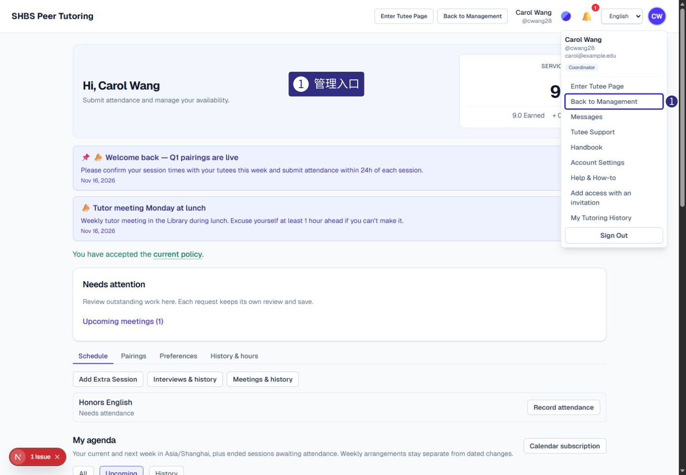

   英文界面

   

   
截图详情

   协调员打开辅导伙伴账户菜单，通过实际显示的返回管理入口回到管理工作区。

   /dashboard · EN · 2026-11-16

   [原始完整截图](assets/manage-daily-work-step-1.en.jpg) · `589c055e4b1cf166b48b353bd619ac1982e5d9f6` · Latest-main development baseline 589c055e with the Help candidate; synthetic demonstration data.

   

2. **打开动态待办** 查看各待办队列并打开相关申请。操作前核对学期、当前状态和人员；通知只是记录的入口，并不代表已作决定。

   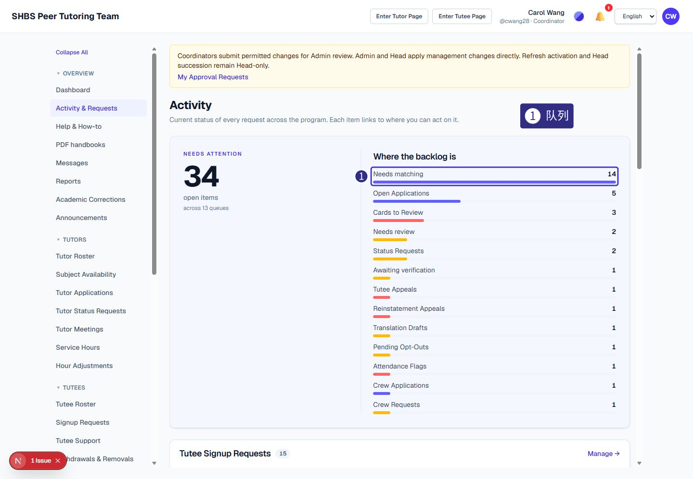

   英文界面

   

   
截图详情

   动态页面显示当前各具名队列及数量；需要配对入口打开对应报名申请记录。

   /admin/activity · EN · 2026-11-16

   [原始完整截图](assets/manage-daily-work-step-2.en.jpg) · `589c055e4b1cf166b48b353bd619ac1982e5d9f6` · Latest-main development baseline 589c055e with the Help candidate; synthetic demonstration data.

   

3. **找到正确记录** 使用页面搜索、筛选和最右侧操作列。可排序表头依次切换升序、降序和原顺序。查找缺失记录时先清除筛选。

   

   英文界面

   

   
截图详情

   人员搜索将名册缩小到Alice；可排序表头及最右侧操作控件均清晰可见。

   /admin/tutors · EN · 2026-11-16

   [原始完整截图](assets/manage-daily-work-step-3.en.jpg) · `589c055e4b1cf166b48b353bd619ac1982e5d9f6` · Latest-main development baseline 589c055e with the Help candidate; synthetic demonstration data.

   

4. **确认操作结果** 已保存表示实际写入完成。已提交审核表示已建立管理操作申请，现有记录尚未改变。打开回执可查看后续决定。

   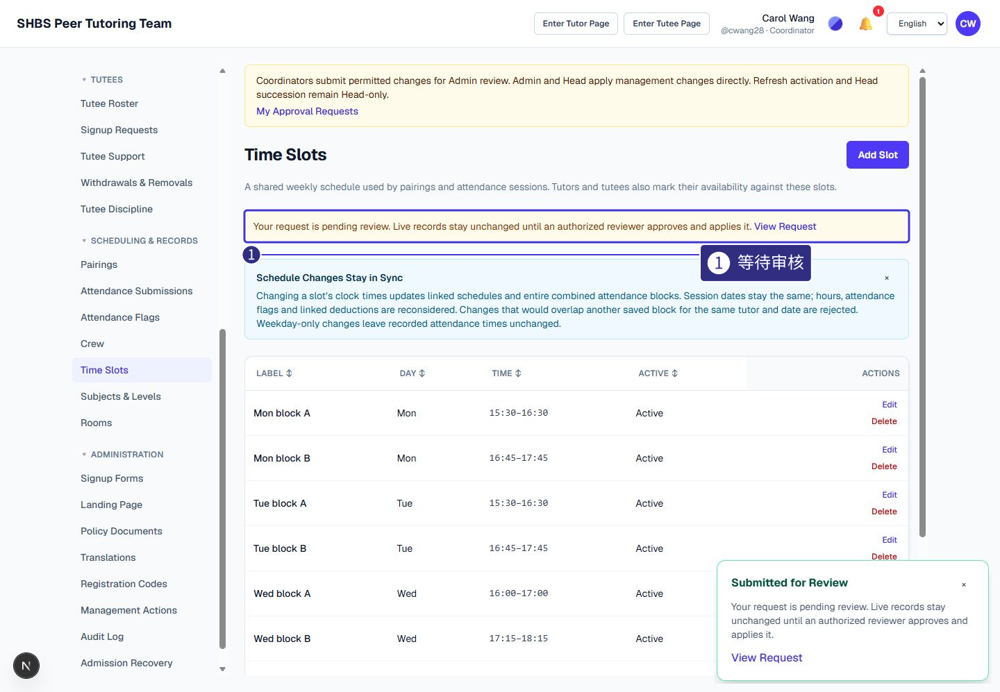

   英文界面

   

   
截图详情

   实际申请已提交审核；每周时段尚未变更，可通过查看申请打开回执。

   /admin/time-slots · EN · 2026-11-16

   [原始完整截图](assets/manage-daily-work-step-4.en.jpg) · `589c055e4b1cf166b48b353bd619ac1982e5d9f6` · Latest-main development baseline 589c055e with the Help candidate; synthetic demonstration data.

   

### 预期结果

能够定位任务、打开当前记录，并分清已应用变更与待审提案。

### 工作原理

导航同时受当前权限和生效功能开关控制。只读观察者看到经过遮蔽的内容，不能提交管理写入。

### 问题排查

- **找不到栏目或记录** 清除搜索及状态、学期筛选，确认模块已启用且权限仍有效。读取失败时使用重试；无法读取队列不等于队列为空。

## 为辅导申请匹配辅导伙伴

审核已验证的需求，比较辅导伙伴资格和工作量，再分配科目志愿。

打开: `/admin/requests`

### 开始之前

- 使用有效的管理权限登录。可选模块须已启用。协调员将允许的变更提交审核；管理员和负责人可直接应用非换期变更。

### 操作步骤

1. **选择申请标签页** 打开报名申请→待匹配。在列表中找到学习伙伴并展开申请。核对来源和验证标记、科目志愿、可用时间及当前答案修订。

   请注意: 选择待匹配，然后在相应科目志愿上使用选择辅导伙伴。

   **视图 1**

   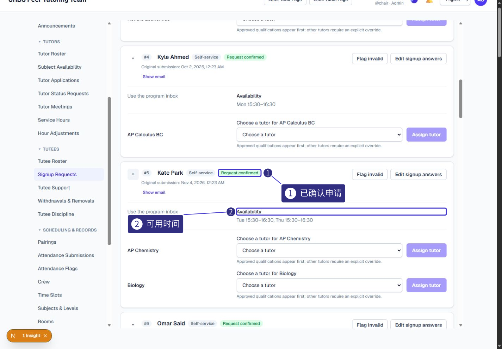

   英文界面

   

   
截图详情

   凯特·帕克已确认的自助申请列出尚未分配的AP化学与生物选择。可用时段为周二及周四15:30至16:30。

   /admin/requests · EN · 2026-11-20

   [原始完整截图](assets/match-tutoring-requests-step-1.en.jpg) · `b5ece465681957c9fe579d26babdeb260c674fa0` · Latest-main development baseline b5ece465, selected 2026-11-20, with the Help candidate and synthetic demo records.

   

   **视图 2**

   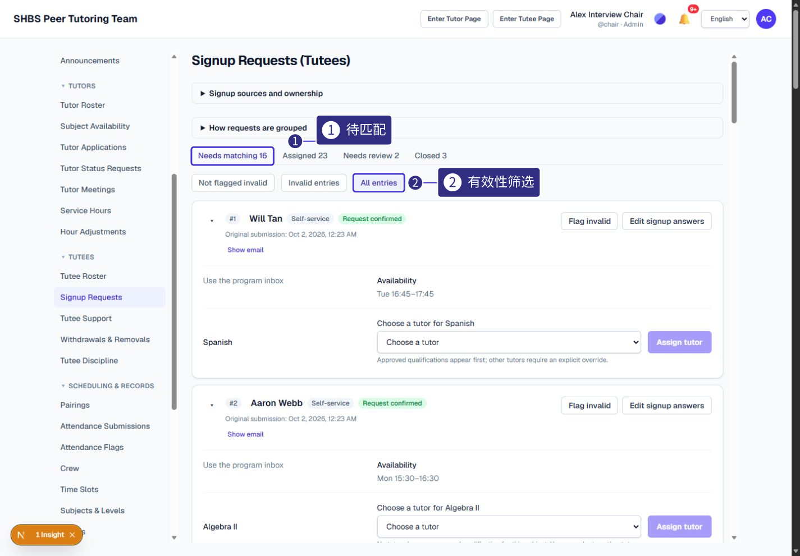

   英文界面

   

   
截图详情

   实际报名申请面板位于待匹配。申请有效性筛选可缩小列表范围。找到当前学习伙伴的申请行并展开，查看核验与提交的选项。

   /admin/requests · EN · 2026-11-20

   [原始完整截图](assets/match-tutoring-requests-step-1-view-2.en.jpg) · `b5ece465681957c9fe579d26babdeb260c674fa0` · Latest-main development baseline b5ece465, selected 2026-11-20, with the Help candidate and synthetic demo records.

   

2. **比较辅导伙伴** 对一个志愿选择辅导伙伴。检查资格、辅导意愿、可用时间、已分配辅导时段及辅导伙伴偏好上限。偏好容量仅供参考，并非自动禁令。

   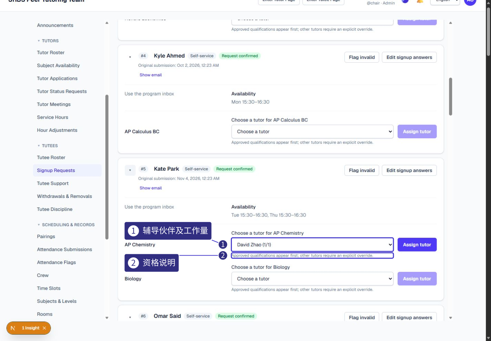

   英文界面

   

   
截图详情

   AP化学选择器显示赵辅导伙伴（1/1），已分配一节、偏好上限一节。资格说明指出哪些选择需要额外审核。

   /admin/requests · EN · 2026-11-20

   [原始完整截图](assets/match-tutoring-requests-step-2.en.jpg) · `b5ece465681957c9fe579d26babdeb260c674fa0` · Latest-main development baseline b5ece465, selected 2026-11-20, with the Help candidate and synthetic demo records.

   

3. **审阅分配内容** 选择预期辅导伙伴，继续前阅读资格警告。确认学习伙伴、科目和学期。应优先使用正常匹配，再考虑手动创建名册或配对。

   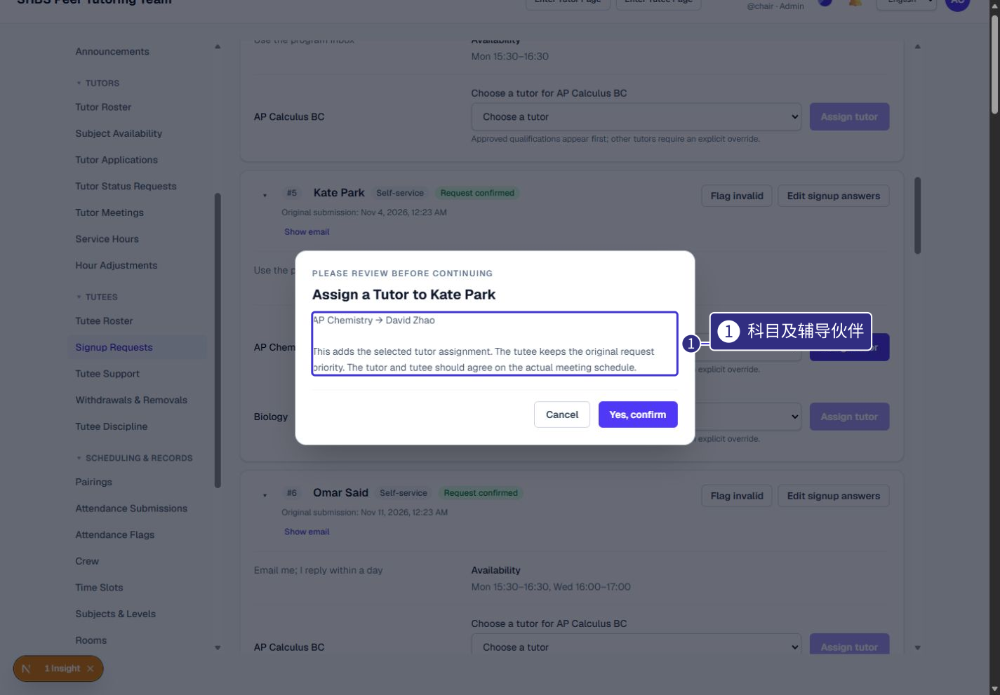

   英文界面

   

   
截图详情

   首次分配审核显示凯特·帕克、AP化学及赵辅导伙伴，并说明保留申请优先顺序。示例停留在审核，未分配辅导伙伴。

   /admin/requests · EN · 2026-11-20

   [原始完整截图](assets/match-tutoring-requests-step-3.en.jpg) · `b5ece465681957c9fe579d26babdeb260c674fa0` · Latest-main development baseline b5ece465, selected 2026-11-20, with the Help candidate and synthetic demo records.

   

4. **检查分配结果** 完成审阅并读取保存或审核回执。已应用分配可在已分配和配对页面查看；固定排课和教室分配仍须另外完成。

   **视图 1**

   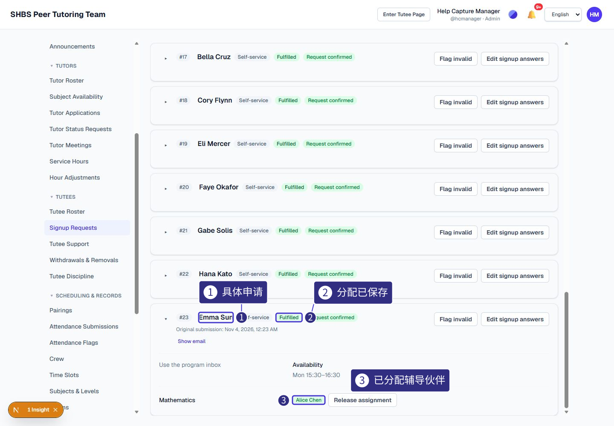

   英文界面

   

   
截图详情

   此已保存申请位于“已分配”。Emma Sun 的数学志愿已显示辅导伙伴 Alice Chen。

   /admin/requests · EN · 2026-11-20

   [原始完整截图](assets/match-tutoring-requests-step-4.en.jpg) · `b5ece465681957c9fe579d26babdeb260c674fa0` · Latest-main development baseline b5ece465, selected 2026-11-20, with the Help candidate and synthetic demo records.

   

   **视图 2**

   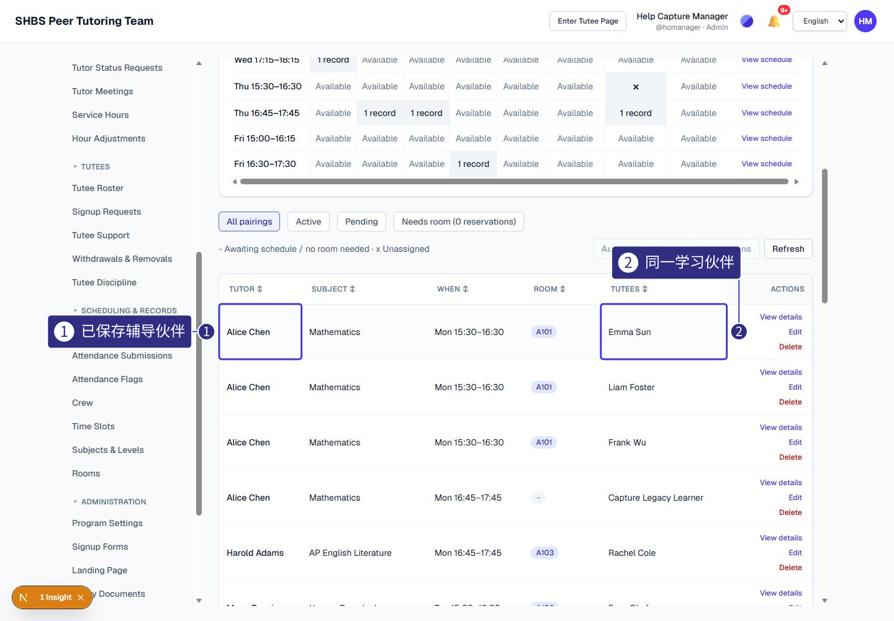

   英文界面

   

   
截图详情

   “配对”显示同一已保存学习伙伴、数学科目和辅导伙伴。现有每周时间及教室另行记录。

   /admin/pairings · EN · 2026-11-20

   [原始完整截图](assets/match-tutoring-requests-step-4-view-2.en.jpg) · `b5ece465681957c9fe579d26babdeb260c674fa0` · Latest-main development baseline b5ece465, selected 2026-11-20, with the Help candidate and synthetic demo records.

   

### 预期结果

预期科目志愿已分配，或生成可明确识别的待审提案。

### 工作原理

自助报名、工作人员录入及早期报名描述来源。早期报名表示来源不明，不代表更早的优先级。已验证问卷保留原始提交优先级。

### 问题排查

- **无法选择辅导伙伴或申请被阻止** 查看显示的资格、成员状态、验证、无效标记或学期限制。通过对应流程修正原因；更改筛选或重复建申请不能解决问题。

## 标记、清除或复核无效报名

记录原因、查看状态邮件并处理报名无效申诉，同时保留证据。

打开: `/admin/requests`

### 开始之前

- 使用有效的管理权限登录。可选模块须已启用。协调员将允许的变更提交审核；管理员和负责人可直接应用非换期变更。

### 操作步骤

1. **检查具体申请** 打开报名申请或辅导伙伴申请。使用申请有效性筛选已标记或未标记条目，变更前先打开具体申请。

   请注意: 在申请中找到申请有效性、标记无效及查看无效标记。

   **视图 1**

   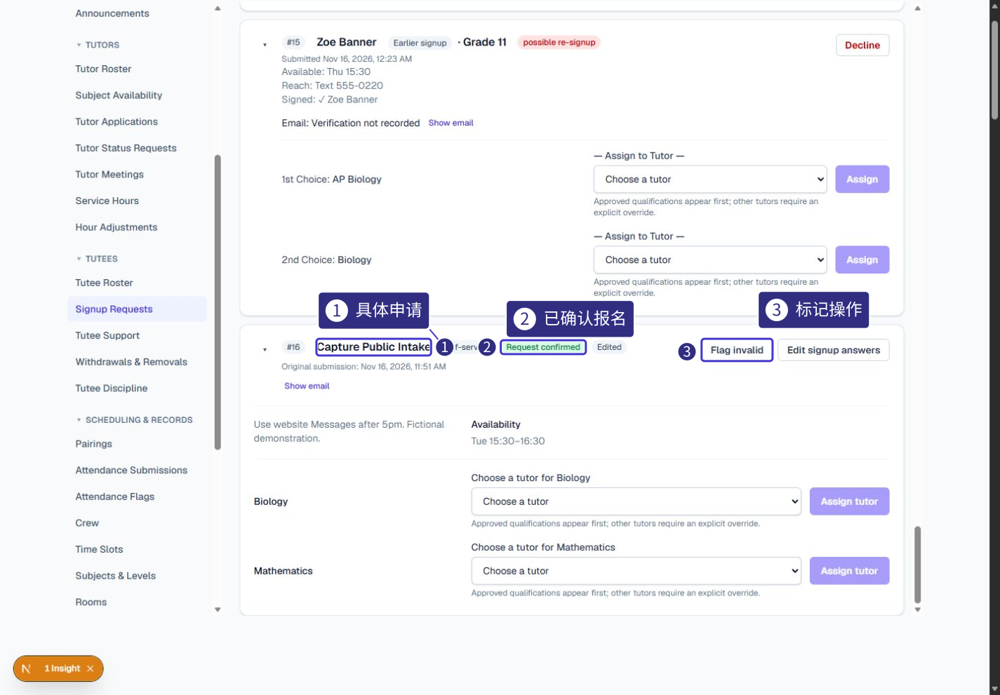

   英文界面

   

   
截图详情

   审核有效性前打开已确认的申请。示例的两项科目志愿仍待匹配。

   /admin/requests · EN · 2026-11-20

   [原始完整截图](assets/review-signup-validity-step-1.en.jpg) · `b5ece465681957c9fe579d26babdeb260c674fa0` · Latest-main development baseline b5ece465, selected 2026-11-20, with the Help candidate and synthetic demo records.

   

   **视图 2**

   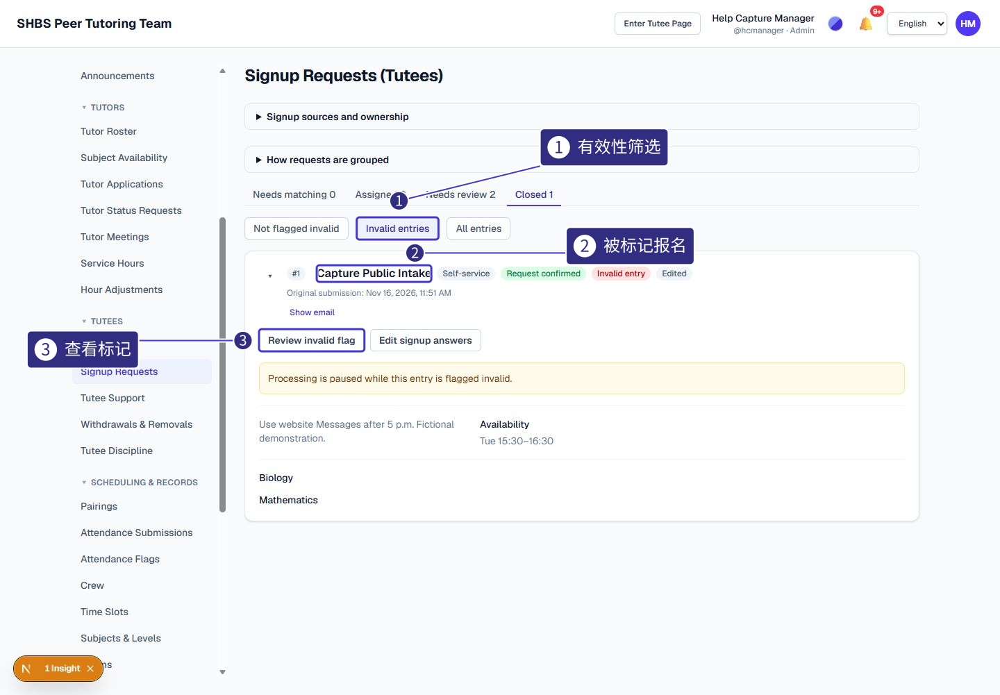

   英文界面

   

   
截图详情

   “无效条目”筛选会在“已关闭”中显示具体被标记申请，其原提交时间仍可见。

   /admin/requests · EN · 2026-11-20

   [原始完整截图](assets/review-signup-validity-step-1-view-2.en.jpg) · `b5ece465681957c9fe579d26babdeb260c674fa0` · Latest-main development baseline b5ece465, selected 2026-11-20, with the Help candidate and synthetic demo records.

   

2. **说明标记或修正原因** 选择标记无效，或查看无效标记→清除无效标记。填写适合申请人阅读的原因，核对具体条目后保存或提交审核。

   **视图 1**

   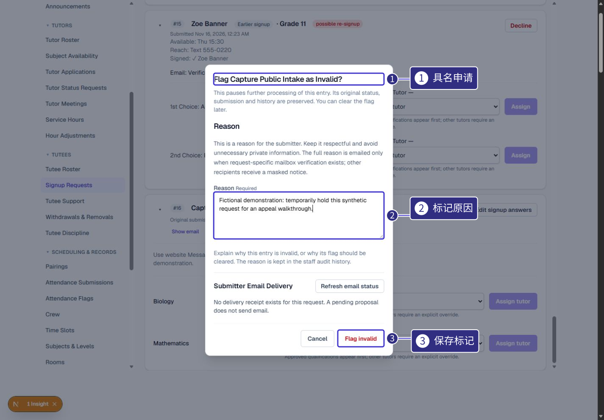

   英文界面

   

   
截图详情

   核对具名申请，填写适合提交人阅读的理由，并在保存前检查标记操作。

   /admin/requests · EN · 2026-11-20

   [原始完整截图](assets/review-signup-validity-step-2.en.jpg) · `b5ece465681957c9fe579d26babdeb260c674fa0` · Latest-main development baseline b5ece465, selected 2026-11-20, with the Help candidate and synthetic demo records.

   

   **视图 2**

   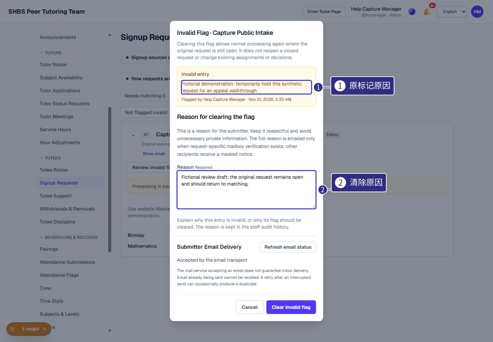

   英文界面

   

   
截图详情

   单独的清除标记审阅会在新说明栏上方显示已保存标记。本草稿已取消。

   /admin/requests · EN · 2026-11-20

   [原始完整截图](assets/review-signup-validity-step-2-view-2.en.jpg) · `b5ece465681957c9fe579d26babdeb260c674fa0` · Latest-main development baseline b5ece465, selected 2026-11-20, with the Help candidate and synthetic demo records.

   

3. **检查邮件与申诉** 查看无效标记对话框中的邮件状态与最新申诉。刷新状态只会读取。管理员或负责人可重试符合条件的失败状态邮件，并在阅读完整原因后决定学习伙伴无效申请申诉。

   **视图 1**

   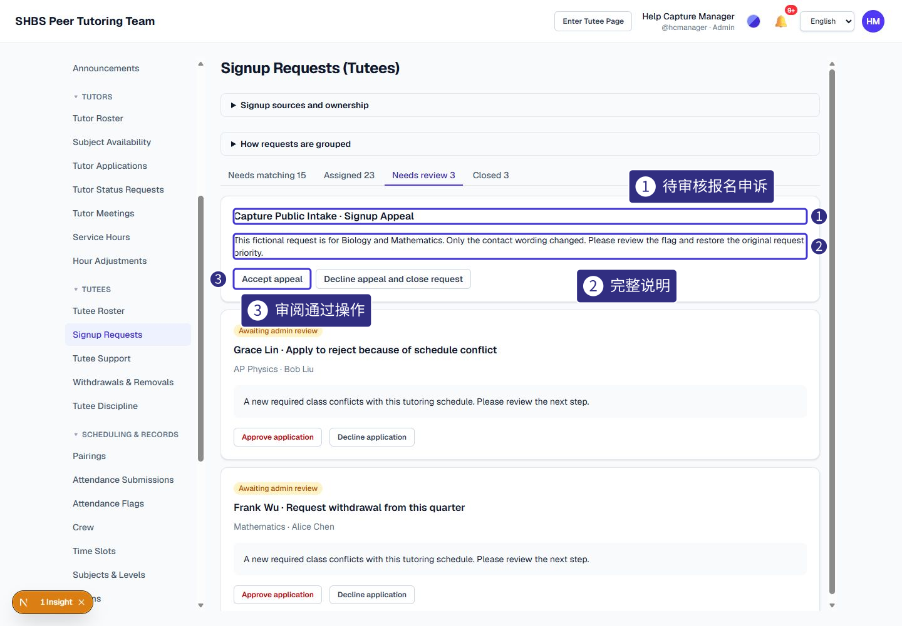

   英文界面

   

   
截图详情

   作出具名决定前，在“待审核”中阅读最新说明。邮件回执可在标记审阅中查看。

   /admin/requests · EN · 2026-11-20

   [原始完整截图](assets/review-signup-validity-step-3.en.jpg) · `b5ece465681957c9fe579d26babdeb260c674fa0` · Latest-main development baseline b5ece465, selected 2026-11-20, with the Help candidate and synthetic demo records.

   

   **视图 2**

   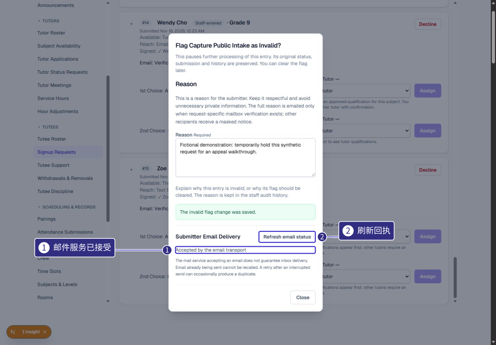

   英文界面

   

   
截图详情

   标记已保存，邮件服务已接受该通知。“刷新邮件状态”用于读取现有回执。

   /admin/requests · EN · 2026-11-20

   [原始完整截图](assets/review-signup-validity-step-3-view-2.en.jpg) · `b5ece465681957c9fe579d26babdeb260c674fa0` · Latest-main development baseline b5ece465, selected 2026-11-20, with the Help candidate and synthetic demo records.

   

   **视图 3**

   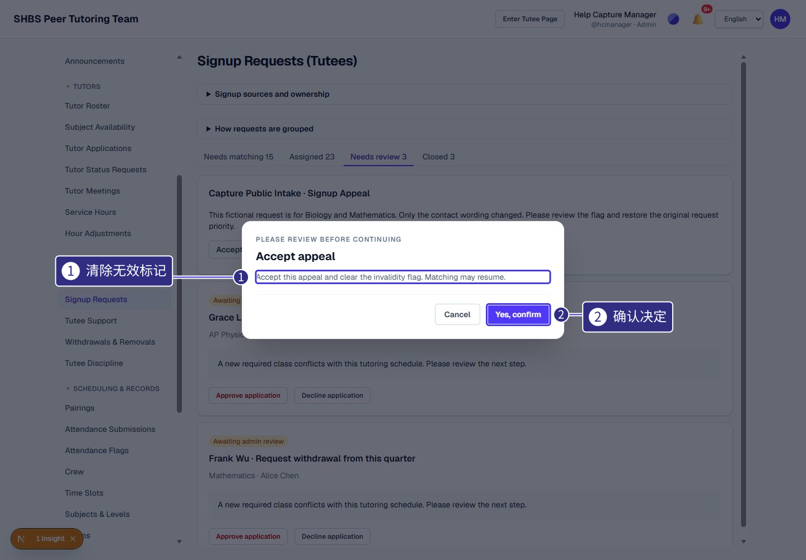

   英文界面

   

   
截图详情

   核对通过待审核申诉的后果。确认后标记会清除，并可恢复匹配。

   /admin/requests · EN · 2026-11-20

   [原始完整截图](assets/review-signup-validity-step-3-view-3.en.jpg) · `b5ece465681957c9fe579d26babdeb260c674fa0` · Latest-main development baseline b5ece465, selected 2026-11-20, with the Help candidate and synthetic demo records.

   

4. **确认决定** 学习伙伴申诉获批后会清除标记；最终驳回会关闭当前申请并移除其优先级。继续处理前检查保留的历史及申请状态。

   **视图 1**

   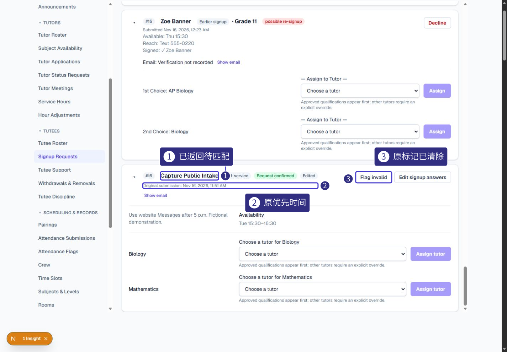

   英文界面

   

   
截图详情

   工作人员通过申诉后，该申请按原提交时间返回“待匹配”。两项科目志愿仍待分配。

   /admin/requests · EN · 2026-11-20

   [原始完整截图](assets/review-signup-validity-step-4.en.jpg) · `b5ece465681957c9fe579d26babdeb260c674fa0` · Latest-main development baseline b5ece465, selected 2026-11-20, with the Help candidate and synthetic demo records.

   

   **视图 2**

   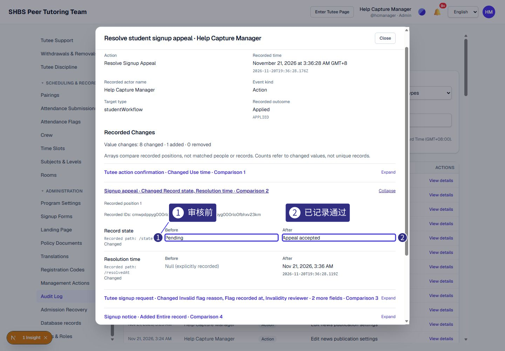

   英文界面

   

   
截图详情

   审计对照记录同一申诉从“待审核”变为“申诉已通过”，并保存处理时间。

   /admin/audit · EN · 2026-11-20

   [原始完整截图](assets/review-signup-validity-step-4-view-2.en.jpg) · `b5ece465681957c9fe579d26babdeb260c674fa0` · Latest-main development baseline b5ece465, selected 2026-11-20, with the Help candidate and synthetic demo records.

   

### 预期结果

能看到当前标记、申诉决定、相应原因及邮件投递状态。

### 工作原理

标记会阻止处理，但不删除条目或施加纪律处罚。清除标记会保留证据，不会恢复过期申请或成员资格。标记期间验证截止时间仍继续；只有针对该申请的邮箱证明才允许披露原因。

### 问题排查

- **状态邮件被阻止或列表未刷新** 核对记录地址及显示的投递限制。保存完成后的重试刷新只重载记录，不重新发送或重复决定。协调员待审提案在应用前不会发送无效通知。

## 审核辅导伙伴申请并修正姓名

查找当前或已完成申请，检查账户设置状态并修正初次申请姓名。

打开: `/admin/applications`

### 开始之前

- 使用有效的管理权限登录。可选模块须已启用。协调员将允许的变更提交审核；管理员和负责人可直接应用非换期变更。

### 操作步骤

1. **查找申请** 在顶部按姓名或邮箱搜索，并使用申请状态、申请科目、面试完成情况及排序筛选。独立的面试记录区域支持搜索申请人、评审或科目；在该处选择待完成、已完成或全部，再点击搜索。按评审搜索应使用下方区域。

   请注意: 使用申请筛选并展开目标申请。

   **视图 1**

   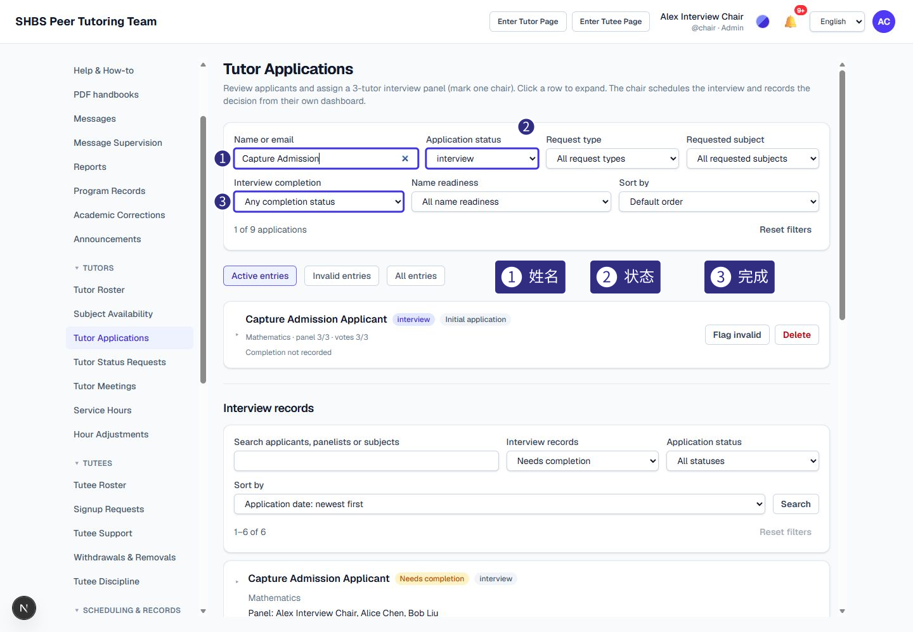

   英文界面

   

   
截图详情

   顶部申请筛选找到一份处于面试状态的 Capture Admission Applicant 申请；此处按申请人姓名或邮箱搜索，与下方面试历史搜索独立。

   /admin/applications · EN · 2026-11-16

   [原始完整截图](assets/review-tutor-applications-step-1.en.jpg) · `dd970ea426016e85cb514beeeab537c3ab2e5098` · Latest-main development baseline dd970ea4, selected 2026-11-16, with the Help candidate; synthetic demonstration data.

   

   **视图 2**

   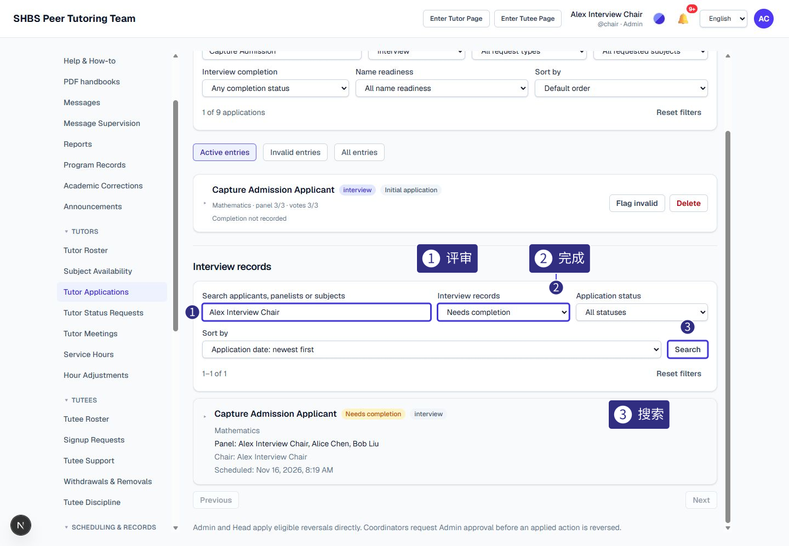

   英文界面

   

   
截图详情

   独立的面试记录搜索按评审 Alex Interview Chair 及待完成筛选，返回一份 Capture Admission 待完成面试；顶部申请人搜索保持独立。

   /admin/applications · EN · 2026-11-16

   [原始完整截图](assets/review-tutor-applications-step-1-view-2.en.jpg) · `dd970ea426016e85cb514beeeab537c3ab2e5098` · Latest-main development baseline dd970ea4, selected 2026-11-16, with the Help candidate; synthetic demonstration data.

   

2. **阅读证据** 展开记录，查看申请资格、评委组、主席、安排、完成情况及账户设置状态。必要时从面试历史打开对应评委链接。

   **视图 1**

   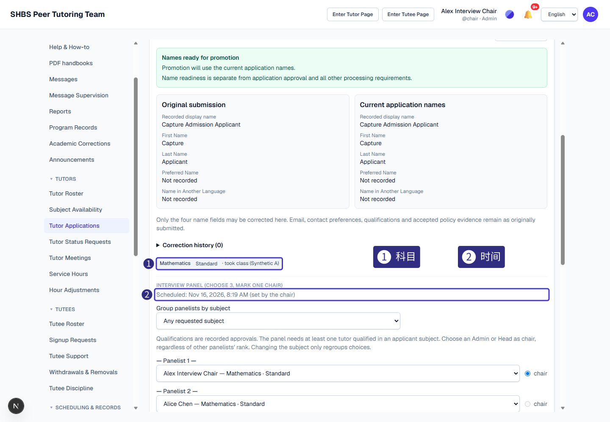

   英文界面

   

   
截图详情

   待审初次申请保留原始及当前姓名、数学资格证据与已安排面试时间；姓名、评审组、完成记录及决定均未变更。

   /admin/applications · EN · 2026-11-16

   [原始完整截图](assets/review-tutor-applications-step-2.en.jpg) · `dd970ea426016e85cb514beeeab537c3ab2e5098` · Latest-main development baseline dd970ea4, selected 2026-11-16, with the Help candidate; synthetic demonstration data.

   

   **视图 2**

   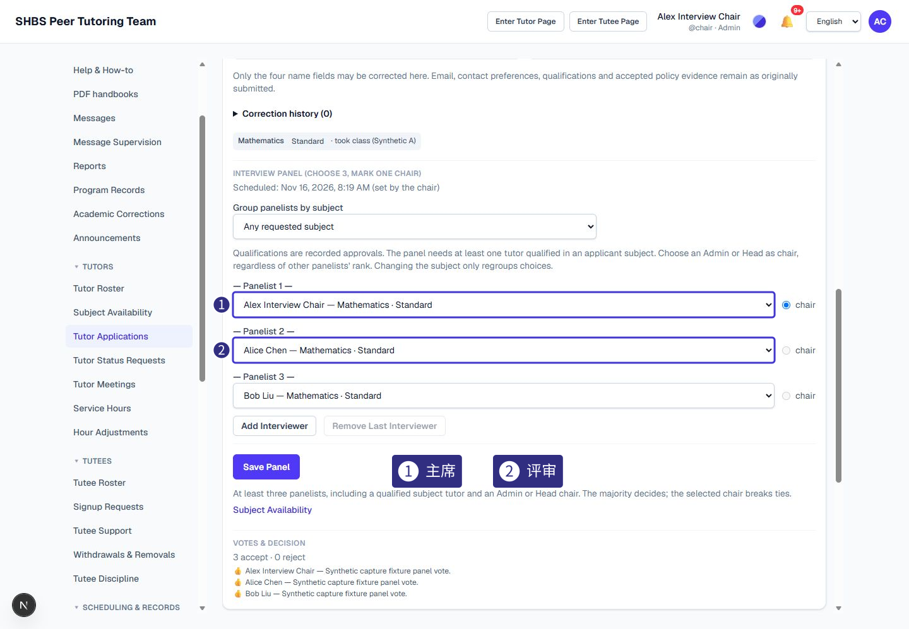

   英文界面

   

   
截图详情

   保存的三人评审组仍为 Alex Interview Chair、Alice Chen 和 Bob Liu，Alex 为已选管理员主席；未点击保存评审组，原有三张赞成票仍可见。

   /admin/applications · EN · 2026-11-16

   [原始完整截图](assets/review-tutor-applications-step-2-view-2.en.jpg) · `dd970ea426016e85cb514beeeab537c3ab2e5098` · Latest-main development baseline dd970ea4, selected 2026-11-16, with the Help candidate; synthetic demonstration data.

   

   **视图 3**

   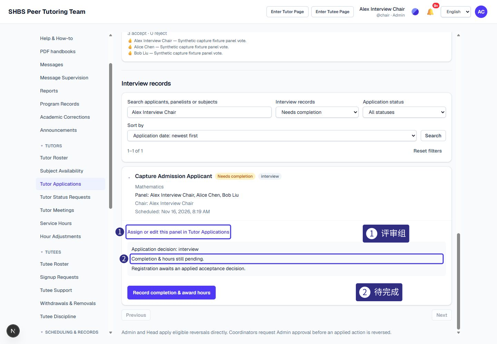

   英文界面

   

   
截图详情

   展开的面试历史显示现有评审组链接、待完成的面试与时数，以及等待实际录用决定的注册状态；未执行完成记录、时数发放或录用操作。

   /admin/applications · EN · 2026-11-16

   [原始完整截图](assets/review-tutor-applications-step-2-view-3.en.jpg) · `dd970ea426016e85cb514beeeab537c3ab2e5098` · Latest-main development baseline dd970ea4, selected 2026-11-16, with the Help candidate; synthetic demonstration data.

   

3. **修正初次申请姓名** 对符合条件的初次申请，打开姓名修正操作，编辑四个姓名字段并填写原因。保存或提交协调员提案前审阅修改前后身份。

   **视图 1**

   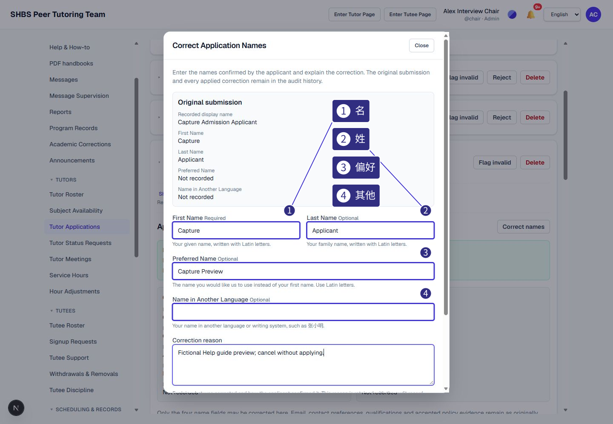

   英文界面

   

   
截图详情

   修正申请姓名窗口显示保留的原始提交及尚未提交的偏好姓名草稿 Capture Preview；原因明确说明此虚构预览将取消，未执行应用姓名修正。

   /admin/applications · EN · 2026-11-16

   [原始完整截图](assets/review-tutor-applications-step-3.en.jpg) · `dd970ea426016e85cb514beeeab537c3ab2e5098` · Latest-main development baseline dd970ea4, selected 2026-11-16, with the Help candidate; synthetic demonstration data.

   

   **视图 2**

   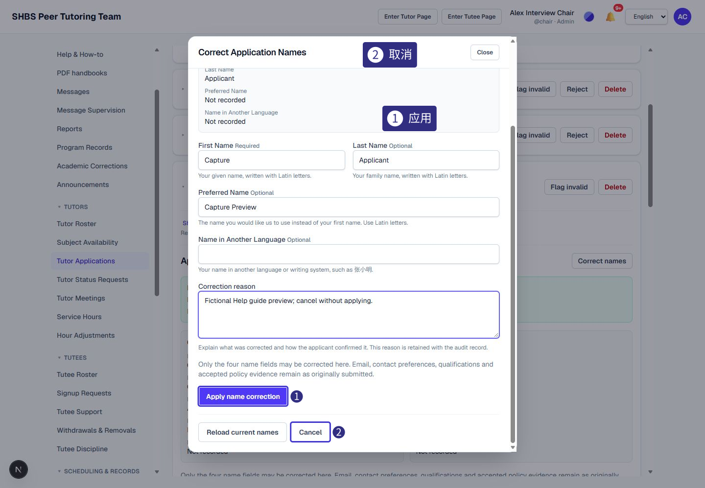

   英文界面

   

   
截图详情

   尚未提交的修正填写了明确的虚构预览原因，并分别显示应用姓名修正和取消操作；演示将选择取消，不保存或提交申请姓名修正。

   /admin/applications · EN · 2026-11-16

   [原始完整截图](assets/review-tutor-applications-step-3-view-2.en.jpg) · `dd970ea426016e85cb514beeeab537c3ab2e5098` · Latest-main development baseline dd970ea4, selected 2026-11-16, with the Help candidate; synthetic demonstration data.

   

4. **继续对应流程** 资格决定使用评委分配和面试审核流程。只有来源符合条件时才使用账户设置操作；名册或已接受申请本身不代表可登录账户。

   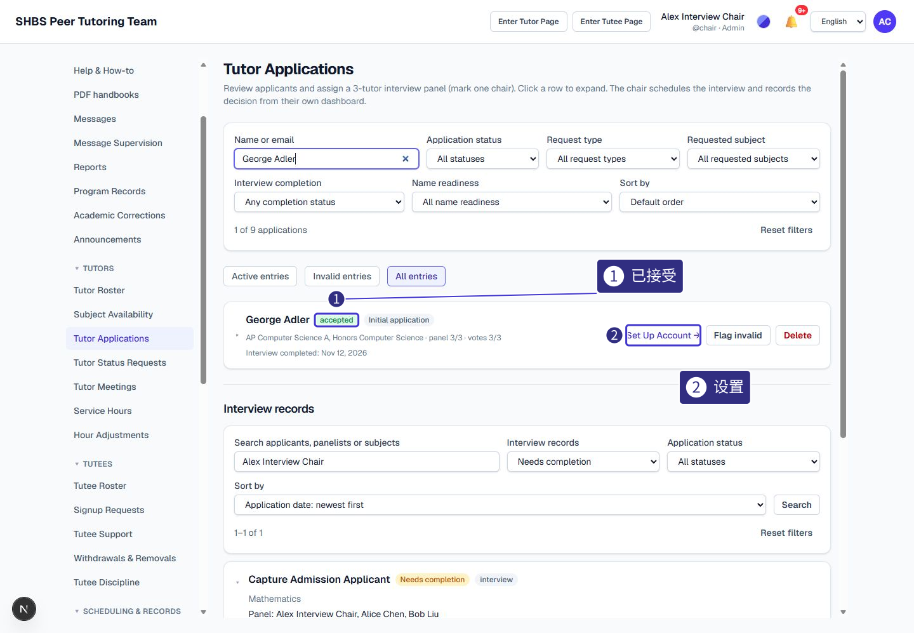

   英文界面

   

   
截图详情

   已接受的申请提供“Set Up Account”入口。本图仅展示打开账户设置详情之前的入口；本次演示没有创建登录账户或邀请。

   /admin/applications · EN · 2026-11-16

   [原始完整截图](assets/review-tutor-applications-step-4.en.jpg) · `dd970ea426016e85cb514beeeab537c3ab2e5098` · Latest-main development baseline dd970ea4, selected 2026-11-16, with the Help candidate; synthetic demonstration data.

   

### 预期结果

申请及面试、账户设置状态清楚可见；姓名修正拥有独立记录原因。

### 工作原理

姓名修正仅改变申请姓名字段及原因，不会接受申请、清除无效标记、修改联系方式或制造资格与政策证据。

### 问题排查

- **找不到已完成面试或申请** 切换至已完成或全部记录并清除状态筛选。历史排序发生在分页之前；使用页面导航，不要把第一页当作全部记录。

## 分配并完成面试评委组

选择合资格评委和有效主席、安排面试，并记录实际完成情况。

打开: `/admin/applications`

### 开始之前

- 使用有效的管理权限登录。可选模块须已启用。协调员将允许的变更提交审核；管理员和负责人可直接应用非换期变更。

### 操作步骤

1. **选择评委组** 打开申请人评委编辑器。选择3至8名关联活跃账户的辅导伙伴，其中至少一人在申请科目具备工作人员确认资格；再选择其中一名管理员或负责人担任主席，审阅后保存。

   请注意: 展开申请人，找到评委分配及面试管理。

   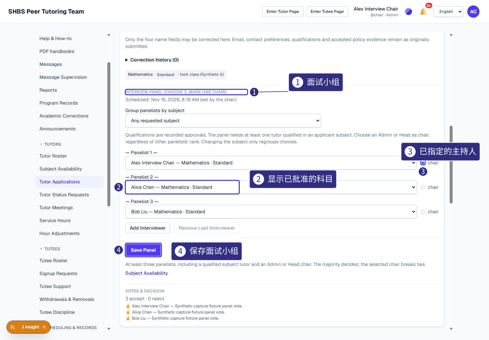

   英文界面

   

   
截图详情

   待处理的数学申请已选三位具备已记录科目资格的面试官。Alex 被选为主持人。“保存面试小组”会对这份申请应用更改。

   /admin/applications · EN · 2026-11-20

   [原始完整截图](assets/manage-interview-panels-step-1.en.jpg) · `b5ece465681957c9fe579d26babdeb260c674fa0` · Latest-main development baseline b5ece465, selected 2026-11-20, with the Help candidate and synthetic demo records.

   

2. **安排面试** 指定主席在辅导伙伴“课表”中打开“待进行的面试”，选择“设置时间”。按项目时区输入日期与时间。每位评委各自提交投票。

   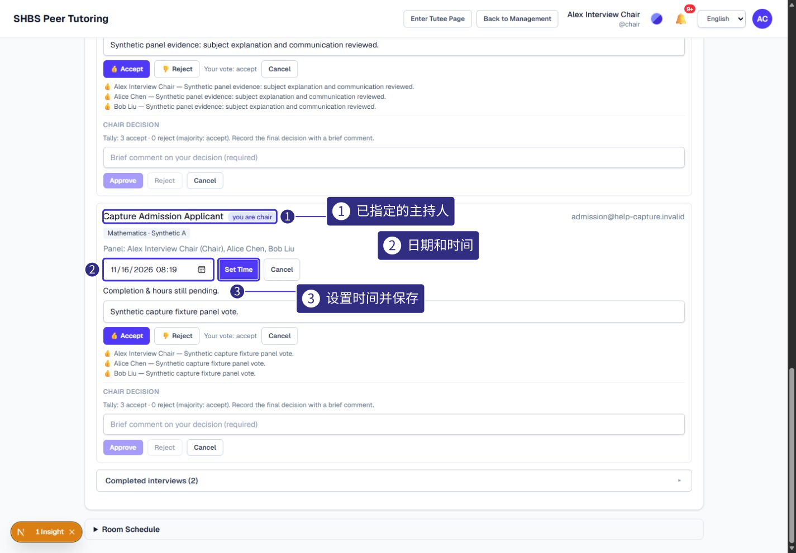

   英文界面

   

   
截图详情

   已指定的管理员主持人在导师日程中查看“设置时间”输入框中的现有时间及独立保存按钮。现有时间保持不变。

   /dashboard#sessions · EN · 2026-11-20

   [原始完整截图](assets/manage-interview-panels-step-2.en.jpg) · `b5ece465681957c9fe579d26babdeb260c674fa0` · Latest-main development baseline b5ece465, selected 2026-11-20, with the Help candidate and synthetic demo records.

   

3. **记录决定** 在“辅导伙伴申请”中打开“投票与决定”查看票数。全体评委投票后，符合资格的主席在“待进行的面试”中按页面显示的多数或平票规则确认决定。

   **视图 1**

   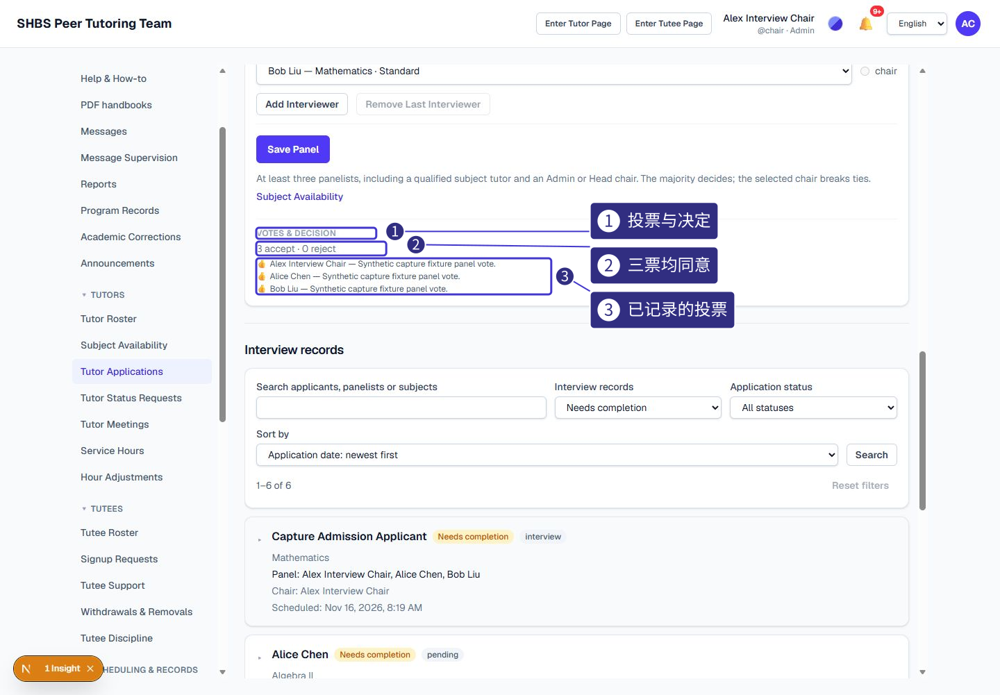

   英文界面

   

   
截图详情

   “投票与决定”列出了三位面试官已保存的投票及 3 比 0 的统计。此管理页面显示申请仍待决定。

   /admin/applications · EN · 2026-11-20

   [原始完整截图](assets/manage-interview-panels-step-3.en.jpg) · `b5ece465681957c9fe579d26babdeb260c674fa0` · Latest-main development baseline b5ece465, selected 2026-11-20, with the Help candidate and synthetic demo records.

   

   **视图 2**

   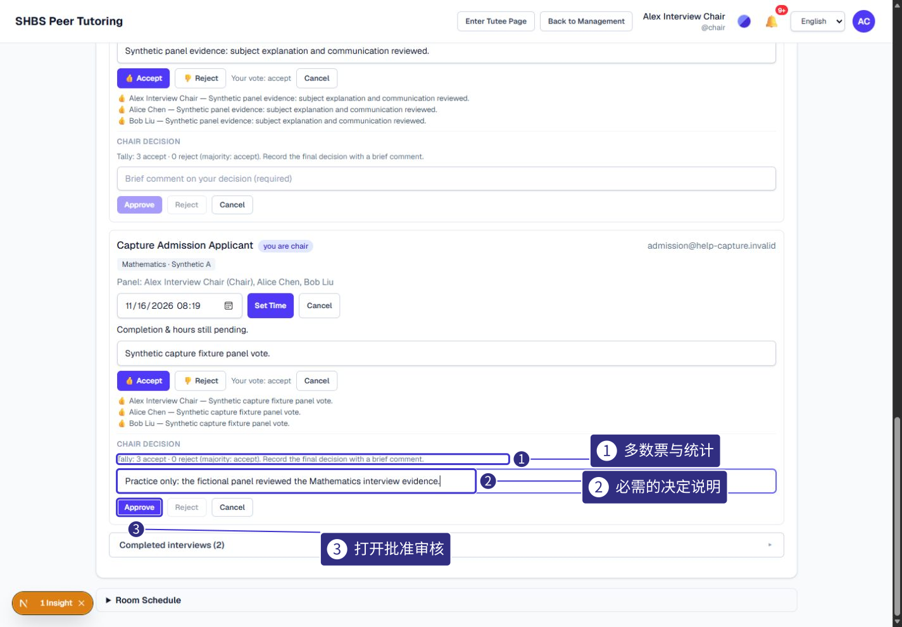

   英文界面

   

   
截图详情

   实际指定主持人可查看 3 比 0 的多数票结果并填写必需的决定说明。“批准”会打开这份首次申请的下一步审核。

   /dashboard#sessions · EN · 2026-11-20

   [原始完整截图](assets/manage-interview-panels-step-3-view-2.en.jpg) · `b5ece465681957c9fe579d26babdeb260c674fa0` · Latest-main development baseline b5ece465, selected 2026-11-20, with the Help candidate and synthetic demo records.

   

4. **完成实际出席记录** 记录实际完成时间、时长及出席评委。后续修正时填写原因，审阅替换的学时后再应用或提出整个修正。

   **视图 1**

   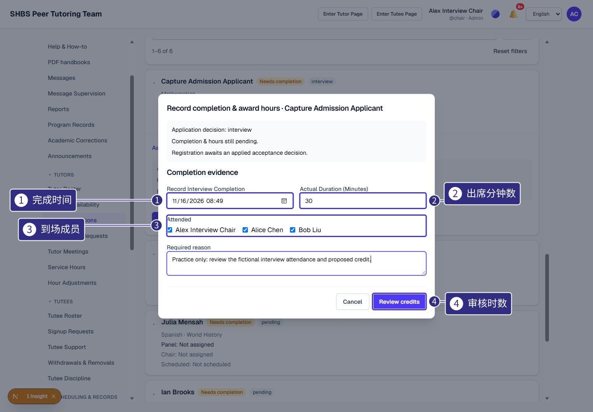

   英文界面

   

   
截图详情

   草稿在审核计时前填写实际完成时间、分钟数及到场面试官。当前申请仍待记录完成与时数。

   /admin/applications · EN · 2026-11-20

   [原始完整截图](assets/manage-interview-panels-step-4.en.jpg) · `b5ece465681957c9fe579d26babdeb260c674fa0` · Latest-main development baseline b5ece465, selected 2026-11-20, with the Help candidate and synthetic demo records.

   

   **视图 2**

   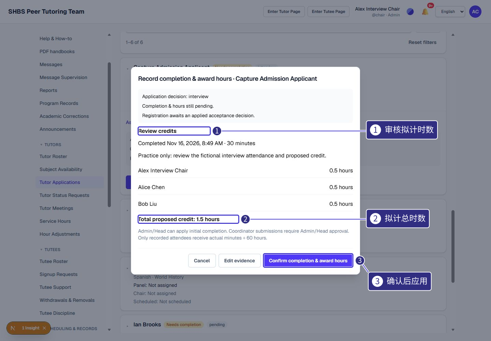

   英文界面

   

   
截图详情

   同一待提交审核显示三位已选到场人员各拟计 0.5 小时，共拟计 1.5 小时。取消会保留原待处理记录。

   /admin/applications · EN · 2026-11-20

   [原始完整截图](assets/manage-interview-panels-step-4-view-2.en.jpg) · `b5ece465681957c9fe579d26babdeb260c674fa0` · Latest-main development baseline b5ece465, selected 2026-11-20, with the Help candidate and synthetic demo records.

   

   **视图 3**

   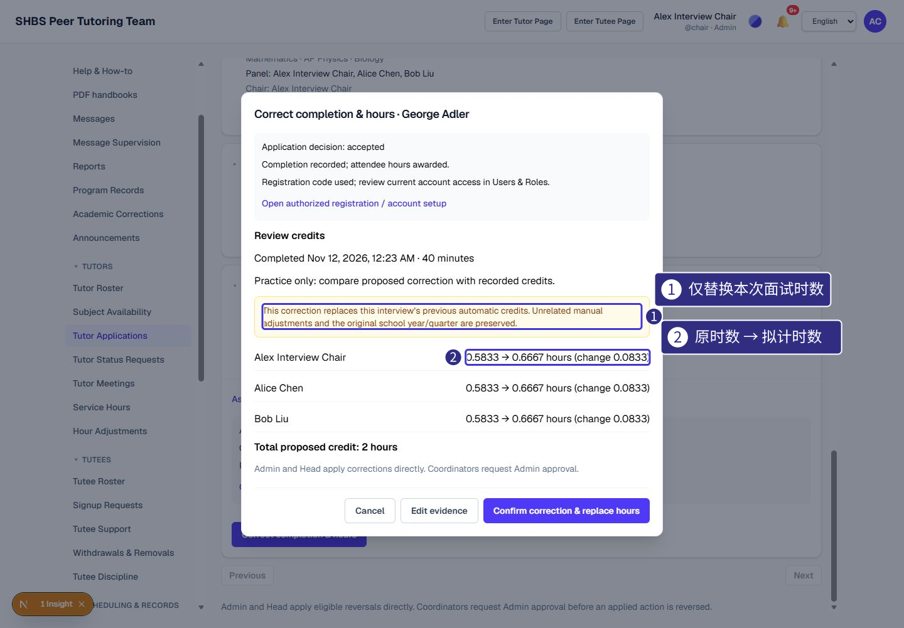

   英文界面

   

   
截图详情

   后续更正审核把 George 已记录的 35 分钟时数与草稿示例 40 分钟比较，并显示替换范围及“取消”。

   /admin/applications · EN · 2026-11-20

   [原始完整截图](assets/manage-interview-panels-step-4-view-3.en.jpg) · `b5ece465681957c9fe579d26babdeb260c674fa0` · Latest-main development baseline b5ece465, selected 2026-11-20, with the Help candidate and synthetic demo records.

   

### 预期结果

保存的评委、主席、安排、投票、决定及完成情况均保留在申请中。

### 工作原理

新的安排、决定及首次完成需要有效管理员或负责人主席。历史学时修正保留记录中的主席，而非重新检查其当前职位。资格、辅导意愿和账户权限仍彼此独立。

### 问题排查

- **评委或完成控件被阻止** 检查评委活跃状态、已记录资格、主席当前权限及面试功能。关闭面试后历史仍可读；写入须待模块和资格允许。

## 比较辅导资格与意愿

阅读直接与继承资格，避免将其与辅导意愿或时间可用性混淆。

打开: `/admin/subject-availability`

### 开始之前

- 使用有效的管理权限登录。可选模块须已启用。协调员将允许的变更提交审核；管理员和负责人可直接应用非换期变更。

### 操作步骤

1. **查找并展开辅导伙伴** 打开辅导伙伴名册下方的科目可用性。搜索辅导伙伴或科目并展开辅导伙伴，查看分组科目及具体级别。

   请注意: 展开辅导伙伴并使用已获资格、待审核或愿意辅导筛选。

   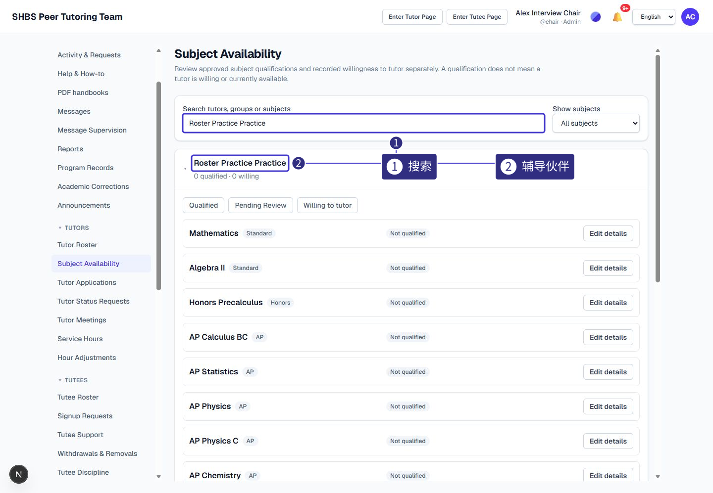

   英文界面

   

   
截图详情

   搜索定位到独立的 Roster Practice Practice 辅导伙伴；展开的名册显示科目名称及级别。该辅导伙伴目前没有已批准资格或已记录的辅导意愿；本图没有更改任何详情。

   /admin/subject-availability · EN · 2026-11-16

   [原始完整截图](assets/inspect-subject-availability-step-1.en.jpg) · `dd970ea426016e85cb514beeeab537c3ab2e5098` · Latest-main development baseline dd970ea4, selected 2026-11-16, with the Help candidate; synthetic demonstration data.

   

2. **应用一个局部筛选** 为该辅导伙伴选择已获资格、待审核或愿意辅导。再次点击已选筛选可清除；它会与页面搜索和筛选共同生效。

   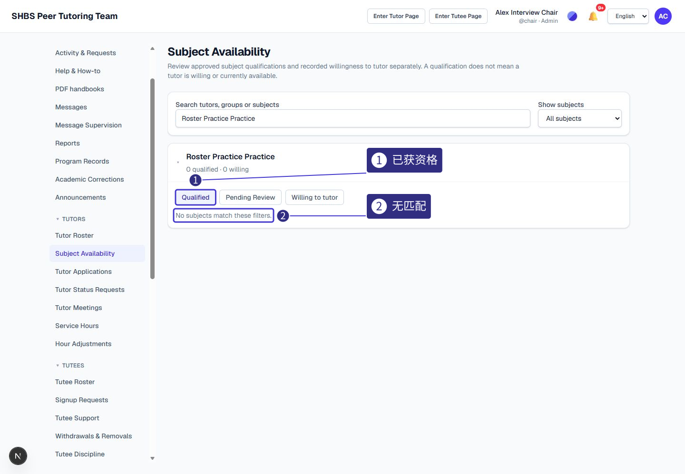

   英文界面

   

   
截图详情

   本图拍摄于第4步所示 Honors 实际批准之前：“Qualified”与搜索组合后，未找到 Roster Practice Practice 的合格科目。再次点击“Qualified”可清除该筛选；筛选或打开“Edit details”不会授予资格。

   /admin/subject-availability · EN · 2026-11-16

   [原始完整截图](assets/inspect-subject-availability-step-2.en.jpg) · `dd970ea426016e85cb514beeeab537c3ab2e5098` · Latest-main development baseline dd970ea4, selected 2026-11-16, with the Help candidate; synthetic demonstration data.

   

3. **检查资格来源** 阅读直接批准及已记录的低级别继承资格。另行比较辅导意愿：未记录表示辅导伙伴尚未保存选择。

   **视图 1**

   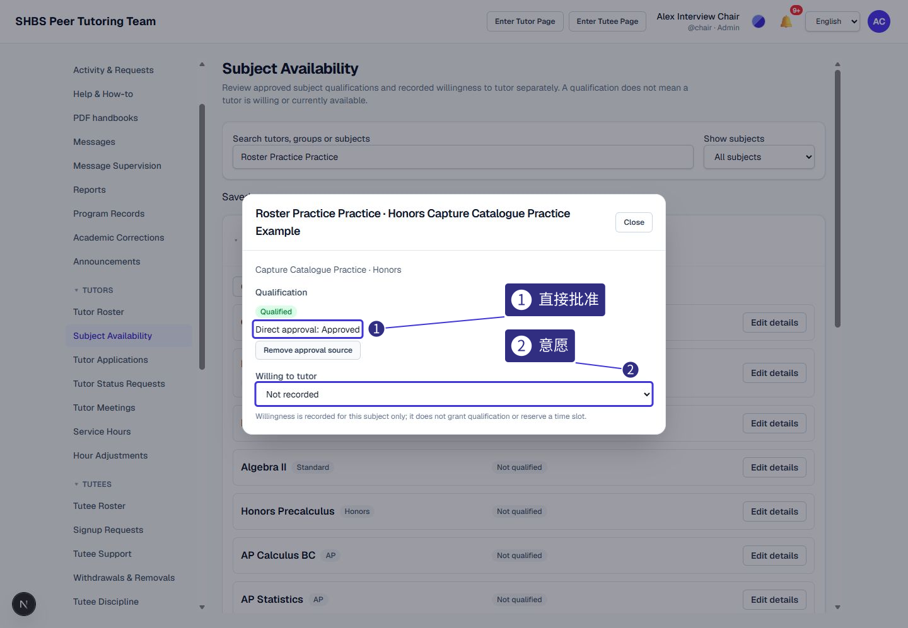

   英文界面

   

   
截图详情

   本图为第4步所示实际“Approve this subject”操作后的保存结果：Honors 显示“Direct approval: Approved”，辅导意愿仍为“Not recorded”。仅打开“Edit details”不会授予资格；未执行“Remove approval source”。

   /admin/subject-availability · EN · 2026-11-16

   [原始完整截图](assets/inspect-subject-availability-step-3.en.jpg) · `dd970ea426016e85cb514beeeab537c3ab2e5098` · Latest-main development baseline dd970ea4, selected 2026-11-16, with the Help candidate; synthetic demonstration data.

   

   **视图 2**

   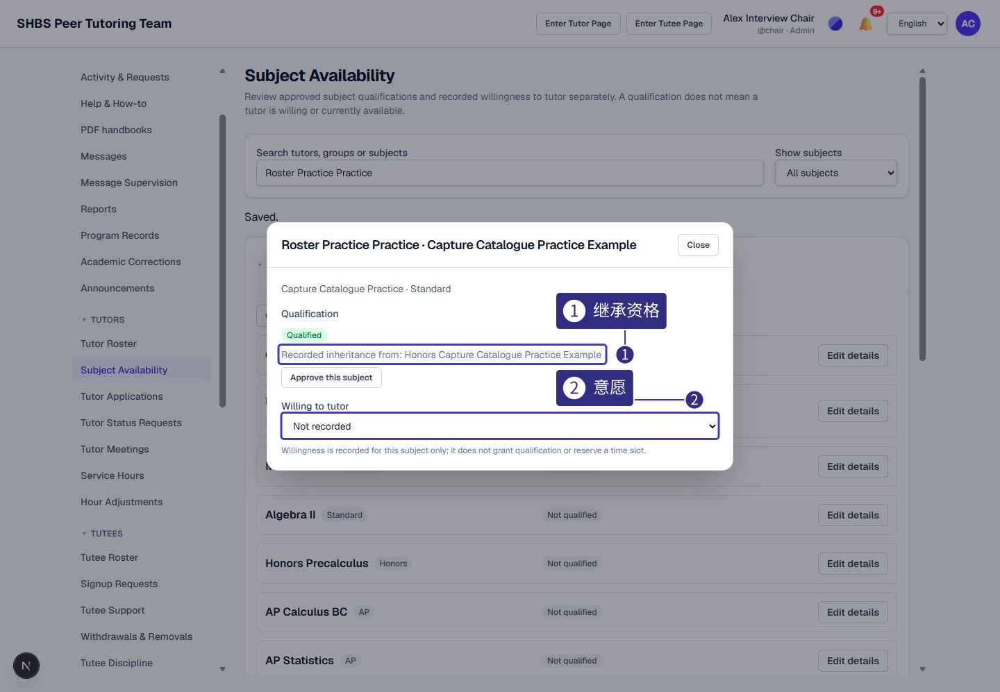

   英文界面

   

   
截图详情

   本图拍摄于第4步所示 Honors 实际批准之后：Standard 已记录来自 Honors Capture Catalogue Practice Example 的继承资格，没有直接 Standard 批准。此时辅导意愿仍为“Not recorded”；第4步后续视图才展示另行保存的意愿。

   /admin/subject-availability · EN · 2026-11-16

   [原始完整截图](assets/inspect-subject-availability-step-3-view-2.en.jpg) · `dd970ea426016e85cb514beeeab537c3ab2e5098` · Latest-main development baseline dd970ea4, selected 2026-11-16, with the Help candidate; synthetic demonstration data.

   

4. **选择正确后续操作** 打开编辑详情。更改辅导意愿会立即保存；批准此科目及移除审批来源也会立即提交。继续前阅读保存结果或协调员的审核申请结果。额外资格申请由管理员或负责人另行决定；匹配时须另行检查排期和容量。

   **视图 1**

   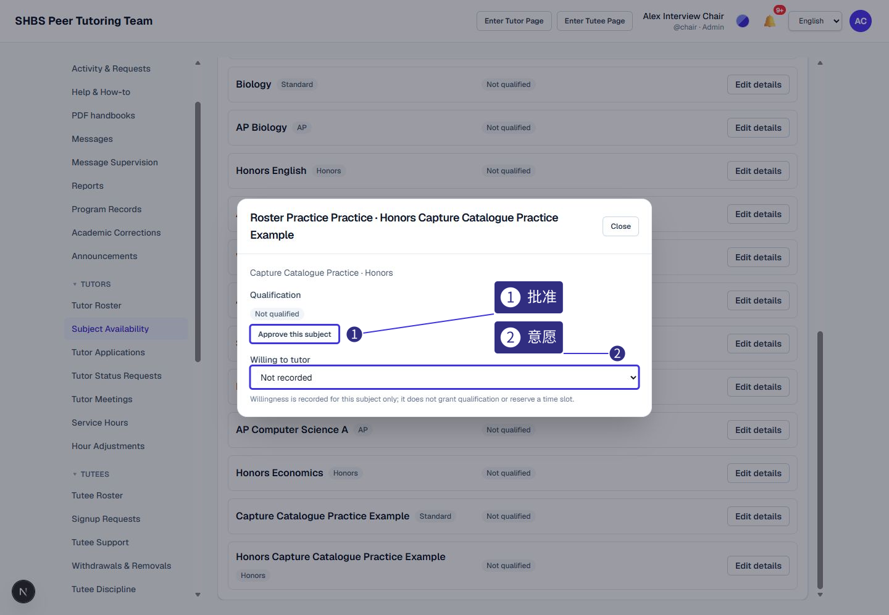

   英文界面

   

   
截图详情

   Roster Practice Practice 尚未获得此活跃练习 Honors 变体的资格，辅导意愿也未记录。“Approve this subject”及意愿更改均会立即提交；本图展示两个动作执行前的状态。

   /admin/subject-availability · EN · 2026-11-16

   [原始完整截图](assets/inspect-subject-availability-step-4.en.jpg) · `dd970ea426016e85cb514beeeab537c3ab2e5098` · Latest-main development baseline dd970ea4, selected 2026-11-16, with the Help candidate; synthetic demonstration data.

   

   **视图 2**

   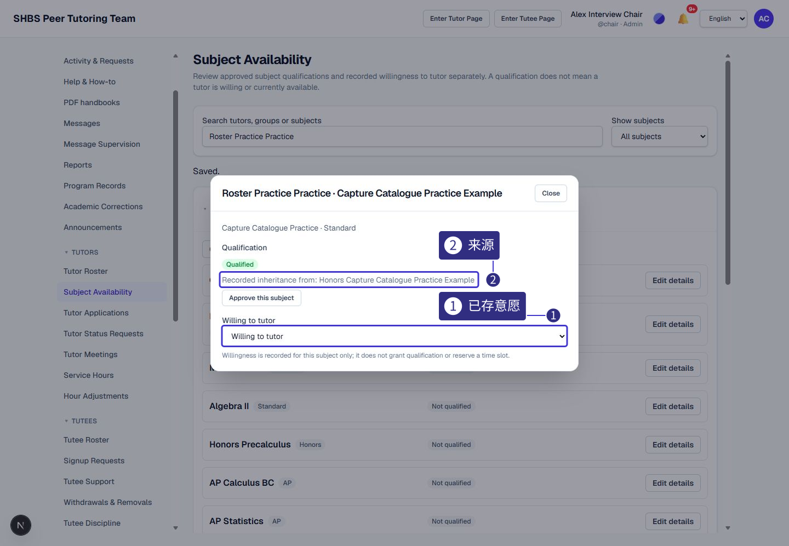

   英文界面

   

   
截图详情

   仅更改 Standard 的辅导意愿后，现已保存为“Willing to tutor”。实际名册摘要为2项资格、1项意愿。已记录的 Honors 继承来源未变；没有直接批准 Standard，也没有预留匹配排期。

   /admin/subject-availability · EN · 2026-11-16

   [原始完整截图](assets/inspect-subject-availability-step-4-view-2.en.jpg) · `dd970ea426016e85cb514beeeab537c3ab2e5098` · Latest-main development baseline dd970ea4, selected 2026-11-16, with the Help candidate; synthetic demonstration data.

   

### 预期结果

能够分辨辅导伙伴是否有资格、愿意辅导、待审，以及是否符合其他分配条件。

### 工作原理

批准高级变体会记录当时提供的较低级别。此后重排目录不会重新计算资格。归档科目中已记录的证据仍可见。资格本身不代表意愿。

### 问题排查

- **缺少预期资格** 清除筛选并检查记录中的批准来源及活跃目录变体。不要从当前级别顺序推断资格；请管理员或负责人审核实际证据。

## 手动授予或移除科目资格

审核证据与授予来源，保持资格、意愿及账户标记彼此独立。

打开: `/admin/subject-availability`

### 开始之前

- 需要当前管理权限。管理员、负责人应用手动资格授予或来源移除；协调员提交允许变更审核。额外资格申请决定使用独立管理员、负责人流程。

### 操作步骤

1. **阅读资格授予记录** 在科目可用性展开辅导伙伴，定位准确科目级别。使用手动批准前阅读资格证据、现有批准来源及独立意愿。

   请注意: 展开辅导伙伴，检查具体级别及其批准来源。

   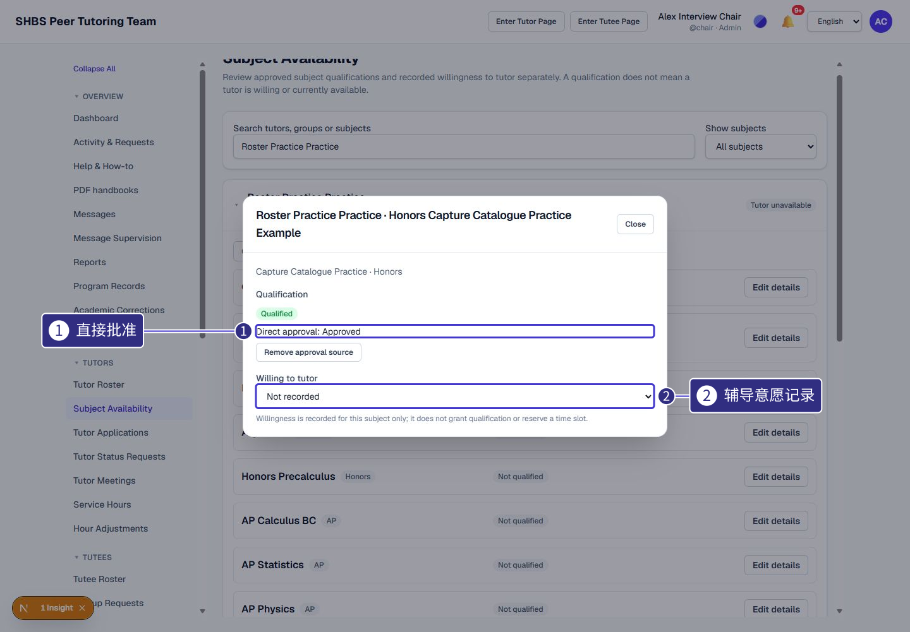

   英文界面

   

   
截图详情

   暂不可用的练习辅导伙伴仍可查看荣誉级记录。界面显示已保存的直接批准，独立意愿为未记录。本例未更改任何字段。

   /admin/subject-availability · EN · 2026-11-20

   [原始完整截图](assets/decide-subject-qualifications-step-1.en.jpg) · `b5ece465681957c9fe579d26babdeb260c674fa0` · Latest-main development baseline b5ece465, selected 2026-11-20, with the Help candidate and synthetic demo records.

   

2. **核对并授予资格** 打开编辑详情，核对辅导伙伴、科目及级别。检查该科目组的较低级别，再选择批准此科目立即提交。管理员及负责人直接应用授予。协调员在管理操作中跟进待审提案。

   **视图 1**

   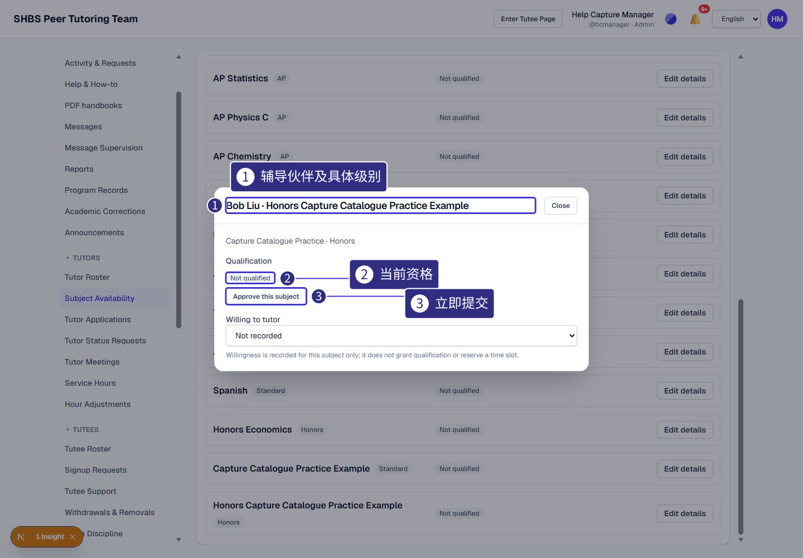

   英文界面

   

   
截图详情

   选择“批准此科目”前核对具名辅导伙伴和荣誉级别。此时尚未提交新批准。

   /admin/subject-availability · EN · 2026-11-20

   [原始完整截图](assets/decide-subject-qualifications-step-2.en.jpg) · `b5ece465681957c9fe579d26babdeb260c674fa0` · Latest-main development baseline b5ece465, selected 2026-11-20, with the Help candidate and synthetic demo records.

   

   **视图 2**

   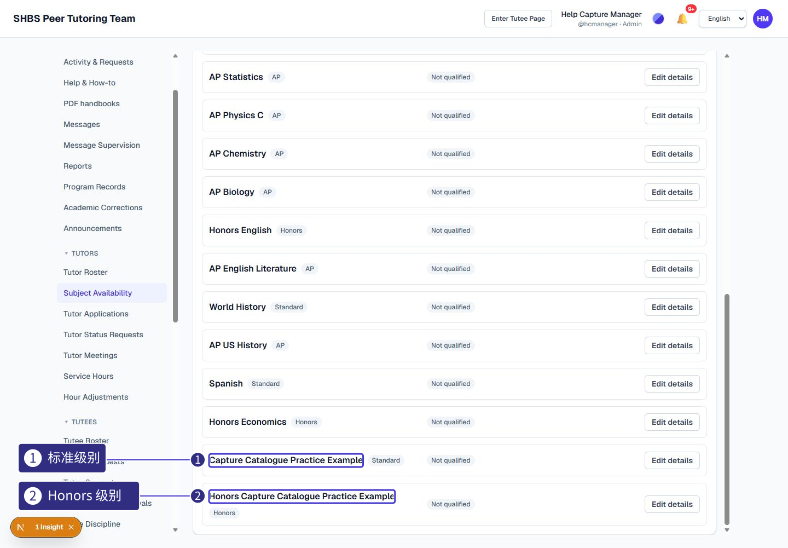

   英文界面

   

   
截图详情

   选择批准来源前，比较同一科目组的标准及荣誉级别。Bob 的两条记录目前均显示未获得资格。

   /admin/subject-availability · EN · 2026-11-20

   [原始完整截图](assets/decide-subject-qualifications-step-2-view-2.en.jpg) · `b5ece465681957c9fe579d26babdeb260c674fa0` · Latest-main development baseline b5ece465, selected 2026-11-20, with the Help candidate and synthetic demo records.

   

3. **仅移除预期来源** 对有直接批准的级别打开编辑详情，先阅读直接来源及继承来源，再选择移除审批来源立即提交。变更应用后重新打开记录，核对哪些资格仍有其他来源支持。

   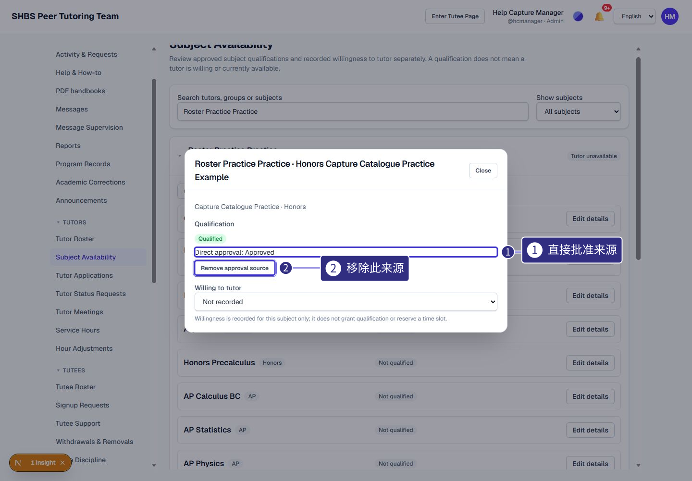

   英文界面

   

   
截图详情

   移除前核对这项具体的荣誉级别直接批准。“移除批准来源”会立即提交。本预览显示变更前的批准来源。

   /admin/subject-availability · EN · 2026-11-20

   [原始完整截图](assets/decide-subject-qualifications-step-3.en.jpg) · `b5ece465681957c9fe579d26babdeb260c674fa0` · Latest-main development baseline b5ece465, selected 2026-11-20, with the Help candidate and synthetic demo records.

   

4. **另行核对意愿** 重新读取辅导伙伴资格，另行查看愿意辅导值。需要时回到辅导伙伴申请查看评委及面试证据。

   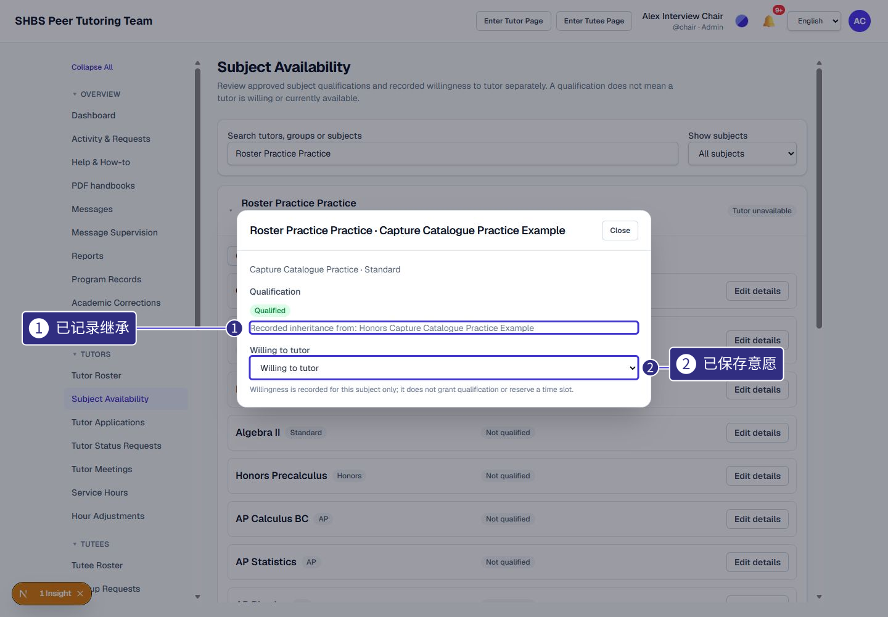

   英文界面

   

   
截图详情

   标准级记录显示已保存的愿意辅导，以及单独记录的荣誉级继承。该辅导伙伴仍暂不可用，未更改任何字段。

   /admin/subject-availability · EN · 2026-11-20

   [原始完整截图](assets/decide-subject-qualifications-step-4.en.jpg) · `b5ece465681957c9fe579d26babdeb260c674fa0` · Latest-main development baseline b5ece465, selected 2026-11-20, with the Help candidate and synthetic demo records.

   

### 预期结果

审核的资格决定及其来源已记录，不会暗中改变意愿。

### 工作原理

手动资格授予、来源移除与额外资格申请决定是独立操作。两者都不会恢复暂停或撤销参与、创建登录或暗中记录辅导意愿。

### 问题排查

- **接受操作提示参与受限** 在用户与角色检查暂停、离校及被撤销辅导权限。仅通过授权流程恢复权限，再依据最新证据重试资格决定。

## 查看与编辑辅导伙伴名册

查看资料、状态、资格与账户证据，或在手动录入警告后创建名册记录。

打开: `/admin/tutors`

### 开始之前

- 使用有效的管理权限登录。可选模块须已启用。协调员将允许的变更提交审核；管理员和负责人可直接应用非换期变更。

### 操作步骤

1. **选择当前或历史记录** 按辅导伙伴保存姓名搜索并检查当前、历史筛选。打开查看用户详情前阅读状态与学业摘要。

   请注意: 在最右侧操作列找到编辑资料与查看用户详情。

   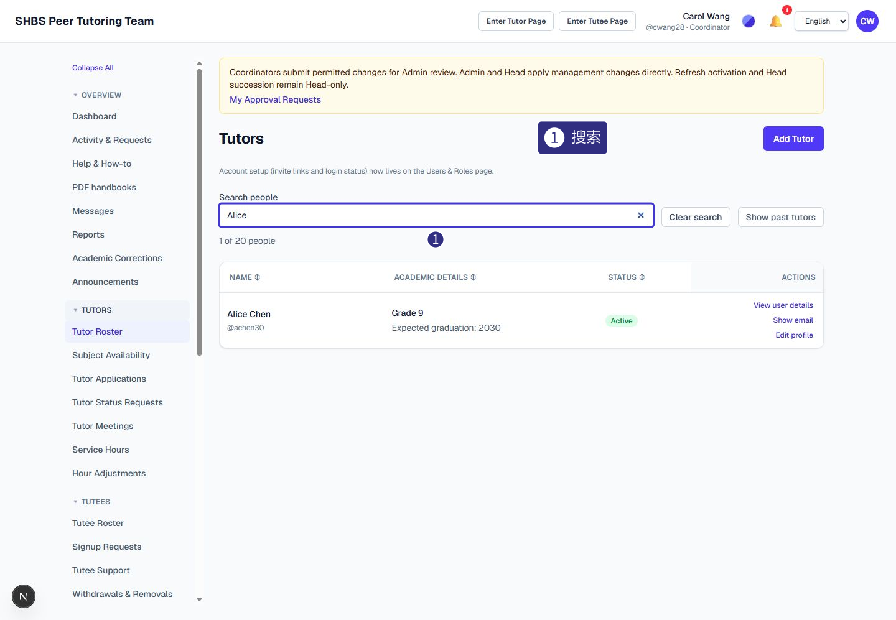

   英文界面

   

   
截图详情

   当前辅导伙伴名册已筛选到Alice，显示在岗状态、学业摘要及查看历史辅导伙伴入口。

   /admin/tutors · EN · 2026-11-16

   [原始完整截图](assets/manage-tutor-roster-step-1.en.jpg) · `589c055e4b1cf166b48b353bd619ac1982e5d9f6` · Latest-main development baseline 589c055e with the Help candidate; synthetic demonstration data.

   

2. **阅读或编辑资料** 详情展示分组科目、资格来源、意愿、登录状态及账户政策历史。允许的变更使用编辑资料；原始入组学业资料与当前账户学业资料应分别审阅。

   **视图 1**

   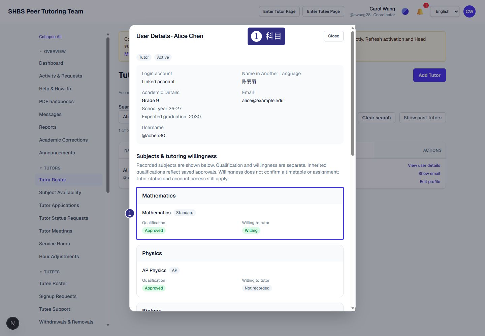

   英文界面

   

   
截图详情

   Alice的真实详情显示关联登录、学业摘要、分组已确认科目及独立记录的辅导意愿。

   /admin/tutors · EN · 2026-11-16

   [原始完整截图](assets/manage-tutor-roster-step-2.en.jpg) · `589c055e4b1cf166b48b353bd619ac1982e5d9f6` · Latest-main development baseline 589c055e with the Help candidate; synthetic demonstration data.

   

   **视图 2**

   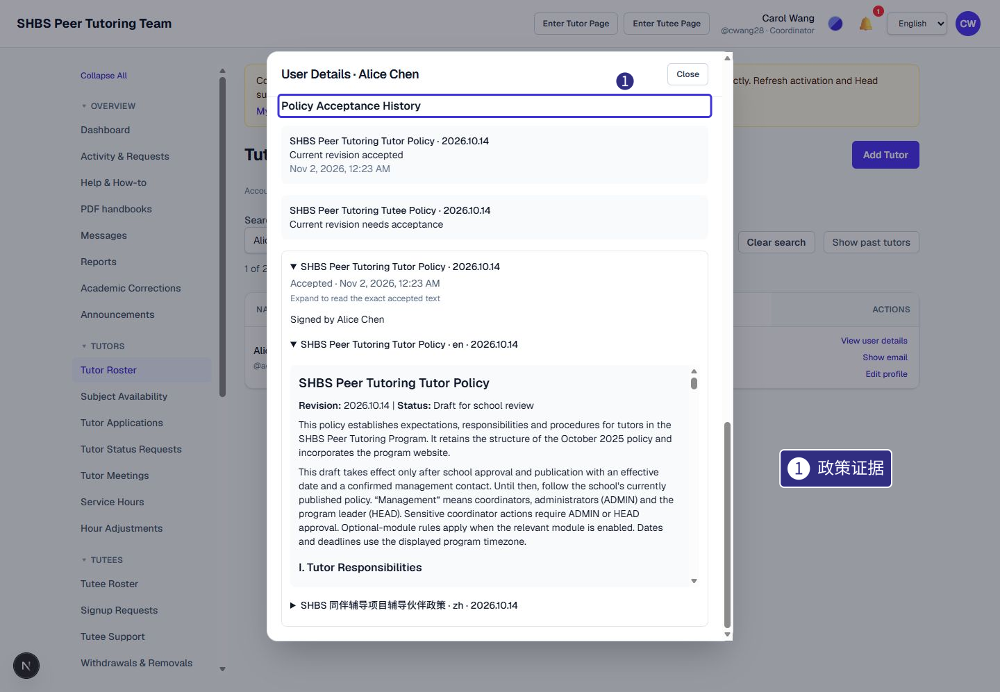

   英文界面

   

   
截图详情

   Alice保留的政策历史区分已接受的辅导伙伴版本与仍待接受的学习伙伴政策，并展开已接受的确切英文文本。

   /admin/tutors · EN · 2026-11-16

   [原始完整截图](assets/manage-tutor-roster-step-2-view-2.en.jpg) · `589c055e4b1cf166b48b353bd619ac1982e5d9f6` · Latest-main development baseline 589c055e with the Help candidate; synthetic demonstration data.

   

3. **审慎变更名册状态** 打开编辑资料，在状态中选择允许的名册状态，再保存该区块。账户权限需另外在用户与角色中检查。归档名册、撤销辅导伙伴标记与退出成员是不同状态。

   **视图 1**

   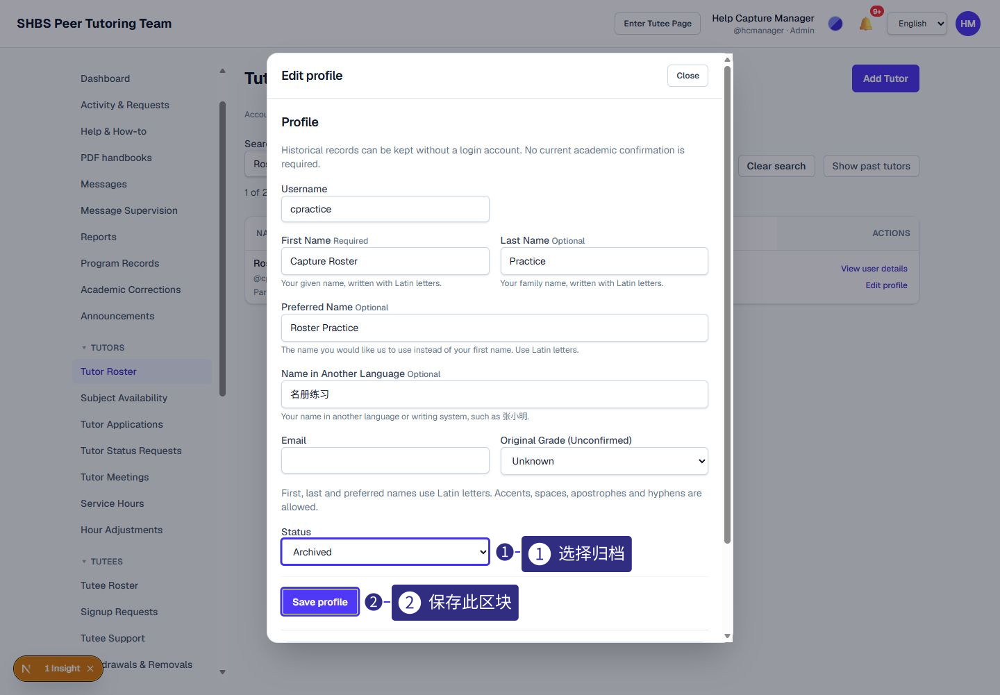

   英文界面

   

   
截图详情

   示例辅导伙伴的名册资料在状态中已选择归档。此时资料仍是未保存的草稿。保存资料会把该状态应用于名册记录。

   /admin/tutors · EN · 2026-11-20

   [原始完整截图](assets/manage-tutor-roster-step-3.en.jpg) · `b5ece465681957c9fe579d26babdeb260c674fa0` · Latest-main development baseline b5ece465, selected 2026-11-20, with the Help candidate and synthetic demo records.

   

   **视图 2**

   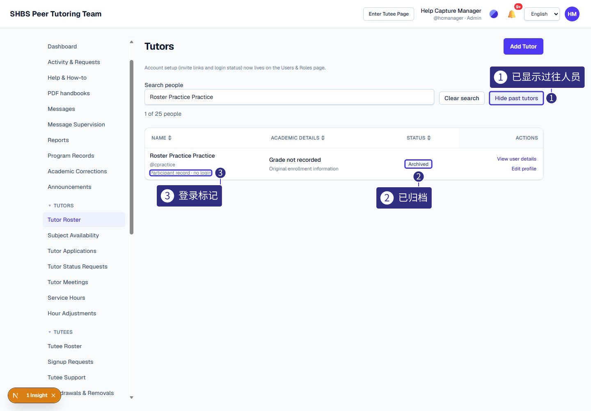

   英文界面

   

   
截图详情

   保存一次后，显示过往辅导伙伴可找到同一练习人员，其状态为已归档。独立的参与者记录无登录标记仍然可见。

   /admin/tutors · EN · 2026-11-20

   [原始完整截图](assets/manage-tutor-roster-step-3-view-2.en.jpg) · `b5ece465681957c9fe579d26babdeb260c674fa0` · Latest-main development baseline b5ece465, selected 2026-11-20, with the Help candidate and synthetic demo records.

   

4. **仅在正常报名不适用时手动创建** 选择添加辅导伙伴，阅读警告、勾选确认并继续。按当前表单规则填写标记为必填的姓名字段及可选邮箱、年级，再选择添加辅导伙伴。阅读已保存或已提交审核结果，并检查是否仍需单独设置账户。

   **视图 1**

   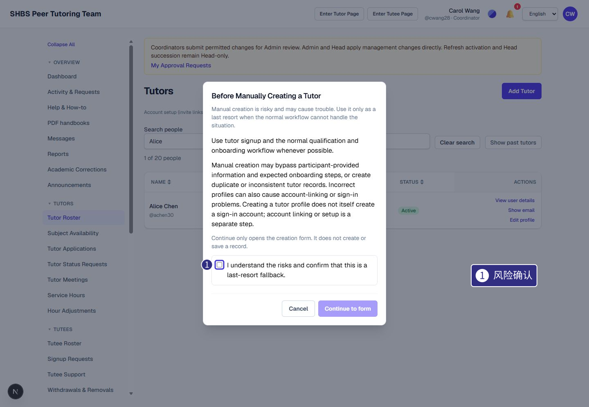

   英文界面

   

   
截图详情

   实际手动创建风险提示要求先确认风险，才能继续打开表单；尚未创建参与者记录。

   /admin/tutors · EN · 2026-11-16

   [原始完整截图](assets/manage-tutor-roster-step-4.en.jpg) · `589c055e4b1cf166b48b353bd619ac1982e5d9f6` · Latest-main development baseline 589c055e with the Help candidate; synthetic demonstration data.

   

   **视图 2**

   

   英文界面

   

   
截图详情

   手动辅导伙伴表单按当前必填姓名规则填写为草稿，尚未创建参与者或登录账户。

   /admin/tutors · EN · 2026-11-16

   [原始完整截图](assets/manage-tutor-roster-step-4-view-2.en.jpg) · `589c055e4b1cf166b48b353bd619ac1982e5d9f6` · Latest-main development baseline 589c055e with the Help candidate; synthetic demonstration data.

   

### 预期结果

名册仅反映已审阅资料或成员变更；无账户记录仍明确显示无账户。

### 工作原理

打开详情不会授予角色编辑权限。关联登录、历史归属与当前参与资格不同。编辑其他资料字段时可以保留旧的未拆分全名。

### 问题排查

- **保存拒绝姓名或辅导伙伴无法登录** 若变更拉丁字母姓名字段，应填写本人实际有效名字，不要猜测旧全名拆分。手动创建未填邮箱会保留为无账户记录。请使用授权设置流程，不要重复创建人员。

## 查看与编辑学习伙伴名册

在统一详情中查看入组、志愿、联系方式与历史，理解无账户记录和手动创建。

打开: `/admin/tutees`

### 开始之前

- 使用有效的管理权限登录。可选模块须已启用。协调员将允许的变更提交审核；管理员和负责人可直接应用非换期变更。

### 操作步骤

1. **查找入组记录** 选择当前、历史或所有记录，按保存的名、姓、偏好名或其他语言姓名搜索。检查记录学期，不要假设一行代表所有入组。

   请注意: 选择当前、历史或所有记录，再使用右侧查看详情。

   **视图 1**

   

   英文界面

   

   
截图详情

   当前已选中。搜索 Emma Sun 找到活跃入组记录，行中显示 26-27 学年。

   /admin/tutees · EN · 2026-11-20

   [原始完整截图](assets/manage-tutee-roster-step-1.en.jpg) · `b5ece465681957c9fe579d26babdeb260c674fa0` · Latest-main development baseline b5ece465, selected 2026-11-20, with the Help candidate and synthetic demo records.

   

   **视图 2**

   

   英文界面

   

   
截图详情

   历史已选中。搜索 Adam Frost 找到上一批虚构学生的真实非活跃记录。

   /admin/tutees · EN · 2026-11-20

   [原始完整截图](assets/manage-tutee-roster-step-1-view-2.en.jpg) · `b5ece465681957c9fe579d26babdeb260c674fa0` · Latest-main development baseline b5ece465, selected 2026-11-20, with the Help candidate and synthetic demo records.

   

2. **打开完整详情** 在操作列选择查看详情。阅读入组摘要、第一和第二志愿、邮箱和账户信息及辅导历史。使用上一页、下一页浏览历史，关闭后返回原名册。

   **视图 1**

   

   英文界面

   

   
截图详情

   查看详情打开 Emma Sun 的入组摘要和已保存科目志愿。工作人员可继续向下看已验证联系方式和辅导历史。

   /admin/tutees · EN · 2026-11-20

   [原始完整截图](assets/manage-tutee-roster-step-2.en.jpg) · `b5ece465681957c9fe579d26babdeb260c674fa0` · Latest-main development baseline b5ece465, selected 2026-11-20, with the Help candidate and synthetic demo records.

   

   **视图 2**

   

   英文界面

   

   
截图详情

   Emma 的辅导历史已加载。当前账户学业资料与原入组记录分别显示。此示例只有一页。

   /admin/tutees · EN · 2026-11-20

   [原始完整截图](assets/manage-tutee-roster-step-2-view-2.en.jpg) · `b5ece465681957c9fe579d26babdeb260c674fa0` · Latest-main development baseline b5ece465, selected 2026-11-20, with the Help candidate and synthetic demo records.

   

3. **编辑正确证据** 允许的联系方式、资料变更使用编辑资料。管理员或负责人可在此管理历史关联和邀请。修正前比较原入组学业资料与当前账户学业资料。

   **视图 1**

   

   英文界面

   

   
截图详情

   编辑资料打开确切关联的入组记录。规范邮箱受保护，由账户持有者管理。本画面仅供审核，未保存变更。

   /admin/tutees · EN · 2026-11-20

   [原始完整截图](assets/manage-tutee-roster-step-3.en.jpg) · `b5ece465681957c9fe579d26babdeb260c674fa0` · Latest-main development baseline b5ece465, selected 2026-11-20, with the Help candidate and synthetic demo records.

   

   **视图 2**

   

   英文界面

   

   
截图详情

   学业资料是 Emma 当前账户的独立区域。原入组记录仍可在详情及历史中查看。本画面没有变更。

   /admin/tutees · EN · 2026-11-20

   [原始完整截图](assets/manage-tutee-roster-step-3-view-2.en.jpg) · `b5ece465681957c9fe579d26babdeb260c674fa0` · Latest-main development baseline b5ece465, selected 2026-11-20, with the Help candidate and synthetic demo records.

   

4. **谨慎使用手动创建** 添加学习伙伴须先确认警告，再填写姓名、学业及科目志愿。隐藏表单会在本次访问保留草稿；保存或提交审核后检查生成名册。

   **视图 1**

   

   英文界面

   

   
截图详情

   已确认仅在不得已时手动创建，继续填写已可用。这一步只打开本地学习伙伴草稿。

   /admin/tutees · EN · 2026-11-20

   [原始完整截图](assets/manage-tutee-roster-step-4.en.jpg) · `b5ece465681957c9fe579d26babdeb260c674fa0` · Latest-main development baseline b5ece465, selected 2026-11-20, with the Help candidate and synthetic demo records.

   

   **视图 2**

   

   英文界面

   

   
截图详情

   Capture Draft Learner 已填写姓名、9 年级及第一志愿数学。表单仍是未保存草稿。

   /admin/tutees · EN · 2026-11-20

   [原始完整截图](assets/manage-tutee-roster-step-4-view-2.en.jpg) · `b5ece465681957c9fe579d26babdeb260c674fa0` · Latest-main development baseline b5ece465, selected 2026-11-20, with the Help candidate and synthetic demo records.

   

### 预期结果

能看到预期入组及历史；编辑或创建具有明确保存或审核结果。

### 工作原理

无账户学习伙伴仍保留在名册中。历史归属本身不会启用当前账户验证。观察者可看入组与科目，私人联系方式和历史仍需要工作人员权限。

### 问题排查

- **历史读取失败或没有邮箱** 在历史区域使用重试，其他详情仍可用。没有地址不代表账户读取失败。提供验证或设置前检查来源资料及授权归属关联。

## 创建或编辑辅导配对

审核辅导伙伴、科目、学习伙伴及排课，保留已保存分组并避免重复手动创建。

打开: `/admin/pairings`

### 开始之前

- 使用有效的管理权限登录。可选模块须已启用。协调员将允许的变更提交审核；管理员和负责人可直接应用非换期变更。

### 操作步骤

1. **检查现有配对** 搜索、筛选配对并打开查看详情。编辑前阅读辅导伙伴、科目、学习伙伴、排课、教室意图及明确分组成员。

   请注意: 使用配对表操作列的查看详情或编辑。

   

   英文界面

   

   
截图详情

   孙学习伙伴的数学配对与福斯特及吴学习伙伴共用已确认课表。固定时段为周一15:30至16:30，A101由工作人员指定。

   /admin/pairings · EN · 2026-11-20

   [原始完整截图](assets/edit-pairings-step-1.en.jpg) · `b5ece465681957c9fe579d26babdeb260c674fa0` · Latest-main development baseline b5ece465, selected 2026-11-20, with the Help candidate and synthetic demo records.

   

2. **编辑预期字段** 打开编辑并选择正确辅导伙伴、科目、学习伙伴及固定时间。搜索不会移除已选学习伙伴；保存前检查完整已选清单。

   

   英文界面

   

   
截图详情

   编辑草稿仍选择数学、陈辅导伙伴和周一固定时段。搜索利亚姆时，孙学习伙伴仍保留在已选名单中。尚未提交。

   /admin/pairings · EN · 2026-11-20

   [原始完整截图](assets/edit-pairings-step-2.en.jpg) · `b5ece465681957c9fe579d26babdeb260c674fa0` · Latest-main development baseline b5ece465, selected 2026-11-20, with the Help candidate and synthetic demo records.

   

3. **审阅保存或移除** 审阅明确后果，包括受影响组员及教室变更。确认预期变更或独立移除操作，再阅读是否已应用或待审核。

   

   英文界面

   

   
截图详情

   移除审核显示陈辅导伙伴、数学及孙学习伙伴，并说明配对移除和已有出勤记录的限制。本次审核已取消。

   /admin/pairings · EN · 2026-11-20

   [原始完整截图](assets/edit-pairings-step-3.en.jpg) · `b5ece465681957c9fe579d26babdeb260c674fa0` · Latest-main development baseline b5ece465, selected 2026-11-20, with the Help candidate and synthetic demo records.

   

4. **仅在必要时创建** 新建配对首先要求确认手动创建警告。响应丢失时保持草稿开启，重试同一未变更操作以恢复已保存配对。另一配对须明确开始新操作。

   

   英文界面

   

   
截图详情

   新建配对先显示手动创建警告。勾选确认前，继续填写表单不可用；继续仅打开草稿。本例在未创建配对时取消。

   /admin/pairings · EN · 2026-11-20

   [原始完整截图](assets/edit-pairings-step-4.en.jpg) · `b5ece465681957c9fe579d26babdeb260c674fa0` · Latest-main development baseline b5ece465, selected 2026-11-20, with the Help candidate and synthetic demo records.

   

### 预期结果

已审阅配对仅保存一次，或能识别其待审提案。

### 工作原理

相同时间或共同出勤提交不会合并独立预约。只有明确合并组才共享主配对固定排期及计划教室。

### 问题排查

- **操作已成功或数据已改变** 重新载入已保存记录，不要修改并重放已接受的创建草稿。编辑过期时明确重载当前证据并重新审阅。保存完成后的重试刷新只会读取。

## 分配教室并处理空缺

选择自动、固定或无需实体教室，并审阅跨配对批量分配。

打开: `/admin/pairings`

### 开始之前

- 使用有效的管理权限登录。可选模块须已启用。协调员将允许的变更提交审核；管理员和负责人可直接应用非换期变更。

### 操作步骤

1. **阅读教室状态** 打开查看详情，区分待排课、需要教室、无需实体教室及旧未分配记录。需要教室筛选显示实际短缺，而非所有x标记。

   请注意: 查看教室标记、需要教室筛选及自动分配所有未分配课程。

   **视图 1**

   

   英文界面

   

   
截图详情

   这项已保存的数学配对已有固定时段，并明确选择无需实体教室，因此不计入教室短缺。

   /admin/pairings · EN · 2026-11-20

   [原始完整截图](assets/allocate-planned-rooms-step-1.en.jpg) · `b5ece465681957c9fe579d26babdeb260c674fa0` · Latest-main development baseline b5ece465, selected 2026-11-20, with the Help candidate and synthetic demo records.

   

   **视图 2**

   

   英文界面

   

   
截图详情

   已选择需要教室筛选，当前有零项预约。明确无需实体教室的配对不计入此筛选。

   /admin/pairings · EN · 2026-11-20

   [原始完整截图](assets/allocate-planned-rooms-step-1-view-2.en.jpg) · `b5ece465681957c9fe579d26babdeb260c674fa0` · Latest-main development baseline b5ece465, selected 2026-11-20, with the Help candidate and synthetic demo records.

   

2. **选择教室意图** 编辑配对并选择自动教室分配、工作人员固定教室或无需实体教室。审阅受影响组内科目。固定教室须明确改为自动才会释放。

   

   英文界面

   

   
截图详情

   配对编辑草稿选择无需实体教室，并提示该选择关系到共用教室的三项数学配对。关闭草稿可保留原先由工作人员指定的A101。

   /admin/pairings · EN · 2026-11-20

   [原始完整截图](assets/allocate-planned-rooms-step-2.en.jpg) · `b5ece465681957c9fe579d26babdeb260c674fa0` · Latest-main development baseline b5ece465, selected 2026-11-20, with the Help candidate and synthetic demo records.

   

3. **重试或批量分配** 容量恢复后重试短缺，或选择自动分配所有未分配课程。审阅不受当前筛选限制的完整预约清单；合并组只出现一次。确认或提交审核。

   **视图 1**

   

   英文界面

   

   
截图详情

   A101 恢复可用后，批量审核列出周一唯一的数学教室预约。此时还未分配教室。

   /admin/pairings · EN · 2026-11-21

   [原始完整截图](assets/allocate-planned-rooms-step-3.en.jpg) · `b5ece465681957c9fe579d26babdeb260c674fa0` · Latest-main development baseline b5ece465, selected 2026-11-20, with the Help candidate. Isolated synthetic first-report demonstration phase.

   

   **视图 2**

   

   英文界面

   

   
截图详情

   数学配对已排定时间，但当时没有可用教室，待分配教室列表中有一项预约。

   /admin/pairings · EN · 2026-11-21

   [原始完整截图](assets/allocate-planned-rooms-step-3-view-2.en.jpg) · `b5ece465681957c9fe579d26babdeb260c674fa0` · Latest-main development baseline b5ece465, selected 2026-11-20, with the Help candidate. Isolated synthetic first-report demonstration phase.

   

4. **核对结果数量** 阅读已分配和仍未分配数量，再处理剩余短缺。批量操作会保留已有教室、固定选择、待排课及有意无需教室选择。

   **视图 1**

   

   英文界面

   

   
截图详情

   批量分配已完成。已核对一项预约，为它分配了教室，没有待分配项。刷新后的配对显示 A101。

   /admin/pairings · EN · 2026-11-21

   [原始完整截图](assets/allocate-planned-rooms-step-4.en.jpg) · `b5ece465681957c9fe579d26babdeb260c674fa0` · Latest-main development baseline b5ece465, selected 2026-11-20, with the Help candidate. Isolated synthetic first-report demonstration phase.

   

   **视图 2**

   

   英文界面

   

   
截图详情

   刷新后，数学配对通过自动分配获得 A101，已无待分配的教室预约。

   /admin/pairings · EN · 2026-11-21

   [原始完整截图](assets/allocate-planned-rooms-step-4-view-2.en.jpg) · `b5ece465681957c9fe579d26babdeb260c674fa0` · Latest-main development baseline b5ece465, selected 2026-11-20, with the Help candidate. Isolated synthetic first-report demonstration phase.

   

### 预期结果

每个已审阅预约显示当前教室状态，剩余短缺仍清楚可见以便跟进。

### 工作原理

待审自动教室提案不会预约教室，批准时才分配。计划教室变更不会重写实际出勤地点。自动分配须已生效启用，批量上限为500条配对记录。

### 问题排查

- **保存后仍需要教室** 排课可能已成功保存，但容量不足。检查教室禁用时段和冲突固定预约，容量变化后再明确重试。重复相同重试不会增加容量或移动固定预约。

## 维护固定时间段

创建、编辑、停用、重新启用或删除课表时间段，并在传播变更前检查影响。

打开: `/admin/time-slots`

### 开始之前

- 使用有效的管理权限登录。可选模块须已启用。协调员将允许的变更提交审核；管理员和负责人可直接应用非换期变更。

### 操作步骤

1. **查看现有时间段** 打开时间段，在列表定位相应日期和时间。阅读启用状态，输入钟表时间前检查项目时区。

   请注意: 使用时间段列表及其明确的行操作。

   

   英文界面

   

   
截图详情

   变更前的每周时段目录；周一A时段显示星期、起止时间及启用状态。

   /admin/time-slots · EN · 2026-11-16

   [原始完整截图](assets/maintain-time-slots-step-1.en.jpg) · `589c055e4b1cf166b48b353bd619ac1982e5d9f6` · Latest-main development baseline 589c055e with the Help candidate; synthetic demonstration data.

   

2. **创建或编辑** 使用添加或编辑操作，填写有标签的日期及开始、结束值并阅读验证提示。保存前检查哪些现有配对可能使用该时间段。

   

   英文界面

   

   
截图详情

   已填写独立周六15:30至16:00时段的新增编辑器，尚未提交变更。

   /admin/time-slots · EN · 2026-11-16

   [原始完整截图](assets/maintain-time-slots-step-2.en.jpg) · `589c055e4b1cf166b48b353bd619ac1982e5d9f6` · Latest-main development baseline 589c055e with the Help candidate; synthetic demonstration data.

   

3. **审慎停用或删除** 在编辑中更改启用复选框以停用或重新启用时间段，并审核明确变更。删除属于独立后果审阅操作。按显示保存或提交允许协调员提案。

   

   英文界面

   

   
截图详情

   管理员核对示例A时段编辑并取消启用勾选；保存更改将停用此独立且未分配的时段。

   /admin/time-slots · EN · 2026-11-16

   [原始完整截图](assets/maintain-time-slots-step-3.en.jpg) · `589c055e4b1cf166b48b353bd619ac1982e5d9f6` · Latest-main development baseline 589c055e with the Help candidate; synthetic demonstration data.

   

4. **检查依赖排课** 变更应用后检查配对及相关课表显示。刷新失败时使用重试恢复，不要重复编辑。

   **视图 1**

   

   英文界面

   

   
截图详情

   独立且未分配的 Capture Guide Slot A 停用后，配对页显示现有每周教室课表。已有周一预约保持原状。

   /admin/pairings · EN · 2026-11-16

   [原始完整截图](assets/maintain-time-slots-step-4.en.jpg) · `dd970ea426016e85cb514beeeab537c3ab2e5098` · Latest-main development baseline dd970ea4, selected 2026-11-16, with the Help candidate; synthetic demonstration data.

   

   **视图 2**

   

   英文界面

   

   
截图详情

   独立且未分配的示例A时段已保存为停用状态，原有每周时段仍保持启用。

   /admin/time-slots · EN · 2026-11-16

   [原始完整截图](assets/maintain-time-slots-step-4-view-2.en.jpg) · `589c055e4b1cf166b48b353bd619ac1982e5d9f6` · Latest-main development baseline 589c055e with the Help candidate; synthetic demonstration data.

   

### 预期结果

已审阅时间段及启用状态可见，并可查看必要审核回执。

### 工作原理

共享时间段属于课表配置，并非特定日期出勤记录。变更时须审阅依赖排课；历史实际课程证据保留自身记录值。

### 问题排查

- **表单或列表无法重载** 保持草稿开启并重试必要读取。若来源改变，明确重新加载并再读数值。不要创建近似重复时间段来绕过错误。

## 维护教室及不可用时段

准确维护教室目录，并在分配课程前标记不可用时段。

打开: `/admin/rooms`

### 开始之前

- 使用有效的管理权限登录。可选模块须已启用。协调员将允许的变更提交审核；管理员和负责人可直接应用非换期变更。

### 操作步骤

1. **检查教室** 打开教室，按保存名称找到教室，再选择编辑详情查看每周重复的不可用时段。变更教室可用性前，在配对中核对现有预约。

   请注意: 打开教室操作及教室不可用时段网格。

   **视图 1**

   

   英文界面

   

   
截图详情

   展开 A101，查看已保存的周三16:00至17:00教职工会议每周禁用时段，尚未变更教室。

   /admin/rooms · EN · 2026-11-16

   [原始完整截图](assets/maintain-rooms-step-1.en.jpg) · `dd970ea426016e85cb514beeeab537c3ab2e5098` · Latest-main development baseline dd970ea4, selected 2026-11-16, with the Help candidate; synthetic demonstration data.

   

   **视图 2**

   

   英文界面

   

   
截图详情

   更改教室可用性前，在配对中筛选周一15:30至16:30的 A101 现有预约；已保存的数学及 Alice 记录保持原状。

   /admin/pairings · EN · 2026-11-16

   [原始完整截图](assets/maintain-rooms-step-1-view-2.en.jpg) · `dd970ea426016e85cb514beeeab537c3ab2e5098` · Latest-main development baseline dd970ea4, selected 2026-11-16, with the Help candidate; synthetic demonstration data.

   

2. **编辑目录资料** 新名称使用添加教室，现有教室可用编辑操作改名。删除应独立审阅并检查受影响预约后果。更改分配优先级、顺序时使用教室排序编辑器。

   **视图 1**

   

   英文界面

   

   
截图详情

   在添加教室前填写新的 Capture Guide Room 名称；此草稿尚未变更目录。

   /admin/rooms · EN · 2026-11-16

   [原始完整截图](assets/maintain-rooms-step-2.en.jpg) · `dd970ea426016e85cb514beeeab537c3ab2e5098` · Latest-main development baseline dd970ea4, selected 2026-11-16, with the Help candidate; synthetic demonstration data.

   

   **视图 2**

   

   英文界面

   

   
截图详情

   新建的 Capture Guide Room 已展开教室设置；保存教室名称前，草拟改名为 Capture Guide Room A。未更改任何共享教室名称。

   /admin/rooms · EN · 2026-11-16

   [原始完整截图](assets/maintain-rooms-step-2-view-2.en.jpg) · `dd970ea426016e85cb514beeeab537c3ab2e5098` · Latest-main development baseline dd970ea4, selected 2026-11-16, with the Help candidate; synthetic demonstration data.

   

   **视图 3**

   

   英文界面

   

   
截图详情

   具名删除审阅说明将移除 Capture Guide Room A 及其禁用时段，已有配对使用的教室不可删除。本演示将取消审阅并保留教室。

   /admin/rooms · EN · 2026-11-16

   [原始完整截图](assets/maintain-rooms-step-2-view-3.en.jpg) · `dd970ea426016e85cb514beeeab537c3ab2e5098` · Latest-main development baseline dd970ea4, selected 2026-11-16, with the Help candidate; synthetic demonstration data.

   

   **视图 4**

   

   英文界面

   

   
截图详情

   仅演示用途的教室在未保存的教室顺序草稿中上移一位。保存顺序将应用完整顺序；本演示将重新读取顺序以放弃草稿。

   /admin/rooms · EN · 2026-11-16

   [原始完整截图](assets/maintain-rooms-step-2-view-4.en.jpg) · `dd970ea426016e85cb514beeeab537c3ab2e5098` · Latest-main development baseline dd970ea4, selected 2026-11-16, with the Help candidate; synthetic demonstration data.

   

3. **标记不可用** 选择编辑详情，再选择添加禁用时段。填写星期、开始时间、结束时间及可选理由，核对具体教室和范围，再保存禁用时段；协调员选择提交申请。已有时段使用编辑时段，移除需单独审阅。

   **视图 1**

   

   英文界面

   

   
截图详情

   为 Capture Guide Room A 草拟周日09:00至10:00的每周禁用时段，填写演示维护理由，尚未保存。

   /admin/rooms · EN · 2026-11-16

   [原始完整截图](assets/maintain-rooms-step-3.en.jpg) · `dd970ea426016e85cb514beeeab537c3ab2e5098` · Latest-main development baseline dd970ea4, selected 2026-11-16, with the Help candidate; synthetic demonstration data.

   

   **视图 2**

   

   已保存的周日禁用时段显示在编辑器上方。

   英文界面

   

   
截图详情

   /admin/rooms · EN · 2026-11-16

   [原始完整截图](assets/maintain-rooms-step-3-view-2.en.jpg) · `dd970ea426016e85cb514beeeab537c3ab2e5098` · Latest-main development baseline dd970ea4, selected 2026-11-16, with the Help candidate; synthetic demonstration data.

   

   **视图 3**

   

   英文界面

   

   
截图详情

   内联移除审阅列明周日09:00至10:00，并提供确认移除或取消。本演示将取消并保留已保存的禁用时段。

   /admin/rooms · EN · 2026-11-16

   [原始完整截图](assets/maintain-rooms-step-3-view-3.en.jpg) · `dd970ea426016e85cb514beeeab537c3ab2e5098` · Latest-main development baseline dd970ea4, selected 2026-11-16, with the Help candidate; synthetic demonstration data.

   

4. **重新检查配对** 检查受影响配对及仍需教室的记录。教室目录编辑不会暗中移动工作人员固定预约。

   

   英文界面

   

   
截图详情

   为未分配的演示教室保存周日禁用时段后，需教室筛选显示零个预约；画面为当前真实空队列。

   /admin/pairings · EN · 2026-11-16

   [原始完整截图](assets/maintain-rooms-step-4.en.jpg) · `dd970ea426016e85cb514beeeab537c3ab2e5098` · Latest-main development baseline dd970ea4, selected 2026-11-16, with the Help candidate; synthetic demonstration data.

   

### 预期结果

目录及禁用时段与审阅后的教室可用性一致。

### 工作原理

计划分配使用教室容量及预约约束。实际辅导地点在出勤中单独记录。紧凑网格无法显示全部细节时，应打开完整教室详情。

### 问题排查

- **预约仍冲突** 打开配对教室意图，分辨固定、自动或有意无需教室状态。先解决具体教室、时间冲突，再重试分配；不要通过改出勤修复计划预约。

## 维护科目、分组及级别

搜索、批量编辑所提供课程或导入经审阅目录，同时保留已保存资格历史。

打开: `/admin/subjects`

### 开始之前

- 使用有效的管理权限登录。可选模块须已启用。协调员将允许的变更提交审核；管理员和负责人可直接应用非换期变更。

### 操作步骤

1. **查找课程分组** 打开科目与级别，按保存的课程、分组或变体名称搜索。除当前开设目录外，也检查已停用条目。

   请注意: 使用课程搜索、分组与级别编辑器及可见行批量选择。

   

   英文界面

   

   
截图详情

   在已开设课程目录搜索 Mathematics，显示已保存的 Standard 课程；状态控件可用于查看启用或停用条目。

   /admin/subjects · EN · 2026-11-16

   [原始完整截图](assets/maintain-subject-catalogue-step-1.en.jpg) · `dd970ea426016e85cb514beeeab537c3ab2e5098` · Latest-main development baseline dd970ea4, selected 2026-11-16, with the Help candidate; synthetic demonstration data.

   

2. **编辑单个课程或级别** 在科目组编辑器选择开设级别，再选择保存科目组；未选级别会停用。重新勾选并保存可恢复开设。级别名称及前缀在离开输入框时保存；AP计分选项和排序箭头会立即提交。每次变更后均应阅读保存或协调员审核申请结果。

   **视图 1**

   

   英文界面

   

   
截图详情

   数学科目组保存前：保留原有名称，已选标准级别；尚未提交目录变更。

   /admin/subjects · EN · 2026-11-16

   [原始完整截图](assets/maintain-subject-catalogue-step-2.en.jpg) · `dd970ea426016e85cb514beeeab537c3ab2e5098` · Latest-main development baseline dd970ea4, selected 2026-11-16, with the Help candidate; synthetic demonstration data.

   

   **视图 2**

   

   英文界面

   

   
截图详情

   导入的练习科目组保留 Standard 开设级别；已草拟并预览新的基础科目名，尚未点击保存科目组。Honors 与 AP 未勾选；未编辑种子科目。

   /admin/subjects · EN · 2026-11-16

   [原始完整截图](assets/maintain-subject-catalogue-step-2-view-2.en.jpg) · `dd970ea426016e85cb514beeeab537c3ab2e5098` · Latest-main development baseline dd970ea4, selected 2026-11-16, with the Help candidate; synthetic demonstration data.

   

   **视图 3**

   

   保存单一层级后，科目组会列出 Standard（标准）层级的科目。

   英文界面

   

   
截图详情

   /admin/subjects · EN · 2026-11-16

   [原始完整截图](assets/maintain-subject-catalogue-step-2-view-3.en.jpg) · `dd970ea426016e85cb514beeeab537c3ab2e5098` · Latest-main development baseline dd970ea4, selected 2026-11-16, with the Help candidate; synthetic demonstration data.

   

   **视图 4**

   

   英文界面

   

   
截图详情

   独立练习组名称仍为 Capture Catalogue Practice。已更名的停用 Standard 变体被选中复用，Honors 使用相同基础名称创建新变体。本图是尚未保存的两个开设级别草稿；AP 及预置科目均未更改。

   /admin/subjects · EN · 2026-11-16

   [原始完整截图](assets/maintain-subject-catalogue-step-2-view-4.en.jpg) · `dd970ea426016e85cb514beeeab537c3ab2e5098` · Latest-main development baseline dd970ea4, selected 2026-11-16, with the Help candidate; synthetic demonstration data.

   

   **视图 5**

   

   重新启用 Standard（标准）层级并添加 Honors（荣誉）层级后，科目组中会同时列出这两项。

   英文界面

   

   
截图详情

   /admin/subjects · EN · 2026-11-16

   [原始完整截图](assets/maintain-subject-catalogue-step-2-view-5.en.jpg) · `dd970ea426016e85cb514beeeab537c3ab2e5098` · Latest-main development baseline dd970ea4, selected 2026-11-16, with the Help candidate; synthetic demonstration data.

   

3. **审阅批量选择** 勾选预期可见课程，使用设置级别及／或设置状态，核对已选数量及隐藏选择提示，再选择应用于N门可见已选课程。此操作立即提交，只有可见且已选的课程会变更。阅读实际保存或审核申请结果。

   **视图 1**

   

   英文界面

   

   
截图详情

   已选一门可见数学课程；停用为尚未提交的批量选项。尚未点击应用，数学仍为启用状态。

   /admin/subjects · EN · 2026-11-16

   [原始完整截图](assets/maintain-subject-catalogue-step-3.en.jpg) · `dd970ea426016e85cb514beeeab537c3ab2e5098` · Latest-main development baseline dd970ea4, selected 2026-11-16, with the Help candidate; synthetic demonstration data.

   

   **视图 2**

   

   英文界面

   

   
截图详情

   仅选中导入的练习科目：一个可见已选、零个隐藏已选。设置状态草拟为非活跃，已存记录仍显示活跃；尚未点击应用于一个可见已选科目。

   /admin/subjects · EN · 2026-11-16

   [原始完整截图](assets/maintain-subject-catalogue-step-3-view-2.en.jpg) · `dd970ea426016e85cb514beeeab537c3ab2e5098` · Latest-main development baseline dd970ea4, selected 2026-11-16, with the Help candidate; synthetic demonstration data.

   

   **视图 3**

   

   英文界面

   

   
截图详情

   批量变更已立即完成；导入的练习科目现在显示非活跃，已选数量归零，无需另一个审核对话框。

   /admin/subjects · EN · 2026-11-16

   [原始完整截图](assets/maintain-subject-catalogue-step-3-view-3.en.jpg) · `dd970ea426016e85cb514beeeab537c3ab2e5098` · Latest-main development baseline dd970ea4, selected 2026-11-16, with the Help candidate; synthetic demonstration data.

   

4. **审慎导入目录** 选择JSON或CSV文件前，先阅读导入说明并下载示例。选中有效文件会立即提交解析后的目录变更。协调员获准发起的导入会进入审核申请。阅读实际导入结果或错误，应用变更后重新读取课程清单。

   **视图 1**

   

   英文界面

   

   
截图详情

   选择文件前查看真实的导入科目说明及 JSON 示例。尚未选择文件；选中有效文件将立即提交其新增目录变更。

   /admin/subjects · EN · 2026-11-16

   [原始完整截图](assets/maintain-subject-catalogue-step-4.en.jpg) · `dd970ea426016e85cb514beeeab537c3ab2e5098` · Latest-main development baseline dd970ea4, selected 2026-11-16, with the Help candidate; synthetic demonstration data.

   

   **视图 2**

   

   英文界面

   

   
截图详情

   单个虚构示例文件已导入：创建一组中的一组，跳过零个未变更组。新建 Capture Catalogue Practice 科目组可见；处理后文件选择框已重置。

   /admin/subjects · EN · 2026-11-16

   [原始完整截图](assets/maintain-subject-catalogue-step-4-view-2.en.jpg) · `dd970ea426016e85cb514beeeab537c3ab2e5098` · Latest-main development baseline dd970ea4, selected 2026-11-16, with the Help candidate; synthetic demonstration data.

   

### 预期结果

预期目录变更已保存或待审，现有资格证据仍保留。

### 工作原理

已保存资格是获批来源的快照。重排级别不会追溯授予或移除历史资格。恢复归档分组或级别仍受当前管理权限约束。

### 问题排查

- **导入验证失败或批量包含错误课程** 导入出错时，应按显示格式修正文件后再重新选择。尚未应用的批量操作可用清除选择，或修正可见选择。重新检查ID及名称；隐藏选择可能不符合当前筛选。

## 审核辅导伙伴退出及重新加入

核对待处理成员申请、遵守等待期，并明确将受影响学习伙伴重新排队。

打开: `/admin/tutor-requests`

### 开始之前

- 使用有效的管理权限登录。可选模块须已启用。协调员将允许的变更提交审核；管理员和负责人可直接应用非换期变更。

### 操作步骤

1. **找到待处理申请** 在辅导伙伴状态申请核对辅导伙伴、申请类型及原因。退出申请可能显示可审批日期及受影响学习伙伴人数。在辅导伙伴名册核对当前资格，并在有权限时通过审计日志查看过去的决定。

   请注意: 找到待处理申请的辅导伙伴、申请类型、原因及可用决定控件。

   

   英文界面

   

   
截图详情

   辅导员状态申请显示辅导员和申请类型，以及已填写的原因。图中两项重新加入申请仍待审核。

   /admin/tutor-requests · EN · 2026-11-20

   [原始完整截图](assets/review-tutor-membership-step-1.en.jpg) · `b5ece465681957c9fe579d26babdeb260c674fa0` · Latest-main development baseline b5ece465, selected 2026-11-20, with the Help candidate and synthetic demo records.

   

2. **核对资格与时间** 退出批准须经过七天；重新加入不需要七天等待。确认申请仍待处理，且成员状态自提交后未改变。

   

   英文界面

   

   
截图详情

   待审核的退出申请显示等待期已满及受影响的学习伙伴人数。重新加入申请没有等待日期，仍需工作人员作出决定。

   /admin/tutor-requests · EN · 2026-11-20

   [原始完整截图](assets/review-tutor-membership-step-2.en.jpg) · `b5ece465681957c9fe579d26babdeb260c674fa0` · Latest-main development baseline b5ece465, selected 2026-11-20, with the Help candidate and synthetic demo records.

   

3. **提交决定** 选择审批通过或拒绝前，核对辅导伙伴、原因及受影响学习伙伴。两个按钮均会立即提交。直接决定后核对更新的名册，或在管理操作中跟进协调员提案。

   

   英文界面

   

   
截图详情

   先核对确切的申请行。批准和拒绝都会立即提交决定。画面显示提交前的按钮，申请仍待审核。

   /admin/tutor-requests · EN · 2026-11-20

   [原始完整截图](assets/review-tutor-membership-step-3.en.jpg) · `b5ece465681957c9fe579d26babdeb260c674fa0` · Latest-main development baseline b5ece465, selected 2026-11-20, with the Help candidate and synthetic demo records.

   

4. **重新安排受影响学习伙伴** 退出应用后，提示会标出受影响的学习伙伴。选择重新加入队列将他们送回待匹配，或选择暂不操作以便稍后审核。核对报名队列及剩余配对。

   **视图 1**

   

   英文界面

   

   
截图详情

   Leo 的退出申请获批后，页面提供将两名学习伙伴另行加入待匹配队列的操作。本例选择“暂不操作”，两项分配均保留。

   /admin/tutor-requests · EN · 2026-11-20

   [原始完整截图](assets/review-tutor-membership-step-4.en.jpg) · `b5ece465681957c9fe579d26babdeb260c674fa0` · Latest-main development baseline b5ece465, selected 2026-11-20, with the Help candidate and synthetic demo records.

   

   **视图 2**

   

   英文界面

   

   
截图详情

   选择“暂不操作”后，“配对”仍显示 Xena Ross 和 Sam Diaz 的 Leo 美国历史 AP 分配。

   /admin/pairings · EN · 2026-11-20

   [原始完整截图](assets/review-tutor-membership-step-4-view-2.en.jpg) · `b5ece465681957c9fe579d26babdeb260c674fa0` · Latest-main development baseline b5ece465, selected 2026-11-20, with the Help candidate and synthetic demo records.

   

   **视图 3**

   

   英文界面

   

   
截图详情

   工作人员审批后，辅导伙伴名册确认 Leo 已退出。两名学习伙伴的分配已留待稍后处理。

   /admin/tutors · EN · 2026-11-20

   [原始完整截图](assets/review-tutor-membership-step-4-view-3.en.jpg) · `b5ece465681957c9fe579d26babdeb260c674fa0` · Latest-main development baseline b5ece465, selected 2026-11-20, with the Help candidate and synthetic demo records.

   

### 预期结果

成员资格仅通过审阅决定变更，学习伙伴匹配后果得到明确处理。

### 工作原理

参与者提交申请不会立即结束活跃成员资格。撤回、撤销未应用提案及逆转已应用决定是不同操作，权限也不同。

### 问题排查

- **决定操作不可用或已过时** 检查等待期及当前成员状态。若其他变更已取代申请，应拒绝过时申请并检查当前名册，不要强行应用旧证据。

## 审核学习伙伴退出与移除

决定前区分本人退出、辅导伙伴转达及纪律移除。

打开: `/admin/tutee-requests`

### 开始之前

- 使用有效的管理权限登录。可选模块须已启用。协调员将允许的变更提交审核；管理员和负责人可直接应用非换期变更。

### 操作步骤

1. **选择正确申请区** 打开退出申请与移除。区分本人提交与辅导伙伴转达申请，阅读学习伙伴、来源、范围及提交时间。

   请注意: 在退出申请与移除中阅读来源、范围及生效日期。

   

   英文界面

   

   
截图详情

   Frank Wu 位于学习伙伴自行提交的退出区，显示本期全部辅导范围及提交时间。下方独立的辅导伙伴代报区当前没有待处理申请。

   /admin/tutee-requests · EN · 2026-11-20

   [原始完整截图](assets/review-tutee-withdrawals-step-1.en.jpg) · `b5ece465681957c9fe579d26babdeb260c674fa0` · Latest-main development baseline b5ece465, selected 2026-11-20, with the Help candidate and synthetic demo records.

   

2. **审核生效时间** 阅读本人申请中取决于批准的生效日期。辅导伙伴转达保留独立七天撤回窗口和精确预定生效时间；工作人员可在生效前取消。

   

   英文界面

   

   
截图详情

   Frank 的自行申请仅在批准后生效。辅导伙伴代报另有七天撤回期，本例没有等待生效的代报申请。

   /admin/tutee-requests · EN · 2026-11-20

   [原始完整截图](assets/review-tutee-withdrawals-step-2.en.jpg) · `b5ece465681957c9fe579d26babdeb260c674fa0` · Latest-main development baseline b5ece465, selected 2026-11-20, with the Help candidate and synthetic demo records.

   

3. **决定具体范围** 打开完整原因及相关参与证据，审阅受影响志愿或成员资格，再确认适当批准、拒绝或取消操作。

   

   英文界面

   

   
截图详情

   指定审核适用于本期全部辅导。界面说明批准会释放所有辅导配对、关闭申请并阻止本期重新报名。本次审核已取消。

   /admin/tutee-requests · EN · 2026-11-20

   [原始完整截图](assets/review-tutee-withdrawals-step-3.en.jpg) · `b5ece465681957c9fe579d26babdeb260c674fa0` · Latest-main development baseline b5ece465, selected 2026-11-20, with the Help candidate and synthetic demo records.

   

4. **检查保留历史** 应用结果后检查当前申请状态及受影响分配。使用已处理历史验证来源和时间，不要删除旧申请证据。

   

   英文界面

   

   
截图详情

   现有已审核历史显示 Wren Withdrawn 已批准，由学习伙伴自行提交本期全部辅导的退出申请，并保留决定时间。这是此前已保存的结果。

   /admin/tutee-requests · EN · 2026-11-20

   [原始完整截图](assets/review-tutee-withdrawals-step-4.en.jpg) · `b5ece465681957c9fe579d26babdeb260c674fa0` · Latest-main development baseline b5ece465, selected 2026-11-20, with the Help candidate and synthetic demo records.

   

### 预期结果

正确退出或移除范围及时间已记录，不会混淆不同申请类型。

### 工作原理

报名无效申诉、纪律卡申诉与退出审核相互独立。逆转已生效参与后果需要当前审核权限和最新证据。

### 问题排查

- **审核时学习伙伴状态已改变** 保留说明，重新读取权威申请并再次阅读影响范围。不要把暂时队列错误当作无待办，也不要在确认冲突后提交旧决定。

## 管理巡视组申请及设置

在独立面板审核公开申请、成员申请、名册及巡视配置。

打开: `/admin/crew`

### 开始之前

- 使用有效的管理权限登录。可选模块须已启用。协调员将允许的变更提交审核；管理员和负责人可直接应用非换期变更。

### 操作步骤

1. **审核申请** 打开巡视组审核，检查已验证申请及当前成员资格。阅读原因和身份后，批准或拒绝预期申请。

   请注意: 使用巡视组审核、名册及巡视设置面板。

   

   英文界面

   

   
截图详情

   具名审核显示 Dorian West、原始申请留言，并说明接受后会发出注册邀请。本次审核已取消。

   /admin/crew · EN · 2026-11-20

   [原始完整截图](assets/manage-crew-membership-step-1.en.jpg) · `b5ece465681957c9fe579d26babdeb260c674fa0` · Latest-main development baseline b5ece465, selected 2026-11-20, with the Help candidate and synthetic demo records.

   

2. **跟进邀请设置** 公开申请获批后，申请人仍须完成新邮箱验证及共享邀请、账户审阅，才能添加巡视组权限。检查显示的设置状态，不要假设批准就已创建登录。

   

   英文界面

   

   
截图详情

   已发邀请码列出已接受、仍待注册的申请人及到期时间。只读查看者视图显示进度但隐藏邀请凭证。

   /admin/crew · EN · 2026-11-20

   [原始完整截图](assets/manage-crew-membership-step-2.en.jpg) · `b5ece465681957c9fe579d26babdeb260c674fa0` · Latest-main development baseline b5ece465, selected 2026-11-20, with the Help candidate and synthetic demo records.

   

3. **审核退出或重新加入** 单独阅读成员申请。退出批准需等待七天；重新加入无七天等待。确认前检查撤回及当前成员状态。

   

   英文界面

   

   
截图详情

   两项待审申请分别是等待期已满的 Cora 退出申请和专用巡查成员重新加入申请。本次未提交资格决定。

   /admin/crew · EN · 2026-11-20

   [原始完整截图](assets/manage-crew-membership-step-3.en.jpg) · `b5ece465681957c9fe579d26babdeb260c674fa0` · Latest-main development baseline b5ece465, selected 2026-11-20, with the Help candidate and synthetic demo records.

   

4. **编辑巡视设置** 打开设置面板，审阅有标签的巡视要求，并按显示权限路径保存。已有观察记录应通过巡视历史或对应修正流程处理。

   

   英文界面

   

   
截图详情

   巡查设置显示当前教室顺序及移动控件。修改顺序后可保存；此画面保留现有设置。

   /admin/crew · EN · 2026-11-20

   [原始完整截图](assets/manage-crew-membership-step-4.en.jpg) · `b5ece465681957c9fe579d26babdeb260c674fa0` · Latest-main development baseline b5ece465, selected 2026-11-20, with the Help candidate and synthetic demo records.

   

### 预期结果

申请、账户设置、成员资格及巡视配置保持清晰分离。

### 工作原理

巡视组成员资格可与辅导伙伴权限并存。关闭可选巡视组模块会影响入口与操作；已保存巡视及成员证据仍属于历史记录。

### 问题排查

- **已批准申请人无法进入巡视** 检查邀请兑换、当前活跃巡视组状态、账户暂停或离校及已生效巡视功能。重新发放或设置控件有各自条件，不能绕过账户审阅。

## 创建会议并记录出席

按学期维护会议详情、请假、各会议草稿及历史比较。

打开: `/admin/meetings`

### 开始之前

- 使用有效的管理权限登录。可选模块须已启用。协调员将允许的变更提交审核；管理员和负责人可直接应用非换期变更。

### 操作步骤

1. **选择学期及会议** 会议默认显示当前项目学期，包括已经举行的会议。较早记录请打开会议历史并选择具体学期；显示过往辅导伙伴只改变人员，不改变会议学期。

   请注意: 打开会议填写出席，使用会议历史查看先前学期。

   **视图 1**

   

   英文界面

   

   
截图详情

   会议页面打开实际当前分组2026–27 Q1，其中包括已举行的 Weekly tutor meeting。会议历史使用独立的时段查看入口；本图未编辑会议或出席记录。

   /admin/meetings · EN · 2026-11-16

   [原始完整截图](assets/manage-meetings-step-1.en.jpg) · `dd970ea426016e85cb514beeeab537c3ab2e5098` · Latest-main development baseline dd970ea4, selected 2026-11-16, with the Help candidate; synthetic demonstration data.

   

   **视图 2**

   

   英文界面

   

   
截图详情

   会议历史已打开，实际2025–26 Q4分组展示其已记录的25-26 Q4 tutor meeting及出席情况。这是时段切换，与显示过往辅导伙伴无关。未更改历史证据。

   /admin/meetings · EN · 2026-11-16

   [原始完整截图](assets/manage-meetings-step-1-view-2.en.jpg) · `dd970ea426016e85cb514beeeab537c3ab2e5098` · Latest-main development baseline dd970ea4, selected 2026-11-16, with the Help candidate; synthetic demonstration data.

   

2. **创建会议或核对删除** 在当前周期填写会议标题、日期及时间，核对日期和项目时区，再选择创建。会议的删除操作会打开独立明确确认；取消会返回且不删除。

   **视图 1**

   

   英文界面

   

   
截图详情

   这是尚未保存的独立练习会议草稿：Capture Guide Meeting - 2026-11-16，时间为项目时区2026年11月16日16:00，晚于练习辅导伙伴当地14:33的创建时间，也早于本次拍摄。“Create”会直接提交；此时会议尚未创建。

   /admin/meetings · EN · 2026-11-16

   [原始完整截图](assets/manage-meetings-step-2.en.jpg) · `dd970ea426016e85cb514beeeab537c3ab2e5098` · Latest-main development baseline dd970ea4, selected 2026-11-16, with the Help candidate; synthetic demonstration data.

   

   **视图 2**

   

   英文界面

   

   
截图详情

   “Create”已实际提交一次，真实已保存的卡片显示 Capture Guide Meeting - 2026-11-16，项目时区时间为2026年11月16日下午4:00，归属当前2026–27 Q1分组。此新会议尚未记录出席。

   /admin/meetings · EN · 2026-11-16

   [原始完整截图](assets/manage-meetings-step-2-view-2.en.jpg) · `dd970ea426016e85cb514beeeab537c3ab2e5098` · Latest-main development baseline dd970ea4, selected 2026-11-16, with the Help candidate; synthetic demonstration data.

   

   **视图 3**

   

   英文界面

   

   
截图详情

   实际“Delete meeting?”确认框只列出独立练习会议 Capture Guide Meeting - 2026-11-16，并提醒删除会议及其出席记录无法撤销。本次会取消该审核；未确认删除。

   /admin/meetings · EN · 2026-11-16

   [原始完整截图](assets/manage-meetings-step-2-view-3.en.jpg) · `dd970ea426016e85cb514beeeab537c3ab2e5098` · Latest-main development baseline dd970ea4, selected 2026-11-16, with the Help candidate; synthetic demonstration data.

   

3. **明确保存出席** 展开会议，选择各辅导伙伴出席状态并检查请假证据，再使用该会议出席保存操作。折叠会议不会保存或丢弃本次访问草稿。

   **视图 1**

   

   英文界面

   

   
截图详情

   在新建的独立练习会议 Capture Guide Meeting - 2026-11-16 中，仅为 Roster Practice Practice 本地选择了出席。其他可选辅导伙伴均未记录；非活跃辅导伙伴显示只读豁免。尚未按“Save Attendance”，“Cancel”会还原为空白的已保存状态。

   /admin/meetings · EN · 2026-11-16

   [原始完整截图](assets/manage-meetings-step-3.en.jpg) · `dd970ea426016e85cb514beeeab537c3ab2e5098` · Latest-main development baseline dd970ea4, selected 2026-11-16, with the Help candidate; synthetic demonstration data.

   

   **视图 2**

   

   英文界面

   

   
截图详情

   “Save Attendance”已实际提交一次，编辑器显示“Saved.”。Roster Practice Practice 是此独立新会议唯一选中的出席记录；没有提交其他辅导伙伴的出席。出席本身不会发放服务时数。

   /admin/meetings · EN · 2026-11-16

   [原始完整截图](assets/manage-meetings-step-3-view-2.en.jpg) · `dd970ea426016e85cb514beeeab537c3ab2e5098` · Latest-main development baseline dd970ea4, selected 2026-11-16, with the Help candidate; synthetic demonstration data.

   

4. **比较并修正** 使用学期总计或比较检查结果。修正时将学时及相关后果作为一个整体审阅。若学期分组发生变化，丢弃草稿前先审阅重新加载分组。

   **视图 1**

   

   英文界面

   

   
截图详情

   当前2026–27 Q1已展开汇总。矩阵按实际会议日期比较已记录出席，其中包含新建的11月16日会议。向下滚动同一表格可查看练习辅导伙伴已保存的出席；未提交任何出席更正。

   /admin/meetings · EN · 2026-11-16

   [原始完整截图](assets/manage-meetings-step-4.en.jpg) · `dd970ea426016e85cb514beeeab537c3ab2e5098` · Latest-main development baseline dd970ea4, selected 2026-11-16, with the Help candidate; synthetic demonstration data.

   

   **视图 2**

   

   英文界面

   

   
截图详情

   实际按辅导伙伴列降序排列后，Roster Practice Practice 显示在顶部。其已保存的 P（出席）位于2026年11月16日列；该辅导伙伴其他会议日期仍未记录。排序只改变显示顺序。

   /admin/meetings · EN · 2026-11-16

   [原始完整截图](assets/manage-meetings-step-4-view-2.en.jpg) · `dd970ea426016e85cb514beeeab537c3ab2e5098` · Latest-main development baseline dd970ea4, selected 2026-11-16, with the Help candidate; synthetic demonstration data.

   

   **视图 3**

   

   英文界面

   

   
截图详情

   Roster Practice Practice 的具名详情显示独立练习会议实际时间为2026年11月16日星期一下午4:00，并记录为出席。该辅导伙伴在其余三个当前时段会议中没有记录，以破折号表示。本查看器未编辑任何记录。

   /admin/meetings · EN · 2026-11-16

   [原始完整截图](assets/manage-meetings-step-4-view-3.en.jpg) · `dd970ea426016e85cb514beeeab537c3ab2e5098` · Latest-main development baseline dd970ea4, selected 2026-11-16, with the Help candidate; synthetic demonstration data.

   

   **视图 4**

   

   英文界面

   

   
截图详情

   仅在未提交的更正草稿中，把独立练习会议的练习辅导伙伴从已保存出席改选为无故缺席。管理员按“Submit attendance correction”会直接应用更改，但本次没有按下。本演示会取消草稿并保留已保存的出席记录。

   /admin/meetings · EN · 2026-11-16

   [原始完整截图](assets/manage-meetings-step-4-view-4.en.jpg) · `dd970ea426016e85cb514beeeab537c3ab2e5098` · Latest-main development baseline dd970ea4, selected 2026-11-16, with the Help candidate; synthetic demonstration data.

   

### 预期结果

会议详情与出席拥有明确保存结果，同时保留历史学期证据。

### 工作原理

历史视图以已记录出席为准，不以辅导伙伴当前成员状态取代。各已打开会议草稿在本次访问分别保留；浏览器重载不提供草稿存储。

### 问题排查

- **保存成功但总计未刷新** 使用只读重试刷新，不要再次保存出席。小屏幕可在比较表自己的水平区域滚动以查看剩余列。

## 检查并修正课程出勤

阅读实际课程证据，并提交包含学时与纪律后果的有理由修正。

打开: `/admin/attendance`

### 开始之前

- 使用有效的管理权限登录。可选模块须已启用。协调员将允许的变更提交审核；管理员和负责人可直接应用非换期变更。

### 操作步骤

1. **查找已提交课程** 打开出勤提交并使用人员、日期或学期筛选。阅读实际时间、教室、辅导伙伴及学习伙伴出勤、备注和卡片，不要仅依赖固定计划。

   请注意: 定位课程，修正前先打开完整出勤详情。

   

   英文界面

   

   
截图详情

   按月份与辅导员筛选，打开已提交课程的查看详情。只读记录显示实际记录时间、出勤、服务小时和备注。

   /admin/attendance · EN · 2026-11-20

   [原始完整截图](assets/correct-attendance-step-1.en.jpg) · `b5ece465681957c9fe579d26babdeb260c674fa0` · Latest-main development baseline b5ece465, selected 2026-11-20, with the Help candidate and synthetic demo records.

   

2. **打开修正** 选择授权修正操作，填写修正后的实际值及清楚原因。一起审阅原始和拟修改证据。

   

   英文界面

   

   
截图详情

   更正出勤会打开该合并课程的当前记录。起草更正前，核对日期、时间、辅导员状态及教室。

   /admin/attendance · EN · 2026-11-20

   [原始完整截图](assets/correct-attendance-step-2.en.jpg) · `b5ece465681957c9fe579d26babdeb260c674fa0` · Latest-main development baseline b5ece465, selected 2026-11-20, with the Help candidate and synthetic demo records.

   

3. **审核全部后果** 阅读重新计算的学时、标记、扣减或参与影响。通过管理员或负责人直接应用，或符合条件的协调员审核路径，提交完整修正。

   

   英文界面

   

   
截图详情

   阅读表单的重新计算说明与撤销权限，填写原因，并在核对拟议更正后再提交。当前为未保存草稿。

   /admin/attendance · EN · 2026-11-20

   [原始完整截图](assets/correct-attendance-step-3.en.jpg) · `b5ece465681957c9fe579d26babdeb260c674fa0` · Latest-main development baseline b5ece465, selected 2026-11-20, with the Help candidate and synthetic demo records.

   

4. **验证相关记录** 检查修正出勤、服务时数及受影响纪律或标记历史。操作成功但读取失败时应重试刷新，而非再次修正。

   **视图 1**

   

   英文界面

   

   
截图详情

   重新打开已保存课次。可核对更新备注，以及原有 60 分钟时长、两名出勤学习伙伴和 3.0 服务时数。

   /admin/attendance · EN · 2026-11-20

   [原始完整截图](assets/correct-attendance-step-4.en.jpg) · `b5ece465681957c9fe579d26babdeb260c674fa0` · Latest-main development baseline b5ece465, selected 2026-11-20, with the Help candidate and synthetic demo records.

   

   **视图 2**

   

   英文界面

   

   
截图详情

   修正前，这节独立课次显示原备注及 3.0 服务时数。Vera Ng 与 Yuki Sato 均标记为出勤。

   /admin/attendance · EN · 2026-11-20

   [原始完整截图](assets/correct-attendance-step-4-view-2.en.jpg) · `b5ece465681957c9fe579d26babdeb260c674fa0` · Latest-main development baseline b5ece465, selected 2026-11-20, with the Help candidate and synthetic demo records.

   

   **视图 3**

   

   英文界面

   

   
截图详情

   服务时数汇总仍显示 Jason 的两节课，其十一月总时数保持 6.6。

   /admin/service-hours · EN · 2026-11-20

   [原始完整截图](assets/correct-attendance-step-4-view-3.en.jpg) · `b5ece465681957c9fe579d26babdeb260c674fa0` · Latest-main development baseline b5ece465, selected 2026-11-20, with the Help candidate and synthetic demo records.

   

### 预期结果

实际出勤及依赖后果反映同一个已审阅修正，并保留原因。

### 工作原理

计划排期和实际记录是不同证据。修正可能逆转已审阅后果，因此全部后果须遵循当前审核权限，不能提前应用看似简单的字段。

### 问题排查

- **历史记录被锁定或已改变** 阅读所述学期、来源或审核限制。版本冲突时重载新证据并使用支持的修正路径；不要编辑计划配对来模拟历史修正。

## 审核巡视证据及出勤标记

比较课程与巡视证据、决定标记，并通过对应流程修正观察。

打开: `/admin/session-flags`

### 开始之前

- 使用有效的管理权限登录。可选模块须已启用。协调员将允许的变更提交审核；管理员和负责人可直接应用非换期变更。

### 操作步骤

1. **阅读全部证据** 打开出勤标记，检查课程、申报时间地点及相关巡视观察。核对观察时间及人数；不一致需要人工审核。

   请注意: 打开标记课程，比较出勤与巡视观察。

   

   英文界面

   

   
截图详情

   打开待审核标记，核对申报的教室与时间并比较两个人数。将巡查作为佐证前，须在巡查历史中核对实际观察时间。

   /admin/session-flags · EN · 2026-11-20

   [原始完整截图](assets/review-patrol-flags-step-1.en.jpg) · `b5ece465681957c9fe579d26babdeb260c674fa0` · Latest-main development baseline b5ece465, selected 2026-11-20, with the Help candidate and synthetic demo records.

   

2. **记录有理由的决定** 打开标记审核，阅读原状态并填写必要原因。仅确认显示的决定及相关扣减或其他后果。

   

   英文界面

   

   
截图详情

   草稿显示选定的扣减、当前差异、说明及扣减小时字段。关闭后，原标记仍待审核。

   /admin/session-flags · EN · 2026-11-20

   [原始完整截图](assets/review-patrol-flags-step-2.en.jpg) · `b5ece465681957c9fe579d26babdeb260c674fa0` · Latest-main development baseline b5ece465, selected 2026-11-20, with the Help candidate and synthetic demo records.

   

3. **必要时修正来源** 若巡视证据错误，打开巡视历史并使用带原因的修正操作；若出勤错误，使用课程修正。不要覆盖一个来源来掩盖另一个来源的不一致。

   

   英文界面

   

   
截图详情

   从巡查设置打开更正巡查，可查看已保存的观察记录并填写原因。这个独立示例展示巡查证据更正，草稿未保存。

   /admin/crew · EN · 2026-11-20

   [原始完整截图](assets/review-patrol-flags-step-3.en.jpg) · `b5ece465681957c9fe579d26babdeb260c674fa0` · Latest-main development baseline b5ece465, selected 2026-11-20, with the Help candidate and synthetic demo records.

   

4. **验证重新计算** 修正或决定应用后，检查标记状态及相关学时。后续改变已审核扣减必须遵循当前逆转权限。

   **视图 1**

   

   英文界面

   

   
截图详情

   重新打开已关闭的标记，确认原因、复核人员和处理时间。此演练保留了原签到记录和服务时数。

   /admin/session-flags · EN · 2026-11-21

   [原始完整截图](assets/review-patrol-flags-step-4.en.jpg) · `b5ece465681957c9fe579d26babdeb260c674fa0` · Latest-main development baseline b5ece465, selected 2026-11-20, with the Help candidate. Isolated synthetic first-report demonstration phase.

   

   **视图 2**

   

   英文界面

   

   
截图详情

   此独立演练的标记在对应教室和时段内找不到巡查记录。复核人员记下原因，选择「判定有效并关闭」，保留原签到记录。

   /admin/session-flags · EN · 2026-11-21

   [原始完整截图](assets/review-patrol-flags-step-4-view-2.en.jpg) · `b5ece465681957c9fe579d26babdeb260c674fa0` · Latest-main development baseline b5ece465, selected 2026-11-20, with the Help candidate. Isolated synthetic first-report demonstration phase.

   

### 预期结果

已审核标记有记录结果，各证据来源保留各自修正轨迹。

### 工作原理

巡视观察是支持证据，不是自动裁决。修正观察可重新考虑相关标记、扣减，但保留已保存巡视学时，不会重新授予巡视学时。

### 问题排查

- **标记再次出现或修正待审** 阅读最新出勤、巡视版本及修正回执。待审提案不会改变实际证据；应先完成审核，再认为标记已清除。

## 审核纪律卡及申诉

查看完整课程记录、决定纪律卡并处理上课日申诉截止时间。

打开: `/admin/discipline`

### 开始之前

- 使用有效的管理权限登录。可选模块须已启用。协调员将允许的变更提交审核；管理员和负责人可直接应用非换期变更。

### 操作步骤

1. **检查纪律卡证据** 在学习伙伴纪律页面的“待复核”中找到对应纪律卡。阅读原因、签发者及已记录的课次情况。在“学习伙伴纪律状态”选择“查看详情”，核对该学习伙伴目前计入的有效纪律卡。

   请注意: 决定前打开纪律卡审核及完整记录。

   **视图 1**

   

   英文界面

   

   
截图详情

   Cory Flynn 的已保存卡片详情显示辅导伙伴记录的原因、来源及待审核状态。此待审核卡片未改变当前有效纪律状态。

   /admin/discipline · EN · 2026-11-20

   [原始完整截图](assets/review-discipline-and-appeals-step-1.en.jpg) · `b5ece465681957c9fe579d26babdeb260c674fa0` · Latest-main development baseline b5ece465, selected 2026-11-20, with the Help candidate and synthetic demo records.

   

   **视图 2**

   

   英文界面

   

   
截图详情

   纪律状态行显示 Cory Flynn 当前状态正常，另有一张待审核卡片。查看详情可打开记录的原因。

   /admin/discipline · EN · 2026-11-20

   [原始完整截图](assets/review-discipline-and-appeals-step-1-view-2.en.jpg) · `b5ece465681957c9fe579d26babdeb260c674fa0` · Latest-main development baseline b5ece465, selected 2026-11-20, with the Help candidate and synthetic demo records.

   

2. **审核有效性** 在对应待复核纪律卡中选择“编辑”。核对原因，并在“复核备注（可选）”中补充相关情况。选择“有效”或“无效”即提交决定。更改先前决定须遵循当前管理员或负责人复核规则。

   

   英文界面

   

   
截图详情

   此待审核编辑器显示 Cory Flynn 的指定卡片和可选的虚构说明草稿。有效和无效按钮用于作出决定。关闭草稿时未记录决定。

   /admin/discipline · EN · 2026-11-20

   [原始完整截图](assets/review-discipline-and-appeals-step-2.en.jpg) · `b5ece465681957c9fe579d26babdeb260c674fa0` · Latest-main development baseline b5ece465, selected 2026-11-20, with the Help candidate and synthetic demo records.

   

3. **打开纪律卡申诉** 在“学习伙伴支持”中打开“学习伙伴申诉”，选择“待处理”。阅读纪律卡原因和申诉内容，选择“撤销纪律记录”或“驳回申诉”，填写“决定理由”后提交。通过“在项目设置中管理学校日历”链接核对哪些日期计为上课日。

   

   英文界面

   

   
截图详情

   待处理学习伙伴申诉显示 Frank Wu 的原卡片原因及已提交申诉。推翻卡片及驳回申诉可分别打开决定操作。本次未填写决定。

   /admin/student-support · EN · 2026-11-20

   [原始完整截图](assets/review-discipline-and-appeals-step-3.en.jpg) · `b5ece465681957c9fe579d26babdeb260c674fa0` · Latest-main development baseline b5ece465, selected 2026-11-20, with the Help candidate and synthetic demo records.

   

4. **验证最终纪律状态** 在“学习伙伴纪律状态”中核对当前状态，并选择“查看详情”查看有效纪律卡。在“学习伙伴申诉”中选择“已处理”可查看申诉决定。若纪律状态显示“待移除”，请在“退出申请与移除”中单独跟进参与状态变更。

   **视图 1**

   

   英文界面

   

   
截图详情

   Zoe Banner 的历史状态显示六格填满、待移除。此处可读取状态及查看详情，移除流程须另行核对。

   /admin/discipline · EN · 2026-11-20

   [原始完整截图](assets/review-discipline-and-appeals-step-4.en.jpg) · `b5ece465681957c9fe579d26babdeb260c674fa0` · Latest-main development baseline b5ece465, selected 2026-11-20, with the Help candidate and synthetic demo records.

   

   **视图 2**

   

   英文界面

   

   
截图详情

   Zoe Banner 保留的纪律历史列出两张已标记为有效的红牌。这些是已有卡片记录，截图期间未作决定。

   /admin/discipline · EN · 2026-11-20

   [原始完整截图](assets/review-discipline-and-appeals-step-4-view-2.en.jpg) · `b5ece465681957c9fe579d26babdeb260c674fa0` · Latest-main development baseline b5ece465, selected 2026-11-20, with the Help candidate and synthetic demo records.

   

   **视图 3**

   

   英文界面

   

   
截图详情

   在虚构队列中，独立的已解决申诉筛选目前为空。此处没有该状态示例的新申诉决定。

   /admin/student-support · EN · 2026-11-20

   [原始完整截图](assets/review-discipline-and-appeals-step-4-view-3.en.jpg) · `b5ece465681957c9fe579d26babdeb260c674fa0` · Latest-main development baseline b5ece465, selected 2026-11-20, with the Help candidate and synthetic demo records.

   

### 预期结果

卡片及申诉拥有有理由的当前结果，同时保留历史证据。

### 工作原理

有效卡片而非所有已提交指控决定纪律状态。学校日历覆盖会影响五个上课日纪律申诉窗口。报名无效申诉使用报名申请的独立审核。

### 问题排查

- **截止时间似乎不同于日历天数** 通过学校日历链接进入项目设置→招募及换期并检查覆盖设置。不要改无关申请日期来延长申诉；以显示的权威截止时间为准。

## 查看反馈及学习伙伴支持

在各自授权视图中处理反馈、私人对话及申诉。

打开: `/admin/student-support`

### 开始之前

- 使用有效的管理权限登录。可选模块须已启用。协调员将允许的变更提交审核；管理员和负责人可直接应用非换期变更。

### 操作步骤

1. **选择支持面板** 打开学习伙伴支持。反馈用于查看工作人员获准反馈；申诉用于待处理或已处理纪律申诉。工作人员反馈访问不依赖与辅导伙伴共享设置。

   请注意: 选择反馈或申诉；每个列表有独立分页。

   

   英文界面

   

   
截图详情

   学习伙伴支持默认打开课程反馈，学习伙伴申诉位于独立选项卡。辅导伙伴共享未勾选时，工作人员仍可读取反馈。

   /admin/student-support · EN · 2026-11-20

   [原始完整截图](assets/review-student-feedback-step-1.en.jpg) · `b5ece465681957c9fe579d26babdeb260c674fa0` · Latest-main development baseline b5ece465, selected 2026-11-20, with the Help candidate and synthetic demo records.

   

2. **阅读完整背景** 直接在反馈卡片中查看姓名、科目、评分、完整反馈及最近更新时间。申诉的纪律卡原因和申诉内容显示在对应条目内。记录较多时使用各列表的独立分页。切换面板会保留当前筛选和草稿。

   

   英文界面

   

   
截图详情

   Emma Sun 的内嵌记录显示数学、已保存的 5/5 评分、完整意见及时间。课程反馈当前只有一页。

   /admin/student-support · EN · 2026-11-20

   [原始完整截图](assets/review-student-feedback-step-2.en.jpg) · `b5ece465681957c9fe579d26babdeb260c674fa0` · Latest-main development baseline b5ece465, selected 2026-11-20, with the Help candidate and synthetic demo records.

   

3. **使用适当响应途径** 处理申诉时选择“撤销纪律记录”或“驳回申诉”，并填写“决定理由”。如需私下跟进，请从反馈面板打开“消息”，并选择允许联系的人员。

   

   英文界面

   

   
截图详情

   驳回申诉会打开待处理记录的决定原因草稿。说明为空时提交不可用。本例取消草稿，申诉仍待处理。

   /admin/student-support · EN · 2026-11-20

   [原始完整截图](assets/review-student-feedback-step-3.en.jpg) · `b5ece465681957c9fe579d26babdeb260c674fa0` · Latest-main development baseline b5ece465, selected 2026-11-20, with the Help candidate and synthetic demo records.

   

4. **单独审核与辅导伙伴共享** 检查“允许已分配的辅导伙伴查看学习伙伴反馈”。管理员或负责人切换复选框后即提交变更，协调员切换后提交审核申请。设置适用于已有和今后的反馈。有权限的工作人员始终可以查看反馈。

   

   英文界面

   

   
截图详情

   键盘焦点位于已保存的未勾选辅导伙伴共享控件。说明涵盖已有及今后的反馈，私信仍独立。本次未更改设置。

   /admin/student-support · EN · 2026-11-20

   [原始完整截图](assets/review-student-feedback-step-4.en.jpg) · `b5ece465681957c9fe579d26babdeb260c674fa0` · Latest-main development baseline b5ece465, selected 2026-11-20, with the Help candidate and synthetic demo records.

   

### 预期结果

阅读工作人员获准反馈，并将各支持事项引导至对应流程。

### 工作原理

反馈说明与纪律申诉是不同证据。支持可见性不会授予一般私人消息权限或无关学习伙伴记录权限。

### 问题排查

- **缺少某项反馈** 检查面板、学期、分页及当前工作人员权限，读取失败后重试。辅导伙伴缺少反馈时，应检查独立共享设置及当前分配归属。

## 查看服务时数总计及明细

比较完整学期总计与筛选后的辅导伙伴名册，并检查每项学时或扣减。

打开: `/admin/service-hours`

### 开始之前

- 使用有效的管理权限登录。可选模块须已启用。协调员将允许的变更提交审核；管理员和负责人可直接应用非换期变更。

### 操作步骤

1. **选择统计时段** 打开服务时数并选择预期时段。缩小名册范围前先阅读完整项目总计。

   请注意: 比较名册上方的学期总计及活跃、非活跃、全部筛选。

   

   英文界面

   

   
截图详情

   2026年11月已实际生效：所选时段显示2026-11，并提供“Clear”。筛选名册之前，项目总计包含所有辅导伙伴：净时数73.1、已得67.0、额外7.3及扣减1.3。

   /admin/service-hours · EN · 2026-11-16

   [原始完整截图](assets/inspect-service-hours-step-1.en.jpg) · `dd970ea426016e85cb514beeeab537c3ab2e5098` · Latest-main development baseline dd970ea4, selected 2026-11-16, with the Help candidate; synthetic demonstration data.

   

2. **独立筛选名册** 选择活跃、非活跃或全部，再筛选时段内有记录或无记录并按姓名搜索。已记录零值或相抵扣减仍算有记录。

   

   英文界面

   

   
截图详情

   在已生效的11月时段中，活跃、无记录及姓名搜索组合仅显示 Roster Practice Practice，课程次数为零、时数0.0。项目总计仍为73.1/67.0/7.3/1.3；只有筛选小计变为零。

   /admin/service-hours · EN · 2026-11-16

   [原始完整截图](assets/inspect-service-hours-step-2.en.jpg) · `dd970ea426016e85cb514beeeab537c3ab2e5098` · Latest-main development baseline dd970ea4, selected 2026-11-16, with the Help candidate; synthetic demonstration data.

   

3. **切换摘要与明细** 摘要展示总计及详情；明细展示已得学时、额外学时及扣减。打开个人详情检查来源贡献，不要将展示小计重复相加。

   **视图 1**

   

   英文界面

   

   
截图详情

   已选择 2026 年 11 月的摘要。筛选后的 Alice Chen 行显示六次辅导、17.8 净时数及其查看详情操作。

   /admin/service-hours · EN · 2026-11-20

   [原始完整截图](assets/inspect-service-hours-step-3.en.jpg) · `b5ece465681957c9fe579d26babdeb260c674fa0` · Latest-main development baseline b5ece465, selected 2026-11-20, with the Help candidate and synthetic demo records.

   

   **视图 2**

   

   英文界面

   

   
截图详情

   摘要行详情显示 Alice 的六次辅导、15.0 已得时数、2.8 额外时数、0.0 扣减及 17.8 净时数。

   /admin/service-hours · EN · 2026-11-20

   [原始完整截图](assets/inspect-service-hours-step-3-view-2.en.jpg) · `b5ece465681957c9fe579d26babdeb260c674fa0` · Latest-main development baseline b5ece465, selected 2026-11-20, with the Help candidate and synthetic demo records.

   

   **视图 3**

   

   英文界面

   

   
截图详情

   明细保持相同的 11 月范围及 Alice 行，已得、额外、扣减和总计各有一列。

   /admin/service-hours · EN · 2026-11-20

   [原始完整截图](assets/inspect-service-hours-step-3-view-3.en.jpg) · `b5ece465681957c9fe579d26babdeb260c674fa0` · Latest-main development baseline b5ece465, selected 2026-11-20, with the Help candidate and synthetic demo records.

   

4. **显示隐藏贡献者** 若活跃筛选隐藏了所选时段有贡献的人，可使用显示操作或全部。手机上在有标签的表格内部滚动查看其余列。

   **视图 1**

   

   英文界面

   

   
截图详情

   活跃筛选隐藏了一位11月有记录的贡献者。所选时段的项目总计仍包含该人员。选择查看非活跃贡献者可打开匹配名册。

   /admin/service-hours · EN · 2026-11-20

   [原始完整截图](assets/inspect-service-hours-step-4.en.jpg) · `b5ece465681957c9fe579d26babdeb260c674fa0` · Latest-main development baseline b5ece465, selected 2026-11-20, with the Help candidate and synthetic demo records.

   

   **视图 2**

   

   英文界面

   

   
截图详情

   查看非活跃贡献者将筛选设为非活跃及有记录。练习人员显示为非活跃，额外0.5、总计0.5。该名册筛选前后项目总计相同。

   /admin/service-hours · EN · 2026-11-20

   [原始完整截图](assets/inspect-service-hours-step-4-view-2.en.jpg) · `b5ece465681957c9fe579d26babdeb260c674fa0` · Latest-main development baseline b5ece465, selected 2026-11-20, with the Help candidate and synthetic demo records.

   

### 预期结果

能够根据原始记录解释完整时段总计及当前名册小计。

### 工作原理

活跃、非活跃描述当前成员资格，不是历史月份状态。筛选小计仅涵盖显示行；项目总计覆盖完整所选时段。这些视图本身不发放学校学时。

### 问题排查

- **筛选后总计不同** 比较时段、当前状态及活动筛选，再查看全部。不要因名册筛选隐藏非活跃贡献者，就认为项目总计或学校报表不包含他们。

## 记录或移除学时调整

为正确辅导伙伴及月份添加带原因的额外或处罚学时调整。

打开: `/admin/hour-adjustments`

### 开始之前

- 使用有效的管理权限登录。可选模块须已启用。协调员将允许的变更提交审核；管理员和负责人可直接应用非换期变更。

### 操作步骤

1. **检查现有调整** 打开学时调整并定位辅导伙伴和月份。显示过往辅导伙伴位于新增学时调整弹窗中；若弹窗未提供目标历史辅导伙伴，可使用该选项。显示人员不会重新激活他们。

   请注意: 使用创建操作，再核对辅导伙伴、月份、类型、数量及原因。

   **视图 1**

   

   英文界面

   

   
截图详情

   现有调整表列出辅导伙伴、月份、类型和数量。11月的可见记录中，Jason Kim 有一项已保存的额外学时调整。打开新增学时调整可查看过往辅导伙伴选项。

   /admin/hour-adjustments · EN · 2026-11-20

   [原始完整截图](assets/record-hour-adjustments-step-1.en.jpg) · `b5ece465681957c9fe579d26babdeb260c674fa0` · Latest-main development baseline b5ece465, selected 2026-11-20, with the Help candidate and synthetic demo records.

   

   **视图 2**

   

   英文界面

   

   
截图详情

   在新增学时调整中，显示过往辅导伙伴会让已归档的练习人员可选。按钮现显示隐藏过往辅导伙伴。该显示操作未改变人员状态，也未提交第二项调整。

   /admin/hour-adjustments · EN · 2026-11-20

   [原始完整截图](assets/record-hour-adjustments-step-1-view-2.en.jpg) · `b5ece465681957c9fe579d26babdeb260c674fa0` · Latest-main development baseline b5ece465, selected 2026-11-20, with the Help candidate and synthetic demo records.

   

2. **填写调整** 打开新增学时调整。选择辅导伙伴、月份及类型，按表单的半小时步长填写正数（如0.5），并说明具体原因。核对类型是增加还是扣减学时，再选择添加。此操作立即提交。

   

   英文界面

   

   
截图详情

   尚未提交的草稿选择 Roster Practice Practice 和2026年11月，类型为额外，数量为0.5，并填写具体原因。点击添加即提交。

   /admin/hour-adjustments · EN · 2026-11-20

   [原始完整截图](assets/record-hour-adjustments-step-2.en.jpg) · `b5ece465681957c9fe579d26babdeb260c674fa0` · Latest-main development baseline b5ece465, selected 2026-11-20, with the Help candidate and synthetic demo records.

   

3. **单独审核移除** 打开现有行详情阅读完整原因。只有审阅具体调整及总计影响后，才使用删除或移除操作；这属于逆转已保存证据。

   **视图 1**

   

   英文界面

   

   
截图详情

   移除审核指出确切的练习辅导伙伴、2026年11月、额外0.5及保存的原因。删除会使该人员总时数减少0.5。本次审核已取消，保留已保存记录。

   /admin/hour-adjustments · EN · 2026-11-20

   [原始完整截图](assets/record-hour-adjustments-step-3.en.jpg) · `b5ece465681957c9fe579d26babdeb260c674fa0` · Latest-main development baseline b5ece465, selected 2026-11-20, with the Help candidate and synthetic demo records.

   

   **视图 2**

   

   英文界面

   

   
截图详情

   查看详情可核对这条已保存调整：2026年11月、额外0.5以及原始练习原因。打开移除审核前先阅读这些证据。

   /admin/hour-adjustments · EN · 2026-11-20

   [原始完整截图](assets/record-hour-adjustments-step-3-view-2.en.jpg) · `b5ece465681957c9fe579d26babdeb260c674fa0` · Latest-main development baseline b5ece465, selected 2026-11-20, with the Help candidate and synthetic demo records.

   

4. **验证总计** 阅读保存或审核结果，并在服务时数中检查同一月份。写入成功而刷新失败时使用只读恢复。

   **视图 1**

   

   英文界面

   

   
截图详情

   服务时数确认同一月份，即2026年11月。练习辅导伙伴无课程，明细中显示额外0.5、总计0.5。

   /admin/service-hours · EN · 2026-11-20

   [原始完整截图](assets/record-hour-adjustments-step-4.en.jpg) · `b5ece465681957c9fe579d26babdeb260c674fa0` · Latest-main development baseline b5ece465, selected 2026-11-20, with the Help candidate and synthetic demo records.

   

   **视图 2**

   

   英文界面

   

   
截图详情

   表单确认该11月练习调整已应用。关闭结果后前往服务时数核对同一月份。

   /admin/hour-adjustments · EN · 2026-11-20

   [原始完整截图](assets/record-hour-adjustments-step-4-view-2.en.jpg) · `b5ece465681957c9fe579d26babdeb260c674fa0` · Latest-main development baseline b5ece465, selected 2026-11-20, with the Help candidate and synthetic demo records.

   

### 预期结果

一项有说明调整或已审核逆转反映在正确时段总计中。

### 工作原理

调整是独立来源记录。创建草稿会在本次访问关闭再打开时保留，但离开或重载页面不提供存储。

### 问题排查

- **数量看起来不正确** 检查月份、数量及额外或处罚类型，再查看来源详情。通过审核流程修正已保存调整；未理解原始错误前，不要添加相抵重复项。

## 配置学校报表收件人及投递

保存收件人及时区、查看投递回执并管理仅报表链接。

打开: `/admin/service-hours`

### 开始之前

- 使用有效的管理权限登录。可选模块须已启用。协调员将允许的变更提交审核；管理员和负责人可直接应用非换期变更。

### 操作步骤

1. **编辑收件人草稿** 在学校报表选择添加收件人，填写各学校邮箱及可选内部标签。现有条目可编辑或移除。保存计划前先完成或取消收件人编辑器。

   请注意: 找到收件人编辑、计划及已保存报表投递历史。

   **视图 1**

   

   英文界面

   

   
截图详情

   打开的“添加收件人”编辑器只填写一个合成学校邮箱及其可选内部标签，计划尚未保存。

   /admin/service-hours · EN · 2026-11-20

   [原始完整截图](assets/schedule-school-report-delivery-step-1.en.jpg) · `b5ece465681957c9fe579d26babdeb260c674fa0` · Latest-main development baseline b5ece465, selected 2026-11-20, with the Help candidate. Isolated synthetic first-report demonstration phase.

   

   **视图 2**

   

   英文界面

   

   
截图详情

   本地计划草稿包含一位带标签的合成收件人，可编辑或移除。

   /admin/service-hours · EN · 2026-11-20

   [原始完整截图](assets/schedule-school-report-delivery-step-1-view-2.en.jpg) · `b5ece465681957c9fe579d26babdeb260c674fa0` · Latest-main development baseline b5ece465, selected 2026-11-20, with the Help candidate. Isolated synthetic first-report demonstration phase.

   

2. **审核计划及时区** 审核时区及默认月末当天中午时间，或设置特定月份日期。通过显示的审核路径保存。列表修改在保存前仍为草稿；保存设置不会发送报表。

   **视图 1**

   

   英文界面

   

   
截图详情

   未保存的计划使用 Asia/Shanghai，默认在月末中午发送，未设置日期覆盖。

   /admin/service-hours · EN · 2026-11-20

   [原始完整截图](assets/schedule-school-report-delivery-step-2.en.jpg) · `b5ece465681957c9fe579d26babdeb260c674fa0` · Latest-main development baseline b5ece465, selected 2026-11-20, with the Help candidate. Isolated synthetic first-report demonstration phase.

   

   **视图 2**

   

   英文界面

   

   
截图详情

   计划复核显示一位合成收件人，并说明保存配置不会生成报告。

   /admin/service-hours · EN · 2026-11-20

   [原始完整截图](assets/schedule-school-report-delivery-step-2-view-2.en.jpg) · `b5ece465681957c9fe579d26babdeb260c674fa0` · Latest-main development baseline b5ece465, selected 2026-11-20, with the Help candidate. Isolated synthetic first-report demonstration phase.

   

   **视图 3**

   

   英文界面

   

   
截图详情

   已保存计划已启用，包含一位合成收件人。下次发送为 Asia/Shanghai 11 月 30 日中午。

   /admin/service-hours · EN · 2026-11-20

   [原始完整截图](assets/schedule-school-report-delivery-step-2-view-3.en.jpg) · `b5ece465681957c9fe579d26babdeb260c674fa0` · Latest-main development baseline b5ece465, selected 2026-11-20, with the Help candidate. Isolated synthetic first-report demonstration phase.

   

3. **查看版本投递** 管理员或负责人可打开“学校投递状态”，查看状态、尝试次数和投递提示。符合条件时，“重试投递”使用同一已保存版本和链接。“报告链接已打开”记录访问，邮件传输是否已接受另行显示。自动链接检查也可能产生打开记录。

   **视图 1**

   

   英文界面

   

   
截图详情

   项目邮件关闭时已保存第 1 版。其邮件处于阻止状态、尝试为零、未记录打开，同时可重试同一版本的投递。

   /admin/service-hours/school-reports/77a833d6-d3a3-42ce-a219-a97d82b15125 · EN · 2026-11-20

   [原始完整截图](assets/schedule-school-report-delivery-step-3.en.jpg) · `b5ece465681957c9fe579d26babdeb260c674fa0` · Latest-main development baseline b5ece465, selected 2026-11-20, with the Help candidate. Isolated synthetic first-report demonstration phase.

   

   **视图 2**

   

   英文界面

   

   
截图详情

   实际重试复核使用同一已保存版本及链接，说明不会生成新报告或新增时数。

   /admin/service-hours/school-reports/77a833d6-d3a3-42ce-a219-a97d82b15125 · EN · 2026-11-20

   [原始完整截图](assets/schedule-school-report-delivery-step-3-view-2.en.jpg) · `b5ece465681957c9fe579d26babdeb260c674fa0` · Latest-main development baseline b5ece465, selected 2026-11-20, with the Help candidate. Isolated synthetic first-report demonstration phase.

   

   **视图 3**

   

   英文界面

   

   
截图详情

   已接受的重试将 11 月第 1 版重新加入投递队列，已保存版本未变。

   /admin/service-hours/school-reports/77a833d6-d3a3-42ce-a219-a97d82b15125 · EN · 2026-11-20

   [原始完整截图](assets/schedule-school-report-delivery-step-3-view-3.en.jpg) · `b5ece465681957c9fe579d26babdeb260c674fa0` · Latest-main development baseline b5ece465, selected 2026-11-20, with the Help candidate. Isolated synthetic first-report demonstration phase.

   

   **视图 4**

   

   英文界面

   

   
截图详情

   同一份 11 月第 1 版显示尝试一次后已发送，并另外记录了一次链接访问。此记录出现在退出登录后打开实际邮件操作之后。

   /admin/service-hours/school-reports/77a833d6-d3a3-42ce-a219-a97d82b15125 · EN · 2026-11-20

   [原始完整截图](assets/schedule-school-report-delivery-step-3-view-4.en.jpg) · `b5ece465681957c9fe579d26babdeb260c674fa0` · Latest-main development baseline b5ece465, selected 2026-11-20, with the Help candidate. Isolated synthetic first-report demonstration phase.

   

4. **管理报表链接** 管理员或负责人可按需撤销或替换仅报表链接。收件人无需登录，因此有效网址即报表访问权，应只分享给预期学校收件人。

   **视图 1**

   

   英文界面

   

   
截图详情

   实际撤销复核说明当前报告链接将无法打开。此复核已取消。

   /admin/service-hours/school-reports/77a833d6-d3a3-42ce-a219-a97d82b15125 · EN · 2026-11-20

   [原始完整截图](assets/schedule-school-report-delivery-step-4.en.jpg) · `b5ece465681957c9fe579d26babdeb260c674fa0` · Latest-main development baseline b5ece465, selected 2026-11-20, with the Help candidate. Isolated synthetic first-report demonstration phase.

   

   **视图 2**

   

   英文界面

   

   
截图详情

   独立的重新生成链接复核仅替换同一报告版本的访问链接，不会新增入账指示。此复核已取消。

   /admin/service-hours/school-reports/77a833d6-d3a3-42ce-a219-a97d82b15125 · EN · 2026-11-20

   [原始完整截图](assets/schedule-school-report-delivery-step-4-view-2.en.jpg) · `b5ece465681957c9fe579d26babdeb260c674fa0` · Latest-main development baseline b5ece465, selected 2026-11-20, with the Help candidate. Isolated synthetic first-report demonstration phase.

   

### 预期结果

经审核的收件人和计划设置及各版本投递状态可见。

### 工作原理

自动化默认关闭。传输接受及链接访问不能证明已读邮件或学校入账，安全扫描及转发也会产生访问。收件人个人提醒与自动月度发放相互独立。

### 问题排查

- **自动发送未执行** 检查已保存计划已启用、项目邮件及服务时数生效、收件人有效且必要核算审核完成。重试前先阅读已保存版本投递状态。

## 阅读、打印及导出学期报表

打印或下载报表前选择正确历史范围及隐私设置。

打开: `/admin/history`

### 开始之前

- 使用有效的管理权限登录。可选模块须已启用。协调员将允许的变更提交审核；管理员和负责人可直接应用非换期变更。

### 操作步骤

1. **选择范围** 打开报表并选择预期学期和报表。等必要记录加载后，先检查标题及日期范围，再理解总计。

   请注意: 选择学期及报表，再检查遮蔽与输出控件。

   

   英文界面

   

   
截图详情

   已选择 25-26 学年及全学年。加载后的标题确认历史范围，个人信息遮蔽已开启。

   /admin/history · EN · 2026-11-20

   [原始完整截图](assets/export-period-reports-step-1.en.jpg) · `b5ece465681957c9fe579d26babdeb260c674fa0` · Latest-main development baseline b5ece465, selected 2026-11-20, with the Help candidate and synthetic demo records.

   

2. **检查详情及隐私** 打开相关明细并审核隐私、遮蔽选择。观察者报表仍受限制；其他位置显示名册行不会授予私人报表数据权限。

   **视图 1**

   

   英文界面

   

   
截图详情

   已选择明细并勾选隐藏个人信息。生成的报表确认个人信息已隐藏，下方显示有权限查看的辅导伙伴表。

   /admin/history · EN · 2026-11-20

   [原始完整截图](assets/export-period-reports-step-2.en.jpg) · `b5ece465681957c9fe579d26babdeb260c674fa0` · Latest-main development baseline b5ece465, selected 2026-11-20, with the Help candidate and synthetic demo records.

   

   **视图 2**

   

   英文界面

   

   
截图详情

   历史行详情显示八次辅导的已保存时数。已得、额外、扣减及总计分别列出。

   /admin/history · EN · 2026-11-20

   [原始完整截图](assets/export-period-reports-step-2-view-2.en.jpg) · `b5ece465681957c9fe579d26babdeb260c674fa0` · Latest-main development baseline b5ece465, selected 2026-11-20, with the Help candidate and synthetic demo records.

   

3. **打印或下载** 使用打印并检查打印预览。报表表格CSV下载需要管理员或负责人权限。选择预期表格，分享文件时保留学期和表头背景。

   **视图 1**

   

   英文界面

   

   
截图详情

   已加载并遮蔽个人信息的 25-26 全学年报表可打印或另存为 PDF。所选范围保持不变。

   /admin/history · EN · 2026-11-20

   [原始完整截图](assets/export-period-reports-step-3.en.jpg) · `b5ece465681957c9fe579d26babdeb260c674fa0` · Latest-main development baseline b5ece465, selected 2026-11-20, with the Help candidate and synthetic demo records.

   

   **视图 2**

   

   英文界面

   

   
截图详情

   CSV 控件属于按辅导伙伴统计服务时数的表格。此历史明细报表的每个表都有自己的导出操作。

   /admin/history · EN · 2026-11-20

   [原始完整截图](assets/export-period-reports-step-3-view-2.en.jpg) · `b5ece465681957c9fe579d26babdeb260c674fa0` · Latest-main development baseline b5ece465, selected 2026-11-20, with the Help candidate and synthetic demo records.

   

4. **单独处理学校入账** 精确学校入账说明请使用服务时数中的学校报表。一般历史总计及项目记录归档不是再次入账相同学时的指令。

   

   英文界面

   

   
截图详情

   学校月报是辅导伙伴服务时数中的独立区域。说明要求每项未报变更只报告一次，并明确发放报表不代表入账确认。

   /admin/service-hours · EN · 2026-11-20

   [原始完整截图](assets/export-period-reports-step-4.en.jpg) · `b5ece465681957c9fe579d26babdeb260c674fa0` · Latest-main development baseline b5ece465, selected 2026-11-20, with the Help candidate and synthetic demo records.

   

### 预期结果

打印或导出报表反映所选学期及允许数据范围。

### 工作原理

CSV保留数值，并对逗号、引号和换行进行引用。类似公式的文本会加保护单引号；在电子表格工具间打开或移动导出时应保留。

### 问题排查

- **报表依赖读取失败** 使用重试恢复所选报表及不可用依赖。保留范围和遮蔽选择；不要把部分加载报表当完整结果或导出猜测总计。

## 发布及维护公告

预览准确收件人快照，再发布、置顶、编辑或归档公告。

打开: `/admin/announcements`

### 开始之前

- 使用有效的管理权限登录。可选模块须已启用。协调员将允许的变更提交审核；管理员和负责人可直接应用非换期变更。

### 操作步骤

1. **开始草稿** 打开公告及创建操作。填写标题、正文和相关选项。关闭再打开会保留本次访问草稿，离开页面则不会。

   请注意: 使用创建操作及受众的包含、排除控件。

   

   英文界面

   

   
截图详情

   在同一次访问中关闭并重新打开对话框后，这份未发送的公告草稿仍保留标题和消息正文。

   /admin/announcements · EN · 2026-11-20

   [原始完整截图](assets/publish-announcements-step-1.en.jpg) · `b5ece465681957c9fe579d26babdeb260c674fa0` · Latest-main development baseline b5ece465, selected 2026-11-20, with the Help candidate and synthetic demo records.

   

2. **审核受众** 选择受众筛选及逐人包含、排除覆盖。发布前打开收件人预览，阅读固定数量及实际预期收件人。

   **视图 1**

   

   英文界面

   

   
截图详情

   按活跃状态筛选后，预览显示 17 位收件人。搜索 Alice 只缩小覆盖选项列表，预览仍显示筛选后的完整名单。

   /admin/announcements · EN · 2026-11-20

   [原始完整截图](assets/publish-announcements-step-2.en.jpg) · `b5ece465681957c9fe579d26babdeb260c674fa0` · Latest-main development baseline b5ece465, selected 2026-11-20, with the Help candidate and synthetic demo records.

   

   **视图 2**

   

   英文界面

   

   
截图详情

   选择“仅指定辅导伙伴”并包含 Alice Chen 后，未发送的草稿仅有一位拟定收件人。

   /admin/announcements · EN · 2026-11-20

   [原始完整截图](assets/publish-announcements-step-2-view-2.en.jpg) · `b5ece465681957c9fe579d26babdeb260c674fa0` · Latest-main development baseline b5ece465, selected 2026-11-20, with the Help candidate and synthetic demo records.

   

3. **发布并验证** 审阅具体公告并发布或提交审核。检查应用状态和收件人快照；待审提案尚不等于已发布公告。

   **视图 1**

   

   英文界面

   

   
截图详情

   这条练习公告只发送给一位选定导师。主管点击“发布公告”后立即生效。

   /admin/announcements · EN · 2026-11-20

   [原始完整截图](assets/publish-announcements-step-3.en.jpg) · `b5ece465681957c9fe579d26babdeb260c674fa0` · Latest-main development baseline b5ece465, selected 2026-11-20, with the Help candidate. Isolated synthetic first-report demonstration phase.

   

   **视图 2**

   

   英文界面

   

   
截图详情

   保存后的练习公告已生效，已发布的固定名单只包含一位导师。

   /admin/announcements · EN · 2026-11-20

   [原始完整截图](assets/publish-announcements-step-3-view-2.en.jpg) · `b5ece465681957c9fe579d26babdeb260c674fa0` · Latest-main development baseline b5ece465, selected 2026-11-20, with the Help candidate. Isolated synthetic first-report demonstration phase.

   

4. **维护已保存记录** 使用“保存”提交编辑，通过“置顶”或“取消置顶”调整位置，通过“停用”或“重新启用”管理可见性。分别查看已关闭人数及收件人信息。“删除”会打开独立审核。

   **视图 1**

   

   英文界面

   

   
截图详情

   已保存的启用公告提供“保存”“取消置顶”和“停用”操作，并单独显示已关闭人数。

   /admin/announcements · EN · 2026-11-20

   [原始完整截图](assets/publish-announcements-step-4.en.jpg) · `b5ece465681957c9fe579d26babdeb260c674fa0` · Latest-main development baseline b5ece465, selected 2026-11-20, with the Help candidate and synthetic demo records.

   

   **视图 2**

   

   英文界面

   

   
截图详情

   另一条较早的公告未启用，可通过“重新启用”操作恢复；此处尚未执行。

   /admin/announcements · EN · 2026-11-20

   [原始完整截图](assets/publish-announcements-step-4-view-2.en.jpg) · `b5ece465681957c9fe579d26babdeb260c674fa0` · Latest-main development baseline b5ece465, selected 2026-11-20, with the Help candidate and synthetic demo records.

   

### 预期结果

已发布公告拥有经审核内容及已记录收件人快照。

### 工作原理

受众预览为发布捕获收件人，因此不能因后续角色或名册变化就认为原受众已改变。已阅确认、通知投递及邮件传输是不同信号。

### 问题排查

- **预期收件人未出现** 检查分组筛选和个人排除，发布前刷新预期收件人预览。若已发布，应查看该版本快照，不要假设当前筛选结果就是其受众。

## 编辑网站页面、新闻及图片

使用首页编辑器独立标签及语言草稿，预览变更并审慎发布。

打开: `/admin/landing`

### 开始之前

- 需要当前协调员、管理员或负责人权限，并被明确指派为翻译员。只有管理职级不足以访问首页编辑器。

### 操作步骤

1. **选择内容区域** 打开“首页”，选择“布局”“主页面内容”“板块”“项目动态”“页面”或“图片”。用方向键在选项卡之间移动焦点，再按回车或空格打开当前选项卡。

   请注意: 使用“布局”“主页面内容”“板块”“项目动态”“页面”和“图片”选项卡。

   

   英文界面

   

   
截图详情

   “布局”仍为所选标签，右方向键把键盘焦点移到“主页面内容”，回车或空格可打开该标签。

   /admin/landing · EN · 2026-11-20

   [原始完整截图](assets/edit-website-content-step-1.en.jpg) · `b5ece465681957c9fe579d26babdeb260c674fa0` · Latest-main development baseline b5ece465, selected 2026-11-20, with the Help candidate and synthetic demo records.

   

2. **编辑当前草稿** 选择“语言”并编辑需要的字段。有独立“保存”的字段会在本次访问中跨选项卡和语言保留各自草稿。在“页面”中，离开标题或页面地址字段时会提交更改。“显示在顶部导航”会立即提交。

   **视图 1**

   

   英文界面

   

   
截图详情

   内容语言切换到中文再切回后，英文主标题草稿仍在。启用的“保存”按钮仅应用此字段。

   /admin/landing · EN · 2026-11-20

   [原始完整截图](assets/edit-website-content-step-2.en.jpg) · `b5ece465681957c9fe579d26babdeb260c674fa0` · Latest-main development baseline b5ece465, selected 2026-11-20, with the Help candidate and synthetic demo records.

   

   **视图 2**

   

   英文界面

   

   
截图详情

   已保存的“关于项目”页面显示页面地址与已启用的顶部导航位置。本图未更改页面设置。

   /admin/landing · EN · 2026-11-20

   [原始完整截图](assets/edit-website-content-step-2-view-2.en.jpg) · `b5ece465681957c9fe579d26babdeb260c674fa0` · Latest-main development baseline b5ece465, selected 2026-11-20, with the Help candidate and synthetic demo records.

   

3. **发布前预览** 打开“预览”检查已保存的布局、标题、链接及图片。编辑者还可在此预览中查看已保存的草稿和隐藏板块。未保存的 Markdown 编辑可使用编辑区内的“预览”。在小屏幕上核对链接和图片显示范围。

   **视图 1**

   

   英文界面

   

   
截图详情

   获得授权的首页“预览”显示实际布局和公开入口链接。未保存的测试标题不会出现在此处。

   /landing-preview · EN · 2026-11-20

   [原始完整截图](assets/edit-website-content-step-3.en.jpg) · `b5ece465681957c9fe579d26babdeb260c674fa0` · Latest-main development baseline b5ece465, selected 2026-11-20, with the Help candidate and synthetic demo records.

   

   **视图 2**

   

   - **1.** 主标题

   - **2.** 公开入口

   英文界面

   

   
截图详情

   同一已保存的首页预览在移动端宽度下以单列显示主标题和两个公开入口。

   /landing-preview · EN · 2026-11-20

   [原始完整截图](assets/edit-website-content-step-3-view-2.en.jpg) · `b5ece465681957c9fe579d26babdeb260c674fa0` · Latest-main development baseline b5ece465, selected 2026-11-20, with the Help candidate and synthetic demo records.

   

4. **保存、发布或恢复** 使用各区块的“保存”或“发布”控件，在更改生效后核对公开页面。“项目动态”使用“归档”或“恢复”，自定义页面使用“显示”或“隐藏”。生效的内容无需重新部署即可显示。

   **视图 1**

   

   英文界面

   

   
截图详情

   确切的练习帖子已发布。编辑器显示已保存状态、发布日期及取消发布控件。

   /admin/landing · EN · 2026-11-20

   [原始完整截图](assets/edit-website-content-step-4.en.jpg) · `b5ece465681957c9fe579d26babdeb260c674fa0` · Latest-main development baseline b5ece465, selected 2026-11-20, with the Help candidate and synthetic demo records.

   

   **视图 2**

   

   英文界面

   

   
截图详情

   在新帖子中填写标题和正文。创建草稿先为编辑者保存练习帖子，以便后续发布。

   /admin/landing · EN · 2026-11-20

   [原始完整截图](assets/edit-website-content-step-4-view-2.en.jpg) · `b5ece465681957c9fe579d26babdeb260c674fa0` · Latest-main development baseline b5ece465, selected 2026-11-20, with the Help candidate and synthetic demo records.

   

   **视图 3**

   

   英文界面

   

   
截图详情

   保存的确切项目动态标记为草稿。具有权限的管理员可在该卡片中发布这条动态。

   /admin/landing · EN · 2026-11-20

   [原始完整截图](assets/edit-website-content-step-4-view-3.en.jpg) · `b5ece465681957c9fe579d26babdeb260c674fa0` · Latest-main development baseline b5ece465, selected 2026-11-20, with the Help candidate and synthetic demo records.

   

   **视图 4**

   

   英文界面

   

   
截图详情

   仅编辑者可用的页面预览在项目动态下显示已保存的练习帖子，并标记为草稿。

   /landing-preview · EN · 2026-11-20

   [原始完整截图](assets/edit-website-content-step-4-view-4.en.jpg) · `b5ece465681957c9fe579d26babdeb260c674fa0` · Latest-main development baseline b5ece465, selected 2026-11-20, with the Help candidate and synthetic demo records.

   

   **视图 5**

   

   英文界面

   

   
截图详情

   退出登录后的公开首页在项目动态下显示这条确切的已发布练习帖子。

   / · EN · 2026-11-20

   [原始完整截图](assets/edit-website-content-step-4-view-5.en.jpg) · `b5ece465681957c9fe579d26babdeb260c674fa0` · Latest-main development baseline b5ece465, selected 2026-11-20, with the Help candidate and synthetic demo records.

   

   **视图 6**

   

   英文界面

   

   
截图详情

   归档已将帖子从公开动态移除。已归档卡片提供恢复操作，可将帖子恢复为草稿。

   /admin/landing · EN · 2026-11-20

   [原始完整截图](assets/edit-website-content-step-4-view-6.en.jpg) · `b5ece465681957c9fe579d26babdeb260c674fa0` · Latest-main development baseline b5ece465, selected 2026-11-20, with the Help candidate and synthetic demo records.

   

   **视图 7**

   

   英文界面

   

   
截图详情

   恢复后，同一条帖子再次成为草稿。保留的发布日期不会改变其草稿状态。

   /admin/landing · EN · 2026-11-20

   [原始完整截图](assets/edit-website-content-step-4-view-7.en.jpg) · `b5ece465681957c9fe579d26babdeb260c674fa0` · Latest-main development baseline b5ece465, selected 2026-11-20, with the Help candidate and synthetic demo records.

   

### 预期结果

公开网站反映已应用内容，无关草稿保持独立。

### 工作原理

自定义页面属于公开内容，不是受保护参与者记录，也不能替代政策版本流程。帮助与操作指南属于维护目录；旧常见问题网址会跳转至此。

### 问题排查

- **预览被拒或保存未公开** 检查管理权限及明确翻译员指派，再检查返回保存或审核状态。读取失败可重试恢复草稿并核对所选语言。仓库政策编辑不会发布网站政策。

## 发布政策修订及翻译

保存已审核英文来源、添加翻译，并查看确切归档版本及重新接受。

打开: `/admin/policies`

### 开始之前

- 使用有效的管理权限登录。可选模块须已启用。协调员将允许的变更提交审核；管理员和负责人可直接应用非换期变更。

### 操作步骤

1. **选择文档** 打开政策并选择辅导伙伴或学习伙伴政策。新站编辑器为空；发布前应获取学校审核文字。

   请注意: 选择辅导伙伴政策或学习伙伴政策及编辑语言。

   

   英文界面

   

   
截图详情

   “政策文件”分别显示已发布的学习伙伴和辅导伙伴政策。此处演示现有的辅导伙伴政策。

   /admin/policies · EN · 2026-11-20

   [原始完整截图](assets/publish-policy-revisions-step-1.en.jpg) · `b5ece465681957c9fe579d26babdeb260c674fa0` · Latest-main development baseline b5ece465, selected 2026-11-20, with the Help candidate. Isolated synthetic first-report demonstration phase.

   

2. **保存经审核英文来源** 选择英文，核对文档标题、版本及政策正文。管理员或负责人选择“保存”发布。协调员选择“请求管理员审批”。添加译文前核对发布版本。

   **视图 1**

   

   英文界面

   

   
截图详情

   英文辅导伙伴政策现显示“Saved.”及已发布的独立演示版本，既有政策内容均保留。

   /admin/policies · EN · 2026-11-20

   [原始完整截图](assets/publish-policy-revisions-step-2.en.jpg) · `b5ece465681957c9fe579d26babdeb260c674fa0` · Latest-main development baseline b5ece465, selected 2026-11-20, with the Help candidate. Isolated synthetic first-report demonstration phase.

   

   **视图 2**

   

   英文界面

   

   
截图详情

   辅导伙伴政策英文草稿保留已发布内容，仅添加独立演示备注和明确版本。“保存”即执行发布。

   /admin/policies · EN · 2026-11-20

   [原始完整截图](assets/publish-policy-revisions-step-2-view-2.en.jpg) · `b5ece465681957c9fe579d26babdeb260c674fa0` · Latest-main development baseline b5ece465, selected 2026-11-20, with the Help candidate. Isolated synthetic first-report demonstration phase.

   

3. **分别保存翻译** 选择另一编辑语言，填写经审核翻译并明确保存。已打开语言草稿在本次访问切换时保留，但浏览器重载或离开不会存储。

   **视图 1**

   

   英文界面

   

   
截图详情

   中文辅导伙伴政策显示其独立保存的版本及对应演示备注，当前编辑语言为中文。

   /admin/policies · EN · 2026-11-20

   [原始完整截图](assets/publish-policy-revisions-step-3.en.jpg) · `b5ece465681957c9fe579d26babdeb260c674fa0` · Latest-main development baseline b5ece465, selected 2026-11-20, with the Help candidate. Isolated synthetic first-report demonstration phase.

   

   **视图 2**

   

   英文界面

   

   
截图详情

   中文辅导伙伴政策草稿使用独立编辑语言。对应的演示备注和版本已就绪，可单独保存。

   /admin/policies · EN · 2026-11-20

   [原始完整截图](assets/publish-policy-revisions-step-3-view-2.en.jpg) · `b5ece465681957c9fe579d26babdeb260c674fa0` · Latest-main development baseline b5ece465, selected 2026-11-20, with the Help candidate. Isolated synthetic first-report demonstration phase.

   

4. **查看确切历史** 使用版本历史→查看，阅读记录语言中的归档标题及正文。检查已发布版本和参与者重新接受要求，不改变原签名。

   **视图 1**

   

   英文界面

   

   
截图详情

   旧英文辅导伙伴政策按记录的 2026.10.14 版打开。当前演示版本与归档正文和此前接受记录分开保存。

   /admin/policies · EN · 2026-11-20

   [原始完整截图](assets/publish-policy-revisions-step-4.en.jpg) · `b5ece465681957c9fe579d26babdeb260c674fa0` · Latest-main development baseline b5ece465, selected 2026-11-20, with the Help candidate. Isolated synthetic first-report demonstration phase.

   

   **视图 2**

   

   英文界面

   

   
截图详情

   “查看”打开独立归档的 2026.10.14 版中文辅导伙伴政策，并使用该记录的原始语言。

   /admin/policies · EN · 2026-11-20

   [原始完整截图](assets/publish-policy-revisions-step-4-view-2.en.jpg) · `b5ece465681957c9fe579d26babdeb260c674fa0` · Latest-main development baseline b5ece465, selected 2026-11-20, with the Help candidate. Isolated synthetic first-report demonstration phase.

   

   **视图 3**

   

   英文界面

   

   
截图详情

   展开的英文“版本历史”列出已替换的 2026.10.14 版，并提供独立“查看”操作。

   /admin/policies · EN · 2026-11-20

   [原始完整截图](assets/publish-policy-revisions-step-4-view-3.en.jpg) · `b5ece465681957c9fe579d26babdeb260c674fa0` · Latest-main development baseline b5ece465, selected 2026-11-20, with the Help candidate. Isolated synthetic first-report demonstration phase.

   

   **视图 4**

   

   英文界面

   

   
截图详情

   关联辅导伙伴的账户重新登录后，新参与操作前会提示查看更新后的辅导伙伴政策。此画面中未记录接受。

   /admin · EN · 2026-11-20

   [原始完整截图](assets/publish-policy-revisions-step-4-view-4.en.jpg) · `b5ece465681957c9fe579d26babdeb260c674fa0` · Latest-main development baseline b5ece465, selected 2026-11-20, with the Help candidate. Isolated synthetic first-report demonstration phase.

   

### 预期结果

预期版本及语言通过授权流程发布，归档文字仍可读取。

### 工作原理

政策接受记录准确接受版本、文字、签名及时间。后续修订不会覆盖旧接受；重新接受属于独立参与者操作。

### 问题排查

- **保存成功但历史或文档无法刷新** 再次编辑前使用独立只读刷新。不要仅因历史读取失败就重复发布。缺少翻译时检查文档及编辑语言。

## 发放及分享账户邀请

选择授权角色、审核绑定及有效期，分享有效邀请卡或导出图片。

打开: `/admin/registration-codes`

### 开始之前

- 使用有效的管理权限登录。可选模块须已启用。协调员将允许的变更提交审核；管理员和负责人可直接应用非换期变更。

### 操作步骤

1. **选择允许邀请类型** 打开注册码。管理员或负责人可发放辅导伙伴、巡视组、管理员或协调员邀请。协调员可申请审核辅导伙伴、巡视组邀请，不能授予管理职级。没有邀请代码可授予负责人。

   请注意: 检查邀请卡角色及有效、已用、已过期状态。

   

   英文界面

   

   
截图详情

   管理员发放注册邀请时可选择辅导伙伴、巡视组、管理员或协调员。表单尚未提交。

   /admin/registration-codes · EN · 2026-11-20

   [原始完整截图](assets/issue-account-invitations-step-1.en.jpg) · `b5ece465681957c9fe579d26babdeb260c674fa0` · Latest-main development baseline b5ece465, selected 2026-11-20, with the Help candidate and synthetic demo records.

   

2. **核对绑定并发放** 选择类型，填写标签及可选邮箱，再核对角色和收件人绑定。管理员或负责人选择发放即直接提交。随后在邀请卡或列表中查看有效期及有效状态。协调员的发放申请在批准前保持待审。

   **视图 1**

   

   英文界面

   

   
截图详情

   辅导伙伴邀请草稿已填写演示标签，并绑定固定邮箱。选择发放代码会直接提交邀请。

   /admin/registration-codes · EN · 2026-11-20

   [原始完整截图](assets/issue-account-invitations-step-2.en.jpg) · `b5ece465681957c9fe579d26babdeb260c674fa0` · Latest-main development baseline b5ece465, selected 2026-11-20, with the Help candidate and synthetic demo records.

   

   **视图 2**

   

   英文界面

   

   
截图详情

   绑定邮箱的辅导伙伴邀请已保存并处于有效状态。列表显示到期日期，邀请卡已关闭。

   /admin/registration-codes · EN · 2026-11-20

   [原始完整截图](assets/issue-account-invitations-step-2-view-2.en.jpg) · `b5ece465681957c9fe579d26babdeb260c674fa0` · Latest-main development baseline b5ece465, selected 2026-11-20, with the Help candidate and synthetic demo records.

   

3. **分享有效邀请卡** 展开有效代码并使用复制、分享控件。导出图片会下载当前语言及主题色的account-setup.png，仅包含设置卡；只应分享给预期收件人。

   **视图 1**

   

   英文界面

   

   
截图详情

   展开有效邀请卡后，可使用分享控件导出图片。完整的短窗口画面将实际代码留在滚动区域上方。

   /admin/registration-codes · EN · 2026-11-20

   [原始完整截图](assets/issue-account-invitations-step-3.en.jpg) · `b5ece465681957c9fe579d26babdeb260c674fa0` · Latest-main development baseline b5ece465, selected 2026-11-20, with the Help candidate and synthetic demo records.

   

   **视图 2**

   

   英文界面

   

   
截图详情

   折叠的有效辅导伙伴邀请行提供复制操作，画面不显示邀请码。仅向指定收件人分享。

   /admin/registration-codes · EN · 2026-11-20

   [原始完整截图](assets/issue-account-invitations-step-3-view-2.en.jpg) · `b5ece465681957c9fe579d26babdeb260c674fa0` · Latest-main development baseline b5ece465, selected 2026-11-20, with the Help candidate and synthetic demo records.

   

4. **检查使用或撤销** 已使用或过期卡作为保留证据阅读；其代码划线且无分享操作。管理员或负责人可通过明确审阅操作撤销符合条件邀请。

   **视图 1**

   

   英文界面

   

   
截图详情

   列表保留一条已过期和一条已使用的辅导伙伴邀请。两条非有效记录都不提供复制或撤销。

   /admin/registration-codes · EN · 2026-11-20

   [原始完整截图](assets/issue-account-invitations-step-4.en.jpg) · `b5ece465681957c9fe579d26babdeb260c674fa0` · Latest-main development baseline b5ece465, selected 2026-11-20, with the Help candidate and synthetic demo records.

   

   **视图 2**

   

   英文界面

   

   
截图详情

   撤销审阅显示该有效演示邀请的确切名称和到期日期。此次审阅已取消。

   /admin/registration-codes · EN · 2026-11-20

   [原始完整截图](assets/issue-account-invitations-step-4-view-2.en.jpg) · `b5ece465681957c9fe579d26babdeb260c674fa0` · Latest-main development baseline b5ece465, selected 2026-11-20, with the Help candidate and synthetic demo records.

   

### 预期结果

能看到预期有效邀请或审核回执及准确授权角色。

### 工作原理

显示邀请代码授权查看；独立邮箱验证证明收件人。现有账户保留凭据及其他权限，只添加已授权审核升级。导出不会改变代码或有效期。

### 问题排查

- **图片导出失败或收件人无法兑换** 从同一有效卡重试图片导出，不要仅因下载失败就发新代码。兑换问题应检查有效期、收件人绑定及已用、撤销状态；邮箱证明仍是独立收件人步骤。

## 查找账户、参与资格及原始记录

使用用户与角色筛选和按需详情，区分登录就绪、标记及保留历史。

打开: `/admin/users`

### 开始之前

- 使用有效的管理权限登录。可选模块须已启用。协调员将允许的变更提交审核；管理员和负责人可直接应用非换期变更。

### 操作步骤

1. **组合搜索及筛选** 打开用户与角色并搜索人员。组合角色、账户筛选、排除、历史记录可见性及未验证账户可见性。辅导伙伴状态只在仅包含辅导伙伴角色时出现。

   请注意: 分别阅读用户、登录设置、角色及参与、操作各列。

   **视图 1**

   

   英文界面

   

   
截图详情

   目录在包含辅导伙伴、排除观察者并选择设置完成后找到 Alice Chen。筛选旁可见辅导状态。

   /admin/users · EN · 2026-11-20

   [原始完整截图](assets/inspect-accounts-and-identities-step-1.en.jpg) · `b5ece465681957c9fe579d26babdeb260c674fa0` · Latest-main development baseline b5ece465, selected 2026-11-20, with the Help candidate and synthetic demo records.

   

   **视图 2**

   

   英文界面

   

   
截图详情

   打开的角色筛选包含辅导伙伴并排除观察者。仅包含辅导伙伴角色，因此辅导状态可用。

   /admin/users · EN · 2026-11-20

   [原始完整截图](assets/inspect-accounts-and-identities-step-1-view-2.en.jpg) · `b5ece465681957c9fe579d26babdeb260c674fa0` · Latest-main development baseline b5ece465, selected 2026-11-20, with the Help candidate and synthetic demo records.

   

2. **单独查看登录就绪** 区分设置完成、设置未完成、邀请待处理及未直接关联登录。设置完成不保证当前权限；暂停与参与状态仍独立。

   **视图 1**

   

   英文界面

   

   
截图详情

   示例观察员同时显示设置完成和已停用。结合设置与访问标记判断当前访问状态。

   /admin/users · EN · 2026-11-20

   [原始完整截图](assets/inspect-accounts-and-identities-step-2.en.jpg) · `b5ece465681957c9fe579d26babdeb260c674fa0` · Latest-main development baseline b5ece465, selected 2026-11-20, with the Help candidate and synthetic demo records.

   

   **视图 2**

   

   英文界面

   

   
截图详情

   Roster Practice Practice 有辅导伙伴参与标记，且未直接关联登录。名册历史独立于登录或密码。

   /admin/users · EN · 2026-11-20

   [原始完整截图](assets/inspect-accounts-and-identities-step-2-view-2.en.jpg) · `b5ece465681957c9fe579d26babdeb260c674fa0` · Latest-main development baseline b5ece465, selected 2026-11-20, with the Help candidate and synthetic demo records.

   

3. **打开用户详情** 阅读登录、权限与成员资格、关联参与者资料、历史记录及合并记录。查看确切账户政策接受历史及原入组学业资料，不要认为姓名就能证明归属。

   **视图 1**

   

   英文界面

   

   
截图详情

   Alice 的用户详情打开合并目录身份与独立登录区域。权限和关联资料在同一对话框下方。

   /admin/users · EN · 2026-11-20

   [原始完整截图](assets/inspect-accounts-and-identities-step-3.en.jpg) · `b5ece465681957c9fe579d26babdeb260c674fa0` · Latest-main development baseline b5ece465, selected 2026-11-20, with the Help candidate and synthetic demo records.

   

   **视图 2**

   

   英文界面

   

   
截图详情

   权限与成员资格显示账户角色，并单独提供政策接受历史以供审核。

   /admin/users · EN · 2026-11-20

   [原始完整截图](assets/inspect-accounts-and-identities-step-3-view-2.en.jpg) · `b5ece465681957c9fe579d26babdeb260c674fa0` · Latest-main development baseline b5ece465, selected 2026-11-20, with the Help candidate and synthetic demo records.

   

   **视图 3**

   

   英文界面

   

   
截图详情

   关联参与者资料显示 Alice 的直接关联辅导伙伴记录及当前账户学业资料。历史记录是独立区域，此账户在该区域没有记录。

   /admin/users · EN · 2026-11-20

   [原始完整截图](assets/inspect-accounts-and-identities-step-3-view-3.en.jpg) · `b5ece465681957c9fe579d26babdeb260c674fa0` · Latest-main development baseline b5ece465, selected 2026-11-20, with the Help candidate and synthetic demo records.

   

4. **选择正确账户路径** 在设置邀请、忘记密码、现有账户成员资格、仅历史访问及合并记录之间选择时，可打开应使用哪种账户路径。不要创建第二登录来解决设置状态问题。

   

   英文界面

   

   
截图详情

   展开的账户路径说明区分设置与密码找回、现有成员资格、仅历史访问及经审核的账户合并。

   /admin/users · EN · 2026-11-20

   [原始完整截图](assets/inspect-accounts-and-identities-step-4.en.jpg) · `b5ece465681957c9fe579d26babdeb260c674fa0` · Latest-main development baseline b5ece465, selected 2026-11-20, with the Help candidate and synthetic demo records.

   

### 预期结果

编辑前能识别具体人员、登录状态、独立能力及原始证据。

### 工作原理

目录按明确合并人员显示一行，包括无账户资料。筛选要求一个成员满足完整表达式，不合并不同账户权限。辅导伙伴和学习伙伴成员资格可共存，即使紧凑行省略重复标记。

### 问题排查

- **已知人员未显示** 清除排除条件并检查显示历史记录、显示未验证账户及账户设置筛选。仅清除搜索不会清除其他筛选。应检查原始来源，不要假设人员已删除。

## 编辑姓名及学业资料

分别保存资料区块，保留原始入组证据及其他草稿。

打开: `/admin/users`

### 开始之前

- 使用有效的管理权限登录。可选模块须已启用。协调员将允许的变更提交审核；管理员和负责人可直接应用非换期变更。

### 操作步骤

1. **选择准确来源** 找到账户或未关联参与者并打开编辑资料。决定修正哪份资料前，比较当前账户学业与参与者原入组证据。

   请注意: 打开编辑资料并检查各区块自己的保存操作。

   

   英文界面

   

   
截图详情

   关联的已归档导师记录独立显示其原始报名学业资料，与账号当前学业资料分开。

   /admin/users · EN · 2026-11-20

   [原始完整截图](assets/edit-account-profile-step-1.en.jpg) · `b5ece465681957c9fe579d26babdeb260c674fa0` · Latest-main development baseline b5ece465, selected 2026-11-20, with the Help candidate and synthetic demo records.

   

2. **编辑一个区块** 更新该区块明确字段。学业记录应确认年级及参考学年，或明确毕业、离校状态；不要把用户名后缀当作学业证据。

   **视图 1**

   

   英文界面

   

   
截图详情

   此草稿仅修改其他语言姓名，保留之前记录的拉丁字母姓名。

   /admin/users · EN · 2026-11-20

   [原始完整截图](assets/edit-account-profile-step-2.en.jpg) · `b5ece465681957c9fe579d26babdeb260c674fa0` · Latest-main development baseline b5ece465, selected 2026-11-20, with the Help candidate and synthetic demo records.

   

   **视图 2**

   

   英文界面

   

   
截图详情

   尚未保存的“学业资料详情”表单显示申报年级及其参考学年。

   /admin/users · EN · 2026-11-20

   [原始完整截图](assets/edit-account-profile-step-2-view-2.en.jpg) · `b5ece465681957c9fe579d26babdeb260c674fa0` · Latest-main development baseline b5ece465, selected 2026-11-20, with the Help candidate and synthetic demo records.

   

3. **保存并等待读取** 使用该区块保存并审核结果。任一区块保存时编辑器不能关闭。写入接受后该区块先自动刷新再恢复编辑，其他区块草稿仍独立。

   **视图 1**

   

   英文界面

   

   
截图详情

   刷新后的“姓名”区显示已保存的值，申报年级仍由独立的“学业资料详情”编辑区显示。

   /admin/users · EN · 2026-11-20

   [原始完整截图](assets/edit-account-profile-step-3.en.jpg) · `b5ece465681957c9fe579d26babdeb260c674fa0` · Latest-main development baseline b5ece465, selected 2026-11-20, with the Help candidate and synthetic demo records.

   

   **视图 2**

   

   英文界面

   

   
截图详情

   重新加载页面并打开资料后，其他语言姓名仍显示为已保存。

   /admin/users · EN · 2026-11-20

   [原始完整截图](assets/edit-account-profile-step-3-view-2.en.jpg) · `b5ece465681957c9fe579d26babdeb260c674fa0` · Latest-main development baseline b5ece465, selected 2026-11-20, with the Help candidate and synthetic demo records.

   

4. **明确审核提案** 在管理操作跟进协调员提案。待审资料申请不会改变实际身份、学业或参与资格。确认全部预期区块已保存后再关闭。

   **视图 1**

   

   英文界面

   

   
截图详情

   在“管理操作”中，协调员的请求列出账号及待审核、尚未应用的其他语言姓名变更。

   /admin/approvals · EN · 2026-11-20

   [原始完整截图](assets/edit-account-profile-step-4.en.jpg) · `b5ece465681957c9fe579d26babdeb260c674fa0` · Latest-main development baseline b5ece465, selected 2026-11-20, with the Help candidate and synthetic demo records.

   

   **视图 2**

   

   英文界面

   

   
截图详情

   协调员可提交其他语言姓名的文字变体供管理员审核。

   /admin/users · EN · 2026-11-20

   [原始完整截图](assets/edit-account-profile-step-4-view-2.en.jpg) · `b5ece465681957c9fe579d26babdeb260c674fa0` · Latest-main development baseline b5ece465, selected 2026-11-20, with the Help candidate and synthetic demo records.

   

   **视图 3**

   

   英文界面

   

   
截图详情

   提交提示确认这项拟议编辑尚未更改实时记录。

   /admin/users · EN · 2026-11-20

   [原始完整截图](assets/edit-account-profile-step-4-view-3.en.jpg) · `b5ece465681957c9fe579d26babdeb260c674fa0` · Latest-main development baseline b5ece465, selected 2026-11-20, with the Help candidate and synthetic demo records.

   

### 预期结果

仅已保存区块发生变化，原始入组及无关草稿保留各自证据。

### 工作原理

旧资料在改其他字段时可以保留未拆分全名。修改名、姓或偏好名需要有效拉丁字母名字；其他语言姓名支持其他文字系统。

### 问题排查

- **保存后区块仍只读** 使用重试刷新读取已接受值，不要再次提交。版本冲突中的明确重新加载只有成功读取新值后才替换草稿；再次保存前检查新值。

## 修正历史学业证据

审核原始入组值，并应用经验证单项或CSV批量修正。

打开: `/admin/academic-corrections`

### 开始之前

- 使用有效的管理权限登录。可选模块须已启用。协调员将允许的变更提交审核；管理员和负责人可直接应用非换期变更。

### 操作步骤

1. **查找历史来源** 打开学业修正，选择辅导伙伴或学习伙伴并搜索准确参与者。阅读原入组年份、年级及参考年份和现有证据缺口。

   请注意: 选择辅导伙伴或学习伙伴记录，并在修正预览检查前后证据。

   

   英文界面

   

   
截图详情

   在学习伙伴中查到 Hugo Mraz 的指定历史记录。原始报名记录为 12 年级，参考学年未知，未记录确认日期。

   /admin/academic-corrections · EN · 2026-11-20

   [原始完整截图](assets/correct-historical-academics-step-1.en.jpg) · `b5ece465681957c9fe579d26babdeb260c674fa0` · Latest-main development baseline b5ece465, selected 2026-11-20, with the Help candidate. Isolated synthetic first-report demonstration phase.

   

2. **准备修正** 编辑预期历史字段及原因。批量操作使用提供CSV格式或导出并保留来源指纹；网页和CSV使用相同验证预览。

   

   英文界面

   

   
截图详情

   草稿完整写出同一个 12 年级值，参考学年仍留空，并记录原始证据和更正原因。

   /admin/academic-corrections · EN · 2026-11-20

   [原始完整截图](assets/correct-historical-academics-step-2.en.jpg) · `b5ece465681957c9fe579d26babdeb260c674fa0` · Latest-main development baseline b5ece465, selected 2026-11-20, with the Help candidate. Isolated synthetic first-report demonstration phase.

   

3. **审核所有前后值** 检查完整修正审阅、原始来源及变化学业值。管理员或负责人直接应用；协调员将完整批次提交审核。

   **视图 1**

   

   英文界面

   

   
截图详情

   单条记录审核显示，更正前为 12、更正后为 Grade 12，参考学年仍未知。原始证据保留，尚未应用更正。

   /admin/academic-corrections · EN · 2026-11-20

   [原始完整截图](assets/correct-historical-academics-step-3.en.jpg) · `b5ece465681957c9fe579d26babdeb260c674fa0` · Latest-main development baseline b5ece465, selected 2026-11-20, with the Help candidate. Isolated synthetic first-report demonstration phase.

   

   **视图 2**

   

   英文界面

   

   
截图详情

   核对原始证据、拟更正文字及未知学年后，已勾选确认框。启用的按钮只会应用这一条已审核记录。

   /admin/academic-corrections · EN · 2026-11-20

   [原始完整截图](assets/correct-historical-academics-step-3-view-2.en.jpg) · `b5ece465681957c9fe579d26babdeb260c674fa0` · Latest-main development baseline b5ece465, selected 2026-11-20, with the Help candidate. Isolated synthetic first-report demonstration phase.

   

4. **验证已接受证据** 操作后重新阅读历史记录及审计证据。当前账户学业应单独检查；历史修正不代表可以编造当前入学资料。

   **视图 1**

   

   英文界面

   

   
截图详情

   这一条更正已保存。历史年级标签现为 Grade 12，保留的原始证据仍为 12，参考学年和确认日期仍未记录。

   /admin/academic-corrections · EN · 2026-11-20

   [原始完整截图](assets/correct-historical-academics-step-4.en.jpg) · `b5ece465681957c9fe579d26babdeb260c674fa0` · Latest-main development baseline b5ece465, selected 2026-11-20, with the Help candidate. Isolated synthetic first-report demonstration phase.

   

   **视图 2**

   

   英文界面

   

   
截图详情

   已保存的更正历史显示第 1 版、保留的未知参考学年，以及确切的证据和原因。

   /admin/academic-corrections · EN · 2026-11-20

   [原始完整截图](assets/correct-historical-academics-step-4-view-2.en.jpg) · `b5ece465681957c9fe579d26babdeb260c674fa0` · Latest-main development baseline b5ece465, selected 2026-11-20, with the Help candidate. Isolated synthetic first-report demonstration phase.

   

   **视图 3**

   

   英文界面

   

   
截图详情

   审计日志显示已对这条指定历史学业记录应用一次网站更正。

   /admin/audit · EN · 2026-11-20

   [原始完整截图](assets/correct-historical-academics-step-4-view-3.en.jpg) · `b5ece465681957c9fe579d26babdeb260c674fa0` · Latest-main development baseline b5ece465, selected 2026-11-20, with the Help candidate. Isolated synthetic first-report demonstration phase.

   

   **视图 4**

   

   英文界面

   

   
截图详情

   单独复查名册后，同一历史参与者记录仍为未启用，报名显示仍为 12 年级，且没有关联登录。

   /admin/tutees · EN · 2026-11-20

   [原始完整截图](assets/correct-historical-academics-step-4-view-4.en.jpg) · `b5ece465681957c9fe579d26babdeb260c674fa0` · Latest-main development baseline b5ece465, selected 2026-11-20, with the Help candidate. Isolated synthetic first-report demonstration phase.

   

### 预期结果

经审核历史值整体改变，并保留来源证据及原因。

### 工作原理

草稿保留导出指纹，不会被后台刷新暗中重新基准化。批次作为一个已验证变更审阅；原入组值与当前账户资料仍区分。

### 问题排查

- **CSV或预览已过时** 阅读报告行或字段错误。重新读取来源证据并重新生成、审阅批次；版本冲突后不要移除指纹或重试旧学业假设。

## 提交及跟进管理提案

捕获允许的变更、阅读申请回执，并按需撤回尚未应用提案。

打开: `/admin/approvals`

### 开始之前

- 使用有效的管理权限登录。可选模块须已启用。协调员将允许的变更提交审核；管理员和负责人可直接应用非换期变更。

### 操作步骤

1. **在对应页面准备变更** 在记录所属页面编辑预期操作，检查拟变更值及提供的后果审阅，再选择显示的申请、审核操作。协调员权限是明确列出的；操作不可用不代表可在别处通用提案。

   请注意: 使用状态及申请人筛选，并打开准确申请证据。

   

   英文界面

   

   
截图详情

   协调员在时段所属编辑器中准备示例A时段；添加时段会提交管理员审核提案。

   /admin/time-slots · EN · 2026-11-16

   [原始完整截图](assets/submit-management-proposals-step-1.en.jpg) · `589c055e4b1cf166b48b353bd619ac1982e5d9f6` · Latest-main development baseline 589c055e with the Help candidate; synthetic demonstration data.

   

2. **打开申请回执** 出现已提交审核时，打开管理操作链接并核对申请人、目标、操作、提交时间及捕获的前后证据。

   

   英文界面

   

   
截图详情

   协调员打开真实待审时段申请，查看申请人、操作及捕获的拟变更值；申请尚未应用。

   /admin/approvals · EN · 2026-11-16

   [原始完整截图](assets/submit-management-proposals-step-2.en.jpg) · `589c055e4b1cf166b48b353bd619ac1982e5d9f6` · Latest-main development baseline 589c055e with the Help candidate; synthetic demonstration data.

   

3. **跟进待处理及已处理状态** 使用状态跟进本人的申请。管理员／负责人还可按申请人筛选；协调员只能查看自己的申请。阅读决定及最终记录，不要假设请求变更已立即保存。

   **视图 1**

   

   英文界面

   

   
截图详情

   协调员按等待审核筛选自己的申请；协调员仅查看自己的申请，审核人的申请人筛选另行展示。

   /admin/approvals · EN · 2026-11-16

   [原始完整截图](assets/submit-management-proposals-step-3.en.jpg) · `589c055e4b1cf166b48b353bd619ac1982e5d9f6` · Latest-main development baseline 589c055e with the Help candidate; synthetic demonstration data.

   

   **视图 2**

   

   英文界面

   

   
截图详情

   管理员和负责人审核人可同时按申请人和状态筛选；此实际视图仅显示Carol的待审申请。

   /admin/approvals · EN · 2026-11-16

   [原始完整截图](assets/submit-management-proposals-step-3-view-2.en.jpg) · `589c055e4b1cf166b48b353bd619ac1982e5d9f6` · Latest-main development baseline 589c055e with the Help candidate; synthetic demonstration data.

   

4. **撤回尚未应用申请** 若自己的待审提案已不需要，先核对具体目标，再选择撤回申请；该按钮会立即提交撤回。逆转实际已应用变更需使用对应功能的审阅逆转流程。

   **视图 1**

   

   英文界面

   

   
截图详情

   协调员核对待审示例B时段的具体值及撤回申请操作，尚未撤回。

   /admin/approvals · EN · 2026-11-16

   [原始完整截图](assets/submit-management-proposals-step-4.en.jpg) · `589c055e4b1cf166b48b353bd619ac1982e5d9f6` · Latest-main development baseline 589c055e with the Help candidate; synthetic demonstration data.

   

   **视图 2**

   

   英文界面

   

   
截图详情

   实际已撤回申请保留示例B时段证据，并明确显示尚未应用。

   /admin/approvals · EN · 2026-11-16

   [原始完整截图](assets/submit-management-proposals-step-4-view-2.en.jpg) · `589c055e4b1cf166b48b353bd619ac1982e5d9f6` · Latest-main development baseline 589c055e with the Help candidate; synthetic demonstration data.

   

### 预期结果

可明确识别提案拥有预期证据及真实待处理或已处理状态。

### 工作原理

待审提案不改变实际记录。原始提交证据保持不可变；审核人应用申请时会重新检查当前角色、政策及目标版本。

### 问题排查

- **申请已过时或被拒** 阅读决定及变化证据，回到对应页面重载当前值，仍有需要时提交新审阅意图。不要重放旧确认或在等待时重复提案。

## 查找审计事件并阅读确切证据

按稳定操作人、操作、记录及所示项目日期筛选，查看存储值而非重建历史。

打开: `/admin/audit`

### 开始之前

- 使用有效的管理权限登录。可选模块须已启用。协调员将允许的变更提交审核；管理员和负责人可直接应用非换期变更。

### 操作步骤

1. **设置筛选** 打开审计日志并选择操作人、事件、操作、记录或日期筛选。日期控件使用显示的项目时区。同名操作人仍为不同稳定账户；已删除用户显示为原账户。

   请注意: 使用操作人、事件、操作、记录、日期筛选，再选择操作→详情。

   

   英文界面

   

   
截图详情

   按帮助捕获管理员、添加导师操作和管理员记录类型筛选。结果包含一条匹配操作。如需添加日期，请查看时区说明。

   /admin/audit · EN · 2026-11-20

   [原始完整截图](assets/inspect-audit-evidence-step-1.en.jpg) · `dd970ea426016e85cb514beeeab537c3ab2e5098` · Latest-main development baseline dd970ea4, selected 2026-11-16, with the Help candidate; synthetic demonstration data.

   

2. **打开事件详情** 选择操作→详情，查看记录操作人及账户ID、目标、操作、包含UTC的确切时间、审核链接及撤销时间。提案和应用操作是不同事件。

   

   英文界面

   

   
截图详情

   打开查看详情后，先比较项目时间和确切 UTC 时间，再展开技术详情查看操作人账户 ID 和操作。本事件未记录目标 ID 或审核。

   /admin/audit · EN · 2026-11-20

   [原始完整截图](assets/inspect-audit-evidence-step-2.en.jpg) · `dd970ea426016e85cb514beeeab537c3ab2e5098` · Latest-main development baseline dd970ea4, selected 2026-11-16, with the Help candidate; synthetic demonstration data.

   

3. **阅读捕获值** 检查可读前后字段及证据。需要准确类型、字段名或转义文字时使用查看存储JSON。缺少详细证据表示当时未记录，不应从当前资料补推。

   **视图 1**

   

   英文界面

   

   
截图详情

   展开导师比较，阅读捕获的值。此创建事件没有记录操作前的记录。操作后列显示历史上的 Roster Practice Practice 记录。

   /admin/audit · EN · 2026-11-20

   [原始完整截图](assets/inspect-audit-evidence-step-3.en.jpg) · `dd970ea426016e85cb514beeeab537c3ab2e5098` · Latest-main development baseline dd970ea4, selected 2026-11-16, with the Help candidate; synthetic demonstration data.

   

   **视图 2**

   

   英文界面

   

   
截图详情

   打开查看存储 JSON，按记录原样阅读字段名、空值、数字和字符串。

   /admin/audit · EN · 2026-11-20

   [原始完整截图](assets/inspect-audit-evidence-step-3-view-2.en.jpg) · `dd970ea426016e85cb514beeeab537c3ab2e5098` · Latest-main development baseline dd970ea4, selected 2026-11-16, with the Help candidate; synthetic demonstration data.

   

4. **单独跟进恢复** 若捕获的准入需恢复，应打开支持的恢复流程，或用准确记录参考联系技术操作员。审计详情和旧撤销摘要不构成完整可逆链。

   

   英文界面

   

   
截图详情

   从审计日志进入单独的准入恢复页面。若存在受支持的恢复参考，请填写。此演示没有捕获的初次准入记录。

   /admin/recovery · EN · 2026-11-20

   [原始完整截图](assets/inspect-audit-evidence-step-4.en.jpg) · `dd970ea426016e85cb514beeeab537c3ab2e5098` · Latest-main development baseline dd970ea4, selected 2026-11-16, with the Help candidate; synthetic demonstration data.

   

### 预期结果

能够引用记录事件，并分清已知证据与从未捕获的信息。

### 工作原理

存储证据属于历史。当前姓名或角色不会重写事件记录操作人；事件摘要和详细值具有不同限制。观察者摘要仍被遮蔽。

### 问题排查

- **详情读取失败或无证据** 重试事件读取，不要重复其操作。若事件明确缺少详情，应记录该限制并使用其他已记录来源；不要推断未发生操作或编造前后值。

## 预览及应用受支持准入恢复

接受恢复前检查已捕获初始操作及依赖后果。

打开: `/admin/recovery`

### 开始之前

- 使用有效的管理权限登录。可选模块须已启用。协调员将允许的变更提交审核；管理员和负责人可直接应用非换期变更。

### 操作步骤

1. **识别目标** 打开恢复并从已记录证据选择捕获初始准入。使用审计日志或数据库记录中的准确操作人、记录参考，不要按相似姓名选择。

   请注意: 选择准确捕获准入并检查完整恢复计划。

   

   英文界面

   

   
截图详情

   面试负责人正式批准后，演示辅导伙伴申请留下了原始录取操作。请核对确切记录编号。

   /admin/recovery · EN · 2026-11-20

   [原始完整截图](assets/preview-admission-recovery-step-1.en.jpg) · `b5ece465681957c9fe579d26babdeb260c674fa0` · Latest-main development baseline b5ece465, selected 2026-11-20, with the Help candidate and synthetic demo records.

   

2. **预览完整计划** 阅读原始效果、后续依赖操作及最终前后记录。网站支持至多一个后续依赖操作的完整计划；更长链需要操作员命令行。

   **视图 1**

   

   英文界面

   

   
截图详情

   收件人验证前，这条录取记录具备完整证据，后续操作为零。系统支持进入恢复审阅。

   /admin/recovery · EN · 2026-11-20

   [原始完整截图](assets/preview-admission-recovery-step-2.en.jpg) · `b5ece465681957c9fe579d26babdeb260c674fa0` · Latest-main development baseline b5ece465, selected 2026-11-20, with the Help candidate and synthetic demo records.

   

   **视图 2**

   

   英文界面

   

   
截图详情

   尚未接受的演示录取有一条待撤销的注册码、零个待核对账户和零条待解除配对。历史面试出勤及工时会保留。

   /admin/recovery · EN · 2026-11-20

   [原始完整截图](assets/preview-admission-recovery-step-2-view-2.en.jpg) · `b5ece465681957c9fe579d26babdeb260c674fa0` · Latest-main development baseline b5ece465, selected 2026-11-20, with the Help candidate and synthetic demo records.

   

   **视图 3**

   

   英文界面

   

   
截图详情

   独立邮箱验证后，同一录取有一条邀请操作记录。当前计划仍可在网站恢复。没有创建新账户或配对。

   /admin/recovery · EN · 2026-11-21

   [原始完整截图](assets/preview-admission-recovery-step-2-view-3.en.jpg) · `b5ece465681957c9fe579d26babdeb260c674fa0` · Latest-main development baseline b5ece465, selected 2026-11-20, with the Help candidate and synthetic demo records.

   

3. **通过授权路径确认** 填写必要恢复证据或原因并审阅全部后果。管理员或负责人应用符合条件计划；协调员提交需要审核。若预览无法确立预期恢复边界，应取消。

   

   英文界面

   

   
截图详情

   最终审阅明确说明撤销本条演示录取的影响。打开收件人操作指南前，已取消此次审阅。

   /admin/recovery · EN · 2026-11-20

   [原始完整截图](assets/preview-admission-recovery-step-3.en.jpg) · `b5ece465681957c9fe579d26babdeb260c674fa0` · Latest-main development baseline b5ece465, selected 2026-11-20, with the Help candidate and synthetic demo records.

   

4. **验证回执及下游状态** 结果被接受后检查恢复回执及受影响记录。刷新失败使用只读恢复；不支持链应附准确参考交给技术操作员。

   **视图 1**

   

   英文界面

   

   
截图详情

   此保存回执属于前面审阅的准确演示录取。回执有固定链接并保留操作员原因。

   /admin/recovery · EN · 2026-11-21

   [原始完整截图](assets/preview-admission-recovery-step-4.en.jpg) · `b5ece465681957c9fe579d26babdeb260c674fa0` · Latest-main development baseline b5ece465, selected 2026-11-20, with the Help candidate and synthetic demo records.

   

   **视图 2**

   

   英文界面

   

   
截图详情

   重新读取面试记录后，申请人已回到面试状态，原 30 分钟的面试完成记录及出席工时仍保留。

   /admin/applications · EN · 2026-11-21

   [原始完整截图](assets/preview-admission-recovery-step-4-view-2.en.jpg) · `b5ece465681957c9fe579d26babdeb260c674fa0` · Latest-main development baseline b5ece465, selected 2026-11-20, with the Help candidate and synthetic demo records.

   

   **视图 3**

   

   英文界面

   

   
截图详情

   该准确演示录取的注册码在真实邀请列表中显示已过期。无效邀请码处于折叠状态。

   /admin/registration-codes · EN · 2026-11-21

   [原始完整截图](assets/preview-admission-recovery-step-4-view-3.en.jpg) · `b5ece465681957c9fe579d26babdeb260c674fa0` · Latest-main development baseline b5ece465, selected 2026-11-20, with the Help candidate and synthetic demo records.

   

### 预期结果

只有完整受支持恢复计划被接受，且其证据与结果被记录。

### 工作原理

旧的一键审计撤销不可用，因为旧载荷不能证明完整后果链。只读预览或数据库检查器本身不会更改记录，也不授权不支持的恢复。

### 问题排查

- **计划不受支持或已改变** 阅读明确依赖或阻碍并加载新计划。不要选择性撤销简单字段。较长或不支持链应使用维护中的恢复手册及操作员命令行。

## 配置招募及下一学期开启时间

审核当前招募、准备指定目标学期开启时间，并发布正确报名链接及二维码。

打开: `/admin/program`

### 开始之前

- 使用有效的管理权限登录。可选模块须已启用。协调员将允许的变更提交审核；管理员和负责人可直接应用非换期变更。

### 操作步骤

1. **检查当前学期** 打开项目设置→招募及换期，阅读当前学期及显示时区。分别检查辅导伙伴和学习伙伴招募，包括接受、开启、结束及设置条件。

   请注意: 打开招募及换期，并区分当前及下一学期编辑器。

   **视图 1**

   

   英文界面

   

   
截图详情

   “招募与刷新”标签显示当前时段和招募日期所用的项目时区。

   /admin/program · EN · 2026-11-20

   [原始完整截图](assets/configure-recruitment-step-1.en.jpg) · `b5ece465681957c9fe579d26babdeb260c674fa0` · Latest-main development baseline b5ece465, selected 2026-11-20, with the Help candidate and synthetic demo records.

   

   **视图 2**

   

   英文界面

   

   
截图详情

   学习伙伴与辅导伙伴的已保存招募设置各自独立。图中两个接受申请开关均已开启。

   /admin/program · EN · 2026-11-20

   [原始完整截图](assets/configure-recruitment-step-1-view-2.en.jpg) · `b5ece465681957c9fe579d26babdeb260c674fa0` · Latest-main development baseline b5ece465, selected 2026-11-20, with the Help candidate and synthetic demo records.

   

2. **编辑当前招募** 使用当前学期编辑器设置预期招募窗口。保存或提交允许提案前，审核保存日期、时区及独立接受开关。

   

   英文界面

   

   
截图详情

   当前学习伙伴招募编辑器显示两项尚未保存的开始、结束时间（Asia/Shanghai），接受申请开关仍开启。

   /admin/program · EN · 2026-11-20

   [原始完整截图](assets/configure-recruitment-step-2.en.jpg) · `b5ece465681957c9fe579d26babdeb260c674fa0` · Latest-main development baseline b5ece465, selected 2026-11-20, with the Help candidate and synthetic demo records.

   

3. **准备未来开启时间** 使用独立下一学期辅导伙伴、学习伙伴编辑器。确认具体目标，选择开启时间或明确清除，再保存。未设置准备会保留目标现有开启或默认值；清除仅移除开启限制。

   **视图 1**

   

   英文界面

   

   
截图详情

   两个角色都未为 26–27 学年第 2 学季准备开放时间。“清除开放时间限制”是针对所选角色的明确操作。

   /admin/program · EN · 2026-11-20

   [原始完整截图](assets/configure-recruitment-step-3.en.jpg) · `b5ece465681957c9fe579d26babdeb260c674fa0` · Latest-main development baseline b5ece465, selected 2026-11-20, with the Help candidate and synthetic demo records.

   

   **视图 2**

   

   英文界面

   

   
截图详情

   辅导伙伴开放时间编辑器显示本地的第 2 学季开放时间草稿，尚未点击“保存开放时间”。

   /admin/program · EN · 2026-11-20

   [原始完整截图](assets/configure-recruitment-step-3-view-2.en.jpg) · `b5ece465681957c9fe579d26babdeb260c674fa0` · Latest-main development baseline b5ece465, selected 2026-11-20, with the Help candidate and synthetic demo records.

   

4. **分享正确公开入口** 使用报名预览链接及公开二维码控件进入预期辅导伙伴、学习伙伴、巡视组或首页目标。分享前检查显示目标及当前招募通知。正式换期会一并启用已准备下一学期开启时间。

   **视图 1**

   

   英文界面

   

   
截图详情

   “分享报名链接”列出辅导伙伴、学习伙伴、巡查队与网站首页，并提供带名称的二维码下载。

   /admin/program · EN · 2026-11-20

   [原始完整截图](assets/configure-recruitment-step-4.en.jpg) · `b5ece465681957c9fe579d26babdeb260c674fa0` · Latest-main development baseline b5ece465, selected 2026-11-20, with the Help candidate and synthetic demo records.

   

   **视图 2**

   

   英文界面

   

   
截图详情

   辅导伙伴报名入口打开实际公开申请表。在此合成环境中，本期辅导伙伴招募已开放。

   /tutor-signup · EN · 2026-11-20

   [原始完整截图](assets/configure-recruitment-step-4-view-2.en.jpg) · `b5ece465681957c9fe579d26babdeb260c674fa0` · Latest-main development baseline b5ece465, selected 2026-11-20, with the Help candidate and synthetic demo records.

   

### 预期结果

当前招募与未来准备是不同已保存设置，具有明确目标及时间。

### 工作原理

准备开启时间不会执行换期，也不会绕过结束、接受或设置规则。管理员、负责人可应用准备及时区变更；协调员可提交允许申请。换期本身仍属负责人权限。

### 问题排查

- **目标或准备已改变** 明确重新加载，检查具体目标并重读保存值后再审核。换期后使用当前学期编辑器，不要继续编辑过时准备。

## 设置上课日及暂停辅导通知

在申诉日历中设置单日调整和假期范围，并决定辅导通知是否同时暂停固定课程。

打开: `/admin/program`

### 开始之前

- 使用有效的管理权限登录。可选模块须已启用。协调员将允许的变更提交审核；管理员和负责人可直接应用非换期变更。

### 操作步骤

1. **检查日历** 打开项目设置→招募及换期中的学校日历控件。编辑单日之前先阅读项目时区及已有上课日、非上课日覆盖。

   请注意: 在招募及换期中找到学校日历及不辅导通知。

   

   英文界面

   

   
截图详情

   招募及换期显示项目的亚洲／上海时区、独立的辅导通知以及学校日历中保存的日期调整。

   /admin/program · EN · 2026-11-20

   [原始完整截图](assets/configure-school-calendar-step-1.en.jpg) · `b5ece465681957c9fe579d26babdeb260c674fa0` · Latest-main development baseline b5ece465, selected 2026-11-20, with the Help candidate and synthetic demo records.

   

2. **保存或移除覆盖** 选择预期日期及是否上课，再通过显示权限路径审阅、保存。恢复某日正常日历行为，应使用明确移除或重置操作。

   **视图 1**

   

   英文界面

   

   
截图详情

   草稿将一个星期六设为上课日，并采用周一课表。保存学校日期前检查日期、上课状态和课表。

   /admin/program · EN · 2026-11-20

   [原始完整截图](assets/configure-school-calendar-step-2.en.jpg) · `b5ece465681957c9fe579d26babdeb260c674fa0` · Latest-main development baseline b5ece465, selected 2026-11-20, with the Help candidate and synthetic demo records.

   

   **视图 2**

   

   英文界面

   

   
截图详情

   恢复常规安排要求核对保存的日期，并说明对校历规则、保留历史及已约定课程的影响。示例停留在审核。

   /admin/program · EN · 2026-11-20

   [原始完整截图](assets/configure-school-calendar-step-2-view-2.en.jpg) · `b5ece465681957c9fe579d26babdeb260c674fa0` · Latest-main development baseline b5ece465, selected 2026-11-20, with the Help candidate and synthetic demo records.

   

3. **添加假期范围** 选择添加假期，填写开始日期、结束日期和共用的工作人员备注。范围包含起止当天和周末，最长366天。核对不上课天数，以及保存时会被替换的已有日期设置及备注。选择保存假期以应用整个范围，或选择申请管理员审批以提交一项协调员提案。

   

   英文界面

   

   
截图详情

   草稿选择11月16日至18日。界面预览计算出三个不上课日，并列出保存时会替换的11月17日调整。

   /admin/program · EN · 2026-11-20

   [原始完整截图](assets/configure-school-calendar-step-3.en.jpg) · `b5ece465681957c9fe579d26babdeb260c674fa0` · Latest-main development baseline b5ece465, selected 2026-11-20, with the Help candidate and synthetic demo records.

   

4. **创建通知或暂停** 填写开始日期、含当天的结束日期及原因。新范围默认选择暂停固定辅导，会停止未来普通课程。若只提供说明而不改变课表，请改选仅通知。暂停期间的新日期例外须明确同意。

   **视图 1**

   

   英文界面

   

   
截图详情

   独立的辅导通知草稿涵盖11月23日至24日，显示暂停固定辅导及其影响。仅通知可发布说明，保持课程安排。先进入审核，尚未保存。

   /admin/program · EN · 2026-11-20

   [原始完整截图](assets/configure-school-calendar-step-4.en.jpg) · `b5ece465681957c9fe579d26babdeb260c674fa0` · Latest-main development baseline b5ece465, selected 2026-11-20, with the Help candidate and synthetic demo records.

   

   **视图 2**

   

   英文界面

   

   
截图详情

   仅通知发布说明，同时保持已有日期约定。本例显示独立保存按钮，尚未保存。

   /admin/program · EN · 2026-11-20

   [原始完整截图](assets/configure-school-calendar-step-4-view-2.en.jpg) · `b5ece465681957c9fe579d26babdeb260c674fa0` · Latest-main development baseline b5ece465, selected 2026-11-20, with the Help candidate and synthetic demo records.

   

5. **审核现有约定** 应用或解除暂停前阅读受影响已发布约定。已确认加课及已同意改期会保留；应检查影响审核，不要假定所有课程均取消。变更结束日期、原因可编辑现有通知；变更用于标识的开始日期，须移除后新建。查看详情可读完整原因。

   

   英文界面

   

   
截图详情

   实际影响审核计算出此草稿涉及12项固定辅导学习伙伴约定，并显示范围内已确认加课或已同意改期的数量为零。保存通知是独立操作，本例未执行。

   /admin/program · EN · 2026-11-20

   [原始完整截图](assets/configure-school-calendar-step-5.en.jpg) · `b5ece465681957c9fe579d26babdeb260c674fa0` · Latest-main development baseline b5ece465, selected 2026-11-20, with the Help candidate and synthetic demo records.

   

### 预期结果

已审核日历覆盖及通知、暂停效果按准确日期范围保存。

### 工作原理

上课日覆盖影响纪律申诉截止时间。辅导暂停不重写历史出勤或申诉日历。重叠通知彼此独立，因此移除一个暂停不会解除另一个。

### 问题排查

- **编辑假期期间已有日期发生变化** 使用重新加载当前日期范围。日期和备注会保留在表单中。再次保存前检查更新后的替换内容。范围保存后，仍可对单日使用编辑或恢复常规安排。

- **移除通知后课程仍暂停** 检查每个重叠暂停及准确含端点范围，并确认该项是否仅为待审提案。不要改历史出勤来配合新暂停计划。

## 配置报名字段、姓名及学业要求

设置必填、可选、隐藏字段、姓名展示及学业确认，同时保留已接受证据。

打开: `/admin/signup-forms`

### 开始之前

- 使用有效的管理权限登录。可选模块须已启用。协调员将允许的变更提交审核；管理员和负责人可直接应用非换期变更。

### 操作步骤

1. **选择表单及字段** 打开“报名表”并选择所需表单，例如“辅导伙伴报名”。查看当前字段要求，在对应字段行选择“配置”，再选“必填”“可选”或“隐藏”。

   请注意: 选择报名表并检查各必填、可选、隐藏选项。

   **视图 1**

   

   英文界面

   

   
截图详情

   已选中导师报名页签。“第二科目”一行显示当前要求，并提供独立的配置按钮。

   /admin/signup-forms · EN · 2026-11-20

   [原始完整截图](assets/configure-signup-fields-step-1.en.jpg) · `b5ece465681957c9fe579d26babdeb260c674fa0` · Latest-main development baseline b5ece465, selected 2026-11-20, with the Help candidate. Isolated synthetic first-report demonstration phase.

   

   **视图 2**

   

   英文界面

   

   
截图详情

   点击“配置”会打开所选导师报名字段。当前为“选填”，窗口列出三个可选设置。

   /admin/signup-forms · EN · 2026-11-20

   [原始完整截图](assets/configure-signup-fields-step-1-view-2.en.jpg) · `b5ece465681957c9fe579d26babdeb260c674fa0` · Latest-main development baseline b5ece465, selected 2026-11-20, with the Help candidate. Isolated synthetic first-report demonstration phase.

   

2. **审核姓名及年级政策** 打开“项目设置”→“账户设置”→“姓名与年级”。在“姓名显示预览”中核对显示选项，并查看未来确认可使用的年级。展开“姓名字段要求”，核对各账户类型的拉丁字母等姓名规则。

   **视图 1**

   

   英文界面

   

   
截图详情

   “账号设置”中的“姓名与年级”显示实时姓名示例和将用于后续确认的可选年级。

   /admin/program · EN · 2026-11-20

   [原始完整截图](assets/configure-signup-fields-step-2.en.jpg) · `b5ece465681957c9fe579d26babdeb260c674fa0` · Latest-main development baseline b5ece465, selected 2026-11-20, with the Help candidate. Isolated synthetic first-report demonstration phase.

   

   **视图 2**

   

   英文界面

   

   
截图详情

   导师账号类型在独立窗口中设置各姓名字段的要求。此次查看未修改任何字段。

   /admin/program · EN · 2026-11-20

   [原始完整截图](assets/configure-signup-fields-step-2-view-2.en.jpg) · `b5ece465681957c9fe579d26babdeb260c674fa0` · Latest-main development baseline b5ece465, selected 2026-11-20, with the Help candidate. Isolated synthetic first-report demonstration phase.

   

3. **保存预期范围** 在字段的“配置”对话框中核对所选要求。管理员或负责人选择“保存”应用设置，协调员选择“提交审批”。保存成功后核对对应字段行。

   **视图 1**

   

   英文界面

   

   
截图详情

   “第二科目”窗口已选中“必填”。“保存字段”只应用这一个导师报名字段。

   /admin/signup-forms · EN · 2026-11-20

   [原始完整截图](assets/configure-signup-fields-step-3.en.jpg) · `b5ece465681957c9fe579d26babdeb260c674fa0` · Latest-main development baseline b5ece465, selected 2026-11-20, with the Help candidate. Isolated synthetic first-report demonstration phase.

   

   **视图 2**

   

   英文界面

   

   
截图详情

   配置窗口已关闭，导师报名的“第二科目”已显示为“必填”。

   /admin/signup-forms · EN · 2026-11-20

   [原始完整截图](assets/configure-signup-fields-step-3-view-2.en.jpg) · `b5ece465681957c9fe579d26babdeb260c674fa0` · Latest-main development baseline b5ece465, selected 2026-11-20, with the Help candidate. Isolated synthetic first-report demonstration phase.

   

4. **预览实际报名** 设置生效后打开对应的公开表单，核对字段标签、必填标记及校验。更改共享账户政策时，也请核对相应的账户资料编辑器。

   

   英文界面

   

   
截图详情

   在实际公开导师报名表中，保存设置后“第二科目”显示“必填”标记。

   /tutor-signup · EN · 2026-11-20

   [原始完整截图](assets/configure-signup-fields-step-4.en.jpg) · `b5ece465681957c9fe579d26babdeb260c674fa0` · Latest-main development baseline b5ece465, selected 2026-11-20, with the Help candidate. Isolated synthetic first-report demonstration phase.

   

### 预期结果

仅经审核表单、资料要求生效，参与者指引与其一致。

### 工作原理

姓名展示偏好不改变原姓名、用户名或历史签名。若所有姓名字段隐藏，个人资料会说明状态，而非展示空白保存表单。要求读取失败不能用猜测默认值替代。

### 问题排查

- **字段仍出现或保存受阻** 确认表单类型、已应用或待审状态及当前政策读取。设置读取失败时保留草稿并重试；版本冲突应明确重载后再保存。

## 配置邮件、通知及访问控制

在对应面板审核部署状态、必要偏好、备用邮箱绑定、验证码及联系规则。

打开: `/admin/program`

### 开始之前

- 使用有效的管理权限登录。可选模块须已启用。协调员将允许的变更提交审核；管理员和负责人可直接应用非换期变更。

### 操作步骤

1. **变更政策前检查投递** 打开“项目设置”→“部署配置”→“邮件通知”。在“邮件投递状态”查看安全邮件和项目邮件。打开学校报表邮件预览，查看 HTML 或纯文本。预览不会发送邮件。SMTP 由技术操作员在主机上配置。

   请注意: 使用账户设置及部署配置；各控件独立保存。

   **视图 1**

   

   英文界面

   

   
截图详情

   部署配置分别显示两项 SMTP 检查和学校报告邮件预览。SMTP 就绪不代表邮件已进入收件箱。

   /admin/program · EN · 2026-11-20

   [原始完整截图](assets/configure-mail-and-access-controls-step-1.en.jpg) · `b5ece465681957c9fe579d26babdeb260c674fa0` · Latest-main development baseline b5ece465, selected 2026-11-20, with the Help candidate. Isolated synthetic first-report demonstration phase.

   

   **视图 2**

   

   英文界面

   

   
截图详情

   邮件 HTML 按所选学校报告月份生成实际预览，既不推进基准也不发送邮件。

   /admin/program · EN · 2026-11-20

   [原始完整截图](assets/configure-mail-and-access-controls-step-1-view-2.en.jpg) · `b5ece465681957c9fe579d26babdeb260c674fa0` · Latest-main development baseline b5ece465, selected 2026-11-20, with the Help candidate. Isolated synthetic first-report demonstration phase.

   

   **视图 3**

   

   英文界面

   

   
截图详情

   纯文本选项卡显示同一只读报告预览的另一种邮件格式。

   /admin/program · EN · 2026-11-20

   [原始完整截图](assets/configure-mail-and-access-controls-step-1-view-3.en.jpg) · `b5ece465681957c9fe579d26babdeb260c674fa0` · Latest-main development baseline b5ece465, selected 2026-11-20, with the Help candidate. Isolated synthetic first-report demonstration phase.

   

2. **审核邮件及通知要求** 阅读“启用邮件通知”旁的影响说明。切换后会按当前权限提交投递设置。在“必需通知”中核对要更改的锁定项，再选择“保存通知要求”或“取消”。锁定设置作用于各用户的独立偏好。

   **视图 1**

   

   英文界面

   

   
截图详情

   必要通知中的公告未读标记是本地草稿。可保存要求，也可取消并丢弃草稿。

   /admin/program · EN · 2026-11-20

   [原始完整截图](assets/configure-mail-and-access-controls-step-2.en.jpg) · `b5ece465681957c9fe579d26babdeb260c674fa0` · Latest-main development baseline b5ece465, selected 2026-11-20, with the Help candidate. Isolated synthetic first-report demonstration phase.

   

   **视图 2**

   

   英文界面

   

   
截图详情

   投递设置显示项目邮件已启用，并说明立即切换会影响哪些邮件。

   /admin/program · EN · 2026-11-20

   [原始完整截图](assets/configure-mail-and-access-controls-step-2-view-2.en.jpg) · `b5ece465681957c9fe579d26babdeb260c674fa0` · Latest-main development baseline b5ece465, selected 2026-11-20, with the Help candidate. Isolated synthetic first-report demonstration phase.

   

3. **审核账户及访问控件** 在有标签控件中检查备用邮箱绑定及验证码设置，再通过各自权限路径仅保存预期设置。角色、用户联系权限需要管理员或负责人直接操作；协调员不能提案联系权限变更。

   **视图 1**

   

   英文界面

   

   
截图详情

   页面分别显示备用邮箱绑定已启用，以及因服务提供方尚未配置而无法启用验证码。

   /admin/program · EN · 2026-11-20

   [原始完整截图](assets/configure-mail-and-access-controls-step-3.en.jpg) · `b5ece465681957c9fe579d26babdeb260c674fa0` · Latest-main development baseline b5ece465, selected 2026-11-20, with the Help candidate. Isolated synthetic first-report demonstration phase.

   

   **视图 2**

   

   英文界面

   

   
截图详情

   账户设置显示指定的 Alice 账号及生效的消息联系组。填写理由前无法保存。

   /admin/program · EN · 2026-11-20

   [原始完整截图](assets/configure-mail-and-access-controls-step-3-view-2.en.jpg) · `b5ece465681957c9fe579d26babdeb260c674fa0` · Latest-main development baseline b5ece465, selected 2026-11-20, with the Help candidate. Isolated synthetic first-report demonstration phase.

   

4. **谨慎重试已有投递** 管理员或负责人可使用“重新发送滞留邮件”，处理符合条件的失败或重试中投递。阅读操作结果，再用“刷新状态”确认传输情况。在相应登录、报名或消息页面核对访问变更。

   

   英文界面

   

   
截图详情

   刚刷新的状态显示两个投递渠道均已就绪，当前没有符合条件的滞留邮件，重发控件不可用。

   /admin/program · EN · 2026-11-20

   [原始完整截图](assets/configure-mail-and-access-controls-step-4.en.jpg) · `b5ece465681957c9fe579d26babdeb260c674fa0` · Latest-main development baseline b5ece465, selected 2026-11-20, with the Help candidate. Isolated synthetic first-report demonstration phase.

   

### 预期结果

每项预期通信、安全设置拥有独立应用或提案结果。

### 工作原理

必要账户、申请邮件与可选项目副本遵循不同规则。传输接受不证明收件箱投递。联系权限配置不会授予协调员私人消息监管。

### 问题排查

- **仍收不到邮件或验证码不可用** 阅读准确保存状态、收件地址及提供商、主机配置错误，再使用相应重试或操作员设置。反复重发不能修复提供商就绪，也不能延长固定验证期限。

## 准备可选功能变更

比较当前生效与待生效模块开关，并理解正式换期何时启用。

打开: `/admin/program`

### 开始之前

- 使用有效的管理权限登录。可选模块须已启用。协调员将允许的变更提交审核；管理员和负责人可直接应用非换期变更。

### 操作步骤

1. **阅读已生效模块** 打开项目设置→可选功能。阅读预期模块已生效及待生效状态，例如巡视组、面试、会议、服务时数或自动教室分配。

   请注意: 打开可选功能，比较已生效与待生效值。

   

   英文界面

   

   
截图详情

   可选功能区区分已生效的开启状态和待生效徽章。导师会议已开启且待关闭，自动分配教室已开启且暂无待生效变更。

   /admin/program · EN · 2026-11-20

   [原始完整截图](assets/stage-program-modules-step-1.en.jpg) · `b5ece465681957c9fe579d26babdeb260c674fa0` · Latest-main development baseline b5ece465, selected 2026-11-20, with the Help candidate. Isolated synthetic first-report demonstration phase.

   

2. **准备预期开关** 将开关切换到预期的下一状态。管理员或负责人切换后立即将变更设为待生效，协调员的变更需提交管理员审核。正式换期应用待生效选择前，当前状态继续生效。

   

   英文界面

   

   
截图详情

   自动分配教室当前仍为开启，关闭待下一次换期生效。开关表示未来拟用状态。

   /admin/program · EN · 2026-11-20

   [原始完整截图](assets/stage-program-modules-step-2.en.jpg) · `b5ece465681957c9fe579d26babdeb260c674fa0` · Latest-main development baseline b5ece465, selected 2026-11-20, with the Help candidate. Isolated synthetic first-report demonstration phase.

   

3. **明确取消待生效变更** 将功能开关切回当前生效状态，并核对返回的状态。取消生效后，待生效标记会清除。如果保存成功但读取失败，请选择“重试刷新”。

   

   英文界面

   

   
截图详情

   “自动分配教室”目前已开启。“导师会议”一行则显示将在下次刷新时关闭。

   /admin/program · EN · 2026-11-20

   [原始完整截图](assets/stage-program-modules-step-3.en.jpg) · `b5ece465681957c9fe579d26babdeb260c674fa0` · Latest-main development baseline b5ece465, selected 2026-11-20, with the Help candidate. Isolated synthetic first-report demonstration phase.

   

4. **在换期审核启用** 授权正式换期审阅会列出暂存设置及参与后果。负责人应用换期后，检查生效模块及相关工作区。

   **视图 1**

   

   英文界面

   

   
截图详情

   真实的负责人审核列出目标时期换期后导师会议将关闭，并说明对参与及保留历史的影响。取消后当前时期保持生效。

   /admin/program · EN · 2026-11-20

   [原始完整截图](assets/stage-program-modules-step-4.en.jpg) · `b5ece465681957c9fe579d26babdeb260c674fa0` · Latest-main development baseline b5ece465, selected 2026-11-20, with the Help candidate. Isolated synthetic first-report demonstration phase.

   

   **视图 2**

   

   英文界面

   

   
截图详情

   当前换期预览列出导师会议将关闭。输入 REFRESH 后可打开指定目标时期的审核。

   /admin/program · EN · 2026-11-20

   [原始完整截图](assets/stage-program-modules-step-4-view-2.en.jpg) · `b5ece465681957c9fe579d26babdeb260c674fa0` · Latest-main development baseline b5ece465, selected 2026-11-20, with the Help candidate. Isolated synthetic first-report demonstration phase.

   

   **视图 3**

   

   英文界面

   

   
截图详情

   正式换期已接受，Q2为当前学季，辅导伙伴会议实际为关闭，已无待应用的覆盖设置。

   /admin/program · EN · 2026-11-20

   [原始完整截图](assets/stage-program-modules-step-4-view-3.en.jpg) · `b5ece465681957c9fe579d26babdeb260c674fa0` · Latest-main development baseline b5ece465, selected 2026-11-20, with the Help candidate. Isolated synthetic first-report demonstration phase.

   

### 预期结果

下一预期模块状态已明确暂存，不会误称已经启用。

### 工作原理

关闭模块会按现有读取规则保留历史证据。暂存与正式换期是不同操作；管理员可以准备设置，但不能代替负责人执行换期。

### 问题排查

- **开关似已保存但功能未改变** 比较生效、待生效值及当前学期。应等待授权换期，而不是反复保存。若待生效目标改变，应重载准备并重新审核。

## 下载及维护帮助手册

获取分角色中英文PDF手册，并检查截图来源及更新流程。

打开: `/admin/help`

### 开始之前

- 使用有效的管理权限登录。可选模块须已启用。协调员将允许的变更提交审核；管理员和负责人可直接应用非换期变更。

### 操作步骤

1. **打开手册下载** 在管理导航打开PDF手册。阅读可用版本；下载遵循当前账户权限，负责人手册仅负责人可用。

   请注意: 选择允许的手册角色及其中英文PDF下载。

   

   英文界面

   

   
截图详情

   在管理侧栏打开 PDF 手册。管理员可查看参与角色和管理手册。负责人手册按账户角色开放。

   /admin/help · EN · 2026-11-20

   [原始完整截图](assets/download-help-handbooks-step-1.en.jpg) · `dd970ea426016e85cb514beeeab537c3ab2e5098` · Latest-main development baseline dd970ea4, selected 2026-11-16, with the Help candidate; synthetic demonstration data.

   

2. **选择语言及角色** 选择所需角色手册，再选择英文或中文PDF。保存下载文件，分享预期版本前检查标题、文章清单及截图说明。

   

   英文界面

   

   
截图详情

   滚动后可看到查看项目手册。选好角色后下载英文或中文版本，并核对保存的 PDF 标题。

   /admin/help · EN · 2026-11-20

   [原始完整截图](assets/download-help-handbooks-step-2.en.jpg) · `dd970ea426016e85cb514beeeab537c3ab2e5098` · Latest-main development baseline dd970ea4, selected 2026-11-16, with the Help candidate; synthetic demonstration data.

   

3. **检查截图来源** 查看指南截图来源详情中的版本、日期及路径。在GitHub目录打开captures.json，查看角色、视口及裁剪记录。中文指南会标明英文回退截图。本组截图标为最新主分支，不声称该版本已经部署。

   

   英文界面

   

   
截图详情

   展开指南中的关于这些截图，查看开发基线、拍摄日期和服务器。每个步骤也会标注自己的页面路径和来源版本，可能与当前默认值不同。

   /help/sign-in-recover · EN · 2026-11-20

   [原始完整截图](assets/download-help-handbooks-step-3.en.jpg) · `dd970ea426016e85cb514beeeab537c3ab2e5098` · Latest-main development baseline dd970ea4, selected 2026-11-16, with the Help candidate; synthetic demonstration data.

   

4. **保持GitHub副本同步** GitHub阅读应使用仓库生成帮助目录；截图及PDF更新应按维护流程进行。修改共享内容来源并一并重新生成，不要独立编辑导出手册。

   

   英文界面

   

   
截图详情

   帮助目录链接到维护中的 GitHub 副本和 PDF 手册。修改共享指南后，按仓库流程重新生成各版本。

   /help · EN · 2026-11-20

   [原始完整截图](assets/download-help-handbooks-step-4.en.jpg) · `dd970ea426016e85cb514beeeab537c3ab2e5098` · Latest-main development baseline dd970ea4, selected 2026-11-16, with the Help candidate; synthetic demonstration data.

   

### 预期结果

下载版本符合所选语言和角色，且可查看捕获证据。

### 工作原理

网站、GitHub手册及PDF来自同一维护文章记录。真实开发服务器截图使用虚构数据展示控件，不授权进入受限流程。

### 问题排查

- **手册不可用或下载被拒** 返回PDF手册，检查当前权限允许的版本。临时下载失败时重试；若持续失败，请操作员检查文档中的截图及字体维护流程。不要给其他角色文件改名来冒充缺失版本。

## 审核及更改项目时区

在所选预览日期比较IANA区域标记，再审核日历及排课后果后保存。

打开: `/admin/program`

### 开始之前

- 使用有效的管理权限登录。可选模块须已启用。协调员将允许的变更提交审核；管理员和负责人可直接应用非换期变更。

### 操作步骤

1. **检查生效区域** 打开“项目设置”→“招募与刷新”→“项目时区”。查看当前 IANA 区域并选择拟更改的区域。UTC 偏移可能随预览日期改变。

   请注意: 使用项目时区的预览日期及拟选区域选择器。

   

   英文界面

   

   
截图详情

   当前项目时区为 Asia/Shanghai，并显示 IANA 区域选择器及偏移标签所用日期。

   /admin/program · EN · 2026-11-20

   [原始完整截图](assets/change-program-timezone-step-1.en.jpg) · `b5ece465681957c9fe579d26babdeb260c674fa0` · Latest-main development baseline b5ece465, selected 2026-11-20, with the Help candidate. Isolated synthetic first-report demonstration phase.

   

2. **比较季节示例** 更改预览日期，检查季节偏移及当前、拟改本地时间示例。它在两个区域比较同一12:00 UTC参考时刻；更改预览日期不会保存项目设置。

   **视图 1**

   

   英文界面

   

   
截图详情

   一月在两个区域使用同一 12:00 UTC 时刻。纽约显示 GMT−05:00 的 07:00，已保存设置仍为 Asia/Shanghai。

   /admin/program · EN · 2026-11-20

   [原始完整截图](assets/change-program-timezone-step-2.en.jpg) · `b5ece465681957c9fe579d26babdeb260c674fa0` · Latest-main development baseline b5ece465, selected 2026-11-20, with the Help candidate. Isolated synthetic first-report demonstration phase.

   

   **视图 2**

   

   英文界面

   

   
截图详情

   七月在同样的 UTC 正午比较中，纽约显示 GMT−04:00 的 08:00。预览日期只改变示例。

   /admin/program · EN · 2026-11-20

   [原始完整截图](assets/change-program-timezone-step-2-view-2.en.jpg) · `b5ece465681957c9fe579d26babdeb260c674fa0` · Latest-main development baseline b5ece465, selected 2026-11-20, with the Help candidate. Isolated synthetic first-report demonstration phase.

   

3. **确认并保存** 阅读影响并确认对排课及截止时间的影响。管理员或负责人选择“保存时区”，协调员选择“请求管理员审批”。若要放弃草稿，请切回当前区域或选择“重新加载当前设置”。

   

   英文界面

   

   
截图详情

   新加坡草稿与当前生效的上海区域比较。负责人选择保存时区前，已勾选影响确认。

   /admin/program · EN · 2026-11-20

   [原始完整截图](assets/change-program-timezone-step-3.en.jpg) · `b5ece465681957c9fe579d26babdeb260c674fa0` · Latest-main development baseline b5ece465, selected 2026-11-20, with the Help candidate. Isolated synthetic first-report demonstration phase.

   

4. **重新检查日期输入** 在“项目时区”核对保存的区域。“下一周期招募”草稿过时时，先选择“重新加载准备”再编辑。在显示时区的日期排课或日历输入旁核对区域。

   **视图 1**

   

   英文界面

   

   
截图详情

   编辑器显示真实保存结果，新生效的 IANA 区域为 Asia/Singapore。

   /admin/program · EN · 2026-11-20

   [原始完整截图](assets/change-program-timezone-step-4.en.jpg) · `b5ece465681957c9fe579d26babdeb260c674fa0` · Latest-main development baseline b5ece465, selected 2026-11-20, with the Help candidate. Isolated synthetic first-report demonstration phase.

   

   **视图 2**

   

   英文界面

   

   
截图详情

   之前打开的导师招募准备仍保留上海时区，重新加载准备成功前无法编辑。

   /admin/program · EN · 2026-11-20

   [原始完整截图](assets/change-program-timezone-step-4-view-2.en.jpg) · `b5ece465681957c9fe579d26babdeb260c674fa0` · Latest-main development baseline b5ece465, selected 2026-11-20, with the Help candidate. Isolated synthetic first-report demonstration phase.

   

   **视图 3**

   

   英文界面

   

   
截图详情

   重新加载后，导师招募准备在尚未保存的开启日期和时间旁显示新加坡时区。

   /admin/program · EN · 2026-11-20

   [原始完整截图](assets/change-program-timezone-step-4-view-3.en.jpg) · `b5ece465681957c9fe579d26babdeb260c674fa0` · Latest-main development baseline b5ece465, selected 2026-11-20, with the Help candidate. Isolated synthetic first-report demonstration phase.

   

### 预期结果

已应用区域及转换示例符合经审阅时区变更，或明确显示待审提案。

### 工作原理

每周钟表时间段保留钟表值，已保存时刻仍为同一时刻。区域控制显示日历解释及日期输入转换。夏令时模糊或跳过的本地输入会被拒绝，不会猜测。

### 问题排查

- **保存过时或本地日期时间被拒** 明确重新加载以采用当前区域，再次审核。夏令时空缺或重叠应选择无歧义本地时间并检查明确时区；只改变预览日期不会改变设置。
