# Get tutoring

Generated from the website help catalogue. Edit the content records, then run `npm run help:export`.

[Catalogue & capture provenance](README.md)

Screenshot source: `1df44d6bb31cf04352adae9c65819139b7b747d8`. New captures use latest-main development baseline 1df44d6b, selected 2026-11-21, with the Help candidate. Earlier captures list their own revision and capture date.

This GitHub training copy includes role-specific instructions. Signing in and current program permissions are still required to use the corresponding website features. All examples are synthetic.

- [Use your tutee dashboard and schedule](#use-your-tutee-dashboard-and-schedule)
- [Edit or recall your tutoring request](#edit-or-recall-your-tutoring-request)
- [Request withdrawal from tutoring](#request-withdrawal-from-tutoring)
- [Appeal an invalid tutoring request](#appeal-an-invalid-tutoring-request)
- [Review attendance, give feedback and appeal a card](#review-attendance-give-feedback-and-appeal-a-card)
- [Continue eligible pairings into the next quarter](#continue-eligible-pairings-into-the-next-quarter)
- [Suggest or respond to a dated session change](#suggest-or-respond-to-a-dated-session-change)

## Use your tutee dashboard and schedule

Find assigned tutors, confirmed times, rooms and the next task.

Open: `/student?view=dashboard`

### Before you start

- Use your own tutee access. First-time participation requires current tutee policy acceptance; merely visiting grants nothing.

### Walkthrough

1. **Start with Dashboard** Read current session and request summaries. Use Request a Tutor in the header for a new eligible request. Choose My Tutors & Schedule for the complete current assignment list.

   Look for: Workspace navigation and current task summaries

   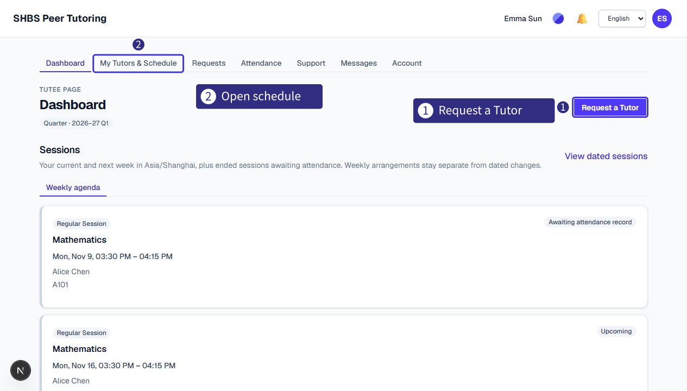

   

   
Capture details

   Student dashboard with dated lessons and workspace navigation

   /student · EN · 2026-11-16

   [Original full screenshot](assets/tutee-workspace-step-1.en.jpg) · `589c055e4b1cf166b48b353bd619ac1982e5d9f6` · Latest-main development baseline 589c055e with the Help candidate; synthetic demonstration data.

   

2. **Read schedule status carefully** Check tutor, subject, weekly time and room. Awaiting schedule means a tutor is assigned but no time has been confirmed. Use dated session cards for agreed moves/extras, and confirm individual dates with your tutor.

   Look for: Assigned subject, tutor, time and room

   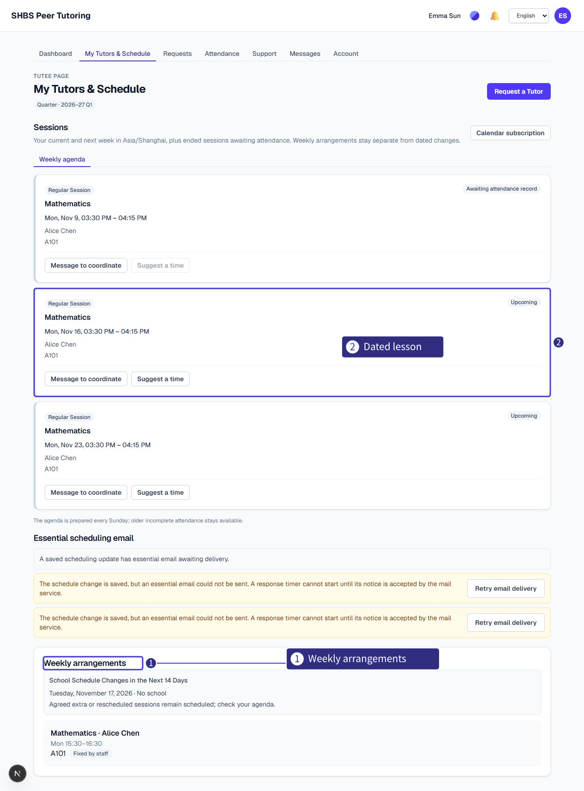

   

   
Capture details

   Dated lesson cards and the separate weekly arrangement

   /student?view=schedule · EN · 2026-11-16

   [Original full screenshot](assets/tutee-workspace-step-2.en.jpg) · `589c055e4b1cf166b48b353bd619ac1982e5d9f6` · Latest-main development baseline 589c055e with the Help candidate; synthetic demonstration data.

   

3. **Move to the task you need** Requests manages enrollment; Attendance contains records/feedback; Support contains cards/appeals; Messages and Account stay inside this workspace. Previous/Next controls belong to their individual lists.

   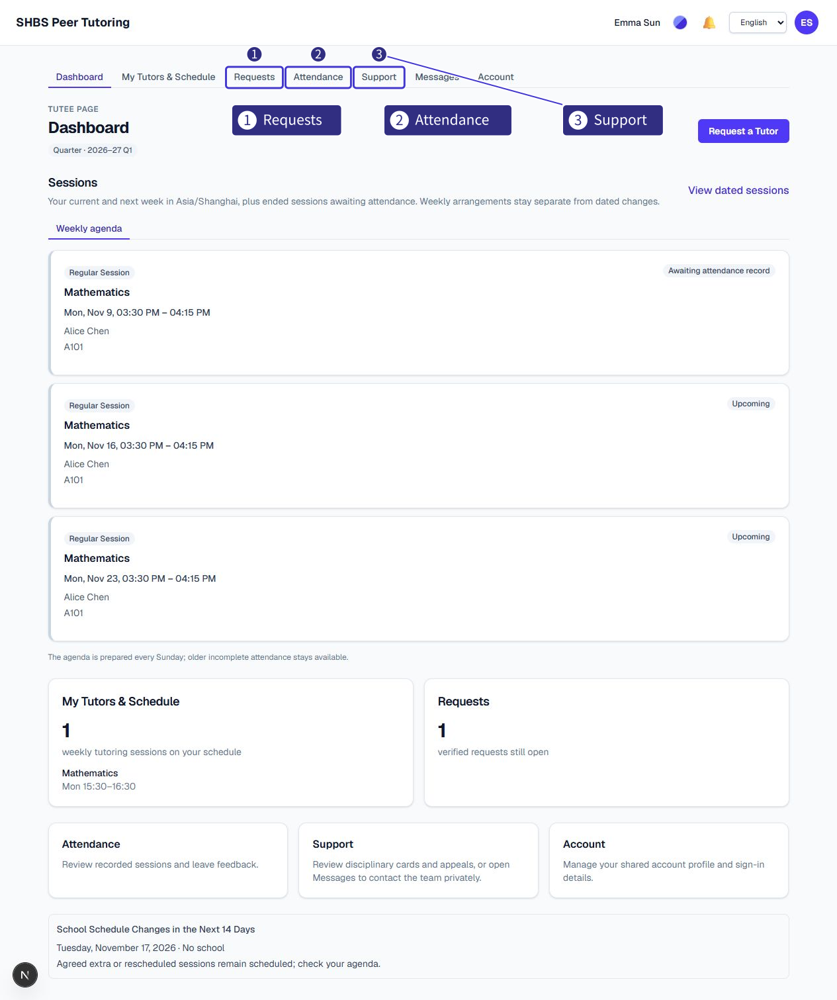

   

   
Capture details

   Student workspace navigation for requests, attendance, support, messages and account

   /student · EN · 2026-11-16

   [Original full screenshot](assets/tutee-workspace-step-3.en.jpg) · `589c055e4b1cf166b48b353bd619ac1982e5d9f6` · Latest-main development baseline 589c055e with the Help candidate; synthetic demonstration data.

   

### What happens next

You can distinguish an assigned tutor from a confirmed weekly schedule and open the right follow-up.

### How it works

Only current active-period assignments on explicitly owned non-inactive profiles appear in the current schedule; historical attendance remains available. No-tutoring notices distinguish information-only dates from paused regular commitments; agreed exceptions use dated scheduling.

### Troubleshooting

- **The count is unknown or a tutor seems missing** Use Retry for unavailable reads. Check Requests and the active period; ask staff to review explicit ownership or inactive status rather than matching another person's name/email.

## Edit or recall your tutoring request

Correct current answers while preserving history, or permanently close an unmatched request.

Open: `/student?view=requests`

### Before you start

- You explicitly own an open request in the active program period.

### Walkthrough

1. **Open Current Request** In Requests review request status, original priority, current choices, assigned tutors and any review notice. Closed contains retained terminal/history entries.

   Look for: Current Request and its edit/recall actions

   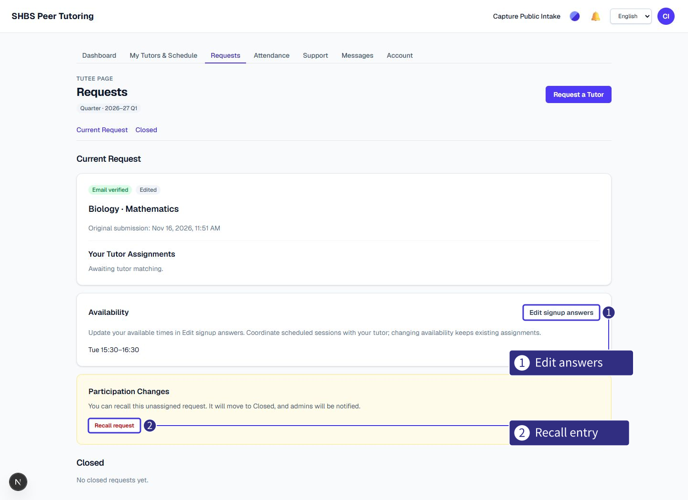

   

   
Capture details

   Actual dedicated fictional Current Request shows verified state, original priority, Biology/Mathematics, awaiting tutor matching, availability and eligible Edit signup answers/Recall request controls. No closed requests yet.

   /student?view=requests · EN · 2026-11-16

   [Original full screenshot](assets/manage-tutee-request-step-1.en.jpg) · `589c055e4b1cf166b48b353bd619ac1982e5d9f6` · Latest-main development baseline 589c055e with the Help candidate; synthetic demonstration data.

   

2. **Edit eligible current answers** Choose Edit Signup Answers and correct eligible names/contact/grade, availability or unassigned subject choices. Check the draft, then choose Save signup answers; this saves directly without another confirmation dialog. Read the saved result before editing again. Assigned choices cannot be dropped here; ask Admin/Head to review release and answer changes together.

   **View 1**

   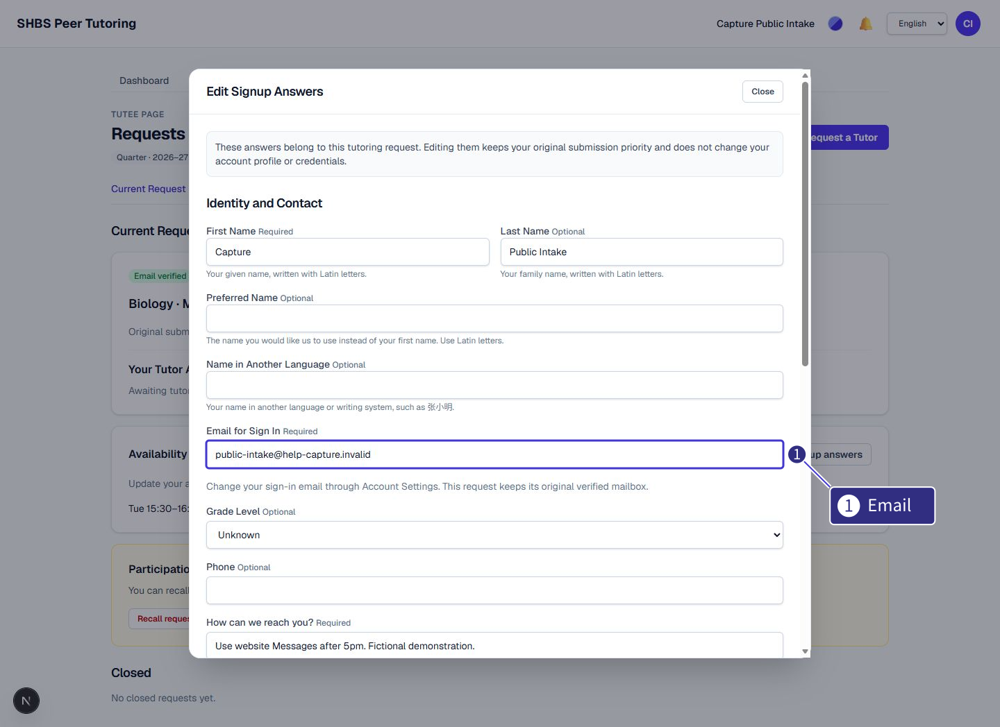

   

   
Capture details

   Reopened real Edit Signup Answers modal after the fictional contact update was saved; the guide now correctly describes direct Save signup answers without an invented confirmation dialog. Request names are editable and the original verified mailbox retained; no credential changes.

   /student?view=requests · EN · 2026-11-16

   [Original full screenshot](assets/manage-tutee-request-step-2.en.jpg) · `589c055e4b1cf166b48b353bd619ac1982e5d9f6` · Latest-main development baseline 589c055e with the Help candidate; synthetic demonstration data.

   

   **View 2**

   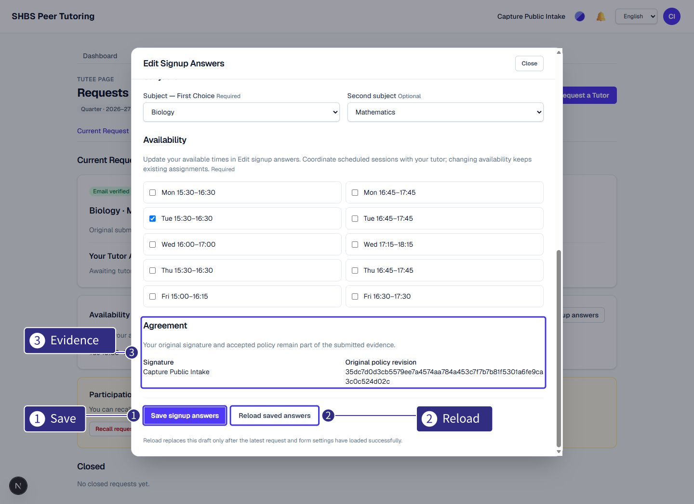

   

   
Capture details

   Reopened actual signup editor footer after the saved fictional contact correction: existing subject/availability choices and original signature/policy evidence remain, with real Save signup answers and Reload saved answers. Saving is direct; no extra confirmation modal is claimed.

   /student?view=requests · EN · 2026-11-16

   [Original full screenshot](assets/manage-tutee-request-step-2-view-2.en.jpg) · `589c055e4b1cf166b48b353bd619ac1982e5d9f6` · Latest-main development baseline 589c055e with the Help candidate; synthetic demonstration data.

   

   **View 3**

   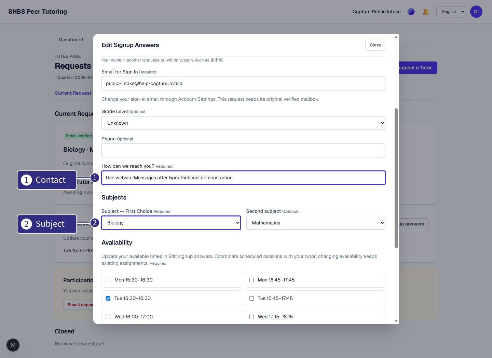

   

   
Capture details

   Reopened saved request editor visibly retains the actual fictional contact correction from after 4pm to after 5pm; subject choices remain Biology/Mathematics. This is the saved read after closing/reopening, not an unsaved claim or a new save operation.

   /student?view=requests · EN · 2026-11-16

   [Original full screenshot](assets/manage-tutee-request-step-2-view-3.en.jpg) · `589c055e4b1cf166b48b353bd619ac1982e5d9f6` · Latest-main development baseline 589c055e with the Help candidate; synthetic demonstration data.

   

3. **Recall only when you mean to close it** For an eligible unassigned request choose Recall, read permanent-closure consequences, wait for the two-second confirmation and confirm. Cancel leaves it open. Check the saved result rather than submitting again after a refresh warning.

   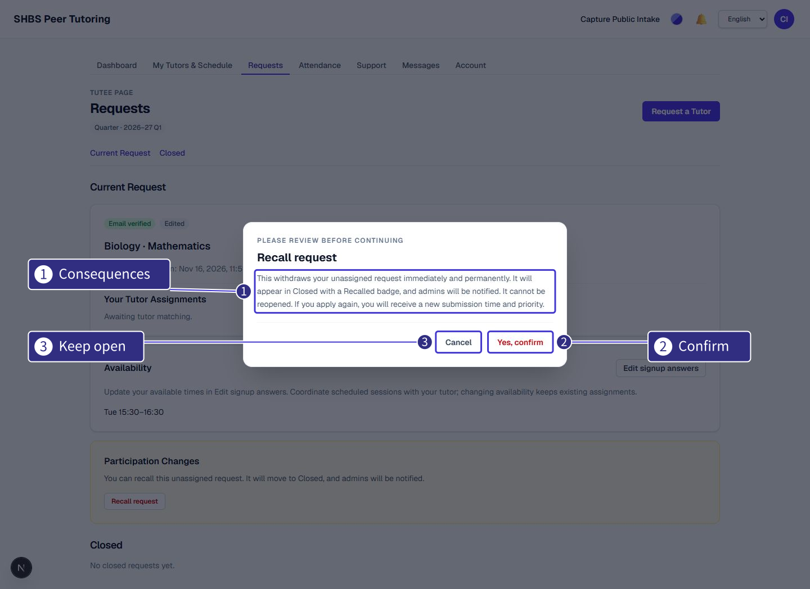

   

   
Capture details

   Actual Recall request review has reached the required two-second delay and now shows Yes, confirm. The dialog explains immediate permanent closure, retained Recalled history and new priority on later reapplication. This frame is before confirmation; request remains open and Cancel will be used.

   /student?view=requests · EN · 2026-11-16

   [Original full screenshot](assets/manage-tutee-request-step-3.en.jpg) · `589c055e4b1cf166b48b353bd619ac1982e5d9f6` · Latest-main development baseline 589c055e with the Help candidate; synthetic demonstration data.

   

### What happens next

The current request shows accepted answers, or the recalled request appears closed with its history retained.

### How it works

An eligible current open request can be edited after public intake closes. Editing preserves original priority, assignments, sessions and signed evidence and does not change canonical login identity. Recall permanently closes that request; applying later establishes a new priority.

### Troubleshooting

- **The request changed while editing** Keep the draft, explicitly reload the current version and review before resubmitting. A normal read Retry does not replace the captured review version.

## Request withdrawal from tutoring

Ask for reviewed withdrawal after assignment and follow the actual decision.

Open: `/student?view=requests`

### Before you start

- You have eligible current participation, including a staff-entered enrollment explicitly linked to your account.

### Walkthrough

1. **Open Participation** In Requests → Participation choose Request withdrawal…. Check that the button names the correct current quarter or semester.

   Look for: Participation and Request withdrawal

   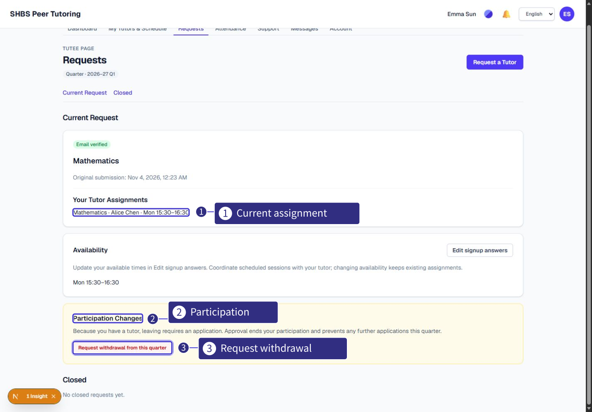

   

   
Capture details

   Requests shows the current tutor assignment and the withdrawal entry under Participation Changes. The button explicitly applies to the current quarter.

   /student?view=requests · EN · 2026-11-20

   [Original full screenshot](assets/withdraw-tutee-step-1.en.jpg) · `b5ece465681957c9fe579d26babdeb260c674fa0` · Latest-main development baseline b5ece465, selected 2026-11-20, with the Help candidate and synthetic demo records.

   

2. **Give the reason and review** Enter your reason, review which participation ends, wait for the three-second confirmation and submit. Cancel or Escape before submission leaves participation unchanged.

   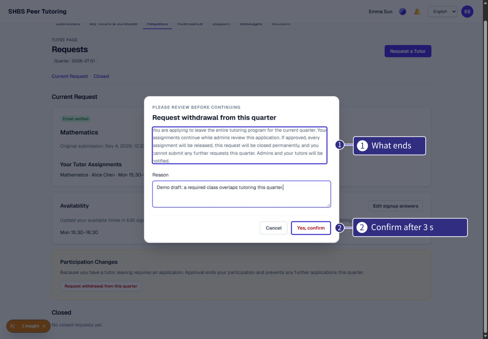

   

   
Capture details

   Read the whole-quarter scope and enter the reason. The real confirmation timer completed. This draft was canceled before any withdrawal request was submitted.

   /student?view=requests · EN · 2026-11-20

   [Original full screenshot](assets/withdraw-tutee-step-2.en.jpg) · `b5ece465681957c9fe579d26babdeb260c674fa0` · Latest-main development baseline b5ece465, selected 2026-11-20, with the Help candidate and synthetic demo records.

   

3. **Follow the decision** Check the pending request and later approval or decline. Assignment remains active while review is pending. If accepted submission cannot refresh, use the read-only retry.

   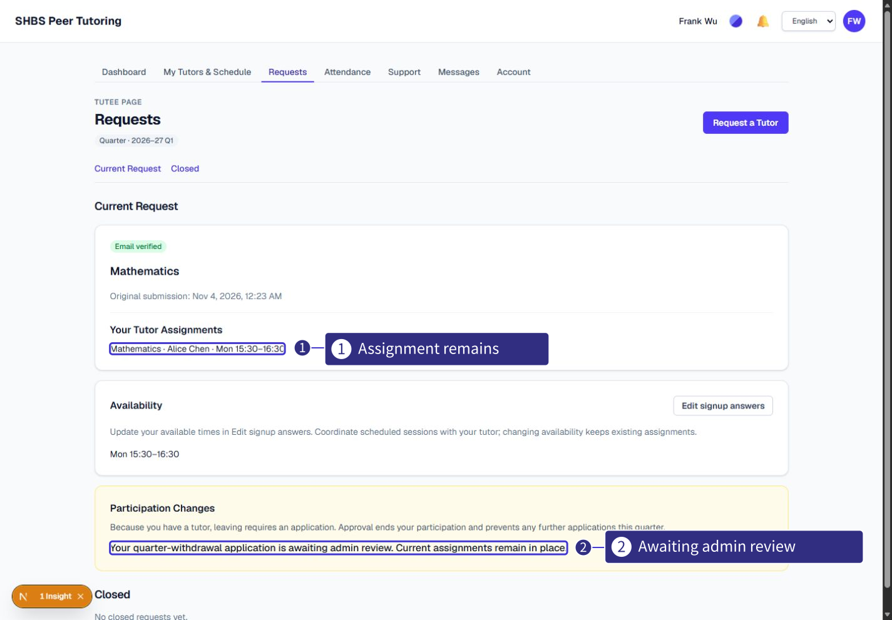

   

   
Capture details

   Frank’s existing withdrawal remains pending, and the current Mathematics tutor is still listed. The pending request was preserved.

   /student?view=requests · EN · 2026-11-20

   [Original full screenshot](assets/withdraw-tutee-step-3.en.jpg) · `b5ece465681957c9fe579d26babdeb260c674fa0` · Latest-main development baseline b5ece465, selected 2026-11-20, with the Help candidate and synthetic demo records.

   

### What happens next

A reasoned withdrawal request is recorded; participation ends only after approval.

### How it works

Approved withdrawal ends participation and blocks another request in the current program period. A tutor schedule-conflict review is narrower: approved rejection releases only that tutor's assignment and retains matching priority.

### Troubleshooting

- **You only want to change one subject or date** Use the request editor, staff assignment review or dated rescheduling instead. Review the displayed scope before choosing whole-period withdrawal.

## Appeal an invalid tutoring request

Read the reason, submit one explanation and distinguish its receipt from a decision.

Open: `/student?view=requests`

### Before you start

- You own the flagged request and its appeal is still eligible in the active period.

### Walkthrough

1. **Read the invalidity notice** Open Review a Flagged Request in Requests and check its appeal status. You can also use the private link in the notice for this request. Complete sign-in or verification if prompted.

   Look for: Invalid request reason and appeal action

   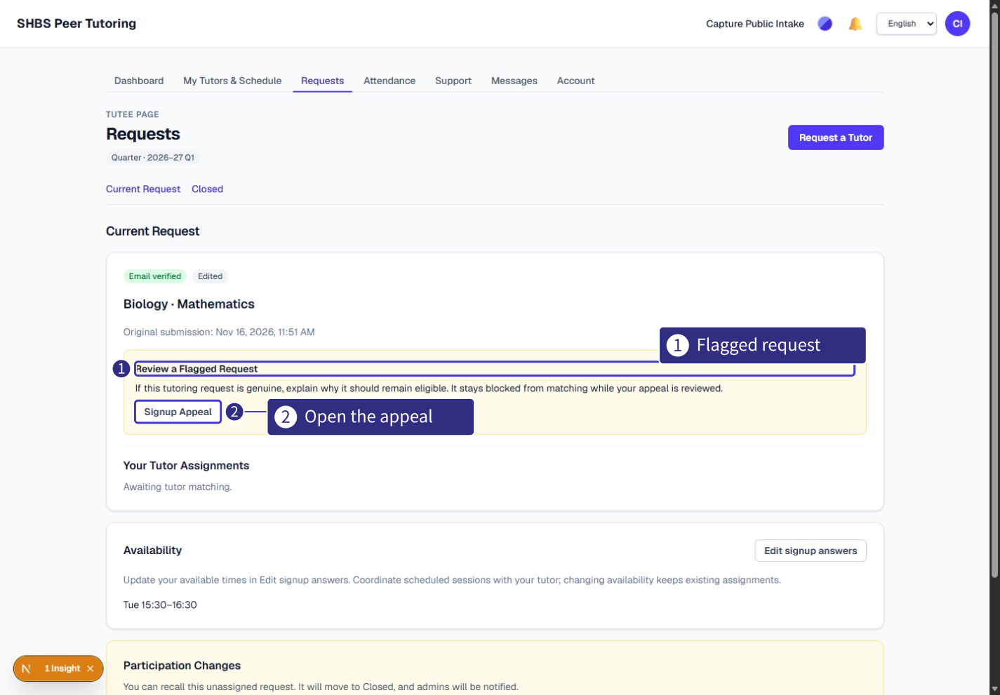

   

   
Capture details

   Open the flagged request in Requests. The Signup Appeal button leads to the explanation form for this owned request.

   /student?view=requests · EN · 2026-11-20

   [Original full screenshot](assets/appeal-invalid-request-step-1.en.jpg) · `b5ece465681957c9fe579d26babdeb260c674fa0` · Latest-main development baseline b5ece465, selected 2026-11-20, with the Help candidate and synthetic demo records.

   

2. **Submit a reasoned appeal** Choose the appeal action, explain why the flag should be reviewed and submit once. Keep the page open while sending; a saved receipt is not an accepted appeal decision.

   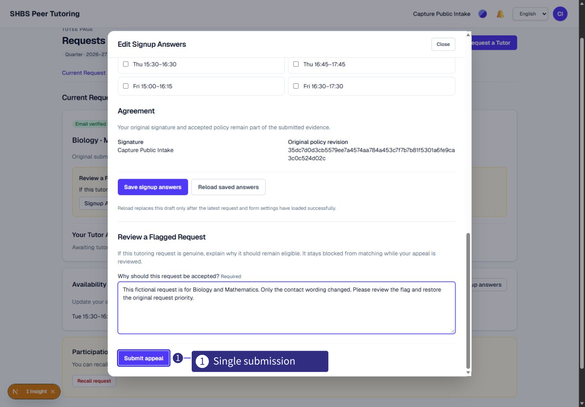

   

   
Capture details

   Write the explanation in the signed-in request form. A single submission from either entry point records the appeal.

   /student?view=requests · EN · 2026-11-20

   [Original full screenshot](assets/appeal-invalid-request-step-2.en.jpg) · `b5ece465681957c9fe579d26babdeb260c674fa0` · Latest-main development baseline b5ece465, selected 2026-11-20, with the Help candidate and synthetic demo records.

   

3. **Check the separate decision** Read Pending, Declined or Cleared. Acceptance clears the flag and preserves original priority. Final rejection closes the active request and ends that priority, while retaining evidence.

   **View 1**

   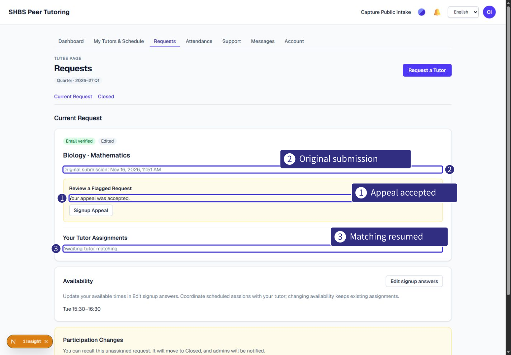

   

   
Capture details

   The owner sees the separate acceptance decision, the original submission time and the return to tutor matching.

   /student?view=requests · EN · 2026-11-20

   [Original full screenshot](assets/appeal-invalid-request-step-3.en.jpg) · `b5ece465681957c9fe579d26babdeb260c674fa0` · Latest-main development baseline b5ece465, selected 2026-11-20, with the Help candidate and synthetic demo records.

   

   **View 2**

   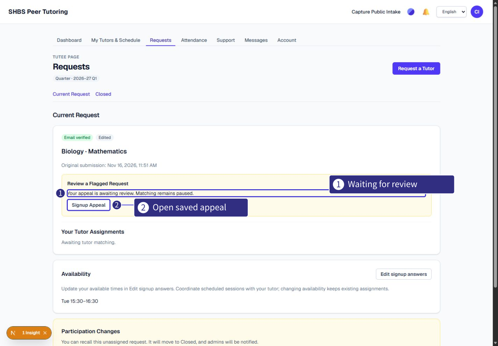

   

   
Capture details

   The signed-in owner sees the same pending appeal after submission. Matching stays paused until a decision is made.

   /student?view=requests · EN · 2026-11-20

   [Original full screenshot](assets/appeal-invalid-request-step-3-view-2.en.jpg) · `b5ece465681957c9fe579d26babdeb260c674fa0` · Latest-main development baseline b5ece465, selected 2026-11-20, with the Help candidate and synthetic demo records.

   

### What happens next

Your appeal has a recorded submission and a separately visible management decision.

### How it works

The request remains invalid and blocked during appeal. Appeals and resends do not extend fixed verification deadlines. Current signup appeals end at period rollover. Older request-specific appeal links have their own displayed validity and allow only their limited appeal action.

### Troubleshooting

- **Appeal submitted but the flag remains** Read the decision separately; submission alone does not clear it. If refresh failed after sending, retry the read instead of submitting the appeal again.

## Review attendance, give feedback and appeal a card

Use session records and your own support history, with visibility and deadlines explained.

Open: `/student?view=attendance`

### Before you start

- The session or disciplinary card belongs to an explicitly owned profile.

### Walkthrough

1. **Open Attendance** Read recorded sessions across intakes and select the relevant lesson for feedback. Check the visibility explanation before submitting: feedback is management-only by default, with optional sharing to that session's tutor.

   Look for: Recorded session and feedback visibility

   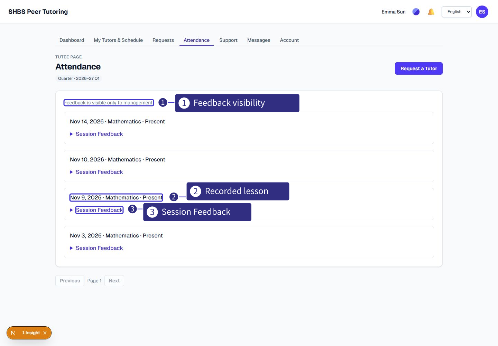

   

   
Capture details

   Attendance shows the current management-only privacy rule. Open Session Feedback within the exact recorded lesson.

   /student?view=attendance · EN · 2026-11-20

   [Original full screenshot](assets/tutee-feedback-appeals-step-1.en.jpg) · `b5ece465681957c9fe579d26babdeb260c674fa0` · Latest-main development baseline b5ece465, selected 2026-11-20, with the Help candidate and synthetic demo records.

   

2. **Submit your feedback** Enter the requested feedback and save once. If visibility is being checked or unavailable, use its retry to verify the current setting rather than assuming an older setting applies.

   Look for: Expanded Session Feedback rating, comment and save controls

   **View 1**

   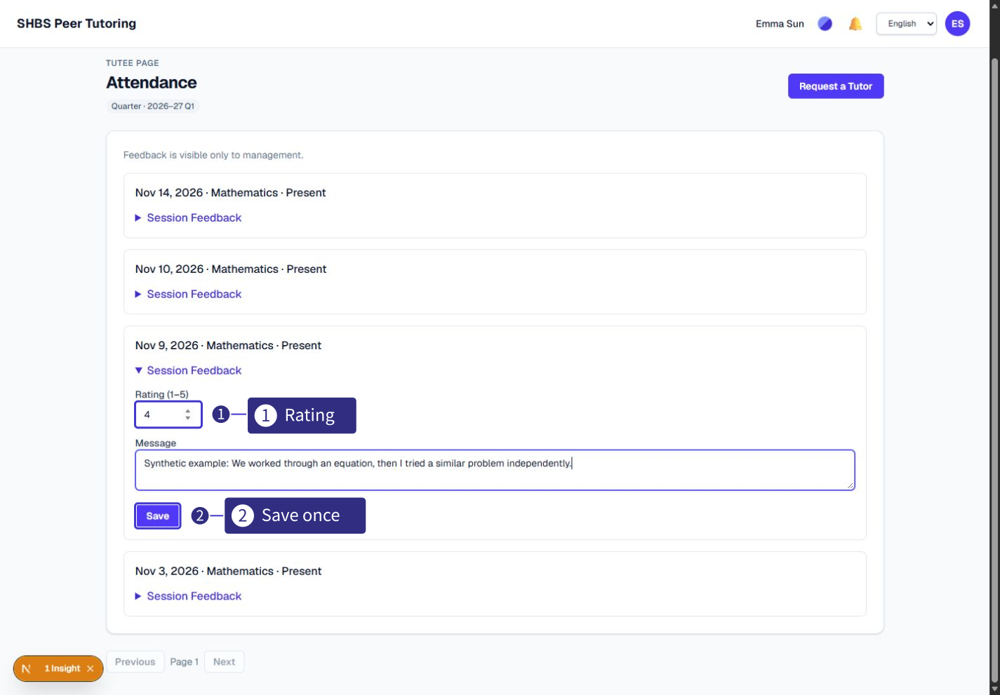

   

   
Capture details

   On the exact lesson, enter a rating and message and choose Save once. The previous step shows the verified sharing rule.

   /student?view=attendance · EN · 2026-11-20

   [Original full screenshot](assets/tutee-feedback-appeals-step-2.en.jpg) · `b5ece465681957c9fe579d26babdeb260c674fa0` · Latest-main development baseline b5ece465, selected 2026-11-20, with the Help candidate and synthetic demo records.

   

   **View 2**

   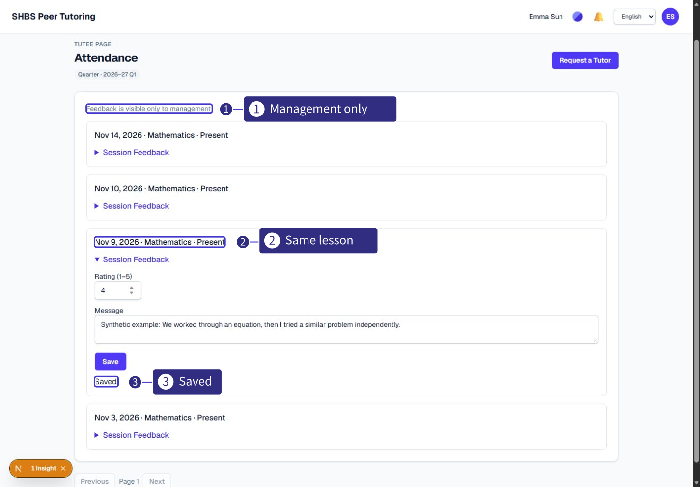

   

   
Capture details

   Saved appears below the feedback on the exact November 9 record. The current privacy rule remains management only.

   /student?view=attendance · EN · 2026-11-20

   [Original full screenshot](assets/tutee-feedback-appeals-step-2-view-2.en.jpg) · `b5ece465681957c9fe579d26babdeb260c674fa0` · Latest-main development baseline b5ece465, selected 2026-11-20, with the Help candidate and synthetic demo records.

   

3. **Review and appeal your card** In Support, find your card and read its reason, displayed appeal deadline and status. Submit one reasoned appeal by the end of the fifth school day after its recorded issue date in the program time zone. Return to Support to check the decision.

   Look for: Your cards, appeal reason and status

   **View 1**

   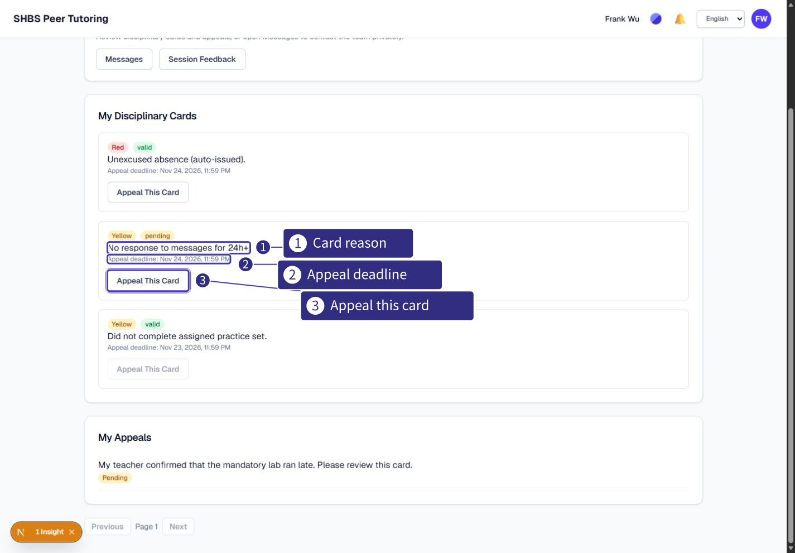

   

   
Capture details

   Support lists the reason, status and displayed deadline on the exact card. This separate yellow card is currently eligible for an appeal.

   /student?view=support · EN · 2026-11-20

   [Original full screenshot](assets/tutee-feedback-appeals-step-3.en.jpg) · `b5ece465681957c9fe579d26babdeb260c674fa0` · Latest-main development baseline b5ece465, selected 2026-11-20, with the Help candidate and synthetic demo records.

   

   **View 2**

   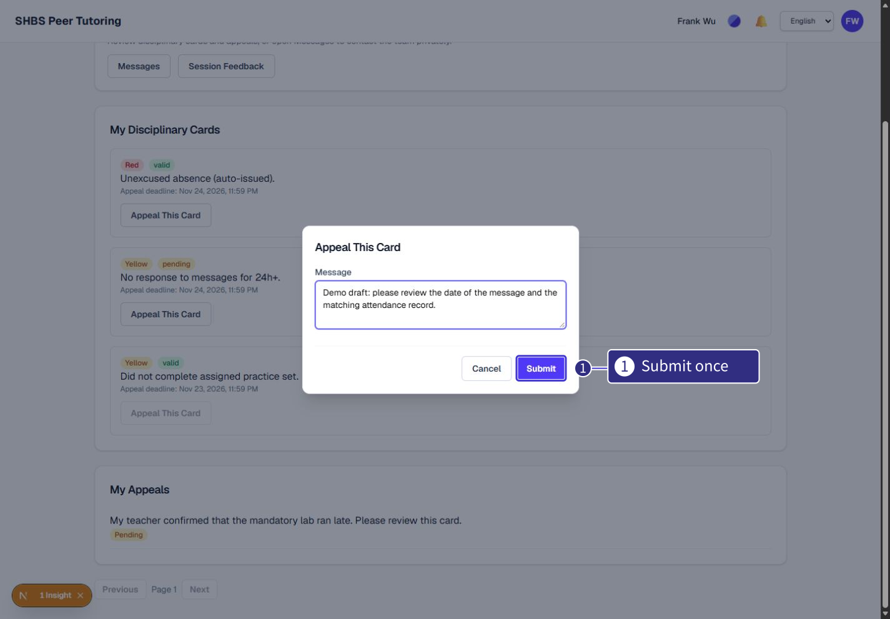

   

   
Capture details

   The chosen card opens its own appeal draft. Enter the supporting reason before submitting; this demonstration was canceled before submission.

   /student?view=support · EN · 2026-11-20

   [Original full screenshot](assets/tutee-feedback-appeals-step-3-view-2.en.jpg) · `b5ece465681957c9fe579d26babdeb260c674fa0` · Latest-main development baseline b5ece465, selected 2026-11-20, with the Help candidate and synthetic demo records.

   

### What happens next

Feedback or appeal displays its saved state, with the relevant sharing rule or decision visible.

### How it works

Later feedback sharing changes also affect earlier feedback. Pending appeals do not invalidate cards. With discipline enabled, an unexcused absence creates a valid red card; three valid yellows contribute one effective red, and two effective reds can remove active participation automatically.

School holidays and make-up days follow staff's school calendar. An upheld appeal invalidates the card and recalculates standing under the existing restoration rules.

### Troubleshooting

- **Sending succeeded but records did not reload** Use Try again to read the saved record. Your draft remains while the page stays open; do not resubmit an accepted appeal. For wrong attendance ask management to correct the exact record.

## Continue eligible pairings into the next quarter

Review prior choices during the limited continuation window and read each assignment outcome.

Open: `/student?view=requests`

### Before you start

- An official Q1→Q2 or Q3→Q4 refresh has occurred, quarter mode is active, and you are within one hour of destination tutee signup first opening.

### Walkthrough

1. **Select owned previous pairings** On Dashboard or Requests read the continuation deadline in program timezone. Select the prior tutor/subject pairings you want and choose Review selected pairings.

   Look for: Eligible continuation choices and named deadline when offered

   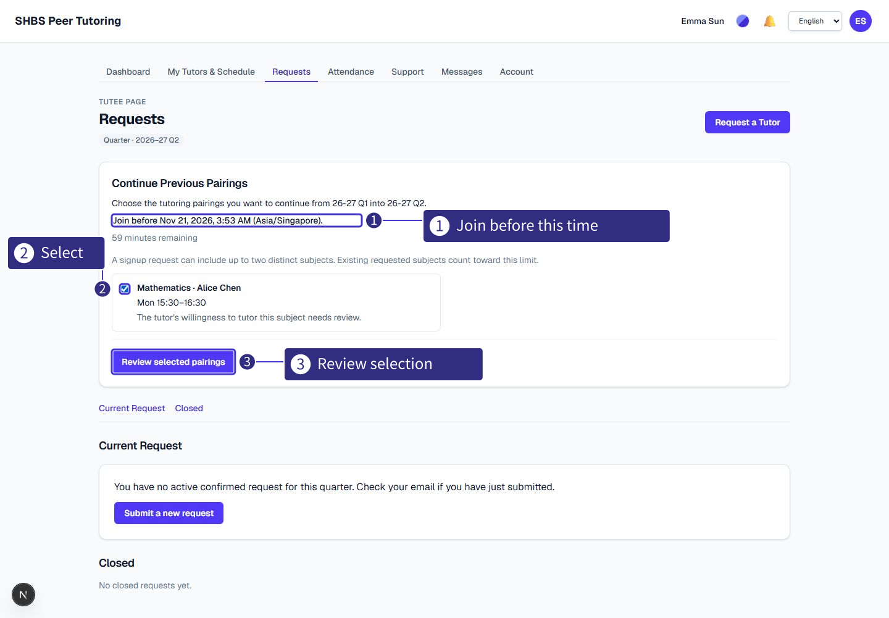

   

   
Capture details

   Emma is inside the first Q2 hour. She selects her owned Q1 Mathematics pairing with Alice Chen, and the app flags willingness for review.

   /student?view=requests · EN · 2026-11-20

   [Original full screenshot](assets/continue-quarter-pairings-step-1.en.jpg) · `b5ece465681957c9fe579d26babdeb260c674fa0` · Latest-main development baseline b5ece465, selected 2026-11-20, with the Help candidate. Isolated synthetic first-report demonstration phase.

   

2. **Review and sign** Read tutors, subjects and inherited weekly times, then review the current policy, agree and sign. Your request may contain at most two distinct subjects, including subjects already requested this quarter. Choose Join selected pairings.

   **View 1**

   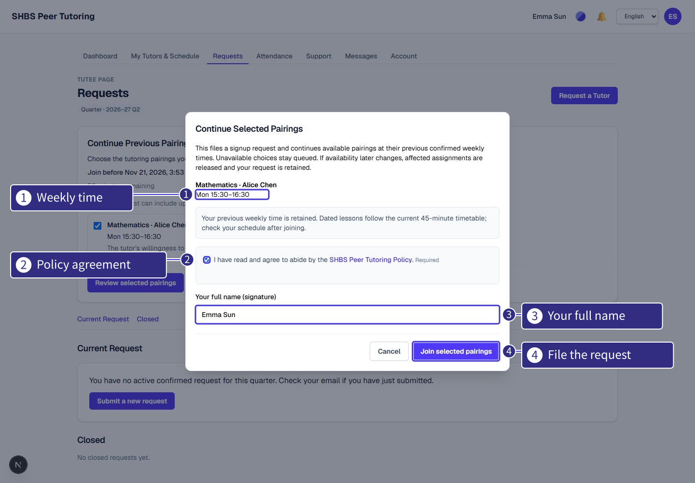

   

   
Capture details

   The review shows the inherited Mathematics pairing and its Monday time. Emma has read and agreed to the current policy and entered her full synthetic name; the Join action is ready.

   /student?view=requests · EN · 2026-11-20

   [Original full screenshot](assets/continue-quarter-pairings-step-2.en.jpg) · `b5ece465681957c9fe579d26babdeb260c674fa0` · Latest-main development baseline b5ece465, selected 2026-11-20, with the Help candidate. Isolated synthetic first-report demonstration phase.

   

   **View 2**

   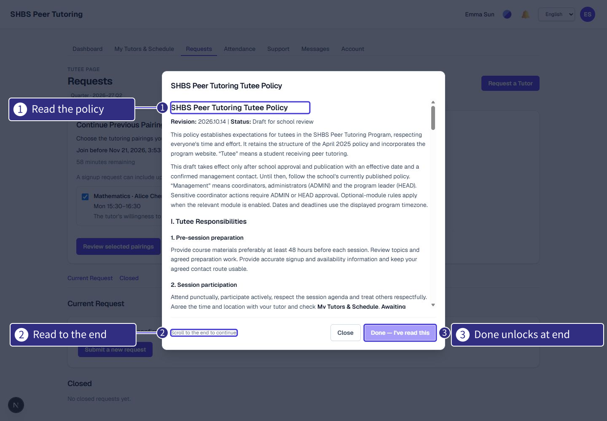

   

   
Capture details

   The current tutee policy opens in the real reader. Scroll through it to the end to enable the Done control, then return to the pairing review.

   /student?view=requests · EN · 2026-11-20

   [Original full screenshot](assets/continue-quarter-pairings-step-2-view-2.en.jpg) · `b5ece465681957c9fe579d26babdeb260c674fa0` · Latest-main development baseline b5ece465, selected 2026-11-20, with the Help candidate. Isolated synthetic first-report demonstration phase.

   

   **View 3**

   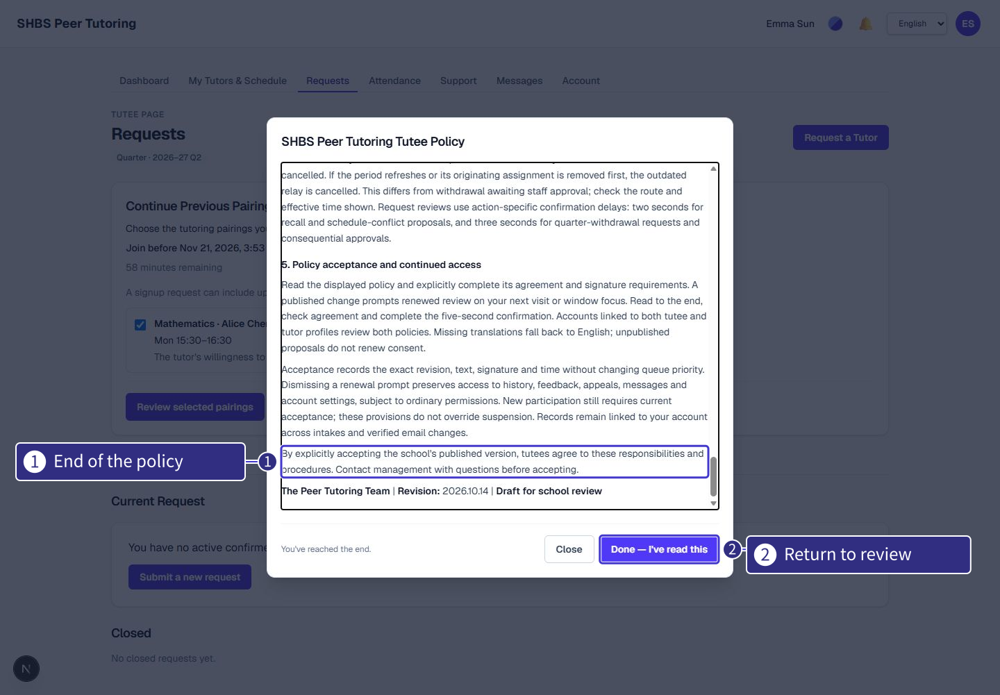

   

   
Capture details

   At the end of the policy, Done is enabled. Returning to the review enables its separate agreement checkbox.

   /student?view=requests · EN · 2026-11-20

   [Original full screenshot](assets/continue-quarter-pairings-step-2-view-3.en.jpg) · `b5ece465681957c9fe579d26babdeb260c674fa0` · Latest-main development baseline b5ece465, selected 2026-11-20, with the Help candidate. Isolated synthetic first-report demonstration phase.

   

3. **Read each saved result** Assigned and Request filed; awaiting assignment are different outcomes and may be mixed. Check the dated calendar for actual meetings and rooms. If the result is uncertain choose Check request result before submitting again.

   **View 1**

   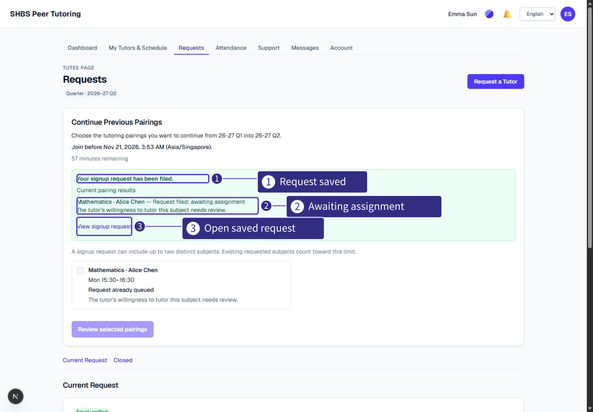

   

   
Capture details

   The accepted Q2 continuation filed a Mathematics signup request. Alice Chen’s pairing is queued for willingness review, so there is no assigned lesson from this request yet.

   /student?view=requests · EN · 2026-11-20

   [Original full screenshot](assets/continue-quarter-pairings-step-3.en.jpg) · `b5ece465681957c9fe579d26babdeb260c674fa0` · Latest-main development baseline b5ece465, selected 2026-11-20, with the Help candidate. Isolated synthetic first-report demonstration phase.

   

   **View 2**

   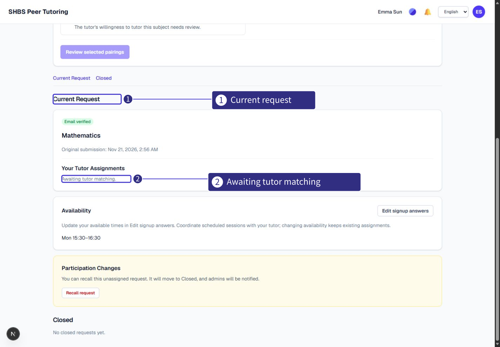

   

   
Capture details

   The Q2 Current Request shows Mathematics and Awaiting tutor matching. The original priority and schedule choices remain visible under this saved request.

   /student?view=requests · EN · 2026-11-20

   [Original full screenshot](assets/continue-quarter-pairings-step-3-view-2.en.jpg) · `b5ece465681957c9fe579d26babdeb260c674fa0` · Latest-main development baseline b5ece465, selected 2026-11-20, with the Help candidate. Isolated synthetic first-report demonstration phase.

   

   **View 3**

   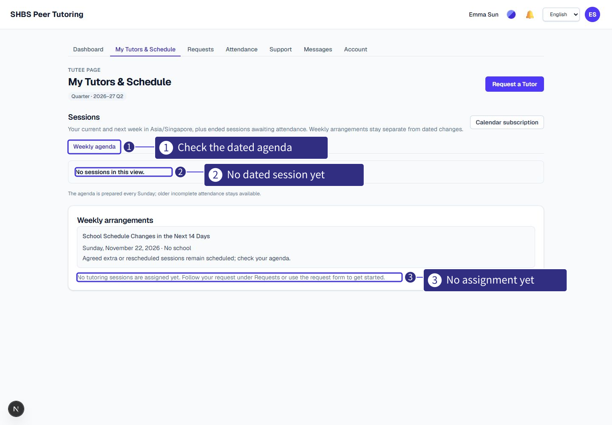

   

   
Capture details

   The actual dated Weekly agenda has no sessions and the workspace confirms no assigned tutoring yet, matching the queued result.

   /student?view=schedule · EN · 2026-11-20

   [Original full screenshot](assets/continue-quarter-pairings-step-3-view-3.en.jpg) · `b5ece465681957c9fe579d26babdeb260c674fa0` · Latest-main development baseline b5ece465, selected 2026-11-20, with the Help candidate. Isolated synthetic first-report demonstration phase.

   

### What happens next

The accepted choices are added to one current request with an explicit outcome for each pairing.

### How it works

Pausing/reopening intake does not restart the hour. Continuation is unavailable across semesters/years or in semester mode. Confirming a regular signup removes continuation choices. Ineligible assignments may remain filed for matching; original historical evidence is retained.

### Troubleshooting

- **No continuation choices appear** Check the transition, deadline, explicit ownership and whether you confirmed a normal request. Use the regular form when recruitment is open; unknown first-opening history does not create an invented window.

- **The panel asks to review required details** Choose Review required details. Check the required name, academic and contact information, and complete email verification if prompted. Contact the program team if information is missing from your prior record.

## Suggest or respond to a dated session change

Agree on reschedules, extras and cancellations without changing weekly pairing groups.

Open: `/student?view=schedule`

### Before you start

- You are an affected tutee on a current dated session or proposal.

### Walkthrough

1. **Open the exact session** In My Tutors & Schedule choose the dated lesson and use its suggestion or response action. Message to coordinate helps discuss a time, but a message alone does not formally accept a change.

   Look for: Dated session and pending proposal actions

   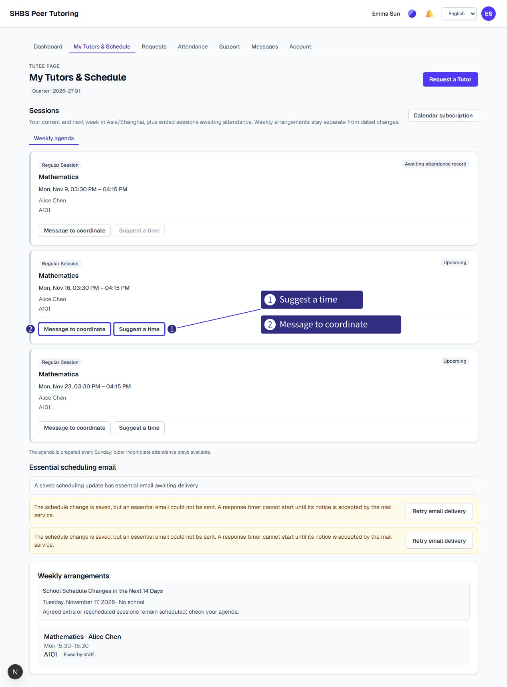

   

   
Capture details

   Open the exact dated lesson and its time-suggestion action

   /student?view=schedule · EN · 2026-11-16

   [Original full screenshot](assets/respond-session-plan-step-1.en.jpg) · `589c055e4b1cf166b48b353bd619ac1982e5d9f6` · Latest-main development baseline 589c055e with the Help candidate; synthetic demonstration data.

   

2. **Review scope, time and location** Read which tutees are affected, the original/proposed times and assigned room or Online. Accept a workable proposal. Rejecting a tutor's first single-tutee proposal requires an alternative; review the final-proposal consequence before responding.

   **View 1**

   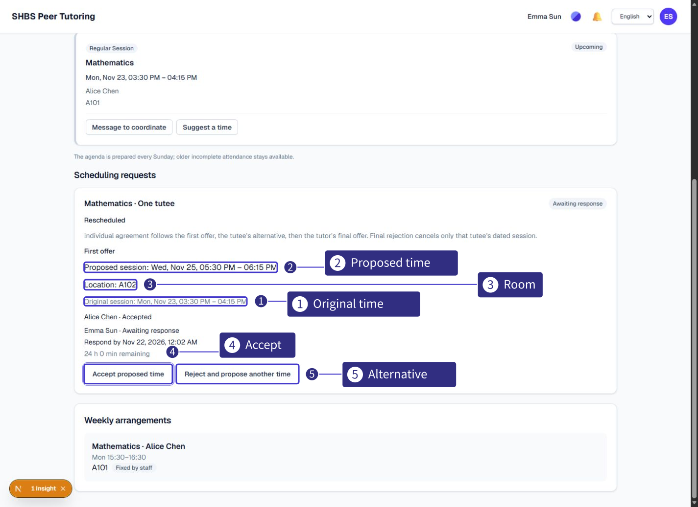

   

   
Capture details

   Compare the original and proposed time and the assigned room on Emma’s one-tutee offer. Accept a workable time or open the alternative editor for the first offer.

   /student?view=schedule · EN · 2026-11-20

   [Original full screenshot](assets/respond-session-plan-step-2.en.jpg) · `b5ece465681957c9fe579d26babdeb260c674fa0` · Latest-main development baseline b5ece465, selected 2026-11-20, with the Help candidate and synthetic demo records.

   

   **View 2**

   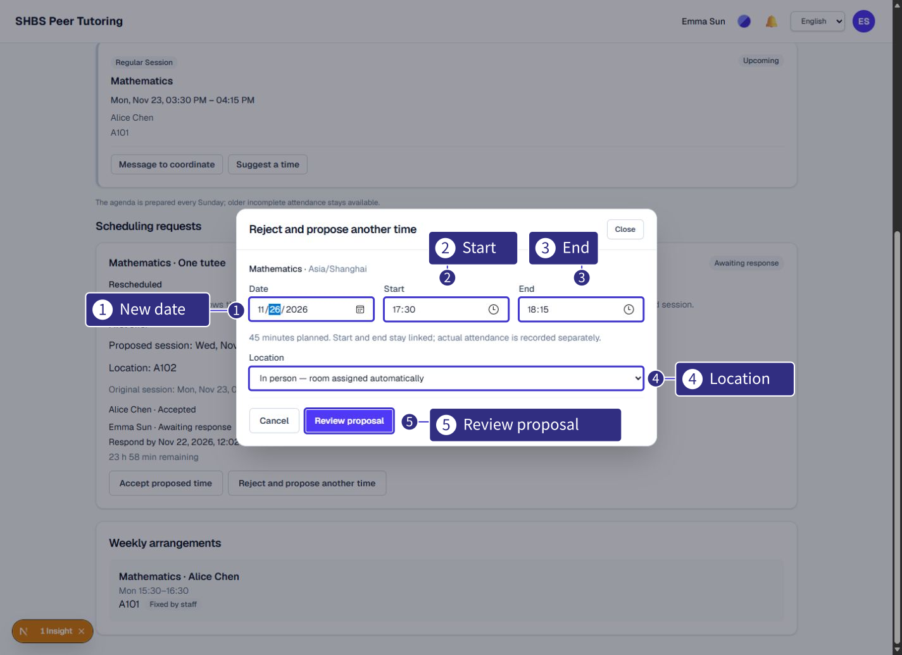

   

   
Capture details

   After choosing the alternative, change the date or time, choose the location, then review before sending.

   /student?view=schedule · EN · 2026-11-20

   [Original full screenshot](assets/respond-session-plan-step-2-view-2.en.jpg) · `b5ece465681957c9fe579d26babdeb260c674fa0` · Latest-main development baseline b5ece465, selected 2026-11-20, with the Help candidate and synthetic demo records.

   

   **View 3**

   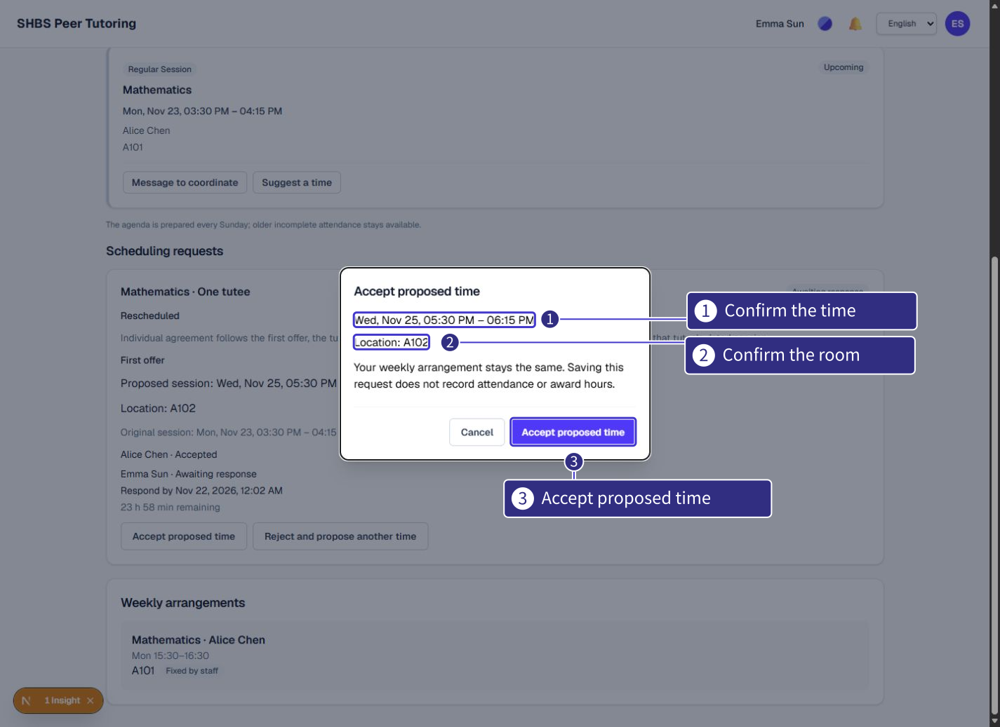

   

   
Capture details

   Read the exact revised date and room in the acceptance dialog, then choose Accept proposed time to confirm.

   /student?view=schedule · EN · 2026-11-20

   [Original full screenshot](assets/respond-session-plan-step-2-view-3.en.jpg) · `b5ece465681957c9fe579d26babdeb260c674fa0` · Latest-main development baseline b5ece465, selected 2026-11-20, with the Help candidate and synthetic demo records.

   

3. **Handle a group or cancellation** For an all-tutee proposal everyone must accept the same time. Each may reject once with an alternative; later conflicts use Separate reschedule. For an agreed extra's cancellation choose Accept cancellation or Decline cancellation; no alternative time is required.

   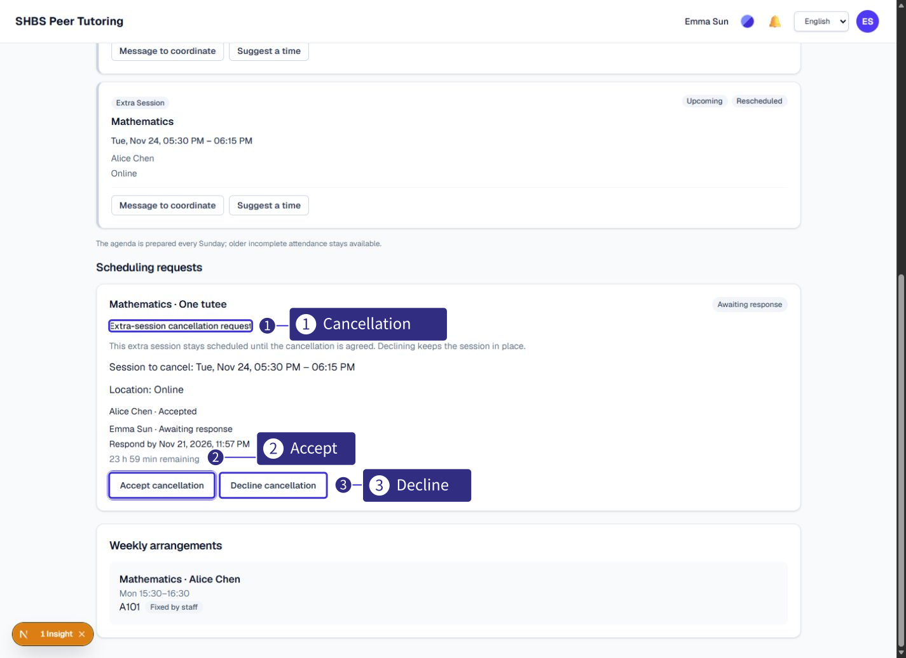

   

   
Capture details

   For this extra-cancellation request, choose Accept cancellation or Decline cancellation. The extra is still Upcoming until agreement, and these decisions do not require another time.

   /student?view=schedule · EN · 2026-11-20

   [Original full screenshot](assets/respond-session-plan-step-3.en.jpg) · `b5ece465681957c9fe579d26babdeb260c674fa0` · Latest-main development baseline b5ece465, selected 2026-11-20, with the Help candidate and synthetic demo records.

   

4. **Check the authoritative outcome** After responding, check the session's agreed state and essential notice. A cancellation submission receipt does not cancel the lesson. Refresh failed views using the read-only retry.

   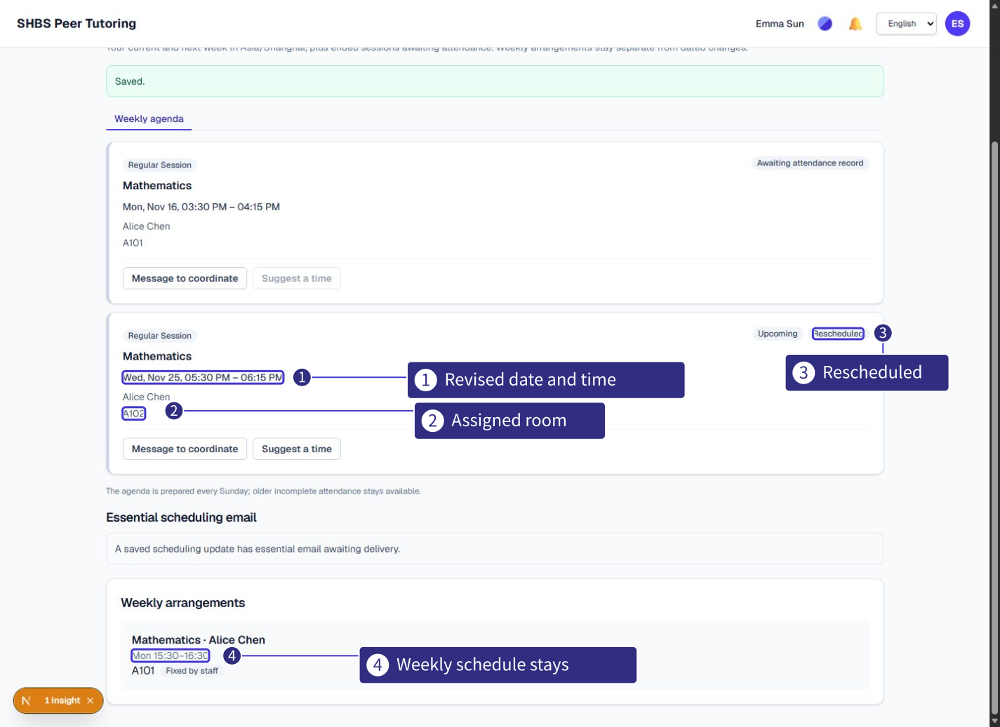

   

   
Capture details

   After accepting, the dated card shows the revised time, assigned room and Rescheduled status. The Weekly arrangements section still shows Monday.

   /student?view=schedule · EN · 2026-11-20

   [Original full screenshot](assets/respond-session-plan-step-4.en.jpg) · `b5ece465681957c9fe579d26babdeb260c674fa0` · Latest-main development baseline b5ece465, selected 2026-11-20, with the Help candidate and synthetic demo records.

   

### What happens next

The portal records your response and shows whether the dated commitment actually changed.

### How it works

A valid 24-hour response window begins only after essential email is accepted by the mail server; failure blocks automatic acceptance. When a full window cannot fit before the earlier session start, explicit agreement is required or the proposal expires. Rejecting a final single-tutee reschedule cancels only that dated commitment; rejected extras leave the regular lesson intact.

Declined or expired extra-cancellation requests preserve the lesson. Scheduling changes do not create attendance or absence records.

### Troubleshooting

- **Email failed or the request expired** Check delivery/status and coordinate with the tutor. Do not assume silence moved a lesson; use the portal's confirmed schedule. The original remains unless a separate authoritative change cancels it.
