# 接受辅导

由网站帮助目录生成。请修改内容源文件后运行 `npm run help:export`。

[目录与截图来源](README.md)

截图来源: `1df44d6bb31cf04352adae9c65819139b7b747d8`. New captures use latest-main development baseline 1df44d6b, selected 2026-11-21, with the Help candidate. Earlier captures list their own revision and capture date.

此 GitHub 培训副本包含各角色操作说明。实际使用网站功能仍需登录并具备当前项目权限。所有示例数据均为虚构。

- [使用学习伙伴概览和课表](#使用学习伙伴概览和课表)
- [编辑或撤回辅导申请](#编辑或撤回辅导申请)
- [申请退出辅导](#申请退出辅导)
- [申诉被标为无效的辅导申请](#申诉被标为无效的辅导申请)
- [查看出勤、反馈及纪律卡申诉](#查看出勤反馈及纪律卡申诉)
- [将符合条件的配对延续到下一学季](#将符合条件的配对延续到下一学季)
- [建议或回应具体课次变更](#建议或回应具体课次变更)

## 使用学习伙伴概览和课表

查找分配的辅导伙伴、已确认时间、教室及下一步任务。

打开: `/student?view=dashboard`

### 开始之前

- 使用本人学习伙伴权限。首次参与需接受当前政策，仅访问页面不会获得资格。

### 操作步骤

1. **从概览开始** 阅读当前课次及申请概览。新的符合条件申请可用页头的申请辅导。选择我的辅导伙伴与课表，查看完整当前分配。

   请注意: 工作区导航与当前任务概览

   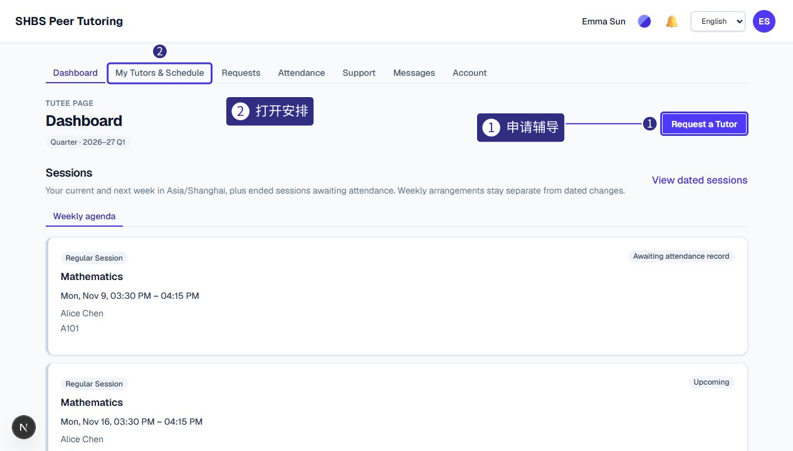

   /student · EN · 2026-11-16

   学员首页：具体日期课次及工作区导航

   [原始完整截图](assets/tutee-workspace-step-1.en.jpg) · `589c055e4b1cf166b48b353bd619ac1982e5d9f6` · Latest-main development baseline 589c055e with the Help candidate; synthetic demonstration data.

   已为本步骤添加标注，原始完整截图保持不变。

   - **1.** 申请辅导

   - **2.** 打开安排

2. **仔细查看课表状态** 检查辅导伙伴、科目、每周时间和教室。等待排课表示已分配辅导伙伴，但时间未确认。通过日期课次卡查看已约定调整或加课，并与辅导伙伴确认具体日期。

   请注意: 已分配科目、辅导伙伴、时间和教室

   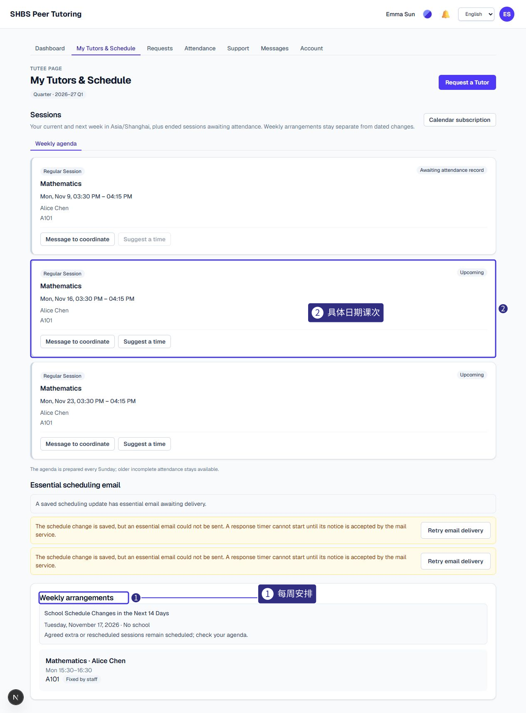

   /student?view=schedule · EN · 2026-11-16

   具体日期课次与单独列出的每周安排

   [原始完整截图](assets/tutee-workspace-step-2.en.jpg) · `589c055e4b1cf166b48b353bd619ac1982e5d9f6` · Latest-main development baseline 589c055e with the Help candidate; synthetic demonstration data.

   已为本步骤添加标注，原始完整截图保持不变。

   - **1.** 每周安排

   - **2.** 具体日期课次

3. **进入所需任务** 申请用于管理报名；出勤包含记录与反馈；支持包含纪律卡与申诉；消息和账户仍位于此工作区。各列表的上一页／下一页控件独立工作。

   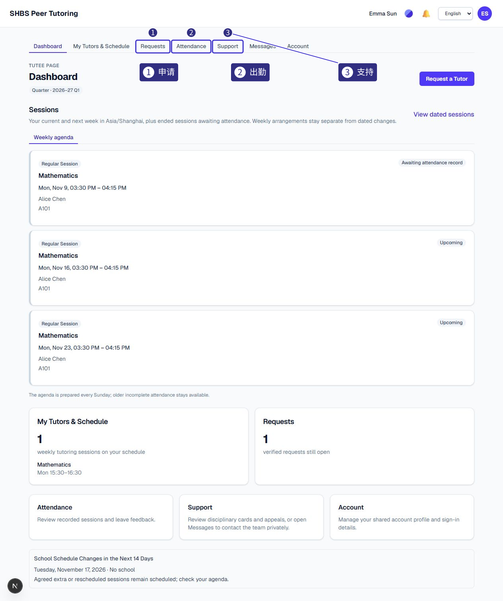

   /student · EN · 2026-11-16

   学员工作区导航：申请、出勤、支持、消息与账户

   [原始完整截图](assets/tutee-workspace-step-3.en.jpg) · `589c055e4b1cf166b48b353bd619ac1982e5d9f6` · Latest-main development baseline 589c055e with the Help candidate; synthetic demonstration data.

   已为本步骤添加标注，原始完整截图保持不变。

   - **1.** 申请

   - **2.** 出勤

   - **3.** 支持

### 预期结果

能够区分已分配辅导伙伴与已确认每周课表，并进入正确后续流程。

### 工作原理

当前课表仅显示本人明确拥有且未停用档案在当前时期的分配；历史出勤仍保留。无辅导提示区分纯信息日期与暂停普通课次；约定例外需使用日期排课流程。

### 问题排查

- **数量未知或缺少辅导伙伴** 数据不可用时使用重试。检查申请与当前时期；请工作人员核查明确所有权或停用状态，不要凭他人姓名／邮箱匹配记录。

## 编辑或撤回辅导申请

更正当前答案并保留历史，或永久结束尚未匹配的申请。

打开: `/student?view=requests`

### 开始之前

- 本人明确拥有当前时期的未结申请。

### 操作步骤

1. **打开当前申请** 在申请页检查状态、原优先时间、当前选择、已分配辅导伙伴及审核提示。已结束列表保留终止及历史记录。

   请注意: 当前申请及编辑、撤回操作

   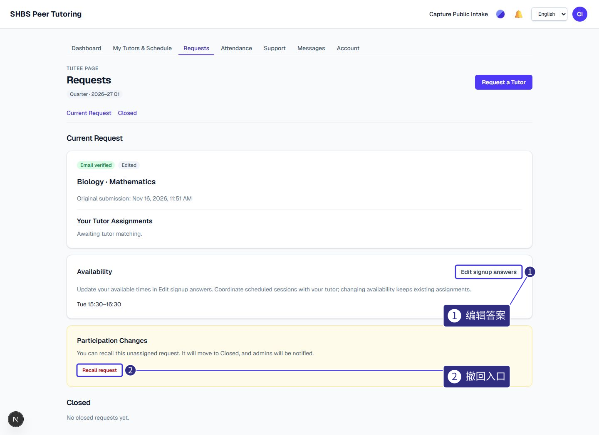

   /student?view=requests · EN · 2026-11-16

   真实虚构专用“当前申请”显示已验证状态、原优先时间、生物／数学、等待辅导匹配、可用时间及符合条件的“编辑报名答案”／“撤回申请”控件；尚无已结束申请。

   [原始完整截图](assets/manage-tutee-request-step-1.en.jpg) · `589c055e4b1cf166b48b353bd619ac1982e5d9f6` · Latest-main development baseline 589c055e with the Help candidate; synthetic demonstration data.

   已为本步骤添加标注，原始完整截图保持不变。

   - **1.** 编辑答案

   - **2.** 撤回入口

2. **编辑可修改的当前答案** 选择编辑报名回答，更正允许修改的姓名／联系／年级、可用时间或尚未分配科目。核对草稿后选择保存报名回答；此操作会直接保存，不会再打开确认弹窗。再次编辑前先阅读保存结果。此处不能删除已分配科目；请管理员／负责人一并审核释放分配及答案更改。

   **视图 1**

   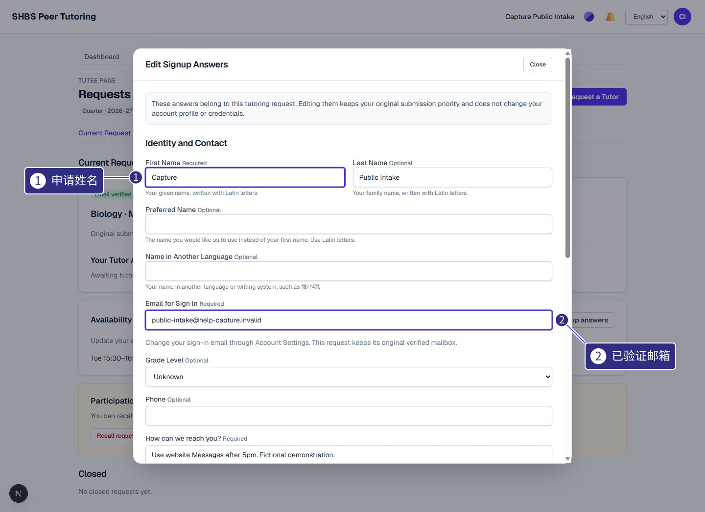

   /student?view=requests · EN · 2026-11-16

   虚构联系资料更新保存后，重新打开真实“编辑报名答案”对话框；指南现已准确说明直接“保存报名答案”，不再虚构额外确认对话框。申请姓名可编辑，原已验证邮箱保留，未更改凭据。

   [原始完整截图](assets/manage-tutee-request-step-2.en.jpg) · `589c055e4b1cf166b48b353bd619ac1982e5d9f6` · Latest-main development baseline 589c055e with the Help candidate; synthetic demonstration data.

   已为本步骤添加标注，原始完整截图保持不变。

   - **1.** 申请姓名

   - **2.** 已验证邮箱

   **视图 2**

   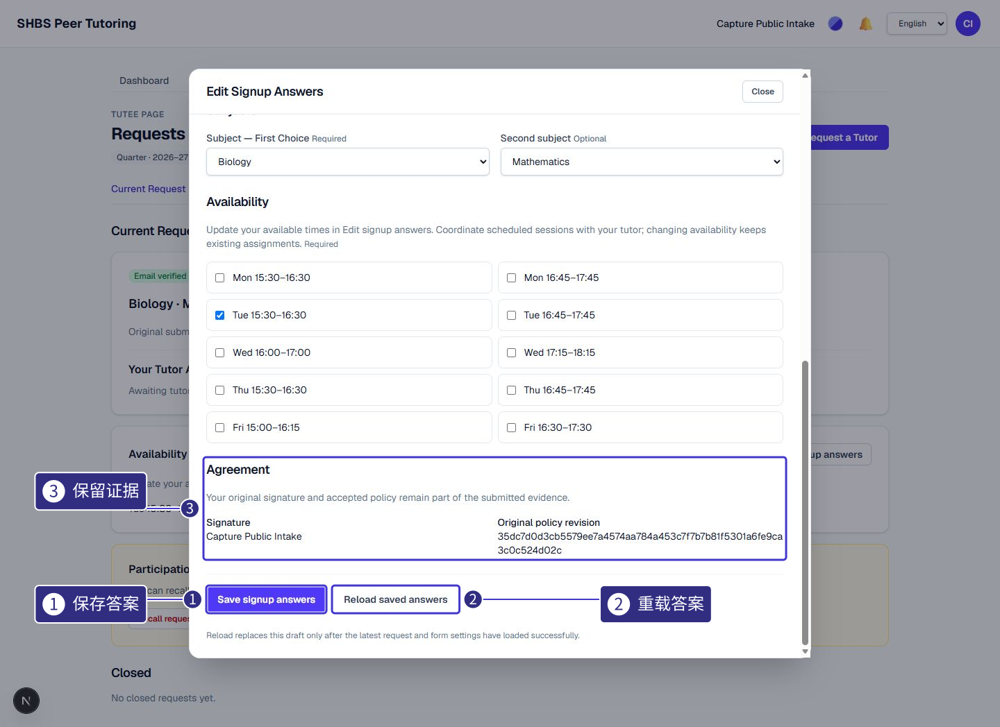

   /student?view=requests · EN · 2026-11-16

   虚构联系更正保存后，重新打开真实报名编辑器页脚：原科目／可用时间、签名及政策证据保留，并显示真实“保存报名答案”和“重新加载已保存答案”。保存会直接执行，不表示存在额外确认对话框。

   [原始完整截图](assets/manage-tutee-request-step-2-view-2.en.jpg) · `589c055e4b1cf166b48b353bd619ac1982e5d9f6` · Latest-main development baseline 589c055e with the Help candidate; synthetic demonstration data.

   已为本步骤添加标注，原始完整截图保持不变。

   - **1.** 保存答案

   - **2.** 重载答案

   - **3.** 保留证据

   **视图 3**

   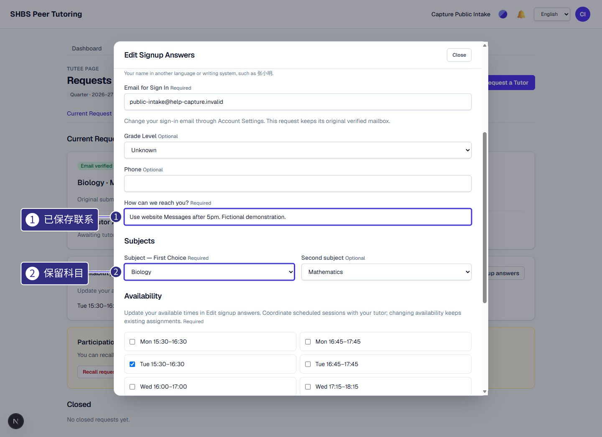

   /student?view=requests · EN · 2026-11-16

   重新打开已保存的申请编辑器，实际显示虚构联系偏好从下午4点后更正为下午5点后，科目仍为生物／数学。此图为关闭后重开的已保存读取结果，不是未保存的声明，也未再次执行保存。

   [原始完整截图](assets/manage-tutee-request-step-2-view-3.en.jpg) · `589c055e4b1cf166b48b353bd619ac1982e5d9f6` · Latest-main development baseline 589c055e with the Help candidate; synthetic demonstration data.

   已为本步骤添加标注，原始完整截图保持不变。

   - **1.** 已保存联系

   - **2.** 保留科目

3. **确需结束时才撤回** 符合条件的未分配申请可选择撤回，阅读永久结束影响，等待两秒确认后提交。取消会保留申请。若刷新警告出现，请先检查保存结果，不要重复提交。

   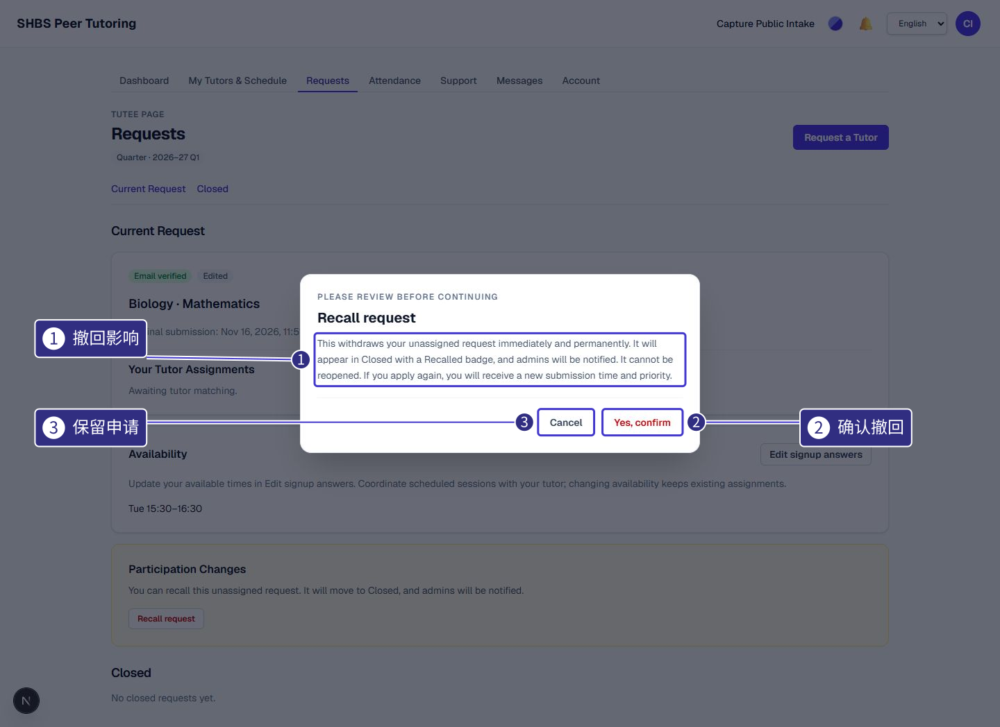

   /student?view=requests · EN · 2026-11-16

   真实“撤回申请”核对已完成所需两秒等待，现显示“是，确认”。对话框说明立即永久结束、保留“已撤回”历史及重新申请时获得新优先时间。此图拍摄于确认之前；申请仍未结束，随后将选择取消。

   [原始完整截图](assets/manage-tutee-request-step-3.en.jpg) · `589c055e4b1cf166b48b353bd619ac1982e5d9f6` · Latest-main development baseline 589c055e with the Help candidate; synthetic demonstration data.

   已为本步骤添加标注，原始完整截图保持不变。

   - **1.** 撤回影响

   - **2.** 确认撤回

   - **3.** 保留申请

### 预期结果

当前申请显示已接受答案，或撤回申请以已结束状态保留历史。

### 工作原理

符合条件的当前未结申请可在公开招募结束后编辑。编辑保留原优先时间、分配、课次和签署证据，不改变登录身份。撤回永久结束该申请；之后重新申请会产生新优先时间。

### 问题排查

- **编辑时申请已改变** 保留草稿，明确重新加载当前版本并核对后再提交。普通读取重试不会替换已捕获的审核版本。

## 申请退出辅导

分配后申请经审核退出，并查看实际决定。

打开: `/student?view=requests`

### 开始之前

- 本人有符合条件的当前参与记录，包括明确关联账户的工作人员录入报名。

### 操作步骤

1. **打开参与情况** 在申请→参与情况中选择申请退出，检查按钮标明正确当前学季或学期。

   请注意: 参与情况与申请退出

   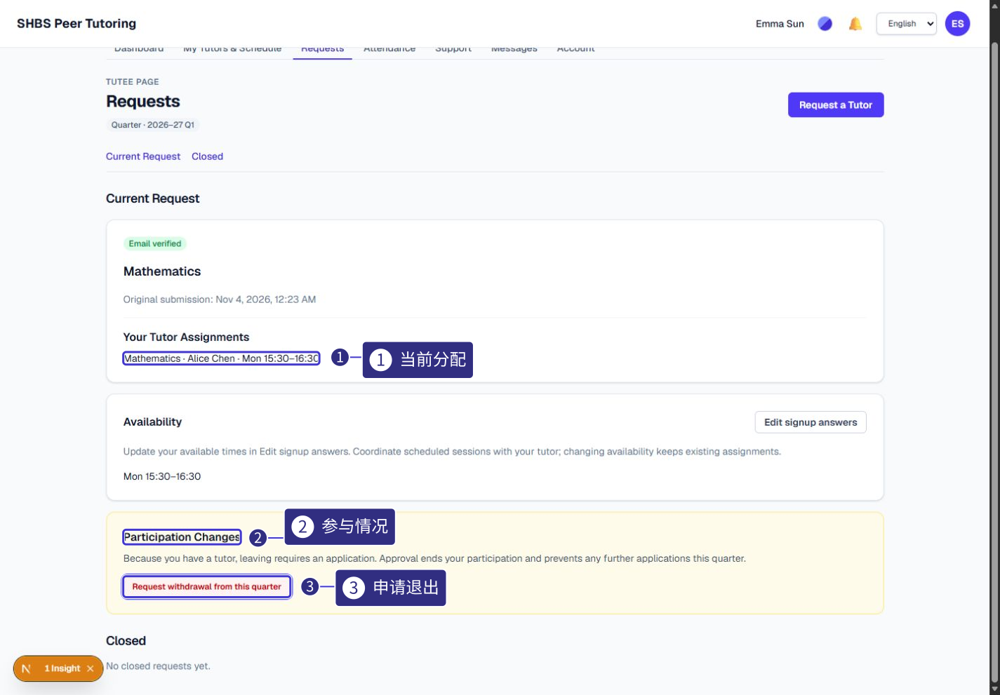

   /student?view=requests · EN · 2026-11-20

   申请页显示当前辅导分配，以及参与情况变更下的退出入口。按钮明确适用于本学季。

   [原始完整截图](assets/withdraw-tutee-step-1.en.jpg) · `b5ece465681957c9fe579d26babdeb260c674fa0` · Latest-main development baseline b5ece465, selected 2026-11-20, with the Help candidate and synthetic demo records.

   已为本步骤添加标注，原始完整截图保持不变。

   - **1.** 当前分配

   - **2.** 参与情况

   - **3.** 申请退出

2. **填写原因并检查** 输入原因，核对将结束的参与范围，等待三秒确认后提交。提交前取消或按Escape不会改变参与。

   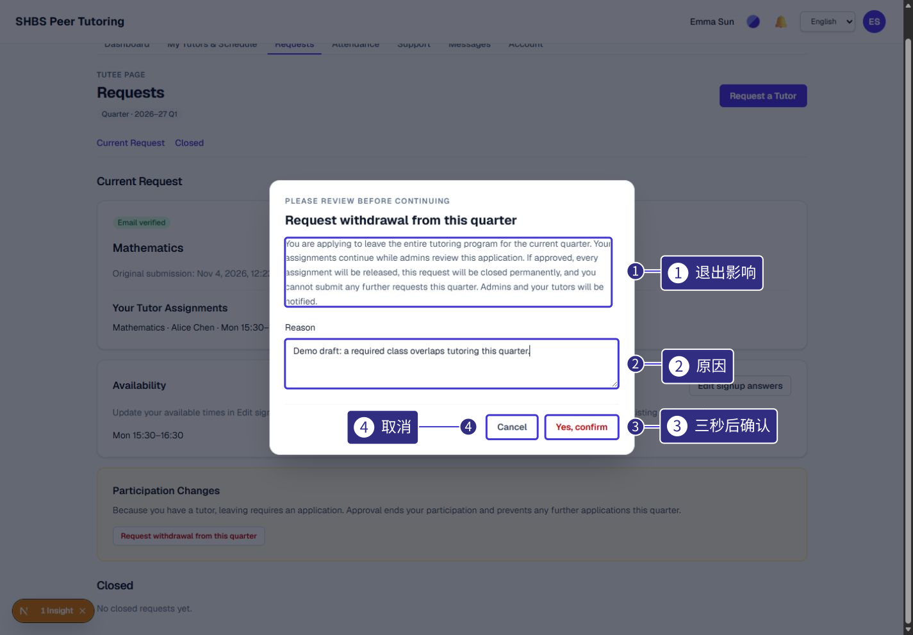

   /student?view=requests · EN · 2026-11-20

   阅读整个学季的退出范围并填写原因。实际确认倒计时已结束。本草稿在提交退出申请前取消。

   [原始完整截图](assets/withdraw-tutee-step-2.en.jpg) · `b5ece465681957c9fe579d26babdeb260c674fa0` · Latest-main development baseline b5ece465, selected 2026-11-20, with the Help candidate and synthetic demo records.

   已为本步骤添加标注，原始完整截图保持不变。

   - **1.** 退出影响

   - **2.** 原因

   - **3.** 三秒后确认

   - **4.** 取消

3. **查看决定** 检查待审申请及之后批准或拒绝结果。审核期间分配仍有效。提交已接受但无法刷新时，使用只读重试。

   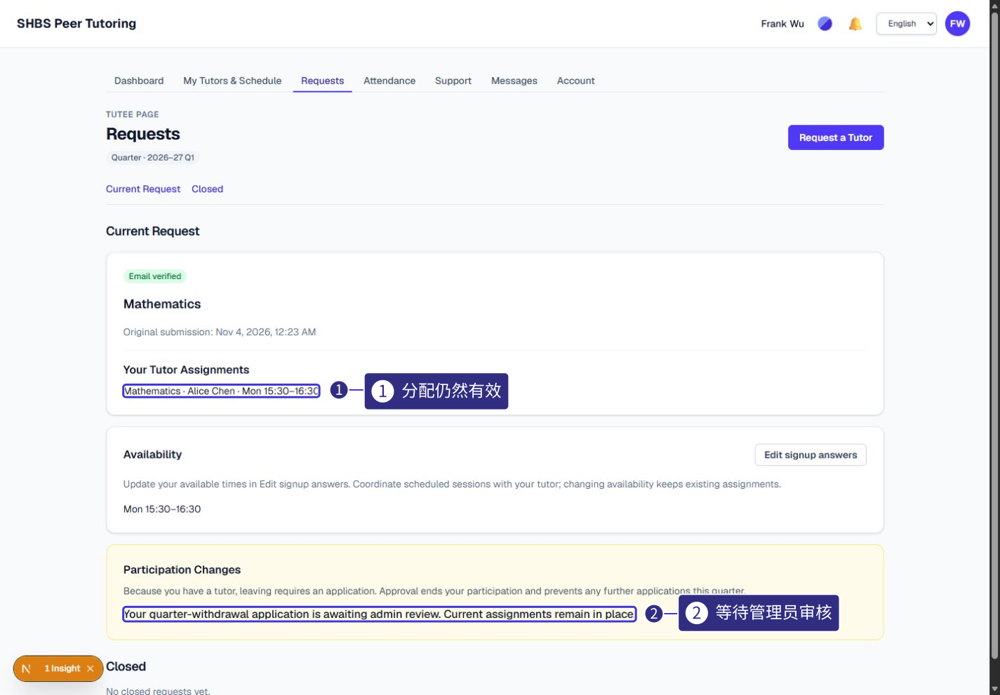

   /student?view=requests · EN · 2026-11-20

   Frank 的现有退出申请仍待审核，当前数学辅导员仍在列表中。现有待审申请保持原状。

   [原始完整截图](assets/withdraw-tutee-step-3.en.jpg) · `b5ece465681957c9fe579d26babdeb260c674fa0` · Latest-main development baseline b5ece465, selected 2026-11-20, with the Help candidate and synthetic demo records.

   已为本步骤添加标注，原始完整截图保持不变。

   - **1.** 分配仍然有效

   - **2.** 等待管理员审核

### 预期结果

记录有原因的退出申请；仅获批后结束参与。

### 工作原理

退出获批会结束参与，并阻止在当前时期再次申请。辅导伙伴的排课冲突审核范围更窄：批准解除只释放该分配，并保留匹配优先时间。

### 问题排查

- **只想更改一个科目或日期** 请使用申请编辑、工作人员分配审核或日期改期。选择整个时期退出前，先核对页面显示范围。

## 申诉被标为无效的辅导申请

阅读原因、提交说明，并区分提交回执和处理决定。

打开: `/student?view=requests`

### 开始之前

- 本人拥有被标记申请，且当前时期仍允许申诉。

### 操作步骤

1. **阅读无效提示** 在“申请”中打开“审核被标记的申请”，查看申诉状态。也可以使用此申请通知中的私密链接。如有提示，请完成登录或验证。

   请注意: 申请无效原因与申诉操作

   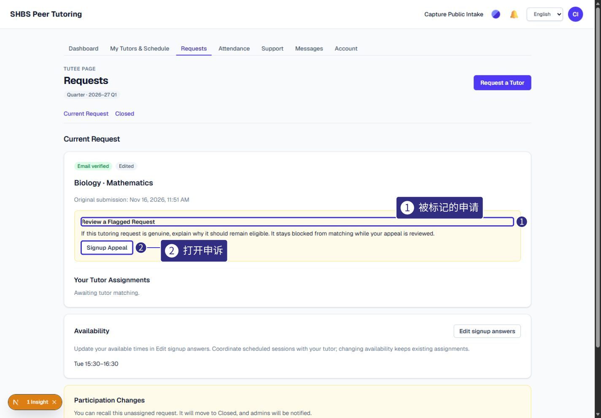

   /student?view=requests · EN · 2026-11-20

   在“申请”中打开被标记的申请。“报名申诉”会打开此本人申请的说明表单。

   [原始完整截图](assets/appeal-invalid-request-step-1.en.jpg) · `b5ece465681957c9fe579d26babdeb260c674fa0` · Latest-main development baseline b5ece465, selected 2026-11-20, with the Help candidate and synthetic demo records.

   已为本步骤添加标注，原始完整截图保持不变。

   - **1.** 被标记的申请

   - **2.** 打开申诉

2. **提交有依据的申诉** 选择申诉，解释为何应复核该标记，并提交一次。发送期间保持页面打开；保存回执并不代表申诉已获支持。

   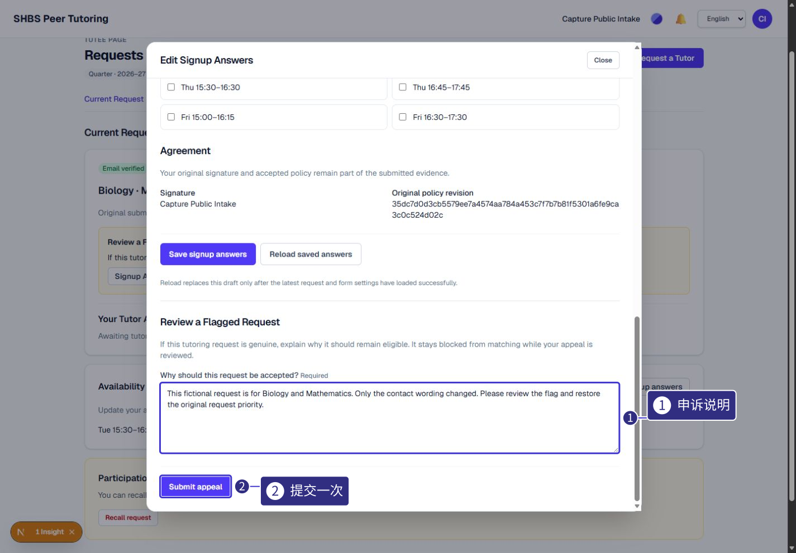

   /student?view=requests · EN · 2026-11-20

   在登录后的申请表中填写说明。任选一个入口提交一次即可记录申诉。

   [原始完整截图](assets/appeal-invalid-request-step-2.en.jpg) · `b5ece465681957c9fe579d26babdeb260c674fa0` · Latest-main development baseline b5ece465, selected 2026-11-20, with the Help candidate and synthetic demo records.

   已为本步骤添加标注，原始完整截图保持不变。

   - **1.** 申诉说明

   - **2.** 提交一次

3. **查看独立决定** 查看待处理、拒绝或已清除状态。申诉获支持会清除标记并保留原优先时间；最终拒绝会结束当前申请及其优先时间，但保留证据。

   **视图 1**

   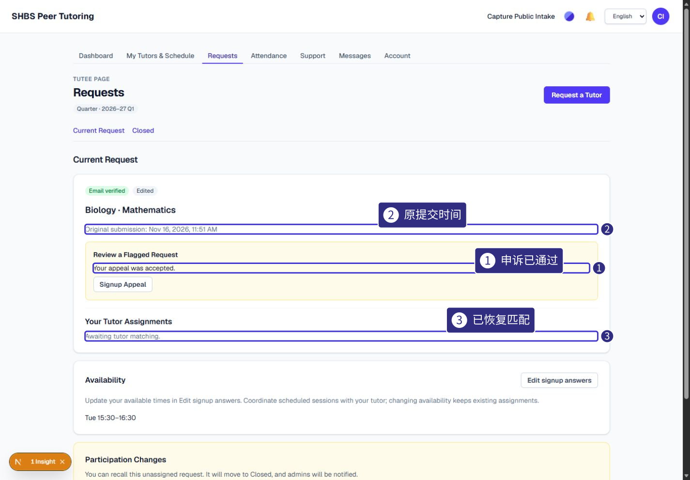

   /student?view=requests · EN · 2026-11-20

   申请人可看到独立的通过决定、原提交时间以及申请返回辅导匹配。

   [原始完整截图](assets/appeal-invalid-request-step-3.en.jpg) · `b5ece465681957c9fe579d26babdeb260c674fa0` · Latest-main development baseline b5ece465, selected 2026-11-20, with the Help candidate and synthetic demo records.

   已为本步骤添加标注，原始完整截图保持不变。

   - **1.** 申诉已通过

   - **2.** 原提交时间

   - **3.** 已恢复匹配

   **视图 2**

   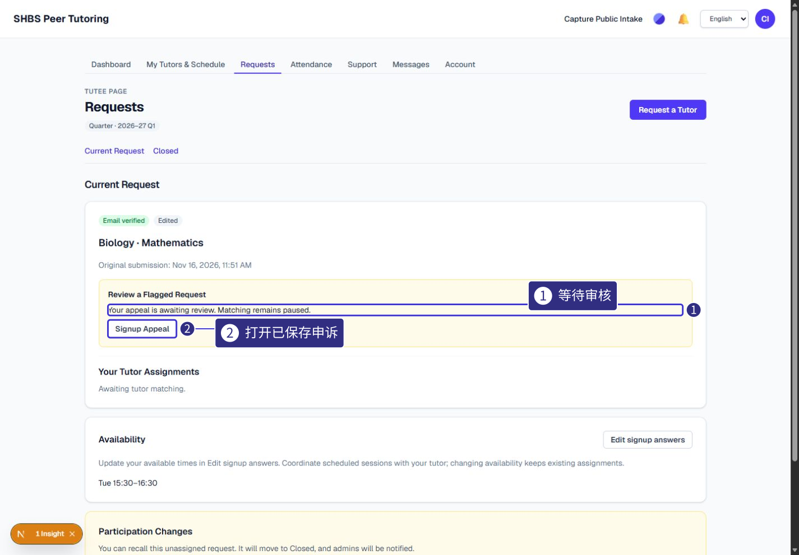

   /student?view=requests · EN · 2026-11-20

   提交后，已登录申请人会看到同一待审核申诉。作出决定前，匹配仍暂停。

   [原始完整截图](assets/appeal-invalid-request-step-3-view-2.en.jpg) · `b5ece465681957c9fe579d26babdeb260c674fa0` · Latest-main development baseline b5ece465, selected 2026-11-20, with the Help candidate and synthetic demo records.

   已为本步骤添加标注，原始完整截图保持不变。

   - **1.** 等待审核

   - **2.** 打开已保存申诉

### 预期结果

申诉提交被记录，并单独显示管理决定。

### 工作原理

申诉期间申请仍无效并被阻止处理。申诉或重发不会延长固定验证期限。当前报名申诉在时期切换时结束。旧版指定申请申诉链接按自身显示期限生效，且仅允许其有限申诉操作。

### 问题排查

- **已提交申诉但仍有标记** 单独查看决定；仅提交不会清除标记。发送后刷新失败时，重试读取，不要重复提交申诉。

## 查看出勤、反馈及纪律卡申诉

使用课次记录和本人支持历史，并了解可见范围及期限。

打开: `/student?view=attendance`

### 开始之前

- 课次或纪律卡属于本人明确拥有的档案。

### 操作步骤

1. **打开出勤** 查看不同招募时期的课次，选择对应课次提交反馈。提交前检查可见范围：反馈默认仅管理团队可见，可选共享给该课辅导伙伴。

   请注意: 已记录课次与反馈可见范围

   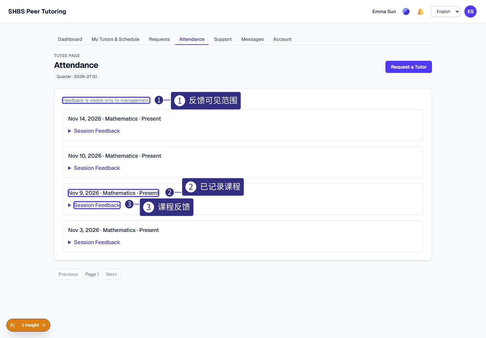

   /student?view=attendance · EN · 2026-11-20

   出勤页面显示当前仅管理团队可见的规则，在确切已记录课程下打开课程反馈。

   [原始完整截图](assets/tutee-feedback-appeals-step-1.en.jpg) · `b5ece465681957c9fe579d26babdeb260c674fa0` · Latest-main development baseline b5ece465, selected 2026-11-20, with the Help candidate and synthetic demo records.

   已为本步骤添加标注，原始完整截图保持不变。

   - **1.** 反馈可见范围

   - **2.** 已记录课程

   - **3.** 课程反馈

2. **提交反馈** 填写所需反馈并保存一次。可见范围正在检查或不可用时，使用其重试确认当前设置，不要假定旧设置仍适用。

   请注意: 展开的课次反馈评分、评论及保存控件

   **视图 1**

   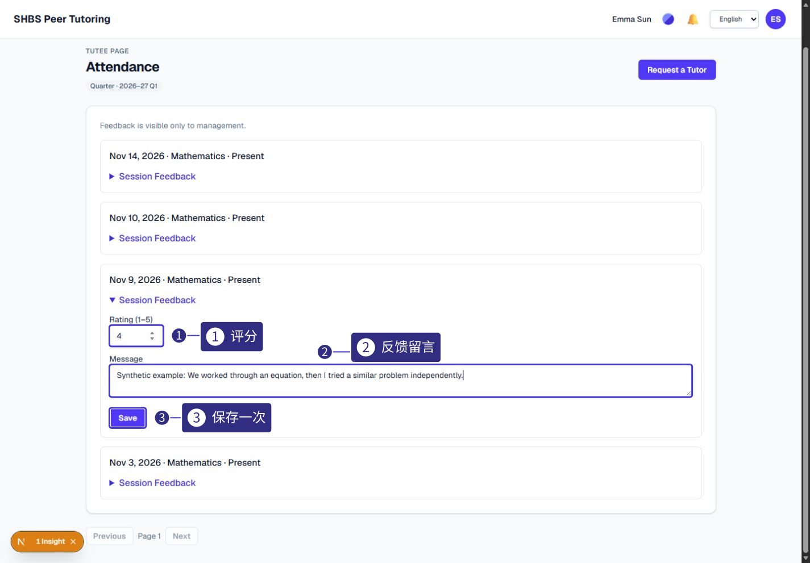

   /student?view=attendance · EN · 2026-11-20

   在确切课程下填写评分和留言，然后保存一次。上一步展示已核实的共享规则。

   [原始完整截图](assets/tutee-feedback-appeals-step-2.en.jpg) · `b5ece465681957c9fe579d26babdeb260c674fa0` · Latest-main development baseline b5ece465, selected 2026-11-20, with the Help candidate and synthetic demo records.

   已为本步骤添加标注，原始完整截图保持不变。

   - **1.** 评分

   - **2.** 反馈留言

   - **3.** 保存一次

   **视图 2**

   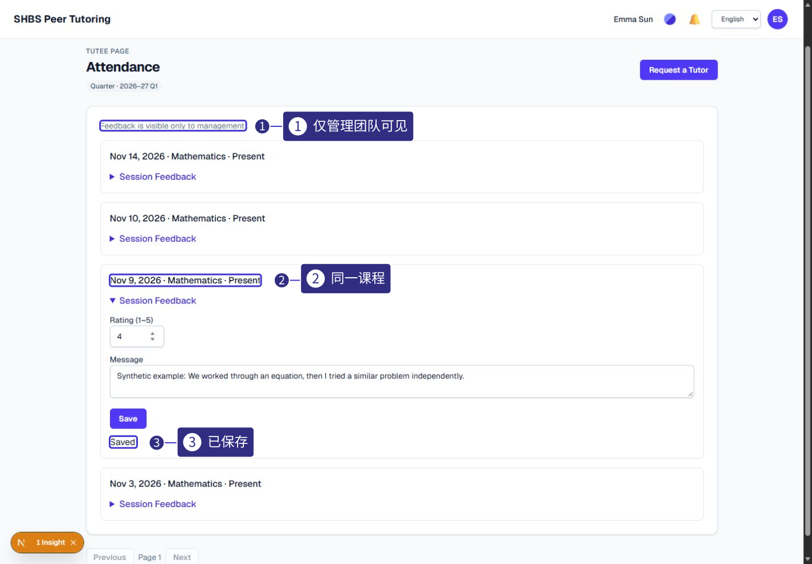

   /student?view=attendance · EN · 2026-11-20

   十一月九日确切记录的反馈下方显示已保存。当前可见范围仍仅限管理团队。

   [原始完整截图](assets/tutee-feedback-appeals-step-2-view-2.en.jpg) · `b5ece465681957c9fe579d26babdeb260c674fa0` · Latest-main development baseline b5ece465, selected 2026-11-20, with the Help candidate and synthetic demo records.

   已为本步骤添加标注，原始完整截图保持不变。

   - **1.** 仅管理团队可见

   - **2.** 同一课程

   - **3.** 已保存

3. **查看并申诉本人的纪律卡** 在“支持”中找到本人纪律卡，查看原因、页面显示的申诉期限及状态。须在项目时区下签发日期后的第五个上课日结束前，提交一次有依据的申诉。之后返回“支持”查看决定。

   请注意: 本人纪律卡、申诉原因和状态

   **视图 1**

   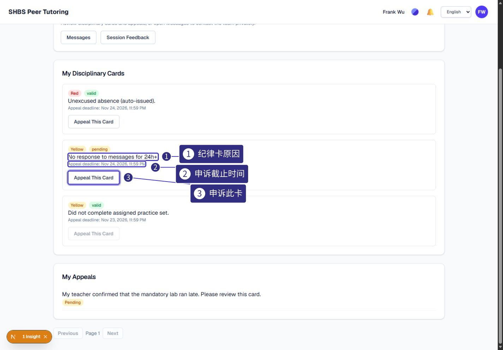

   /student?view=support · EN · 2026-11-20

   支持页面在确切纪律卡上列出原因、状态及显示的截止时间。此独立黄卡目前可申诉。

   [原始完整截图](assets/tutee-feedback-appeals-step-3.en.jpg) · `b5ece465681957c9fe579d26babdeb260c674fa0` · Latest-main development baseline b5ece465, selected 2026-11-20, with the Help candidate and synthetic demo records.

   已为本步骤添加标注，原始完整截图保持不变。

   - **1.** 纪律卡原因

   - **2.** 申诉截止时间

   - **3.** 申诉此卡

   **视图 2**

   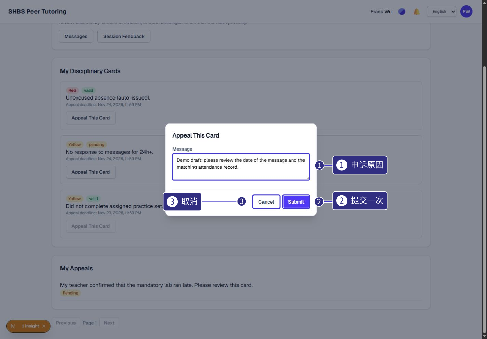

   /student?view=support · EN · 2026-11-20

   选择的纪律卡会打开其申诉草稿。提交前填入支持理由；本次示例在提交前取消。

   [原始完整截图](assets/tutee-feedback-appeals-step-3-view-2.en.jpg) · `b5ece465681957c9fe579d26babdeb260c674fa0` · Latest-main development baseline b5ece465, selected 2026-11-20, with the Help candidate and synthetic demo records.

   已为本步骤添加标注，原始完整截图保持不变。

   - **1.** 申诉原因

   - **2.** 提交一次

   - **3.** 取消

### 预期结果

反馈或申诉显示已保存状态，并能查看对应共享规则或决定。

### 工作原理

后续反馈共享变更也影响以前的反馈。待处理申诉不会使纪律卡失效。启用纪律模块时，无故缺席生成有效红卡；三张有效黄卡折算一张有效红卡，两张有效红卡可自动结束有效参与。

假期及补课日按工作人员维护的校历计算。申诉获支持会使纪律卡失效，并按现有恢复规则重新计算状态。

### 问题排查

- **发送成功但记录未重新加载** 使用重试读取保存记录。页面打开期间保留草稿；不要重复提交已接受申诉。出勤错误请管理团队更正指定记录。

## 将符合条件的配对延续到下一学季

在有限延续窗口内检查原配对，并查看每项分配结果。

打开: `/student?view=requests`

### 开始之前

- 已正式进行Q1到Q2或Q3到Q4刷新、当前使用学季模式，且仍在目标学习伙伴报名首次开放后一小时内。

### 操作步骤

1. **选择本人原配对** 在概览或申请中查看项目时区下的延续截止时间。选择希望保留的原辅导伙伴／科目配对，再选择检查已选配对。

   请注意: 出现时的可延续选择及明确截止时间

   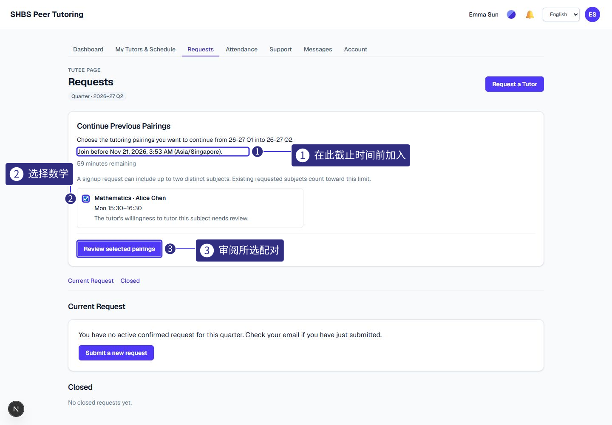

   /student?view=requests · EN · 2026-11-20

   Emma在Q2开放首小时内，选中自己原Q1与Alice Chen的数学配对。页面提示需审核辅导伙伴意愿。

   [原始完整截图](assets/continue-quarter-pairings-step-1.en.jpg) · `b5ece465681957c9fe579d26babdeb260c674fa0` · Latest-main development baseline b5ece465, selected 2026-11-20, with the Help candidate. Isolated synthetic first-report demonstration phase.

   已为本步骤添加标注，原始完整截图保持不变。

   - **1.** 在此截止时间前加入

   - **2.** 选择数学

   - **3.** 审阅所选配对

2. **核对并签名** 核对辅导伙伴、科目和沿用的每周时间，再阅读当前政策、同意并签名。申请最多包含两个不同科目，包括本学季已申请科目。选择加入已选配对。

   **视图 1**

   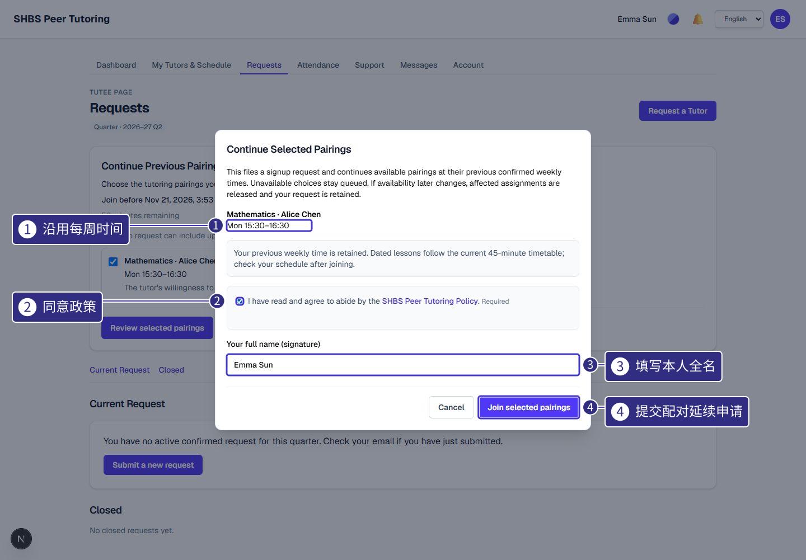

   /student?view=requests · EN · 2026-11-20

   审阅展示沿用的数学配对及星期一时间。Emma已阅读并同意当前政策，填写模拟账户全名，此时可提交加入。

   [原始完整截图](assets/continue-quarter-pairings-step-2.en.jpg) · `b5ece465681957c9fe579d26babdeb260c674fa0` · Latest-main development baseline b5ece465, selected 2026-11-20, with the Help candidate. Isolated synthetic first-report demonstration phase.

   已为本步骤添加标注，原始完整截图保持不变。

   - **1.** 沿用每周时间

   - **2.** 同意政策

   - **3.** 填写本人全名

   - **4.** 提交配对延续申请

   **视图 2**

   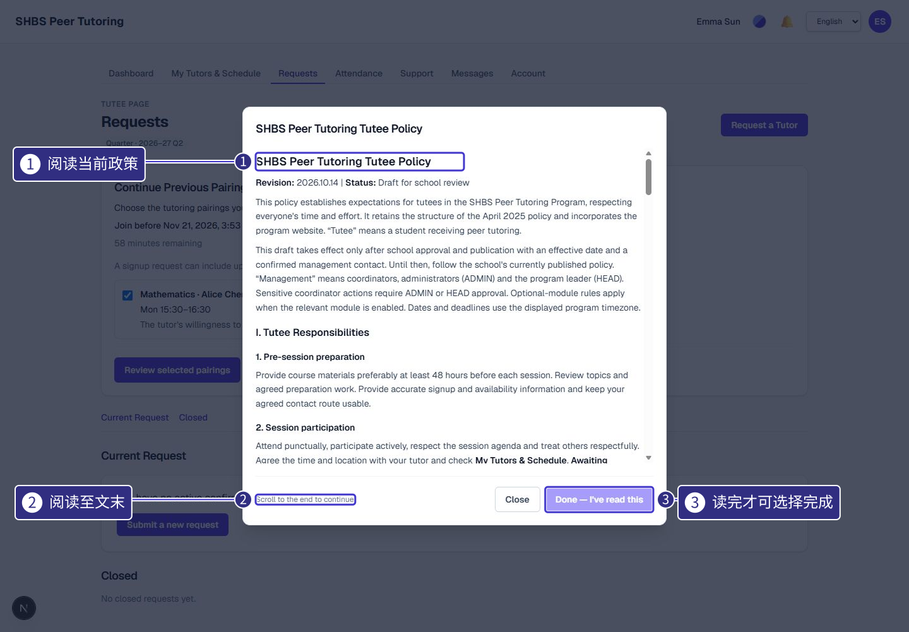

   /student?view=requests · EN · 2026-11-20

   当前学习伙伴政策在真实阅读器中打开。滚动读至末尾以启用完成按钮，然后返回配对审阅。

   [原始完整截图](assets/continue-quarter-pairings-step-2-view-2.en.jpg) · `b5ece465681957c9fe579d26babdeb260c674fa0` · Latest-main development baseline b5ece465, selected 2026-11-20, with the Help candidate. Isolated synthetic first-report demonstration phase.

   已为本步骤添加标注，原始完整截图保持不变。

   - **1.** 阅读当前政策

   - **2.** 阅读至文末

   - **3.** 读完才可选择完成

   **视图 3**

   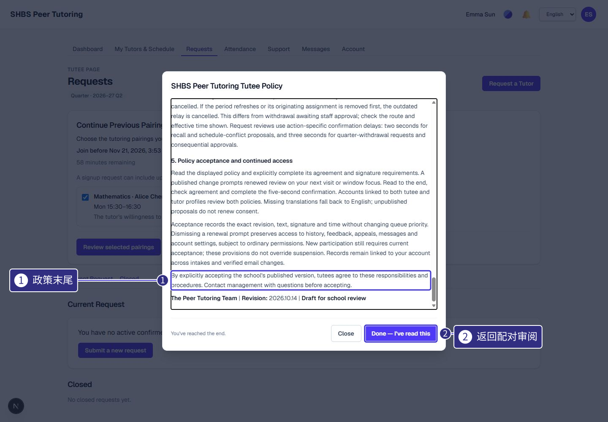

   /student?view=requests · EN · 2026-11-20

   阅读至政策末尾后，完成按钮可用。返回配对审阅时，其单独的政策同意复选框即可选择。

   [原始完整截图](assets/continue-quarter-pairings-step-2-view-3.en.jpg) · `b5ece465681957c9fe579d26babdeb260c674fa0` · Latest-main development baseline b5ece465, selected 2026-11-20, with the Help candidate. Isolated synthetic first-report demonstration phase.

   已为本步骤添加标注，原始完整截图保持不变。

   - **1.** 政策末尾

   - **2.** 返回配对审阅

3. **逐项查看保存结果** 已分配与申请已提交、等待分配是不同结果，也可能同时出现。实际课次与教室应查看日期课表。结果不明确时先选择检查申请结果，不要再次提交。

   **视图 1**

   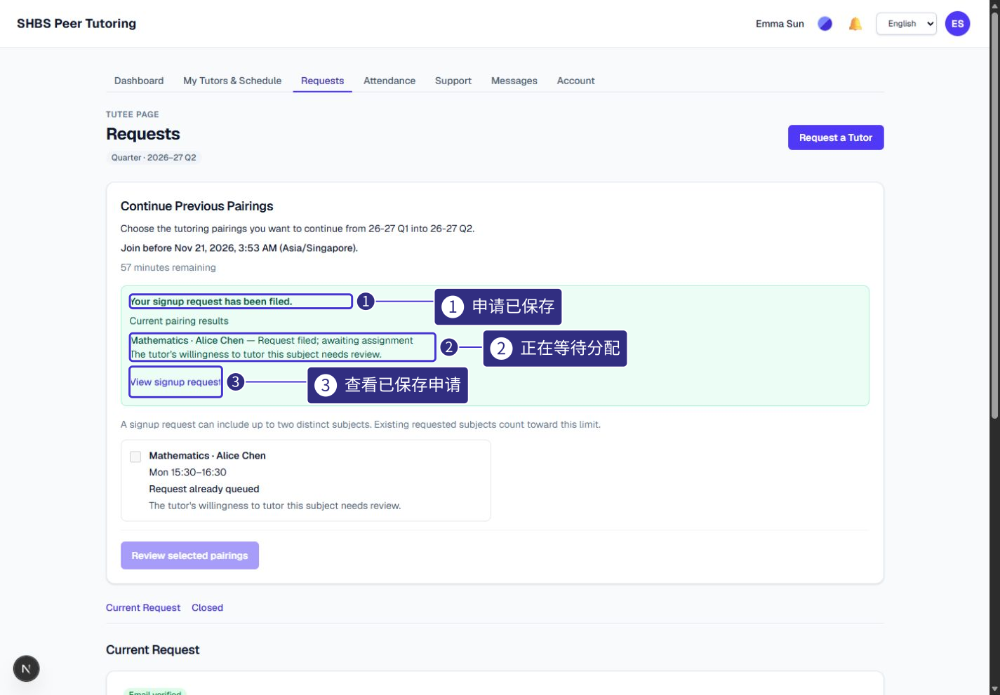

   /student?view=requests · EN · 2026-11-20

   Q2延续已接受并生成数学报名申请。与Alice Chen的配对等候意愿审阅，暂未产生已分配课次。

   [原始完整截图](assets/continue-quarter-pairings-step-3.en.jpg) · `b5ece465681957c9fe579d26babdeb260c674fa0` · Latest-main development baseline b5ece465, selected 2026-11-20, with the Help candidate. Isolated synthetic first-report demonstration phase.

   已为本步骤添加标注，原始完整截图保持不变。

   - **1.** 申请已保存

   - **2.** 正在等待分配

   - **3.** 查看已保存申请

   **视图 2**

   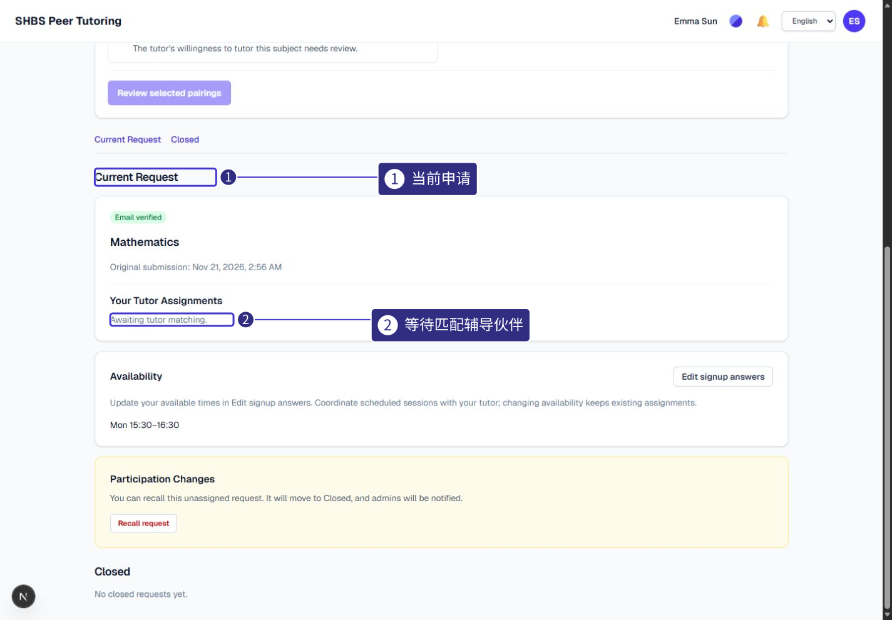

   /student?view=requests · EN · 2026-11-20

   Q2当前申请显示数学及等待辅导伙伴匹配。此保存申请下仍可查看原申请时间和可用时间。

   [原始完整截图](assets/continue-quarter-pairings-step-3-view-2.en.jpg) · `b5ece465681957c9fe579d26babdeb260c674fa0` · Latest-main development baseline b5ece465, selected 2026-11-20, with the Help candidate. Isolated synthetic first-report demonstration phase.

   已为本步骤添加标注，原始完整截图保持不变。

   - **1.** 当前申请

   - **2.** 等待匹配辅导伙伴

   **视图 3**

   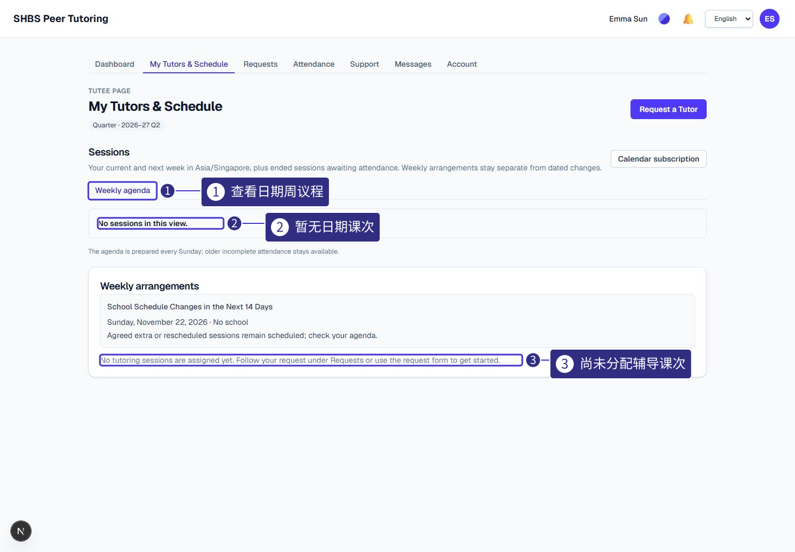

   /student?view=schedule · EN · 2026-11-20

   实际日期周议程目前没有课次，工作区也确认尚未分配辅导安排，与等待分配的结果一致。

   [原始完整截图](assets/continue-quarter-pairings-step-3-view-3.en.jpg) · `b5ece465681957c9fe579d26babdeb260c674fa0` · Latest-main development baseline b5ece465, selected 2026-11-20, with the Help candidate. Isolated synthetic first-report demonstration phase.

   已为本步骤添加标注，原始完整截图保持不变。

   - **1.** 查看日期周议程

   - **2.** 暂无日期课次

   - **3.** 尚未分配辅导课次

### 预期结果

接受的选择加入同一当前申请，每项配对都有明确结果。

### 工作原理

暂停或重开招募不会重新开始一小时。跨学期、跨学年或学期模式不能延续。确认常规报名后延续选项消失。不符合分配条件的选择仍可能以申请形式等待匹配；原历史证据保留。

### 问题排查

- **没有延续选项** 检查时期转换、截止时间、明确所有权及是否已确认普通申请。招募开放时可使用常规表单；首次开放历史未知时不会虚设窗口。

- **面板提示检查必需信息** 选择“检查必需信息”，核对必需的姓名、学业及联系方式，如有提示请完成邮箱验证。如果原记录缺少信息，请联系项目团队。

## 建议或回应具体课次变更

协商改期、加课和取消，同时保留每周配对组。

打开: `/student?view=schedule`

### 开始之前

- 本人属于当前日期课次或提议的受影响学习伙伴。

### 操作步骤

1. **打开具体课次** 在我的辅导伙伴与课表中选择具体日期课次，使用建议或回应操作。可先通过协调消息讨论时间，但消息本身不正式接受变更。

   请注意: 具体日期课次及待回应提议操作

   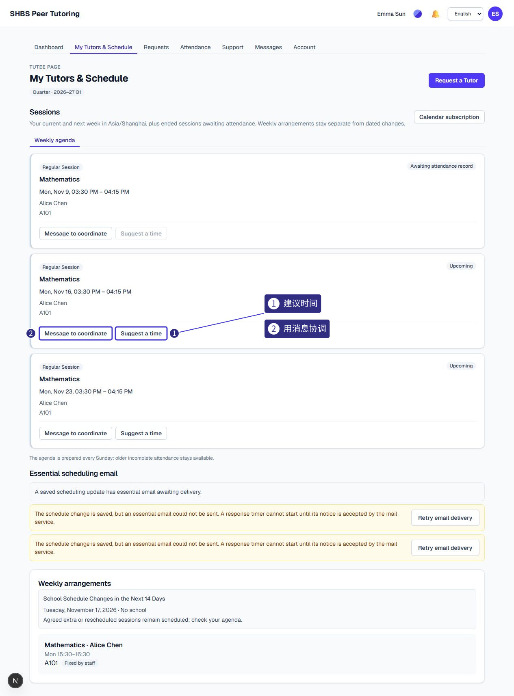

   /student?view=schedule · EN · 2026-11-16

   找到准确日期课次及其时间建议操作

   [原始完整截图](assets/respond-session-plan-step-1.en.jpg) · `589c055e4b1cf166b48b353bd619ac1982e5d9f6` · Latest-main development baseline 589c055e with the Help candidate; synthetic demonstration data.

   已为本步骤添加标注，原始完整截图保持不变。

   - **1.** 建议时间

   - **2.** 用消息协调

2. **核对范围、时间与地点** 查看受影响学习伙伴、原时间与拟定时间，以及教室或线上安排。合适则接受。拒绝辅导伙伴首次单人提议时须提供替代时间；回应最终提议前应阅读其影响。

   **视图 1**

   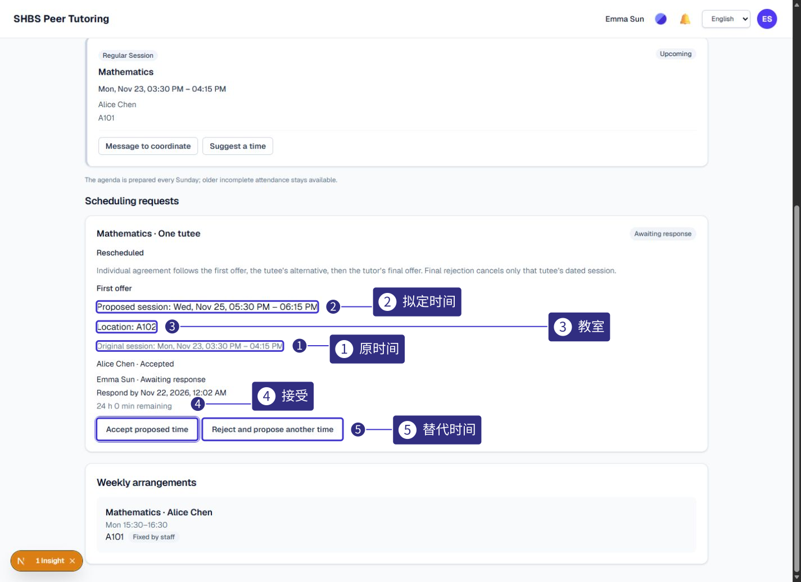

   /student?view=schedule · EN · 2026-11-20

   在艾玛的单人提议中比较原时间、拟定时间和分配教室。可接受合适的时间，或为首次提议打开替代时间编辑器。

   [原始完整截图](assets/respond-session-plan-step-2.en.jpg) · `b5ece465681957c9fe579d26babdeb260c674fa0` · Latest-main development baseline b5ece465, selected 2026-11-20, with the Help candidate and synthetic demo records.

   已为本步骤添加标注，原始完整截图保持不变。

   - **1.** 原时间

   - **2.** 拟定时间

   - **3.** 教室

   - **4.** 接受

   - **5.** 替代时间

   **视图 2**

   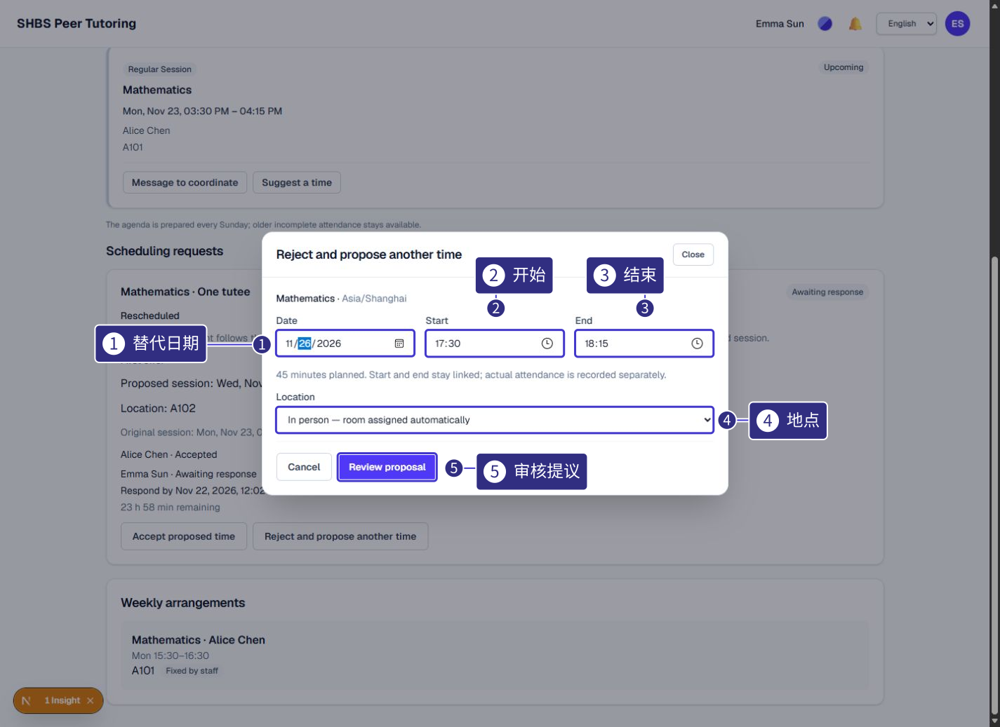

   /student?view=schedule · EN · 2026-11-20

   选择替代方案后，修改日期或时间并选择地点，再审核后发送。

   [原始完整截图](assets/respond-session-plan-step-2-view-2.en.jpg) · `b5ece465681957c9fe579d26babdeb260c674fa0` · Latest-main development baseline b5ece465, selected 2026-11-20, with the Help candidate and synthetic demo records.

   已为本步骤添加标注，原始完整截图保持不变。

   - **1.** 替代日期

   - **2.** 开始

   - **3.** 结束

   - **4.** 地点

   - **5.** 审核提议

   **视图 3**

   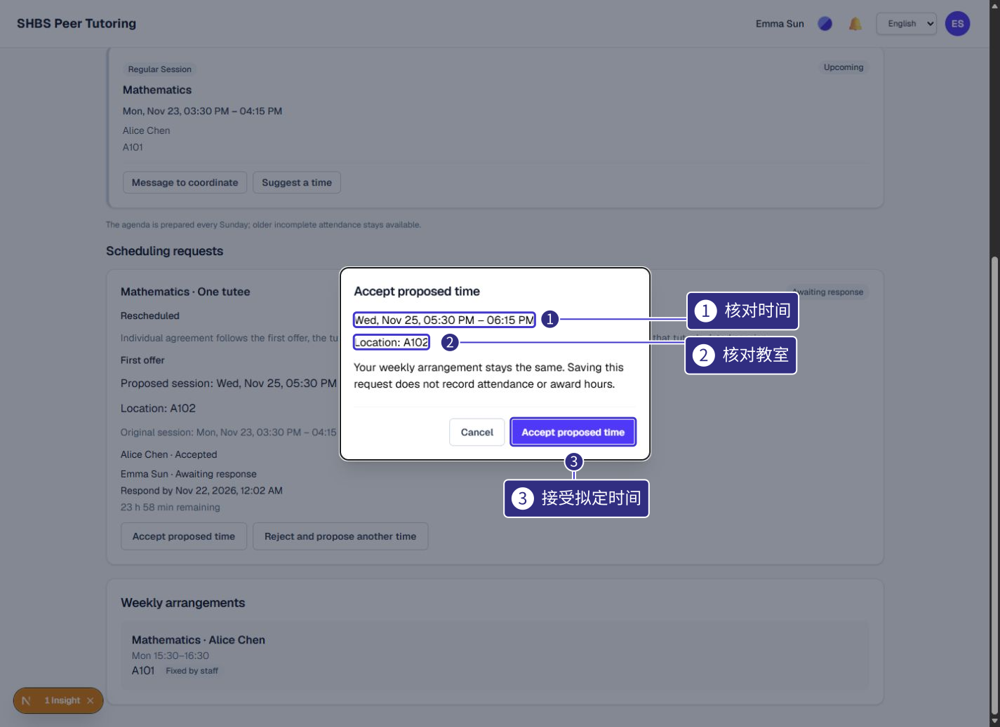

   /student?view=schedule · EN · 2026-11-20

   在确认窗口核对新的日期时间和教室，再选择接受拟定时间完成确认。

   [原始完整截图](assets/respond-session-plan-step-2-view-3.en.jpg) · `b5ece465681957c9fe579d26babdeb260c674fa0` · Latest-main development baseline b5ece465, selected 2026-11-20, with the Help candidate and synthetic demo records.

   已为本步骤添加标注，原始完整截图保持不变。

   - **1.** 核对时间

   - **2.** 核对教室

   - **3.** 接受拟定时间

3. **处理小组或取消申请** 全组提议需要所有人接受同一时间。每人可拒绝一次并提供替代时间；之后仍冲突时使用单独改期。已约定加课的取消申请可接受或拒绝取消，不需要替代时间。

   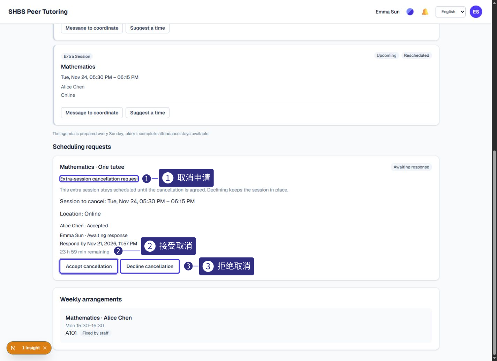

   /student?view=schedule · EN · 2026-11-20

   对此加课取消申请可选择接受取消或拒绝取消。达成同意前，加课仍为即将发生，回应时无需提供其他时间。

   [原始完整截图](assets/respond-session-plan-step-3.en.jpg) · `b5ece465681957c9fe579d26babdeb260c674fa0` · Latest-main development baseline b5ece465, selected 2026-11-20, with the Help candidate and synthetic demo records.

   已为本步骤添加标注，原始完整截图保持不变。

   - **1.** 取消申请

   - **2.** 接受取消

   - **3.** 拒绝取消

4. **查看最终有效结果** 回应后检查课次约定状态和必需通知。取消申请提交回执并不代表课次已取消。刷新失败时使用只读重试。

   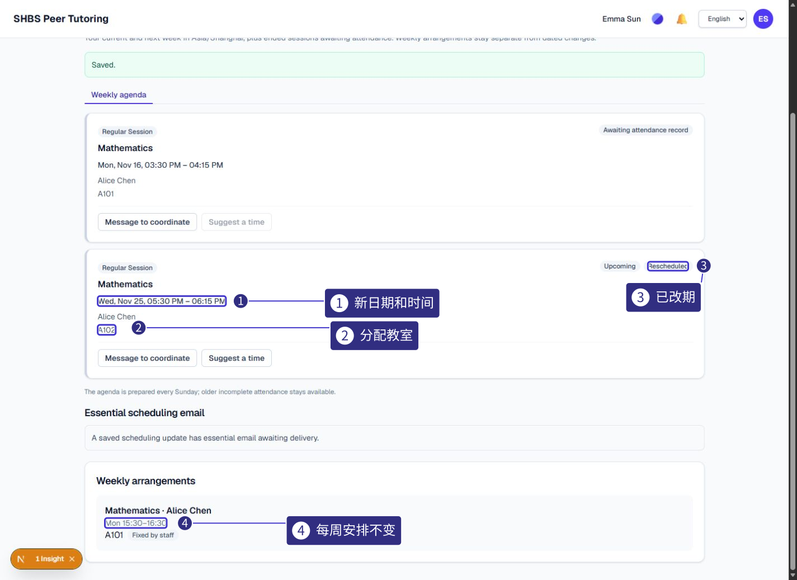

   /student?view=schedule · EN · 2026-11-20

   接受后，指定日期的课程卡片显示新时间、分配教室和已改期状态。每周安排仍显示星期一。

   [原始完整截图](assets/respond-session-plan-step-4.en.jpg) · `b5ece465681957c9fe579d26babdeb260c674fa0` · Latest-main development baseline b5ece465, selected 2026-11-20, with the Help candidate and synthetic demo records.

   已为本步骤添加标注，原始完整截图保持不变。

   - **1.** 新日期和时间

   - **2.** 分配教室

   - **3.** 已改期

   - **4.** 每周安排不变

### 预期结果

页面记录回应，并显示具体日期安排是否真正改变。

### 工作原理

有效二十四小时回应窗口仅在邮件服务器接受必需邮件后开始；发送失败不会自动接受。若在较早课次开始前不足完整窗口，则需明确同意，否则提议过期。拒绝最终单人改期仅取消该日期安排；拒绝加课不会取消常规课。

加课取消申请被拒绝或过期时，课次保留。排课更改不会创建出勤或缺席记录。

### 问题排查

- **邮件失败或申请过期** 查看投递与状态，并与辅导伙伴协调。不要假定未回应就已改课；以页面确认课表为准。除其他有效变更取消外，原课仍保留。
