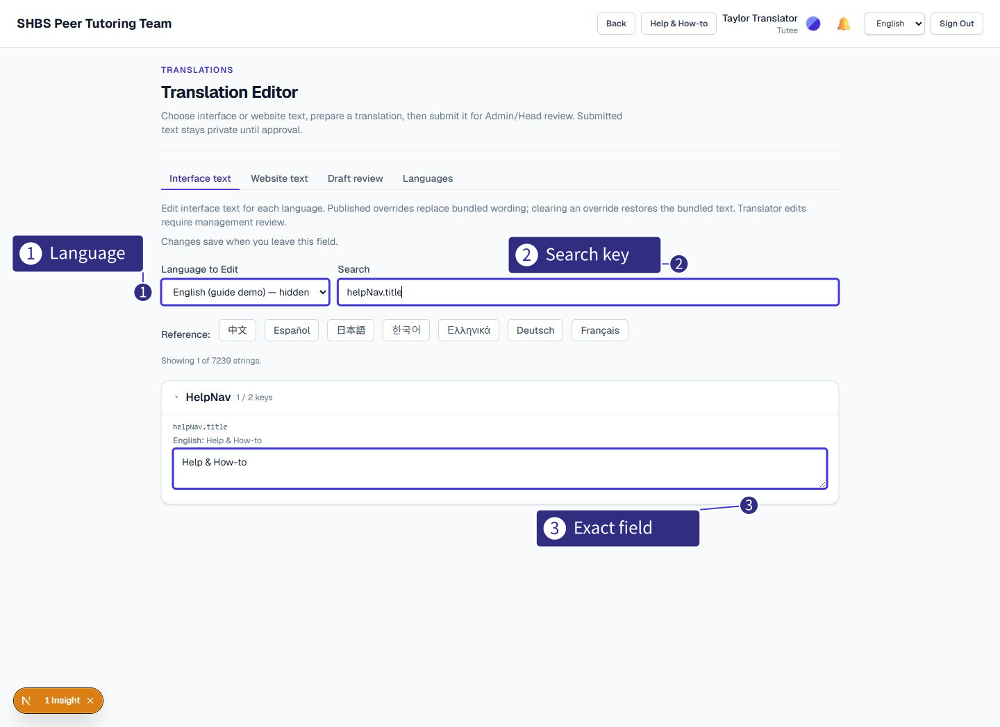
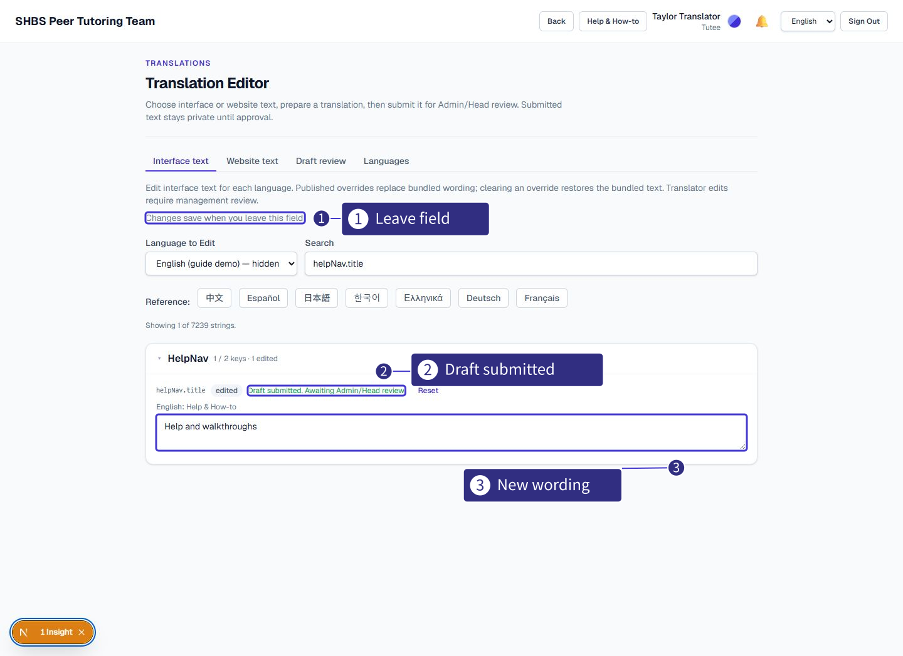
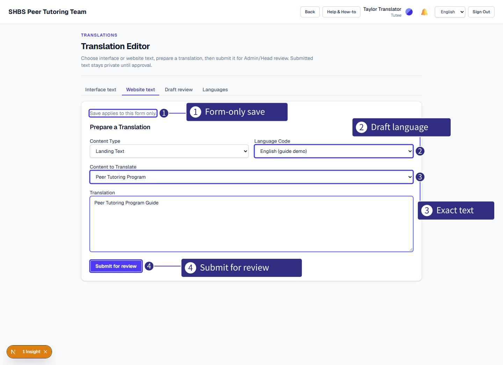
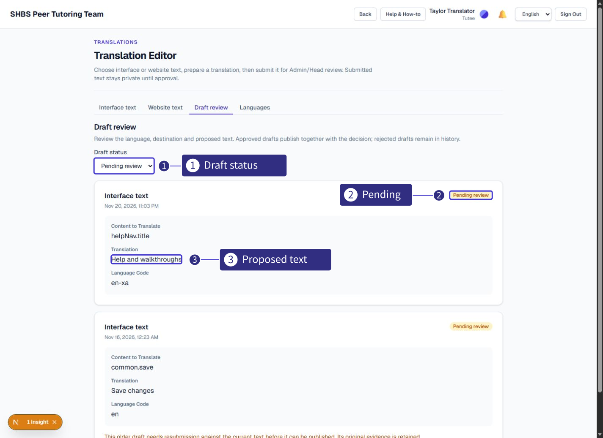
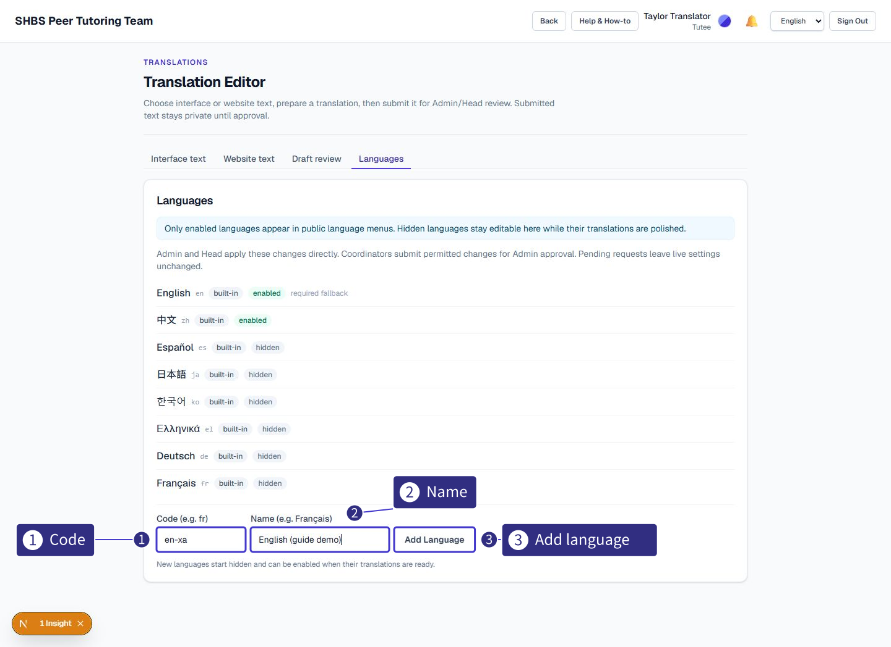
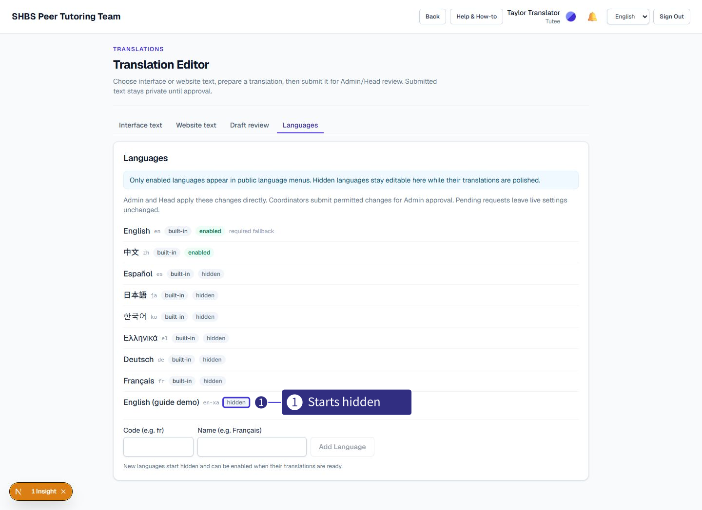

# Translate the website

Generated from the website help catalogue. Edit the content records, then run `npm run help:export`.

[Catalogue & capture provenance](README.md)

Screenshot source: `b5ece465681957c9fe579d26babdeb260c674fa0`. New captures use latest-main development baseline b5ece465, selected 2026-11-20, with the Help candidate. Earlier captures list their own revision and capture date.

This GitHub training copy includes role-specific instructions. Signing in and current program permissions are still required to use the corresponding website features. All examples are synthetic.

- [Translate interface and website text](#translate-interface-and-website-text)

## Translate interface and website text

Choose the exact destination, keep language drafts separate and follow publication review.

Open: `/localization`

### Before you start

- You have an explicit approved Translator assignment. Management review permission alone does not grant editing assignment.

### Walkthrough

1. **Choose text type and language** Open Translations and select Interface text or Website text. Choose the target language and exact destination/group. Search interface strings and expand their group before editing; preserve variables and intended meaning.

   Look for: Interface text, Website text, Draft review and language selector

   

   /localization · EN · 2026-11-20

   In Interface text, select the target language and search the exact key. The matching HelpNav group displays the English source and editable value.

   [Original full screenshot](assets/translate-interface-website-step-1.en.jpg) · `dd970ea426016e85cb514beeeab537c3ab2e5098` · Latest-main development baseline dd970ea4, selected 2026-11-16, with the Help candidate; synthetic demonstration data.

   Annotations added for this step. The original full screenshot is unchanged.

   - **1.** Language

   - **2.** Search key

   - **3.** Exact field

2. **Submit using the correct control** A changed interface field submits when focus leaves it. Website text uses its explicit submission button. Check each saved/pending/error state before leaving. Open language/destination drafts remain independent during the visit.

   **View 1**

   

   /localization · EN · 2026-11-20

   Leave the changed interface field to submit it for review. Draft submitted confirms the new wording is saved for Admin or Head review.

   [Original full screenshot](assets/translate-interface-website-step-2.en.jpg) · `dd970ea426016e85cb514beeeab537c3ab2e5098` · Latest-main development baseline dd970ea4, selected 2026-11-16, with the Help candidate; synthetic demonstration data.

   Annotations added for this step. The original full screenshot is unchanged.

   - **1.** Leave field

   - **2.** Draft submitted

   - **3.** New wording

   **View 2**

   

   /localization · EN · 2026-11-20

   Website text uses its own form. The hidden demonstration language and landing text are selected, and the new wording stays local until Submit for review is selected.

   [Original full screenshot](assets/translate-interface-website-step-2-view-2.en.jpg) · `b5ece465681957c9fe579d26babdeb260c674fa0` · Latest-main development baseline b5ece465, selected 2026-11-20, with the Help candidate and synthetic demo records.

   Annotations added for this step. The original full screenshot is unchanged.

   - **1.** Form-only save

   - **2.** Draft language

   - **3.** Exact text

   - **4.** Submit for review

3. **Follow Draft review** Use Pending, Published, Rejected or All filters to read review status. Ordinary translators and Coordinator edits create private drafts; only Admin/Head approve/publish or reject. A Coordinator may Request Admin/Head approval, leaving the draft pending.

   

   /localization · EN · 2026-11-20

   Open Draft review and use Draft status to locate your exact submission. The new HelpNav string is Pending review in the demo language.

   [Original full screenshot](assets/translate-interface-website-step-3.en.jpg) · `dd970ea426016e85cb514beeeab537c3ab2e5098` · Latest-main development baseline dd970ea4, selected 2026-11-16, with the Help candidate; synthetic demonstration data.

   Annotations added for this step. The original full screenshot is unchanged.

   - **1.** Draft status

   - **2.** Pending

   - **3.** Proposed text

4. **Add a language carefully** Use Languages to add a language with English fallback. New languages start hidden until management reviews and enables them. Only the permitted management controls change public visibility, order or deletion; built-in catalogues cannot be deleted.

   **View 1**

   

   /localization · EN · 2026-11-20

   In Languages, enter a new code and name, then choose Add Language. New language catalogues start hidden.

   [Original full screenshot](assets/translate-interface-website-step-4.en.jpg) · `dd970ea426016e85cb514beeeab537c3ab2e5098` · Latest-main development baseline dd970ea4, selected 2026-11-16, with the Help candidate; synthetic demonstration data.

   Annotations added for this step. The original full screenshot is unchanged.

   - **1.** Code

   - **2.** Name

   - **3.** Add language

   **View 2**

   

   /localization · EN · 2026-11-20

   The new catalogue appears in Languages with hidden status. A Translator can prepare text while this language is absent from the public chooser.

   [Original full screenshot](assets/translate-interface-website-step-4-view-2.en.jpg) · `dd970ea426016e85cb514beeeab537c3ab2e5098` · Latest-main development baseline dd970ea4, selected 2026-11-16, with the Help candidate; synthetic demonstration data.

   Annotations added for this step. The original full screenshot is unchanged.

   - **1.** Starts hidden

### What happens next

Your exact destination has a saved draft or an explicitly identified authorized live publication.

### How it works

Admin/Head with Translator assignment can publish their direct edits; their editor labels these as live changes. Translating text grants no structural page deletion, account authority or unilateral policy publication. Policy translations follow the separate policy revision process; UI language visibility does not create a policy translation.

### Troubleshooting

- **The destination changed or submission refresh failed** A stale destination needs fresh text/draft after reloading; do not approve old wording against changed content. After accepted submission with failed synchronization use read-only Retry. Drafts are not stored after leaving/reloading the editor.
