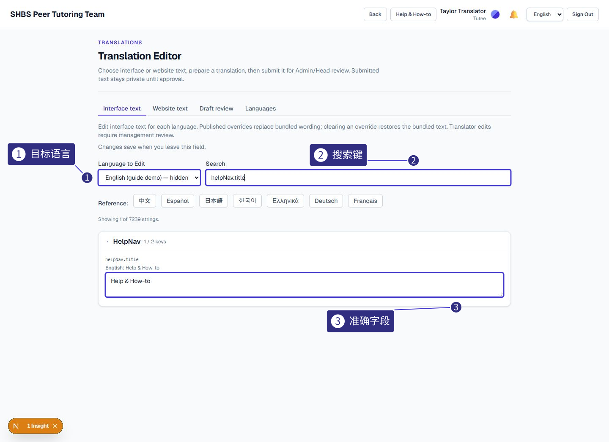
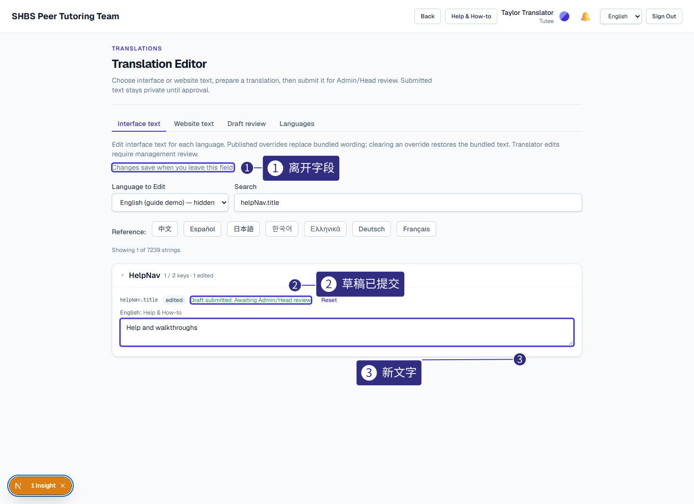
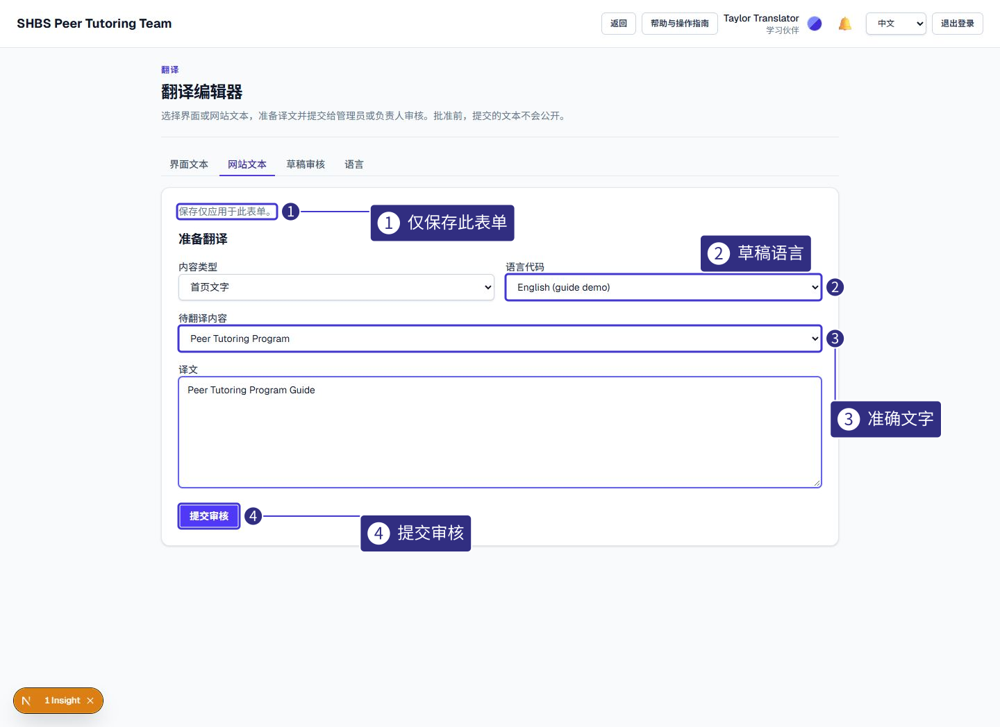
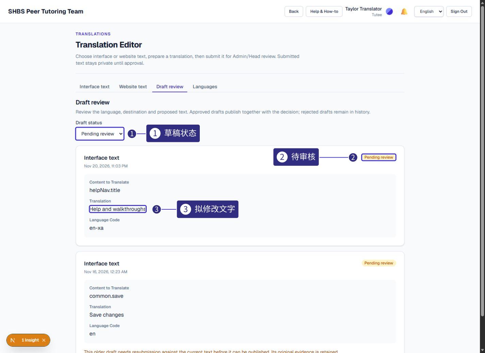
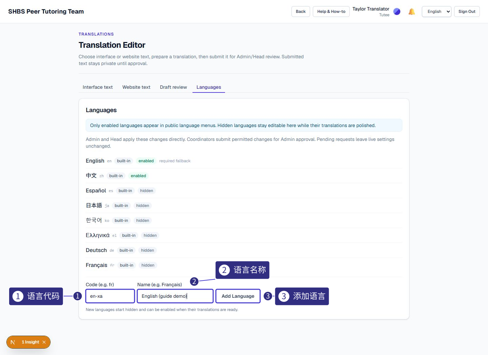
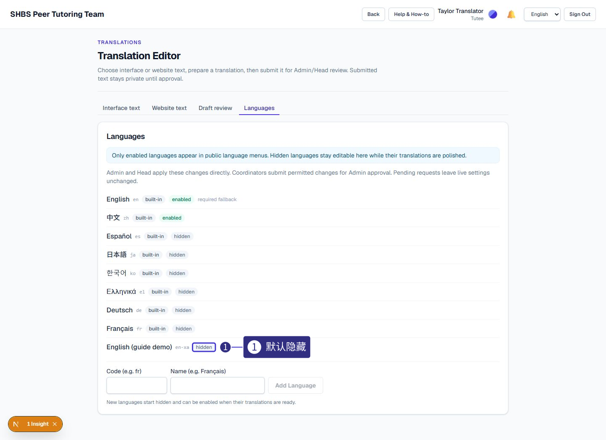

# 翻译网站

由网站帮助目录生成。请修改内容源文件后运行 `npm run help:export`。

[目录与截图来源](README.md)

截图来源: `b5ece465681957c9fe579d26babdeb260c674fa0`. New captures use latest-main development baseline b5ece465, selected 2026-11-20, with the Help candidate. Earlier captures list their own revision and capture date.

此 GitHub 培训副本包含各角色操作说明。实际使用网站功能仍需登录并具备当前项目权限。所有示例数据均为虚构。

- [翻译界面及网站文字](#翻译界面及网站文字)

## 翻译界面及网站文字

选择准确目标、分别保留语言草稿，并跟进发布审核。

打开: `/localization`

### 开始之前

- 本人有明确获批的翻译分配；仅有管理审核权限不代表可编辑。

### 操作步骤

1. **选择文字类型及语言** 打开翻译，选择界面文字或网站文字，再选择目标语言及准确位置／分组。搜索界面字符串并展开分组后编辑，保留变量及原意。

   请注意: 界面文字、网站文字、草稿审核及语言选择

   

   /localization · EN · 2026-11-20

   在界面文字中选择目标语言，并搜索准确的键。匹配的 HelpNav 分组展示英文原文和可编辑值。

   [原始完整截图](assets/translate-interface-website-step-1.en.jpg) · `dd970ea426016e85cb514beeeab537c3ab2e5098` · Latest-main development baseline dd970ea4, selected 2026-11-16, with the Help candidate; synthetic demonstration data.

   已为本步骤添加标注，原始完整截图保持不变。

   - **1.** 目标语言

   - **2.** 搜索键

   - **3.** 准确字段

2. **使用对应方式提交** 界面字段修改后在失去焦点时提交。网站文字使用明确提交按钮。离开前检查每项保存、待处理或错误状态。本次访问中打开的语言及目标草稿相互独立。

   **视图 1**

   

   /localization · EN · 2026-11-20

   离开已修改的界面字段以提交审核。草稿已提交表示新文字已保存，等待管理员或负责人审核。

   [原始完整截图](assets/translate-interface-website-step-2.en.jpg) · `dd970ea426016e85cb514beeeab537c3ab2e5098` · Latest-main development baseline dd970ea4, selected 2026-11-16, with the Help candidate; synthetic demonstration data.

   已为本步骤添加标注，原始完整截图保持不变。

   - **1.** 离开字段

   - **2.** 草稿已提交

   - **3.** 新文字

   **视图 2**

   

   /localization · ZH · 2026-11-20

   中文网站文字表单保留目标和未提交的译文。使用明确的提交审核按钮提交。

   [原始完整截图](assets/translate-interface-website-step-2-view-2.zh.jpg) · `b5ece465681957c9fe579d26babdeb260c674fa0` · Latest-main development baseline b5ece465, selected 2026-11-20, with the Help candidate and synthetic demo records.

   已为本步骤添加标注，原始完整截图保持不变。

   - **1.** 仅保存此表单

   - **2.** 草稿语言

   - **3.** 准确文字

   - **4.** 提交审核

3. **跟进草稿审核** 使用待处理、已发布、已拒绝或全部筛选查看审核状态。普通翻译人员及协调员编辑产生私密草稿；仅管理员／负责人能批准发布或拒绝。协调员可申请管理员／负责人批准，草稿仍保持待审。

   

   /localization · EN · 2026-11-20

   打开草稿审核并使用草稿状态查找准确提交项。新 HelpNav 字符串在演示语言中显示为待审核。

   [原始完整截图](assets/translate-interface-website-step-3.en.jpg) · `dd970ea426016e85cb514beeeab537c3ab2e5098` · Latest-main development baseline dd970ea4, selected 2026-11-16, with the Help candidate; synthetic demonstration data.

   已为本步骤添加标注，原始完整截图保持不变。

   - **1.** 草稿状态

   - **2.** 待审核

   - **3.** 拟修改文字

4. **谨慎新增语言** 在语言区域添加使用英语回退的新语言。新增语言默认隐藏，直至管理团队审核启用。只有获准管理控件能更改公开可见性、顺序或删除；内置语言目录不可删除。

   **视图 1**

   

   /localization · EN · 2026-11-20

   在语言页面输入新代码及名称，再选择添加语言。新语言目录默认隐藏。

   [原始完整截图](assets/translate-interface-website-step-4.en.jpg) · `dd970ea426016e85cb514beeeab537c3ab2e5098` · Latest-main development baseline dd970ea4, selected 2026-11-16, with the Help candidate; synthetic demonstration data.

   已为本步骤添加标注，原始完整截图保持不变。

   - **1.** 语言代码

   - **2.** 语言名称

   - **3.** 添加语言

   **视图 2**

   

   /localization · EN · 2026-11-20

   新语言目录在语言页面显示为隐藏。翻译员可准备文字，此语言此时不会出现在公开选择器。

   [原始完整截图](assets/translate-interface-website-step-4-view-2.en.jpg) · `dd970ea426016e85cb514beeeab537c3ab2e5098` · Latest-main development baseline dd970ea4, selected 2026-11-16, with the Help candidate; synthetic demonstration data.

   已为本步骤添加标注，原始完整截图保持不变。

   - **1.** 默认隐藏

### 预期结果

指定目标生成已保存草稿，或明确标识的获授权实时发布。

### 工作原理

具有翻译分配的管理员／负责人可直接发布本人编辑；编辑器会标示实时更改。翻译文字不会授予页面结构删除、账户权限或单方政策发布。政策翻译遵循独立修订流程；界面语言可见不等于已有政策译文。

### 问题排查

- **目标已改变或提交后刷新失败** 目标过时时应重新加载后编写新草稿，不应针对已改变内容批准旧文字。提交已接受但同步失败时使用只读重试。离开或刷新编辑器后不保留本地草稿。
