# Tutor workspace

Generated from the website help catalogue. Edit the content records, then run `npm run help:export`.

[Catalogue & capture provenance](README.md)

Screenshot source: `b5ece465681957c9fe579d26babdeb260c674fa0`. New captures use latest-main development baseline b5ece465, selected 2026-11-20, with the Help candidate. Earlier captures list their own revision and capture date.

This GitHub training copy includes role-specific instructions. Signing in and current program permissions are still required to use the corresponding website features. All examples are synthetic.

- [Activate tutoring and find your next task](#activate-tutoring-and-find-your-next-task)
- [Set time availability and preferred session count](#set-time-availability-and-preferred-session-count)
- [Set subject willingness and request qualifications](#set-subject-willingness-and-request-qualifications)
- [Read your pairing and choose a weekly time](#read-your-pairing-and-choose-a-weekly-time)
- [Combine, repair or split recurring pairings](#combine-repair-or-split-recurring-pairings)
- [Record attendance for an ended tutoring session](#record-attendance-for-an-ended-tutoring-session)
- [Reschedule a session or add an extra lesson](#reschedule-a-session-or-add-an-extra-lesson)
- [Request cancellation of an agreed extra lesson](#request-cancellation-of-an-agreed-extra-lesson)
- [Vote on an interview or complete chair duties](#vote-on-an-interview-or-complete-chair-duties)
- [Review meetings and request an excuse](#review-meetings-and-request-an-excuse)
- [Manage tutoring participation and understand hours](#manage-tutoring-participation-and-understand-hours)
- [Read announcements, room schedules and learner standing](#read-announcements-room-schedules-and-learner-standing)

## Activate tutoring and find your next task

Confirm current participation, read action states and use the unified tutor workspace.

Open: `/dashboard`

### Before you start

- Your account has a linked tutor profile with tutoring access.

### Walkthrough

1. **Check activation and policy notices** Open Enter Tutor Page. If Pending, confirm whether you will participate using the displayed choice and review. Read and accept any current tutor policy before participation actions.

   Look for: Participation notice, Needs attention and workspace panels

   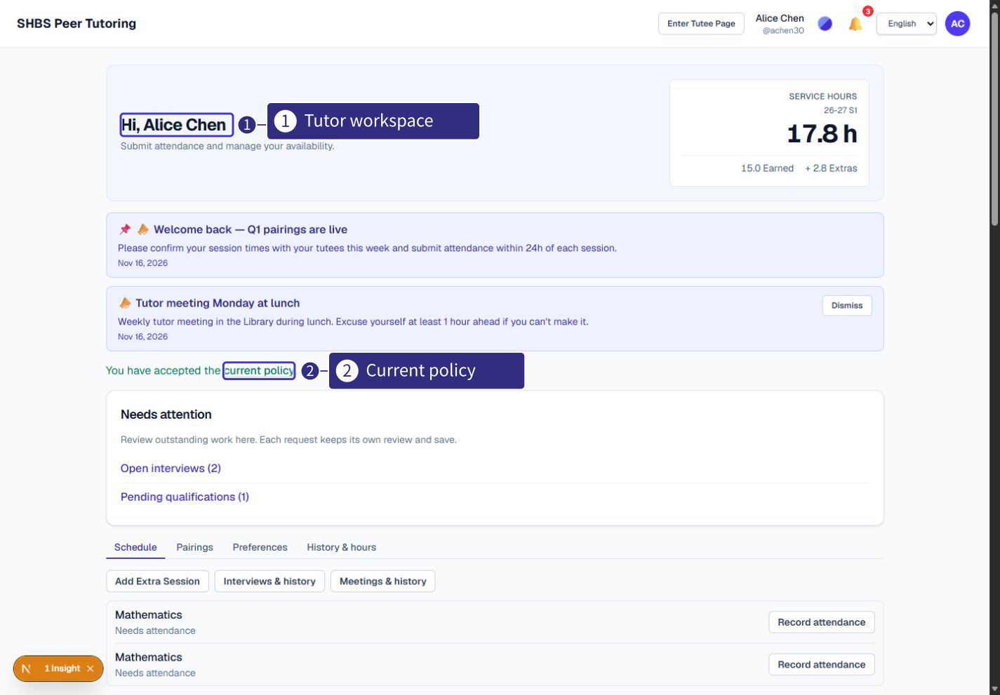

   /dashboard · EN · 2026-11-20

   Alice is already active. The tutor dashboard shows the accepted current-policy notice before participation tasks. A pending tutor would first see a separate participation choice.

   [Original full screenshot](assets/start-tutoring-step-1.en.jpg) · `b5ece465681957c9fe579d26babdeb260c674fa0` · Latest-main development baseline b5ece465, selected 2026-11-20, with the Help candidate and synthetic demo records.

   Annotations added for this step. The original full screenshot is unchanged.

   - **1.** Tutor workspace

   - **2.** Current policy

2. **Use the four task panels** Schedule holds dated tutoring, interviews and meetings. Pairings holds recurring assignments. Preferences holds availability, workload and subject choices. History & hours holds retained evidence. Switching these local panels retains visited editors during the visit.

   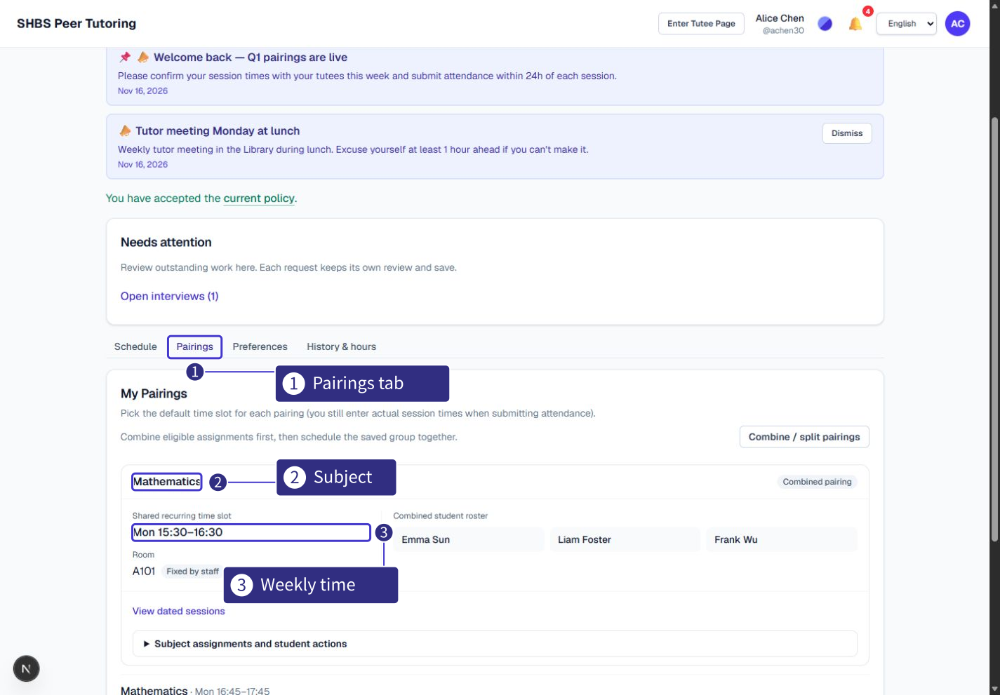

   /dashboard#tutor-pairings · EN · 2026-11-21

   Choose Pairings in the Tutor workspace to see the recurring group. The Mathematics row shows the weekly time.

   [Original full screenshot](assets/start-tutoring-step-2.en.jpg) · `b5ece465681957c9fe579d26babdeb260c674fa0` · Latest-main development baseline b5ece465, selected 2026-11-20, with the Help candidate and synthetic demo records.

   Annotations added for this step. The original full screenshot is unchanged.

   - **1.** Pairings tab

   - **2.** Subject

   - **3.** Weekly time

3. **Follow Needs attention** Open the task for an unconfirmed schedule, missing attendance, interview vote or meeting. Needs Action requires your work; Vote recorded / Awaiting decision means your vote is saved while the interview is still open.

   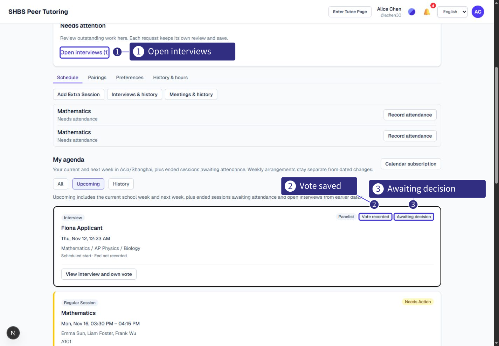

   /dashboard · EN · 2026-11-21

   Open interviews connects the Needs attention shortcut to the dated work. Fiona’s interview shows Vote recorded and Awaiting decision.

   [Original full screenshot](assets/start-tutoring-step-3.en.jpg) · `b5ece465681957c9fe579d26babdeb260c674fa0` · Latest-main development baseline b5ece465, selected 2026-11-20, with the Help candidate and synthetic demo records.

   Annotations added for this step. The original full screenshot is unchanged.

   - **1.** Open interviews

   - **2.** Vote saved

   - **3.** Awaiting decision

### What happens next

You know your active status and can open the exact task that needs your action.

### How it works

Inactive tutors retain read-only history but cannot edit pairings or submit attendance. An Admin badge alone is not a tutor identity. Both /dashboard and /schedule render the tutor workspace; legacy section links preserve their destination without discarding an open editor.

### Troubleshooting

- **Tutoring controls are unavailable** Check status, current policy, academic confirmation, suspension, school departure and revoked access with management. Approval of an application alone does not restore a separate access revocation.

## Set time availability and preferred session count

Save weekly catalogue choices and a separate advisory workload preference.

Open: `/dashboard#tutor-preferences`

### Before you start

- You are an active tutor with current participation requirements satisfied.

### Walkthrough

1. **Edit My Time Availability** Open Preferences → My Availability → Edit My Time Availability. Select the catalogue weekday/time slots you can teach and choose Save Availability. Cancel restores the last loaded time selection.

   Look for: Weekday time choices and Save Availability

   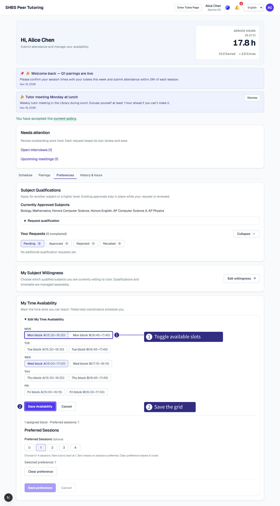

   /dashboard#tutor-preferences · EN · 2026-11-16

   Expanded availability grid with separate preferred-session controls and current workload context

   [Original full screenshot](assets/tutor-availability-step-1.en.jpg) · `589c055e4b1cf166b48b353bd619ac1982e5d9f6` · Latest-main development baseline 589c055e with the Help candidate; synthetic demonstration data.

   Annotations added for this step. The original full screenshot is unchanged.

   - **1.** Toggle available slots

   - **2.** Save the grid

2. **Save Preferred Sessions separately** Under the time choices choose one of 0–4, or clear the preference, then use its own Save. Zero means prefer no assignments; an unset preference is different. Saving availability does not save this separate draft.

   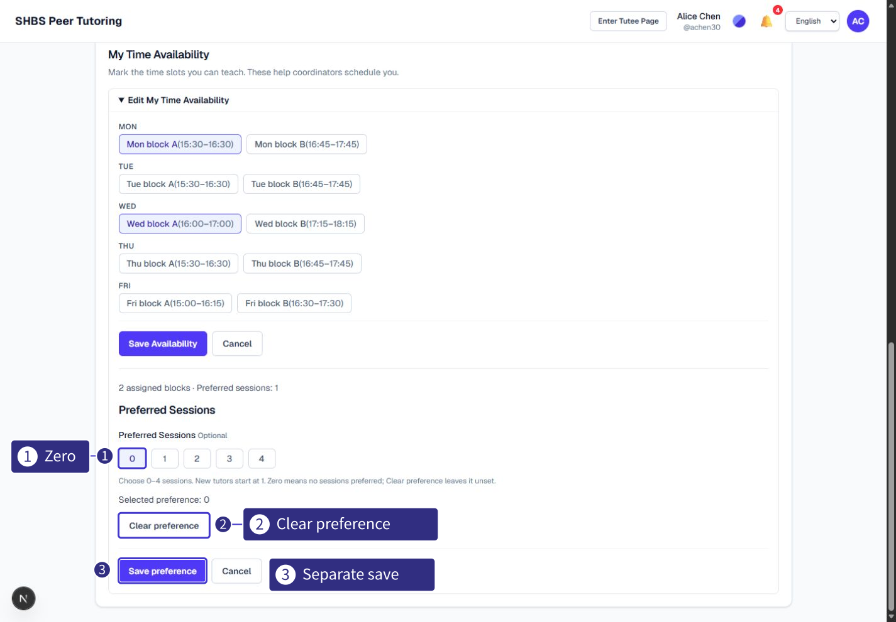

   /dashboard#tutor-preferences · EN · 2026-11-21

   Choose zero or Clear preference in the separate Preferred Sessions form. This zero was a draft and was cancelled.

   [Original full screenshot](assets/tutor-availability-step-2.en.jpg) · `b5ece465681957c9fe579d26babdeb260c674fa0` · Latest-main development baseline b5ece465, selected 2026-11-20, with the Help candidate and synthetic demo records.

   Annotations added for this step. The original full screenshot is unchanged.

   - **1.** Zero

   - **2.** Clear preference

   - **3.** Separate save

3. **Check the saved workload context** Compare assigned session-block count with the saved preference. Group changes refresh this count without replacing an unsaved preference. After an accepted save with failed synchronization use Retry refresh.

   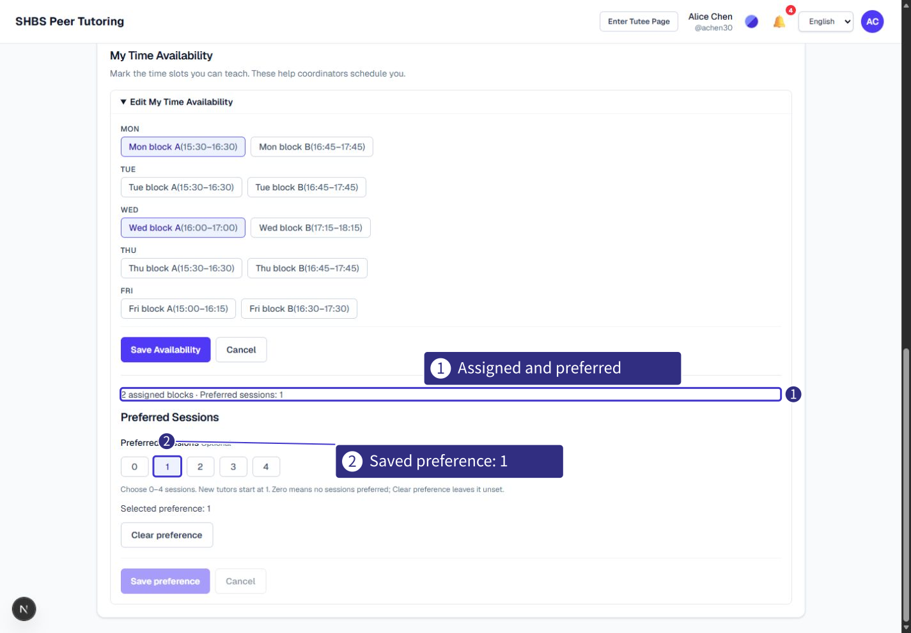

   /dashboard#tutor-preferences · EN · 2026-11-21

   The saved comparison shows two assigned blocks and a preference of one. The saved value is selected after canceling the draft.

   [Original full screenshot](assets/tutor-availability-step-3.en.jpg) · `b5ece465681957c9fe579d26babdeb260c674fa0` · Latest-main development baseline b5ece465, selected 2026-11-20, with the Help candidate and synthetic demo records.

   Annotations added for this step. The original full screenshot is unchanged.

   - **1.** Assigned and preferred

   - **2.** Saved preference: 1

### What happens next

Saved availability and preferred workload each show their own accepted values.

### How it works

The preference is advisory: staff may assign above it and lowering it does not cancel an assignment. Becoming inactive resets it to locked zero; reactivation keeps zero until changed. A valid combined group counts as one block, while matching times alone do not combine assignments.

### Troubleshooting

- **Saved values changed elsewhere** Use Reload saved preference to deliberately replace only that stale draft. Failed saves retain your selection; read-only Retry refresh recovers a successful save without submitting again.

## Set subject willingness and request qualifications

Separate approved qualification, willingness and a pending additional-subject request.

Open: `/dashboard#tutor-preferences`

### Before you start

- Active tutors can change willingness or make eligible qualification requests; inactive tutors retain read-only history.

### Walkthrough

1. **Edit willingness for approved subjects** Open My Subject Willingness → Edit willingness. Choose Willing to Tutor or Unwilling to Tutor for each offered approved subject. Each choice saves immediately; check the result before continuing. Not recorded means no choice was saved.

   Look for: Subject Willingness and Subject Qualifications

   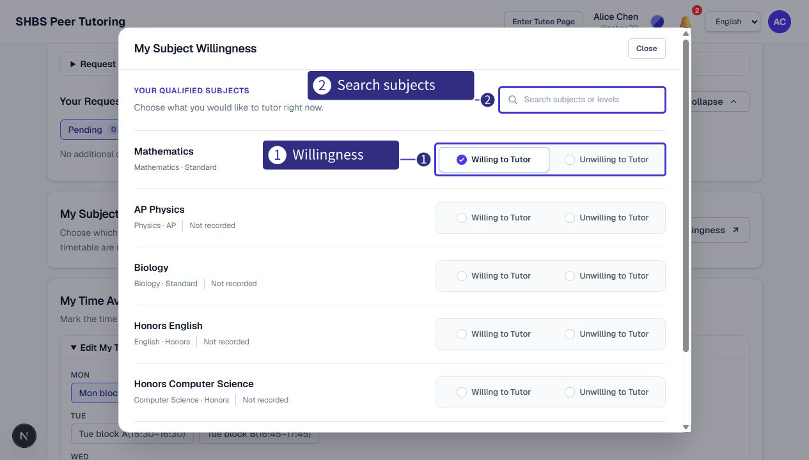

   /dashboard#tutor-preferences · EN · 2026-11-16

   Subject willingness editor showing the automatically saved Mathematics preference

   [Original full screenshot](assets/tutor-subject-qualifications-step-1.en.jpg) · `589c055e4b1cf166b48b353bd619ac1982e5d9f6` · Latest-main development baseline 589c055e with the Help candidate; synthetic demonstration data.

   Annotations added for this step. The original full screenshot is unchanged.

   - **1.** Willingness

   - **2.** Search subjects

2. **Request a new subject or higher level** In Subject Qualifications choose the subject/level, explain your qualifications and submit. Under Your Requests use Pending, Approved, Rejected or Recalled filters and expand history to read decision notes and granted subjects.

   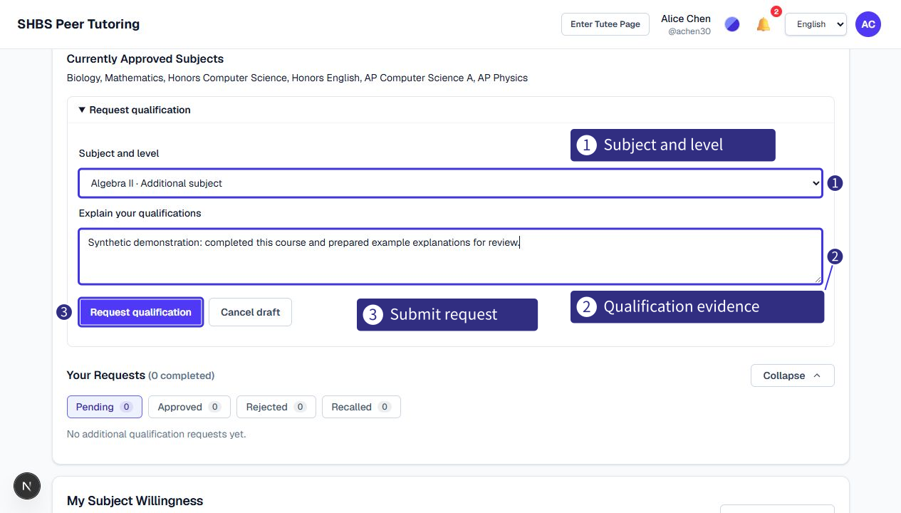

   /dashboard#tutor-preferences · EN · 2026-11-16

   Additional subject qualification draft with a chosen level and explanation

   [Original full screenshot](assets/tutor-subject-qualifications-step-2.en.jpg) · `589c055e4b1cf166b48b353bd619ac1982e5d9f6` · Latest-main development baseline 589c055e with the Help candidate; synthetic demonstration data.

   Annotations added for this step. The original full screenshot is unchanged.

   - **1.** Subject and level

   - **2.** Qualification evidence

   - **3.** Submit request

3. **Recall an eligible pending request** Choose Recall request while Pending or Interview, review the named subject and confirm. A recalled request cannot be reopened or approved; submit a fresh request later when ready.

   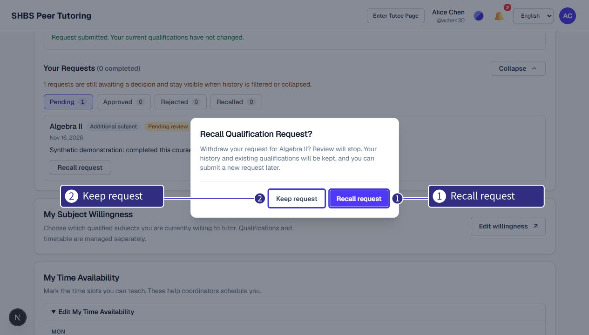

   /dashboard#tutor-preferences · EN · 2026-11-16

   Named confirmation before recalling the still-pending Algebra II qualification request

   [Original full screenshot](assets/tutor-subject-qualifications-step-3.en.jpg) · `589c055e4b1cf166b48b353bd619ac1982e5d9f6` · Latest-main development baseline 589c055e with the Help candidate; synthetic demonstration data.

   Annotations added for this step. The original full screenshot is unchanged.

   - **1.** Recall request

   - **2.** Keep request

### What happens next

Current willingness is saved independently and request history shows its actual decision stage.

### How it works

Pending, rejected or recalled requests do not change existing qualifications. Admin/Head may approve directly with a decision note or assign an interview; interview rejection requires the authorized chair and votes. Approval captures lower offered levels at that time; later catalogue reordering does not change saved grants.

### Troubleshooting

- **A subject does not appear or duplicate request is blocked** Only saved approved qualifications appear in willingness. Review existing pending requests for that subject/level before submitting again. Ask management about missing catalogue or qualification evidence.

## Read your pairing and choose a weekly time

Use shared availability advice and confirm a schedule without double-booking.

Open: `/dashboard#tutor-pairings`

### Before you start

- You are active and own a current populated assignment.

### Walkthrough

1. **Inspect My Pairings** Open Pairings. Read each group's subjects, weekly time, room status and distinct tutees. Choose Details beside a tutee to inspect saved availability, verification deadline and pending reviews.

   Look for: Pairing schedule selector before the tutee list and Details

   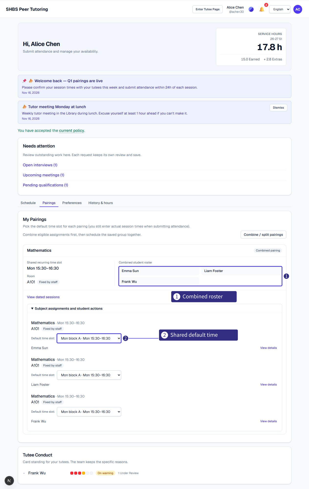

   /dashboard#tutor-pairings · EN · 2026-11-16

   Expanded combined pairing with roster, room, weekly slot and individual details

   [Original full screenshot](assets/tutor-pairing-time-step-1.en.jpg) · `589c055e4b1cf166b48b353bd619ac1982e5d9f6` · Latest-main development baseline 589c055e with the Help candidate; synthetic demonstration data.

   Annotations added for this step. The original full screenshot is unchanged.

   - **1.** Combined roster

   - **2.** Shared default time

2. **Compare the time groups** Use the default time selector. Both Available requires the same saved catalogue slot for you and every current tutee; Other Time Slots lacks that shared evidence. Unavailable choices are disabled when they overlap another teaching block.

   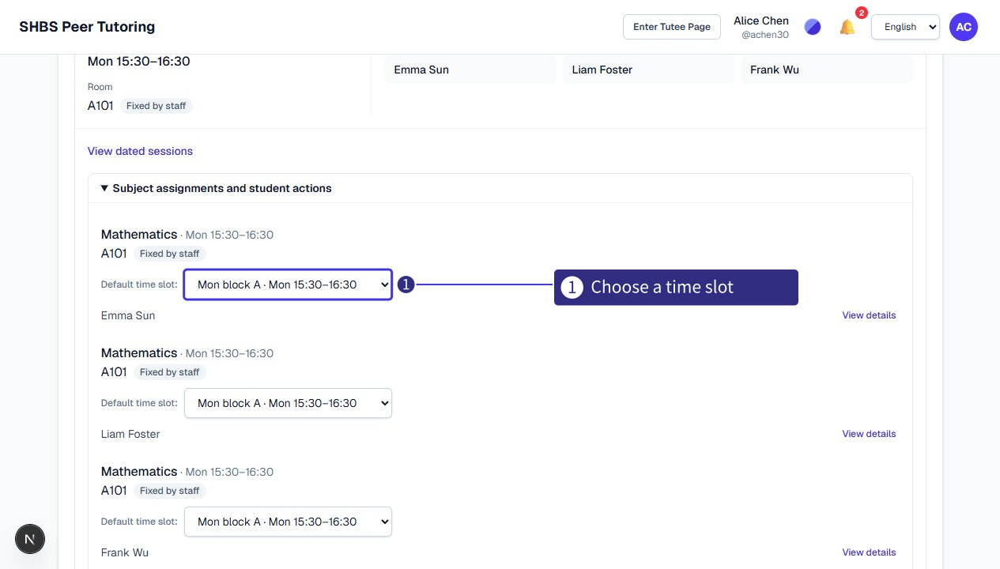

   /dashboard#tutor-pairings · EN · 2026-11-16

   Default-time catalogue selector for the combined Mathematics pairing

   [Original full screenshot](assets/tutor-pairing-time-step-2.en.jpg) · `589c055e4b1cf166b48b353bd619ac1982e5d9f6` · Latest-main development baseline 589c055e with the Help candidate; synthetic demonstration data.

   Annotations added for this step. The original full screenshot is unchanged.

   - **1.** Choose a time slot

3. **Review and save the time** Discuss the time, select the intended slot and confirm the named review. A combined group shares one time, so changing a member's default changes the whole group. Check the room result and dated calendar afterward.

   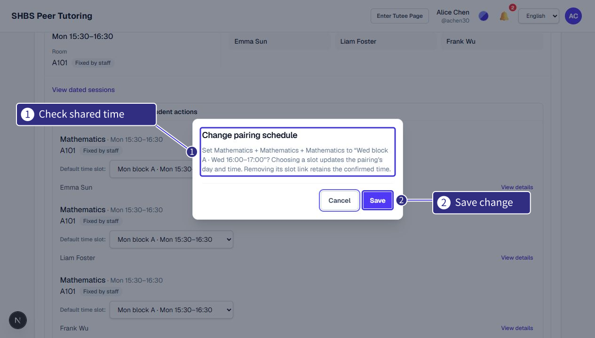

   /dashboard#tutor-pairings · EN · 2026-11-16

   Named review before changing the shared recurring slot for every member of the combined group

   [Original full screenshot](assets/tutor-pairing-time-step-3.en.jpg) · `589c055e4b1cf166b48b353bd619ac1982e5d9f6` · Latest-main development baseline 589c055e with the Help candidate; synthetic demonstration data.

   Annotations added for this step. The original full screenshot is unchanged.

   - **1.** Check shared time

   - **2.** Save change

4. **Report an actual schedule conflict** In tutee Details use the schedule-conflict request, provide a reason and complete its two-second review. The assignment stays active until approval. Missing saved availability alone does not establish a conflict.

   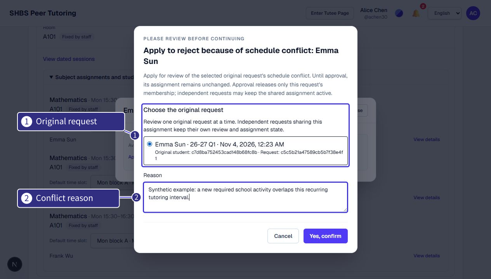

   /dashboard#tutor-pairings · EN · 2026-11-16

   Exact original-request schedule-conflict review with a reason, before submission

   [Original full screenshot](assets/tutor-pairing-time-step-4.en.jpg) · `589c055e4b1cf166b48b353bd619ac1982e5d9f6` · Latest-main development baseline 589c055e with the Help candidate; synthetic demonstration data.

   Annotations added for this step. The original full screenshot is unchanged.

   - **1.** Original request

   - **2.** Conflict reason

### What happens next

The pairing shows its confirmed shared time or a pending reasoned conflict request.

### How it works

Clock overlap is not enough to establish a shared catalogue choice. Back-to-back sessions are allowed; separate overlapping assignments conflict. Awaiting schedule reserves no time. Tutors can trigger automatic room assignment but do not choose a staff-fixed room.

### Troubleshooting

- **No room or no shared slot is available** Review each person's saved catalogue availability and actual booking conflicts. Needs room means the schedule lacks a reservation; ask management to review capacity. Never assume automatic assignment silently changed to Online.

## Combine, repair or split recurring pairings

Create a reusable shared teaching block while retaining individual subject assignments and history.

Open: `/dashboard#tutor-pairings`

### Before you start

- You are active and own two to six eligible current populated assignments with complete student–subject coverage.

### Walkthrough

1. **Open Combine / split pairings** In My Pairings select Combine / split pairings. Choose the assignments and primary member. Every student in the group must already have every selected subject; combining never creates a missing assignment.

   Look for: Combine / split pairings and grouped assignment summary

   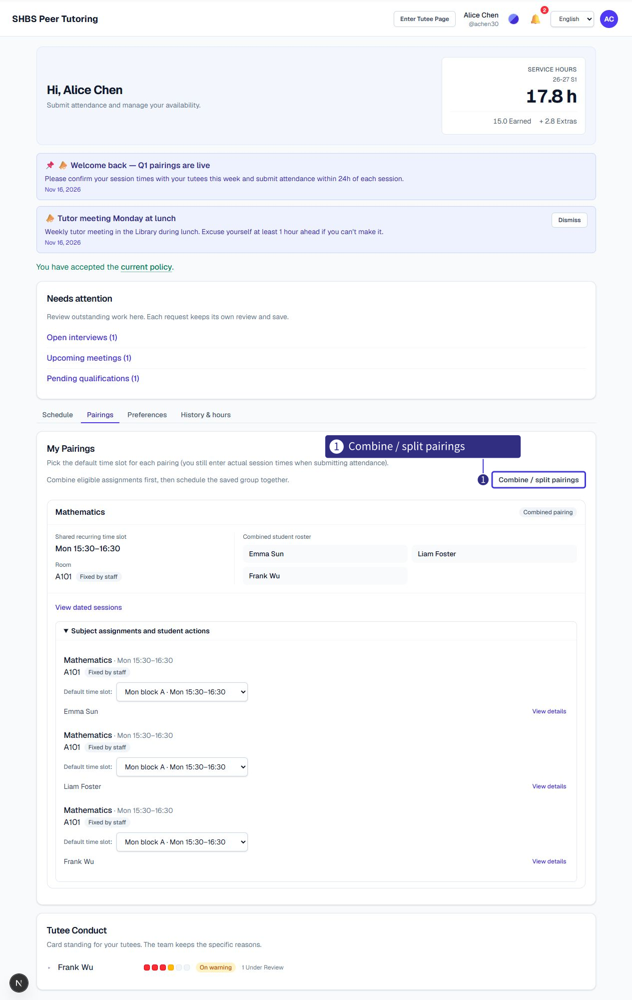

   /dashboard#tutor-pairings · EN · 2026-11-16

   Open the explicit combine/split editor from My Pairings

   [Original full screenshot](assets/combine-split-pairings-step-1.en.jpg) · `589c055e4b1cf166b48b353bd619ac1982e5d9f6` · Latest-main development baseline 589c055e with the Help candidate; synthetic demonstration data.

   Annotations added for this step. The original full screenshot is unchanged.

   - **1.** Combine / split pairings

2. **Choose the shared schedule** Leave the group Awaiting schedule or choose one shared catalogue slot; use the explicit retained-time option only when preserving a confirmed interval. Review students, subjects, time and room consequences before saving.

   Look for: Selected assignments, primary member and shared schedule in the group editor

   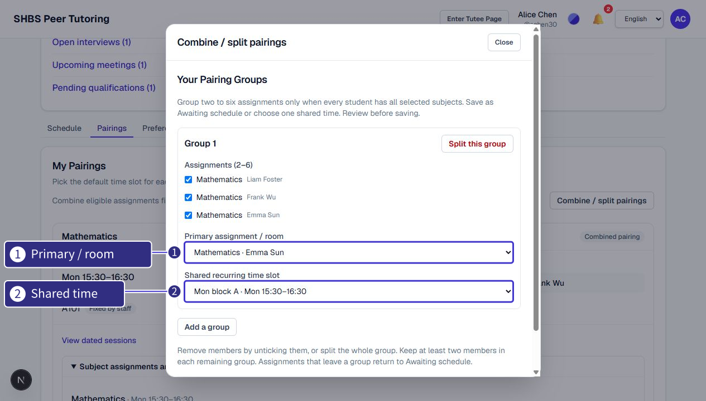

   /dashboard#tutor-pairings · EN · 2026-11-16

   Existing combined group: selected assignments, primary room source and one shared recurring slot

   [Original full screenshot](assets/combine-split-pairings-step-2.en.jpg) · `589c055e4b1cf166b48b353bd619ac1982e5d9f6` · Latest-main development baseline 589c055e with the Help candidate; synthetic demonstration data.

   Annotations added for this step. The original full screenshot is unchanged.

   - **1.** Primary / room

   - **2.** Shared time

3. **Repair or split deliberately** Reopen the editor to add or untick assignments, or choose Split this group. Each remaining group needs at least two members. Leaving assignments keep their students/subjects/room but return to Awaiting schedule until separately scheduled.

   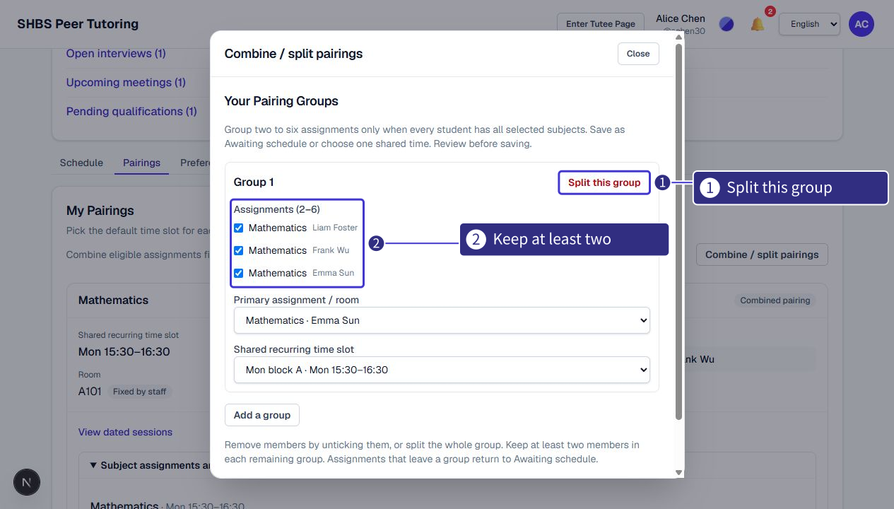

   /dashboard#tutor-pairings · EN · 2026-11-16

   Repair or split controls in the existing combined-group editor before review

   [Original full screenshot](assets/combine-split-pairings-step-3.en.jpg) · `589c055e4b1cf166b48b353bd619ac1982e5d9f6` · Latest-main development baseline 589c055e with the Help candidate; synthetic demonstration data.

   Annotations added for this step. The original full screenshot is unchanged.

   - **1.** Split this group

   - **2.** Keep at least two

### What happens next

My Pairings shows a valid shared block, repaired group or separately unscheduled assignments.

### How it works

A–Chemistry and B–Chemistry can combine; mixing Chemistry and Mathematics for both students needs all four student–subject relationships. A saved valid group counts as one workload block. Group changes affect future plans, preserving past attendance, ratings and credit; Needs repair groups must be repaired or split before combined scheduling/attendance.

### Troubleshooting

- **Save rejects coverage, time or room** Use Back to correct the selection. A fixed-room or overlapping independent-block conflict cannot be silently overridden. If saved groups changed, Reload saved groups explicitly replaces the draft after a successful read; a saved-result Retry only refreshes.

## Record attendance for an ended tutoring session

Open the exact dated lesson and record what actually happened once.

Open: `/dashboard#sessions`

### Before you start

- You are active, have current tutor-policy acceptance and the lesson has ended without a saved attendance entry.

### Walkthrough

1. **Choose the ended lesson** In Schedule → Needs attendance open Record attendance on the exact lesson. Check its captured subjects and tutees, including separately rescheduled participants. Do not use another lesson to record missing history.

   Look for: Ended lesson marked Needs attendance

   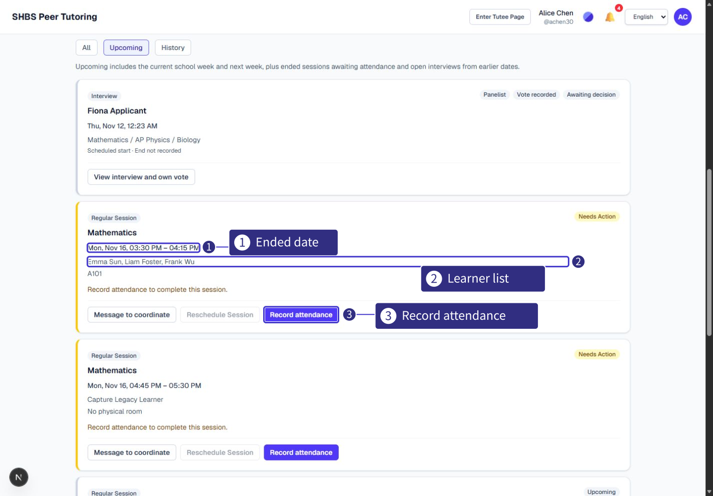

   /dashboard#sessions · EN · 2026-11-21

   Pick the ended Mathematics lesson with the correct date and learner list. Its Record attendance action opens the lesson form.

   [Original full screenshot](assets/record-attendance-step-1.en.jpg) · `b5ece465681957c9fe579d26babdeb260c674fa0` · Latest-main development baseline b5ece465, selected 2026-11-20, with the Help candidate and synthetic demo records.

   Annotations added for this step. The original full screenshot is unchanged.

   - **1.** Ended date

   - **2.** Learner list

   - **3.** Record attendance

2. **Record actual time and location** Confirm actual start/end and room or Online; planned lessons use 45 minutes but attendance records the duration that actually occurred. Read any room-conflict warning; a truthful historical report does not reserve a future conflicting room.

   Look for: Actual times, location and attendance rows

   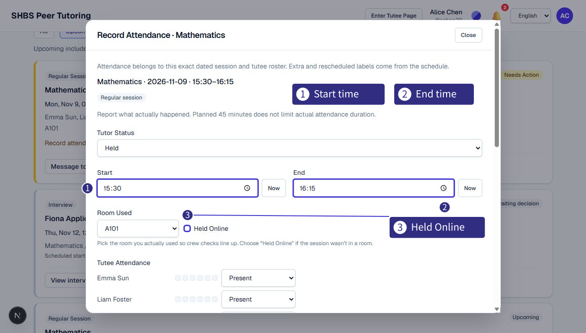

   /dashboard · EN · 2026-11-16

   Attendance form: actual time, room and online mode for the exact ended lesson

   [Original full screenshot](assets/record-attendance-step-2.en.jpg) · `589c055e4b1cf166b48b353bd619ac1982e5d9f6` · Latest-main development baseline 589c055e with the Help candidate; synthetic demonstration data.

   Annotations added for this step. The original full screenshot is unchanged.

   - **1.** Start time

   - **2.** End time

   - **3.** Held Online

3. **Complete every attendance row** Record your attendance and every student's actual attendance. Supply required absence/excuse reasons, comments, session ratings and reasons for requested disciplinary cards. Combined lessons count distinct students once and retain captured subjects.

   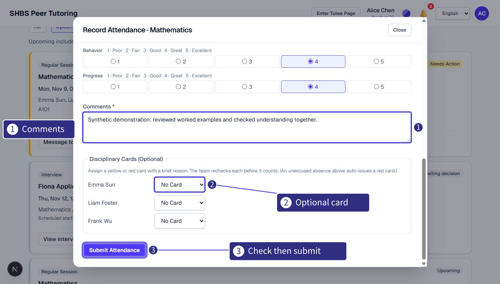

   /dashboard · EN · 2026-11-16

   Attendance form scrolled to evaluation, comments and optional disciplinary cards before submission

   [Original full screenshot](assets/record-attendance-step-3.en.jpg) · `589c055e4b1cf166b48b353bd619ac1982e5d9f6` · Latest-main development baseline 589c055e with the Help candidate; synthetic demonstration data.

   Annotations added for this step. The original full screenshot is unchanged.

   - **1.** Comments

   - **2.** Optional card

   - **3.** Check then submit

4. **Submit and check the receipt** Submit once and read the saved receipt. The accepted entry is locked; Submit Another starts a new entry. If totals fail to refresh use Retry refresh. Ask management for corrections to a saved or unplanned historical lesson.

   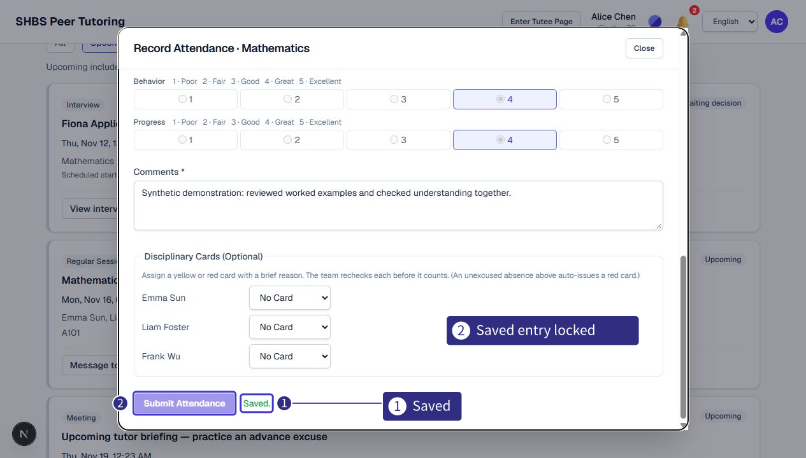

   /dashboard · EN · 2026-11-16

   Saved planned attendance: the accepted form is locked and shows Saved

   [Original full screenshot](assets/record-attendance-step-4.en.jpg) · `589c055e4b1cf166b48b353bd619ac1982e5d9f6` · Latest-main development baseline 589c055e with the Help candidate; synthetic demonstration data.

   Annotations added for this step. The original full screenshot is unchanged.

   - **1.** Saved

   - **2.** Saved entry locked

### What happens next

One attendance record and its calculated consequences are saved for the exact lesson.

### How it works

An identical retry does not award another credit; changed answers after saving require correction. Moving the time cannot create duplicate attendance. Adjacent non-overlapping sessions remain valid. Extra/rescheduled labels come from the schedule rather than an attendance checkbox.

### Troubleshooting

- **A draft is open for a different lesson** Resume or explicitly discard it before switching. Closing the form retains its draft during this visit. For uncertain submission inspect the saved result before retrying.

## Reschedule a session or add an extra lesson

Review exact participants, time and room before sending an agreement proposal.

Open: `/dashboard#sessions`

### Before you start

- You own an eligible current pairing and the affected session can still be planned.

### Walkthrough

1. **Open the session action** In Schedule choose Reschedule Session or Add Extra Session. For a regular lesson paused by a no-tutoring notice, choose Arrange exception to propose an explicitly agreed dated exception for the affected learners. Use Message to coordinate first when useful; chat does not formally accept a schedule change.

   Look for: Session action menu and dated event

   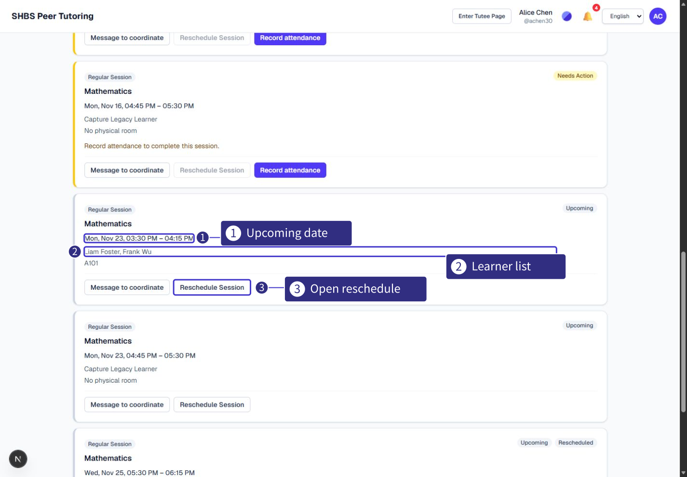

   /dashboard#sessions · EN · 2026-11-21

   Choose the upcoming Mathematics date and confirm the included learners, then open Reschedule Session for that dated lesson.

   [Original full screenshot](assets/plan-dated-session-step-1.en.jpg) · `b5ece465681957c9fe579d26babdeb260c674fa0` · Latest-main development baseline b5ece465, selected 2026-11-20, with the Help candidate and synthetic demo records.

   Annotations added for this step. The original full screenshot is unchanged.

   - **1.** Upcoming date

   - **2.** Learner list

   - **3.** Open reschedule

2. **Choose scope, time and mode** Keep Include all tutees in this session checked, or uncheck it and choose one person. Choose In person — room assigned automatically or Online. Editing start/end retains the planned 45-minute duration.

   Look for: Proposal editor with included tutees, date/time and In person or Online

   **View 1**

   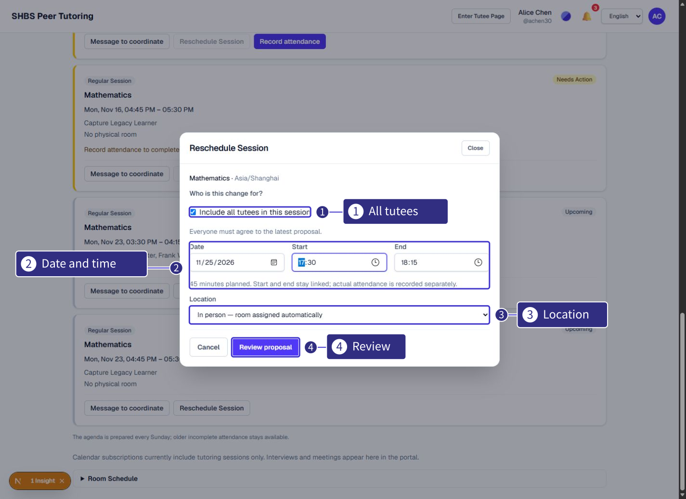

   /dashboard · EN · 2026-11-20

   Keep Include all checked for the whole dated Mathematics group. Set the date and start time, check the linked 45-minute end, then choose the location.

   [Original full screenshot](assets/plan-dated-session-step-2.en.jpg) · `b5ece465681957c9fe579d26babdeb260c674fa0` · Latest-main development baseline b5ece465, selected 2026-11-20, with the Help candidate and synthetic demo records.

   Annotations added for this step. The original full screenshot is unchanged.

   - **1.** All tutees

   - **2.** Date and time

   - **3.** Location

   - **4.** Review

   **View 2**

   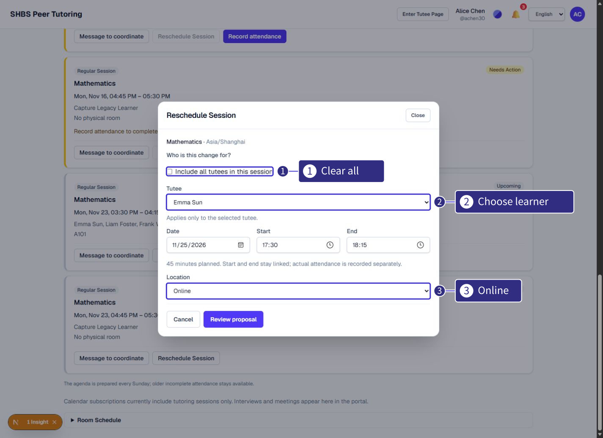

   /dashboard · EN · 2026-11-20

   For a one-tutee proposal, clear Include all and choose the exact learner. Online is a separate location choice.

   [Original full screenshot](assets/plan-dated-session-step-2-view-2.en.jpg) · `b5ece465681957c9fe579d26babdeb260c674fa0` · Latest-main development baseline b5ece465, selected 2026-11-20, with the Help candidate and synthetic demo records.

   Annotations added for this step. The original full screenshot is unchanged.

   - **1.** Clear all

   - **2.** Choose learner

   - **3.** Online

3. **Review availability and room** Choose Review and read the assigned room before sending. Review reserves nothing; if that room becomes unavailable, edit and review again. The system does not silently change the reviewed room or switch to Online.

   **View 1**

   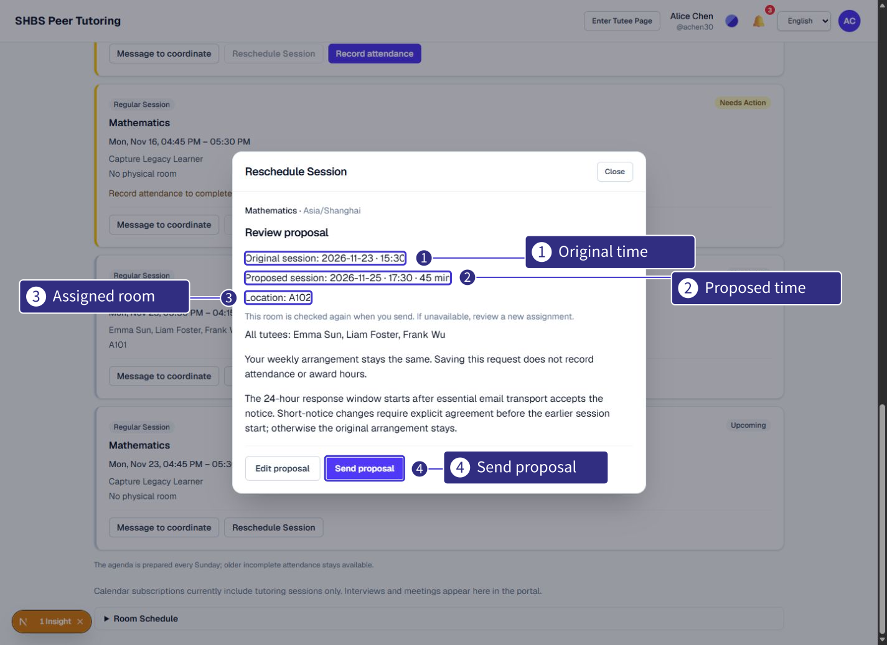

   /dashboard · EN · 2026-11-20

   Review compares the original time with the proposed group time and shows the assigned room. The room is checked again when a proposal is sent.

   [Original full screenshot](assets/plan-dated-session-step-3.en.jpg) · `b5ece465681957c9fe579d26babdeb260c674fa0` · Latest-main development baseline b5ece465, selected 2026-11-20, with the Help candidate and synthetic demo records.

   Annotations added for this step. The original full screenshot is unchanged.

   - **1.** Original time

   - **2.** Proposed time

   - **3.** Assigned room

   - **4.** Send proposal

   **View 2**

   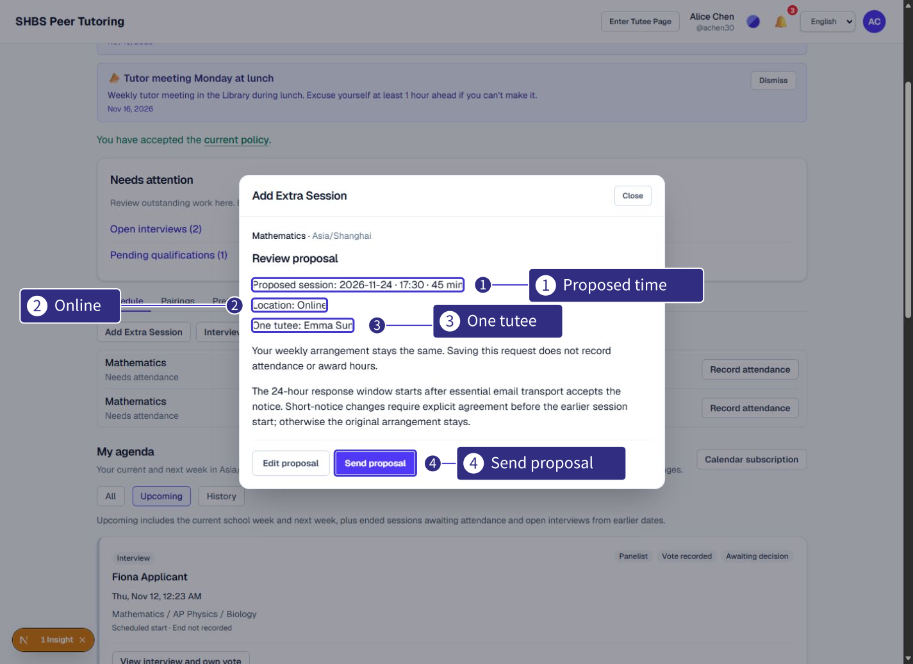

   /dashboard · EN · 2026-11-20

   Review this one-tutee extra separately. The checked proposal shows the proposed date, Online location, and Emma as the only learner.

   [Original full screenshot](assets/plan-dated-session-step-3-view-2.en.jpg) · `b5ece465681957c9fe579d26babdeb260c674fa0` · Latest-main development baseline b5ece465, selected 2026-11-20, with the Help candidate and synthetic demo records.

   Annotations added for this step. The original full screenshot is unchanged.

   - **1.** Proposed time

   - **2.** Online

   - **3.** One tutee

   - **4.** Send proposal

4. **Send and follow agreement** Send the reviewed proposal and inspect essential-email delivery and each response. Use this suggestion can formalize an exact current tutee suggestion. For one tutee, accept their alternative or reject with one final proposal. If a group shows Separate rescheduling requested, choose Start individual requests and review/confirm the affected participants; then follow each individual request. The group timer stops while separate rescheduling is requested, and the weekly pairing group remains intact.

   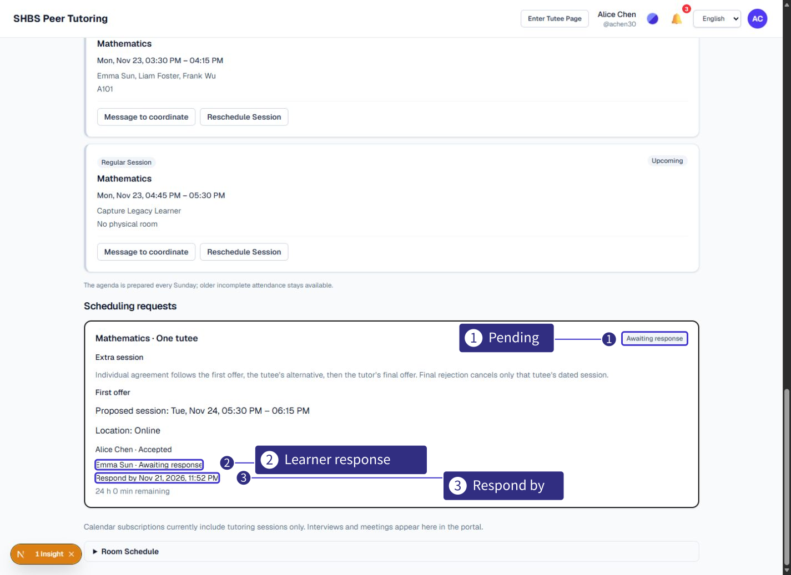

   /dashboard · EN · 2026-11-20

   Open Scheduling requests after sending. The extra awaits Emma’s response, and the displayed deadline starts after essential email delivery.

   [Original full screenshot](assets/plan-dated-session-step-4.en.jpg) · `b5ece465681957c9fe579d26babdeb260c674fa0` · Latest-main development baseline b5ece465, selected 2026-11-20, with the Help candidate and synthetic demo records.

   Annotations added for this step. The original full screenshot is unchanged.

   - **1.** Pending

   - **2.** Learner response

   - **3.** Respond by

### What happens next

The dated calendar shows the proposal and then its authoritative agreed, expired or cancelled result.

### How it works

Rescheduling changes a dated commitment; extras leave the regular lesson intact. The 24-hour automatic-acceptance window begins only after essential email transport accepts the notice. Short windows require explicit agreement before the earlier start; delayed reconciliation after a session starts requires review rather than a retroactive move.

Add Extra Session opens a source picker showing the actual weekly pairing slot; choose Choose session to continue. Eligible paused sources offer Arrange exception there. Fully paused or cancelled commitments leave Upcoming; use All or History to inspect their retained cancellation evidence. These controls do not change your private calendar subscription settings.

### Troubleshooting

- **Mail failed or no response window fits** Inspect delivery status and retry eligible delivery, then check the confirmed portal result. Do not treat silence as acceptance without a valid window. Expiry preserves the original unless another authoritative change cancels it.

## Request cancellation of an agreed extra lesson

Review exactly which dated commitments are affected and wait for agreement.

Open: `/dashboard#sessions`

### Before you start

- The extra is agreed, has not started and has no recorded attendance.

### Walkthrough

1. **Find the agreed extra** In Schedule open the extra's card and choose Cancel Extra Session. Use All to find extras beyond the two-week Upcoming window, including a moved extra.

   Look for: Agreed Extra card and Cancel Extra Session

   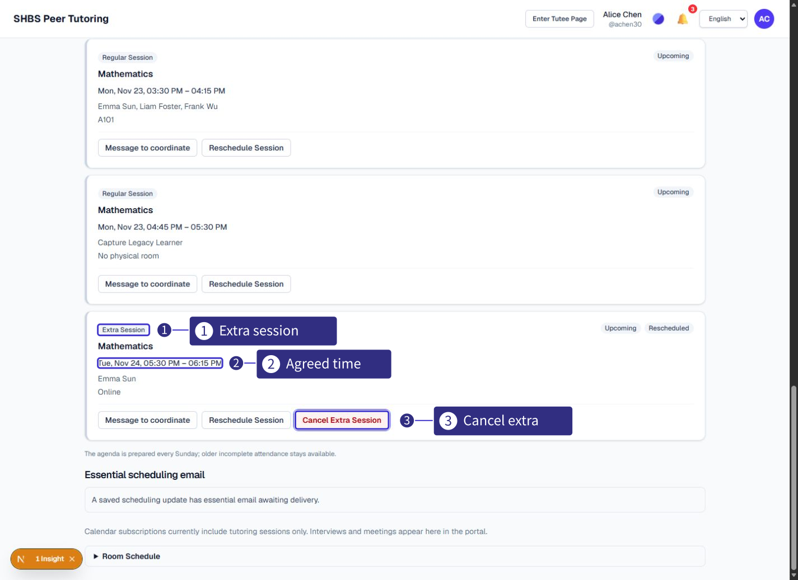

   /dashboard#sessions · EN · 2026-11-20

   Find the already scheduled Extra Session for the exact date and learner. Open Cancel Extra Session from that card.

   [Original full screenshot](assets/cancel-extra-session-step-1.en.jpg) · `b5ece465681957c9fe579d26babdeb260c674fa0` · Latest-main development baseline b5ece465, selected 2026-11-20, with the Help candidate and synthetic demo records.

   Annotations added for this step. The original full screenshot is unchanged.

   - **1.** Extra session

   - **2.** Agreed time

   - **3.** Cancel extra

2. **Review the participants** Include all current tutees or choose one, then review the exact date, time and people. Close or Cancel before submission sends nothing. Send only the reviewed cancellation request.

   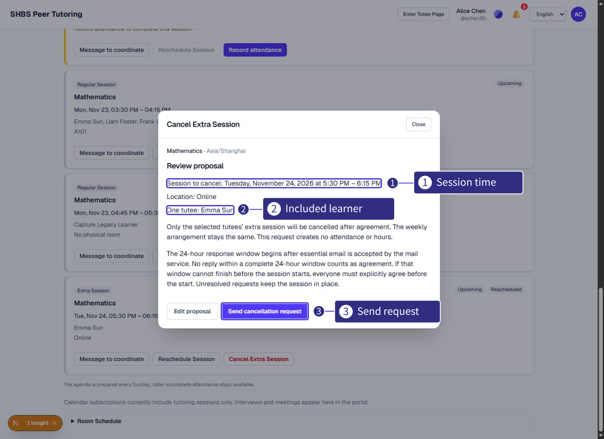

   /dashboard#sessions · EN · 2026-11-20

   Check the exact extra date, time and learner on Review proposal. Send cancellation request creates an agreement request for that extra.

   [Original full screenshot](assets/cancel-extra-session-step-2.en.jpg) · `b5ece465681957c9fe579d26babdeb260c674fa0` · Latest-main development baseline b5ece465, selected 2026-11-20, with the Help candidate and synthetic demo records.

   Annotations added for this step. The original full screenshot is unchanged.

   - **1.** Session time

   - **2.** Included learner

   - **3.** Send request

3. **Check agreement and the result** Each included tutee can Accept cancellation or Decline cancellation. The extra remains scheduled until agreement under essential-email response rules. Check the saved request separately from actual cancellation.

   **View 1**

   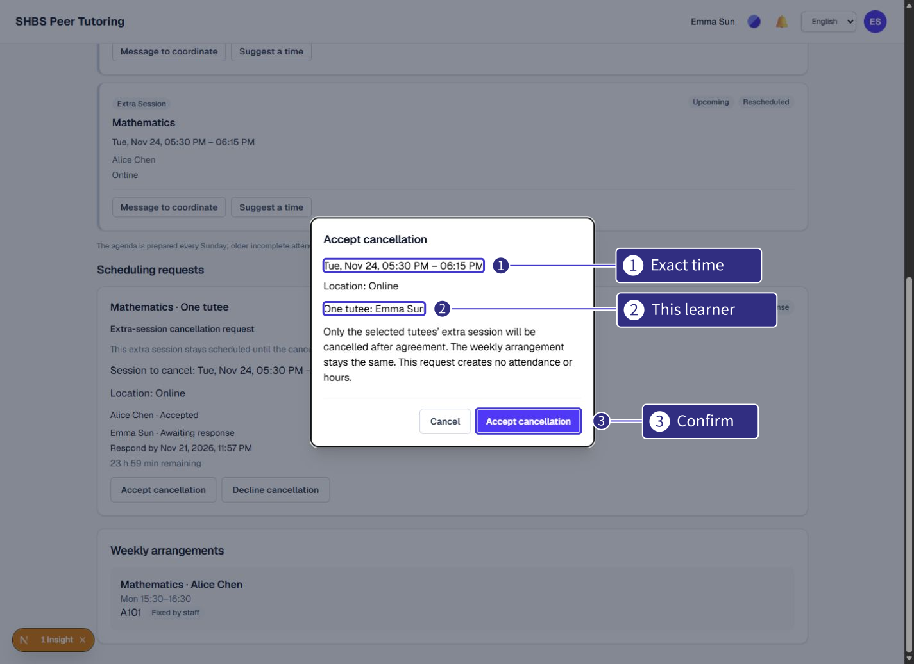

   /student?view=schedule · EN · 2026-11-20

   On the learner’s Accept cancellation review, confirm the exact dated extra and the single participant. After the response, check the agenda for the saved outcome.

   [Original full screenshot](assets/cancel-extra-session-step-3.en.jpg) · `b5ece465681957c9fe579d26babdeb260c674fa0` · Latest-main development baseline b5ece465, selected 2026-11-20, with the Help candidate and synthetic demo records.

   Annotations added for this step. The original full screenshot is unchanged.

   - **1.** Exact time

   - **2.** This learner

   - **3.** Confirm

   **View 2**

   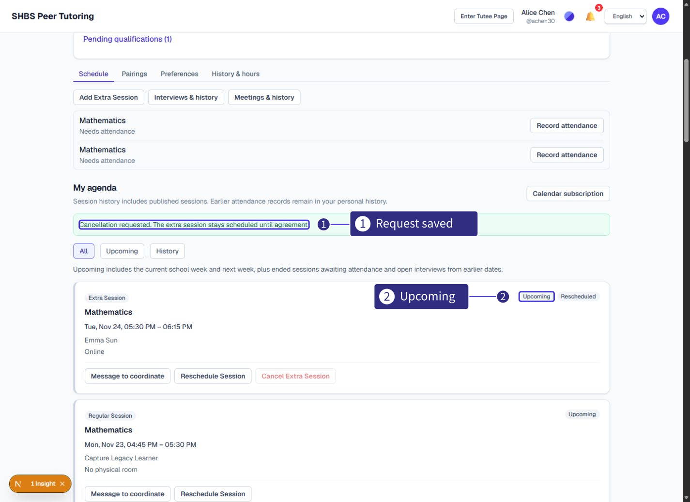

   /dashboard#sessions · EN · 2026-11-20

   The tutor sees the cancellation-request receipt while the very same extra remains Upcoming. Agreement is still pending.

   [Original full screenshot](assets/cancel-extra-session-step-3-view-2.en.jpg) · `b5ece465681957c9fe579d26babdeb260c674fa0` · Latest-main development baseline b5ece465, selected 2026-11-20, with the Help candidate and synthetic demo records.

   Annotations added for this step. The original full screenshot is unchanged.

   - **1.** Request saved

   - **2.** Upcoming

   **View 3**

   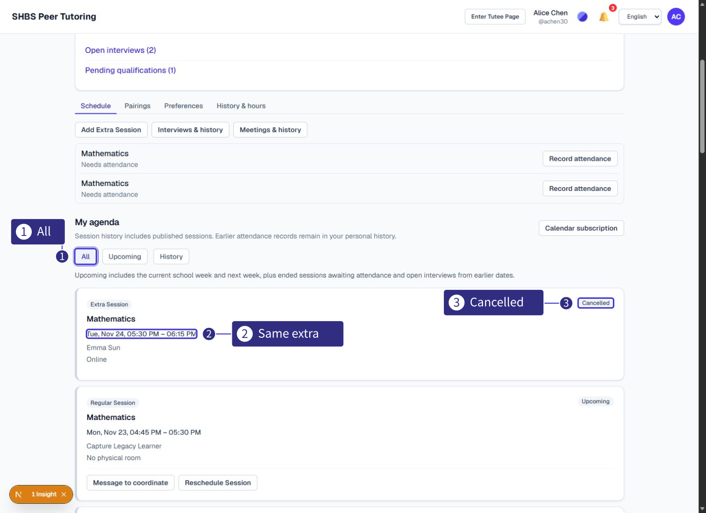

   /dashboard#sessions · EN · 2026-11-20

   After the learner agrees, use All in the tutor schedule to find the same dated extra with its actual Cancelled badge.

   [Original full screenshot](assets/cancel-extra-session-step-3-view-3.en.jpg) · `b5ece465681957c9fe579d26babdeb260c674fa0` · Latest-main development baseline b5ece465, selected 2026-11-20, with the Help candidate and synthetic demo records.

   Annotations added for this step. The original full screenshot is unchanged.

   - **1.** All

   - **2.** Same extra

   - **3.** Cancelled

### What happens next

Only the selected dated extra commitments are cancelled after the required agreement.

### How it works

A decline or expiry preserves the lesson. This request has no alternative-time or separate-reschedule step. It preserves peers, weekly pairing groups and ordinary lessons.

### Troubleshooting

- **The action is missing or refresh failed** Check the extra is agreed/upcoming and has no attendance. After a saved request, use read-only refresh rather than sending another cancellation. For a lesson that already happened, ask management about attendance correction.

## Vote on an interview or complete chair duties

Review the application, submit your vote and distinguish a decision from recorded hours.

Open: `/dashboard#sessions`

### Before you start

- You are an assigned eligible panelist. Scheduling and final decisions require the selected Admin/Head tutor chair; applicants cannot review themselves.

### Walkthrough

1. **Open Interview work** In Schedule open your assigned interview and inspect the requested subjects and qualification explanation. Chairs can also open Interviews to Conduct; completed records are in its collapsed history section.

   Look for: Interview card, vote status and action

   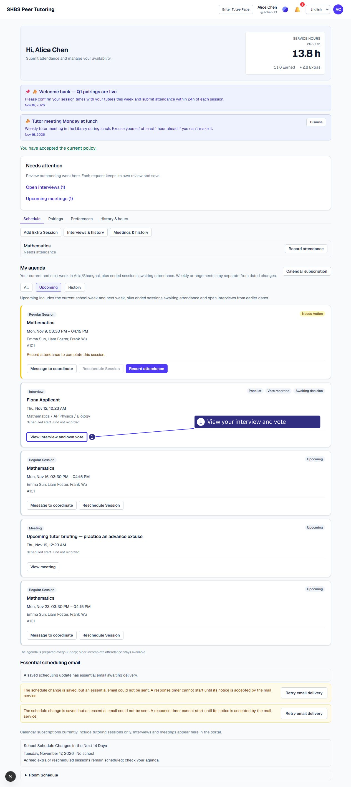

   /dashboard · EN · 2026-11-16

   Tutor dashboard on latest main: pinned and ordinary announcements, task panels and dated agenda

   [Original full screenshot](assets/tutor-interviews-step-1.en.jpg) · `589c055e4b1cf166b48b353bd619ac1982e5d9f6` · Latest-main development baseline 589c055e with the Help candidate; synthetic demonstration data.

   Annotations added for this step. The original full screenshot is unchanged.

   - **1.** View your interview and vote

2. **Submit your own vote** Read the application evidence and record your vote through its existing control. Check Vote recorded / Awaiting decision. Every panelist must vote before the final decision; opening or scheduling earns no hours.

   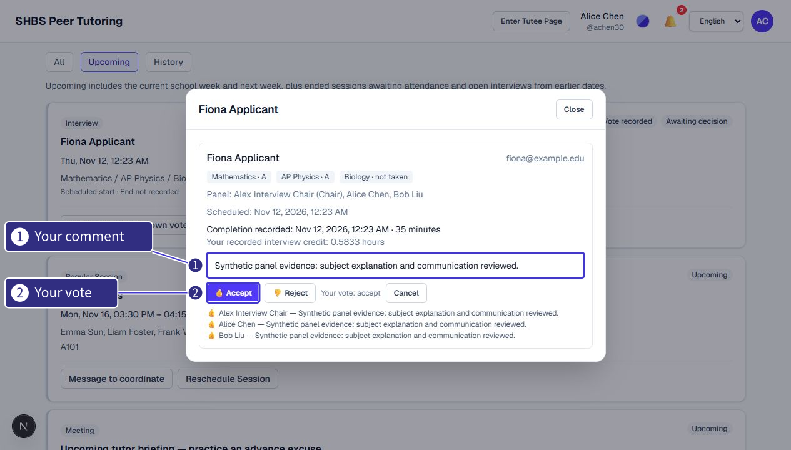

   /dashboard · EN · 2026-11-16

   Panelist interview details with an optional vote comment and the recorded own vote

   [Original full screenshot](assets/tutor-interviews-step-2.en.jpg) · `589c055e4b1cf166b48b353bd619ac1982e5d9f6` · Latest-main development baseline 589c055e with the Help candidate; synthetic demonstration data.

   Annotations added for this step. The original full screenshot is unchanged.

   - **1.** Your comment

   - **2.** Your vote

3. **Chair: schedule and decide** An authorized chair schedules the interview and records the outcome after all votes, following the majority and resolving a tie. On approval enter actual completion time, minutes and attending panelists, then review Approve & award hours.

   **View 1**

   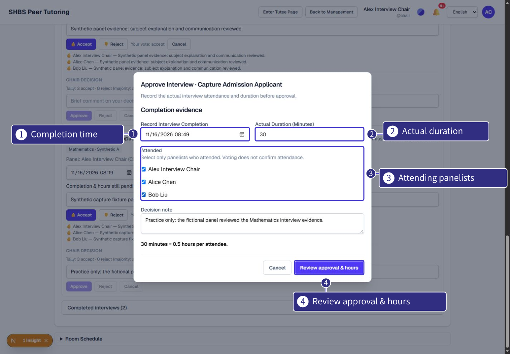

   /dashboard#sessions · EN · 2026-11-20

   The assigned chair enters the completion time, duration and actual attendees for this fictional approval draft. Review approval & hours opens the final consequence review.

   [Original full screenshot](assets/tutor-interviews-step-3.en.jpg) · `b5ece465681957c9fe579d26babdeb260c674fa0` · Latest-main development baseline b5ece465, selected 2026-11-20, with the Help candidate and synthetic demo records.

   Annotations added for this step. The original full screenshot is unchanged.

   - **1.** Completion time

   - **2.** Actual duration

   - **3.** Attending panelists

   - **4.** Review approval & hours

   **View 2**

   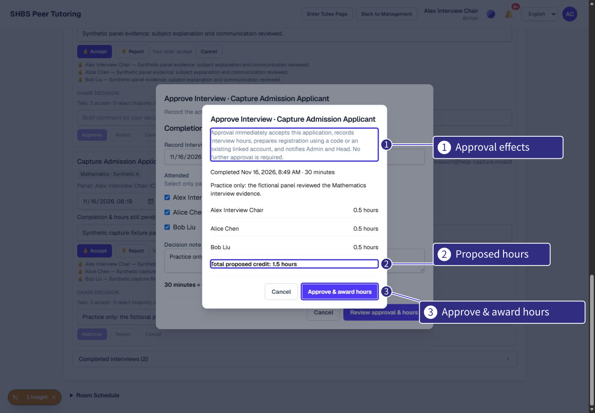

   /dashboard#sessions · EN · 2026-11-20

   The final initial approval review shows the proposed 1.5 hours and acceptance, registration and notification consequences. The confirmation remains unpressed.

   [Original full screenshot](assets/tutor-interviews-step-3-view-2.en.jpg) · `b5ece465681957c9fe579d26babdeb260c674fa0` · Latest-main development baseline b5ece465, selected 2026-11-20, with the Help candidate and synthetic demo records.

   Annotations added for this step. The original full screenshot is unchanged.

   - **1.** Approval effects

   - **2.** Proposed hours

   - **3.** Approve & award hours

4. **Check completion follow-up** Read the saved decision and completion separately. Acceptance, interview credit and initial invitation setup can apply together; additional qualifications grant subjects without a new registration code. Ask management to correct completion/hours through Interview Records.

   **View 1**

   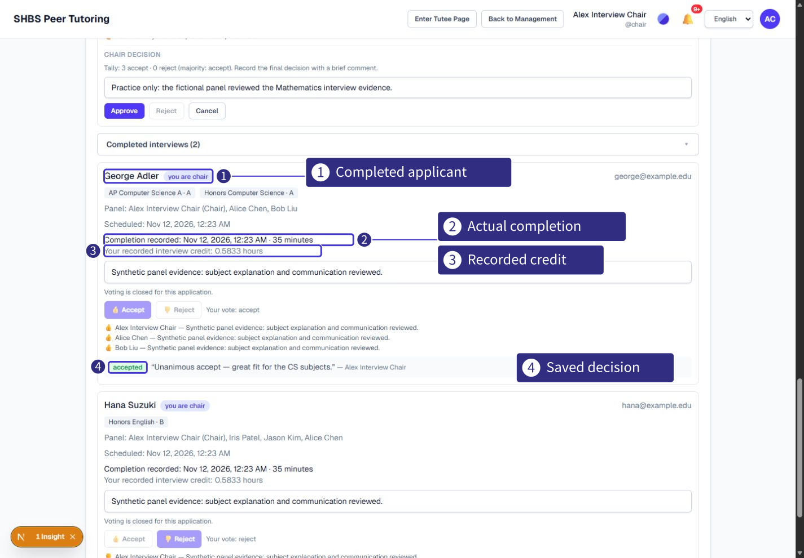

   /dashboard#sessions · EN · 2026-11-20

   George’s completed card shows a saved accepted decision and the separate 35-minute completion and personal interview credit.

   [Original full screenshot](assets/tutor-interviews-step-4.en.jpg) · `b5ece465681957c9fe579d26babdeb260c674fa0` · Latest-main development baseline b5ece465, selected 2026-11-20, with the Help candidate and synthetic demo records.

   Annotations added for this step. The original full screenshot is unchanged.

   - **1.** Completed applicant

   - **2.** Actual completion

   - **3.** Recorded credit

   - **4.** Saved decision

   **View 2**

   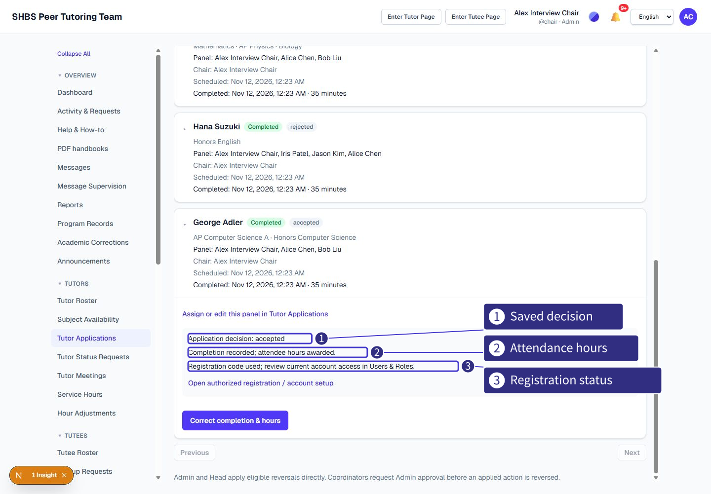

   /admin/applications#interview-records · EN · 2026-11-20

   Interview records shows George’s accepted decision, awarded attendance hours and the separate already-used registration status. No code is displayed.

   [Original full screenshot](assets/tutor-interviews-step-4-view-2.en.jpg) · `b5ece465681957c9fe579d26babdeb260c674fa0` · Latest-main development baseline b5ece465, selected 2026-11-20, with the Help candidate and synthetic demo records.

   Annotations added for this step. The original full screenshot is unchanged.

   - **1.** Saved decision

   - **2.** Attendance hours

   - **3.** Registration status

### What happens next

Your vote is saved, or the authorized chair's final decision and actual attendance credit are recorded.

### How it works

Coordinators may vote as panelists but cannot chair. A missing or demoted chair blocks new scheduling/decision/first completion until management fixes the panel; existing historical completion corrections retain their recorded chair. A completed interview can still await votes or decision.

### Troubleshooting

- **The decision is blocked** Check every vote, eligible active panelists, subject qualifications and a selected current Admin/Head chair. Restricted applicant access may require a separate management restoration; retrying acceptance cannot bypass it.

## Review meetings and request an excuse

Read current/history attendance and submit or cancel an excuse before the deadline.

Open: `/dashboard#sessions`

### Before you start

- The meeting belongs to your tutor schedule and the excuse deadline has not passed.

### Walkthrough

1. **Open the meeting** In Schedule choose the meeting card. Read its date, program timezone and attendance or excuse state. A meeting awaiting staff attendance does not ask you to record your own attendance.

   Look for: Meeting card and excuse state

   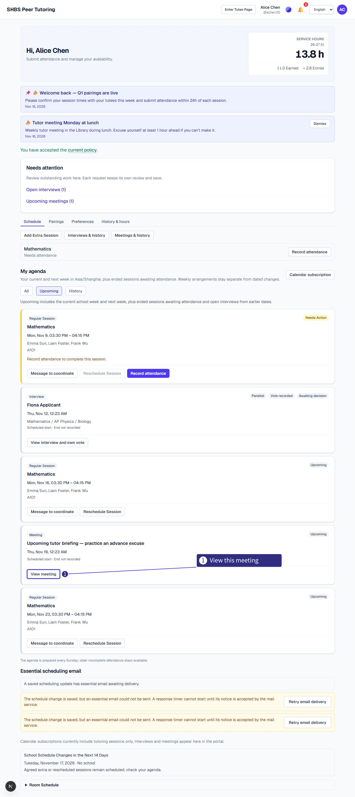

   /dashboard · EN · 2026-11-16

   Tutor dashboard on latest main: pinned and ordinary announcements, task panels and dated agenda

   [Original full screenshot](assets/tutor-meetings-step-1.en.jpg) · `589c055e4b1cf166b48b353bd619ac1982e5d9f6` · Latest-main development baseline 589c055e with the Help candidate; synthetic demonstration data.

   Annotations added for this step. The original full screenshot is unchanged.

   - **1.** View this meeting

2. **Submit or cancel your excuse** Use the excuse action, supply the requested reason and confirm at least 60 minutes before the meeting starts. You may cancel your own eligible excuse before that same deadline. Staff-recorded statuses require staff correction.

   **View 1**

   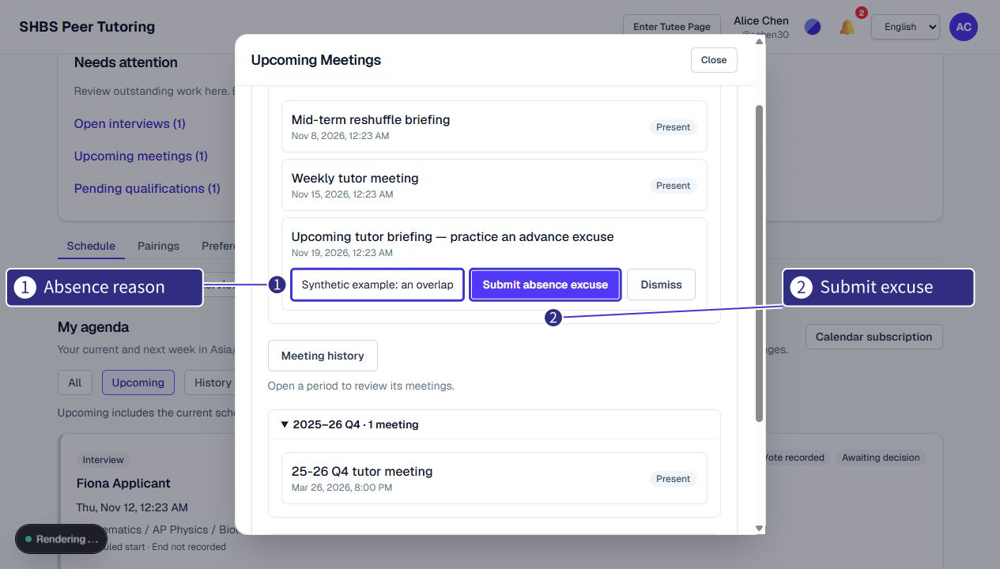

   /dashboard#sessions · EN · 2026-11-16

   Advance meeting excuse after the form layout fix: reason and both actions stay inside the dialog

   [Original full screenshot](assets/tutor-meetings-step-2.en.jpg) · `589c055e4b1cf166b48b353bd619ac1982e5d9f6` · Latest-main development baseline 589c055e with the Help candidate; synthetic demonstration data.

   Annotations added for this step. The original full screenshot is unchanged.

   - **1.** Absence reason

   - **2.** Submit excuse

   **View 2**

   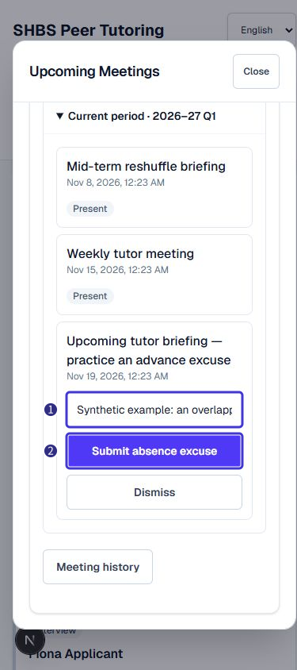

   /dashboard · EN · 2026-11-16

   English mobile meeting excuse after the layout fix; reason and both actions remain visible

   [Original full screenshot](assets/tutor-meetings-step-2-view-2.en.jpg) · `589c055e4b1cf166b48b353bd619ac1982e5d9f6` · Latest-main development baseline 589c055e with the Help candidate; synthetic demonstration data.

   Annotations added for this step. The original full screenshot is unchanged.

   - **1.** Reason

   - **2.** Submit excuse

3. **Read Meeting history** Open Meeting history, then a school-year/quarter group for recorded attendance. Semester mode groups both constituent quarters. Period not recorded remains explicit; future meetings recorded under other periods appear separately.

   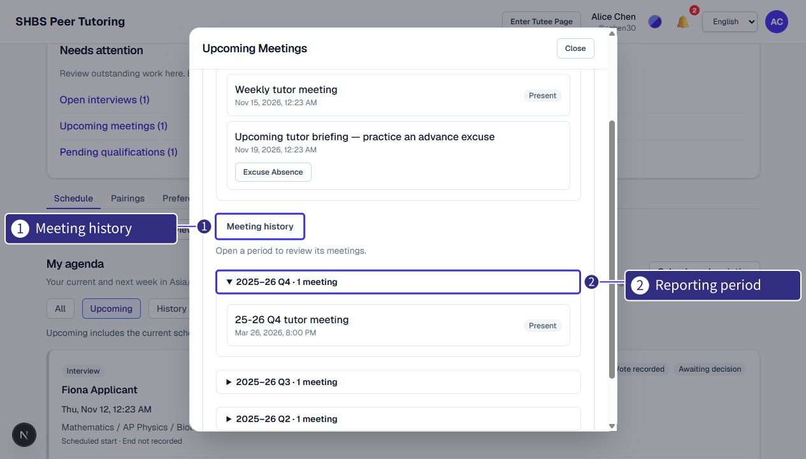

   /dashboard#sessions · EN · 2026-11-16

   Meeting history expanded to a retained school-year/quarter group with recorded attendance

   [Original full screenshot](assets/tutor-meetings-step-3.en.jpg) · `589c055e4b1cf166b48b353bd619ac1982e5d9f6` · Latest-main development baseline 589c055e with the Help candidate; synthetic demonstration data.

   Annotations added for this step. The original full screenshot is unchanged.

   - **1.** Meeting history

   - **2.** Reporting period

### What happens next

Your excuse shows its saved state or historical meeting attendance remains readable.

### How it works

The first three unexcused tutor-meeting absences per semester have no automatic deduction; each further one deducts 0.25 hours. Excused absences do not consume that allowance. Missing attendance is not an absence.

### Troubleshooting

- **Period grouping changed or a save failed** Keep your draft and use Retry after a failed save/read. Reload groups explicitly confirms discarding unsaved drafts after an applied quarter/semester mode change; it waits for pending saves/refreshes.

## Manage tutoring participation and understand hours

Request or recall membership changes, relay eligible departures and inspect separate credit sources.

Open: `/settings`

### Before you start

- You have a linked tutor profile; actions depend on current participation and existing pending requests.

### Walkthrough

1. **Request or recall your opt-out** In Account Settings open opt-out, enter an optional reason, review the named request and confirm after its three-second pause. Participation continues until staff approval, allowed only after seven days. Use the separate recall control to withdraw a pending request.

   Look for: Tutor participation request and pending state

   **View 1**

   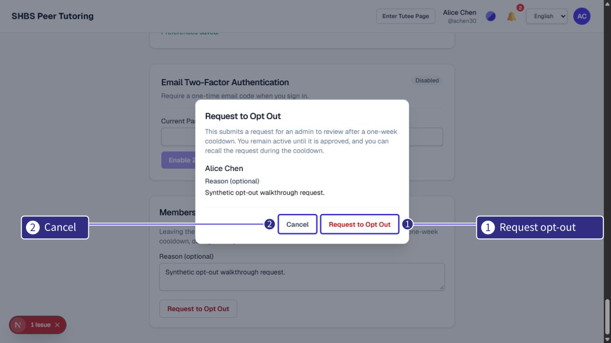

   /settings · EN · 2026-11-16

   Opt-out review names the tutor, optional reason, seven-day review cooldown and continued participation until approval.

   [Original full screenshot](assets/tutor-membership-hours-step-1.en.jpg) · `589c055e4b1cf166b48b353bd619ac1982e5d9f6` · Latest-main development baseline 589c055e with the Help candidate; synthetic demonstration data.

   Annotations added for this step. The original full screenshot is unchanged.

   - **1.** Request opt-out

   - **2.** Cancel

   **View 2**

   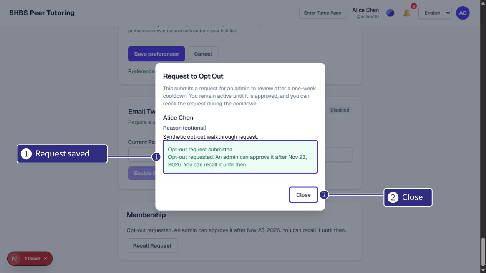

   /settings · EN · 2026-11-16

   Actual submitted opt-out receipt names the future approval date and recall window; it does not approve departure.

   [Original full screenshot](assets/tutor-membership-hours-step-1-view-2.en.jpg) · `589c055e4b1cf166b48b353bd619ac1982e5d9f6` · Latest-main development baseline 589c055e with the Help candidate; synthetic demonstration data.

   Annotations added for this step. The original full screenshot is unchanged.

   - **1.** Request saved

   - **2.** Close

   **View 3**

   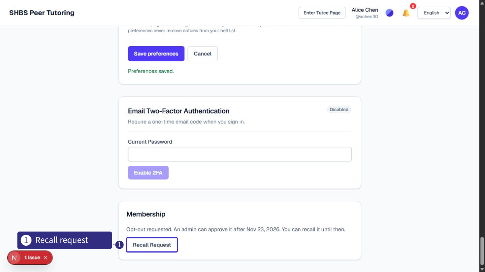

   /settings · EN · 2026-11-16

   The pending opt-out shows its real approval date and a separate Recall Request action while participation remains active.

   [Original full screenshot](assets/tutor-membership-hours-step-1-view-3.en.jpg) · `589c055e4b1cf166b48b353bd619ac1982e5d9f6` · Latest-main development baseline 589c055e with the Help candidate; synthetic demonstration data.

   Annotations added for this step. The original full screenshot is unchanged.

   - **1.** Recall request

2. **Request reentry or confirm a new semester** An opted-out tutor can request reentry without a seven-day wait, but approval remains required. Only one pending membership request is allowed. After semester refresh, pending continuing tutors directly choose available or opting out in the activation prompt.

   **View 1**

   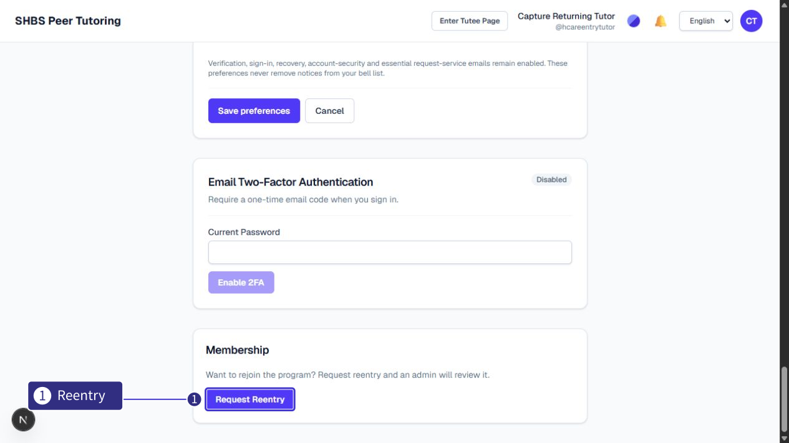

   /settings · EN · 2026-11-16

   This dedicated opted-out tutor sees Request Reentry in Membership. The page says an Admin will review the request; the button does not make the tutor active.

   [Original full screenshot](assets/tutor-membership-hours-step-2.en.jpg) · `dd970ea426016e85cb514beeeab537c3ab2e5098` · Latest-main development baseline dd970ea4, selected 2026-11-16, with the Help candidate; synthetic demonstration data.

   Annotations added for this step. The original full screenshot is unchanged.

   - **1.** Reentry

   **View 2**

   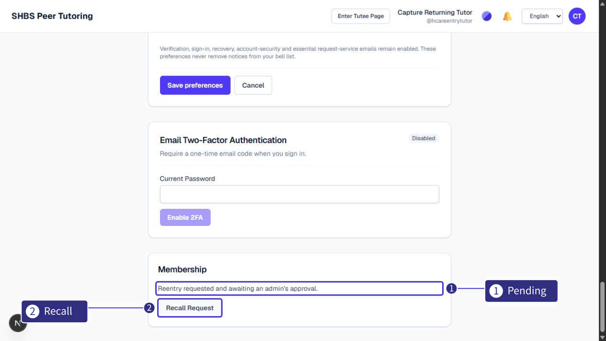

   /settings · EN · 2026-11-16

   Request Reentry submitted immediately and the real page now says it awaits Admin approval. Recall Request is available; the tutor has not been activated and no policy acceptance was submitted.

   [Original full screenshot](assets/tutor-membership-hours-step-2-view-2.en.jpg) · `dd970ea426016e85cb514beeeab537c3ab2e5098` · Latest-main development baseline dd970ea4, selected 2026-11-16, with the Help candidate; synthetic demonstration data.

   Annotations added for this step. The original full screenshot is unchanged.

   - **1.** Pending

   - **2.** Recall

3. **Relay only an eligible student's request** For a non-survey enrolled student use the relay action in pairing Details, add an optional reason and review. It processes after a seven-day recall window unless recalled or cancelled. Survey students request whole-period withdrawal in their own workspace; schedule conflicts use their own review.

   **View 1**

   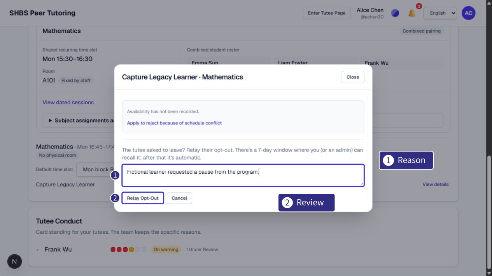

   /dashboard#tutor-pairings · EN · 2026-11-16

   Alice opens the non-survey Capture Legacy Learner pairing details and drafts an optional relay reason. Relay Opt-Out will open the confirmation review; nothing has been submitted yet.

   [Original full screenshot](assets/tutor-membership-hours-step-3.en.jpg) · `dd970ea426016e85cb514beeeab537c3ab2e5098` · Latest-main development baseline dd970ea4, selected 2026-11-16, with the Help candidate; synthetic demonstration data.

   Annotations added for this step. The original full screenshot is unchanged.

   - **1.** Reason

   - **2.** Review

   **View 2**

   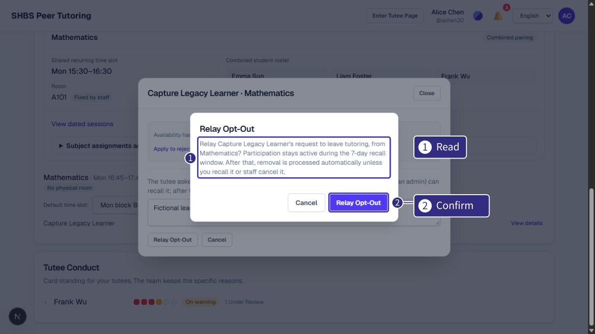

   /dashboard#tutor-pairings · EN · 2026-11-16

   The real Relay Opt-Out review names Capture Legacy Learner and Mathematics, states that participation remains active during the seven-day recall window, and offers Cancel or the final Relay Opt-Out action. Nothing has been submitted yet.

   [Original full screenshot](assets/tutor-membership-hours-step-3-view-2.en.jpg) · `dd970ea426016e85cb514beeeab537c3ab2e5098` · Latest-main development baseline dd970ea4, selected 2026-11-16, with the Help candidate; synthetic demonstration data.

   Annotations added for this step. The original full screenshot is unchanged.

   - **1.** Read

   - **2.** Confirm

   **View 3**

   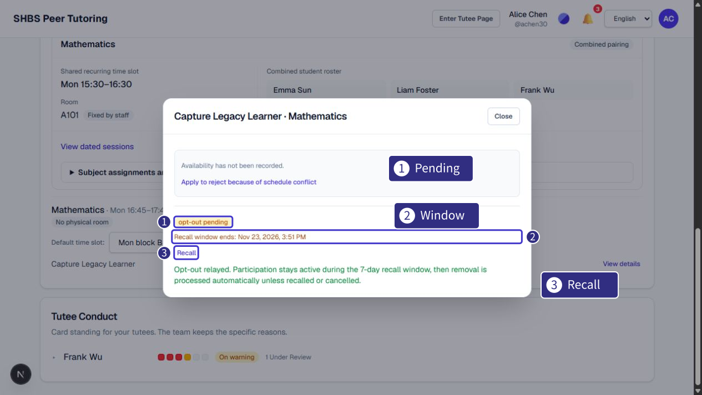

   /dashboard#tutor-pairings · EN · 2026-11-16

   The real relay was submitted once. The learner shows opt-out pending and an actual recall deadline of Nov 23, 2026, 3:51 PM; the receipt says participation remains active during this seven-day window. Recall is available.

   [Original full screenshot](assets/tutor-membership-hours-step-3-view-3.en.jpg) · `dd970ea426016e85cb514beeeab537c3ab2e5098` · Latest-main development baseline dd970ea4, selected 2026-11-16, with the Help candidate; synthetic demonstration data.

   Annotations added for this step. The original full screenshot is unchanged.

   - **1.** Pending

   - **2.** Window

   - **3.** Recall

   **View 4**

   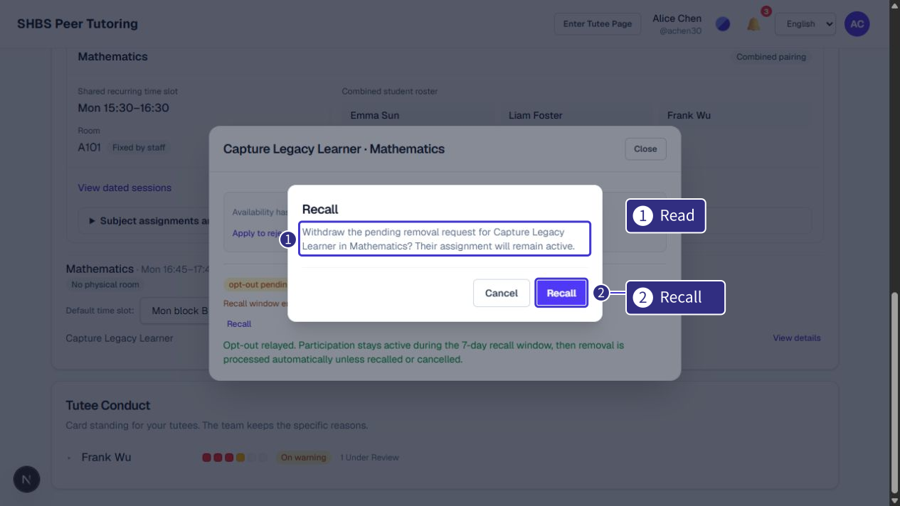

   /dashboard#tutor-pairings · EN · 2026-11-16

   Recall opens this real confirmation. Check the named learner and subject, then choose Recall to withdraw the pending removal or Cancel to keep it pending. The dialog states the assignment will remain active.

   [Original full screenshot](assets/tutor-membership-hours-step-3-view-4.en.jpg) · `dd970ea426016e85cb514beeeab537c3ab2e5098` · Latest-main development baseline dd970ea4, selected 2026-11-16, with the Help candidate; synthetic demonstration data.

   Annotations added for this step. The original full screenshot is unchanged.

   - **1.** Read

   - **2.** Recall

   **View 5**

   

   /dashboard#tutor-pairings · EN · 2026-11-16

   The final Recall action completed and the real Saved receipt is visible. The pending badge, deadline and Recall action have disappeared; Relay Opt-Out is available again and the learner remains in the assignment.

   [Original full screenshot](assets/tutor-membership-hours-step-3-view-5.en.jpg) · `dd970ea426016e85cb514beeeab537c3ab2e5098` · Latest-main development baseline dd970ea4, selected 2026-11-16, with the Help candidate; synthetic demonstration data.

   Annotations added for this step. The original full screenshot is unchanged.

   - **1.** Saved

4. **Inspect History & hours** Read the reporting period, earned tutoring hours, extras and deductions. Review sessions, interviews, meeting deductions and manual adjustments. Crew Hours is separate and is not included in the tutoring total.

   Look for: Selected period and earned/extras/deductions

   

   /dashboard#tutor-history · EN · 2026-11-16

   Retained tutor history detail separates stored session credits from meeting records and manual amendments

   [Original full screenshot](assets/tutor-membership-hours-step-4.en.jpg) · `589c055e4b1cf166b48b353bd619ac1982e5d9f6` · Latest-main development baseline 589c055e with the Help candidate; synthetic demonstration data.

   Annotations added for this step. The original full screenshot is unchanged.

   - **1.** Credits ≠ total

   - **2.** Recorded lesson

### What happens next

Membership requests show pending/decided state and hours can be traced to their recorded source.

### How it works

A submission receipt never ends participation immediately. An outdated student relay cancels if the program refreshes or its original assignment is removed before processing. Historical attendance credit follows its recorded policy; manual adjustments and Crew credit remain separate evidence.

### Troubleshooting

- **Hours or membership differ from your expectation** Check period, actual saved attendance, adjustments and review decision. Ask management to inspect the exact source record. After a successful request with refresh failure use Retry refresh rather than requesting again.

## Read announcements, room schedules and learner standing

Find shared program information while respecting the limits on private evidence.

Open: `/dashboard`

### Before you start

- Use your tutor workspace; optional sections depend on enabled modules and relevant records.

### Walkthrough

1. **Read addressed announcements** Read the announcement cards above your workspace. Pinned posts stay visible even after an earlier acknowledgement; they have no Dismiss button. Use Dismiss on an ordinary post when offered. Addressed posts use the audience captured at publication; another tutor's notice is not yours to acknowledge.

   Look for: Announcements above the tutor workspace

   

   /dashboard · EN · 2026-11-16

   Tutor dashboard on latest main: pinned and ordinary announcements, task panels and dated agenda

   [Original full screenshot](assets/tutor-program-information-step-1.en.jpg) · `589c055e4b1cf166b48b353bd619ac1982e5d9f6` · Latest-main development baseline 589c055e with the Help candidate; synthetic demonstration data.

   Annotations added for this step. The original full screenshot is unchanged.

   - **1.** Pinned and ordinary posts

   - **2.** Dismiss this post

2. **Inspect the shared room schedule** Use the shared room-schedule view in the tutor workspace to read planned public room commitments. Read the exact time and room details, and close the reader when finished. It does not display private interview evidence or reserve a room for you.

   Look for: Shared room schedule beside pairing tools when offered

   

   /dashboard#sessions · EN · 2026-11-16

   Read-only room-schedule detail for the exact Monday time slot, including an unavailable room

   [Original full screenshot](assets/tutor-program-information-step-2.en.jpg) · `589c055e4b1cf166b48b353bd619ac1982e5d9f6` · Latest-main development baseline 589c055e with the Help candidate; synthetic demonstration data.

   Annotations added for this step. The original full screenshot is unchanged.

   - **1.** Time slot

   - **2.** Room and interval

   - **3.** Close details

3. **Read your learners' standing** When discipline history is available, expand a tutee's timeline to inspect card color, date and pending/valid outcome. Tutors see standing and outcomes, never the private card reasons. Request new cards only through the relevant attendance form with an actual reason.

   

   /dashboard#tutor-pairings · EN · 2026-11-16

   Expanded tutor-visible card timeline: colors, dates and valid or under-review outcomes

   [Original full screenshot](assets/tutor-program-information-step-3.en.jpg) · `589c055e4b1cf166b48b353bd619ac1982e5d9f6` · Latest-main development baseline 589c055e with the Help candidate; synthetic demonstration data.

   Annotations added for this step. The original full screenshot is unchanged.

   - **1.** Card standing

   - **2.** Dated outcomes

4. **Reopen the handbook** Choose Handbook or current policy to read the published tutor policy in the interface language, with English fallback. Reading does not sign a new revision; complete the separate participation-policy review if prompted.

   

   /dashboard#tutor-pairings · EN · 2026-11-16

   Published tutor-policy reader reopened from the already-accepted policy notice

   [Original full screenshot](assets/tutor-program-information-step-4.en.jpg) · `589c055e4b1cf166b48b353bd619ac1982e5d9f6` · Latest-main development baseline 589c055e with the Help candidate; synthetic demonstration data.

   Annotations added for this step. The original full screenshot is unchanged.

   - **1.** Title & revision

   - **2.** Close reader

5. **Read feedback shared with you** Open Tutee Support at /student-support. When management enables Share feedback with tutors, you can read feedback for your own recorded sessions and use Previous/Next for that list. When sharing is off or cannot be verified, follow the stated unavailable/privacy message rather than assuming access.

   

   /student-support · EN · 2026-11-16

   Tutor feedback reader when management sharing is disabled: the privacy message is explicit

   [Original full screenshot](assets/tutor-program-information-step-5.en.jpg) · `589c055e4b1cf166b48b353bd619ac1982e5d9f6` · Latest-main development baseline 589c055e with the Help candidate; synthetic demonstration data.

   Annotations added for this step. The original full screenshot is unchanged.

   - **1.** Visibility notice

   - **2.** Pagination

### What happens next

You understand the current announcement, planned room information and permitted learner standing.

### How it works

Optional discipline history hides after a successful empty read, not during a failed load. Shared room information does not grant management room-selection powers; the assigned session remains authoritative for your lesson.

### Troubleshooting

- **The section is missing or cannot refresh** Check whether the module is enabled and you have addressed announcements or relevant records. Use Retry for failed reads. Ask management privately about incorrect standing; do not infer hidden reasons from a summary.
