# 辅导伙伴工作台

由网站帮助目录生成。请修改内容源文件后运行 `npm run help:export`。

[目录与截图来源](README.md)

截图来源: `1df44d6bb31cf04352adae9c65819139b7b747d8`. New captures use latest-main development baseline 1df44d6b, selected 2026-11-21, with the Help candidate. Earlier captures list their own revision and capture date.

此 GitHub 培训副本包含各角色操作说明。实际使用网站功能仍需登录并具备当前项目权限。所有示例数据均为虚构。

- [激活辅导并查找下一项任务](#激活辅导并查找下一项任务)
- [设置可用时间及期望课次数](#设置可用时间及期望课次数)
- [设置科目意愿并申请资质](#设置科目意愿并申请资质)
- [查看配对并选择每周时间](#查看配对并选择每周时间)
- [合并、修复或拆分每周配对](#合并修复或拆分每周配对)
- [为已结束辅导课记录出勤](#为已结束辅导课记录出勤)
- [改期或新增加课](#改期或新增加课)
- [申请取消已约定加课](#申请取消已约定加课)
- [进行面试投票或履行主席职责](#进行面试投票或履行主席职责)
- [查看会议并申请请假](#查看会议并申请请假)
- [管理辅导参与并了解时数](#管理辅导参与并了解时数)
- [阅读公告、教室课表及学习伙伴状态](#阅读公告教室课表及学习伙伴状态)

## 激活辅导并查找下一项任务

确认当前参与状态、查看任务状态，并使用统一辅导伙伴工作区。

打开: `/dashboard`

### 开始之前

- 账户有关联的辅导伙伴档案及辅导权限。

### 操作步骤

1. **检查激活与政策提示** 打开进入辅导伙伴页面。待确认时，通过页面选项和审核确认是否参与。进行参与操作前，阅读并接受当前辅导政策。

   请注意: 参与提示、待处理任务和工作区页签

   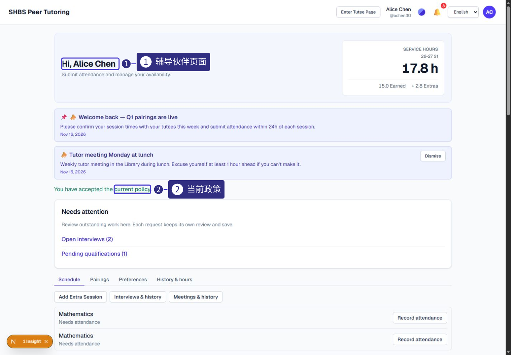

   英文界面

   

   
截图详情

   Alice 已处于活跃状态。辅导伙伴概览在参与任务前显示已接受当前政策的提示。待确认人员会先看到单独的参与选项。

   /dashboard · EN · 2026-11-20

   [原始完整截图](assets/start-tutoring-step-1.en.jpg) · `b5ece465681957c9fe579d26babdeb260c674fa0` · Latest-main development baseline b5ece465, selected 2026-11-20, with the Help candidate and synthetic demo records.

   

2. **使用四个任务页签** 课表包含日期辅导、面试和会议；配对包含每周分配；偏好包含可用时间、期望课次数和科目选择；历史与时数包含保留证据。在本次访问中切换这些本地页签会保留已打开编辑器。

   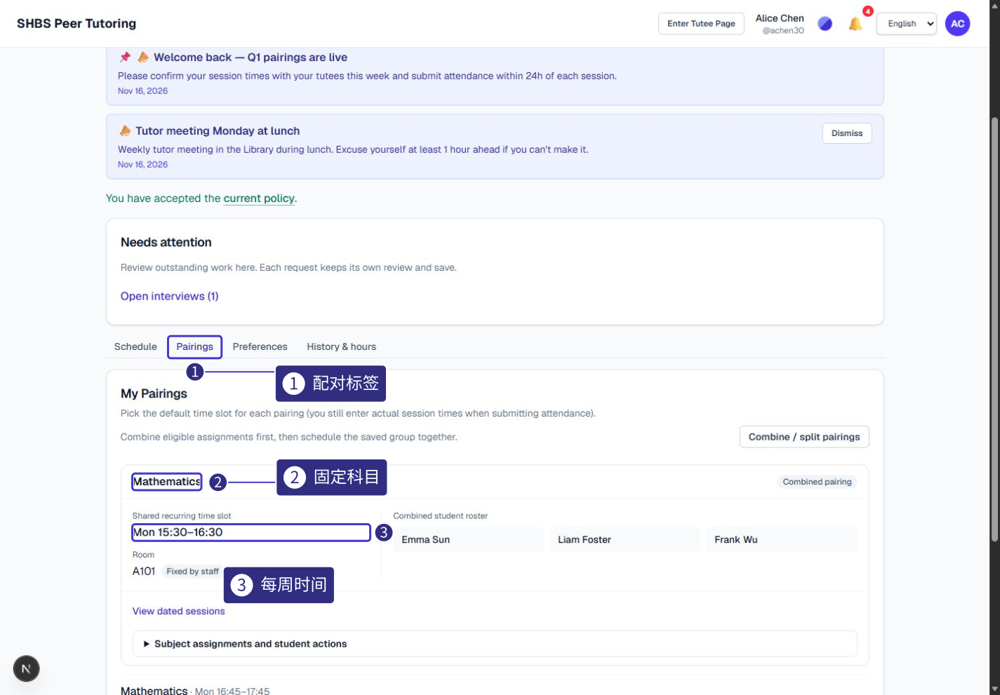

   英文界面

   

   
截图详情

   在辅导伙伴工作区选择“配对”查看固定小组。数学条目显示每周时间。

   /dashboard#tutor-pairings · EN · 2026-11-21

   [原始完整截图](assets/start-tutoring-step-2.en.jpg) · `b5ece465681957c9fe579d26babdeb260c674fa0` · Latest-main development baseline b5ece465, selected 2026-11-20, with the Help candidate and synthetic demo records.

   

3. **跟进待处理任务** 打开待确认排课、缺少出勤、面试投票或会议任务。需要处理表示等待本人操作；已投票／等待决定表示投票已保存，但面试仍未结束。

   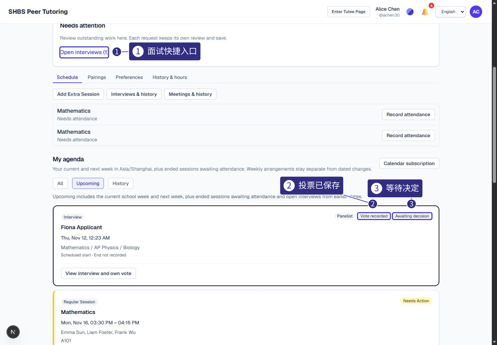

   英文界面

   

   
截图详情

   “待处理任务”中的“未结束面试”可进入对应日期任务。Fiona 的面试显示已投票及等待决定。

   /dashboard · EN · 2026-11-21

   [原始完整截图](assets/start-tutoring-step-3.en.jpg) · `b5ece465681957c9fe579d26babdeb260c674fa0` · Latest-main development baseline b5ece465, selected 2026-11-20, with the Help candidate and synthetic demo records.

   

### 预期结果

明确本人有效状态，并能打开需要本人处理的指定任务。

### 工作原理

非活跃辅导伙伴保留只读历史，但不能编辑配对或提交出勤。仅有管理员徽章不代表辅导身份。/dashboard与/schedule均显示辅导工作区；旧章节链接保留目标，不会丢弃已打开编辑器。

### 问题排查

- **辅导控件不可用** 与管理团队检查状态、当前政策、学业确认、停用、离校及权限撤销。申请获批本身不会恢复单独被撤销的辅导权限。

## 设置可用时间及期望课次数

保存每周可用时间，并单独设置建议性的工作量偏好。

打开: `/dashboard#tutor-preferences`

### 开始之前

- 本人为有效辅导伙伴，且符合当前参与要求。

### 操作步骤

1. **编辑我的可用时间** 打开偏好→我的可用时间→编辑我的可用时间。选择可授课的目录星期及时间段，再选择保存可用时间。取消会恢复上次读取的选择。

   请注意: 星期时间选择与保存可用时间

   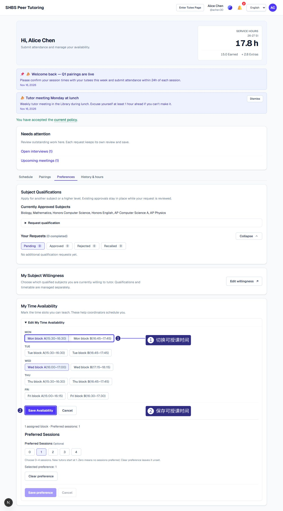

   英文界面

   

   
截图详情

   展开的可授课时间表、独立偏好课次数控件及当前工作量

   /dashboard#tutor-preferences · EN · 2026-11-16

   [原始完整截图](assets/tutor-availability-step-1.en.jpg) · `589c055e4b1cf166b48b353bd619ac1982e5d9f6` · Latest-main development baseline 589c055e with the Help candidate; synthetic demonstration data.

   

2. **单独保存期望课次数** 在时间选择下方选择零至四，或清空偏好，再使用该区域的保存。零表示希望不分配课程；未设置是另一种状态。保存时间不会保存此独立草稿。

   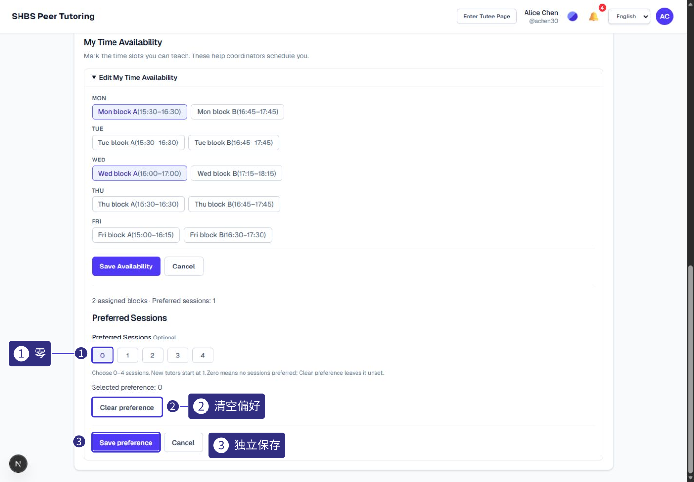

   英文界面

   

   
截图详情

   在独立的“期望课次数”表单中选择零或清空偏好。本例的零是草稿，随后已取消。

   /dashboard#tutor-preferences · EN · 2026-11-21

   [原始完整截图](assets/tutor-availability-step-2.en.jpg) · `b5ece465681957c9fe579d26babdeb260c674fa0` · Latest-main development baseline b5ece465, selected 2026-11-20, with the Help candidate and synthetic demo records.

   

3. **查看保存后的工作量信息** 比较已分配教学块数量与已保存偏好。配对组改变会刷新数量，但不替换未保存偏好。保存已接受但同步失败时，使用重试刷新。

   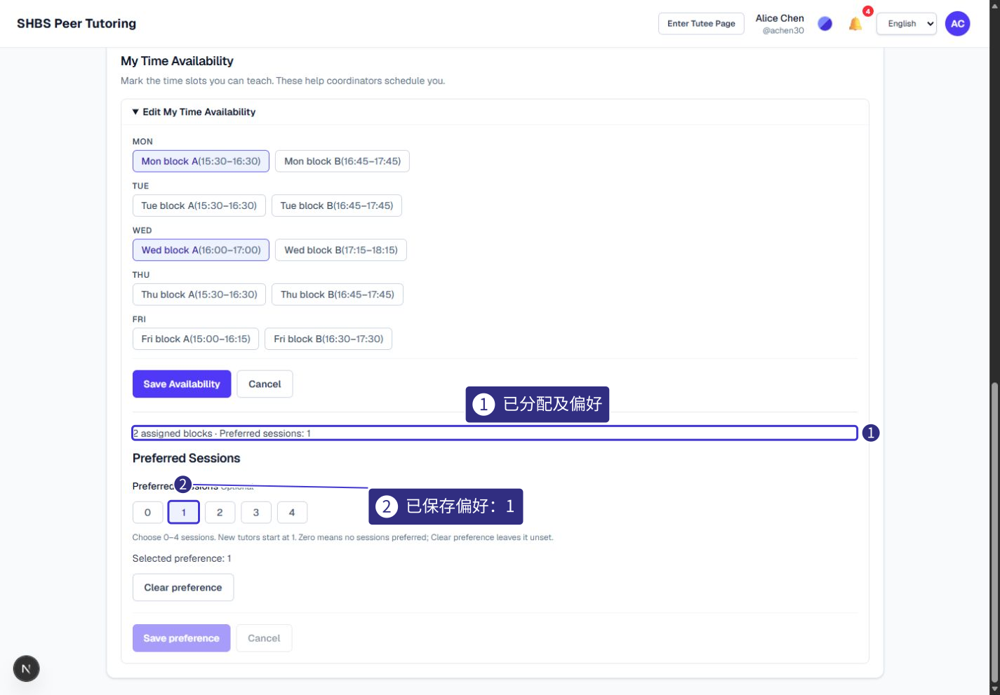

   英文界面

   

   
截图详情

   保存后的比较显示已分配两个教学块，偏好为一。取消草稿后，选中的是已保存的值。

   /dashboard#tutor-preferences · EN · 2026-11-21

   [原始完整截图](assets/tutor-availability-step-3.en.jpg) · `b5ece465681957c9fe579d26babdeb260c674fa0` · Latest-main development baseline b5ece465, selected 2026-11-20, with the Help candidate and synthetic demo records.

   

### 预期结果

可用时间和期望工作量分别显示各自已接受值。

### 工作原理

偏好仅供参考：工作人员仍可超出偏好分配，降低偏好不会取消分配。变为非活跃会重置并锁定为零；恢复活跃后需自行修改。有效配对组计为一个教学块，仅时间相同不会合并分配。

### 问题排查

- **保存值已在其他地方更改** 使用重新加载已存偏好，明确仅替换该过时草稿。保存失败保留选择；只读重试刷新恢复已成功保存结果，不会再次提交。

## 设置科目意愿并申请资质

区分已获批资质、辅导意愿和待审新增科目申请。

打开: `/dashboard#tutor-preferences`

### 开始之前

- 有效辅导伙伴可修改意愿或提交符合条件的资质申请；非活跃辅导伙伴保留只读历史。

### 操作步骤

1. **编辑已获批科目意愿** 打开我的科目意愿→编辑意愿。对已批准开放科目选择愿意辅导或不愿辅导。每次选择立即保存；继续前检查结果。未记录表示尚未保存选择。

   请注意: 科目意愿与科目资质

   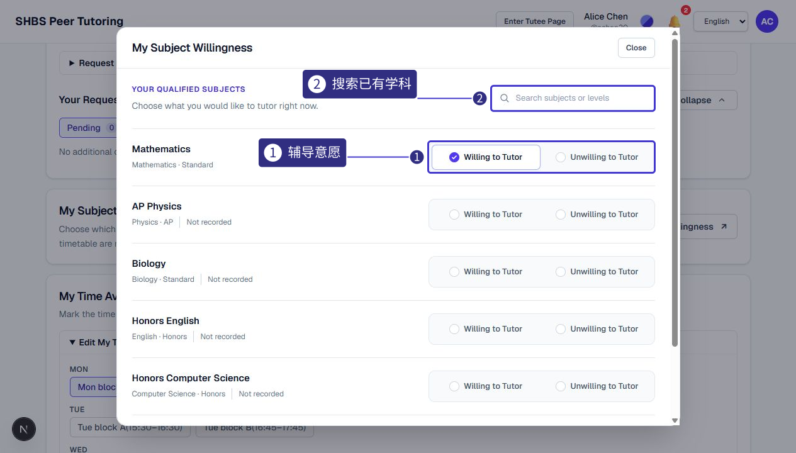

   英文界面

   

   
截图详情

   学科意愿编辑器：显示已自动保存的数学意愿

   /dashboard#tutor-preferences · EN · 2026-11-16

   [原始完整截图](assets/tutor-subject-qualifications-step-1.en.jpg) · `589c055e4b1cf166b48b353bd619ac1982e5d9f6` · Latest-main development baseline 589c055e with the Help candidate; synthetic demonstration data.

   

2. **申请新科目或更高等级** 在科目资质中选择科目／等级，说明资质并提交。在你的申请中使用待处理、已批准、已拒绝或已撤回筛选，并展开历史查看决定说明及已授予科目。

   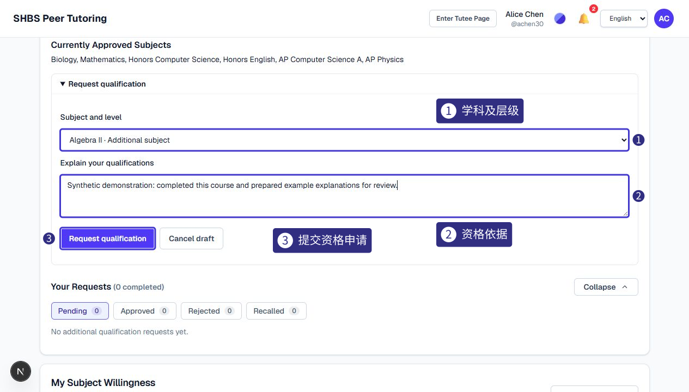

   英文界面

   

   
截图详情

   额外学科资格申请草稿：已选学科层级并填写说明

   /dashboard#tutor-preferences · EN · 2026-11-16

   [原始完整截图](assets/tutor-subject-qualifications-step-2.en.jpg) · `589c055e4b1cf166b48b353bd619ac1982e5d9f6` · Latest-main development baseline 589c055e with the Help candidate; synthetic demonstration data.

   

3. **撤回符合条件的待审申请** 在待处理或面试阶段选择撤回申请，核对具体科目后确认。已撤回申请不能重开或获批；准备好后需重新提交。

   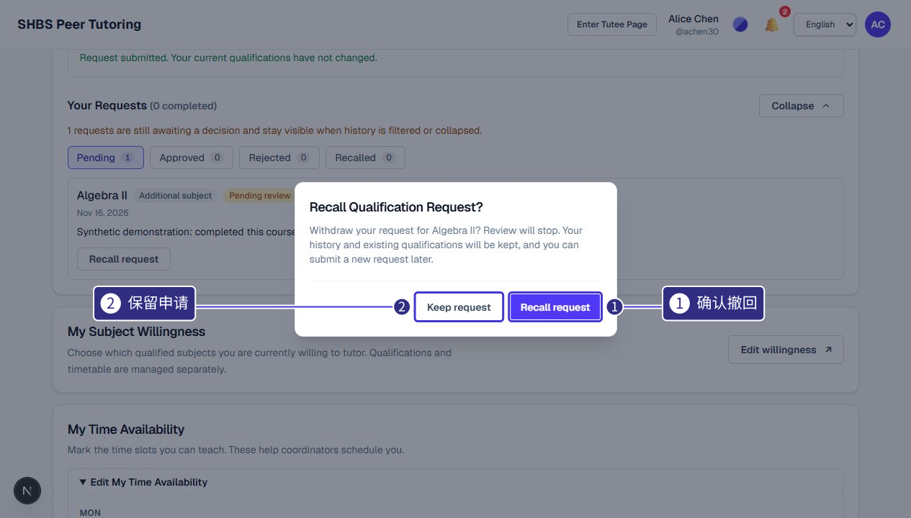

   英文界面

   

   
截图详情

   撤回仍待审核的代数II资格申请前的明确确认

   /dashboard#tutor-preferences · EN · 2026-11-16

   [原始完整截图](assets/tutor-subject-qualifications-step-3.en.jpg) · `589c055e4b1cf166b48b353bd619ac1982e5d9f6` · Latest-main development baseline 589c055e with the Help candidate; synthetic demonstration data.

   

### 预期结果

当前意愿独立保存，申请历史显示实际决定阶段。

### 工作原理

待审、被拒或撤回申请不会改变现有资质。管理员／负责人可附决定说明直接批准或安排面试；面试拒绝需要获授权主席及投票。批准会记录当时开放的较低等级，之后目录重排不会改变已存授权。

### 问题排查

- **科目未显示或重复申请被阻止** 意愿中仅显示已有批准资质。再次提交前，检查相同科目／等级现有待审申请。目录或资质证据缺失时联系管理团队。

## 查看配对并选择每周时间

参考共同可用时间，确认课表并避免重复预约。

打开: `/dashboard#tutor-pairings`

### 开始之前

- 本人处于活跃状态，且拥有当前含学习伙伴的分配。

### 操作步骤

1. **检查我的配对** 打开配对，查看每组科目、每周时间、教室状态及不同学习伙伴。选择学习伙伴旁的详情，查看已存可用时间、验证期限及待审事项。

   请注意: 学习伙伴列表之前的配对时间选择器与详情

   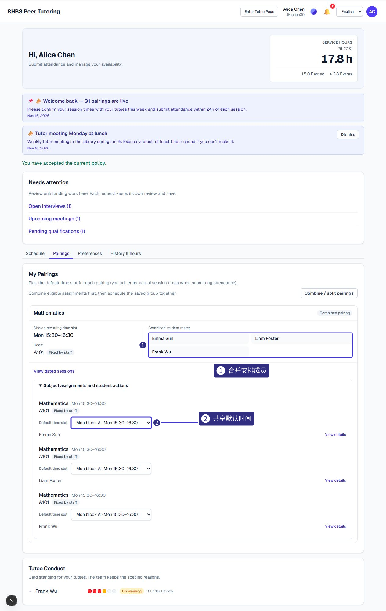

   英文界面

   

   
截图详情

   展开的合并辅导安排：成员、教室、每周时间及个人详情

   /dashboard#tutor-pairings · EN · 2026-11-16

   [原始完整截图](assets/tutor-pairing-time-step-1.en.jpg) · `589c055e4b1cf166b48b353bd619ac1982e5d9f6` · Latest-main development baseline 589c055e with the Help candidate; synthetic demonstration data.

   

2. **比较时间分组** 使用默认时间选择器。双方可用要求本人及所有当前学习伙伴保存相同目录时间段；其他时间段缺少该共同证据。与其他教学块重叠的不可用选项会被禁用。

   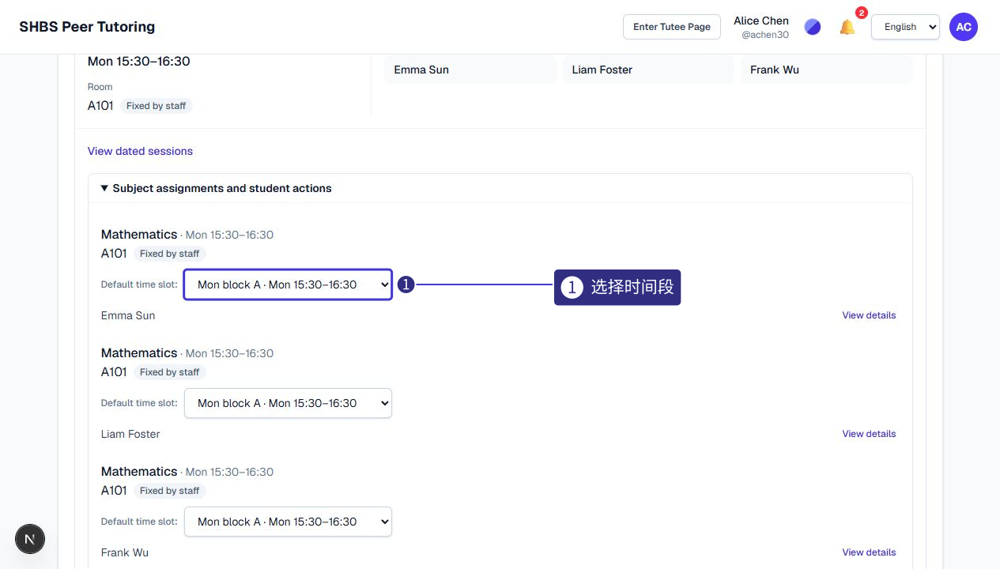

   英文界面

   

   
截图详情

   合并数学辅导安排的默认时间段选择器

   /dashboard#tutor-pairings · EN · 2026-11-16

   [原始完整截图](assets/tutor-pairing-time-step-2.en.jpg) · `589c055e4b1cf166b48b353bd619ac1982e5d9f6` · Latest-main development baseline 589c055e with the Help candidate; synthetic demonstration data.

   

3. **核对并保存时间** 讨论时间后选择所需时段，并确认具体审核。配对组共享时间，修改一个成员默认时间会改变整组。之后检查教室结果及日期课表。

   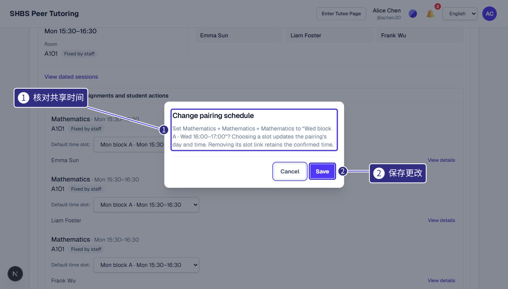

   英文界面

   

   
截图详情

   更改合并组全体成员共享每周时间段前的明确审核

   /dashboard#tutor-pairings · EN · 2026-11-16

   [原始完整截图](assets/tutor-pairing-time-step-3.en.jpg) · `589c055e4b1cf166b48b353bd619ac1982e5d9f6` · Latest-main development baseline 589c055e with the Help candidate; synthetic demonstration data.

   

4. **报告实际排课冲突** 在学习伙伴详情中使用排课冲突申请，提供原因并完成两秒审核。获批前分配仍有效。仅缺少已存可用时间并不能证明冲突。

   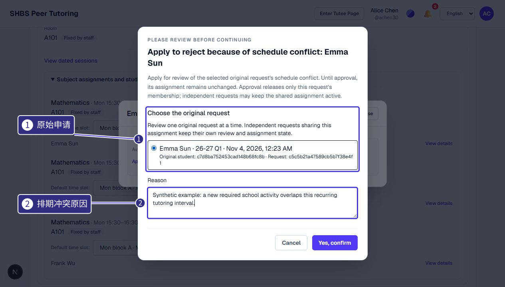

   英文界面

   

   
截图详情

   准确原始申请的排期冲突审核：已说明原因，尚未提交

   /dashboard#tutor-pairings · EN · 2026-11-16

   [原始完整截图](assets/tutor-pairing-time-step-4.en.jpg) · `589c055e4b1cf166b48b353bd619ac1982e5d9f6` · Latest-main development baseline 589c055e with the Help candidate; synthetic demonstration data.

   

### 预期结果

配对显示已确认共享时间，或有理由的待审冲突申请。

### 工作原理

时钟区间重叠不等于相同目录选择。首尾相接课次允许，独立分配重叠会冲突。等待排课不占用时间。辅导伙伴可触发自动教室分配，但不能选择工作人员固定教室。

### 问题排查

- **无可用教室或共同时间段** 检查每人已存目录时间及实际预约冲突。需要教室表示课表没有教室预订，请管理团队检查容量。不要假定自动分配失败后已转为线上。

## 合并、修复或拆分每周配对

建立可复用共享教学块，同时保留各科目分配及历史。

打开: `/dashboard#tutor-pairings`

### 开始之前

- 本人处于活跃状态，拥有二至六个符合条件的当前分配，并具有完整学习伙伴与科目覆盖。

### 操作步骤

1. **打开合并／拆分配对** 在我的配对中选择合并／拆分配对。选取分配及主要成员。组内每位学习伙伴必须已拥有每个所选科目；合并不会创建缺失分配。

   请注意: 合并／拆分配对与分组概览

   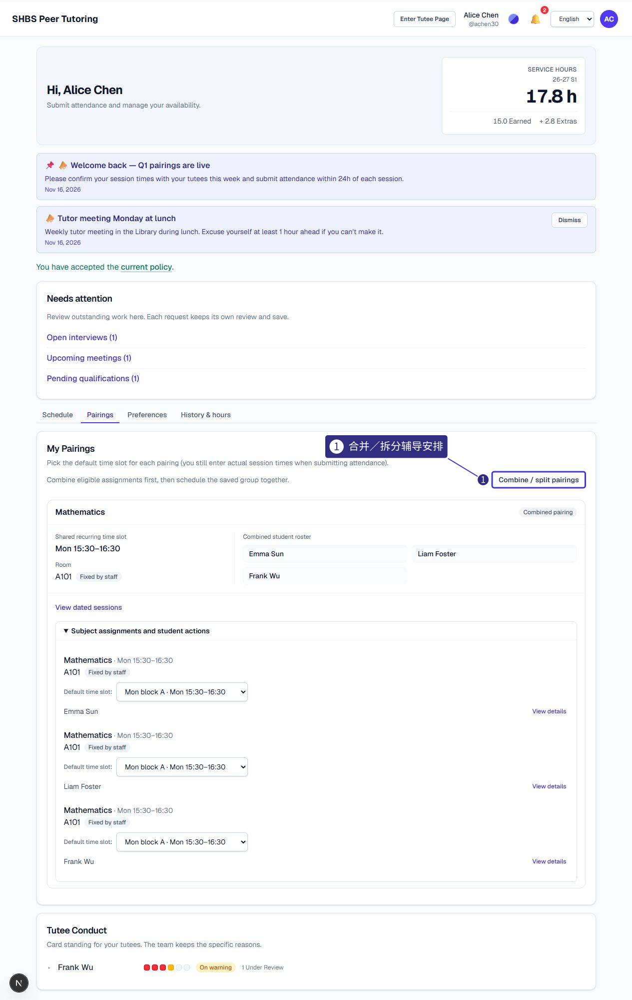

   英文界面

   

   
截图详情

   从“我的配对”打开明确的合并／拆分编辑器

   /dashboard#tutor-pairings · EN · 2026-11-16

   [原始完整截图](assets/combine-split-pairings-step-1.en.jpg) · `589c055e4b1cf166b48b353bd619ac1982e5d9f6` · Latest-main development baseline 589c055e with the Help candidate; synthetic demonstration data.

   

2. **选择共享时间** 可保持等待排课，或选择一个共享目录时段；仅在保留已确认时间区间时使用明确保留时间选项。保存前核对学生、科目、时间及教室影响。

   请注意: 分组编辑器中已选分配、主要成员及共享时间

   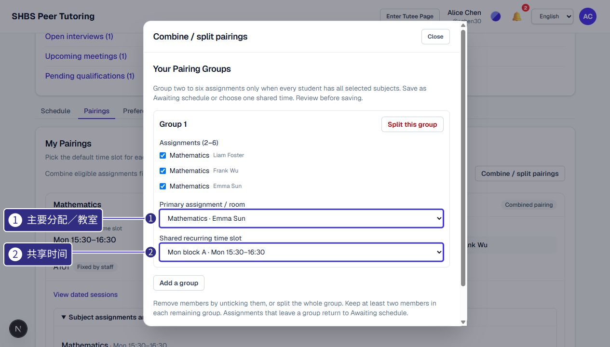

   英文界面

   

   
截图详情

   现有合并组：已选分配、主要教室来源及单一共享每周时间段

   /dashboard#tutor-pairings · EN · 2026-11-16

   [原始完整截图](assets/combine-split-pairings-step-2.en.jpg) · `589c055e4b1cf166b48b353bd619ac1982e5d9f6` · Latest-main development baseline 589c055e with the Help candidate; synthetic demonstration data.

   

3. **明确修复或拆分** 重新打开编辑器可添加或取消选中分配，或选择拆分此组。保留的每组至少需两名成员。退出组的分配保留学生、科目和教室，但返回等待排课，需另行安排。

   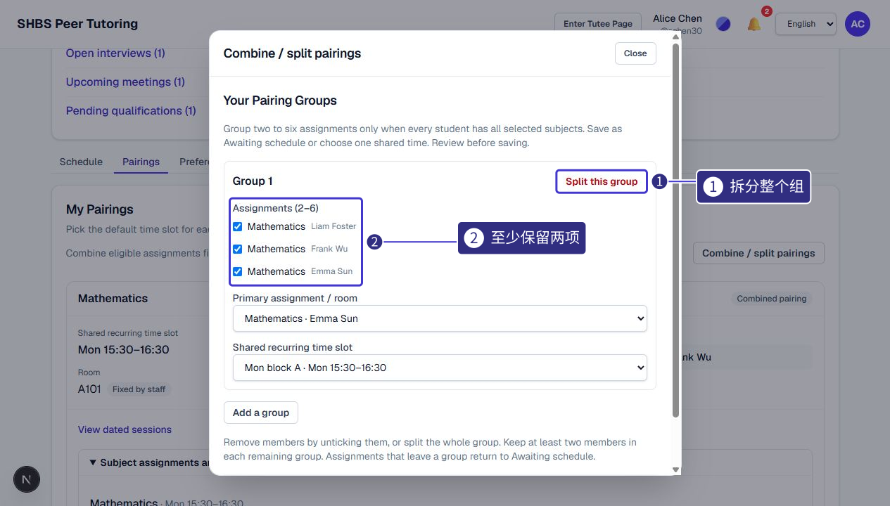

   英文界面

   

   
截图详情

   审核前现有合并组编辑器中的修复及拆分控件

   /dashboard#tutor-pairings · EN · 2026-11-16

   [原始完整截图](assets/combine-split-pairings-step-3.en.jpg) · `589c055e4b1cf166b48b353bd619ac1982e5d9f6` · Latest-main development baseline 589c055e with the Help candidate; synthetic demonstration data.

   

### 预期结果

我的配对显示有效共享教学块、修复后组或分别等待排课的分配。

### 工作原理

A化学与B化学可合并；若两名学生同时组合化学和数学，则必须已有四种学生科目关系。有效组计为一个工作量教学块。组变更影响未来计划，保留过去出勤、评分及学分；需要修复的组必须先修复或拆分，才能进行组合排课和出勤。

### 问题排查

- **保存因覆盖、时间或教室被拒** 使用返回修正选择。不能静默覆盖固定教室或独立教学块冲突。已存组改变时，成功读取后明确重新加载已存组以替换草稿；已存结果的重试仅刷新。

## 为已结束辅导课记录出勤

打开具体日期课次，如实记录实际情况并提交一次。

打开: `/dashboard#sessions`

### 开始之前

- 本人处于活跃状态并已接受当前辅导政策；课次已结束且尚未记录出勤。

### 操作步骤

1. **选择已结束课次** 在课表→待记录出勤中，打开具体课次的记录出勤。核对捕获的科目和学习伙伴，包括单独改期人员。不要借其他课次补录缺失历史。

   请注意: 标记待记录出勤的已结束课次

   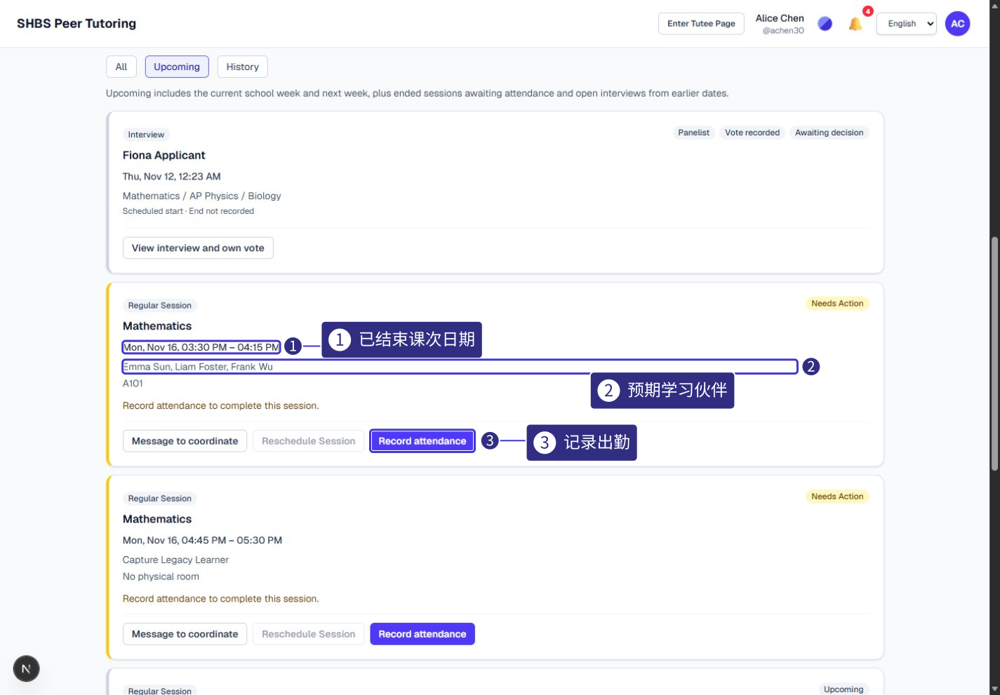

   英文界面

   

   
截图详情

   选择日期与学习伙伴名单正确的已结束数学课次。“记录出勤”会打开该课次表单。

   /dashboard#sessions · EN · 2026-11-21

   [原始完整截图](assets/record-attendance-step-1.en.jpg) · `b5ece465681957c9fe579d26babdeb260c674fa0` · Latest-main development baseline b5ece465, selected 2026-11-20, with the Help candidate and synthetic demo records.

   

2. **记录实际时间与地点** 确认实际起止时间、教室或线上。计划课次为四十五分钟，但出勤记录实际时长。阅读任何教室冲突提示；如实历史记录不会预订未来冲突教室。

   请注意: 实际时间、地点及出勤行

   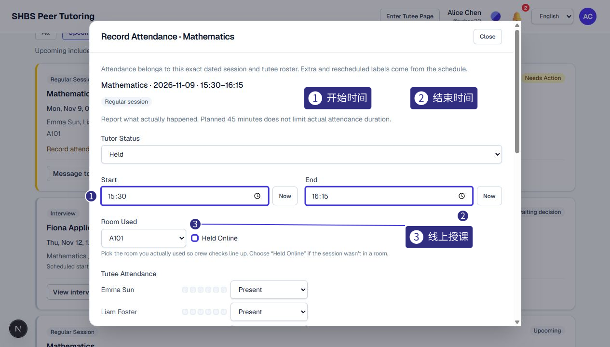

   英文界面

   

   
截图详情

   出勤表：准确已结束课次的实际时间、教室及线上模式

   /dashboard · EN · 2026-11-16

   [原始完整截图](assets/record-attendance-step-2.en.jpg) · `589c055e4b1cf166b48b353bd619ac1982e5d9f6` · Latest-main development baseline 589c055e with the Help candidate; synthetic demonstration data.

   

3. **填写每人的出勤** 填写本人及每位学生实际出勤。提供所需缺席或请假原因、评论、课次评分及纪律卡申请原因。组合课次中不同学生各计一次，并保留捕获科目。

   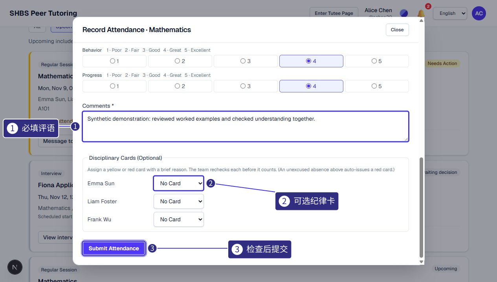

   英文界面

   

   
截图详情

   提交前滚动至出勤评价、评语及可选纪律卡区域

   /dashboard · EN · 2026-11-16

   [原始完整截图](assets/record-attendance-step-3.en.jpg) · `589c055e4b1cf166b48b353bd619ac1982e5d9f6` · Latest-main development baseline 589c055e with the Help candidate; synthetic demonstration data.

   

4. **提交并查看回执** 提交一次并查看保存回执。已接受记录会锁定；再次提交入口用于新记录。总数刷新失败时使用重试刷新。已存记录或未计划历史课次的更正需联系管理团队。

   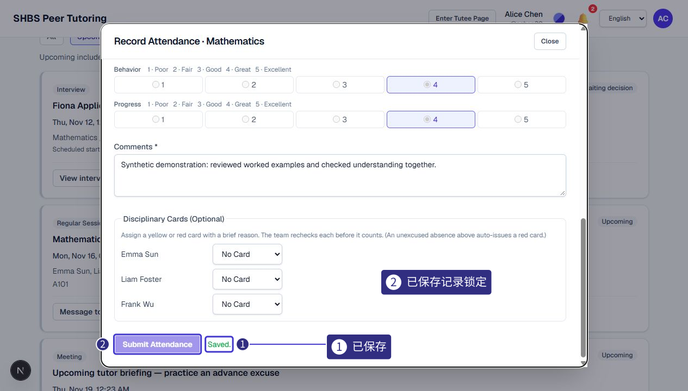

   英文界面

   

   
截图详情

   计划课次出勤已保存：已接受表单锁定并显示保存成功

   /dashboard · EN · 2026-11-16

   [原始完整截图](assets/record-attendance-step-4.en.jpg) · `589c055e4b1cf166b48b353bd619ac1982e5d9f6` · Latest-main development baseline 589c055e with the Help candidate; synthetic demonstration data.

   

### 预期结果

指定课次保存一条出勤记录及其计算结果。

### 工作原理

相同重试不会再次计时；保存后修改答案需更正流程。移动时间不能创建重复出勤。相邻不重叠课次允许分别记录。加课或改期标签来自课表，而非出勤复选框。

### 问题排查

- **另一课次已有草稿** 切换前继续原草稿或明确放弃。关闭表单会在本次访问保留草稿。提交结果不明确时，先查看保存结果再重试。

## 改期或新增加课

发送协商提议前，核对具体人员、时间及教室。

打开: `/dashboard#sessions`

### 开始之前

- 本人拥有符合条件的当前配对，且相关课次仍可安排。

### 操作步骤

1. **打开课次操作** 在课表中选择改期或新增加课。常规课因无辅导通知而暂停时，可选择安排例外辅导，为受影响学习伙伴提议需明确约定的日期例外。必要时先发送协调消息；聊天不等于正式接受课表变更。

   请注意: 课次操作菜单与具体日期事件

   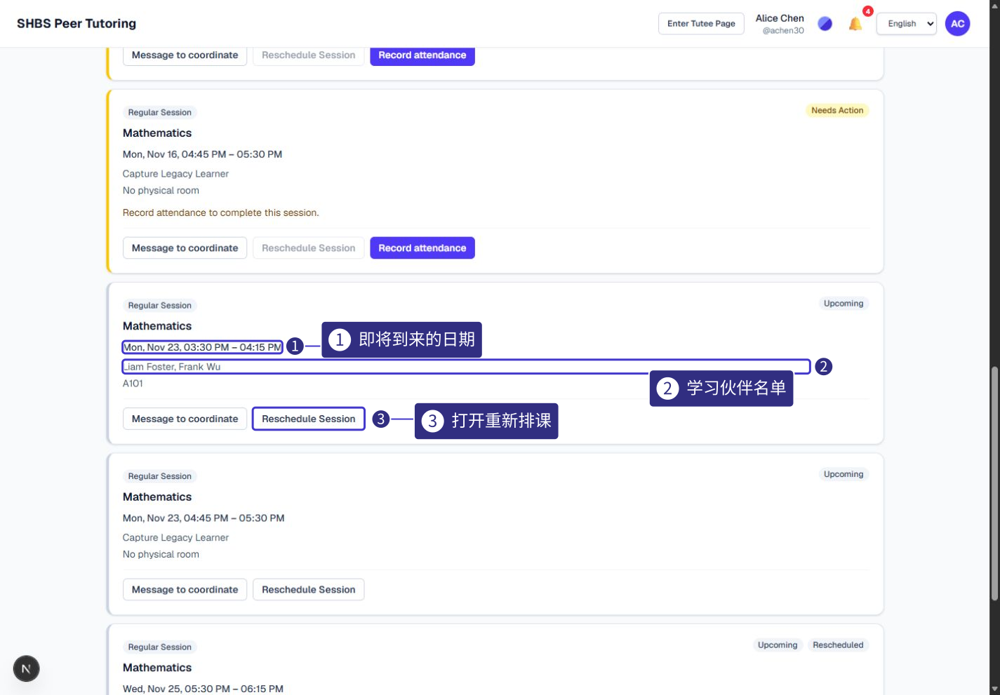

   英文界面

   

   
截图详情

   选择即将到来的数学课日期，核对包含的学习伙伴，再从该日期课次打开“重新排课”。

   /dashboard#sessions · EN · 2026-11-21

   [原始完整截图](assets/plan-dated-session-step-1.en.jpg) · `b5ece465681957c9fe579d26babdeb260c674fa0` · Latest-main development baseline b5ece465, selected 2026-11-20, with the Help candidate and synthetic demo records.

   

2. **选择范围、时间与方式** 可保留包含本课所有学习伙伴，或取消勾选后选一人。选择线下自动分配教室或线上。修改起止时间时，计划时长仍保持四十五分钟。

   请注意: 提议编辑器中的学习伙伴范围、日期时间及线下或线上方式

   **视图 1**

   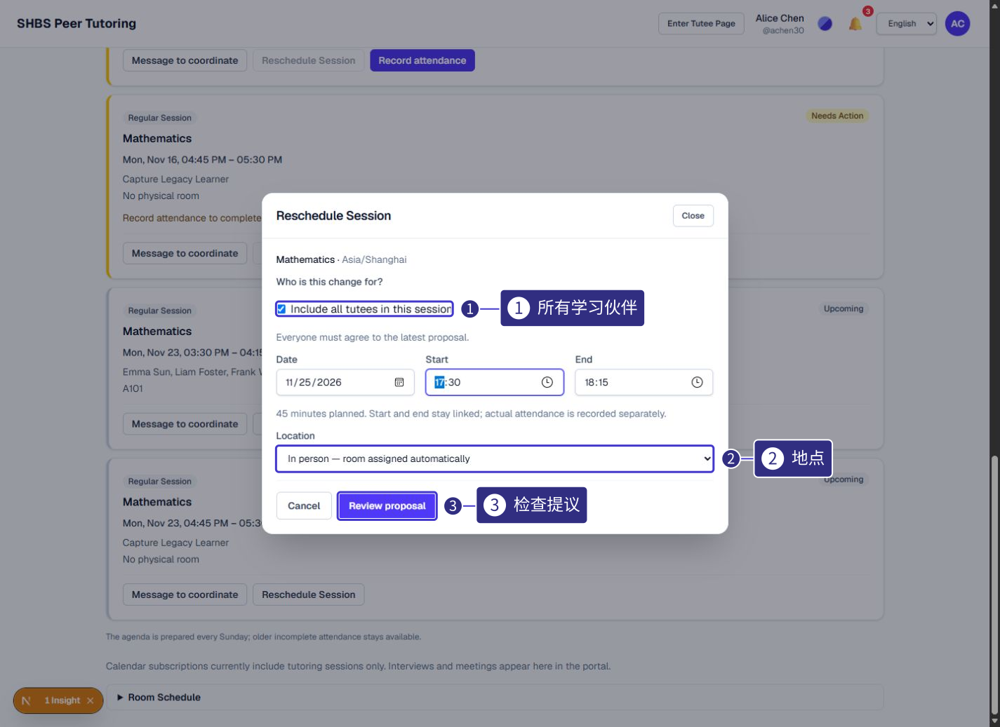

   英文界面

   

   
截图详情

   勾选包含所有学习伙伴以选择该日期的数学小组。设置日期和开始时间，核对联动的四十五分钟结束时间，再选择地点。

   /dashboard · EN · 2026-11-20

   [原始完整截图](assets/plan-dated-session-step-2.en.jpg) · `b5ece465681957c9fe579d26babdeb260c674fa0` · Latest-main development baseline b5ece465, selected 2026-11-20, with the Help candidate and synthetic demo records.

   

   **视图 2**

   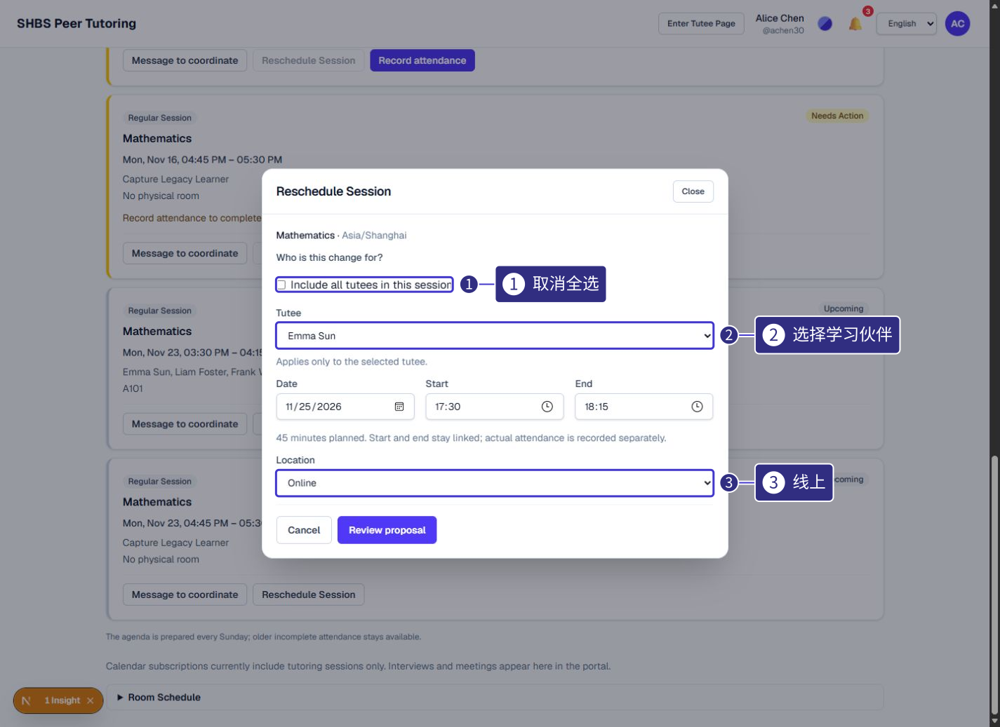

   英文界面

   

   
截图详情

   如只为一位学习伙伴提议，请取消包含所有人并选择准确对象。线上是单独的地点选项。

   /dashboard · EN · 2026-11-20

   [原始完整截图](assets/plan-dated-session-step-2-view-2.en.jpg) · `b5ece465681957c9fe579d26babdeb260c674fa0` · Latest-main development baseline b5ece465, selected 2026-11-20, with the Help candidate and synthetic demo records.

   

3. **检查可用情况和教室** 选择检查，并在发送前查看分配教室。检查不会预订；教室变为不可用时须编辑后重新检查。系统不会静默更换已审核教室或转为线上。

   **视图 1**

   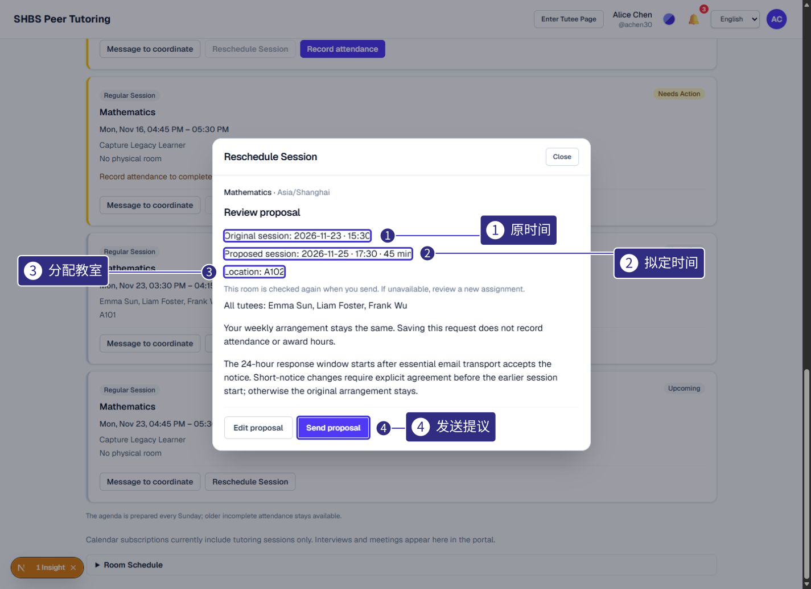

   英文界面

   

   
截图详情

   检查会比较原时间与小组拟定时间，并显示分配教室。发送提议时会再次检查教室。

   /dashboard · EN · 2026-11-20

   [原始完整截图](assets/plan-dated-session-step-3.en.jpg) · `b5ece465681957c9fe579d26babdeb260c674fa0` · Latest-main development baseline b5ece465, selected 2026-11-20, with the Help candidate and synthetic demo records.

   

   **视图 2**

   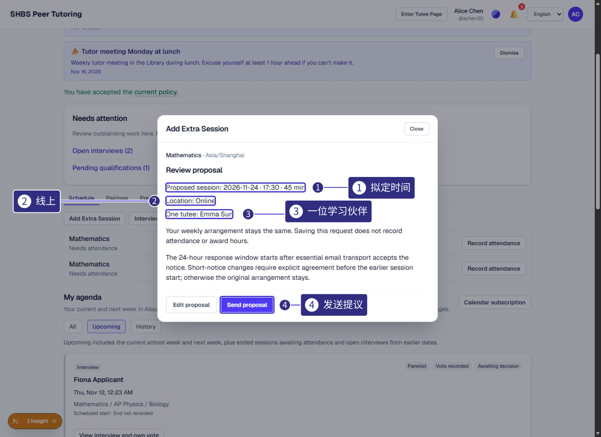

   英文界面

   

   
截图详情

   单独检查此单人加课。已检查的提议会显示拟定日期、线上地点，并表明艾玛是唯一的学习伙伴。

   /dashboard · EN · 2026-11-20

   [原始完整截图](assets/plan-dated-session-step-3-view-2.en.jpg) · `b5ece465681957c9fe579d26babdeb260c674fa0` · Latest-main development baseline b5ece465, selected 2026-11-20, with the Help candidate and synthetic demo records.

   

4. **发送并跟进同意情况** 发送核对后的提议，并检查必需邮件投递及各人回应。使用此建议可将完全一致的当前学习伙伴建议正式化。单人改期可接受其替代时间，或拒绝并提供一次最终提议。小组显示已申请单独改期时，选择开始个人申请，核对并确认受影响人员，再分别跟进各人申请。申请单独改期期间小组倒计时停止，每周配对组仍保留。

   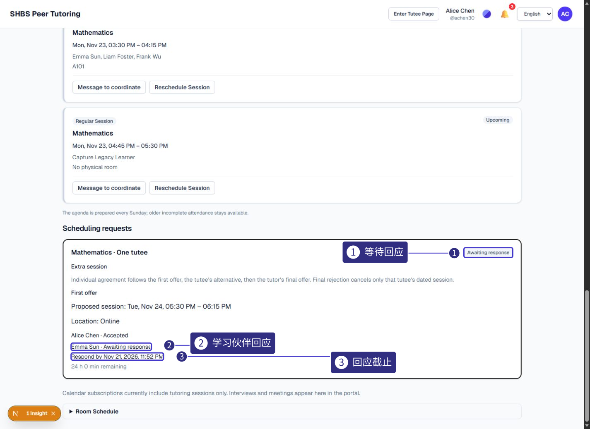

   英文界面

   

   
截图详情

   发送后打开排课申请。加课正在等待艾玛回应，显示的截止时间在必需邮件投递后开始。

   /dashboard · EN · 2026-11-20

   [原始完整截图](assets/plan-dated-session-step-4.en.jpg) · `b5ece465681957c9fe579d26babdeb260c674fa0` · Latest-main development baseline b5ece465, selected 2026-11-20, with the Help candidate and synthetic demo records.

   

### 预期结果

日期课表先显示提议，再显示最终有效的已约定、过期或取消结果。

### 工作原理

改期改变具体日期安排；加课保留常规课。二十四小时自动接受窗口仅在邮件传输接受必需通知后开始。短窗口需在较早开始前明确同意；课次开始后才处理的延迟情况需审核，不会追溯改课。

添加额外辅导会打开来源选择器，显示实际每周配对时段；点击选择辅导继续。符合条件的暂停来源会在此提供安排例外辅导。完全暂停或取消的约定不再显示于近期；可在全部或历史中检查保留的取消证据。这些控件不会改变私密日历订阅设置。

### 问题排查

- **邮件失败或回应窗口不足** 检查投递状态并重试符合条件的投递，再查看页面确认结果。没有有效窗口时不要将沉默视为接受。除其他有效变更取消外，过期会保留原课。

## 申请取消已约定加课

核对受影响的具体日期安排，并等待同意。

打开: `/dashboard#sessions`

### 开始之前

- 加课已约定、尚未开始且未记录出勤。

### 操作步骤

1. **找到已约定加课** 在课表打开加课卡并选择取消加课。可用全部查找两周即将发生窗口之外的加课，包括已改期加课。

   请注意: 已约定加课卡与取消加课

   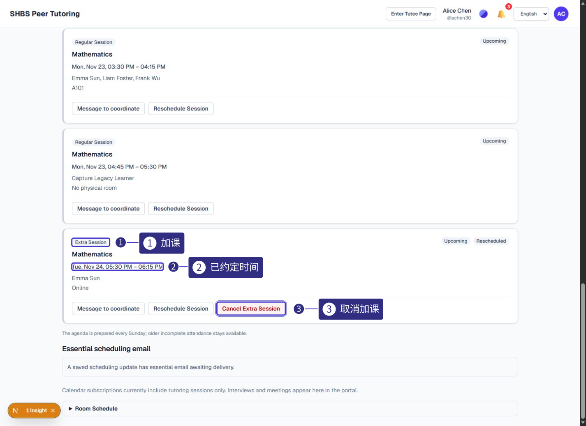

   英文界面

   

   
截图详情

   找到准确日期、学习伙伴的已安排加课。在该卡片上打开取消加课。

   /dashboard#sessions · EN · 2026-11-20

   [原始完整截图](assets/cancel-extra-session-step-1.en.jpg) · `b5ece465681957c9fe579d26babdeb260c674fa0` · Latest-main development baseline b5ece465, selected 2026-11-20, with the Help candidate and synthetic demo records.

   

2. **核对参与者** 选择所有当前学习伙伴或一人，然后核对具体日期、时间及人员。提交前关闭或取消不会发送任何内容。只发送核对后的取消申请。

   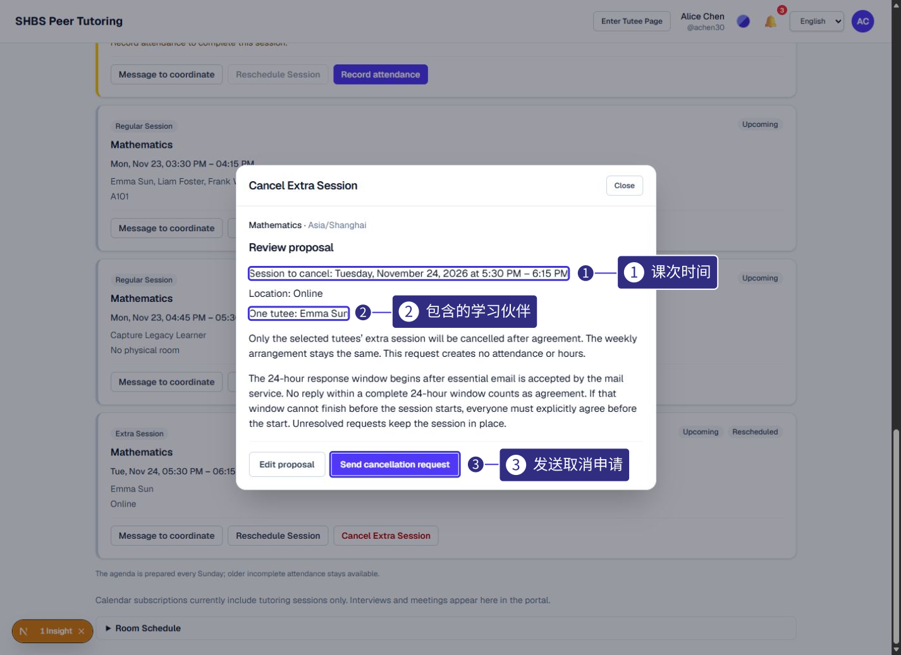

   英文界面

   

   
截图详情

   在检查提议中核对加课的准确日期、时间与学习伙伴。发送取消申请会为该加课创建同意申请。

   /dashboard#sessions · EN · 2026-11-20

   [原始完整截图](assets/cancel-extra-session-step-2.en.jpg) · `b5ece465681957c9fe579d26babdeb260c674fa0` · Latest-main development baseline b5ece465, selected 2026-11-20, with the Help candidate and synthetic demo records.

   

3. **检查同意情况与结果** 每位包含的学习伙伴可接受或拒绝取消。按必需邮件回应规则达成同意前，加课仍在课表中。应区分申请保存与真正取消。

   **视图 1**

   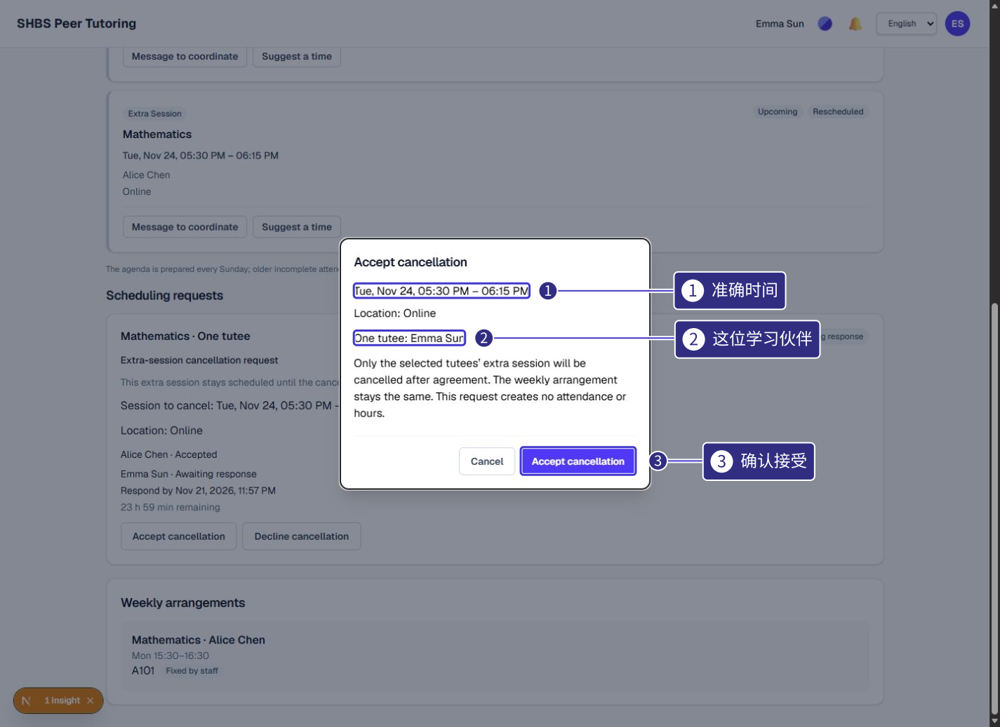

   英文界面

   

   
截图详情

   在学习伙伴的接受取消检查中，确认准确的日期加课及唯一参与者。回应后在课表中查看保存结果。

   /student?view=schedule · EN · 2026-11-20

   [原始完整截图](assets/cancel-extra-session-step-3.en.jpg) · `b5ece465681957c9fe579d26babdeb260c674fa0` · Latest-main development baseline b5ece465, selected 2026-11-20, with the Help candidate and synthetic demo records.

   

   **视图 2**

   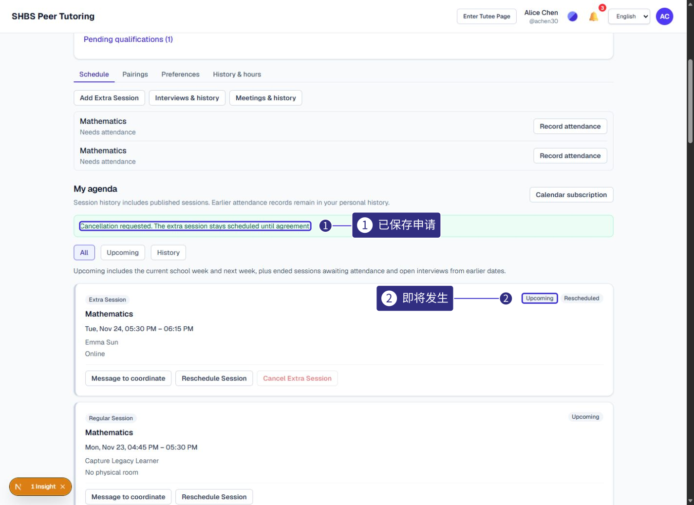

   英文界面

   

   
截图详情

   导师看到取消申请回执，同时同一加课仍显示为即将发生。仍在等待同意。

   /dashboard#sessions · EN · 2026-11-20

   [原始完整截图](assets/cancel-extra-session-step-3-view-2.en.jpg) · `b5ece465681957c9fe579d26babdeb260c674fa0` · Latest-main development baseline b5ece465, selected 2026-11-20, with the Help candidate and synthetic demo records.

   

   **视图 3**

   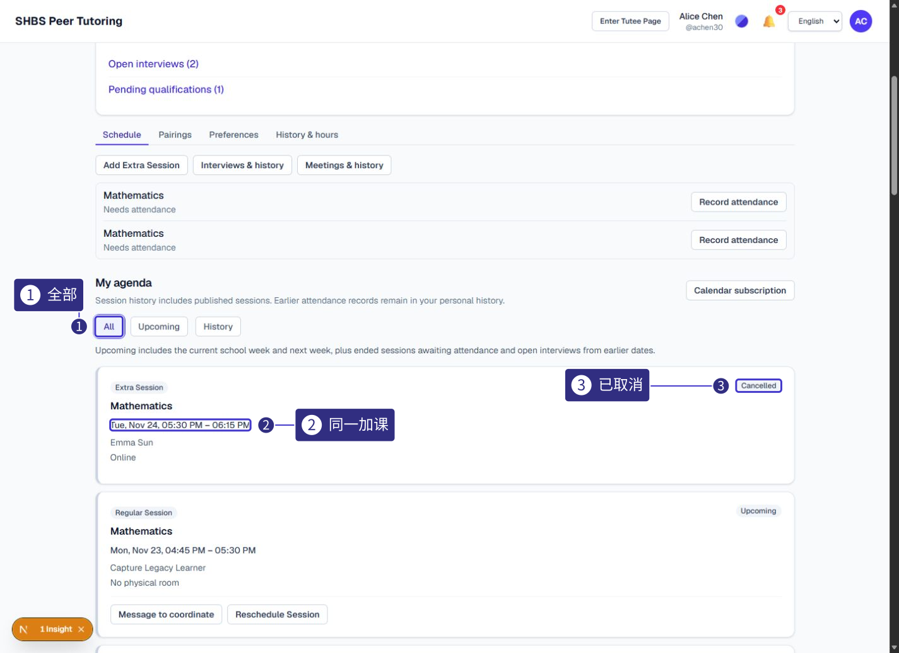

   英文界面

   

   
截图详情

   学习伙伴同意后，在导师课表选择全部，找到同一日期加课及其实际已取消标记。

   /dashboard#sessions · EN · 2026-11-20

   [原始完整截图](assets/cancel-extra-session-step-3-view-3.en.jpg) · `b5ece465681957c9fe579d26babdeb260c674fa0` · Latest-main development baseline b5ece465, selected 2026-11-20, with the Help candidate and synthetic demo records.

   

### 预期结果

所需同意达成后，仅取消选定日期的加课安排。

### 工作原理

拒绝或过期会保留课次。此申请没有替代时间或单独改期步骤，并保留其他成员、每周配对组及常规课。

### 问题排查

- **操作缺失或刷新失败** 检查加课已约定、尚未开始且无出勤。申请保存后用只读刷新，不要重复发送取消。已发生课次请管理团队审核出勤更正。

## 进行面试投票或履行主席职责

检查申请、提交本人投票，并区分决定与已记录时数。

打开: `/dashboard#sessions`

### 开始之前

- 本人为已分配的合格面试委员。排期及最终决定要求所选管理员／负责人辅导伙伴主席；申请人不能自评。

### 操作步骤

1. **打开面试工作** 在课表中打开分配的面试，查看申请科目及资质说明。主席也可打开待主持面试；已完成记录位于折叠历史区域。

   请注意: 面试卡、投票状态及操作

   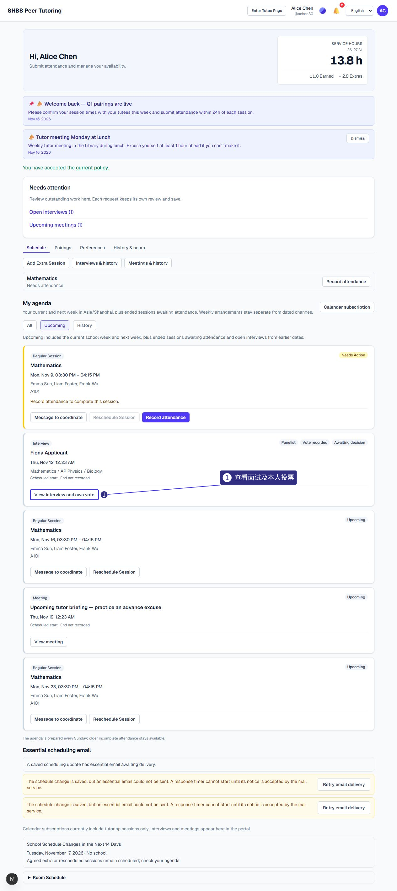

   英文界面

   

   
截图详情

   最新main辅导伙伴首页：置顶及普通公告、任务面板和具体日期日程

   /dashboard · EN · 2026-11-16

   [原始完整截图](assets/tutor-interviews-step-1.en.jpg) · `589c055e4b1cf166b48b353bd619ac1982e5d9f6` · Latest-main development baseline 589c055e with the Help candidate; synthetic demonstration data.

   

2. **提交本人的投票** 阅读申请证据，通过现有控件记录本人投票。检查已投票／等待决定。最终决定前每位委员必须投票；仅打开或排期不会计时。

   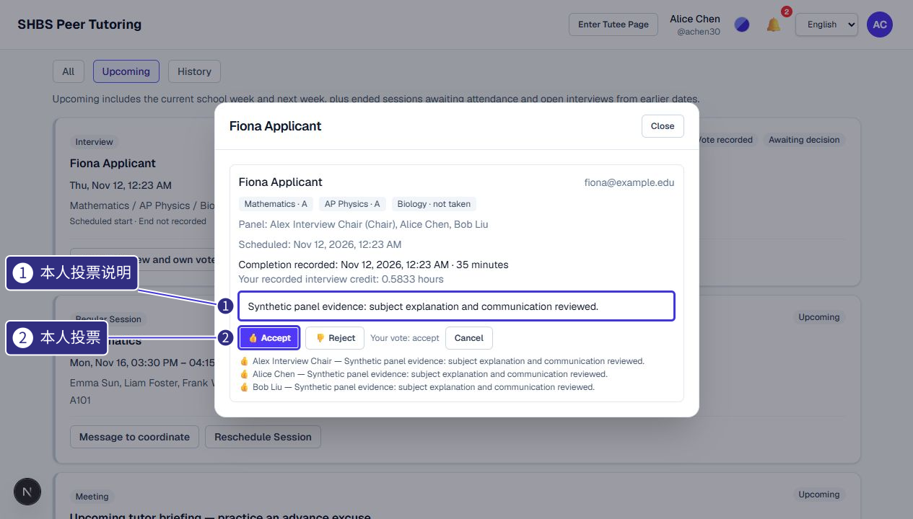

   英文界面

   

   
截图详情

   面试小组成员详情：可选投票评语及本人已记录投票

   /dashboard · EN · 2026-11-16

   [原始完整截图](assets/tutor-interviews-step-2.en.jpg) · `589c055e4b1cf166b48b353bd619ac1982e5d9f6` · Latest-main development baseline 589c055e with the Help candidate; synthetic demonstration data.

   

3. **主席：排期并决定** 获授权主席安排面试，并在全部投票后依据多数意见记录结果，平票时作出决定。批准时填写实际完成时间、分钟数及出席委员，再检查批准并授予时数。

   **视图 1**

   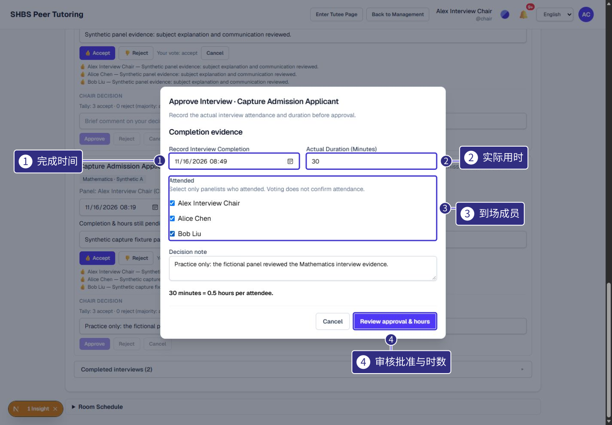

   英文界面

   

   
截图详情

   指定主持人在练习批准草稿中填写完成时间、用时及实际到场人员。“审核批准与时数”会打开最终影响审核。

   /dashboard#sessions · EN · 2026-11-20

   [原始完整截图](assets/tutor-interviews-step-3.en.jpg) · `b5ece465681957c9fe579d26babdeb260c674fa0` · Latest-main development baseline b5ece465, selected 2026-11-20, with the Help candidate and synthetic demo records.

   

   **视图 2**

   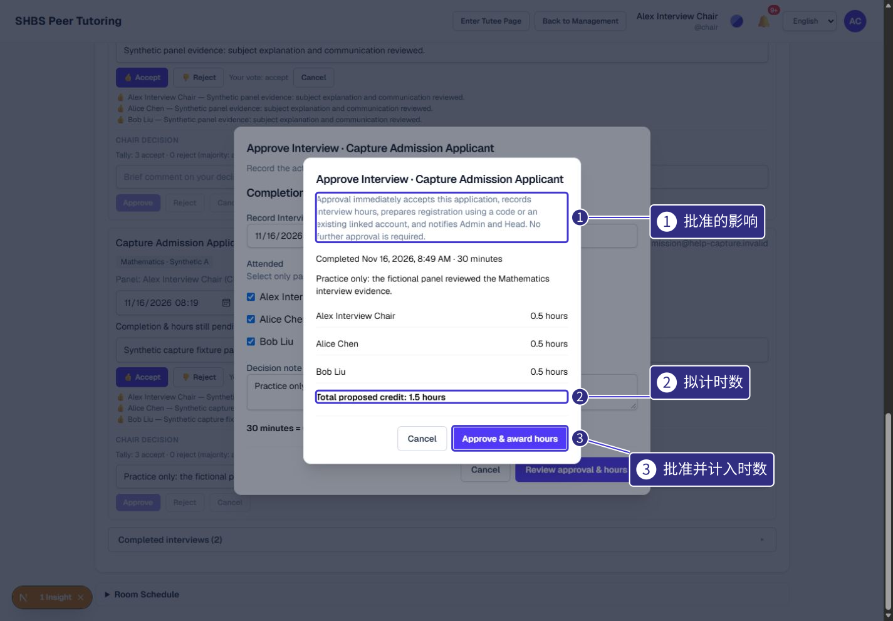

   英文界面

   

   
截图详情

   首次申请的最终批准审核显示拟计 1.5 小时，以及录取、注册及通知的影响。尚未点击确认。

   /dashboard#sessions · EN · 2026-11-20

   [原始完整截图](assets/tutor-interviews-step-3-view-2.en.jpg) · `b5ece465681957c9fe579d26babdeb260c674fa0` · Latest-main development baseline b5ece465, selected 2026-11-20, with the Help candidate and synthetic demo records.

   

4. **检查完成后续** 分别检查保存决定及完成记录。录取、面试计时和初次邀请设置可一并生效；新增资质授予科目但不创建新注册码。完成信息或时数更正请管理团队通过面试记录处理。

   **视图 1**

   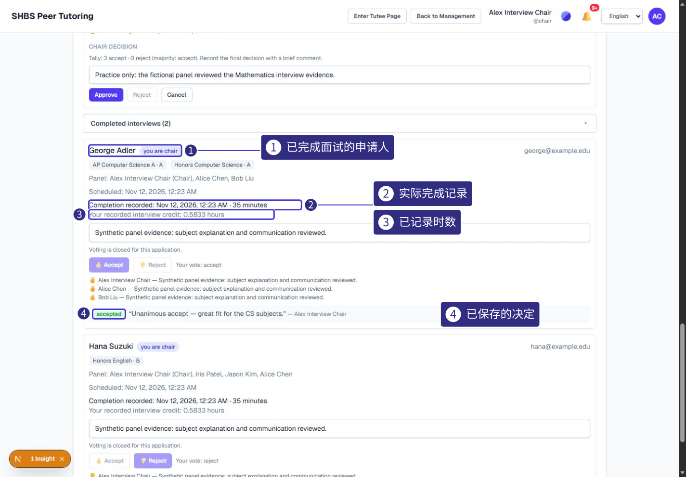

   英文界面

   

   
截图详情

   George 的已完成面试卡片显示已保存的录取决定，以及独立记录的 35 分钟完成信息和本人面试时数。

   /dashboard#sessions · EN · 2026-11-20

   [原始完整截图](assets/tutor-interviews-step-4.en.jpg) · `b5ece465681957c9fe579d26babdeb260c674fa0` · Latest-main development baseline b5ece465, selected 2026-11-20, with the Help candidate and synthetic demo records.

   

   **视图 2**

   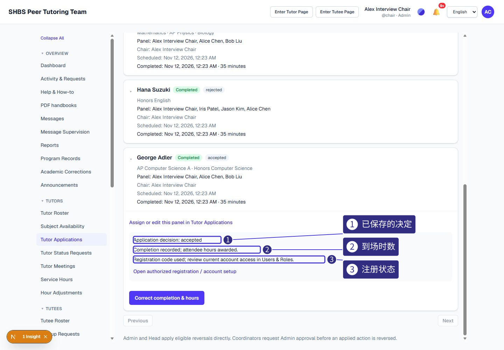

   英文界面

   

   
截图详情

   “面试记录”显示 George 已录取、到场面试时数已计入，以及单独的注册码已使用状态。页面没有显示注册码。

   /admin/applications#interview-records · EN · 2026-11-20

   [原始完整截图](assets/tutor-interviews-step-4-view-2.en.jpg) · `b5ece465681957c9fe579d26babdeb260c674fa0` · Latest-main development baseline b5ece465, selected 2026-11-20, with the Help candidate and synthetic demo records.

   

### 预期结果

本人投票已保存，或获授权主席最终决定及实际出席时数已记录。

### 工作原理

协调员可作为委员投票，但不能担任主席。缺少主席或主席降职时，新排期、决定及首次完成受阻，需管理团队修正面试组；已有历史完成更正保留原主席。面试已完成仍可能等待投票或决定。

### 问题排查

- **决定被阻止** 检查全部投票、有效活跃委员、科目资质及当前管理员／负责人主席。申请人权限限制可能需单独管理恢复；重复批准不能绕过。

## 查看会议并申请请假

查看当前及历史出勤，并在期限前提交或取消请假。

打开: `/dashboard#sessions`

### 开始之前

- 会议属于本人辅导伙伴课表，且请假截止时间未过。

### 操作步骤

1. **打开会议** 在课表中选择会议卡，查看日期、项目时区和出勤或请假状态。等待工作人员记录出勤的会议不要求本人自行登记。

   请注意: 会议卡及请假状态

   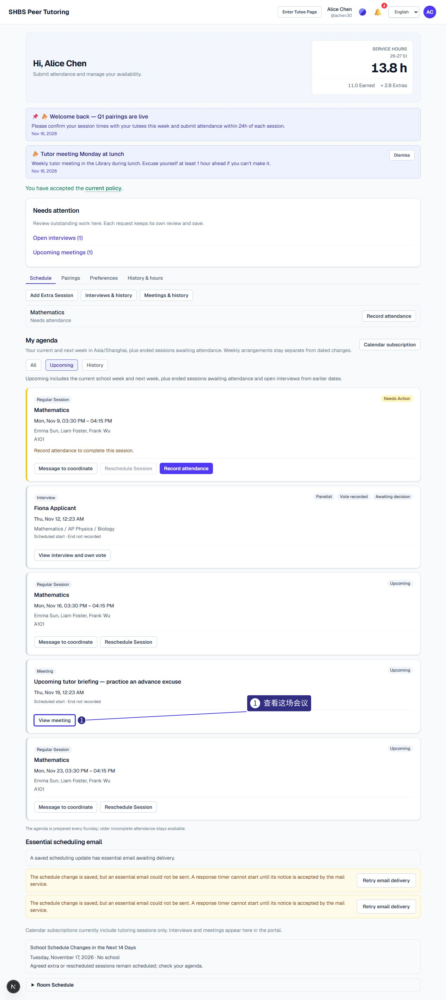

   英文界面

   

   
截图详情

   最新main辅导伙伴首页：置顶及普通公告、任务面板和具体日期日程

   /dashboard · EN · 2026-11-16

   [原始完整截图](assets/tutor-meetings-step-1.en.jpg) · `589c055e4b1cf166b48b353bd619ac1982e5d9f6` · Latest-main development baseline 589c055e with the Help candidate; synthetic demonstration data.

   

2. **提交或取消请假** 使用请假操作，填写所需原因，并至少在会议开始前六十分钟确认。同一期限前可取消本人符合条件的请假。工作人员记录的状态需由工作人员更正。

   **视图 1**

   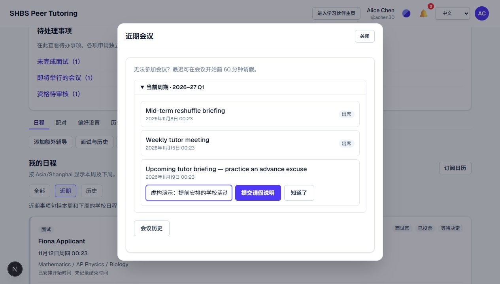

   

   
截图详情

   布局修复后的中文桌面会议请假，尚未提交

   /dashboard · ZH · 2026-11-16

   [原始完整截图](assets/tutor-meetings-step-2.zh.jpg) · `589c055e4b1cf166b48b353bd619ac1982e5d9f6` · Latest-main development baseline 589c055e with the Help candidate; synthetic demonstration data.

   

   **视图 2**

   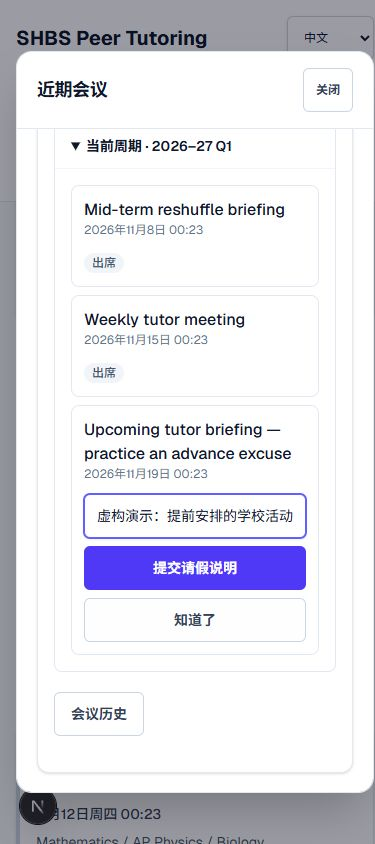

   

   
截图详情

   布局修复后的中文手机会议请假：所有操作均位于对话框内

   /dashboard · ZH · 2026-11-16

   [原始完整截图](assets/tutor-meetings-step-2-view-2.zh.jpg) · `589c055e4b1cf166b48b353bd619ac1982e5d9f6` · Latest-main development baseline 589c055e with the Help candidate; synthetic demonstration data.

   

3. **查看会议历史** 打开会议历史，再选择学年／学季组查看已记录出勤。学期模式合并该学期两个学季。未记录时期会明确标示；记录于其他时期的未来会议单独呈现。

   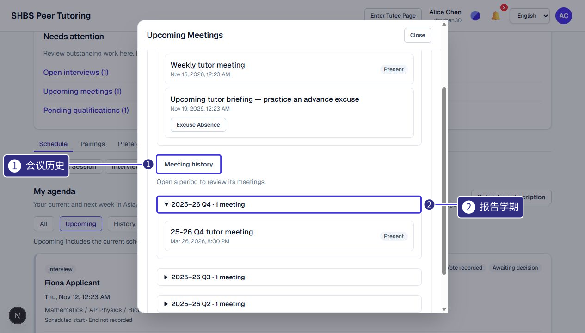

   英文界面

   

   
截图详情

   会议历史已展开至保留的学年／季度分组及出勤记录

   /dashboard#sessions · EN · 2026-11-16

   [原始完整截图](assets/tutor-meetings-step-3.en.jpg) · `589c055e4b1cf166b48b353bd619ac1982e5d9f6` · Latest-main development baseline 589c055e with the Help candidate; synthetic demonstration data.

   

### 预期结果

请假显示保存状态，或可读取历史会议出勤。

### 工作原理

每学期前三次无故会议缺席不自动扣时；之后每次扣零点二五小时。获准请假不占此额度。缺少出勤记录不代表缺席。

### 问题排查

- **时期分组改变或保存失败** 保存或读取失败后保留草稿并重试。已启用的学季／学期模式改变时，重新加载分组会明确要求确认放弃未保存草稿，并等待进行中的保存和刷新。

## 管理辅导参与并了解时数

申请或撤回资格变更、转达符合条件的退出，并分别检查时数来源。

打开: `/settings`

### 开始之前

- 本人有关联辅导档案；可用操作取决于当前参与状态及现有待处理申请。

### 操作步骤

1. **申请或撤回本人退出** 在账户设置打开退出，填写可选原因，核对申请并在三秒暂停后确认。工作人员获准在七天后批准；批准前继续参与。待审申请可通过独立撤回控件取消。

   请注意: 辅导参与申请与待处理状态

   **视图 1**

   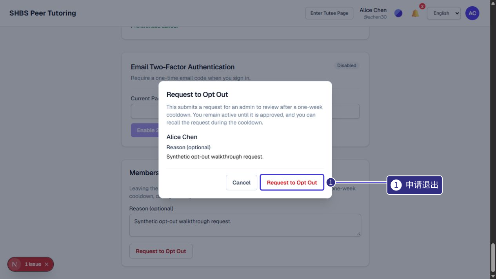

   英文界面

   

   
截图详情

   退出审核确认区显示导师、可选理由、七天审核冷却期，以及获批前继续参与的规则。

   /settings · EN · 2026-11-16

   [原始完整截图](assets/tutor-membership-hours-step-1.en.jpg) · `589c055e4b1cf166b48b353bd619ac1982e5d9f6` · Latest-main development baseline 589c055e with the Help candidate; synthetic demonstration data.

   

   **视图 2**

   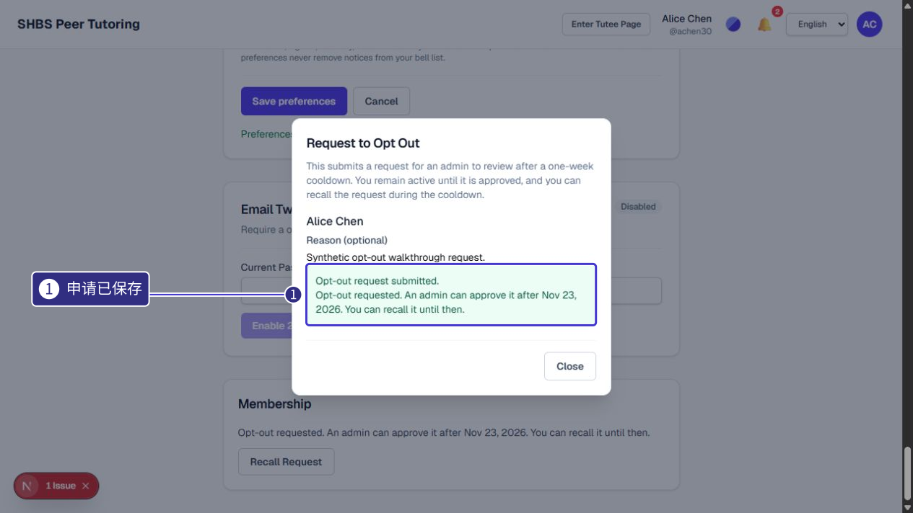

   英文界面

   

   
截图详情

   实际退出申请回执列明未来可批准日期及撤回期限，并不等于已获批准。

   /settings · EN · 2026-11-16

   [原始完整截图](assets/tutor-membership-hours-step-1-view-2.en.jpg) · `589c055e4b1cf166b48b353bd619ac1982e5d9f6` · Latest-main development baseline 589c055e with the Help candidate; synthetic demonstration data.

   

   **视图 3**

   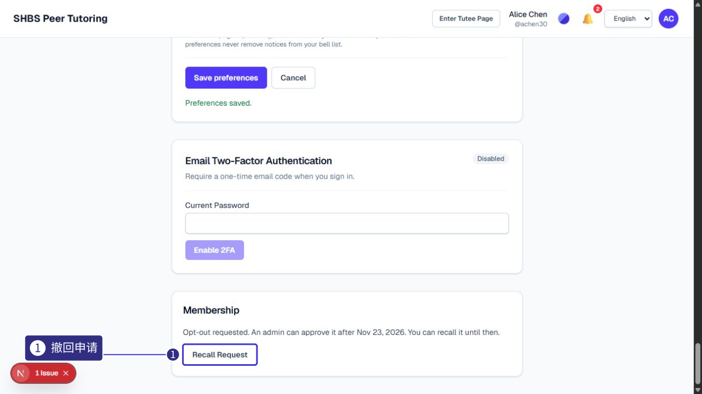

   英文界面

   

   
截图详情

   待批准退出申请显示实际可批准日期及独立撤回申请按钮，此时仍可参与。

   /settings · EN · 2026-11-16

   [原始完整截图](assets/tutor-membership-hours-step-1-view-3.en.jpg) · `589c055e4b1cf166b48b353bd619ac1982e5d9f6` · Latest-main development baseline 589c055e with the Help candidate; synthetic demonstration data.

   

2. **申请重新加入或确认新学期** 已退出辅导伙伴可申请重新加入，无七天等待，但仍需批准。同一时间仅允许一个待审资格申请。学期刷新后，待确认的继续参与者可在激活提示直接选择可参与或退出。

   **视图 1**

   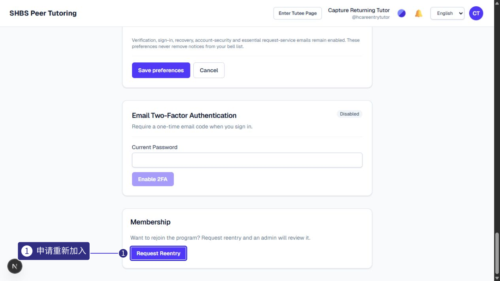

   英文界面

   

   
截图详情

   此独立已退出辅导账户在参与资格中看到申请重新加入。页面说明申请由管理员审核；按钮不会将辅导资格直接设为有效。

   /settings · EN · 2026-11-16

   [原始完整截图](assets/tutor-membership-hours-step-2.en.jpg) · `dd970ea426016e85cb514beeeab537c3ab2e5098` · Latest-main development baseline dd970ea4, selected 2026-11-16, with the Help candidate; synthetic demonstration data.

   

   **视图 2**

   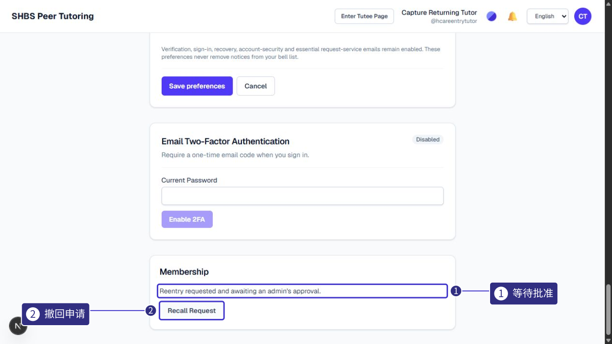

   英文界面

   

   
截图详情

   申请重新加入已立即提交，实际页面显示等待管理员批准。可使用撤回申请；辅导资格未激活，也未提交政策接受。

   /settings · EN · 2026-11-16

   [原始完整截图](assets/tutor-membership-hours-step-2-view-2.en.jpg) · `dd970ea426016e85cb514beeeab537c3ab2e5098` · Latest-main development baseline dd970ea4, selected 2026-11-16, with the Help candidate; synthetic demonstration data.

   

3. **仅转达符合条件学生的退出** 非问卷报名学生可在配对详情使用转达操作，填写可选原因并检查。七天撤回窗口后自动处理，除非撤回或取消。问卷学生应在本人页面申请整个时期退出；排课冲突使用独立审核。

   **视图 1**

   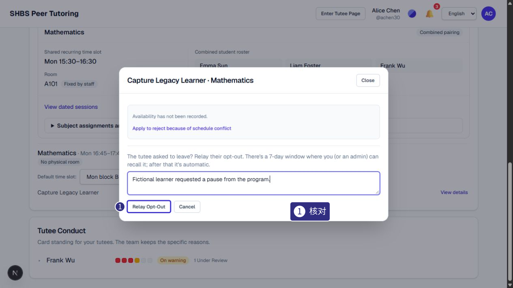

   英文界面

   

   
截图详情

   Alice 在非问卷登记的 Capture Legacy Learner 配对详情中填写可选转达原因；点击转达退出将打开核对确认，尚未提交。

   /dashboard#tutor-pairings · EN · 2026-11-16

   [原始完整截图](assets/tutor-membership-hours-step-3.en.jpg) · `dd970ea426016e85cb514beeeab537c3ab2e5098` · Latest-main development baseline dd970ea4, selected 2026-11-16, with the Help candidate; synthetic demonstration data.

   

   **视图 2**

   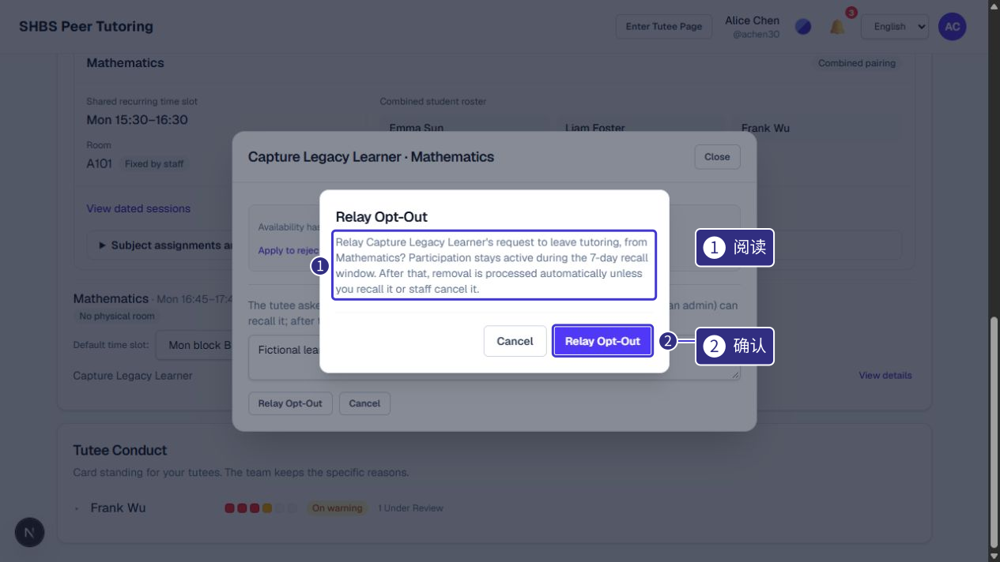

   英文界面

   

   
截图详情

   实际转达退出核对框列明 Capture Legacy Learner 与 Mathematics，说明参与状态在七天撤回期内仍保持活跃，并提供取消或最终转达退出；尚未提交。

   /dashboard#tutor-pairings · EN · 2026-11-16

   [原始完整截图](assets/tutor-membership-hours-step-3-view-2.en.jpg) · `dd970ea426016e85cb514beeeab537c3ab2e5098` · Latest-main development baseline dd970ea4, selected 2026-11-16, with the Help candidate; synthetic demonstration data.

   

   **视图 3**

   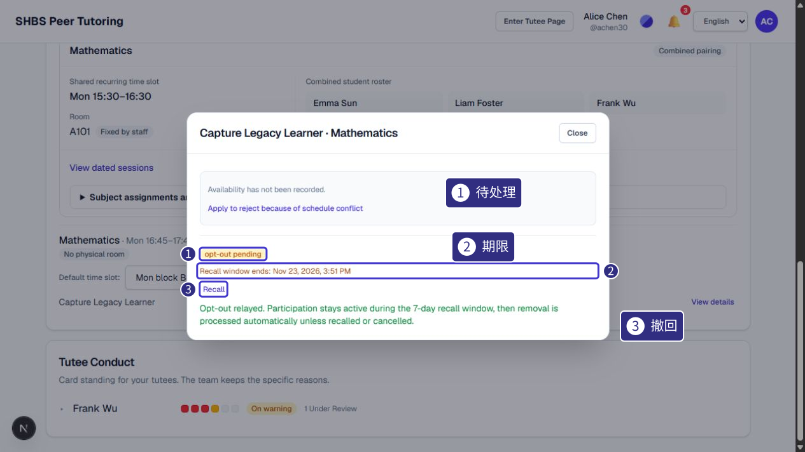

   英文界面

   

   
截图详情

   实际转达已提交一次；学习伙伴显示退出待处理，实际撤回期限为2026年11月23日下午3:51。回执说明七天窗口内参与状态保持活跃，且可撤回。

   /dashboard#tutor-pairings · EN · 2026-11-16

   [原始完整截图](assets/tutor-membership-hours-step-3-view-3.en.jpg) · `dd970ea426016e85cb514beeeab537c3ab2e5098` · Latest-main development baseline dd970ea4, selected 2026-11-16, with the Help candidate; synthetic demonstration data.

   

   **视图 4**

   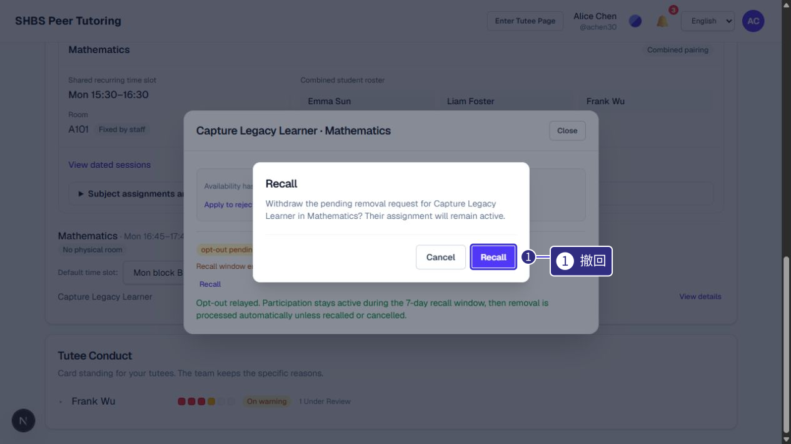

   英文界面

   

   
截图详情

   点击撤回后出现此实际确认框。核对学习伙伴与科目，再选择撤回以取消待处理移除，或选择取消以保留待处理申请；框内说明分配将保持活跃。

   /dashboard#tutor-pairings · EN · 2026-11-16

   [原始完整截图](assets/tutor-membership-hours-step-3-view-4.en.jpg) · `dd970ea426016e85cb514beeeab537c3ab2e5098` · Latest-main development baseline dd970ea4, selected 2026-11-16, with the Help candidate; synthetic demonstration data.

   

   **视图 5**

   

   英文界面

   

   
截图详情

   最终撤回操作已完成，实际已保存回执可见。待处理标记、期限与撤回操作均消失；可再次转达退出，学习伙伴仍在分配中。

   /dashboard#tutor-pairings · EN · 2026-11-16

   [原始完整截图](assets/tutor-membership-hours-step-3-view-5.en.jpg) · `dd970ea426016e85cb514beeeab537c3ab2e5098` · Latest-main development baseline dd970ea4, selected 2026-11-16, with the Help candidate; synthetic demonstration data.

   

4. **检查历史与时数** 查看报告时期、辅导获得时数、额外时数和扣除。检查课次、面试、会议扣时及手动调整。巡查时数单独计算，不包含在辅导总时数内。

   请注意: 所选时期及获得、额外、扣除时数

   

   英文界面

   

   
截图详情

   保留的辅导历史详情区分已存课次学时、会议记录及人工调整

   /dashboard#tutor-history · EN · 2026-11-16

   [原始完整截图](assets/tutor-membership-hours-step-4.en.jpg) · `589c055e4b1cf166b48b353bd619ac1982e5d9f6` · Latest-main development baseline 589c055e with the Help candidate; synthetic demonstration data.

   

### 预期结果

资格申请显示待审或决定状态，时数可追溯至记录来源。

### 工作原理

提交回执不会立即结束参与。若处理前项目刷新或原分配删除，过时学生转达会取消。历史出勤按记录政策计时；手动调整与巡查计时仍为独立证据。

### 问题排查

- **时数或资格与预期不符** 检查时期、实际保存出勤、调整及审核决定。请管理团队核对准确来源记录。申请成功但刷新失败时使用重试刷新，不要重复申请。

## 阅读公告、教室课表及学习伙伴状态

查看共享项目信息，并尊重私人证据的访问限制。

打开: `/dashboard`

### 开始之前

- 使用本人辅导伙伴页面；可选区域取决于启用模块及相关记录。

### 操作步骤

1. **阅读发给本人的公告** 阅读本人工作区上方的公告卡片。置顶公告即使曾确认仍会保留，也没有收起按钮。普通公告提供收起按钮时可使用。定向公告使用发布时确定的受众，不能代他人确认。

   请注意: 辅导伙伴页面上方公告

   

   英文界面

   

   
截图详情

   最新main辅导伙伴首页：置顶及普通公告、任务面板和具体日期日程

   /dashboard · EN · 2026-11-16

   [原始完整截图](assets/tutor-program-information-step-1.en.jpg) · `589c055e4b1cf166b48b353bd619ac1982e5d9f6` · Latest-main development baseline 589c055e with the Help candidate; synthetic demonstration data.

   

2. **查看共享教室课表** 在辅导伙伴页面使用共享教室课表，查看公开计划教室安排。核对具体时间及教室详情，完成后关闭阅读器。此视图不会显示私人面试证据，也不会为本人预订教室。

   请注意: 提供时配对工具旁的共享教室课表

   

   英文界面

   

   
截图详情

   准确周一时间段的只读教室课表详情，包含不可用教室

   /dashboard#sessions · EN · 2026-11-16

   [原始完整截图](assets/tutor-program-information-step-2.en.jpg) · `589c055e4b1cf166b48b353bd619ac1982e5d9f6` · Latest-main development baseline 589c055e with the Help candidate; synthetic demonstration data.

   

3. **查看本人学习伙伴状态** 纪律历史可用时，可展开学习伙伴时间线，查看卡片颜色、日期及待处理或有效结果。辅导伙伴可见状态和结果，不能查看私人纪律原因。新纪律卡需通过相关出勤表单并提供真实原因申请。

   

   英文界面

   

   
截图详情

   展开的辅导伙伴可见纪律时间线：颜色、日期以及有效或待审核结果

   /dashboard#tutor-pairings · EN · 2026-11-16

   [原始完整截图](assets/tutor-program-information-step-3.en.jpg) · `589c055e4b1cf166b48b353bd619ac1982e5d9f6` · Latest-main development baseline 589c055e with the Help candidate; synthetic demonstration data.

   

4. **重新打开手册** 选择手册或当前政策，按界面语言阅读已发布辅导政策，无译文时使用英语。阅读不会签署新修订版；如提示，仍需完成独立参与政策审核。

   

   英文界面

   

   
截图详情

   从已接受政策提示重新打开的已发布辅导伙伴政策阅读器

   /dashboard#tutor-pairings · EN · 2026-11-16

   [原始完整截图](assets/tutor-program-information-step-4.en.jpg) · `589c055e4b1cf166b48b353bd619ac1982e5d9f6` · Latest-main development baseline 589c055e with the Help candidate; synthetic demonstration data.

   

5. **阅读共享给本人的反馈** 打开/student-support的学习伙伴支持。管理团队启用与辅导伙伴共享反馈后，可阅读本人已记录课次的反馈，并用上一页／下一页浏览。共享关闭或无法确认时，应遵循页面不可用或隐私提示，不要假定仍有访问权限。

   

   英文界面

   

   
截图详情

   管理团队未开启共享时的辅导伙伴反馈页面：明确显示隐私提示

   /student-support · EN · 2026-11-16

   [原始完整截图](assets/tutor-program-information-step-5.en.jpg) · `589c055e4b1cf166b48b353bd619ac1982e5d9f6` · Latest-main development baseline 589c055e with the Help candidate; synthetic demonstration data.

   

### 预期结果

了解当前公告、教室计划信息及允许查看的学习伙伴状态。

### 工作原理

可选纪律历史仅在成功读取为空后隐藏，加载失败时不会视为空。共享教室信息不授予管理教室选择权限；本人课程仍以分配课次为准。

### 问题排查

- **区域缺失或无法刷新** 检查模块是否启用，以及本人是否有定向公告或相关记录。读取失败时使用重试。状态错误请私下联系管理团队，不要从概览猜测隐藏原因。
